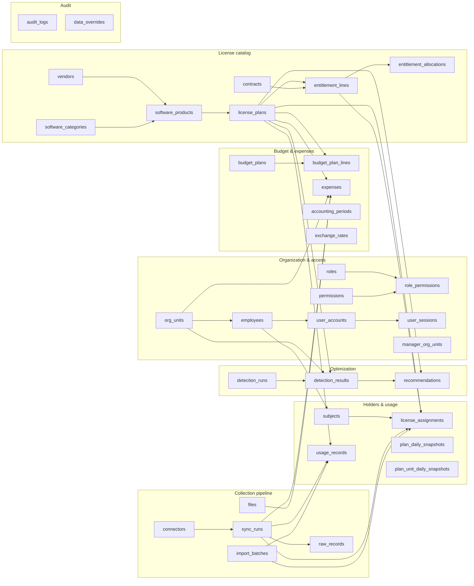
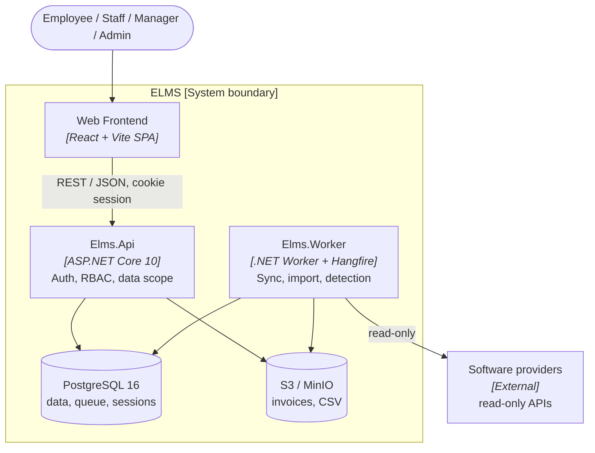

# Enterprise License Management System (ELMS) — team VFast

ELMS brings software licenses from every provider (Microsoft, Google, Adobe, JetBrains, Oracle, OpenAI, Anthropic, AWS, VPN, specialized software) and every license model into one place. It keeps the catalog, vendors, entitlements, contracts, and expenses; plans and monitors the license budget; detects unused, inactive, and overused licenses; turns them into recommendations with evidence; and shows everything on dashboards — **without ever assigning, revoking, or changing anything on a provider**.

## 1. Requirements — Research, Use Cases, and INVEST

Requirements are derived top-down: business problem → stakeholders → goals → license models and data sources → epics (mind map) → use cases → user stories. Each story is reviewed with INVEST and has Given/When/Then acceptance criteria.

### 1.1 Mind map


The map has five branches: **License Management** (catalog & entitlement), **Budget Management** (planning & cost allocation, spending & monitoring), **Optimization** (detection, savings & recommendation), **Analytics** (four dashboards), and **User & Organization**. Each of the 22 leaves is one use case (UC01–UC22, in branch order); UC23 View My Licenses and UC24 Login / Logout are self-service use cases every role has.

Editable source: [`docs/mindmap/vfast.xmind`](docs/mindmap/vfast.xmind) (open with XMind); `docs/mindmap.png` is exported from it.

### 1.2 Top-down problem analysis

License and usage data are scattered across each provider's admin portal, and every provider counts in its own unit: seats, sessions, devices, cores, tokens, or contract terms. Nobody can say what the company owns, who uses it, or how far reality is from the budget plan.

| Goal | Measured by |
|---|---|
| G1 Centralize licenses | Every license from every provider listed with vendor, model, quantity, cost, and expiry in one catalog |
| G2 Know who uses what | Every assigned seat has exactly one status: `Active`, `Inactive`, `No activity`, or `Not monitored` |
| G3 Measure automatically | License, assignment, and usage data refresh daily for providers with an API |
| G4 Express waste as money | Underutilized accounts and their annual cost on one screen |
| G5 Plan and reconcile the budget | Planned, Purchased, Assigned, Used, and Actual cost compared per unit and license |
| G6 Turn waste into savings | Every unused, inactive, or overused license becomes a recommendation with evidence and an estimated saving |
| G7 Trustworthy figures | Numbers match across screens; missing data is `Unknown`, never zero |

What makes this project different:

1. **One model for every license** — each license is a combination of three axes (measurement archetype, commercial term, collection method) and one of four archetypes: Allocation, Concurrent, Metered, Capacity.
2. **Budget reconciliation chain** — Planned → Purchased → Assigned → Used → Actual cost; each gap is a different problem with a different fix.
3. **Missing data is not guessed** — a failed sync is `Unknown`, never usage 0, so it never creates a false waste finding.
4. **Decisions stay with people** — every recommendation shows evidence and a saving, and a Manager accepts or rejects it; ELMS only reads from providers.

Full analysis, license-model research, data-source feasibility, scope, and risks: [Top-down research](docs/01-research-top-down.md).

### 1.3 Use cases

There are four roles. One diagram per actor shows every use case that actor can start; shared use cases (View My Licenses, Login / Logout) appear in each actor's diagram.

| Role | Use cases |
|---|---|
| **Employee** (every employee) | UC23 View My Licenses · UC24 Login / Logout |
| **Staff** (reports to a Manager; hands-on data entry) | UC01–UC04 License Management · UC07 Manage Expenses · UC23, UC24 |
| **Manager** (manager of a P&L or a department; plans and decides) | UC05, UC06, UC08, UC09 Budget · UC10–UC14 Optimization · UC15–UC18 Analytics · UC23, UC24 |
| **Admin** (system operator) | UC19–UC22 User & Organization (users, P&Ls and departments, roles, permissions) · UC23, UC24 |

| | |
|---|---|
|  |  |
|  |  |

Diagram sources are draw.io files in [`docs/diagrams/out/`](docs/diagrams/out/). Role × feature matrix, 18 business rules, and the specification of all 24 use cases: [Use cases](docs/02-use-cases.md).

### 1.4 Roles and permissions

There are four roles; each account has exactly one. Every account belongs to a real employee, matched by company email.

| Role | Who | Responsibility | Data scope |
|---|---|---|---|
| **Employee** | Every employee of the group | Sees the licenses assigned to them and whether they are recorded as used | Own licenses only, without price or cost |
| **Staff** | License management team member, reports to a Manager | Hands-on work: enters and corrects license data, holders and usage where there is no connector, and expenses | Every license and expense; no budget, no dashboards |
| **Manager** | Manager of a P&L (subsidiary) or a department | Plans the budget, monitors spending, reviews waste, decides on recommendations | Only the P&Ls or departments assigned to them |
| **Admin** | System operator | Users, P&Ls and departments, roles, permissions | Access settings only; no license, budget, or cost data |

| Capability | Admin | Manager | Staff | Employee |
|---|---|---|---|---|
| Software catalog, vendors | — | — | Create / edit | — |
| License entitlements, contracts | — | — | Create / edit | — |
| License holders and usage (where there is no connector) | — | — | Create / edit / import | — |
| Expenses and invoices | — | — | Create / edit / import | — |
| Budget plan | — | Create / edit, own units | — | — |
| Cost allocation, budget monitoring, forecast | — | Read, own units | — | — |
| Unused, inactive, overuse detection | — | Read, own units | — | — |
| Cost optimization, recommendations | — | Read / decide, own units | — | — |
| License, financial, compliance, optimization dashboards | — | Read, own units | — | — |
| Users, roles, permissions | Create / edit | — | — | — |
| P&Ls and departments | Create / edit | — | — | — |
| My licenses | Read own | Read own | Read own | Read own |

- The backend enforces every cell of this table and the data scope; hiding a button in the interface is not enough, and a call outside the role returns `403`.
- ELMS never writes to a provider: "edit" here changes data in ELMS only.
- Every change to license data, expenses, budgets, recommendations, and access is recorded with who, old value, new value, and time.

Staff and Manager compared, and the full role × feature matrix with the business rules: [Use cases](docs/02-use-cases.md#staff-and-manager).

### 1.5 INVEST requirements

The backlog contains **24 user stories (92 story points)**, one per use case (USxx implements UCxx). Every story passes the INVEST review and has Given/When/Then acceptance criteria.

| Criterion | Meaning in ELMS |
|---|---|
| **Independent** | Each story produces a demonstrable outcome; analytics and detection stories run on seeded data without waiting for connectors. |
| **Negotiable** | Layout and implementation may change while outcome, permissions, and business rules stay fixed. |
| **Valuable** | Each story names the benefit for one role: Employee, Staff, Manager, or Admin. |
| **Estimable** | Inputs, outputs, roles, data scope, and failure outcomes are explicit; every story is estimated in points. |
| **Small** | One mind-map leaf per story; only US03 (entitlements plus manual usage entry) reaches 8 points. |
| **Testable** | Every story has observable criteria, including rules that tie figures across screens. |

```text
US01–US04   License Management: catalog, vendors, entitlements, contracts       Staff
US05–US09   Budget: plan, cost allocation, expenses, monitoring, forecast       Manager (US07: Staff)
US10–US14   Optimization: unused, inactive, overuse, savings, recommendations   Manager
US15–US18   Analytics: license, financial, compliance, optimization dashboards  Manager
US19–US22   User & Organization: users, P&Ls and departments, roles, permissions Admin
US23–US24   My licenses, login / logout                                         Every role
```

Backlog, per-story INVEST review, and acceptance criteria: [INVEST requirements](docs/03-invest-requirements.md).

## 2. Database Diagrams (DBML / ER)

The PostgreSQL data model has 37 tables in seven groups, written in DBML: [elms.dbml](docs/database/elms.dbml). Paste it into [dbdiagram.io](https://dbdiagram.io) or run `npx -p @dbml/cli dbml2sql docs/database/elms.dbml --postgres`. It is a **target design**; nothing is migrated yet.

### 2.1 Table groups



### 2.2 Entity-relationship diagram

Relationships between all tables (label = foreign key column). Columns, types, and per-group diagrams: [ER diagrams](docs/database/er-diagram.md).

```mermaid
erDiagram
  org_units ||--o{ org_units : "parent_id"
  org_units ||--o{ employees : "org_unit_id"
  roles ||--o{ role_permissions : "role_id"
  permissions ||--o{ role_permissions : "permission_id"
  user_accounts ||--o{ role_permissions : "granted_by"
  employees ||--o| user_accounts : "employee_id"
  roles ||--o{ user_accounts : "role_id"
  user_accounts ||--o{ user_accounts : "created_by"
  user_accounts ||--o{ user_sessions : "user_account_id"
  user_accounts ||--o{ manager_org_units : "user_account_id"
  org_units ||--o{ manager_org_units : "org_unit_id"
  user_accounts ||--o{ manager_org_units : "assigned_by"
  user_accounts ||--o{ vendors : "created_by"
  software_categories ||--o{ software_categories : "parent_id"
  vendors ||--o{ software_products : "vendor_id"
  software_categories ||--o{ software_products : "category_id"
  user_accounts ||--o{ software_products : "created_by"
  software_products ||--o{ product_links : "product_id"
  software_products ||--o{ license_plans : "product_id"
  user_accounts ||--o{ license_plans : "created_by"
  vendors ||--o{ contracts : "vendor_id"
  files ||--o{ contracts : "attachment_file_id"
  user_accounts ||--o{ contracts : "created_by"
  license_plans ||--o{ entitlement_lines : "license_plan_id"
  contracts ||--o{ entitlement_lines : "contract_id"
  sync_runs ||--o{ entitlement_lines : "sync_run_id"
  import_batches ||--o{ entitlement_lines : "import_batch_id"
  user_accounts ||--o{ entitlement_lines : "created_by"
  entitlement_lines ||--o{ entitlement_allocations : "entitlement_line_id"
  org_units ||--o{ entitlement_allocations : "org_unit_id"
  user_accounts ||--o{ entitlement_allocations : "created_by"
  vendors ||--o{ connectors : "vendor_id"
  license_plans ||--o{ plan_data_sources : "license_plan_id"
  connectors ||--o{ plan_data_sources : "connector_id"
  connectors ||--o{ sync_runs : "connector_id"
  sync_runs ||--o{ raw_records : "sync_run_id"
  user_accounts ||--o{ files : "uploaded_by"
  license_plans ||--o{ import_batches : "license_plan_id"
  files ||--o{ import_batches : "file_id"
  user_accounts ||--o{ import_batches : "imported_by"
  vendors ||--o{ subjects : "vendor_id"
  employees ||--o{ subjects : "employee_id"
  org_units ||--o{ subjects : "org_unit_id"
  license_plans ||--o{ license_assignments : "license_plan_id"
  subjects ||--o{ license_assignments : "subject_id"
  entitlement_lines ||--o{ license_assignments : "entitlement_line_id"
  sync_runs ||--o{ license_assignments : "sync_run_id"
  import_batches ||--o{ license_assignments : "import_batch_id"
  user_accounts ||--o{ license_assignments : "entered_by"
  license_plans ||--o{ usage_records : "license_plan_id"
  subjects ||--o{ usage_records : "subject_id"
  sync_runs ||--o{ usage_records : "sync_run_id"
  import_batches ||--o{ usage_records : "import_batch_id"
  user_accounts ||--o{ usage_records : "entered_by"
  license_plans ||--o{ plan_daily_snapshots : "license_plan_id"
  license_plans ||--o{ plan_unit_daily_snapshots : "license_plan_id"
  org_units ||--o{ plan_unit_daily_snapshots : "org_unit_id"
  org_units ||--o{ budget_plans : "org_unit_id"
  user_accounts ||--o{ budget_plans : "activated_by"
  user_accounts ||--o{ budget_plans : "created_by"
  budget_plans ||--o{ budget_plan_lines : "budget_plan_id"
  license_plans ||--o{ budget_plan_lines : "license_plan_id"
  license_plans ||--o{ expenses : "license_plan_id"
  org_units ||--o{ expenses : "org_unit_id"
  files ||--o{ expenses : "invoice_file_id"
  expenses ||--o{ expenses : "corrects_expense_id"
  sync_runs ||--o{ expenses : "sync_run_id"
  import_batches ||--o{ expenses : "import_batch_id"
  user_accounts ||--o{ expenses : "created_by"
  user_accounts ||--o{ accounting_periods : "closed_by"
  user_accounts ||--o{ exchange_rates : "declared_by"
  detection_runs ||--o{ detection_results : "detection_run_id"
  license_plans ||--o{ detection_results : "license_plan_id"
  org_units ||--o{ detection_results : "org_unit_id"
  license_plans ||--o{ recommendations : "license_plan_id"
  license_plans ||--o{ recommendations : "target_plan_id"
  org_units ||--o{ recommendations : "org_unit_id"
  detection_results ||--o{ recommendations : "detection_result_id"
  user_accounts ||--o{ recommendations : "owner_id"
  user_accounts ||--o{ recommendations : "created_by"
  user_accounts ||--o{ recommendations : "decided_by"
  user_accounts ||--o{ audit_logs : "actor_id"
  user_accounts ||--o{ data_overrides : "overridden_by"
```



### 2.3 Key rules

The schema itself keeps the most important rules:

- Missing data is `NULL` = Unknown and is never read as 0 (BR-04); "unlimited" is its own flag.
- Money is `numeric(18,2)` with a currency; different currencies are only added through `exchange_rates` (BR-05).
- Master data is never deleted, only ended or deactivated (BR-15), so no foreign key cascades on delete.
- Each daily figure has one owner table: Purchased and cost, seat counts, and period usage are stored once; `detection_results` stores only the verdict.
- Every account belongs to exactly one employee and has exactly one role (BR-17); sessions are server-side so a disabled account ends at once.
- ELMS never writes to a provider (BR-01).

Tables, enums, conventions, and tables per backend module: [Data model](docs/06-data-model.md).

## 3. Architecture and Folder Structures

ELMS is designed as one monolith with Clean Architecture, deployed as two processes (API and worker) that share one PostgreSQL database. The API serves users; slow work (provider sync, CSV import, detection) runs in the worker through a PostgreSQL-backed job queue, so no Redis or message broker is required.

### 3.1 Container view



| Layer | Technology | Status |
|---|---|---|
| Frontend | React 19, Vite, TypeScript, MUI v6, Tailwind CSS v4, ApexCharts | Implemented in `src/frontend` |
| Backend | ASP.NET Core 10, EF Core + Dapper, Hangfire worker | Proposed |
| Database | PostgreSQL 16 | Designed in `docs/database/elms.dbml` |

### 3.2 Repository layout

```text
VFast/
├─ README.md
├─ docs/
│  ├─ 01 … 04               Research, use cases, INVEST, information architecture
│  ├─ 05-folder-structure.md
│  ├─ 06-data-model.md
│  ├─ database/             elms.dbml, er-diagram.md
│  ├─ diagrams/out/         Use case diagrams
│  └─ mindmap/              XMind source
└─ src/
   ├─ frontend/             React SPA (implemented)
   └─ backend/              .NET solution (proposed)
```

### 3.3 Frontend (implemented)

```text
src/frontend/
├─ routes/        paths.ts, router.tsx
├─ layouts/       Header, Sidebar, MainLayout
├─ components/    cards/, layout/, shared charts and icons
├─ sections/      licenses/, budget/  (feature blocks that compose pages)
├─ pages/         licenses/, budget/, analytics/, users/  (one per screen)
├─ types/  utils/  data/  theme/
└─ App.tsx, main.tsx, index.css
```

Call flow: `routes → pages → sections → components → types / utils`.

### 3.4 Backend (proposed)

```text
src/backend/
├─ src/
│  ├─ SharedKernel/
│  ├─ Elms.Domain/           Entities/<Module>/, Enums/, Rules/
│  ├─ Elms.Application/      <Module>/<Feature>/{Commands,Queries,DTO}, Interfaces/
│  ├─ Elms.Infrastructure/   Data/ (AppDbContext, Configurations/, Migrations/), Connectors/, Storage/
│  ├─ Elms.Api/              Controllers/, Program.cs
│  └─ Elms.Worker/           Jobs/, Program.cs
└─ tests/                    Unit, Integration (Testcontainers), Architecture
```

Dependency direction: `Api / Worker → Infrastructure → Application → Domain → SharedKernel`. The eight business modules (`identity`, `organization`, `catalog`, `ingestion`, `usage`, `finance`, `optimization`, `analytics`, plus shared `audit`) are feature folders inside each layer; boundaries are enforced by architecture tests.

Full trees, module table, API conventions, jobs, caching, security, and deployment: [Folder structure and architecture](docs/05-folder-structure.md).

## Documentation

- [Top-down research](docs/01-research-top-down.md) — problem, stakeholders, goals, license models, data sources, process, epics, scope, risks
- [Use cases](docs/02-use-cases.md) — actors, role × feature matrix, business rules, use case diagrams per role, 24 use cases
- [INVEST requirements](docs/03-invest-requirements.md) — 24 user stories, INVEST review, acceptance criteria
- [Information architecture](docs/04-information-architecture-manager.md) — screens, views, and navigation: License Management, Analytics Hub (license health and budget analytics), User Management
- [Folder structure and architecture](docs/05-folder-structure.md) — solution architecture, frontend structure, backend modules and .NET folder layout, API conventions, jobs, caching, security
- [Data model](docs/06-data-model.md) — table groups, tables, enums, conventions, tables per backend module
- [Database design (DBML)](docs/database/elms.dbml) — 37 tables, 19 enums, PostgreSQL; paste into [dbdiagram.io](https://dbdiagram.io) to render
- [ER diagrams (Mermaid)](docs/database/er-diagram.md) — one diagram per table group, generated from the DBML

## Frontend development

The frontend application, configuration, package manifests and lockfiles are in [src/frontend](src/frontend/README.md).

```powershell
cd src/frontend
pnpm.cmd install --frozen-lockfile
pnpm.cmd dev
```

Run `pnpm.cmd build` in the same directory to create `src/frontend/dist/`. Dependencies and build outputs are ignored by Git.
