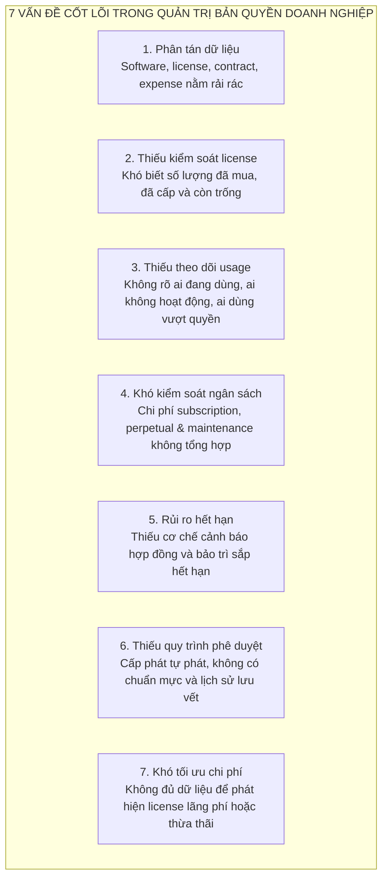
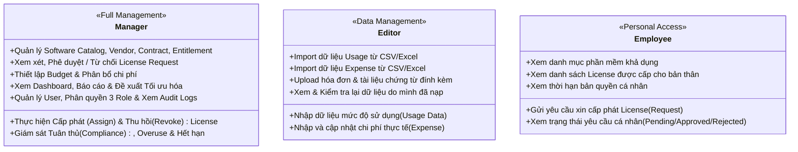
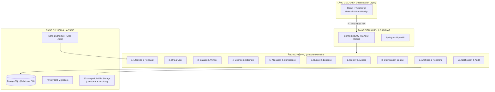

# VFast – Enterprise License Management System (ELMS)
### Tài liệu Đặc tả Yêu cầu Phần mềm (Software Requirements Specification - SRS v1.0)

[](file:///home/datnguyen-nuoa/VFast)
[](file:///home/datnguyen-nuoa/VFast/docs/01-MVP.md)
[](file:///home/datnguyen-nuoa/VFast/docs/01-MVP.md)
[](file:///home/datnguyen-nuoa/VFast/docs/01-MVP.md)
[](file:///home/datnguyen-nuoa/VFast/docs/02-use-cases.md)
[](file:///home/datnguyen-nuoa/VFast/docs/03-user-stories.md)

---

## 1. Giới thiệu & Đề bài Dự án (Introduction & Purpose)

### 1.1. Mục đích Hệ thống (System Purpose)
**Enterprise License Management System (ELMS)** là hệ thống quản lý tập trung tài sản phần mềm, quyền sở hữu bản quyền (`License Entitlement`), dữ liệu tiêu thụ thực tế (`Usage Data`) và chi phí ngân sách (`Budget & Expense`) trong nội bộ doanh nghiệp.

Hệ thống được thiết kế nhằm giúp doanh nghiệp kiểm soát toàn diện và xuyên suốt vòng đời của license:
- Ghi nhận và thẩm định các khoản quyền sử dụng phần mềm đã mua.
- Quản lý quy trình phân bổ (Yêu cầu $\to$ Phê duyệt $\to$ Cấp phát $\to$ Thu hồi).
- Theo dõi mức độ sử dụng thực tế của người dùng và phòng ban.
- Quản lý ngân sách, kiểm soát chi phí và đối chiếu chứng từ hóa đơn.
- Phát hiện rủi ro vi phạm bản quyền (Overuse / Over-allocation) và tìm kiếm cơ hội cắt giảm chi phí lãng phí.

Hệ thống quản lý đồng thời hai mô hình bản quyền:
1. **SaaS Subscription:** License sử dụng theo hình thức thuê bao đám mây, có thời hạn và chi phí định kỳ (Microsoft 365, Google Workspace, Adobe CC, Zoom, Slack, Figma,...).
2. **Perpetual License:** License mua đứt quyền sử dụng lâu dài (On-premise/OEM), có thể phát sinh chi phí thỏa thuận bảo trì hoặc hỗ trợ nâng cấp định kỳ (AutoCAD, Windows Pro, VMware,...).

---

## 2. Phân tích Vấn đề Thực tế (Problem Statement)

Trong thực tế vận hành tại các doanh nghiệp, việc quản lý license phần mềm và chi phí liên quan thường diễn ra phân tán qua nhiều nguồn dữ liệu rời rạc như file Excel, hợp đồng giấy, hóa đơn kế toán và cổng quản trị riêng của từng nhà cung cấp. Thực trạng này dẫn đến **7 vấn đề cốt lõi**:



1. **Phân tán dữ liệu (Fragmented Data):** Thông tin về phần mềm, quyền sở hữu, hợp đồng pháp lý, dữ liệu sử dụng và chi phí tài chính không được quản lý tập trung trên cùng một hệ thống.
2. **Thiếu kiểm soát license (Lack of License Inventory Control):** Nhà quản lý gặp khó khăn khi cần xác định chính xác số lượng license đã mua (`Purchased`), số lượng đã phân bổ (`Allocated`) và số lượng còn khả dụng trong kho (`Available`).
3. **Thiếu khả năng theo dõi mức độ sử dụng (Lack of Usage Monitoring):** Doanh nghiệp không nắm được license nào đang được sử dụng tích cực, license nào bị "bỏ quên" (inactive) hoặc có dấu hiệu dùng vượt quá hạn ngạch.
4. **Khó kiểm soát ngân sách (Budget Control Challenges):** Các khoản chi phí thuê bao định kỳ, chi phí mua đứt và chi phí bảo trì hằng năm không được tổng hợp theo thời gian thực để đối soát với ngân sách kế hoạch.
5. **Rủi ro hết hạn hợp đồng (Expiration & Maintenance Risks):** Thiếu cơ chế tự động theo dõi và cảnh báo trước các mốc hết hạn của hợp đồng thuê bao và gói bảo trì, gây nguy cơ gián đoạn dịch vụ đột ngột.
6. **Thiếu quy trình phê duyệt minh bạch (Lack of Unified Request & Approval):** Việc xin cấp phần mềm diễn ra qua email hoặc trao đổi miệng, thiếu sự kiểm duyệt ngân sách và thiếu lưu vết lịch sử.
7. **Khó tối ưu chi phí (Unidentified Cost Optimization Opportunities):** Doanh nghiệp thiếu dữ liệu định lượng để phát hiện các license chưa phân bổ (unallocated) hoặc nhân viên nghỉ việc/chuyển vị trí nhưng vẫn giữ license (zombie seats).

---

## 3. Mục tiêu Hệ thống & Tiêu chí Thành công (Objectives & Success Criteria)

### 3.1. Mục tiêu Sản phẩm (Product Objectives)
Hệ thống **VFast ELMS** hướng đến 8 mục tiêu chiến lược:
- **Centralized License Management:** Quản lý tập trung toàn bộ danh mục và hồ sơ bản quyền của doanh nghiệp.
- **License Allocation Control:** Kiểm soát chặt chẽ quy trình yêu cầu, phê duyệt, cấp phát và thu hồi license.
- **Usage Monitoring:** Ghi nhận và theo dõi dữ liệu tiêu thụ phần mềm thực tế của người dùng.
- **Budget Management:** Thiết lập ngân sách, theo dõi chi phí thực tế và tỷ lệ giải ngân (`Budget Utilization`).
- **Lifecycle Management:** Quản lý thời hạn, tự động cảnh báo mốc hết hạn hợp đồng và kế hoạch gia hạn/bảo trì.
- **License Compliance:** Tự động phát hiện tình trạng cấp phát vượt quyền (`Over-allocation`) hoặc sử dụng vượt mức (`Overuse`).
- **License Optimization:** Xác định các cơ hội cắt giảm lãng phí thông qua khuyến nghị tối ưu hóa chi phí.
- **Management Analytics:** Cung cấp Dashboard điều hành và hệ thống báo cáo phục vụ việc ra quyết định.

### 3.2. Tiêu chí Đánh giá Thành công (Success Criteria)
Hệ thống được đánh giá là thành công khi đáp ứng các tiêu chuẩn định lượng:
- Quản lý tập trung thành công cả **SaaS Subscription** và **Perpetual License**.
- Xác định tức thì số lượng `Purchased`, `Allocated` và `Available` theo từng license metric với độ chính xác 100%.
- Vận hành thông suốt quy trình khép kín: Gửi yêu cầu $\to$ Phê duyệt $\to$ Cấp phát $\to$ Thu hồi.
- Ghi nhận và tổng hợp đầy đủ dữ liệu sử dụng (`Usage`) và chi phí thực tế (`Expense`).
- Cảnh báo sớm các hợp đồng sắp đến hạn (trước 30, 15, 7 ngày).
- Phát hiện chính xác các trường hợp `Over-allocation` ($Allocated > Purchased$) và `Overuse`.
- Thực thi phân quyền nghiêm ngặt cho 3 role tại backend.
- 100% thao tác nghiệp vụ quan trọng được ghi nhận vào nhật ký kiểm toán bất biến (`Audit Log`).

---

## 4. Phạm vi Sản phẩm (Product Scope)

### 4.1. 8 Nhóm Tính năng trong Phạm vi (In-Scope Feature Groups)
Theo đặc tả SRS v1.0, hệ thống được cấu thành từ 8 nhóm chức năng:

| Mã | Nhóm Chức năng | Mô tả Nghiệp vụ Chính |
| :---: | :--- | :--- |
| **F01** | **License Management** | Quản lý danh mục phần mềm chuẩn (`Software Catalog`), nhà cung cấp (`Vendor`), hồ sơ quyền sử dụng (`Entitlement`), hợp đồng mua sắm (`Contract`) và trạng thái tuân thủ (`Compliance`). |
| **F02** | **License Allocation** | Quản lý quy trình gửi yêu cầu cấp license (`Request`), phê duyệt phân cấp, thực hiện cấp phát (`Assign`), thu hồi (`Revoke`) và theo dõi phân bổ (`Allocation Tracking`). |
| **F03** | **Budget Management** | Thiết lập ngân sách theo năm/kỳ tài chính, ghi nhận chi phí thực tế (`Expense`), đính kèm hóa đơn và tính toán tỷ lệ sử dụng ngân sách (`Budget Utilization`). |
| **F04** | **Lifecycle Management** | Theo dõi ngày hết hạn hợp đồng thuê bao và gói bảo trì, quản lý kế hoạch gia hạn (`Renewal`) và phát sinh thông báo nhắc hạn tự động (`Lifecycle Notification`). |
| **F05** | **License Optimization** | Thuật toán nhận diện license chưa gán (`Unallocated`), license không hoạt động (`Inactive`), phát hiện vượt quyền (`Overuse`) và cung cấp đề xuất tiết kiệm ngân sách. |
| **F06** | **Analytics & Reporting** | Bảng điều khiển tổng quan (`License Dashboard`, `Financial Dashboard`, `Compliance Dashboard`) và chức năng xuất báo cáo. |
| **F07** | **User & Role Management**| Quản lý tài khoản người dùng, danh bạ nhân sự, phòng ban và phân quyền theo mô hình 3 role. |
| **F08** | **System Administration** | Quản lý xác thực đăng nhập/đăng xuất, quản trị phiên, lưu trữ nhật ký kiểm toán (`Audit Log`) và công cụ import dữ liệu. |

### 4.2. Ngoài phạm vi Ban đầu (Out-of-Scope for Initial Release)
Để đảm bảo tiến độ triển khai tập trung và chất lượng vận hành cao nhất, các hạng mục sau được hoãn lại cho các phiên bản tiếp theo:
- Tự động kết nối API đồng bộ trực tiếp với tất cả các nhà cung cấp phần mềm (SaaS Vendor APIs).
- Tự động kích hoạt (Auto-provisioning) hoặc thu hồi tài khoản trực tiếp trên hệ thống của vendor.
- Tích hợp sâu vào hệ thống ERP hoặc phần mềm kế toán bên ngoài.
- Tự động thanh toán thẻ tín dụng hoặc thanh toán hóa đơn trực tuyến.
- Tối ưu hóa license bằng mô hình Trí tuệ Nhân tạo / Học máy nâng cao (AI/ML Optimization).
- Luồng phê duyệt đa cấp phức tạp (Multi-level approval).
- Tự động thu hồi license ngay khi phát hiện inactivity mà không cần sự xác nhận của Manager.
- Kiến trúc đa người thuê (Multi-tenancy) phục vụ nhiều doanh nghiệp độc lập trên cùng hạ tầng.

---

## 5. Mô hình 3 Role & Ma trận Phân quyền (RBAC Matrix)

Hệ thống ELMS chuẩn hóa quyền hạn dựa trên **3 Roles cốt lõi**:



### Ma trận Quyền hạn Chi tiết (Role Permission Matrix)
| Phân hệ / Chức năng | Manager | Editor | Employee | Nguyên tắc kiểm soát |
| :--- | :---: | :---: | :---: | :--- |
| **Software Catalog** | **CRUD** | Read | Read | Employee chỉ xem phần mềm khả dụng; không thấy giá mua/key. |
| **Vendor Management** | **CRUD** | Read | No Access | Quản trị thông tin liên hệ nhà cung cấp và đại lý. |
| **License Entitlement** | **CRUD** | Read | No Access | Chỉ Manager có quyền tạo và chỉnh sửa gói quyền sử dụng. |
| **Contract Management** | **CRUD** | Read | No Access | Lưu trữ hợp đồng mua sắm và thời hạn pháp lý. |
| **License Compliance** | **Manage / Read** | Read | No Access | Đánh giá trạng thái tuân thủ và phát hiện Overuse. |
| **License Request** | **Review / Approve**| No Access | **Create / Own** | Employee tạo request; Manager duyệt; Editor không can thiệp. |
| **License Assignment** | **CRUD** | No Access | **Own / Read** | Chỉ Manager có quyền gán seat; Employee xem seat cá nhân. |
| **License Revocation** | **Manage** | No Access | No Access | Chỉ Manager có quyền thu hồi seat về kho. |
| **Budget Management** | **CRUD** | Read | No Access | Thiết lập hạn mức ngân sách theo năm/kỳ/bộ phận. |
| **Expense Management** | **CRUD** | **Input / Update** | No Access | Editor nạp chi phí và upload hóa đơn; Manager đối soát. |
| **License Usage Data** | **Read / Manage** | **Input / Update** | No Access | Editor nạp dữ liệu tiêu thụ; Manager giám sát. |
| **Lifecycle Management** | **Manage** | Read | **Own / Read** | Manager nhận cảnh báo hết hạn; Employee xem hạn dùng cá nhân. |
| **Optimization Insights**| **Manage / Review**| Read | No Access | Quản lý các đề xuất cắt giảm chi phí lãng phí. |
| **Dashboard & Reports** | **Full** | Data-related | Personal only | Bảng điều khiển phân tích chi phí và hiệu suất sử dụng. |
| **User & Role Admin** | **CRUD** | No Access | No Access | Quản trị tài khoản và phân quyền 3 role cho tổ chức. |
| **Audit Logs** | **Read** | Own actions | No Access | Tra cứu nhật ký kiểm toán hệ thống. |
| **Data Import** | **Manage** | **Execute** | No Access | Editor thực thi nạp file; Manager quản lý cấu trúc. |

> **Quy tắc bảo mật bắt buộc:** Toàn bộ phân quyền phải được kiểm tra và thực thi nghiêm ngặt tại **Backend API (Server-side Enforcement)**; không phụ thuộc vào việc ẩn/hiện nút trên giao diện Frontend.

---

## 6. Quy tắc Nghiệp vụ Cốt lõi (20 Business Rules)

Hệ thống tuân thủ 20 quy tắc kinh doanh bất biến:
- **BR-01:** Hệ thống hỗ trợ song song hai loại hình: SaaS Subscription và Perpetual License.
- **BR-02:** Mọi Entitlement bắt buộc phải liên kết với một Sản phẩm phần mềm và một Nhà cung cấp xác định.
- **BR-03:** Các số lượng license chỉ được phép so sánh hoặc cộng trừ khi sử dụng cùng metric đo lường và phạm vi dữ liệu tương thích.
- **BR-04:** Công thức tính toán dung lượng: $\text{Available Quantity} = \text{Purchased Quantity} - \text{Allocated Quantity}$.
- **BR-05:** Tuyệt đối không cho phép cấp phát vượt quá số lượng bản quyền khả dụng ($\text{Allocated} \le \text{Purchased}$).
- **BR-06:** Chỉ duy nhất vai trò Manager có quyền phê duyệt hoặc từ chối các yêu cầu cấp license.
- **BR-07:** Chỉ duy nhất vai trò Manager có quyền thực hiện cấp phát (Assign) hoặc thu hồi (Revoke) license.
- **BR-08:** Employee chỉ được phép xem thông tin yêu cầu và license thuộc sở hữu của chính bản thân mình.
- **BR-09:** Editor được quyền nhập dữ liệu usage và expense, nhưng tuyệt đối không được sửa đổi Entitlement hoặc Budget.
- **BR-10:** Bản ghi Expense hợp lệ bắt buộc phải có Số tiền hợp lệ, Tiền tệ và Ngày thanh toán.
- **BR-11:** Các khoản chi phí khác loại tiền tệ không được cộng gộp trừ khi có chính sách quy đổi tỷ giá rõ ràng.
- **BR-12:** Thời hạn bản quyền vĩnh viễn và thời hạn thỏa thuận bảo trì (Maintenance) phải được quản lý ở hai trường độc lập.
- **BR-13:** Các lượt gán đã bị thu hồi (`Revoked Assignments`) phải được giữ lại trong lịch sử để đối soát kiểm toán.
- **BR-14:** Việc đánh giá tuân thủ dựa trên mức dùng thực tế bắt buộc phải có dữ liệu usage hợp lệ và tương thích.
- **BR-15:** Dữ liệu usage bị thiếu không được tự động hiểu là mức sử dụng bằng không ($Usage \ne 0$).
- **BR-16:** Mọi đề xuất tối ưu hóa chi phí bắt buộc phải có căn cứ dữ liệu và phải qua sự phê duyệt của Manager trước khi thực thi.
- **BR-17:** Mọi thao tác nghiệp vụ quan trọng bắt buộc phải lưu vết vào Audit Log bất biến kèm Actor, Action và Timestamp.
- **BR-18:** Người dùng ở trạng thái vô hiệu hóa (`Deactivated`) lập tức bị khóa quyền truy cập hệ thống.
- **BR-19:** Một License Request đã xử lý (`Approved` hoặc `Rejected`) không được phép xử lý lại lần thứ hai.
- **BR-20:** Các dữ liệu lưu trữ lịch sử được bảo lưu theo chính sách lưu trữ dữ liệu của doanh nghiệp.

---

## 7. Định hướng Kiến trúc & Công nghệ Đề xuất (Architecture & Tech Stack)

Hệ thống được thiết kế theo kiến trúc **Modular Monolith** nhằm tối ưu hóa sự đơn giản trong triển khai, dễ kiểm thử và đảm bảo ranh giới module rõ ràng:



### Bảng Công nghệ Khuyến nghị (Recommended Stack)
| Tầng hệ thống | Công nghệ đề xuất | Lý do lựa chọn |
| :--- | :--- | :--- |
| **Frontend** | **React + TypeScript** | Hệ sinh thái mạnh, type-safe, linh hoạt xây dựng giao diện quản trị. |
| **UI Framework** | **Material UI (MUI)** | Cung cấp sẵn hệ thống component chuẩn cho bảng dữ liệu, biểu mẫu và dashboard. |
| **Backend Engine** | **Java + Spring Boot** | Mạnh mẽ, bảo mật cao, hỗ trợ hoàn hảo cấu trúc Modular Monolith và kiểm soát giao dịch ACID. |
| **Security** | **Spring Security** | Thực thi phân quyền RBAC 3 role chặt chẽ tại tầng service và controller. |
| **Database** | **PostgreSQL** | Cơ sở dữ liệu quan hệ mạnh mẽ, đảm bảo toàn vẹn dữ liệu giao dịch tài chính và cấp phát license. |
| **Migration** | **Flyway** | Quản lý phiên bản cấu trúc cơ sở dữ liệu có tính lặp lại và kiểm soát lịch sử schema. |
| **API Specs** | **Springdoc OpenAPI (Swagger)** | Tự động sinh tài liệu API chuẩn hóa hỗ trợ kết nối frontend-backend. |
| **Background Jobs** | **Spring Scheduler** | Quét tự động hằng ngày các mốc hết hạn hợp đồng để gửi thông báo cảnh báo. |
| **Containerization** | **Docker & Docker Compose** | Đóng gói nhất quán môi trường từ phát triển đến chạy thử nghiệm production pilot. |

---

## 8. Tiêu chí Nghiệm thu & Chuyển giao (Acceptance & Release Criteria)

Hệ thống được coi là hoàn thiện và sẵn sàng chuyển giao khi vượt qua **14 tiêu chí nghiệm thu cốt lõi**:
1. Cả 3 role (`Manager, Editor, Employee`) đăng nhập thành công và chỉ truy cập được các chức năng được phân quyền.
2. Manager có thể tạo và quản lý toàn bộ thông tin phần mềm và quyền sở hữu bản quyền.
3. Cả hai loại hình **SaaS Subscription** và **Perpetual License** được đăng ký và theo dõi chính xác.
4. Employee có thể gửi và theo dõi tiến độ các yêu cầu xin cấp license cá nhân.
5. Manager có thể phê duyệt, từ chối yêu cầu; thực hiện cấp phát và thu hồi license thành công.
6. Số lượng cấp phát được tính toán tự động và không bao giờ vượt quá dung lượng đã mua ($Allocated \le Purchased$).
7. Editor có thể nhập dữ liệu sử dụng (`Usage`) và ghi nhận các khoản chi phí (`Expense`) kèm hóa đơn.
8. Manager có thể theo dõi hạn mức ngân sách và chi phí giải ngân thực tế theo từng bộ phận.
9. Hệ thống nhận diện và phát sinh cảnh báo đối với các hợp đồng sắp đến hạn hết hạn hoặc hạn bảo trì.
10. Dashboard cung cấp đầy đủ các chỉ số trực quan về tình hình bản quyền, tài chính và tuân thủ.
11. Các thao tác nghiệp vụ trọng yếu được ghi nhận đầy đủ vào hệ thống Audit Log bất biến.
12. Toàn bộ các luồng nghiệp vụ kinh doanh chính vượt qua kiểm thử tích hợp (Integration Tests).
13. Quy trình sao lưu và phục hồi dữ liệu cơ sở dữ liệu được kiểm nghiệm thành công.
14. Hệ thống được triển khai ổn định trên môi trường thử nghiệm pilot và vượt qua kiểm thử chấp nhận người dùng (UAT).

---

## 9. Bản đồ Điều hướng Tài liệu Kỹ thuật (`/docs`)

Toàn bộ tài liệu chi tiết được tổ chức quy chuẩn trong thư mục [`/docs`](file:///home/datnguyen-nuoa/VFast/docs):

```
VFast/
├── README.md                      # Báo cáo Tổng quan SRS v1.0, 7 Vấn đề, 8 Mục tiêu, 6 Modules & Kiến trúc
└── docs/
    ├── 01-MVP.md                  # Đặc tả Phạm vi MVP, 19 Stories P0, 20 Business Rules & Tiêu chí Nghiệm thu
    ├── 02-use-cases.md            # Đặc tả ĐẦY ĐỦ 39 Use Cases (UC01-UC39) theo 3 Role & 3 Luồng Sequence Diagrams
    └── 03-user-stories.md         # Đặc tả 25 User Stories chuẩn INVEST (P0/P1) với Given-When-Then & Traceability Matrix
```

- 📘 [**Tài liệu Đặc tả Phạm vi MVP (01-MVP.md)**](file:///home/datnguyen-nuoa/VFast/docs/01-MVP.md):
  Đặc tả chi tiết phạm vi In-Scope vs Out-of-Scope, 19 User Stories P0 bắt buộc cho pilot, ma trận RBAC 3 role, 20 quy tắc kinh doanh bất biến (BR-01 đến BR-20), 7 yêu cầu phi chức năng (NFRs), mô hình 12 thực thể dữ liệu và 14 tiêu chí nghiệm thu.
- 📗 [**Tài liệu Đặc tả Use Case (02-use-cases.md)**](file:///home/datnguyen-nuoa/VFast/docs/02-use-cases.md):
  Đặc tả chuẩn hóa **39 Use Cases (UC01 đến UC39)** theo bảng phân loại SRS v1.0, mô tả chi tiết 3 luồng nghiệp vụ trọng yếu (License Allocation, Expense Management, Budget Monitoring) và các biểu đồ Sequence Diagram tương tác.
- 📙 [**Tài liệu Đặc tả User Stories (03-user-stories.md)**](file:///home/datnguyen-nuoa/VFast/docs/03-user-stories.md):
  Đặc tả chi tiết **25 User Stories** chuẩn hóa theo tiêu chí INVEST phân bổ cho 3 Role (Manager US-M01 đến US-M14, Editor US-E01 đến US-E06, Employee US-U01 đến US-U05), cung cấp 100% kịch bản kiểm thử chấp nhận định dạng Gherkin (**Given - When - Then**) và Ma trận ánh xạ Traceability Matrix với 39 Use Cases.

---

## 10. Thông tin Cấu hình Git & Nhánh Dự án

- **Kho lưu trữ từ xa (Remote):** `git@github.com-personal:cuonglpv/VFast.git`
- **Nhánh triển khai (Branch):** `docs/requirements-mvp`
- **Tác giả commit (Author):** `DatTienNguyenn <dn841746@gmail.com>`
