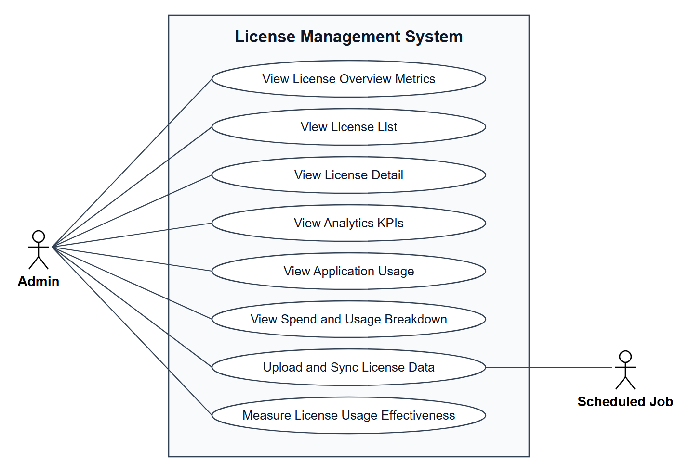

# VFast – Internal License Management

VFast is a set of analysis documents for a self-built system that manages software licenses for a group of subsidiaries. It serves one role, the license manager (Admin), and covers every kind of license. The system observes and analyzes only: it has no grant or revoke action. Nothing is implemented yet.

The scope has three parts:

1. **8 use cases** for the Admin: 6 for viewing and analyzing, 2 additions.
2. **A usage-effectiveness solution** that measures usage across 7 software groups.
3. **A data-intake solution**: manual upload is the base, automatic sync is the priority direction.

Two confirmed pain points set the priority: **allocation is entered by hand** (P1) and **usage effectiveness is not tracked** (P2).

## 1. Mind map

The map has seven branches: **Scope & Users**, **Pain Points**, **View & Analyze**, **Data Intake**, **Usage Effectiveness**, **Automation Roadmap**, and **Open Questions**. The three bold branches are the three parts of the scope.

Editable source: [`docs/mindmap/vfast-license.xmind`](docs/mindmap/vfast-license.xmind) (open with XMind). `docs/mindmap.png` is exported from it.

## 2. Pain points

| # | Pain point | Use case |
|---|---|---|
| P1 | Manual entry of license allocation (confirmed) | UC07 |
| P2 | Usage effectiveness not tracked (confirmed) | UC08, UC03–UC06 |
| P3 | No overall picture across subsidiaries | UC01, UC02, UC06 |
| P4 | Compliance and audit risk | UC02 |
| P5 | Passive renewal | UC02 |
| P6 | Shadow IT | Later phase |

Symptoms of each one: [Scope](docs/01-scope.md).

## 3. Use cases

| ID | Use case | Screen |
|---|---|---|
| UC01 | View License Overview Metrics | License Management |
| UC02 | View License List | License Management |
| UC03 | View License Detail | License Management |
| UC04 | View Analytics KPIs | Analytics |
| UC05 | View Application Usage | Analytics |
| UC06 | View Spend and Usage Breakdown | Analytics |
| UC07 | Upload and Sync License Data | Data Sources |
| UC08 | Measure License Usage Effectiveness | Settings |

- **Actors:** Admin (primary, the license manager); Scheduled Job (secondary, runs automatic sync for UC07).
- **Company filter:** every screen has a shared Company filter, defaulting to the whole group; choosing a subsidiary recomputes UC01 to UC06 for that company.
- UC01 to UC05 follow the team's original specification. UC06 merges two original use cases. UC07 and UC08 are additions.

Diagram source: [`docs/diagrams/ve_license.py`](docs/diagrams/ve_license.py), drawn with [`srsdiagram.py`](docs/diagrams/srsdiagram.py); SVG and an editable draw.io file are in [`docs/diagrams/out/`](docs/diagrams/out/). Regenerate with `python ve_license.py` from `docs/diagrams` (needs Pillow, Playwright with Chromium, and Liberation Sans or Arial).

## 4. Usage effectiveness

Each software product belongs to one of 7 groups with its own default measurement (UC08):

1. Office and collaboration SaaS, per user
2. Specialized SaaS, per seat
3. Installed software, per device or user
4. Concurrent/floating
5. Server, per core, CPU or instance
6. Consumption-based
7. Enterprise/site, unlimited quantity

Groups 1 to 3 map to the statuses Active, Inactive and No activity. Groups 4 to 7 are measured at license level with a usage ratio. Details, common metrics, and the three measurement levels: [Usage effectiveness](docs/03-usage-effectiveness.md).

## 5. Data intake

Upload from Excel or CSV is always available. Automatic sync (HR, IdP/SSO, vendor APIs, endpoint tools) replaces upload source by source. Proposed roadmap: standard template and Excel import, then HR and IdP sync, then APIs for the most expensive SaaS, then endpoint inventory and license server logs, then contract extraction with OCR/AI. Details: [Data intake automation](docs/04-data-automation.md).

## 6. Open questions

Whether the group has a central IdP/SSO, a shared HR system and employee ID, and an endpoint management tool; which are the top 10–20 products; what the current Excel file looks like; how subsidiaries split cost; and whether anyone besides the Admin will use the system. Full list: [Scope](docs/01-scope.md#4-open-questions).

## Documentation

- [Scope](docs/01-scope.md) — pain points, scope, open questions
- [Use cases](docs/02-use-cases.md) — actors, 8 use cases, specifications of UC06–UC08
- [Usage effectiveness](docs/03-usage-effectiveness.md) — 7 software groups and how to measure each
- [Data intake automation](docs/04-data-automation.md) — sources, design rules, roadmap
