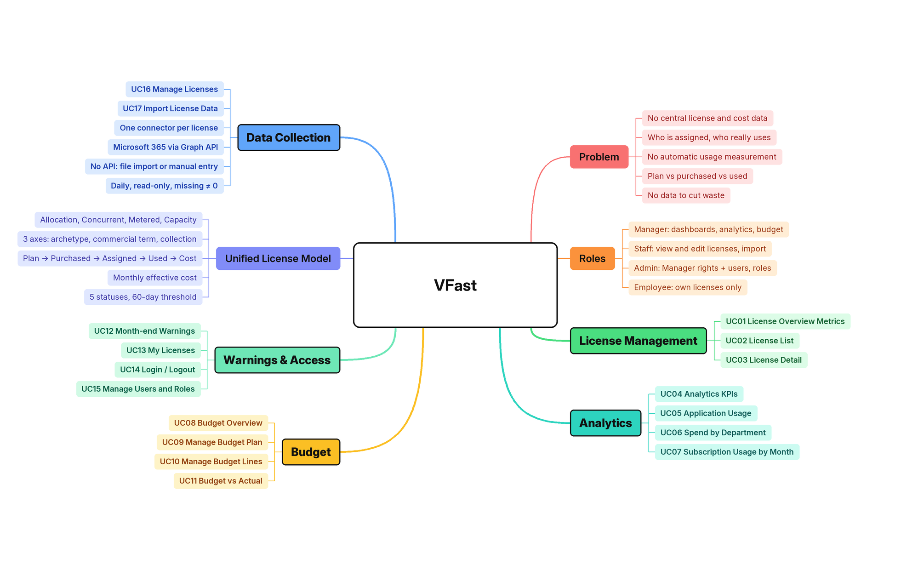
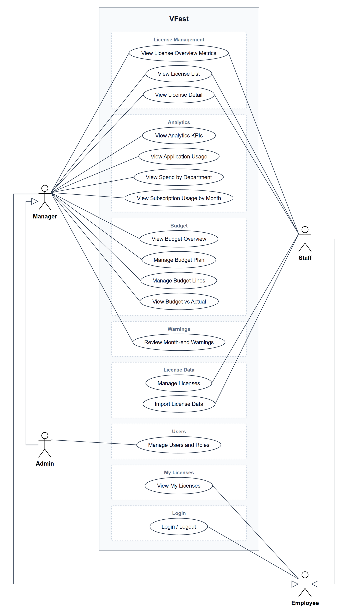

# VFast

VFast is a software license management, usage analytics, and budget optimization platform. It brings licenses from every provider (Microsoft, Google, Adobe, JetBrains, Oracle, OpenAI, Anthropic, AWS, VPN, specialized software) and every license model into one place, shows who holds each license and who really uses it, compares the budget plan with what was bought, assigned, and used, and tells each manager at month end which seats were wasted — **without ever assigning, revoking, or changing anything on a provider**.

## 1. Requirements — Research, Use Cases, and INVEST

Requirements are derived top-down: business problem → stakeholders → goals → license models and data sources → epics → use cases → user stories. Each story is reviewed with INVEST and has Given/When/Then acceptance criteria.

### 1.1 Top-down problem analysis

License and usage data are scattered across each provider's admin portal, and every provider counts in its own unit: seats, sessions, devices, cores, tokens, or contract terms. Nobody can say what the company owns, who uses it, or how far reality is from the budget plan.

| Goal | Measured by |
|---|---|
| G1 Centralize licenses | Every license from every provider listed with publisher, model, quantity, cost, and expiry in one table |
| G2 Know who uses what | Every assigned seat has exactly one status: `Active`, `Inactive`, `No activity`, or `Not monitored` |
| G3 Measure automatically | License, assignment, and usage data refresh daily for providers with an API |
| G4 Express waste as money | Underutilized accounts and their annual cost on one screen |
| G5 Plan and reconcile the budget | Planned, Purchased, Assigned, Used, and Actual cost compared per unit and license |
| G6 Act every month | A month-end list of unused seats per unit, with a recorded decision for each |
| G7 Trustworthy figures | Numbers match across screens; missing data is `Unknown`, never zero |

What makes this project different:

1. **One model for every license** — each license is a combination of three axes (measurement archetype, commercial term, collection method) and one of four archetypes: Allocation, Concurrent, Metered, Capacity. A new provider needs a connector, not new analysis logic.
2. **Budget reconciliation chain** — Planned → Purchased → Assigned → Used → Actual cost; each gap is a different problem with a different fix.
3. **Missing data is not guessed** — a failed sync is `Unknown`, never usage 0, so it never creates a false waste warning.
4. **Read-only by design** — every provider connection only reads; decisions stay with people.

Full analysis, license-model research, data-source feasibility, scope, and risks: [Top-down research](docs/01-research-top-down.md).

### 1.2 Mind map



The five bold branches hold the use cases. Editable source: [`docs/mindmap/vfast.xmind`](docs/mindmap/vfast.xmind) (open with XMind); `docs/mindmap.png` is exported from it.

### 1.3 Use cases



| Role | Use cases |
|---|---|
| **Employee** (every employee) | UC13 View My Licenses · UC14 Login / Logout |
| **Staff** (license management team) | UC01–UC03 view licenses · UC16 Manage Licenses · UC17 Import License Data |
| **Manager** (unit manager) | UC01–UC03 License Management · UC04–UC07 Analytics · UC08–UC11 Budget · UC12 Review Month-end Warnings |
| **Admin** | Everything a Manager can do, for every unit · UC15 Manage Users and Roles |

Admin inherits Manager; Manager and Staff inherit Employee. Diagram source: [`docs/diagrams/out/uc_vfast.drawio`](docs/diagrams/out/uc_vfast.drawio) (open with draw.io).

Role × feature matrix, 18 business rules, and the specification of every use case: [Use cases](docs/02-use-cases.md).

### 1.4 INVEST requirements

The backlog contains **17 user stories (74 story points)**, one per use case (USxx implements UCxx). Every story passes the INVEST review and has Given/When/Then acceptance criteria.

| Criterion | Meaning in VFast |
|---|---|
| **Independent** | Each story produces a demonstrable outcome; viewing stories run on seeded data without waiting for connectors. |
| **Negotiable** | Layout and implementation may change while outcome, permissions, and business rules stay fixed. |
| **Valuable** | Each story names the benefit for one role: Manager, Staff, Admin, or Employee. |
| **Estimable** | Inputs, outputs, roles, data scope, and failure outcomes are explicit; every story is estimated in points. |
| **Small** | One capability per story; the largest (month-end warnings, data import) are 8 points. |
| **Testable** | Every story has observable criteria, including rules that tie figures across screens. |

```text
US01–US03   License Management: overview, list, detail          Manager, Staff
US04–US07   Analytics: KPIs, application usage, spend, by month  Manager
US08–US11   Budget: overview, plan, lines, budget vs actual       Manager
US12        Month-end warnings and decisions                      Manager
US13        My licenses                                           Employee
US14        Login / logout                                        Every role
US15        Users and roles                                       Admin
US16–US17   Manage licenses, import license data                  Staff
```

Backlog, per-story INVEST review, and acceptance criteria: [INVEST requirements](docs/03-invest-requirements.md).

## Documentation

- [Top-down research](docs/01-research-top-down.md) — problem, stakeholders, goals, license models, data sources, process, scope, risks
- [Use cases](docs/02-use-cases.md) — actors, role × feature matrix, business rules, use case diagram, 17 use cases
- [INVEST requirements](docs/03-invest-requirements.md) — 17 user stories, INVEST review, acceptance criteria
