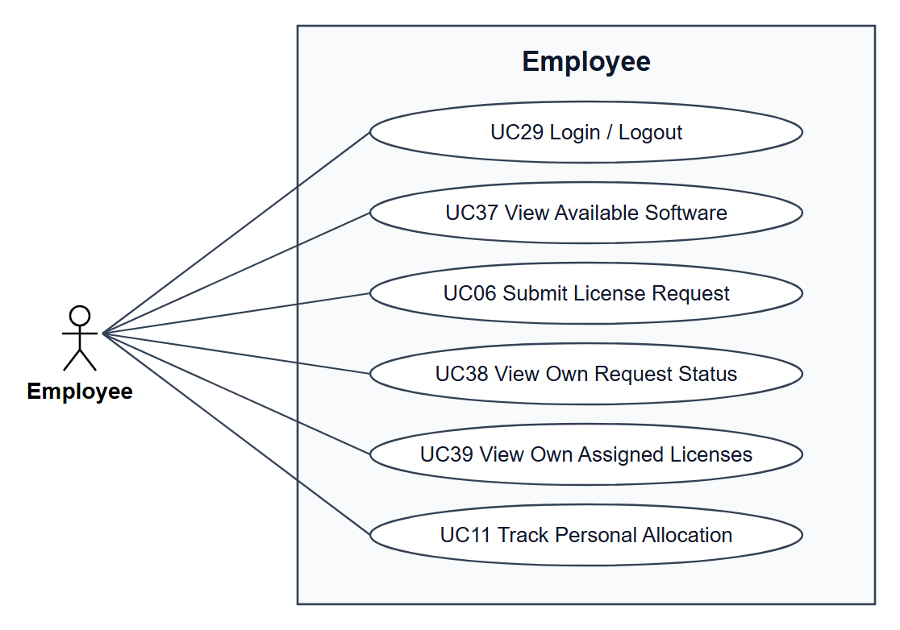
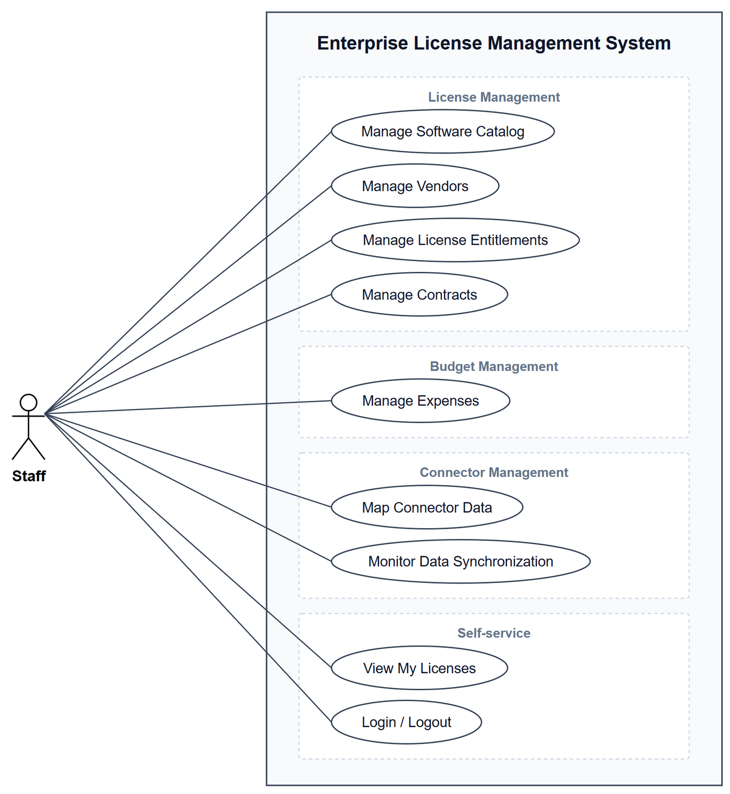
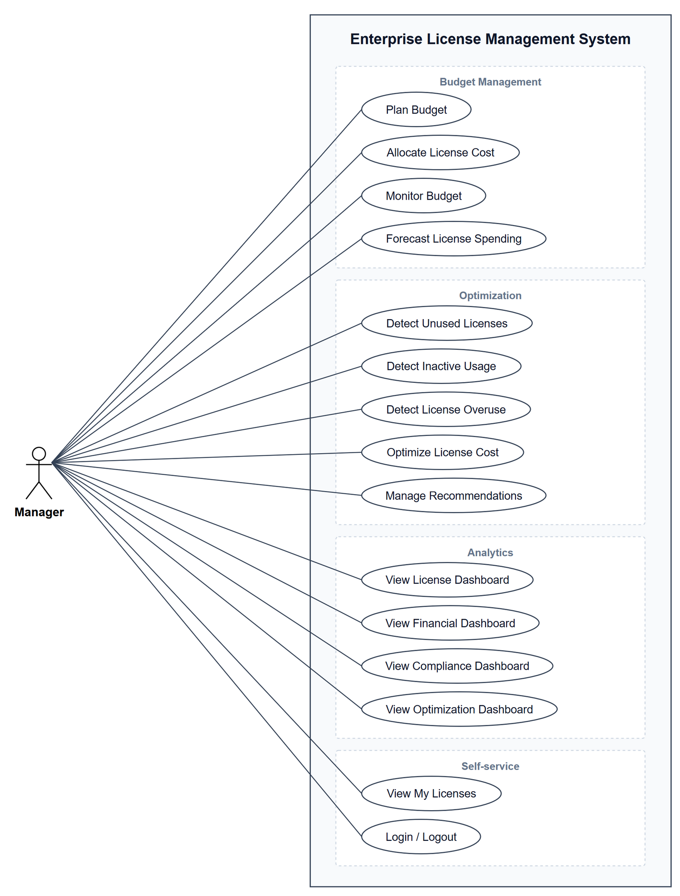
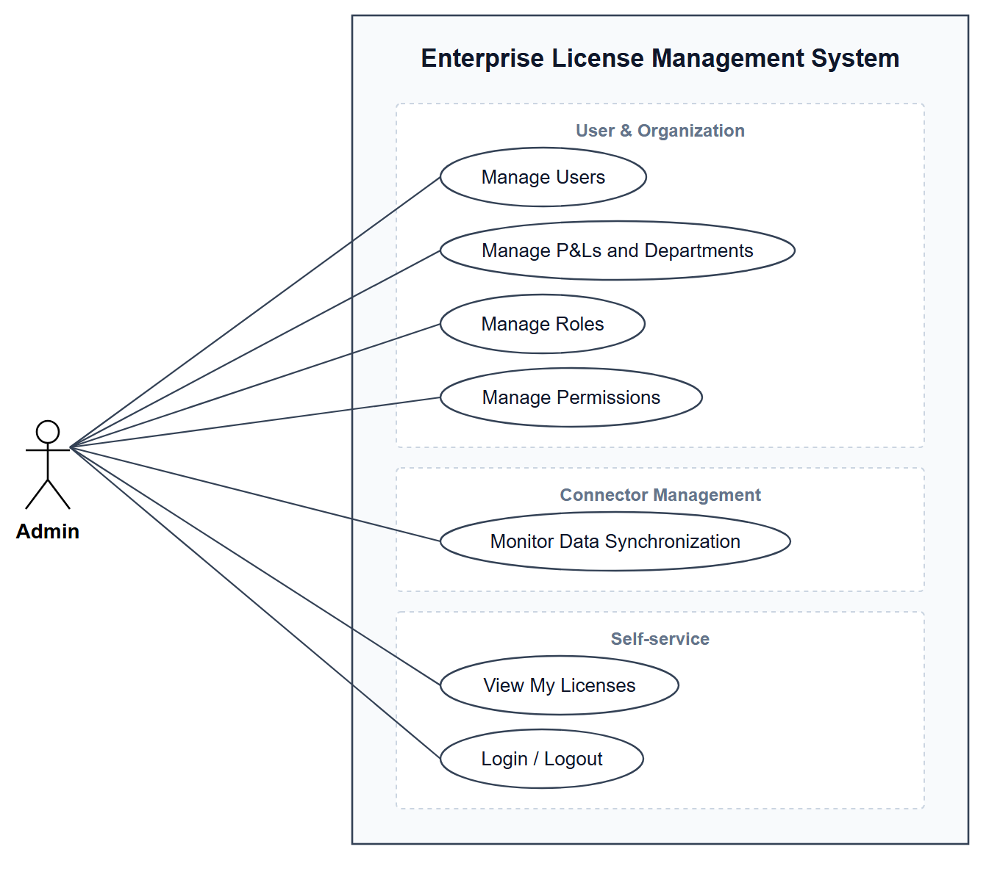
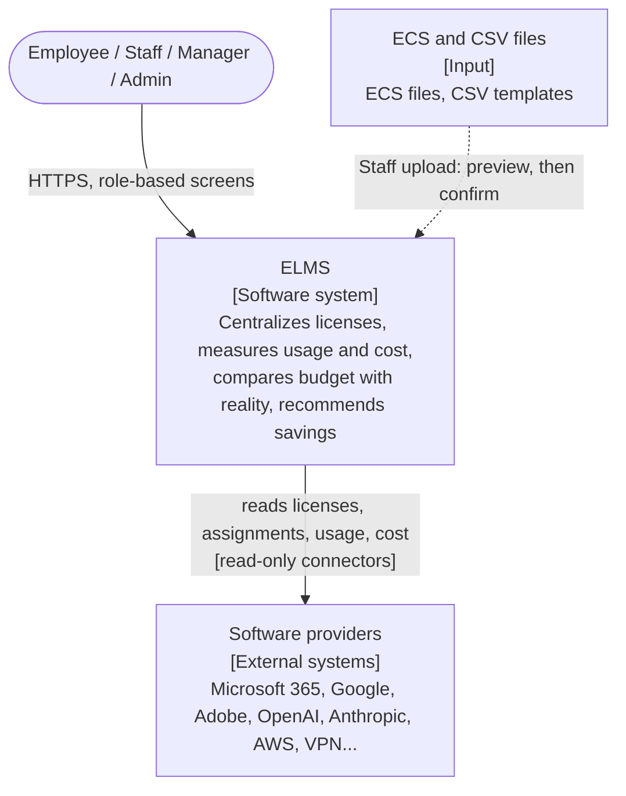
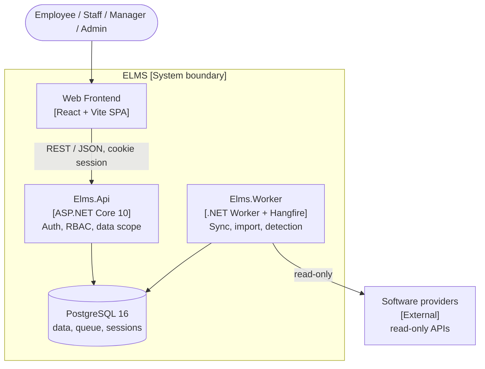

# Enterprise License Management System (ELMS) — team VFast

ELMS brings software licenses from every provider (Microsoft, Google, Adobe, JetBrains, Oracle, OpenAI, Anthropic, AWS, VPN, specialized software) and every license model into one place. It keeps the catalog, vendors, entitlements, contracts, and expenses; plans and monitors the license budget; detects unused, inactive, and overused licenses; turns them into recommendations with evidence; and shows everything on dashboards — **without ever assigning, revoking, or changing anything on a provider**.

## 1. Requirements — Research, Use Cases, and INVEST

Requirements are derived top-down: business problem → stakeholders → goals → license models and data sources → epics (mind map) → use cases → user stories. Each story is reviewed with INVEST and has Given/When/Then acceptance criteria.

### 1.1 Mind map


The map has six branches: **License Management** (catalog & entitlement), **Budget Management** (planning & cost allocation, spending & monitoring), **Optimization** (detection, savings & recommendation), **Analytics** (four dashboards), **User & Organization**, and **Connector Management** (sync & data quality). Each of the 24 leaves is one use case: UC01–UC22 in branch order for the first five branches, and UC25–UC26 for Connector Management, numbered after the existing ones so references stay stable. A connector is set up inside License Entitlement (UC03), when Staff add the license. UC23 View My Licenses and UC24 Login / Logout are self-service use cases every role has.

Editable source: [`docs/mindmap/vfast.xmind`](docs/mindmap/vfast.xmind) (open with XMind); `docs/mindmap.png` is exported from it.

### 1.2 Top-down problem analysis

License and usage data are scattered across each provider's admin portal, and every provider counts in its own unit: seats, sessions, devices, cores, tokens, or contract terms. Nobody can say what the company owns, who uses it, or how far reality is from the budget plan.

| Goal | Measured by |
|---|---|
| G1 Centralize licenses | Every license from every provider listed with vendor, model, quantity, cost, and expiry in one catalog |
| G2 Know who uses what | Every assigned seat has exactly one status: `Active`, `Inactive`, `No activity`, or `Not monitored` |
| G3 Measure automatically | License, assignment, and usage data refresh daily for providers with an API |
| G4 Express waste as money | Underutilized accounts and their annual cost on one screen |
| G5 Plan and reconcile the budget | Planned, Purchased, Assigned, Used, and Actual cost compared per unit and license |
| G6 Turn waste into savings | Every unused, inactive, or overused license becomes a recommendation with evidence and an estimated saving |
| G7 Trustworthy figures | Numbers match across screens; missing data is `Unknown`, never zero |

What makes this project different:

1. **One model for every license** — each license is a combination of three axes (measurement archetype, commercial term, collection method) and one of four archetypes: Allocation, Concurrent, Metered, Capacity.
2. **Budget reconciliation chain** — Planned → Purchased → Assigned → Used → Actual cost; each gap is a different problem with a different fix.
3. **Missing data is not guessed** — a failed sync is `Unknown`, never usage 0, so it never creates a false waste finding.
4. **Decisions stay with people** — every recommendation shows evidence and a saving, and a Manager accepts or rejects it; ELMS only reads from providers.
5. **One connector standard** — every connector, whether the provider implements it or ELMS writes an adapter, delivers the same datasets in the ELMS Connector Standard (ECS), a profile of FOCUS, SCIM 2.0, and ISO/IEC 19770; nothing enters ELMS without passing its validator.

Full analysis, license-model research, data-source feasibility, scope, and risks: [Top-down research](docs/01-research-top-down.md).

Research on a common connector standard (FOCUS, SCIM 2.0, ISO/IEC 19770, provider APIs), the ECS v1 proposal, and its rollout plan: [Connector standard](docs/06-connector-standard.md).

### 1.3 Use cases

There are four roles. One diagram per actor shows every use case that actor can start; shared use cases (View My Licenses, Login / Logout) appear in each actor's diagram.

| Role | Use cases |
|---|---|
| **Employee** (every employee) | UC23 View My Licenses · UC24 Login / Logout |
| **Staff** (reports to a Manager; hands-on data entry) | UC01–UC04 License Management · UC07 Manage Expenses · UC25, UC26 Connector data mapping and sync monitoring · UC23, UC24 |
| **Manager** (manager of a P&L or a department; plans and decides) | UC05, UC06, UC08, UC09 Budget · UC10–UC14 Optimization · UC15–UC18 Analytics · UC23, UC24 |
| **Admin** (system operator) | UC19–UC22 User & Organization (users, P&Ls and departments, roles, permissions) · UC26 Sync status · UC23, UC24 |

| | |
|---|---|
|  |  |
|  |  |

Diagram sources are draw.io files in [`docs/diagrams/out/`](docs/diagrams/out/). Role × feature matrix, 20 business rules, and the specification of all 26 use cases: [Use cases](docs/02-use-cases.md).

### 1.4 Roles and permissions

There are four roles; each account has exactly one. Every account belongs to a real employee, matched by company email.

| Role | Who | Responsibility | Data scope |
|---|---|---|---|
| **Employee** | Every employee of the group | Sees the licenses assigned to them and whether they are recorded as used | Own licenses only, without price or cost |
| **Staff** | License management team member, reports to a Manager | Hands-on work: enters and corrects license data, holders and usage where there is no connector, and expenses; connects licenses to their providers, maps provider data to licenses, and watches the data syncs | Every license and expense; no budget, no dashboards |
| **Manager** | Manager of a P&L (subsidiary) or a department | Plans the budget, monitors spending, reviews waste, decides on recommendations | Only the P&Ls or departments assigned to them |
| **Admin** | System operator | Users, P&Ls and departments, roles, permissions; watches the status of data syncs | Access settings and connector status only; no license, budget, or cost data |

| Capability | Admin | Manager | Staff | Employee |
|---|---|---|---|---|
| Software catalog, vendors | — | — | Create / edit | — |
| License entitlements, contracts | — | — | Create / edit | — |
| License holders and usage (where there is no connector) | — | — | Create / edit / import | — |
| Expenses and invoices | — | — | Create / edit / import | — |
| Budget plan | — | Create / edit, own units | — | — |
| Cost allocation, budget monitoring, forecast | — | Read, own units | — | — |
| Unused, inactive, overuse detection | — | Read, own units | — | — |
| Cost optimization, recommendations | — | Read / decide, own units | — | — |
| License, financial, compliance, optimization dashboards | — | Read, own units | — | — |
| Users, roles, permissions | Create / edit | — | — | — |
| P&Ls and departments | Create / edit | — | — | — |
| Connectors (set up when adding a license) | — | — | Create / edit | — |
| Connector data mapping | — | — | Create / edit | — |
| Sync runs | Read status | — | Read / rerun / upload | — |
| My licenses | Read own | Read own | Read own | Read own |

- The backend enforces every cell of this table and the data scope; hiding a button in the interface is not enough, and a call outside the role returns `403`.
- ELMS never writes to a provider: "edit" here changes data in ELMS only.
- Every change to license data, expenses, budgets, recommendations, and access is recorded with who, old value, new value, and time.

Staff and Manager compared, and the full role × feature matrix with the business rules: [Use cases](docs/02-use-cases.md#staff-and-manager).

### 1.5 INVEST requirements

The backlog contains **26 user stories (107 story points)**, one per use case (USxx implements UCxx). Every story passes the INVEST review and has Given/When/Then acceptance criteria.

| Criterion | Meaning in ELMS |
|---|---|
| **Independent** | Each story produces a demonstrable outcome; analytics and detection stories run on seeded data without waiting for connectors. |
| **Negotiable** | Layout and implementation may change while outcome, permissions, and business rules stay fixed. |
| **Valuable** | Each story names the benefit for one role: Employee, Staff, Manager, or Admin. |
| **Estimable** | Inputs, outputs, roles, data scope, and failure outcomes are explicit; every story is estimated in points. |
| **Small** | One mind-map leaf per story; only US03 (entitlements plus manual usage entry) reaches 8 points. |
| **Testable** | Every story has observable criteria, including rules that tie figures across screens. |

```text
US01–US04   License Management: catalog, vendors, entitlements, contracts       Staff
US05–US09   Budget: plan, cost allocation, expenses, monitoring, forecast       Manager (US07: Staff)
US10–US14   Optimization: unused, inactive, overuse, savings, recommendations   Manager
US15–US18   Analytics: license, financial, compliance, optimization dashboards  Manager
US19–US22   User & Organization: users, P&Ls and departments, roles, permissions Admin
US23–US24   My licenses, login / logout                                         Every role
US25–US26   Connector Management: data mapping, sync monitoring                Staff (US26: Admin sees status)
```

Backlog, per-story INVEST review, and acceptance criteria: [INVEST requirements](docs/03-invest-requirements.md).

## 2. Database design

The target schema is PostgreSQL, 39 tables in seven groups: organization and access, license catalog, collection pipeline, holders and usage, budget and expenses, optimization, audit. A license is a plan (tier/SKU); each purchase is an entitlement line; missing data is `Unknown`, never 0; history is kept as frozen daily snapshots and monthly cost allocations.


Entity overview, one ERD per group, a short explanation of every table, rule-to-schema traceability, and the decisions still to confirm (D5–D23): [Database design](docs/database/README.md). Source [`elms.dbml`](docs/database/elms.dbml), reference DDL [`schema.sql`](docs/database/schema.sql), draw.io files in [`docs/database/diagrams/`](docs/database/diagrams/).

## 3. Architecture and Folder Structures

ELMS is designed as one monolith with Clean Architecture, deployed as two processes (API and worker) that share one PostgreSQL database. The API serves users; slow work (provider sync, CSV import, detection) runs in the worker through a PostgreSQL-backed job queue, so no Redis or message broker is required.

### 3.1 System context (C4 level 1)



Four roles use ELMS; each account has exactly one. Data from providers is collected daily through read-only connectors, in the ELMS Connector Standard (ECS), and is never changed on the provider. Where a provider has no connector, Staff enter the data manually or import CSV files.

### 3.2 Container view (C4 level 2)



| Layer | Technology |
|---|---|
| Frontend | React 19, Vite, TypeScript, MUI v6, Tailwind CSS v4, ApexCharts |
| Backend | ASP.NET Core 10, EF Core + Dapper, Hangfire worker |
| Database | PostgreSQL 16 |

Deeper levels in [C4 Architecture](docs/07-c4-architecture.md): [components of the API, worker, modules, and frontend](docs/07-c4-architecture.md#3-level-3--component), [the daily pipeline](docs/07-c4-architecture.md#5-dynamic-view--the-daily-pipeline), and [deployment](docs/07-c4-architecture.md#6-deployment-view).

### 3.3 Repository layout

```text
VFast/
├─ README.md
├─ docs/
│  ├─ 01 … 04               Research, use cases, INVEST, information architecture
│  ├─ 05-folder-structure.md
│  ├─ 06-connector-standard.md
│  ├─ 07-c4-architecture.md
│  ├─ database/             elms.dbml, schema.sql, tables.md, ERDs
│  ├─ diagrams/out/         Use case diagrams
│  └─ mindmap/              XMind source
└─ src/
   ├─ frontend/             React SPA
   └─ backend/              .NET solution
```

### 3.4 Frontend

```text
src/frontend/
├─ routes/        paths.ts, router.tsx
├─ layouts/       Header, Sidebar, MainLayout
├─ components/    cards/, layout/, shared charts and icons
├─ sections/      licenses/, budget/  (feature blocks that compose pages)
├─ pages/         licenses/, budget/, analytics/, users/  (one per screen)
├─ types/  utils/  data/  theme/
└─ App.tsx, main.tsx, index.css
```

Call flow: `routes → pages → sections → components → types / utils`.

### 3.5 Backend

```text
ELMS/
├─ Elms.slnx, global.json, Directory.Build.props, Directory.Packages.props
├─ docker-compose.yml
├─ src/
│  ├─ SharedKernel.Domain/            BaseEntity, BaseAuditableEntity, Money
│  ├─ SharedKernel.Application/       Base Command/Query, Behaviours, Exceptions, AccessScope
│  ├─ SharedKernel.Infrastructure/    BaseDbContext, Audit + Scope interceptor
│  ├─ SharedKernel.Api/               BaseApiController, GlobalExceptionHandler
│  ├─ Elms.Domain/
│  │  ├─ Entities/<Module>/           Catalog, Usage, Finance, Optimization...
│  │  ├─ Enums/                       Archetype, SeatStatus, RecommendationStatus
│  │  └─ Rules/                       SeatStatusRule, CostNormalizer, CostAllocator
│  ├─ Elms.Application/
│  │  ├─ Interfaces/                  IAppDbContext, IProviderConnector
│  │  ├─ <Module>/<Feature>/          e.g. Catalog/Products, Finance/BudgetPlans
│  │  │  └─ Commands/  Queries/  DTO/
│  │  ├─ Analytics/<Dashboard>/Queries/   Read views with Dapper
│  │  ├─ Ingestion/Pipeline/          Steps of the daily job
│  │  └─ ConfigureServices.cs
│  ├─ Elms.Infrastructure/
│  │  ├─ Data/                        AppDbContext, Configurations/, Migrations/
│  │  ├─ Connectors/MicrosoftGraph/
│  │  └─ ConfigureServices.cs
│  ├─ Elms.Api/                       Controllers/<Module>/, Program.cs
│  └─ Elms.Worker/                    Program.cs, Jobs/DailyPipelineJob.cs
└─ tests/                             Unit, Integration (Testcontainers), Architecture
```

Dependency direction: `Api / Worker → Infrastructure → Application → Domain → SharedKernel`. The eight business modules (`identity`, `organization`, `catalog`, `ingestion`, `usage`, `finance`, `optimization`, `analytics`, plus shared `audit`) are feature folders inside each layer; boundaries are enforced by architecture tests.

Full trees, module table, API conventions, jobs, caching, security, and deployment: [Folder structure and architecture](docs/05-folder-structure.md). The same design as C4 diagrams (context, container, component, daily pipeline, deployment): [C4 Architecture](docs/07-c4-architecture.md).

## Documentation

- [Top-down research](docs/01-research-top-down.md) — problem, stakeholders, goals, license models, data sources, process, epics, scope, risks
- [Use cases](docs/02-use-cases.md) — actors, role × feature matrix, business rules, use case diagrams per role, 26 use cases
- [INVEST requirements](docs/03-invest-requirements.md) — 26 user stories, INVEST review, acceptance criteria
- [Information architecture](docs/04-information-architecture-manager.md) — screens, views, and navigation: License Management, Analytics Hub (license health and budget analytics), User Management
- [Folder structure and architecture](docs/05-folder-structure.md) — solution architecture, frontend structure, backend modules and .NET folder layout, API conventions, jobs, caching, security
- [Connector standard](docs/06-connector-standard.md) — research on FOCUS, SCIM, ISO/IEC 19770 and provider APIs; the ELMS Connector Standard (ECS) v1 proposal, Connector Management use cases, rollout plan
- [C4 Architecture](docs/07-c4-architecture.md) — system context, containers, components, daily pipeline, deployment, cross-cutting concerns
- [Database design](docs/database/README.md) — conventions, entity overview, ERD per group, every table explained, rule-to-schema traceability, proposed decisions D5–D23; every field in [Tables and fields](docs/database/tables.md)

## Frontend development

The frontend application, configuration, dependencies and lockfiles are in [src/frontend](src/frontend/README.md). From the repository root, install its dependencies once and start the dev server:

```powershell
npm --prefix src/frontend install
npm run dev
```

`npm run build` and `npm run preview` also work from the repository root. The root scripts forward to `src/frontend`; the build output is `src/frontend/dist/`.
