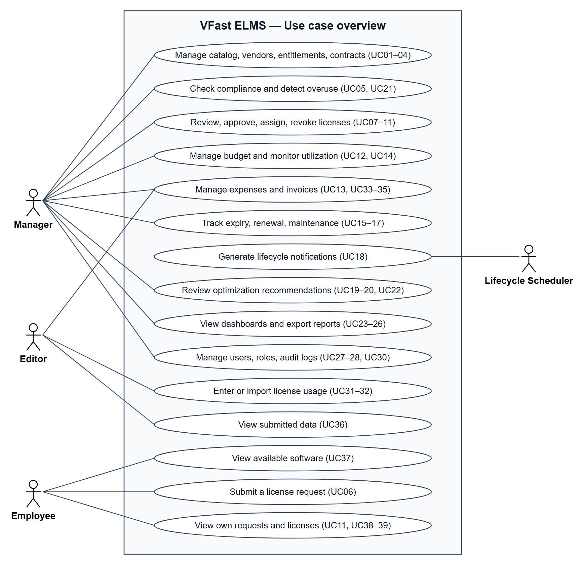
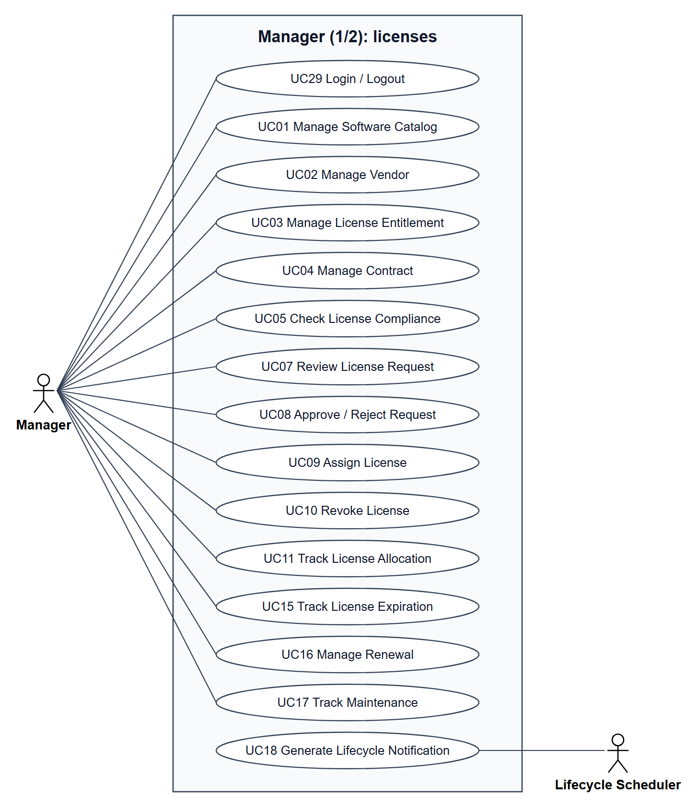
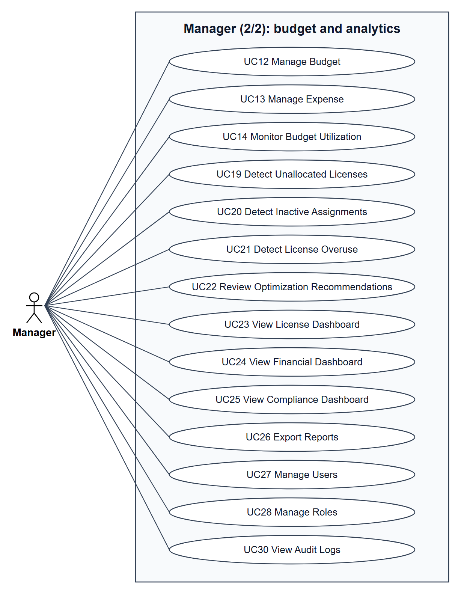
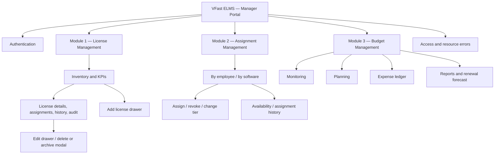
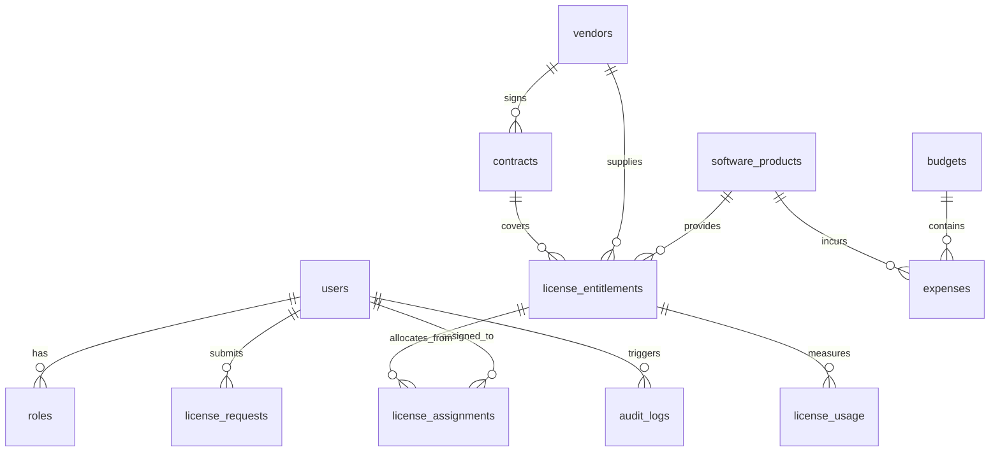

# VFast – Enterprise License Management System (ELMS)

VFast ELMS is an internal software license and budget management system. It brings the software catalog, entitlements, requests, approvals, assignments, usage records, expenses, expiry alerts, compliance checks, and audit history into one workspace.

The pilot serves **one company**, with three user roles: **Manager, Staff, and Employee**. Manager controls approvals and allocation; Staff maintains usage and expense data; Employee requests software and views personal requests and assignments. The main workflow is **request → approve/reject → assign → monitor usage → revoke or review renewal**.

**Pilot baseline:** SaaS Subscription and Perpetual License; eight feature groups F01–F08; 20 business rules BR-01–BR-20; a documented **2-week (14-day) Production Pilot** delivery target. The existing role model, rules, and individual UC/US priorities are retained.

**Current phase:** requirements analysis and design. This repository contains specifications and diagram-generation tools; no ELMS application or runtime acceptance results are present. The 14-day target is a delivery goal, not evidence of completion. [Specification alignment](#specification-alignment) lists differences that still require team agreement.

## 1. Requirements — INVEST, Use Cases and Acceptance Criteria

Requirements are organized top-down: **business problem → goals → scope → feature groups → use cases → user stories**. Use-case and story IDs provide traceability between business behavior, roles, and acceptance criteria.

### 1.1 Problem Analysis (Top-down Research)

| Analysis level | Content |
| --- | --- |
| Context | One company managing software entitlements, assignments, usage, budgets, and expenses |
| Problems | Fragmented license data; weak allocation and usage visibility; difficult budget tracking; expiry risk; informal approvals; limited evidence for optimization |
| Goals | Centralize license records, control allocation, monitor spending and lifecycle, support management decisions |
| Core capabilities | License portfolio, allocation, budget, lifecycle, optimization, analytics, roles, audit and data import |
| Pilot scope | Three roles; SaaS Subscription and Perpetual License; P0 core flows with P1 extensions |
| Validation | 14 pilot acceptance criteria, Given/When/Then scenarios, UC↔US mapping, planned integration tests and UAT |

These are the documented product problem areas. Organization-specific findings still need discovery evidence. Complete data coverage and 100% allocation accuracy are targets for an agreed managed scope, reporting period, and reconciliation source; they are not achieved results.

<details>
<summary>Business objectives G1–G8</summary>

| ID | Objective | Target outcome |
|---|---|---|
| G1 | Centralize licenses | Register and track SaaS Subscription and Perpetual License entitlements in one place |
| G2 | Control allocation | Support Request → Approve/Reject → Assign → Revoke; maintain accurate Purchased, Allocated, and Available quantities for compatible license metrics |
| G3 | Monitor usage | Record and aggregate usage data for the managed scope; distinguish missing data from zero usage |
| G4 | Manage budget | Record expenses and monitor budget utilization by year, period, and department |
| G5 | Manage lifecycle | Alert on contract and maintenance expiry at 30, 15, and 7 days |
| G6 | Support compliance checks | Detect over-allocation and overuse using valid, compatible data |
| G7 | Support cost optimization | Identify unassigned and inactive licenses and present evidence for Manager review |
| G8 | Support management decisions | Provide License, Financial, and Compliance dashboards and reports |

</details>

#### Top-down business decomposition


[Open XMind: VFast ELMS](docs/mindmap/vfast-elms.xmind)

The diagram breaks down the system into **License Management**, **Budget Management**, **Optimization**, **Analytics**, and **User & Organization**, then into more detailed capabilities. It connects the business analysis above to the pilot scope, use cases, and user stories. The PNG is exported from the editable XMind source.

### 1.2 Pilot scope and priorities

- **SaaS Subscription:** cloud subscriptions with a term and recurring cost.
- **Perpetual License:** continuing usage rights purchased once, potentially accompanied by a separate maintenance or upgrade-support agreement. Maintenance expiry is distinct from license validity.

These categories describe the pilot scope. Quantity comparisons must respect the entitlement's license metric and compatible data scope (BR-03); seat-based flows do not imply support for every licensing metric.

| Code | Feature group | Main content |
|:---:|---|---|
| F01 | License Management | Software Catalog, Vendor, Entitlement, Contract, Compliance |
| F02 | License Allocation | Request, approval, Assign, Revoke, allocation tracking |
| F03 | Budget Management | Budget per year or period, Expense, invoices, Budget Utilization |
| F04 | Lifecycle Management | Contract and maintenance dates, Renewal, expiry notifications |
| F05 | License Optimization | Unassigned and inactive licenses, Overuse, saving recommendations |
| F06 | Analytics & Reporting | License, Financial, Compliance dashboards; report export |
| F07 | User & Role Management | Accounts, departments, three-role permissions |
| F08 | System Administration | Login/logout, sessions, Audit Log, data import |

| Priority | Included capabilities |
|:---:|---|
| **P0 — required for pilot** | Login and RBAC; Catalog; SaaS/Perpetual Entitlement; Request and Approve/Reject; Assign/Revoke with quantity control; Budget and Expense; manual Usage entry; expiry tracking and alerts; core Dashboard; Audit Log; compliance and overuse checks |
| **P1 — after the core flow** | Vendor and Contract management; CSV/Excel import; invoice upload; detection of unassigned licenses and assignments inactive for at least 60 days; optimization recommendations; Compliance Dashboard; report export; personal expiry view |
| **P2 — future** | Automatic vendor integration, advanced SSO, AI optimization |

**Outside the first-release scope:** vendor API synchronization; automatic provisioning or revocation on vendor systems; ERP/accounting integration; automatic payment; AI/ML optimization; multi-level approval; automatic reclamation without Manager approval; multi-tenancy.

Assign/Revoke describes records managed within ELMS. An ELMS status change alone does not confirm a vendor-side access change. See [MVP scope and priorities](docs/01-MVP.md).

### 1.3 INVEST requirements

The backlog contains **25 user stories: 19 P0 and 6 P1**, grouped by Manager (14), Staff (6), and Employee (5).

| Criterion | Review expectation |
|---|---|
| Independent | A demonstrable outcome with dependencies identified |
| Negotiable | Implementation details can be discussed within agreed business rules |
| Valuable | A clear contribution to license control, budget control, or optimization |
| Estimable | Sufficiently explicit fields, constraints, and acceptance behavior |
| Small | Target size of 1–2 working days, subject to team estimation; manual entry and bulk import remain separate |
| Testable | Given/When/Then criteria with applicable authorization, validation, and failure scenarios |

| Story range | Responsibility |
|---|---|
| US-M01–M03 | Software catalog, entitlements, contracts |
| US-M04–M07 | Review requests, approve/reject, assign, revoke |
| US-M08–M09 | Budgets and expense review |
| US-M10–M11 | Compliance, overuse, expiry, renewal |
| US-M12 | Optimization recommendations (P1) |
| US-M13 | Management dashboards |
| US-M14 | User and role administration |
| US-S01–S02 | Manual usage entry (P0), usage import (P1) |
| US-S03–S05 | Manual expense entry (P0), expense import and invoice upload (P1) |
| US-S06 | Submitted-data review |
| US-U01–U03 | Software discovery, requests, request status |
| US-U04–U05 | Personal assignments (P0), personal expiry view (P1) |

INVEST is the review framework, not a certification that every story has passed. The 1–2-day story size is a target requiring team estimation. US-S04 still lacks Given/When/Then criteria; authorization and failure coverage need review. Mapping a use case to a story does not establish complete acceptance coverage.

See [User stories, acceptance scenarios, and traceability](docs/03-user-stories.md). Some P0 stories reference both P0 and P1 use cases; consult each use case's priority when planning delivery.

### 1.4 Use cases

The catalog contains **39 use cases: 27 P0 and 12 P1**, counted from the individual inventory rows. No use-case priority is changed by this summary. An ID appearing in multiple diagrams remains one use case.

#### Overview by role



The overview groups related use cases into capability ellipses for readability. Detailed views below show individual use cases.

#### Manager — License, allocation, and lifecycle



#### Manager — Budget, optimization, analytics, and administration



#### Staff — Usage and expense data


#### Employee — Requests and personal assignments


UC29 covers login/logout for all roles. UC18 is triggered by the **Lifecycle Notification System**, an automated actor without a user account. Diagram associations do not override record-level permissions or business rules.

[Use-case inventory, detailed flows, and sequence diagrams](docs/02-use-cases.md) · [Editable draw.io and SVG diagrams](docs/diagrams/out/)

### 1.5 Roles and permissions

| Capability | Manager | Staff | Employee |
|---|---|---|---|
| Software Catalog | CRUD | Read | Read (no price, no key) |
| Vendor | CRUD | Read | No access |
| License Entitlement | CRUD | Read | No access |
| Contract | CRUD | Read | No access |
| License Compliance | Manage / read | Read | No access |
| License Request | Review / approve | No access | Create / own |
| License Assignment | CRUD | No access | Read own |
| License Revocation | Manage | No access | No access |
| Budget | CRUD | Read | No access |
| Expense | CRUD | Enter / update | No access |
| License Usage | Read / manage | Enter / update | No access |
| Lifecycle | Manage | Read | Read own expiry |
| Optimization Insights | Manage / review | Read | No access |
| Dashboard and reports | Full | Related data only | Personal only |
| User and Role admin | CRUD | No access | No access |
| Audit Log | Read | Own actions | No access |
| Data Import | Manage | Execute | No access |

CRUD means create, read, update, and delete, subject to business rules and history retention. The matrix describes authorization, not delivery priority; access to a P1 capability does not make it P0.

The backend must enforce permissions for each action. Employee access is limited to personal requests and assignments (BR-08); Staff cannot modify Entitlement or Budget (BR-09). Hidden controls do not replace authorization. The Lifecycle Notification System scans SaaS expiry and Perpetual maintenance dates daily and alerts Managers.

### 1.6 Acceptance criteria

The MVP specification contains **14 pilot acceptance criteria**, covering login and access control; catalog and entitlement management; requests and allocation; usage and expense entry; budget and expiry visibility; dashboards; audit; integration tests; backup/restore; deployment; and UAT. These are requirements, not passed checks.

Key business controls supporting acceptance are:

| Control | Required behavior | Reference |
|---|---|---|
| Allocation capacity | Available = Purchased − Allocated; prevent assignments that exceed purchased capacity, including concurrent operations | BR-03–BR-05 |
| Decision authority | Only Manager approves/rejects requests and assigns/revokes licenses; optimization execution requires evidence and Manager approval | BR-06, BR-07, BR-16 |
| Data access | Employee sees personal requests and assignments; Staff cannot modify Entitlement or Budget | BR-08, BR-09 |
| Financial records | Valid Expense records require an amount, currency, and payment date; different currencies cannot be summed without an explicit conversion policy | BR-10, BR-11 |
| License lifecycle | Perpetual license validity and maintenance term are managed separately | BR-12 |
| Usage evidence | Compliance checks require valid, compatible usage data; missing usage is not automatically zero | BR-14, BR-15 |
| Traceability | Preserve revoked assignments and record important business actions in an immutable Audit Log; retain history according to company policy | BR-13, BR-17, BR-20 |
| Account and request state | Deactivated users lose access immediately; processed requests cannot be approved/rejected a second time | BR-18, BR-19 |

The specification requires transactions with row locking for assignment integrity; runtime protection has not been implemented or tested in this repository. Preventing over-allocation on assignment and detecting inconsistent allocation during reconciliation are distinct checks. The source and handling of externally inconsistent records need clarification.

[20 business rules and 14 pilot acceptance criteria](docs/01-MVP.md) · [Story acceptance scenarios](docs/03-user-stories.md) · [Specification alignment](#specification-alignment)

## 2. Information Architecture, Screen Hierarchy and UI/UX

The existing IA covers the **Manager Portal, Modules 1–3**: license inventory, assignment management, and budget management. Its screen catalog contains **18 screens and interactive views**, including pages, drawers, modals, sub-views, and system error pages. This is a design inventory, not implemented routing or full coverage of every role.

### 2.1 Information architecture



This summarizes the existing IA; including a view here does not resolve the P0/P1 scope differences. See [screen catalog, routes, and hierarchy](docs/04-information-architecture-manager.md).

### 2.2 Screen hierarchy

| Level / area | Screens and interactions |
| --- | --- |
| Application shell | Authentication context, role guards, global feedback |
| Authentication | Login page |
| License management | Inventory, add drawer, detail page, edit drawer, delete/decommission modal |
| License details | General information, active assignments, allocation history, audit tabs |
| Assignment management | Hub by employee/software, availability monitor, history, assign/revoke/change-tier dialogs |
| Budget management | Monitoring, planning, expense ledger, reports and renewal forecast |
| Access/errors | 403 Forbidden and 404 Not Found |

The hierarchy uses **shell → primary page → tab/sub-view → drawer/modal**. Detailed screen IDs, routes, breadcrumbs, and action mappings remain in the [Manager IA](docs/04-information-architecture-manager.md).

### 2.3 Primary user flows

1. **Request and allocation:** Employee views available software (UC37) and submits a request (UC06). Manager reviews it (UC07), approves or rejects it (UC08), and assigns an available, valid entitlement after approval (UC09). Employee views the assignment (UC39). Manager can subsequently revoke it while preserving history (UC10). UC09 also documents direct Manager assignment.
2. **Usage and expense:** Staff enters usage (UC31) and expense (UC33), then reviews submitted data (UC36). Manager reviews expense records (UC13); recorded data supports financial and compliance calculations. Bulk imports (UC32, UC34) and invoice upload (UC35) are P1.
3. **Budget and lifecycle:** Manager sets the budget (UC12) and monitors financial indicators (UC14). The system tracks expiry (UC15) and generates notifications (UC18). Renewal, downsizing, or cancellation decisions are covered by renewal management (UC16, P1); maintenance tracking is UC17, P1.

[Detailed workflows and sequence diagrams](docs/02-use-cases.md)

### 2.4 UI/UX design

The Manager IA specifies the following views and interaction patterns. No standalone UI mockup gallery or interactive application is included in the current repository.

| Area | Documented design |
| --- | --- |
| License inventory | KPIs, searchable inventory, entitlement details, seat gauge, contextual add/edit drawers |
| Assignment management | Employee/software perspectives, availability, assignment history, assign/revoke dialogs, tier change |
| Financial management | Budget monitoring, planning matrix, expense ledger, financial and renewal reports |
| Traceability | Historical assignments and audit tabs linked to the relevant records |

Financial formulas, report priority, and other cross-document differences are recorded under [Specification alignment](#specification-alignment). Illustrative labels, values, and layouts in the IA do not establish production data or completed behavior.

### 2.5 States and experience quality

| State | Documented behavior |
| --- | --- |
| Loading / submitting | Skeletons and progress indicators; disable repeated submission while processing |
| Empty | Explain the absence of records and offer an authorized initial action |
| Success | Formatted quantities/currencies, status badges, pagination, updated data |
| Capacity / budget alert | Show capacity and budget warnings with reasons for blocked allocation |
| Error / access denied | Inline field feedback, safe failure messages, retry, 403/404 views |

These are design requirements. Runtime behavior and usability have not been validated. See [UI states and interaction rules](docs/04-information-architecture-manager.md).

## 3. XMind Diagram Set

| Artifact | Format | Purpose |
| --- | --- | --- |
| [VFast ELMS mind map](docs/mindmap/vfast-elms.xmind) | Editable XMind | Product capabilities and top-down analysis |
| [Mind map preview](docs/mindmap.png) | PNG | README preview |
| [Use case diagrams](docs/diagrams/out/) | PNG, SVG, draw.io | Overview and four detailed actor views |

Only the product mind map currently has a native XMind source. Use-case diagrams are separately editable in draw.io; IA and sequence diagrams are documented in Mermaid.

To regenerate use-case assets, run `python ve_elms.py` from `docs/diagrams`. [ve_elms.py](docs/diagrams/ve_elms.py) uses [srsdiagram.py](docs/diagrams/srsdiagram.py) and writes PNG/SVG/draw.io output. Requirements: Python 3, Pillow, Playwright with Chromium, and Liberation Sans. These are diagram-tool dependencies, not an application setup guide.

## 4. Target Tech Stack

The table records technology choices already named in VFast specifications. It does not import the reference repository's stack or establish a complete, validated runtime baseline.

| Area | Existing specification | Source / status |
| --- | --- | --- |
| Database | PostgreSQL | Named in the MVP data-model section; no database or migrations included |
| Application architecture | Modular Monolith; Controller, Business Service, Data Persistence separation | Named in MVP NFR-05; no application code included |
| Schema migration | Flyway | Named in MVP NFR-05; no migration files included |
| Security | Backend RBAC, session checks, HTTPS/TLS; BCrypt or Argon2 password hashing | MVP NFR-01; IA also refers to JWT, without a complete authentication contract |
| Frontend / backend framework | No framework or version baseline specified in the current documents | Requires a separate technology decision |
| Documentation tools | XMind, Mermaid, Python diagram tools, draw.io | Existing documentation assets and generation scripts |

[MVP non-functional requirements and data model](docs/01-MVP.md) · [Manager IA](docs/04-information-architecture-manager.md)

## 5. C4 Architecture

The repository has no C4 diagram set. The following entries show documentation status; no new architecture is selected by matching the reference README format.

| Level | Current status |
| --- | --- |
| **C1 — System Context** | Roles and scope are described in requirements; no dedicated C4 context diagram |
| **C2 — Container** | Modular Monolith and PostgreSQL are named in the MVP; no container/deployment diagram |
| **C3 — Component** | Controller, Business Service, and Data Persistence separation is specified; no C4 component diagram |

## 6. Database Diagrams and OpenAPI Document

### 6.1 DBML / ER Mermaid format

The MVP describes **12 core entities**. The following Mermaid reproduces the existing ER relationships; it is a specification diagram, not a physical schema or an operational database.



[Entity descriptions and ER source](docs/01-MVP.md). No standalone DBML or physical migration files are included; relationship/cardinality validation remains part of data-model review.

### 6.2 OpenAPI API documentation

The IA contains a **screen-to-API mapping matrix** with example routes for license, assignment, budget, and audit views. No standalone OpenAPI JSON/YAML contract or running API is included.

[Screen-to-API mapping matrix](docs/04-information-architecture-manager.md)

## 7. Frontend and Backend Folder Structures

### 7.1 Current repository layout

```text
VFast/
├── README.md
└── docs/
    ├── 01-MVP.md
    ├── 02-use-cases.md
    ├── 03-user-stories.md
    ├── 04-information-architecture-manager.md
    ├── mindmap.png
    ├── mindmap/
    │   └── vfast-elms.xmind
    └── diagrams/
        ├── ve_elms.py
        ├── srsdiagram.py
        └── out/                  # PNG, SVG, editable draw.io
```

### 7.2 Target frontend structure

Not specified in the current repository. The Manager IA describes screens and routes, but does not define a frontend code tree.

### 7.3 Target backend structure

Not specified at folder/file level. The MVP requires a Modular Monolith with Controller, Business Service, and Data Persistence separation. No source directories, dependencies, or implementation scaffolding are created by this README update.

## Documentation

| Group | Documents |
| --- | --- |
| Scope, business rules, quality | [MVP: F01–F08, BR-01–BR-20, NFRs, 14 acceptance criteria](docs/01-MVP.md) |
| Requirements and traceability | [39 use cases and workflows](docs/02-use-cases.md) · [25 user stories and acceptance scenarios](docs/03-user-stories.md) |
| Structure and experience | [Manager IA, 18 views, states, permissions, and API mappings](docs/04-information-architecture-manager.md) |
| Product diagrams | [XMind source](docs/mindmap/vfast-elms.xmind) · [PNG preview](docs/mindmap.png) |
| Use-case diagrams | [Overview and actor diagrams](docs/diagrams/out/) · [Generation script](docs/diagrams/ve_elms.py) |
| Alignment | [Specification differences requiring agreement](#specification-alignment) |

<a id="7-cross-document-items-requiring-agreement"></a>

### Specification alignment

These items record unresolved specification differences. They do not replace existing business rules, change priorities, or introduce new pilot requirements.

| Item | Existing difference or gap | Agreement needed |
|---|---|---|
| Financial indicators | UC12/UC14 uses Budget − Actual for Remaining Budget and Actual / Budget for utilization. IA uses Actual + Committed in both indicators. IA describes Actual as paid cash and Committed as pending invoices plus active contracts. | Agree the reporting basis, distinct indicator names, and treatment of commitments without counting the same obligation twice. Neither formula is silently selected here. |
| Invoice upload | UC35 and US-S05 are P1, while MVP acceptance criterion 7 and the P0 expense flow include invoice attachments. | Confirm whether attachments are a P0 acceptance dependency or remain a P1 deliverable. |
| Vendor dependency | Entitlement requires a Vendor (BR-02), but Vendor management is P1. | Clarify how P0 obtains valid Vendor references without changing the Vendor-management priority. |
| IA delivery scope | IA labels all 18 views P0, including reports and renewal forecasting; its report view includes export and optimization behavior mapped to P1 use cases. | Align screen-level scope with UC/US priorities and distinguish P0 behavior from P1 extensions. |
| Personal expiry | US-U05 is P1, but the P0 UC39 flow already displays SaaS expiry. | Clarify the boundary between the P0 assignment view and P1 expiry detail. |
| Expense acceptance criteria | US-S04 has no Given/When/Then criteria; error and authorization coverage is incomplete across the backlog. | Complete the missing acceptance behavior before declaring INVEST or acceptance coverage complete. |
| VAT evidence | IA attributes mandatory VAT receipts to BR-10; BR-10 only specifies amount, currency, and payment date. | Confirm whether VAT evidence is an additional policy and its applicable delivery scope. |
| Source specification | MVP, Use Cases, and User Stories cite SRS v1.0, which is not included in this repository. | Provide an accessible reference/version so the cited sections can be verified. |

## Project Progress

Checked items indicate existing documentation artifacts, not business approval, implementation, or passed acceptance tests.

- [x] Product problem areas, objectives G1–G8, feature groups F01–F08, and pilot priorities documented.
- [x] Three-role permissions matrix and 20 business rules documented.
- [x] Catalog of 39 use cases: 27 P0 and 12 P1, with actor diagrams and core workflows.
- [x] Backlog of 25 user stories: 19 P0 and 6 P1, with a UC↔US mapping matrix.
- [x] Editable product XMind and PNG/SVG/draw.io use-case assets available.
- [x] Manager IA for Modules 1–3: 18 screens/views, hierarchy, states, and API mappings documented.
- [x] MVP ER diagram, 12 core entities, NFRs, and 14 pilot acceptance criteria documented.
- [ ] Resolve cross-document financial definitions, P0/P1 dependencies, and invoice requirements.
- [ ] Complete missing US-S04 acceptance criteria and review authorization/failure coverage.
- [ ] Provide a verifiable SRS v1.0 reference and validate organization-specific discovery findings.
- [ ] Complete UI validation, architecture/API/schema review, and framework/version decisions.
- [ ] Implement the ELMS application and verify integration tests, concurrency, backup/restore, deployment, and UAT under a separate implementation request.

The current repository provides analysis and design artifacts. No running application or accepted pilot is established by this documentation.
