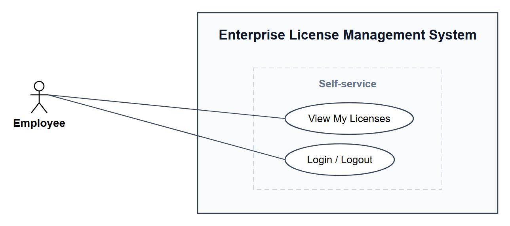
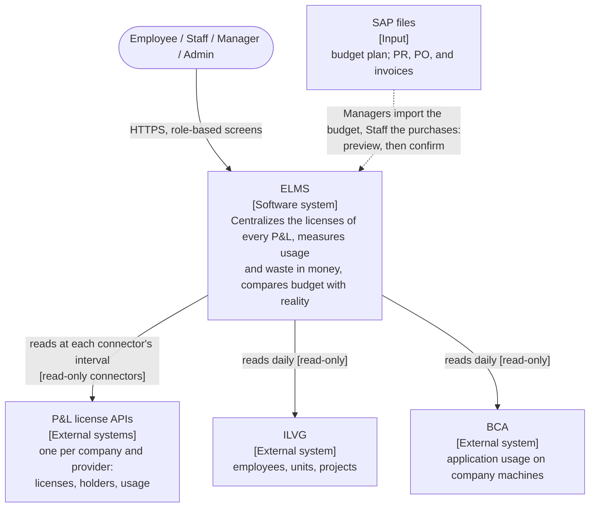
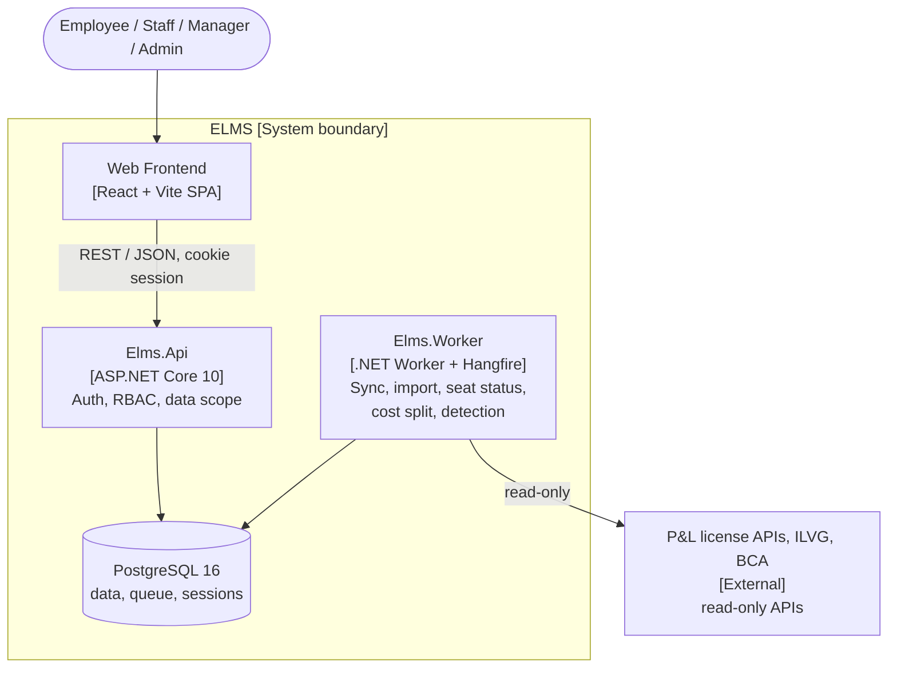

# Enterprise License Management System (ELMS) — team VFast

ELMS brings the software licenses of every company of the group, cloud services included, into one place. Each company connects its providers (Microsoft, Atlassian, Adobe, GitHub…) through usage connectors; ELMS reads who holds each license and how much is actually used, takes what was bought from SAP and the cloud costs from AWS, Azure, and the other cloud providers, and sets them against the budget plan. Managers see, for their units, Plan, Spend, and Actual — down to each license and each user — and judge waste from them, with a forecast of where the year will land. **ELMS never assigns, revokes, buys, or pays for anything.**

## 1. Requirements — Research, Use Cases, and INVEST

Requirements are derived top-down: business problem → stakeholders → goals → license models and data sources → epics (mind map) → use cases → user stories. Each story is reviewed with INVEST and has Given/When/Then acceptance criteria.

### 1.1 Mind map


The map collects the ideas of the product in seven branches: **License Management**, **Usage**, **Budget Management**, **Optimization**, **Analytics**, **User & Organization**, and **Connection Management**. Bold leaves are Must- and Should-have, plain leaves Could-have. The use cases are grouped close to these branches but not one to one: the map holds ideas, the use cases the goals of the actors.

Editable source: [`docs/mindmap/vfast.xmind`](docs/mindmap/vfast.xmind) (open with XMind); `docs/mindmap.png` is exported from it.

### 1.2 Top-down problem analysis

License and usage data are scattered across each provider's admin portal, and every provider counts in its own unit: seats, sessions, devices, cores, tokens, or contract terms. Nobody can say what the company owns, who uses it, or how far reality is from the budget plan.

| Goal | Measured by |
|---|---|
| G1 Centralize licenses | Every license of every company listed with provider, cost, allocated / purchased, and expiry in one list |
| G2 Know who uses what | Every assigned seat has one status — `Active`, `Inactive` (holder has left), `No use`, or `Not monitored` — and every holder a usage frequency |
| G3 Measure automatically | License, assignment, and usage data arrive through usage connectors on a schedule; nobody types them in |
| G4 Show the seats to act on | Seats not used, unassigned, or held by people who have left, with their cost |
| G5 Plan and reconcile the budget | Plan, Spend, and Actual compared per unit, license, and month, with a year-end forecast |
| G6 Cover cloud services | Pay-as-you-go cloud services tracked like licenses, per unit against their budget, with the cost to come |
| G7 Trustworthy figures | Numbers match across screens; missing data is `Unknown`, never zero |

What makes this project different:

1. **One view from group to user** — the same figures from the group down to a P&L, block, department, project, license, and the people holding it.
2. **Plan, Spend, Actual** — the user compares what was planned, what was spent, and what is really used, and judges waste from the gaps; ELMS does not compute waste for them.
3. **Missing data is not guessed** — a failed sync is `Unknown`, never usage 0, so it never suggests a seat is unused when it is not.
4. **Read-only toward every source** — ELMS shows the evidence; changes to licenses are made at the source, never by ELMS.
5. **One connector contract** — every usage connector, one per company and provider, answers in the same license data contract; nothing enters ELMS without passing its validator.

Full analysis, license-model research, data-source feasibility, scope, and risks: [Top-down research](docs/01-research-top-down.md).

Research on a common connector standard (FOCUS, SCIM 2.0, ISO/IEC 19770, provider APIs), the ECS v1 proposal, and its rollout plan: [Connector standard](docs/06-connector-standard.md).

### 1.3 Use cases

There are four roles: the **Manager** uses the product, **Staff** keep it fed, the **Admin** decides who can do what, and the **Employee** sees their own licenses. One diagram per actor shows every use case it can start:

| | |
|---|---|
|  |  |
|  |  |

11 use cases, by mind-map branch. A use case is one large flow of action of one actor; its smaller branches and the cases it handles are not use cases of their own. Manager and Staff work within the units or companies assigned to them, and a Manager can be assigned to the whole group; the Admin sees no license or cost data.

| ID | Use case | Goal | Actors |
|---|---|---|---|
| | **License Management** | | |
| UC01 | View License Detail | Know every license of my units, cloud services included, by unit or by provider: what it costs, how much of it is allocated, when it expires, and who uses it | Manager |
| UC02 | Browse License Inventory | Check the licenses each company's sources deliver, and keep the catalog, the shared licenses, and the cloud accounts assigned to units, so the figures land on the right units | Staff |
| | **Optimization** | | |
| UC03 | Track License Waste | Judge where licenses are wasted, from Plan, Spend, and Actual of every unit and the seats that are not used, unassigned, or held by people who have left | Manager |
| | **Budget Management** | | |
| UC04 | Manage Budget Plan | Managers set the license plan and the cloud budget of their units; Staff bring in what was bought, so Plan and Spend are right every month | Manager, Staff |
| UC05 | Forecast Spending | Know before the year ends where spending will land against the plan, and what the coming bills will be | Manager |
| | **Analytics** | | |
| UC06 | View Dashboards | See licenses, spending, and usage of my units at a glance, by unit or by license, provider, and category | Manager |
| | **User & Organization** | | |
| UC07 | Manage User Roles and Permissions | Give each user the role and the data scope their job needs | Admin |
| UC08 | Manage Organization Hierarchy | Keep the hierarchy from ILVG right and assign Managers to units | Admin |
| | **Connection Management** | | |
| UC09 | Manage Data Connectors | Connect the data sources — each company's license APIs and the cloud providers — so licenses, usage, and cloud costs flow into ELMS, and keep the syncs healthy | Staff |
| | **Self-service** | | |
| UC10 | View My Licenses | See the licenses I hold and whether I use them | Everyone |
| UC11 | Login / Logout | Sign in and out; set the password from the account email | Everyone |

Actors, core concepts, role × use case matrix, what each use case covers, and system processes: [Use cases](docs/02-use-cases.md). Features per use case: [Feature list](docs/08-feature-list.md).

### 1.4 Roles and permissions

There are four roles; each account has exactly one. Every account belongs to a real employee and is created from ILVG with the role Employee; Admin then gives the role and scope.

| Role | Who | Responsibility | Data scope |
|---|---|---|---|
| **Manager** | Manager of a unit: the group, a P&L, block, department, or project — **the main user** | Browses licenses and who uses them, tracks waste, plans the license and cloud budget of their units, follows the forecast, reads the dashboards | The units assigned to them and everything under them; the whole group for a Manager of the group |
| **Staff** | License management team member — hands-on work | Connects the data sources, imports the purchases from SAP, runs the monthly accrual, keeps the exchange rates, the software catalog, the shared licenses, and the assignment of cloud accounts to units | The companies assigned to them |
| **Admin** | System operator | Gives each user a role and a data scope, sets the permissions of each role, keeps the organization hierarchy and which Manager owns which unit | Users, roles, permissions, and the hierarchy; no license, usage, budget, or cost data |
| **Employee** | Every employee of the group | Sees the licenses they hold and whether they are recorded as used | Own licenses only |

| Capability | Admin | Manager | Staff | Employee |
|---|---|---|---|---|
| View License Detail (UC01) | — | Read, own units | — | — |
| Browse License Inventory (UC02) | — | — | Read, own companies; catalog, shared licenses, cloud accounts | — |
| Track License Waste (UC03) | — | Read, own units | — | — |
| Manage Budget Plan (UC04) | — | License plan and cloud budget of own units | Purchases, accrual, exchange rates | — |
| Forecast Spending (UC05) | — | Read, own units | — | — |
| View Dashboards (UC06) | — | Read, own units | — | — |
| Manage User Roles and Permissions, Organization Hierarchy (UC07, UC08) | Edit | — | — | — |
| Manage Data Connectors (UC09) | — | — | Create / edit / delete, own companies and cloud providers | — |
| View My Licenses (UC10) | Read own | Read own | Read own | Read own |

- The backend enforces every cell of this table and the data scope; hiding a button in the interface is not enough, and a call outside the role returns `403`.
- ELMS never writes to a provider or to SAP: "edit" here changes data in ELMS only.
- Every change to connectors, budget imports, purchases, cloud budgets and account assignments, user roles and scopes, the hierarchy, and permissions is recorded with who, old value, new value, and time.

The role × use case matrix: [Use cases](docs/02-use-cases.md#role--use-case-matrix).

### 1.5 INVEST requirements

The backlog contains **46 user stories (159 story points)**: 29 Must-have (113 points), 13 Should-have (37), 4 Could-have (9). Each story implements one use case; a use case too large for one story is split into several. Every story passes the INVEST review and has Given/When/Then acceptance criteria with concrete figures.

| Criterion | Meaning in ELMS |
|---|---|
| **Independent** | Each story produces a demonstrable outcome; usage, waste, and dashboard stories run on seeded data labelled as mock, without waiting for the P&L APIs. |
| **Negotiable** | Layout is left to the UI design and may change while outcome, permissions, and business rules stay fixed. |
| **Valuable** | Each story names the benefit for one role: Employee, Staff, Manager, or Admin. |
| **Estimable** | Inputs, outputs, roles, data scope, and failure outcomes are explicit; every story is estimated in points. |
| **Small** | One or more stories per use case; only US18 (budget import with versions and idempotency) reaches 8 points. |
| **Testable** | Every story has observable criteria, including rules that tie figures across use cases. |

```text
License Management     US01–US10 (UC01, UC02)         Manager (US09, US10: Staff)
Usage                  US11–US17 (UC03)               Manager
Budget Management      US18–US22 (UC04)               Manager (US20–US22: Staff)
Optimization           US23–US29 (UC03)               Manager
Analytics              US30–US36 (UC06)               Manager
User & Organization    US37–US39 (UC07, UC08)         Admin
Connection Management  US40–US44 (UC09)               Staff
Self-service           US45, US46 (UC10, UC11)        Every role
```

Backlog, per-story INVEST review, and acceptance criteria: [INVEST requirements](docs/03-invest-requirements.md).

## 2. Database design

The target schema is PostgreSQL, 40 tables in seven groups: organization and access, software catalog and licenses, collection pipeline, holders and usage, budget and expenses, optimization, audit. It follows the business model: a five-level organization from ILVG, one usage connector per company and provider, a license per connector and company mapped to the software catalog, budget versions imported from Excel, purchases (PO lines and invoices) imported from SAP, the cost of each month split into Used, Wasted, and Not evaluated, and BCA usage in its own table. Missing data is `Unknown`, never 0; history is kept as frozen daily snapshots and monthly cost allocations.


Entity overview, one ERD per group, a short explanation of every table, rule-to-schema traceability, and the decisions still to confirm (D24–D41): [Database design](docs/database/README.md). Source [`elms.dbml`](docs/database/elms.dbml), reference DDL [`schema.sql`](docs/database/schema.sql), draw.io files in [`docs/database/diagrams/`](docs/database/diagrams/).

## 3. Architecture and Folder Structures

ELMS is designed as one monolith with Clean Architecture, deployed as two processes (API and worker) that share one PostgreSQL database. The API serves users; slow work (connector syncs at each interval, budget and purchase imports, seat status, cost split, detection) runs in the worker through a PostgreSQL-backed job queue, so no Redis or message broker is required.

### 3.1 System context (C4 level 1)



Four roles use ELMS; each account has exactly one. Each P&L provides an API for its own license data; ELMS reads it through one usage connector per company and provider, at each connector's interval, in the license data contract (ECS), and never changes anything at a source. Employees and units come from ILVG, application usage from BCA, the budget plan from an Excel export of SAP, and the purchases — PO lines for seats and terms, invoices for cost — from another SAP export that Staff import each month, with a purchase made outside SAP entered by hand. Nobody enters licenses, holders, or usage by hand.

### 3.2 Container view (C4 level 2)



| Layer | Technology |
|---|---|
| Frontend | React 19, Vite, TypeScript, MUI v6, Tailwind CSS v4, ApexCharts |
| Backend | ASP.NET Core 10, EF Core + Dapper, Hangfire worker |
| Database | PostgreSQL 16 |

Deeper levels in [C4 Architecture](docs/07-c4-architecture.md): [components of the API, worker, modules, and frontend](docs/07-c4-architecture.md#3-level-3--component), [the sync and daily pipeline](docs/07-c4-architecture.md#5-dynamic-view--the-daily-pipeline), and [deployment](docs/07-c4-architecture.md#6-deployment-view).

### 3.3 Repository layout

```text
VFast/
├─ README.md
├─ docs/
│  ├─ 01 … 04               Research, use cases, INVEST, information architecture
│  ├─ 07, 08, 09            C4 architecture, feature list, data fields research
│  ├─ 05-folder-structure.md
│  ├─ 06-connector-standard.md
│  ├─ 07-c4-architecture.md
│  ├─ database/             elms.dbml, schema.sql, tables.md, ERDs
│  ├─ diagrams/out/         Use case diagrams
│  └─ mindmap/              XMind source
└─ src/
   ├─ frontend/             React SPA
   └─ backend/              .NET solution
```

### 3.4 Frontend

```text
src/frontend/
├─ routes/        paths.ts, router.tsx
├─ layouts/       Header, Sidebar, MainLayout
├─ components/    cards/, layout/, shared charts and icons
├─ sections/      licenses/, budget/  (feature blocks that compose pages)
├─ pages/         licenses/, budget/, analytics/, users/  (one per screen)
├─ types/  utils/  data/  theme/
└─ App.tsx, main.tsx, index.css
```

Call flow: `routes → pages → sections → components → types / utils`.

### 3.5 Backend

```text
ELMS/
├─ Elms.slnx, global.json, Directory.Build.props, Directory.Packages.props
├─ docker-compose.yml
├─ src/
│  ├─ SharedKernel.Domain/            BaseEntity, BaseAuditableEntity, Money
│  ├─ SharedKernel.Application/       Base Command/Query, Behaviours, Exceptions, AccessScope
│  ├─ SharedKernel.Infrastructure/    BaseDbContext, Audit + Scope interceptor
│  ├─ SharedKernel.Api/               BaseApiController, GlobalExceptionHandler
│  ├─ Elms.Domain/
│  │  ├─ Entities/<Module>/           Catalog, Usage, Finance, Optimization...
│  │  ├─ Enums/                       OrgLevel, Archetype, LicenseType, SeatStatus, ConnectorStatus
│  │  └─ Rules/                       SeatStatusRule, AccrualCalculator, CostAllocator, WasteFlagRule
│  ├─ Elms.Application/
│  │  ├─ Interfaces/                  IAppDbContext, ILicenseSource, IIlvgSource, IBcaSource
│  │  ├─ <Module>/<Feature>/          e.g. Catalog/Software, Finance/BudgetImports
│  │  │  └─ Commands/  Queries/  DTO/
│  │  ├─ Analytics/<Dashboard>/Queries/   Read views with Dapper
│  │  ├─ Ingestion/Pipeline/          Steps of a sync run: fetch, validate, normalize, coverage
│  │  └─ ConfigureServices.cs
│  ├─ Elms.Infrastructure/
│  │  ├─ Data/                        AppDbContext, Configurations/, Migrations/
│  │  ├─ Connectors/                  Ecs/ (P&L APIs), Ilvg/, Bca/, Simulated/
│  │  └─ ConfigureServices.cs
│  ├─ Elms.Api/                       Controllers/<Module>/, Program.cs
│  └─ Elms.Worker/                    Program.cs, Jobs/ (sync scheduler, connector run, daily pipeline, month close)
└─ tests/                             Unit, Integration (Testcontainers), Architecture
```

Dependency direction: `Api / Worker → Infrastructure → Application → Domain → SharedKernel`. The eight business modules (`identity`, `organization`, `catalog`, `ingestion`, `usage`, `finance`, `optimization`, `analytics`, plus shared `audit`) are feature folders inside each layer; boundaries are enforced by architecture tests.

Full trees, module table, API conventions, jobs, caching, security, and deployment: [Folder structure and architecture](docs/05-folder-structure.md). The same design as C4 diagrams (context, container, component, daily pipeline, deployment): [C4 Architecture](docs/07-c4-architecture.md).

## Documentation

- [Top-down research](docs/01-research-top-down.md) — problem, stakeholders, goals, license models, data sources, process, epics, scope, risks
- [Use cases](docs/02-use-cases.md) — actors, role × feature matrix, business rules, system processes, 11 use cases
- [INVEST requirements](docs/03-invest-requirements.md) — 46 user stories, INVEST review, acceptance criteria
- [Information architecture](docs/04-information-architecture-manager.md) — screen catalog, navigation by role, screen specifications, UI conventions, screen-to-API mapping
- [Folder structure and architecture](docs/05-folder-structure.md) — solution architecture, frontend structure, backend modules and .NET folder layout, API conventions, jobs, caching, security
- [Connector standard](docs/06-connector-standard.md) — research on FOCUS, SCIM, ISO/IEC 19770 and provider APIs; the ELMS Connector Standard (ECS) v1 proposal, Connector Management use cases, rollout plan
- [C4 Architecture](docs/07-c4-architecture.md) — system context, containers, components, daily pipeline, deployment, cross-cutting concerns
- [Feature list](docs/08-feature-list.md) — features of every use case, by mind-map branch
- [Data fields research](docs/09-data-fields-research.md) — fields each source can return: usage connectors, BCA, ILVG, budget file
- [Database design](docs/database/README.md) — conventions, entity overview, ERD per group, every table explained, rule-to-schema traceability, proposed decisions D24–D41; every field in [Tables and fields](docs/database/tables.md)

## Frontend development

The frontend application, configuration, dependencies and lockfiles are in [src/frontend](src/frontend/README.md). From the repository root, install its dependencies once and start the dev server:

```powershell
npm --prefix src/frontend install
npm run dev
```

`npm run build` and `npm run preview` also work from the repository root. The root scripts forward to `src/frontend`; the build output is `src/frontend/dist/`.
