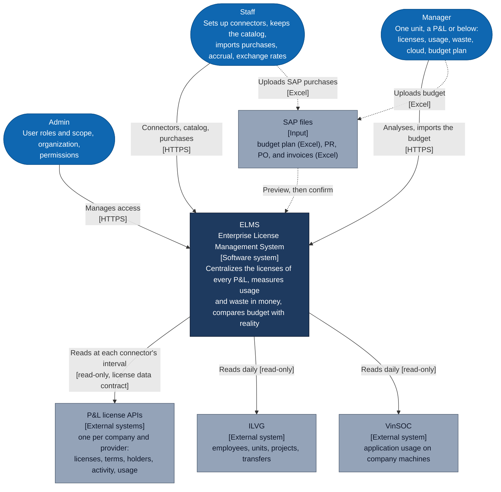
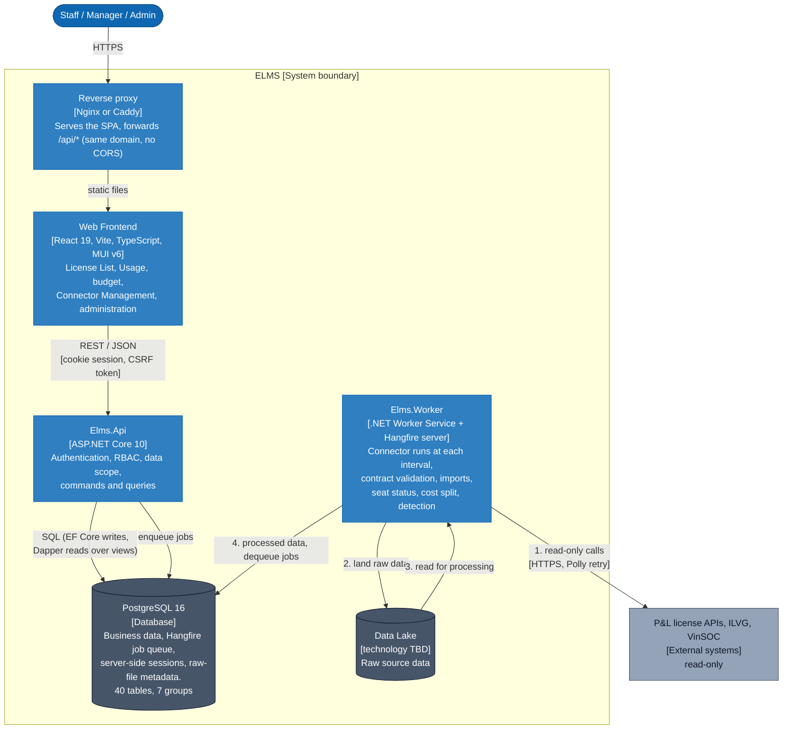
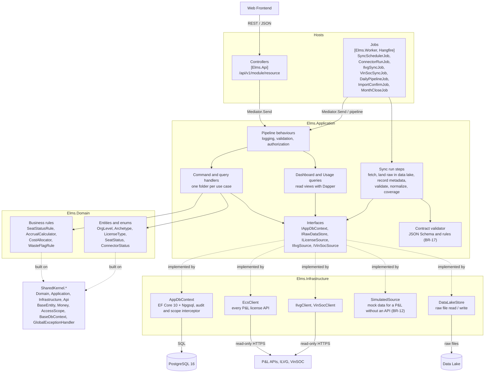
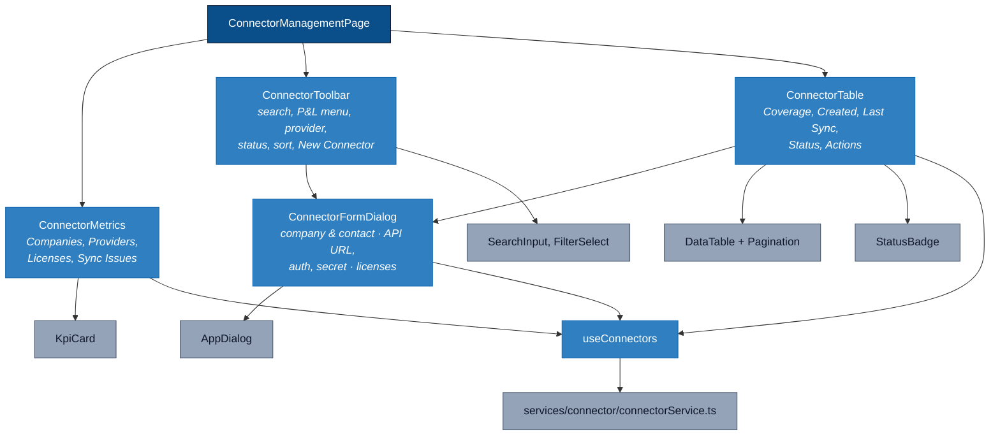
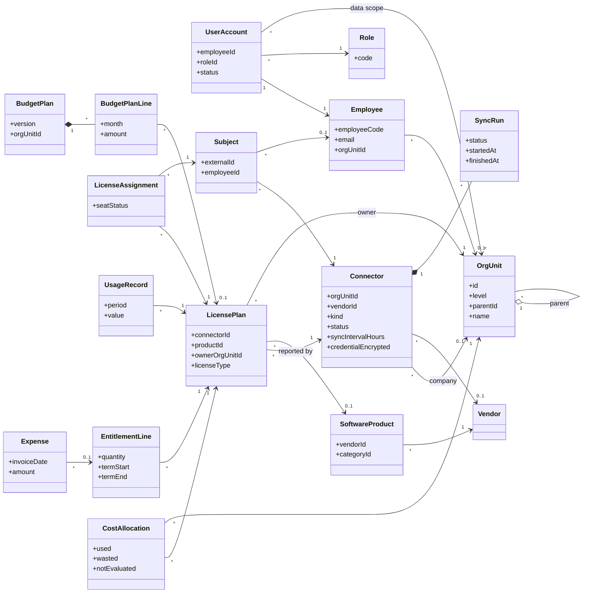

# Enterprise License Management System (ELMS) — team VFast

ELMS brings the software licenses of every company of the group into one place. Each company connects its providers (Microsoft, Atlassian, Adobe, GitHub, SAP…) through usage connectors; ELMS reads what each license costs, how much of it is allocated, who holds it, and how much is actually used, and sets it against the budget plan. Managers see, for their units, the money planned, purchased, used, and wasted — down to each license and each user — **and ELMS never assigns, revokes, buys, or changes anything on a provider**.

## 1. Requirements — Research, Use Cases, and INVEST

Requirements are derived top-down: business problem → stakeholders → goals → license models and data sources → epics (mind map) → use cases → user stories. Each story is reviewed with INVEST and has Given/When/Then acceptance criteria.

### 1.1 Mind map


The map has seven branches: **License Management** (license list & validity; catalog & inventory), **Usage** (scope & overview, subordinate analytics, employee usage), **Budget Management** (planning & cost allocation, spending & monitoring), **Optimization** (detection, waste analysis), **Analytics** (group overview, license & provider analysis, metric definitions, dashboards), **User & Organization**, and **Connection Management** (usage connectors, sync monitoring). The map collects ideas; the use cases in 1.3 follow the goals of the actors, so they are close to its branches but not one to one.

Editable source: [`docs/mindmap/vfast.xmind`](docs/mindmap/vfast.xmind) (open with XMind); `docs/mindmap.png` is exported from it.

### 1.2 Top-down problem analysis

License and usage data are scattered across each provider's admin portal, and every provider counts in its own unit: seats, sessions, devices, cores, tokens, or contract terms. Nobody can say what the company owns, who uses it, or how far reality is from the budget plan.

| Goal | Measured by |
|---|---|
| G1 Centralize licenses | Every license of every company listed with provider, cost, allocated / purchased, and expiry in one list |
| G2 Know who uses what | Every assigned seat has exactly one status over the last 30 days — `Active`, `Inactive`, `No activity`, or `Not monitored` — and every holder a usage frequency |
| G3 Measure automatically | License, assignment, and usage data arrive through usage connectors on a schedule; nobody types them in |
| G4 Express waste as money | Underutilized accounts and their annual cost on one screen |
| G5 Plan and reconcile the budget | Plan, Purchased, and Used compared per unit, license, and month |
| G6 Make waste visible | Waste (the cost of unassigned and inactive seats) shown per unit, license, and month, with the units wasting most first |
| G7 Trustworthy figures | Numbers match across screens; missing data is `Unknown`, never zero |

What makes this project different:

1. **One view from group to user** — the same figures from the group down to a P&L, block, department, project, license, and the people holding it.
2. **Plan, Purchased, Used** — Plan − Purchased is unspent budget; Purchased splits into Used, Wasted, and Not evaluated; each gap is a different problem with a different fix.
3. **Missing data is not guessed** — a failed sync is `Unknown`, never usage 0, so it never creates a false waste finding.
4. **Read-only toward every source** — ELMS shows the evidence; changes to licenses are made at the source, never by ELMS.
5. **One connector contract** — every usage connector, one per company and provider, answers in the same license data contract; nothing enters ELMS without passing its validator.

Full analysis, license-model research, data-source feasibility, scope, and risks: [Top-down research](docs/01-research-top-down.md).

Research on a common connector standard (FOCUS, SCIM 2.0, ISO/IEC 19770, provider APIs), the ECS v1 proposal, and its rollout plan: [Connector standard](docs/06-connector-standard.md).

### 1.3 Use cases

There are three roles: the **Manager** uses the product and makes the decisions, **Staff** keep it fed, and the **Admin** decides who can do what. One diagram per actor shows every use case it can start:

| Manager | Staff |
|---|---|
|  |  |

| Admin |
|---|
|  |

11 use cases, by mind-map branch. A Manager works on their unit — a P&L, block, department, or project — and everything under it; there is no level above the P&L. A Staff member works for one Manager, on that Manager's units, and the Manager can do every task of Staff. The Admin sees no license or cost data.

| ID | Use case | Goal | Actors | What the actor does |
|---|---|---|---|---|
| | **License Management** | | | |
| UC01 | View License Detail | Know every license of my units: what it costs, how much of it is allocated, when it expires, and who uses it | Manager | Picks a license; reads its Plan, Spend, and Actual, the seats bought and allocated, and the expiry date; sees the units it is allocated to; sees each holder — still employed or left, using it or not, and for how long |
| UC02 | Maintain License Inventory | Make the figures from every source land on the right units | Staff, Manager | Checks that each company's sources deliver all its licenses; keeps the software catalog and maps license names to it; marks the licenses shared between companies; assigns each cloud account to the unit that uses it |
| | **Optimization** | | | |
| UC03 | Track License Waste | Find which units and licenses waste money, to reclaim seats or cut them | Manager | Picks a unit and a period; compares Plan, Spend, and Actual of the unit and of each unit below it, month by month, down to each license; reviews the seats not used, held by people who have left, or bought and given to nobody; exports |
| | **Cloud** | | | |
| UC04 | Track Cloud Costs and Usage | Follow the cost and usage of my units' cloud services against their budget | Manager | Picks the cloud infrastructure and the year; reads Plan, Spend, and Actual by month; goes down to unit, provider, and service, or by billing account; exports |
| | **Budget Management** | | | |
| UC05 | Manage Budget Plan | Keep the Plan and Spend of my units right and complete every month | Manager, Staff | Manager: uploads or enters the license plan and the cloud budget of their units, and reviews the gap between plan and purchases. Staff and Manager: import the purchases from SAP and enter those made outside it, fill the missing months, close the monthly accrual, keep the exchange rates |
| UC06 | Forecast Spending | Know before the year ends where spending will land against the plan, and what the coming bills will be | Manager | Reads past spending and the forecast of the months left; sees whether year-end spending will be over or under plan, and by how much; sees the amounts falling due: license renewals and cloud cost |
| | **Analytics** | | | |
| UC07 | View Dashboards | See at a glance how the licenses and spending of my units stand, to know where to look closer | Manager | Reads the summary figures — Plan, Spend, and Actual, license counts, licenses expiring soon, seats by status — and their trend by month, unit, and license; from there opens UC01, UC03, or UC04 |
| | **User & Organization** | | | |
| UC08 | Manage User Accounts and Access | Give each user the role and the data scope their job needs | Admin | Gives an employee an account with the role Manager or Staff; assigns a Manager to a unit and a Staff member to a Manager; disables or re-enables an account; reads the change history |
| UC09 | Manage Organization Hierarchy | Keep the organization tree right, so figures add up and data scopes are right | Admin | Reviews the tree from ILVG — P&L, Block, Department, Project; adds, renames, or removes a unit, and corrects a unit placed wrongly |
| | **Connection Management** | | | |
| UC10 | Manage Data Connectors | Bring licenses, usage, and cloud costs into ELMS and keep the syncs healthy | Staff, Manager | Creates or edits the connector of a company and provider, with its licenses and credential; connects the cloud providers; follows the syncs and fixes the failing connectors |
| | **Access** | | | |
| UC11 | Login / Logout | Enter ELMS and work within my own scope | Admin, Manager, Staff | Signs in and out; resets the password from the account email |

Role × use case matrix, core concepts, system processes, and what every use case covers: [Use cases](docs/02-use-cases.md).

### 1.4 Roles and permissions

There are three roles; each account has exactly one. Every account belongs to a real employee, matched by company email.

| Role | Who | Responsibility | Data scope |
|---|---|---|---|
| **Manager** | Manager of one unit: a P&L, block, department, or project — **the main user** | Browses licenses and who uses them, tracks license waste and cloud costs, plans the budget of licenses and cloud, follows the forecast, reads the dashboards; can also do every task of Staff | Their unit and everything under it; there is no level above the P&L |
| **Staff** | License management team member, working for one Manager — hands-on work | Connects the data sources, imports the purchases from SAP, runs the monthly accrual, keeps the exchange rates, the software catalog, the shared licenses, and the assignment of cloud accounts to units; does not plan, judge waste, forecast, or read the dashboards | The units of the Manager they work for |
| **Admin** | System operator | Accounts, roles, data scopes, permissions, and the organization hierarchy | No license, budget, or cost data |

| Use case | Admin | Manager | Staff |
|---|---|---|---|
| UC01 View License Detail | — | Own units | — |
| UC02 Maintain License Inventory | — | Own units | Their Manager's units |
| UC03 Track License Waste | — | Own units | — |
| UC04 Track Cloud Costs and Usage | — | Own units | — |
| UC05 Manage Budget Plan | — | License plan and cloud budget; purchases, accrual, exchange rates | Purchases, accrual, exchange rates |
| UC06 Forecast Spending | — | Own units | — |
| UC07 View Dashboards | — | Own units | — |
| UC08 Manage User Accounts and Access, UC09 Manage Organization Hierarchy | ✓ | — | — |
| UC10 Manage Data Connectors | — | Own units | Their Manager's units |
| UC11 Login / Logout | ✓ | ✓ | ✓ |

- The backend enforces every cell of this table and the data scope; hiding a button in the interface is not enough, and a call outside the role returns `403`.
- ELMS never writes to a provider: "edit" here changes data in ELMS only.
- Every change to connectors, budget imports, users, the hierarchy, roles, and permissions is recorded with who, old value, new value, and time.

The role × use case matrix and the core concepts: [Use cases](docs/02-use-cases.md#role--use-case-matrix).

### 1.5 INVEST requirements

The backlog contains **50 user stories (178 story points)** for the 11 use cases; a use case is split into several stories, and each story names its use case: 32 Must-have (127 points), 14 Should-have (42), 4 Could-have (9). Every story passes the INVEST review and has Given/When/Then acceptance criteria with concrete figures.

| Criterion | Meaning in ELMS |
|---|---|
| **Independent** | Each story produces a demonstrable outcome; usage, waste, and dashboard stories run on seeded data labelled as mock, without waiting for the P&L APIs. |
| **Negotiable** | Layout follows the UI demos but may change while outcome, permissions, and business rules stay fixed. |
| **Valuable** | Each story names the benefit for one role: Staff, Manager, or Admin; a Manager can also do every Staff story in their units. |
| **Estimable** | Inputs, outputs, roles, data scope, and failure outcomes are explicit; every story is estimated in points. |
| **Small** | A use case is split into stories, often one per flow (the login story US45 is not on the map); only US18 (budget import with versions and idempotency) reaches 8 points. |
| **Testable** | Every story has observable criteria, including rules that tie figures across screens. |

```text
License Management     US01–US05 US07 US08 (UC01); US06 US09 US10 US47 (UC02)   Manager (US06, US09, US10, US47: Staff)
Cloud                  US46 (UC04)                                              Manager
Usage                  US11–US17 (UC03)                                         Manager
Budget Management      US18–US22 US48 (UC05); US50 (UC06)                       Manager (US20–US22: Staff)
Optimization           US23–US29 (UC03)                                         Manager
Analytics              US30–US36 (UC07)                                         Manager
User & Organization    US37 US38 (UC08); US39 (UC09)                            Admin
Connection Management  US40–US44 US49 (UC10)                                    Staff
Access                 US45 (UC11)                                              Every role
```

Backlog, per-story INVEST review, and acceptance criteria: [INVEST requirements](docs/03-invest-requirements.md).


## 2. Information Architecture, Screen Hierarchy, and UI/UX

The workspace is organized by role: after login each role lands on its own first screen, and the sidebar shows only the screens the role may open. Every screen follows the same states (loading, empty, `Unknown` / no data yet, error, saving, success) and shows money with the rate used; missing data is never shown as 0.

### 2.1 Information architecture

```text
Public
└── Login                                   SCR-LOGIN-01

Authenticated shell (Topbar + Sidebar by role)
├── Manager                                 lands on License List
│   ├── License List → License details + users
│   ├── Usage: scope, Plan / Spend / Actual, waste analysis
│   ├── Licenses: inventory, by organization, providers, terms
│   ├── Cloud: by unit, by infrastructure
│   ├── Budget: import, plan, cloud budget, accrual
│   ├── Employee usage
│   ├── Dashboards, Analysis, Metric definitions
│   └── every Staff screen, for their units
├── Staff                                   lands on Connector Management
│   ├── Connector Management → New / Edit connector
│   ├── Sync monitoring
│   ├── Software catalog, Shared licenses, Cloud accounts
│   └── Expenses, Accrual, Exchange rates
└── Admin                                   lands on Users
    └── Users, Organization, Roles, Permissions
```

### 2.2 Screen hierarchy

Login leads to the authenticated shell: a topbar (breadcrumb, sync status, fiscal year, session, switch account) and a sidebar whose menu depends on the role. Pages open inside the shell; create, edit, import, and drill-down open as dialogs owned by the page's feature (Quick edit budget, Import budget, New / Edit connector, License analysis, Cost records). A route outside the role is refused by the frontend guard and, behind it, by the API (`403`).

The 33 screen IDs, navigation by role, screen specifications, UI conventions, and the API each screen calls: [Information architecture](docs/04-information-architecture-manager.md).

### 2.3 Current UI prototype

The frontend baseline is the HTML demo [`UI/VFast_UI_v90.html`](UI/VFast_UI_v90.html); open it in a browser and pick a role on the login screen.

| Screen | Screen ID | Role |
|---|---|---|
| Login | SCR-LOGIN-01 | Every role |
| Usage — License Cost & Efficiency Analytics | SCR-USAGE-01 | Manager |
| License Overview, License Detail | SCR-LIC-LIST-01, SCR-LIC-DETAIL-01 | Manager |
| Budget Plan, Import budget | SCR-BUDGET-PLAN-01, SCR-BUDGET-IMPORT-01 | Manager, Staff |
| Cloud Usage by P&L, by infrastructure | SCR-CLOUD-PNL-01, SCR-CLOUD-INFRA-01 | Manager |
| Connector Management, New / Edit connector | SCR-CONN-01, SCR-CONN-FORM-01 | Staff, Manager |
| User Management | SCR-USERS-01 | Admin |

## 3. C4 Architecture

ELMS is designed as one monolith with Clean Architecture, deployed as two processes (API and worker) that share one PostgreSQL database, plus a data lake for raw source data. This README shows C1–C3; C4 Level 4 is in [section 6](#6-detailed-class-and-sequence-design), and the full views are in the [architecture documentation](docs/architecture/c4/README.md).

### C1 — System Context



Three roles use ELMS; each account has exactly one. Each P&L provides an API for its own license data; ELMS reads it through one usage connector per company and provider, at each connector's interval, in the license data contract (ECS), and never changes anything at a source. Employees and units come from ILVG, application usage from VinSOC, the budget plan from an Excel export of SAP, and the cost from the invoices Staff record. Nobody enters licenses, holders, or usage by hand.

### C2 — Container



The API serves users; slow work (connector syncs at each interval, budget and expense imports, seat status, cost split, detection) runs in the worker through a PostgreSQL-backed job queue, so no Redis or message broker is required. Data from the source APIs never goes straight into the database: the worker lands it in the data lake, processes it, and only then writes the result to PostgreSQL.

| Layer | Technology |
|---|---|
| Frontend | React 19, Vite, TypeScript, MUI v6, Tailwind CSS v4, ApexCharts, axios |
| Backend | ASP.NET Core 10, EF Core + Dapper, Hangfire worker |
| Database | PostgreSQL 16 |
| Raw data storage | Data lake (technology TBD) |

### C3 — Component



The Api and the Worker are built from the same layers and run the same handlers; the eight business modules are feature folders inside each layer, kept apart by architecture tests.

Complete documentation: [C4 Architecture](docs/architecture/c4/README.md) (with the [business modules](docs/architecture/c4/03-component.md#2-business-modules) and the [frontend components](docs/architecture/c4/03-component.md#3-web-frontend)) and the [arc42 Architecture Handbook](docs/architecture/arc42/README.md) ([runtime](docs/architecture/arc42/06-runtime-view.md), [deployment](docs/architecture/arc42/07-deployment-view.md), [decisions](docs/architecture/arc42/09-architecture-decisions.md)).

## 4. Database Design and API Contract

### 4.1 Database diagrams

The target schema is PostgreSQL, 40 tables in seven groups: organization and access, software catalog and licenses, collection pipeline, holders and usage, budget and expenses, optimization, audit. It follows the business model: the organization from ILVG (P&L > block > department > project, with a group row kept only as the owner of shared licenses until that owner is decided), three roles with each Staff member working for one Manager, one usage connector per company and provider, a license per connector and company mapped to the software catalog, budget versions imported from Excel, the cost of each month split into Used, Wasted, and Not evaluated, and VinSOC usage in its own table. Raw data from the sources is kept in a data lake; the collection pipeline tables hold only its metadata. Missing data is `Unknown`, never 0; history is kept as frozen daily snapshots and monthly cost allocations.


Entity overview, one ERD per group, a short explanation of every table, rule-to-schema traceability, and the decisions still to confirm (D24–D53): [Database design](docs/database/README.md). Source [`elms.dbml`](docs/database/elms.dbml), reference DDL [`schema.sql`](docs/database/schema.sql), draw.io files in [`docs/database/diagrams/`](docs/database/diagrams/).

### 4.2 API contract

All endpoints are under `/api/v1/<module>/<resource>`, read the data scope from the cookie session, and return `403` outside it.

```text
REST / JSON under /api/v1, plural kebab-case resources
Cookie session (HttpOnly) + XSRF token, no bearer token in the browser
Lists: page, pageSize (max 100), sort, filters → { items, total }
Errors: ProblemDetails (RFC 9457) — 400, 401, 403, 404 outside scope, 409
Optimistic concurrency on PostgreSQL xmin
Imports: preview, then confirm by previewKey (idempotent)
Money as amount + currency; missing data is null with a reason, never 0
```

The OpenAPI 3 specification is not written yet; until then the contract is defined by the [API conventions](docs/05-code-structure.md#5-api-conventions) and the [screen-to-API mapping](docs/04-information-architecture-manager.md#6-screen-to-api-mapping).

## 5. Frontend and Backend Code Structures

### 5.1 Repository layout

```text
VFast/
├─ README.md
├─ docs/
│  ├─ 01 … 04               Research, use cases, INVEST, IA
│  ├─ 05-code-structure.md
│  ├─ 06-connector-standard.md
│  ├─ 08, 09                Feature list, data fields research
│  ├─ architecture/         arc42/ (1–12), c4/ (C1–C4), uml/
│  ├─ database/             elms.dbml, schema.sql, tables.md, ERDs
│  ├─ diagrams/out/         Use case diagrams
│  └─ mindmap/              XMind source
├─ UI/                      HTML demos (v90 = frontend baseline)
└─ src/
   ├─ frontend/             React SPA
   └─ backend/              .NET solution
```

The frontend in `src/frontend` is already coded but still follows the previous layered model (`pages/`, `sections/`, `components/`) and mock data; the backend is not started. The trees below are the target.

### 5.2 Target React feature structure

```text
src/frontend/
├─ app/           App, router, RequireRole, layout/
├─ config/        env.ts, api.ts (API prefix, XSRF names, timeout)
├─ features/      auth, usage, licenses, budget, cloud, admin…
│  └─ <feature>/  pages/, components/, hooks/, types.ts, index.ts
├─ services/      apiClient.ts (axios) + <module>/<module>Service.ts
├─ shared/        components, hooks, types, utils
├─ theme/
└─ main.tsx, index.css
```

Target dependency flow:

```text
Page / Component → Feature Hook → Feature Service → apiClient → ASP.NET Core API
```

Decomposed from UI demo [`UI/VFast_UI_v90.html`](UI/VFast_UI_v90.html) and organized by feature; API calls live only in `services/`, imported by feature hooks; a feature imports `services/` and `shared/`, never another feature. Full tree and responsibilities: [Code structure §3](docs/05-code-structure.md#3-frontend).

### 5.3 Target ASP.NET Core Clean Architecture structure

```text
src/backend/
├─ src/
│  ├─ SharedKernel.*/        Base types, behaviours, AccessScope
│  ├─ Elms.Domain/           Entities, enums, Rules/ (pure business rules)
│  ├─ Elms.Application/      <Module>/<Feature>/ commands, queries, handlers
│  ├─ Elms.Infrastructure/   EF Core, connectors, DataLakeStore
│  ├─ Elms.Api/              Controllers/<Module>/
│  └─ Elms.Worker/           Hangfire jobs
└─ tests/                    Unit, integration, architecture
```

Target flow:

```text
HTTP:   Controller → Mediator → Behaviours → Handler → Domain Rules
        → IAppDbContext → PostgreSQL
Worker: Hangfire Job → Pipeline step → ILicenseSource → IRawDataStore
        → Handler → IAppDbContext → PostgreSQL
```

Dependency rules:

```text
Api / Worker → Infrastructure → Application → Domain → SharedKernel
Domain → nothing
Application → interfaces only (IAppDbContext, IRawDataStore, ILicenseSource)
Only Infrastructure references EF Core, Npgsql, HTTP clients, the data lake
A module never calls another module's tables; analytics only reads
```

The eight business modules (`identity`, `organization`, `catalog`, `ingestion`, `usage`, `finance`, `optimization`, `analytics`, plus shared `audit`) are feature folders inside each layer; boundaries are enforced by NetArchTest. Full tree, responsibilities, modules, jobs, caching, security, and deployment: [Code structure §4](docs/05-code-structure.md#4-backend).

## 6. Detailed Class and Sequence Design

The detailed design derives from the C4 components in section 3, the database and API contract in section 4, and the target code structure in section 5. These are target views; the code may merge classes as long as the layer boundaries hold.

### 6.1 C4 Level 4 — Code

#### L4.1 Connector Management (`/connectors`)



The other pages (shell and routing, Usage, Budget Plan, Cloud Usage, User Management) follow the same pattern. Source: [C4 Level 4 — Code](docs/architecture/c4/04-code.md)

### 6.2 Core class diagrams

#### 1. Core domain



Source: [Class diagrams](docs/architecture/uml/01-class-diagrams.md), which also hold the frontend `apiClient` and service classes.

### 6.3 Sequence diagrams

Four scenarios from UI demo v90, each from the page through its hook and service to the API and the database, with the `401` / `403` / `404` paths:

- [Login and role routing](docs/architecture/uml/02-sequence-diagrams.md#1-login-and-role-routing)
- [Usage for a scope](docs/architecture/uml/02-sequence-diagrams.md#2-usage-for-a-scope)
- [Import budget plan](docs/architecture/uml/02-sequence-diagrams.md#3-import-budget-plan) — preview, then confirm by `previewKey`
- [New connector](docs/architecture/uml/02-sequence-diagrams.md#4-new-connector)

The sync and daily pipeline (connector run → data lake → validate → normalize) is in [arc42 runtime view](docs/architecture/arc42/06-runtime-view.md).

## Documentation

- [Top-down research](docs/01-research-top-down.md) — problem, stakeholders, goals, license models, data sources, process, epics, scope, risks
- [Use cases](docs/02-use-cases.md) — actors, core concepts, role × use case matrix, 11 use cases, system processes
- [INVEST requirements](docs/03-invest-requirements.md) — 50 user stories, INVEST review, acceptance criteria
- [Information architecture](docs/04-information-architecture-manager.md) — screen catalog, navigation by role, screen specifications, UI conventions, screen-to-API mapping
- [Code structure and architecture](docs/05-code-structure.md) — solution architecture; frontend and backend target flow, code structure, and responsibilities; backend modules, API conventions, jobs, caching, security
- [Connector standard](docs/06-connector-standard.md) — research on FOCUS, SCIM, ISO/IEC 19770 and provider APIs; the ELMS Connector Standard (ECS) v1 proposal, Connector Management use cases, rollout plan
- [Architecture](docs/architecture/arc42/README.md) — arc42 chapters 1–12 (goals, constraints, context, strategy, building blocks, runtime, deployment, concepts, decisions, quality, risks, glossary), [C4](docs/architecture/c4/README.md) C1–C4 with frontend pages, [UML](docs/architecture/uml/README.md) class and sequence diagrams
- [Feature list](docs/08-feature-list.md) — features of every use case, by mind-map branch
- [Data fields research](docs/09-data-fields-research.md) — fields each source can return: usage connectors, VinSOC, ILVG, budget file
- [Database design](docs/database/README.md) — conventions, entity overview, ERD per group, every table explained, rule-to-schema traceability, proposed decisions D24–D53; every field in [Tables and fields](docs/database/tables.md)

## Frontend development

The frontend application, configuration, dependencies and lockfiles are in [src/frontend](src/frontend/README.md). From the repository root, install its dependencies once and start the dev server:

```powershell
npm --prefix src/frontend install
npm run dev
```

`npm run build` and `npm run preview` also work from the repository root. The root scripts forward to `src/frontend`; the build output is `src/frontend/dist/`.

## Project Progress

- [x] Research the problem top-down: stakeholders, goals, license models, data sources
- [x] Build the mind map and the feature list
- [x] Write the 11 use cases and the role × use case matrix (Admin, Manager, Staff)
- [x] Write 50 user stories following INVEST, with acceptance criteria
- [x] Research a common connector standard and propose ECS v1
- [x] Design the information architecture, screen catalog, and screen-to-API mapping
- [x] Build the HTML UI demo (v90)
- [x] Design the C4 System Context, Container, Component, and Code views
- [x] Write the arc42 documentation (chapters 1–12, ADR-01 to ADR-13)
- [x] Design the PostgreSQL schema, DBML, and ERDs (40 tables, 7 groups)
- [x] Design the frontend code structure (by feature, axios services, config)
- [x] Design the backend code structure (Clean Architecture, modules)
- [x] Design class diagrams and sequence diagrams
- [ ] Write the business rules table (`BR-xx`) in one place
- [ ] Decide the data lake technology and add raw-file metadata to the schema
- [ ] Decide the owner of shared licenses (D53) and confirm D24–D53
- [ ] Write the OpenAPI 3 specification
- [ ] Move `src/frontend` to the target feature structure
- [ ] Build the ASP.NET Core backend: identity, organization, catalog, ingestion
- [ ] Build the usage connectors and the daily pipeline
- [ ] Build usage, finance, optimization, and analytics
- [ ] Connect the frontend to the API and remove mock data
- [ ] Write unit, integration, and architecture tests
