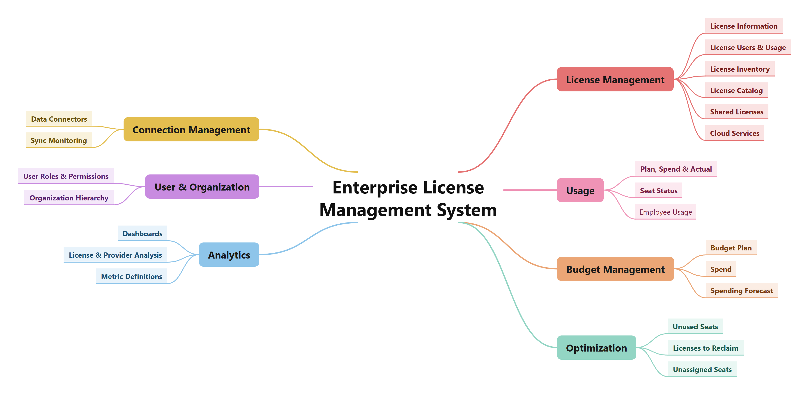
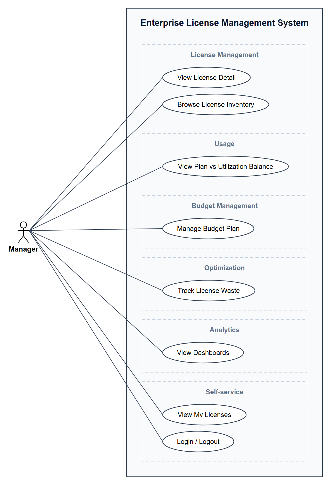
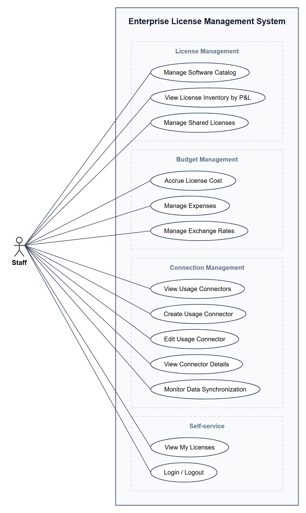
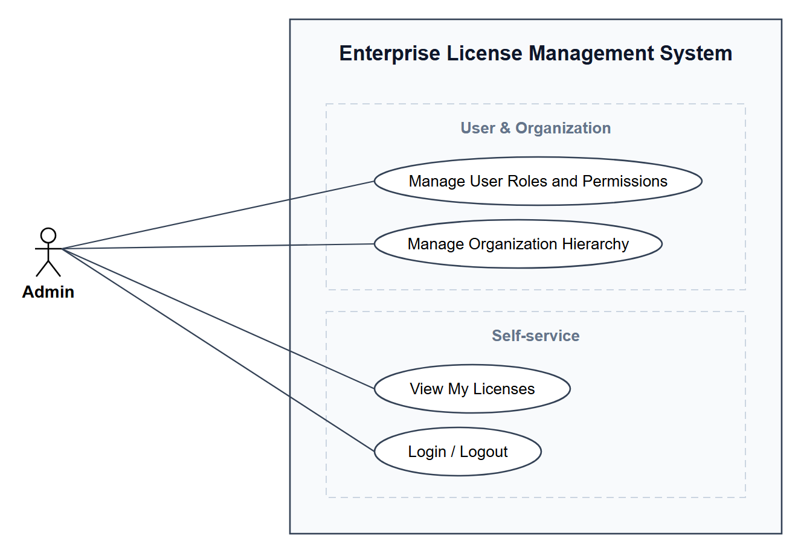
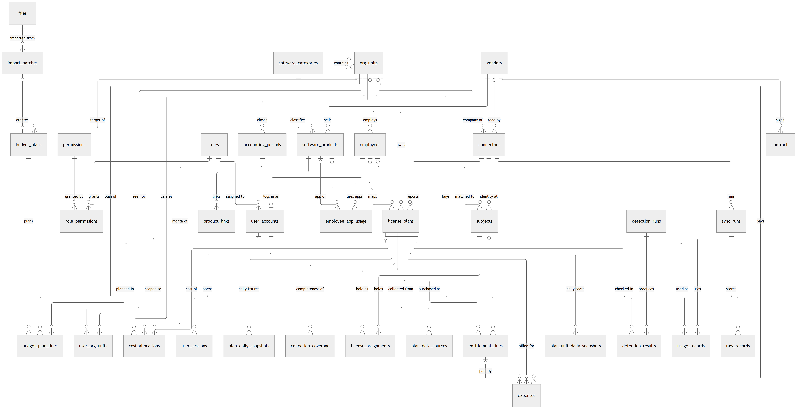
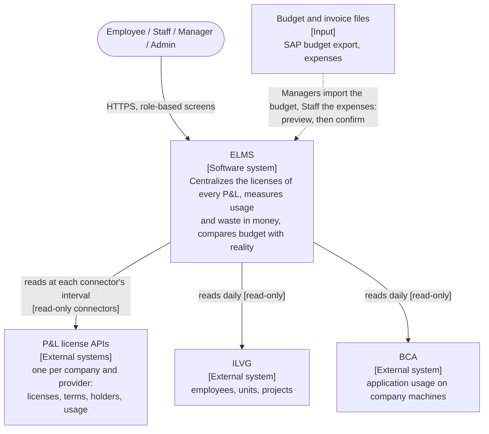

# Enterprise License Management System (ELMS) — team VFast

ELMS brings the software licenses of every company of the group into one place. Each company connects its providers (Microsoft, Atlassian, Adobe, GitHub, SAP…) through usage connectors; ELMS reads what each license costs, how much of it is allocated, who holds it, and how much is actually used, and sets it against the budget plan. Managers see, for their units, the money planned, purchased, used, and wasted — down to each license and each user — **and ELMS never assigns, revokes, buys, or changes anything on a provider**.

## 1. Requirements — Research, Use Cases, and INVEST

Requirements are derived top-down: business problem → stakeholders → goals → license models and data sources → epics (mind map) → use cases → user stories. Each story is reviewed with INVEST and has Given/When/Then acceptance criteria.

### 1.1 Mind map



The map has seven branches: **License Management** (license list & validity; catalog & inventory), **Usage** (scope & overview, subordinate analytics, employee usage), **Budget Management** (planning & cost allocation, spending & monitoring), **Optimization** (detection, waste analysis), **Analytics** (group overview, license & provider analysis, metric definitions, dashboards), **User & Organization**, and **Connection Management** (usage connectors, sync monitoring). Each leaf is one use case; UC23 View My Licenses and UC24 Login / Logout are self-service use cases every role has. Use case numbers are kept stable, so they are not in branch order.

Editable source: [`docs/mindmap/vfast.xmind`](docs/mindmap/vfast.xmind) (open with XMind); `docs/mindmap.png` is exported from it.

### 1.2 Top-down problem analysis

License and usage data are scattered across each provider's admin portal, and every provider counts in its own unit: seats, sessions, devices, cores, tokens, or contract terms. Nobody can say what the company owns, who uses it, or how far reality is from the budget plan.

| Goal | Measured by |
|---|---|
| G1 Centralize licenses | Every license of every company listed with provider, cost, allocated / purchased, and expiry in one list |
| G2 Know who uses what | Every assigned seat has exactly one status over the last 30 days — `Active`, `Inactive`, `No activity`, or `Not monitored` — and every holder a usage frequency |
| G3 Measure automatically | License, assignment, and usage data arrive through usage connectors on a schedule; nobody types them in |
| G4 Express waste as money | Underutilized accounts and their annual cost on one screen |
| G5 Plan and reconcile the budget | Plan, Purchased, and Used compared per unit, license, and month |
| G6 Make waste visible | Waste (the cost of unassigned and inactive seats) shown per unit, license, and month, with the units wasting most first |
| G7 Trustworthy figures | Numbers match across screens; missing data is `Unknown`, never zero |

What makes this project different:

1. **One view from group to user** — the same figures from the group down to a P&L, block, department, project, license, and the people holding it.
2. **Plan, Purchased, Used** — Plan − Purchased is unspent budget; Purchased splits into Used, Wasted, and Not evaluated; each gap is a different problem with a different fix.
3. **Missing data is not guessed** — a failed sync is `Unknown`, never usage 0, so it never creates a false waste finding.
4. **Read-only toward every source** — ELMS shows the evidence; changes to licenses are made at the source, never by ELMS.
5. **One connector contract** — every usage connector, one per company and provider, answers in the same license data contract; nothing enters ELMS without passing its validator.

Full analysis, license-model research, data-source feasibility, scope, and risks: [Top-down research](docs/01-research-top-down.md).

Research on a common connector standard (FOCUS, SCIM 2.0, ISO/IEC 19770, provider APIs), the ECS v1 proposal, and its rollout plan: [Connector standard](docs/06-connector-standard.md).

### 1.3 Use cases

There are four roles: the **Manager** uses the product, **Staff** keep it fed, the **Admin** runs it and sees the group from above, and the **Employee** sees their own licenses. One diagram per actor shows every use case it can start:

| | |
|---|---|
|  |  |
|  |  |

49 use cases, by mind-map branch. Manager and Staff work within the units or companies assigned to them, and a Manager can be assigned to the whole group; the Admin reads the whole group. Analysis shows complete months only, up to the previous month.

| ID | Use case | What the user can do | Actor |
|---|---|---|---|
| | **License Management** | | |
| UC01 | Manage Software Catalog | Keep the list of software with its category, and map each license name the connectors report to a software | Staff |
| UC57 | View License List | See every license of the group with its monthly cost, company, allocated / purchased and days to expiry; search, filter by company and expiry, sort, page | Manager |
| UC58 | View License Validity Timeline | See each license term on a six-month timeline, move it month by month or back to today, spot licenses about to expire | Manager |
| UC59 | View License Details | Open a license: cost, start and expiry, unallocated or over-allocated seats | Manager |
| UC61 | View License Users and Activity | See who holds a license, who is active or inactive, when each last used it and how often; filter, search, export | Manager |
| UC02 | View Providers and Licenses | See the providers the group buys from and, per provider, its licenses and the companies using them | Manager |
| UC04 | View Contracts | See license terms — start, expiry, auto-renew, cost — and those renewing within 30 or 60 days | Manager |
| UC27 | View License Inventory by P&L | Pick a P&L and see every license it reports, grouped by provider | Manager, Staff |
| UC28 | View Licenses by Organization | Pick any unit and see its licenses, or pick a license and see which units use it | Manager |
| UC47 | Manage Shared Licenses | Mark licenses used by two or more companies as shared, owned by the group; see how their cost is charged back to each company | Staff; Manager reads |
| | **Usage** | | |
| UC37 | Navigate Organization Scope | Choose the company or unit to analyse from the tree or the company picker; go down and back up the hierarchy | Manager |
| UC08 | View Plan vs Utilization Balance | See Plan, Purchased and Used of the scope, whether it is over budget, and how much of what was bought is used | Manager |
| UC48 | Compare Subordinate Units | Compare the units below the scope year to date or for a month; sort, search, switch currency | Manager |
| UC49 | View Annual Trend by Unit | See each unit month by month over the year, with its efficiency | Manager |
| UC50 | View Subordinate Units Table | Read every unit's Plan, Purchased, Used, Wasted, utilization and variance; open a P&L to see the same figures per license | Manager |
| UC51 | Export Usage Report | Download the units listed, with their figures, as CSV | Manager |
| UC32 | Track Employee Usage | See how often each employee uses each application | Manager |
| | **Budget Management** | | |
| UC33 | Import Budget Plan from Excel | Download the template, upload the budget plan of their unit or of any unit under it, check the preview, confirm; the same file twice changes nothing | Manager |
| UC05 | View Monthly Budget Plan | See the plan by month and compare it with earlier versions | Manager |
| UC06 | Allocate License Cost | See the cost of each license split over the units that hold it | Manager |
| UC42 | Accrue License Cost | Spread license costs over the months of their terms, review rounding, close the month | Staff; Manager reads |
| UC07 | Manage Expenses | Record license expenses with their invoice, or import them from CSV | Staff |
| UC62 | Manage Exchange Rates | Enter the rate of each currency to VND from a date, used to convert invoices and budget lines | Staff |
| UC34 | Track Monthly Plan Variance | See how actual spending moves away from plan month by month | Manager |
| UC09 | Forecast License Spending | See the projected year-end spending against plan | Manager |
| | **Optimization** | | |
| UC10 | Detect Unused Licenses | See seats bought but not given to anyone, and what they cost | Manager |
| UC11 | Detect Inactive Usage | See seats given to people who have not used them for 30 days, and what they cost | Manager |
| UC35 | Flag P&L Waste | See which P&Ls waste licenses (in red) and what causes it | Manager |
| UC43 | Rank Units by Waste | See the units wasting the most money first | Manager |
| UC52 | Track Plan, Usage and Waste Trend | Follow Plan, Used and Wasted month by month on one chart | Manager |
| UC53 | View Waste Risk Distribution | Spot units where high spend meets high waste | Manager |
| UC54 | View Monthly Waste Heatmap | See in which months each unit wastes, for any year | Manager |
| | **Analytics** | | |
| UC36 | View Group Overview | See every P&L of the group on one screen with its waste flag | Admin |
| UC44 | Analyze by License and Provider | Read the same figures per license, software, category, provider or license type instead of per unit | Manager |
| UC45 | View Metric Definitions | Look up what each figure means and how it is computed | Manager |
| UC15 | View License Dashboard | See license counts, allocation and expiries at a glance | Manager; Admin (whole group) |
| UC16 | View Financial Dashboard | See spending by month and unit, plan against actual, and the forecast | Manager; Admin (whole group) |
| UC18 | View Optimization Dashboard | See waste, unused and inactive seats, and flagged P&Ls at a glance | Manager; Admin (whole group) |
| | **User & Organization** | | |
| UC19 | Manage Users | Create accounts for employees, reset passwords, disable accounts | Admin |
| UC20 | Manage Organization Hierarchy | Review the five-level hierarchy and assign Managers to units | Admin |
| UC21 | Manage Roles | Give each user one of the four roles | Admin |
| UC22 | Manage Permissions | Grant or remove permissions per role | Admin |
| | **Connection Management** | | |
| UC38 | View Usage Connectors | See every company's connectors, providers and licenses with their sync status; search, filter, sort | Staff |
| UC55 | Create Usage Connector | Connect a company's provider: contact, API URL, credential, sync interval, licenses | Staff |
| UC60 | Edit Usage Connector | Change a connector's settings or licenses, keeping or replacing its credential, or delete it | Staff |
| UC56 | View Connector Details | Read a connector's settings and its licenses' status | Staff |
| UC26 | Monitor Data Synchronization | Follow sync runs, see failures, rerun a period, pause or resume a connector, change its interval | Staff |
| | **Self-service** | | |
| UC23 | View My Licenses | See the licenses they hold and whether they use them | Everyone |
| UC24 | Login / Logout | Sign in and out | Everyone |

Role × feature matrix, business rules, system processes, and the specification of every use case: [Use cases](docs/02-use-cases.md). Features per use case: [Feature list](docs/08-feature-list.md).

### 1.4 Roles and permissions

There are four roles; each account has exactly one. Every account belongs to a real employee, matched by company email.

| Role | Who | Responsibility | Data scope |
|---|---|---|---|
| **Manager** | Manager of a unit: the group, a P&L, block, department, or project — **the main user** | Browses licenses and who uses them, analyses usage and waste, imports and changes the budget plan of their units and of every unit under them | The units assigned to them and everything under them; the whole group for a Manager of the group |
| **Staff** | License management team member — hands-on work | Sets up and edits usage connectors, watches the syncs, checks what each company's connectors deliver, runs the monthly accrual, records expenses, exchange rates, and shared licenses, keeps the software catalog | The companies assigned to them; no usage or waste analysis |
| **Admin** | System operator | Users, roles, permissions, the organization hierarchy and which Manager owns which unit; watches the group through the group overview and dashboards | The whole group through the group overview and the dashboards, down to each license, read-only; no Usage screen, no budget |
| **Employee** | Every employee of the group | Sees the licenses they hold and whether they are recorded as used | Own licenses only |

| Capability | Admin | Manager | Staff | Employee |
|---|---|---|---|---|
| License list, validity timeline, license details, license users | — | Read, own units | — | — |
| Providers and licenses, contracts, licenses by organization | — | Read, own units | — | — |
| License inventory by P&L | — | Read, own units | Read, own companies | — |
| Shared licenses | — | Read, own units | Create / edit, group level | — |
| Software catalog and mapping | — | Read | Catalog: create / edit, group level; mapping: own companies | — |
| Usage: balance, unit comparison, trend, units table, CSV export, employee usage | — | Read, own units | — | — |
| Budget plan | — | Import and change, own units and every unit under them | — | — |
| Monthly plan, cost allocation, plan variance, forecast | — | Read, own units | — | — |
| Cost accrual | — | Read, own units | Run / close month, own companies | — |
| Expenses and invoices | — | — | Create / edit / import | — |
| Exchange rates | — | Read | Create / edit, group level | — |
| Unused and inactive seats, P&L waste flag, waste analysis | — | Read, own units | — | — |
| License and provider analysis, metric definitions | — | Read, own units | — | — |
| Group overview | Read, totals per P&L | — | — | — |
| License, financial, optimization dashboards | Read, whole group, down to each license | Read, own units | — | — |
| Users, roles, permissions, organization hierarchy | Create / edit | — | — | — |
| Usage connectors | — | — | Create / edit, own companies | — |
| Sync runs | — | — | Read / rerun / pause | — |
| My licenses | Read own | Read own | Read own | Read own |

- The backend enforces every cell of this table and the data scope; hiding a button in the interface is not enough, and a call outside the role returns `403`.
- ELMS never writes to a provider: "edit" here changes data in ELMS only.
- Every change to connectors, budget imports, users, the hierarchy, roles, and permissions is recorded with who, old value, new value, and time.

The full role × feature matrix with the business rules: [Use cases](docs/02-use-cases.md#role--feature-matrix).

### 1.5 INVEST requirements

The backlog contains **49 user stories (163 story points)**, one per use case (USxx implements UCxx): 31 Must-have (114 points), 13 Should-have (37), 5 Could-have (12). Every story passes the INVEST review and has Given/When/Then acceptance criteria with concrete figures.

| Criterion | Meaning in ELMS |
|---|---|
| **Independent** | Each story produces a demonstrable outcome; usage, waste, and dashboard stories run on seeded data labelled as mock, without waiting for the P&L APIs. |
| **Negotiable** | Layout follows the UI demos but may change while outcome, permissions, and business rules stay fixed. |
| **Valuable** | Each story names the benefit for one role: Employee, Staff, Manager, or Admin. |
| **Estimable** | Inputs, outputs, roles, data scope, and failure outcomes are explicit; every story is estimated in points. |
| **Small** | One mind-map leaf per story; only US33 (budget import with versions and idempotency) reaches 8 points. |
| **Testable** | Every story has observable criteria, including rules that tie figures across screens. |

```text
License Management     US57 US58 US59 US61 US01 US27 US28 US47 US02 US04   Manager (US01, US47: Staff)
Usage                  US37 US08 US48 US49 US50 US51 US32                  Manager
Budget Management      US33 US05 US06 US42 US07 US62 US34 US09             Manager (US42, US07, US62: Staff)
Optimization           US10 US11 US35 US43 US52 US53 US54                  Manager
Analytics              US36 US44 US45 US15 US16 US18                       Manager, Admin (US36)
User & Organization    US19 US20 US21 US22                                 Admin
Connection Management  US38 US55 US60 US56 US26                            Staff
Self-service           US23 US24                                           Every role
```

Backlog, per-story INVEST review, and acceptance criteria: [INVEST requirements](docs/03-invest-requirements.md).

## 2. Database design

The target schema is PostgreSQL, 40 tables in seven groups: organization and access, software catalog and licenses, collection pipeline, holders and usage, budget and expenses, optimization, audit. It follows the business model: a five-level organization from ILVG, one usage connector per company and provider, a license per connector and company mapped to the software catalog, budget versions imported from Excel, the cost of each month split into Used, Wasted, and Not evaluated, and BCA usage in its own table. Missing data is `Unknown`, never 0; history is kept as frozen daily snapshots and monthly cost allocations.



Entity overview, one ERD per group, a short explanation of every table, rule-to-schema traceability, and the decisions still to confirm (D24–D41): [Database design](docs/database/README.md). Source [`elms.dbml`](docs/database/elms.dbml), reference DDL [`schema.sql`](docs/database/schema.sql), draw.io files in [`docs/database/diagrams/`](docs/database/diagrams/).

## 3. Architecture and Folder Structures

ELMS is designed as one monolith with Clean Architecture, deployed as two processes (API and worker) that share one PostgreSQL database. The API serves users; slow work (connector syncs at each interval, budget and expense imports, seat status, cost split, detection) runs in the worker through a PostgreSQL-backed job queue, so no Redis or message broker is required.

### 3.1 System context (C4 level 1)



Four roles use ELMS; each account has exactly one. Each P&L provides an API for its own license data; ELMS reads it through one usage connector per company and provider, at each connector's interval, in the license data contract (ECS), and never changes anything at a source. Employees and units come from ILVG, application usage from BCA, the budget plan from an Excel export of SAP, and the cost from the invoices Staff record. Nobody enters licenses, holders, or usage by hand.

### 3.2 Container view (C4 level 2)


| Layer | Technology |
|---|---|
| Frontend | React 19, Vite, TypeScript, MUI v6, Tailwind CSS v4, ApexCharts |
| Backend | ASP.NET Core 10, EF Core + Dapper, Hangfire worker |
| Database | PostgreSQL 16 |

Deeper levels in [C4 Architecture](docs/07-c4-architecture.md): [components of the API, worker, modules, and frontend](docs/07-c4-architecture.md#3-level-3--component), [the sync and daily pipeline](docs/07-c4-architecture.md#5-dynamic-view--the-daily-pipeline), and [deployment](docs/07-c4-architecture.md#6-deployment-view).

### 3.3 Repository layout

```text
VFast/
├─ README.md
├─ docs/
│  ├─ 01 … 04               Research, use cases, INVEST, information architecture
│  ├─ 07, 08, 09            C4 architecture, feature list, data fields research
│  ├─ 05-folder-structure.md
│  ├─ 06-connector-standard.md
│  ├─ 07-c4-architecture.md
│  ├─ database/             elms.dbml, schema.sql, tables.md, ERDs
│  ├─ diagrams/out/         Use case diagrams
│  └─ mindmap/              XMind source
└─ src/
   ├─ frontend/             React SPA
   └─ backend/              .NET solution
```

### 3.4 Frontend

```text
src/frontend/
├─ routes/        paths.ts, router.tsx
├─ layouts/       Header, Sidebar, MainLayout
├─ components/    cards/, layout/, shared charts and icons
├─ sections/      licenses/, budget/  (feature blocks that compose pages)
├─ pages/         licenses/, budget/, analytics/, users/  (one per screen)
├─ types/  utils/  data/  theme/
└─ App.tsx, main.tsx, index.css
```

Call flow: `routes → pages → sections → components → types / utils`.

### 3.5 Backend

```text
ELMS/
├─ Elms.slnx, global.json, Directory.Build.props, Directory.Packages.props
├─ docker-compose.yml
├─ src/
│  ├─ SharedKernel.Domain/            BaseEntity, BaseAuditableEntity, Money
│  ├─ SharedKernel.Application/       Base Command/Query, Behaviours, Exceptions, AccessScope
│  ├─ SharedKernel.Infrastructure/    BaseDbContext, Audit + Scope interceptor
│  ├─ SharedKernel.Api/               BaseApiController, GlobalExceptionHandler
│  ├─ Elms.Domain/
│  │  ├─ Entities/<Module>/           Catalog, Usage, Finance, Optimization...
│  │  ├─ Enums/                       OrgLevel, Archetype, LicenseType, SeatStatus, ConnectorStatus
│  │  └─ Rules/                       SeatStatusRule, AccrualCalculator, CostAllocator, WasteFlagRule
│  ├─ Elms.Application/
│  │  ├─ Interfaces/                  IAppDbContext, ILicenseSource, IIlvgSource, IBcaSource
│  │  ├─ <Module>/<Feature>/          e.g. Catalog/Software, Finance/BudgetImports
│  │  │  └─ Commands/  Queries/  DTO/
│  │  ├─ Analytics/<Dashboard>/Queries/   Read views with Dapper
│  │  ├─ Ingestion/Pipeline/          Steps of a sync run: fetch, validate, normalize, coverage
│  │  └─ ConfigureServices.cs
│  ├─ Elms.Infrastructure/
│  │  ├─ Data/                        AppDbContext, Configurations/, Migrations/
│  │  ├─ Connectors/                  Ecs/ (P&L APIs), Ilvg/, Bca/, Simulated/
│  │  └─ ConfigureServices.cs
│  ├─ Elms.Api/                       Controllers/<Module>/, Program.cs
│  └─ Elms.Worker/                    Program.cs, Jobs/ (sync scheduler, connector run, daily pipeline, month close)
└─ tests/                             Unit, Integration (Testcontainers), Architecture
```

Dependency direction: `Api / Worker → Infrastructure → Application → Domain → SharedKernel`. The eight business modules (`identity`, `organization`, `catalog`, `ingestion`, `usage`, `finance`, `optimization`, `analytics`, plus shared `audit`) are feature folders inside each layer; boundaries are enforced by architecture tests.

Full trees, module table, API conventions, jobs, caching, security, and deployment: [Folder structure and architecture](docs/05-folder-structure.md). The same design as C4 diagrams (context, container, component, daily pipeline, deployment): [C4 Architecture](docs/07-c4-architecture.md).

## Documentation

- [Top-down research](docs/01-research-top-down.md) — problem, stakeholders, goals, license models, data sources, process, epics, scope, risks
- [Use cases](docs/02-use-cases.md) — actors, role × feature matrix, business rules, system processes, 49 use cases, open decisions
- [INVEST requirements](docs/03-invest-requirements.md) — 49 user stories, INVEST review, acceptance criteria
- [Information architecture](docs/04-information-architecture-manager.md) — screen catalog, navigation by role, screen specifications, UI conventions, screen-to-API mapping
- [Folder structure and architecture](docs/05-folder-structure.md) — solution architecture, frontend structure, backend modules and .NET folder layout, API conventions, jobs, caching, security
- [Connector standard](docs/06-connector-standard.md) — research on FOCUS, SCIM, ISO/IEC 19770 and provider APIs; the ELMS Connector Standard (ECS) v1 proposal, Connector Management use cases, rollout plan
- [C4 Architecture](docs/07-c4-architecture.md) — system context, containers, components, daily pipeline, deployment, cross-cutting concerns
- [Feature list](docs/08-feature-list.md) — features of every use case, by mind-map branch
- [Data fields research](docs/09-data-fields-research.md) — fields each source can return: usage connectors, BCA, ILVG, budget file
- [Database design](docs/database/README.md) — conventions, entity overview, ERD per group, every table explained, rule-to-schema traceability, proposed decisions D24–D41; every field in [Tables and fields](docs/database/tables.md)

## Frontend development

The frontend application, configuration, dependencies and lockfiles are in [src/frontend](src/frontend/README.md). From the repository root, install its dependencies once and start the dev server:

```powershell
npm --prefix src/frontend install
npm run dev
```

`npm run build` and `npm run preview` also work from the repository root. The root scripts forward to `src/frontend`; the build output is `src/frontend/dist/`.
