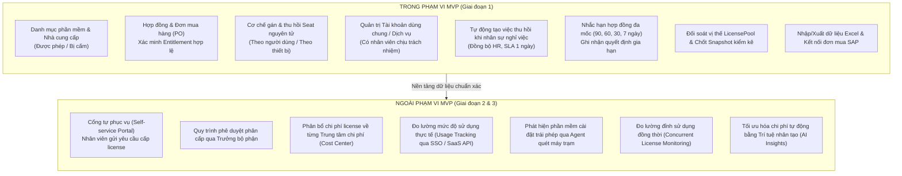
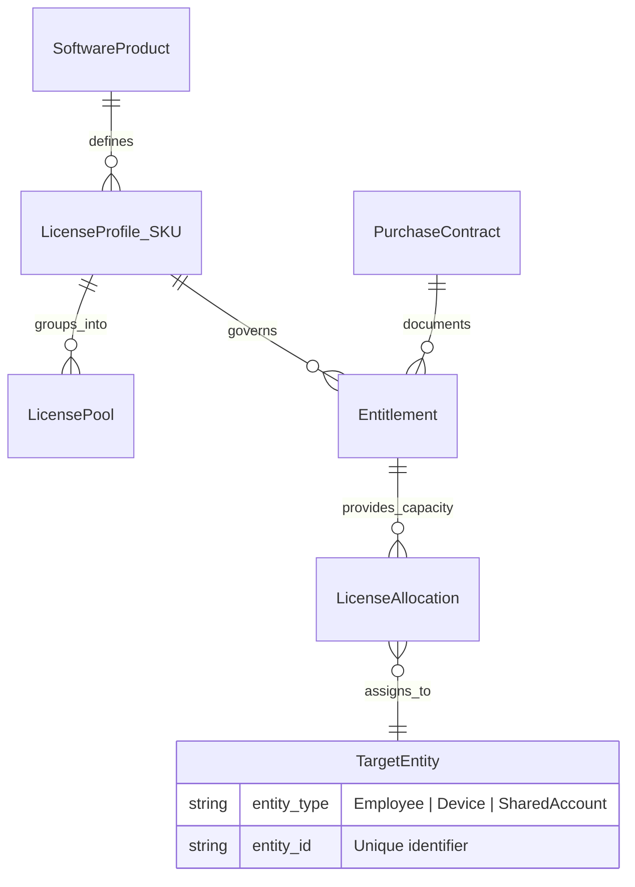
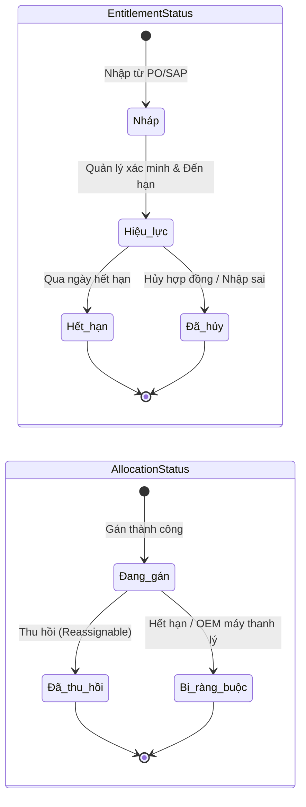

# Tài liệu Đặc tả Phạm vi Sản phẩm Khả dụng Tối thiểu (MVP Specification)
## Dự án: VFast – Hệ thống Quản lý Bản quyền Phần mềm (Software Asset Management - SAM)

---

## 1. Giới thiệu & Mục tiêu cốt lõi của MVP

### 1.1. Bối cảnh dự án
Hiện tại, công ty đang theo dõi và quản lý bản quyền phần mềm (Software Licenses) phân tán qua các bảng tính Excel và email trao đổi rời rạc giữa phòng CNTT (IT), phòng Mua sắm (Procurement), phòng Tài chính - Kế toán (Finance) và các phòng ban chuyên môn. Thực trạng này dẫn đến việc ban lãnh đạo và các bộ phận vận hành không thể trả lời nhanh chóng và chính xác các câu hỏi then chốt:
- Công ty đang chi trả cho những phần mềm nào? Tổng ngân sách là bao nhiêu?
- Số lượng bản quyền thực tế đã mua là bao nhiêu? Đã được xác minh qua hợp đồng/hóa đơn chưa?
- Thời hạn hiệu lực của từng phần mềm ra sao? Khi nào phải gia hạn?
- Ai (nhân viên nào, thiết bị nào, tài khoản dịch vụ nào) đang nắm giữ và sử dụng license?
- Vị thế tuân thủ bản quyền (Effective License Position - ELP) đang thừa hay thiếu? Có nguy cơ bị phạt pháp lý khi bị hãng kiểm toán (audit) không?

### 1.2. Mục tiêu chiến lược của MVP (Giai đoạn 1)
Mục tiêu tối thượng của Giai đoạn 1 (MVP) là xây dựng **"Sổ cái bản quyền" (License Ledger)** đóng vai trò nguồn dữ liệu duy nhất đáng tin cậy (**Single Source of Truth - SSOT**) cho toàn bộ doanh nghiệp:
1. **Minh bạch hóa 100% hồ sơ bản quyền:** Số hóa toàn bộ danh mục phần mềm, nhà cung cấp, chứng từ mua sắm và quyền sử dụng (Entitlement) đã được thẩm định.
2. **Kiểm soát vòng đời phân bổ (Allocation Lifecycle):** Đảm bảo việc gán/thu hồi bản quyền diễn ra nguyên tử, có căn cứ, đúng đối tượng và gắn liền với vòng đời nhân sự (onboarding / offboarding).
3. **Phòng ngừa rủi ro pháp lý & tài chính:** Cảnh báo trước hạn hợp đồng, ngăn chặn tình trạng cài đặt vượt quyền hoặc lãng phí license không thu hồi khi nhân viên nghỉ việc.
4. **Chuẩn bị nền tảng kiểm kê:** Cho phép quản lý license đối soát tức thì theo từng nhóm bản quyền tương đương (LicensePool) và chốt bản chụp kiểm kê (Snapshot) có giá trị kiểm soát nội bộ.

---

## 2. Ranh giới hệ thống: Trong phạm vi (In-Scope) vs. Ngoài phạm vi (Out-of-Scope)

Chiến lược phân kỳ dự án tuân theo nguyên tắc: **"Dữ liệu đúng trước, Tự động hóa sau"**. MVP tập trung thiết lập kỷ luật quy trình và cấu trúc dữ liệu chuẩn xác trước khi đầu tư vào tích hợp đo lường phức tạp.

### 2.1. Chi tiết các phân hệ trong phạm vi MVP (Giai đoạn 1)
| Phân hệ (Epic) | Nội dung nghiệp vụ trong phạm vi MVP |
| :--- | :--- |
| **E1. Danh mục & Nhà cung cấp** | Quản lý danh mục phần mềm chuẩn (`SoftwareProduct`), phiên bản, người phụ trách, trạng thái cấp phép (`Allowed` / `Prohibited`). Quản lý hồ sơ nhà cung cấp, đại lý phân phối, mã nhà cung cấp SAP. |
| **E2. Hợp đồng & Quyền sử dụng** | Ghi nhận chi tiết hợp đồng, đơn mua (`PO`), hóa đơn, license key (mã hóa). Phân loại `LicenseProfile`/SKU theo metric. Thẩm định quyền sử dụng (`Entitlement`) thành trạng thái `Hiệu lực` để tính toán dung lượng. |
| **E3. Gán & Thu hồi Seat** | Gán seat từ một Entitlement xác định cho đúng đối tượng (nhân viên, thiết bị, tài khoản dùng chung). Kiểm tra điều kiện ràng buộc cố định (Fixed Binding như OEM). Thu hồi seat và hoàn trả capacity khả dụng nếu điều khoản cho phép. |
| **E4. Vòng đời nhân viên** | Đồng bộ dữ liệu nhân sự (ít nhất 1 lần/ngày). Tự động kích hoạt danh sách việc cần làm (Task checklist) khi nhân viên nghỉ việc: thu hồi seat, bàn giao tài khoản dùng chung, chuyển giao phần mềm phụ trách. Ràng buộc SLA 1 ngày làm việc. |
| **E5. Nhắc hạn & Gia hạn** | Hệ thống tự động gửi thông báo nhắc hạn trước 90, 60, 30, 7 ngày trước khi hợp đồng/bảo trì hết hạn. Ghi nhận lịch sử quyết định gia hạn (`Giữ nguyên`, `Tăng`, `Giảm`, `Ngừng`) kèm lý do và theo dõi trạng thái mua mới. |
| **E7. Đối soát & Tuân thủ** | Tổng hợp vị thế bản quyền (`ELP`) theo từng `LicensePool` quyền tương đương. Cảnh báo trực quan (Đỏ: thiếu quyền / mất bao phủ; Vàng: hồ sơ chưa duyệt / sắp hết hạn). Cho phép chốt bản chụp kiểm kê bất biến (`Snapshot`) phục vụ kiểm toán nội bộ. |
| **E8. Nhập & Xuất dữ liệu** | Hỗ trợ nhập liệu ban đầu từ file Excel chuẩn hóa (xác thực dữ liệu từng dòng). Xuất danh sách ra Excel/CSV theo phân quyền (tuyệt đối không để lộ key). Nhập file đơn mua hàng định kỳ từ SAP ERP với cơ chế idempotent (chống trùng lặp). |

### 2.2. Các hạng mục chuyển giao cho Giai đoạn 2 và Giai đoạn 3
- **Giai đoạn 2 (Tự phục vụ & Phân bổ chi phí):**
  - Mở rộng giao diện cho Nhân viên (xem license cá nhân, tra cứu catalog) và Trưởng bộ phận (xem chi phí phòng, duyệt yêu cầu).
  - Quy trình gửi yêu cầu và phê duyệt cấp phát license (`RQ-01`, `RQ-02`).
  - Tự động phân bổ chi phí license về từng Trung tâm chi phí / Phòng ban (`EN-03`).
  - Tích hợp cổng quản trị SaaS và hệ thống SSO để phát hiện tài khoản không hoạt động quá $N$ ngày và đề xuất thu hồi (`CP-03`).
  - Lịch gia hạn dự báo ngân sách 12 tháng (`RN-03`).
- **Giai đoạn 3 (Tối ưu hóa nâng cao & Giám sát tuân thủ tự động):**
  - Giám sát đỉnh sử dụng của license dùng đồng thời (Concurrent License).
  - Tích hợp công cụ quét máy trạm (Inventory Agent) để phát hiện cài đặt thực tế và Shadow IT (`CP-04`).
  - Gói bản quyền theo vị trí chức danh (`LC-04`) để tự động đề xuất cấp phát.
  - Theo dõi quyền mở rộng (quyền hạ cấp phiên bản - Downgrade Rights, cài máy phụ, môi trường test) (`EN-04`).

---

## 3. Danh sách 17 User Stories bắt buộc (Must-Have) của MVP

Toàn bộ 17 User Stories dưới đây là điều kiện tiên quyết để nghiệm thu phiên bản MVP, được phân chia theo 8 Epics:

```mermaid
classDiagram
    class Epic1_Catalog {
        SW-01: Tạo danh mục phần mềm chuẩn
        SW-02: Quản lý nhà cung cấp & đại lý
    }
    class Epic2_Entitlement {
        EN-01: Ghi nhận lần mua & hợp đồng
        EN-02: Cộng dồn quyền sử dụng theo pool
    }
    class Epic3_Allocation {
        AS-01: Gán seat cho người/máy/tài khoản
        AS-02: Thu hồi seat về kho
        AC-01: Quản trị tài khoản dùng chung
        DV-01: Quản trị danh sách thiết bị
    }
    class Epic4_Lifecycle {
        LC-01: Đồng bộ dữ liệu nhân sự tự động
        LC-02: Tự động tạo việc thu hồi khi nghỉ việc
    }
    class Epic5_Renewal {
        RN-01: Nhắc hạn hợp đồng đa mốc
        RN-02: Ghi nhận quyết định gia hạn
    }
    class Epic7_Compliance {
        CP-01: Đối soát vị thế theo LicensePool
        CP-02: Chốt snapshot kiểm kê định kỳ
    }
    class Epic8_Integration {
        IM-01: Nhập dữ liệu ban đầu từ Excel
        IM-02: Xuất dữ liệu kiểm soát ra Excel/CSV
        IM-03: Nhập đơn mua hàng từ SAP ERP
    }
```

### Bảng tổng hợp 17 Stories MVP
| ID | Tên Story | Vai trò chính | Tóm tắt Tiêu chí Nghiệm thu Cốt lõi |
| :--- | :--- | :--- | :--- |
| **SW-01** | Tạo danh mục phần mềm | Quản lý license | Định danh duy nhất theo Hãng + Dòng + Edition + Version. Chuyển sang `Bị cấm` kích hoạt task rà soát/thu hồi các seat đang gán. |
| **SW-02** | Lưu nhà cung cấp & đại lý | Quản lý license | Cho phép 1 phần mềm mua từ nhiều vendor. Lưu mã vendor SAP để khớp khi import PO. |
| **EN-01** | Ghi nhận lần mua & hợp đồng | Mua sắm | Bắt buộc SKU, metric, thời hạn, chứng từ PO/hóa đơn. Entitlement mới ở trạng thái `Nháp`; chỉ Quản lý license được xem key và mọi lượt xem đều ghi audit log. |
| **EN-02** | Cộng dồn quyền sử dụng | Quản lý license | Chỉ cộng các Entitlement đã `Xác minh` và còn `Hiệu lực` trong cùng `LicensePool`. Tách biệt các metric và edition khác nhau. |
| **AS-01** | Gán seat cho đối tượng | IT Vận hành | Kiểm tra dung lượng khả dụng; thực hiện cấp phát nguyên tử (Atomic); chặn cấp nếu thiếu quyền; cấm cấp phần mềm `Bị cấm` hoặc cấp cho nhân viên đã nghỉ. |
| **AS-02** | Thu hồi seat về kho | IT Vận hành | Kết thúc allocation, lưu vết lịch sử; chỉ giải phóng dung lượng nếu quyền cho phép tái phân bổ (không giải phóng OEM / binding cố định). |
| **AC-01** | Quản lý tài khoản dùng chung | IT Vận hành | Bắt buộc có nhân viên đang làm việc chịu trách nhiệm. Xác định rõ tài khoản chung có chiếm quyền (`COUNT`) hay miễn trừ (`EXEMPT`). |
| **DV-01** | Quản lý danh sách thiết bị | IT Vận hành | Mã thiết bị duy nhất. Quản lý binding license theo máy. Thanh lý máy tạo task xử lý bản quyền gắn kèm. |
| **LC-01** | Đồng bộ dữ liệu nhân sự | IT Vận hành | Đồng bộ tự động hằng ngày từ hệ thống HR; không cho phép sửa tay trường đồng bộ; có cơ chế dự phòng nhập file CSV. |
| **LC-02** | Xử lý khi nhân viên nghỉ việc | IT Vận hành | Tự động tạo task xử lý toàn bộ allocation, bàn giao tài khoản chung, chuyển giao phần mềm phụ trách; SLA xử lý 1 ngày làm việc. |
| **RN-01** | Nhắc hạn hợp đồng/bảo trì | Mua sắm | Tự động gửi email cảnh báo trước 90, 60, 30, 7 ngày kèm danh sách allocation bị ảnh hưởng và số lượng seat trống. |
| **RN-02** | Ghi nhận quyết định gia hạn | Người phụ trách | Ghi nhận quyết định (`Giữ nguyên`/`Tăng`/`Giảm`/`Ngừng`) kèm lý do; theo dõi độc lập giữa quyết định, PO mới và việc thu hồi seat. |
| **CP-01** | Đối soát LicensePool & ELP | Quản lý license | Tính toán tự động: $ELP = \text{VerifiedCapacity} - \text{CommittedUnits}$. Báo cáo riêng allocation mất bao phủ; cảnh báo Đỏ/Vàng. |
| **CP-02** | Chốt bản chụp kiểm kê | Quản lý license | Snapshot bất biến có dấu thời gian, danh sách pool, số liệu chi tiết, người chốt; không thể chỉnh sửa sau khi chốt; xuất file Excel. |
| **IM-01** | Nhập dữ liệu từ Excel | Quản lý license | Xác thực cấu trúc và tính hợp lệ từng dòng; báo lỗi chi tiết; dừng toàn bộ giao dịch nếu có lỗi bắt buộc (nguyên tử). |
| **IM-02** | Xuất dữ liệu ra Excel/CSV | Người có quyền | Xuất danh sách theo phân quyền RBAC; tuyệt đối không để lộ license key trong file xuất. |
| **IM-03** | Nhập đơn mua từ SAP ERP | Quản lý license | Nhập idempotent dựa trên khóa tổng hợp SAP (System + CompanyCode + PO + Line); tạo bản ghi Entitlement ở trạng thái `Nháp`. |

---

## 4. Mô hình quản lý quyền sử dụng chuẩn (Section 7.1 Framework)

Để loại bỏ hoàn toàn các sai số trong quản lý tài sản phần mềm, MVP thiết lập mô hình dữ liệu và nghiệp vụ phân tách nghiêm ngặt giữa:
1. **Sản phẩm (Product):** Cái gì có thể cài đặt?
2. **Quy tắc cấp phép (LicenseProfile/SKU):** Được đo lường và giới hạn theo tiêu chí nào?
3. **Chứng từ mua hàng (Purchase Contract/PO):** Tiền đã trả cho ai, theo hóa đơn nào?
4. **Quyền sử dụng được xác minh (Entitlement):** Doanh nghiệp thực sự sở hữu bao nhiêu quyền hợp pháp?
5. **Phân bổ sử dụng (Allocation):** Quyền đang được gán cho ai/thiết bị nào?

### 4.1. Khái niệm LicensePool và Nguyên tắc tính toán
- **Định nghĩa LicensePool:** Là một nhóm quyền sử dụng tương đương có thể thay thế lẫn nhau để bao phủ cho một đối tượng sử dụng. Một `LicensePool` được xác định duy nhất bởi:
  $$\text{LicensePool} = (\text{SoftwareProduct}, \text{Metric}, \text{Edition}, \text{LegalEntity}, \text{VersionScope})$$
- **Quy tắc bất biến:**
  - **Không gộp khác Metric:** Tuyệt đối không cộng dồn bản quyền tính theo người dùng (`NAMED_USER`) với bản quyền theo máy (`PER_DEVICE`) hay bản quyền theo CPU Core.
  - **Không gộp khác Edition:** Bản quyền Standard không thể nằm chung pool với Enterprise trừ khi có chứng nhận chuyển đổi hợp lệ.
  - **Chỉ tính Entitlement hợp lệ:** Chỉ các Entitlement có trạng thái `Hiệu lực` (`Active`) và đã được Quản lý license thẩm định (`Verified`) mới được cộng vào dung lượng khả dụng (`VerifiedActiveCapacity`).

### 4.2. Công thức tính Vị thế Bản quyền Hiệu dụng (ELP - Effective License Position)
Tại bất kỳ thời điểm $T$, vị thế bản quyền của một `LicensePool` được tính toán như sau:

$$ELP(T) = \text{VerifiedActiveCapacity}(T) - \text{CommittedUnits}(T)$$

Trong đó:
- $\text{VerifiedActiveCapacity}(T)$: Tổng số đơn vị quyền đã xác minh, thuộc các Entitlement đang có hiệu lực tại thời điểm $T$.
- $\text{CommittedUnits}(T)$: Tổng số đơn vị quyền đang bị chiếm dụng, bao gồm:
  1. Các Allocation đang hoạt động hợp lệ (`Active Allocation`).
  2. Các đơn vị quyền bị ràng buộc cố định (`Fixed Binding`), ví dụ OEM gắn liền với phần cứng không thể tái cấp phát.
- **Allocation mất bao phủ (Orphaned / Uncovered Allocation):** Là các lượt gán đang trỏ vào Entitlement đã hết hạn hoặc bị hủy. Các bản ghi này **không được tự động xóa**, mà phải được hệ thống đưa vào danh sách cảnh báo đặc biệt để IT xử lý điều chuyển hoặc thu hồi.

### 4.3. Cơ chế Phân bổ Nguyên tử (Atomic Allocation)
Để ngăn chặn hoàn toàn hiện tượng tranh chấp (Race condition) dẫn đến việc cấp phát vượt quá số quyền sở hữu (Over-allocation):
- Mọi thao tác gán seat phải được thực thi trong một Database Transaction có cơ chế khóa dòng (`SELECT FOR UPDATE` hoặc Optimistic Locking với trường version).
- Hệ thống kiểm tra: Nếu $\text{AvailableUnits} = \text{VerifiedActiveCapacity} - \text{CommittedUnits} \le 0$, giao dịch lập tức bị hủy bỏ (Rollback) và thông báo lỗi. Không cho phép ghi nhận tạm thời làm âm số dư trừ khi có phê duyệt ngoại lệ theo chính sách công ty.

### 4.4. Ràng buộc cố định (Fixed Binding) vs. Quyền tái phân bổ (Reassignable)
- **Quyền có thể tái phân bổ (Standard Reassignable):** Khi thu hồi seat từ nhân viên hoặc máy cũ, dung lượng khả dụng của Entitlement lập tức được cộng ngược lại vào kho để cấp phát cho đối tượng mới.
- **Ràng buộc cố định (Fixed Binding - OEM / Non-transferable):** Quyền gắn liền vĩnh viễn với thiết bị/phần cứng ban đầu. Khi thiết bị bị hỏng hoặc thanh lý, quyền đó chuyển sang trạng thái `Bị ràng buộc` (`Bound/Retired`) và **không được phép trả về kho** để gán cho thiết bị khác.

---

## 5. Bảng trạng thái đối tượng & Quy tắc nghiệp vụ cốt lõi

### 5.1. Bảng chuyển trạng thái đối tượng
| Đối tượng | Trạng thái | Điều kiện kích hoạt & Ý nghĩa nghiệp vụ |
| :--- | :--- | :--- |
| **Entitlement** | `Nháp (Draft)` | Mới nhập từ file Excel hoặc SAP; chưa đối chiếu hóa đơn/hợp đồng; **không được tính vào capacity**. |
| | `Hiệu lực (Active)` | Đã được Quản lý license xác minh tính hợp lệ và đang nằm trong khoảng thời gian hiệu lực ($StartDate \le T \le EndDate$). |
| | `Hết hạn (Expired)` | Ngày hiện tại $T > EndDate$. Lập tức ngừng tính vào capacity; kích hoạt cảnh báo mất bao phủ cho các seat đang gán. |
| | `Đã hủy (Revoked)` | Bị hủy bỏ do đối soát sai hoặc chấm dứt hợp đồng sớm; ghi rõ lý do hủy. |
| **Allocation** | `Đang gán (Active)` | Đang chiếm 1 đơn vị quyền từ Entitlement nguồn cho đối tượng sử dụng hợp lệ. |
| | `Đã thu hồi (Revoked)` | Đã hoàn tất gỡ cài đặt / thu hồi tài khoản; giải phóng dung lượng về kho (đối với quyền cho phép tái cấp). |
| | `Bị ràng buộc (Bound)` | Quyền bị gán chết với phần cứng/máy thanh lý; không giải phóng capacity về kho. |
| **Nhân viên** | `Đang làm việc (Active)` | Được phép tiếp nhận và duy trì các allocation bản quyền. |
| | `Sắp nghỉ (Pending Offboarding)` | Đã có ngày nghỉ việc dự kiến từ HR; hệ thống sẵn sàng lịch trình thu hồi. |
| | `Đã nghỉ việc (Terminated)` | Kích hoạt SLA 1 ngày làm việc để thu hồi toàn bộ tài nguyên bản quyền. |
| **Thu hồi Task** | `Cần làm (Pending)` | Công việc mới được tạo tự động từ sự kiện nhân viên nghỉ việc. |
| | `Đã xong (Completed)` | IT Vận hành đã hoàn tất thao tác thu hồi trên phần mềm thực tế và xác nhận vào hệ thống. |
| | `Quá hạn (Overdue)` | Quá 1 ngày làm việc kể từ thời điểm thông báo HR có hiệu lực mà task chưa hoàn thành. |

### 5.2. Quy tắc màu sắc cảnh báo trên giao diện
- 🔴 **Màu Đỏ (Nguy hiểm / Bất thường cao):**
  - Vị thế $ELP < 0$ (thiếu quyền, nguy cơ vi phạm pháp lý khi audit).
  - Có allocation bị mất bao phủ (trỏ vào Entitlement đã hết hạn hoặc bị hủy).
  - Task thu hồi nhân viên nghỉ việc bị `Quá hạn` (> 1 ngày làm việc).
  - Tồn tại phân bổ cho phần mềm ở trạng thái `Bị cấm`.
- 🟡 **Màu Vàng (Cảnh báo sớm / Cần theo dõi):**
  - Entitlement sắp hết hạn trong vòng 90, 60, 30 ngày tới.
  - Tồn tại Entitlement ở trạng thái `Nháp` chưa được xác minh quá 7 ngày.
  - Tỷ lệ phân bổ (Allocation Rate) quá thấp (< 50% capacity, nguy cơ lãng phí ngân sách).
  - Nhân viên ở trạng thái `Sắp nghỉ`.
- 🟢 **Màu Xanh (Bình thường / Đạt chuẩn):**
  - Vị thế $ELP \ge 0$, không có allocation mất bao phủ, 100% hồ sơ đã được xác minh.

---

## 6. Tiêu chí Nghiệm thu MVP & Các Cổng Quyết định (Decision Gates)

### 6.1. Chi tiết 3 Cổng quyết định (Decision Gates)
1. **Cổng 1 (Khởi động triển khai):**
   - Tài liệu đặc tả yêu cầu, MVP, Use Cases và User Stories được Sponsor và PO ký duyệt.
   - Chốt phương án kiến trúc hệ thống và công nghệ triển khai.
2. **Cổng 2 (Tích hợp & Tuân thủ pháp lý - Cổng bắt buộc):**
   - Đội quản trị SAP ERP xác nhận cấu trúc dữ liệu đơn mua hàng (PO), tài khoản chi phí và mô hình cấp phép kết nối chỉ đọc (Read-only).
   - Bộ phận Pháp chế phê duyệt cơ chế thu thập và lưu trữ thông tin nhân viên theo Luật Bảo vệ dữ liệu cá nhân 91/2025/QH15.
3. **Cổng 3 (Nghiệm thu Go-Live):**
   - Hoàn thành kiểm thử chấp nhận người dùng (UAT) với sự tham gia của IT, Mua sắm và Tài chính.
   - Đối chiếu thành công 100% dữ liệu lịch sử hóa đơn phần mềm 12 tháng gần nhất.
   - Sponsor phê duyệt đưa hệ thống vào vận hành thực tế.

### 6.2. Chỉ số Đánh giá Hiệu quả Cốt lõi (KPIs) của MVP
| Mục tiêu | Chỉ số Đo lường (KPI) | Mục tiêu Cam kết (Target) | Thời điểm Đánh giá |
| :--- | :--- | :--- | :--- |
| **Nắm bắt dữ liệu** | Tỷ lệ phần mềm trả phí (đối chiếu hóa đơn 12 tháng) được đưa vào hệ thống | **100%** | 1 tháng sau Go-Live |
| **Tuân thủ bản quyền** | Số lượng LicensePool có $ELP < 0$ mà không có phương án khắc phục | **0 pool** | Ngay khi nạp xong dữ liệu |
| **Xử lý nghỉ việc** | Tỷ lệ nhân viên nghỉ việc có toàn bộ seat được xử lý trong vòng 1 ngày làm việc | **100%** | Đo lường liên tục hằng tháng |
| **Tối ưu hóa chi phí** | Tỷ lệ seat thu hồi từ người nghỉ việc được tái sử dụng thay vì mua mới | **≥ 90%** | 3 tháng sau Go-Live |
| **Quản lý hợp đồng** | Tỷ lệ hợp đồng bản quyền được kích hoạt nhắc hạn trước ít nhất 60 ngày | **100%** | Đo lường liên tục |
| **Thời gian đáp ứng** | Thời gian xuất báo cáo vị thế bản quyền phục vụ kiểm toán hoặc lãnh đạo | **< 5 phút** (so với 2–3 tuần trước đây) | Ngay khi Go-Live |

---

## 7. Bảng Phân nhiệm Trách nhiệm Nghiệp vụ (RACI Matrix)

| Quy trình nghiệp vụ cốt lõi | Sponsor | PO (IT Head) | IT Operator | Mua sắm | Tài chính | Nhân sự (HR) | Pháp chế |
| :--- | :---: | :---: | :---: | :---: | :---: | :---: | :---: |
| Phê duyệt phạm vi và ngân sách dự án | **A** | **R** | I | C | C | I | I |
| Ban hành danh mục phần mềm Được phép / Bị cấm | **A** | **R** | C | C | — | I | **C** |
| Thu thập và nhập liệu hợp đồng, hóa đơn 12 tháng | I | **A** | **R** | **R** | **R** | — | — |
| Thẩm định và xác minh Entitlement hợp lệ | — | **A** | **R** | C | I | — | C |
| Gán và thu hồi license hằng ngày | — | **A** | **R** | — | — | — | — |
| Xử lý thu hồi license khi nhân viên nghỉ việc | I | **A** | **R** | — | — | **R** | — |
| Xử lý thông báo và ghi nhận quyết định gia hạn | I | **A** | C | **R** | C | — | — |
| Đối soát vị thế và chốt bản chụp kiểm kê quý | I | **A** | **R** | C | I | — | **C** |
| Kiểm tra an toàn dữ liệu cá nhân (Nghị định 91) | I | C | — | — | — | C | **A / R** |

*Ghi chú: **R** = Responsible (Thực hiện), **A** = Accountable (Chịu trách nhiệm cuối cùng), **C** = Consulted (Tham vấn ý kiến), **I** = Informed (Được thông báo).*
