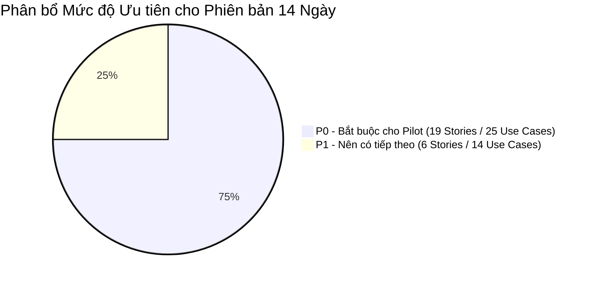
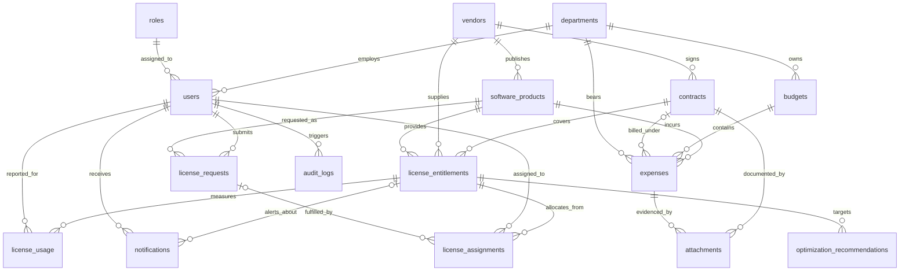

# Tài liệu Đặc tả Phạm vi Sản phẩm Khả dụng Tối thiểu (MVP Specification)
## Dự án: VFast – Enterprise License Management System (ELMS)
### Căn cứ: Bản Đặc tả Yêu cầu Phần mềm (SRS v1.0)

---

## 1. Giới thiệu & Mục tiêu Chiến lược của MVP

### 1.1. Mục tiêu Chuyển giao
Hệ thống **VFast – Enterprise License Management System (ELMS)** là giải pháp quản trị tài sản bản quyền phần mềm nội bộ (**Internal Enterprise**), hướng tới mục tiêu triển khai thử nghiệm đưa vào vận hành thực tế (**Production Pilot**) trong thời gian **2 tuần (14 ngày)**.

Mục tiêu cốt lõi của phiên bản MVP:
1. **Thiết lập Sổ cái Bản quyền Tập trung:** Gom toàn bộ dữ liệu phần mềm, nhà cung cấp, quyền sở hữu (SaaS và Perpetual) về một nguồn dữ liệu duy nhất (`Single Source of Truth`).
2. **Kiểm soát Vòng đời Phân bổ:** Vận hành trơn tru quy trình xin cấp, phê duyệt, cấp phát và thu hồi license giữa Employee và Manager.
3. **Theo dõi Ngân sách & Chi phí:** Cung cấp cho Staff công cụ nạp dữ liệu tiêu thụ (`Usage`) và chi phí thực tế (`Expense`), giúp Manager giám sát tỷ lệ giải ngân (`Budget Utilization`).
4. **Giảm thiểu Rủi ro Tuân thủ:** Tự động cảnh báo khi xảy ra tình trạng cấp phát vượt quyền (`Over-allocation`) hoặc sử dụng vượt mức (`Overuse`), cảnh báo hợp đồng sắp hết hạn.

---

## 2. Ranh giới Hệ thống (In-Scope vs. Out-of-Scope)

### 2.1. Trong Phạm vi MVP (In-Scope - 8 Nhóm Chức năng F01–F08)
- **F01. License Management:** Quản lý Software Catalog, Vendor, Entitlement (SaaS & Perpetual) và Contract.
- **F02. License Allocation:** Quy trình gửi yêu cầu, phê duyệt, cấp phát, thu hồi và theo dõi phân bổ.
- **F03. Budget Management:** Quản lý hạn mức ngân sách, ghi nhận chi phí thực tế và hóa đơn chứng từ.
- **F04. Lifecycle Management:** Theo dõi hạn dùng SaaS, hạn bảo trì Perpetual và cảnh báo tự động.
- **F05. License Optimization:** Phát hiện license chưa gán, license không dùng và đề xuất tối ưu hóa.
- **F06. Analytics & Reporting:** Dashboard điều hành tổng quan (License, Finance, Compliance).
- **F07. User & Role Management:** Quản lý tài khoản và phân quyền 3 role tập trung (Manager, Staff, Employee).
- **F08. System Administration:** Xác thực đăng nhập/đăng xuất, lưu vết Audit Log và import dữ liệu.

### 2.2. Ngoài Phạm vi Ban đầu (Out-of-Scope for Initial Pilot)
- Tự động kết nối trực tiếp với API của tất cả các nhà cung cấp phần mềm (SaaS Vendor APIs).
- Tự động tạo hoặc hủy tài khoản trực tiếp trên hệ thống của vendor (Auto-provisioning / Deprovisioning).
- Tích hợp sâu vào hệ thống kế toán hoặc ERP bên ngoài (SAP, Oracle,...).
- Tự động thanh toán thẻ tín dụng hoặc thanh toán hóa đơn trực tuyến.
- Mô hình tối ưu hóa bằng Trí tuệ Nhân tạo / Học máy (AI/ML Optimization).
- Luồng phê duyệt đa cấp phức tạp (Multi-level approval workflows).
- Tự động thu hồi license ngay khi phát hiện không hoạt động mà không qua Manager duyệt.
- Kiến trúc đa người thuê (Multi-tenancy) phục vụ nhiều doanh nghiệp độc lập.

---

## 3. Phân cấp Ưu tiên Tính năng (Feature Prioritization)

- **P0 – Must Have (Bắt buộc cho Pilot 14 ngày):**
  - Xác thực đăng nhập và phân quyền 3 role RBAC (`Manager, Staff, Employee`).
  - Quản lý danh mục phần mềm chuẩn (`Software Catalog`), kèm danh mục Vendor tối giản (chỉ tên nhà cung cấp) để thỏa BR-02 (xem D1, Mục 8).
  - Đăng ký và quản lý Entitlement cho cả **SaaS Subscription** và **Perpetual License**.
  - Quy trình gửi yêu cầu (`License Request`) và phê duyệt/từ chối của Manager.
  - Cấp phát (`Assign`) và thu hồi (`Revoke`) license có kiểm soát số lượng khả dụng.
  - Quản lý hạn mức ngân sách (`Budget`) và ghi nhận chi phí thực tế (`Expense`).
  - Nhập dữ liệu mức độ sử dụng thực tế (`Usage Data`).
  - Theo dõi các mốc hết hạn hợp đồng thuê bao và bảo trì.
  - Bảng điều khiển tổng quan (`Core Dashboard`) và lưu vết kiểm toán (`Audit Logging`).
- **P1 – Should Have (Nên có ngay sau luồng cốt lõi):**
  - Quản lý nhà cung cấp đầy đủ (`Vendor`: CRUD, thông tin liên hệ) và hồ sơ hợp đồng chi tiết (`Contract`).
  - Tính năng nạp dữ liệu hàng loạt từ file Excel/CSV (`Import Usage & Expense`).
  - Tải lên tệp đính kèm hóa đơn và chứng từ thanh toán hợp lệ.
  - Phát hiện license chưa gán, license không hoạt động $\ge 60$ ngày và hiển thị khuyến nghị tối ưu.
  - Báo cáo tuân thủ (`Compliance Dashboard`) và chức năng xuất báo cáo.
- **P2 – Could Have (Mở rộng trong tương lai):**
  - Tích hợp tự động với hệ thống nhà cung cấp, đồng bộ SSO nâng cao, tối ưu hóa AI.

---

## 4. 20 Quy tắc Nghiệp vụ Bất biến (20 Business Rules)

Hệ thống tuân thủ nghiêm ngặt 20 quy tắc từ **Mục 7 của bản SRS v1.0**:
- **BR-01:** Hệ thống hỗ trợ song song hai loại hình: SaaS Subscription và Perpetual License.
- **BR-02:** Mọi Entitlement bắt buộc phải liên kết với một Sản phẩm phần mềm và một Nhà cung cấp xác định.
- **BR-03:** Các số lượng license chỉ được phép so sánh hoặc cộng trừ khi sử dụng cùng metric đo lường và phạm vi dữ liệu tương thích.
- **BR-04:** Công thức tính toán dung lượng: $\text{Available Quantity} = \text{Purchased Quantity} - \text{Allocated Quantity}$.
- **BR-05:** Tuyệt đối không cho phép cấp phát vượt quá số lượng bản quyền khả dụng ($\text{Allocated} \le \text{Purchased}$).
- **BR-06:** Chỉ duy nhất vai trò Manager có quyền phê duyệt hoặc từ chối các yêu cầu cấp license.
- **BR-07:** Chỉ duy nhất vai trò Manager có quyền thực hiện cấp phát (Assign) hoặc thu hồi (Revoke) license.
- **BR-08:** Employee chỉ được phép xem thông tin yêu cầu và license thuộc sở hữu của chính bản thân mình.
- **BR-09:** Staff được quyền nhập dữ liệu usage và expense, nhưng tuyệt đối không được sửa đổi Entitlement hoặc Budget.
- **BR-10:** Bản ghi Expense hợp lệ bắt buộc phải có Số tiền hợp lệ, Tiền tệ và Ngày thanh toán.
- **BR-11:** Các khoản chi phí khác loại tiền tệ không được cộng gộp trừ khi có chính sách quy đổi tỷ giá rõ ràng.
- **BR-12:** Thời hạn bản quyền vĩnh viễn và thời hạn thỏa thuận bảo trì (Maintenance) phải được quản lý ở hai trường độc lập.
- **BR-13:** Các lượt gán đã bị thu hồi (`Revoked Assignments`) phải được giữ lại trong lịch sử để đối soát kiểm toán.
- **BR-14:** Việc đánh giá tuân thủ dựa trên mức dùng thực tế bắt buộc phải có dữ liệu usage hợp lệ và tương thích.
- **BR-15:** Dữ liệu usage bị thiếu không được tự động hiểu là mức sử dụng bằng không ($Usage \ne 0$).
- **BR-16:** Mọi đề xuất tối ưu hóa chi phí bắt buộc phải có căn cứ dữ liệu và phải qua sự phê duyệt của Manager trước khi thực thi.
- **BR-17:** Mọi thao tác nghiệp vụ quan trọng bắt buộc phải lưu vết vào Audit Log bất biến kèm Actor, Action và Timestamp.
- **BR-18:** Người dùng ở trạng thái vô hiệu hóa (`Deactivated`) lập tức bị khóa quyền truy cập hệ thống.
- **BR-19:** Một License Request đã xử lý (`Approved` hoặc `Rejected`) không được phép xử lý lại lần thứ hai.
- **BR-20:** Các dữ liệu lưu trữ lịch sử được bảo lưu theo chính sách lưu trữ dữ liệu của doanh nghiệp.

---

## 5. Yêu cầu Phi Chức năng (Non-Functional Requirements - NFRs)

Theo chuẩn hóa tại **Mục 8 của bản SRS v1.0**:
- **NFR-01 (Bảo mật - Security):**
  - Mật khẩu phải được mã hóa bằng thuật toán băm an toàn (BCrypt / Argon2).
  - Xác thực phiên làm việc trên mọi endpoint; kiểm tra quyền hạn RBAC tại tầng Backend API.
  - Bảo vệ dữ liệu truyền tải trên mạng bằng giao thức HTTPS/TLS.
  - License key và thông tin bí mật không được xuất hiện dưới dạng rõ trong nhật ký log, URL/query string hoặc file kết xuất; không được dùng license key làm tiêu chí tìm kiếm.
  - License key được mã hóa khi lưu (AES-256-GCM hoặc tương đương), khóa mã hóa quản lý ngoài cơ sở dữ liệu. API danh sách và chi tiết chỉ trả về dạng che; chỉ Manager được xem key rõ qua thao tác riêng, có giới hạn tần suất, phản hồi `Cache-Control: no-store` và ghi Audit Log `VIEW_LICENSE_KEY`.
  - Phiên đăng nhập phải thu hồi được từ phía máy chủ để bảo đảm BR-18: access token ngắn hạn, refresh token xoay vòng được lưu phía máy chủ, kiểm tra trạng thái tài khoản và phiên bản phiên ở mỗi request; vô hiệu hóa tài khoản hoặc đổi role sẽ thu hồi toàn bộ phiên (chi tiết tại UC29).
  - File tải lên: chỉ nhận PDF/PNG/JPG, kiểm tra theo nội dung thực của file thay vì phần mở rộng, tối đa 10MB, lưu ngoài webroot với tên ngẫu nhiên, tải về phải qua kiểm tra quyền theo từng bản ghi.
  - File import được kiểm tra từng dòng và giới hạn kích thước; file export phải vô hiệu hóa công thức bảng tính (ô bắt đầu bằng `=`, `+`, `-`, `@`).
- **NFR-02 (Toàn vẹn Dữ liệu - Data Integrity):**
  - Giao dịch cơ sở dữ liệu (ACID Transactions) có khóa dòng để ngăn chặn tình trạng gán vượt dung lượng khi có nhiều người cùng thao tác (Concurrency Control); áp dụng cho cả Assign và Revoke.
  - Ràng buộc ở tầng cơ sở dữ liệu làm lớp bảo vệ cuối: `CHECK (allocated_quantity >= 0 AND allocated_quantity <= purchased_quantity)`; unique index một phần trên `license_assignments (entitlement_id, user_id) WHERE status = 'Active'` và trên `license_assignments (request_id) WHERE request_id IS NOT NULL`.
  - `available_quantity` không được cập nhật độc lập: giá trị luôn được tính từ `purchased_quantity - allocated_quantity` (BR-04), ví dụ bằng generated column.
  - Chuyển trạng thái `License Request` dùng cập nhật có điều kiện (`WHERE status = 'Pending'`); nếu không có dòng nào được cập nhật thì báo lỗi theo BR-19. Audit Log được ghi trong cùng transaction với thao tác nghiệp vụ.
  - Giữ nguyên lịch sử giao dịch khi thu hồi license hoặc lưu trữ dữ liệu.
- **NFR-03 (Hiệu năng - Performance):**
  - Thời gian phản hồi trung bình của các API thông thường $\le 2$ giây dưới tải thử nghiệm pilot.
  - Thời gian phản hồi của các truy vấn Dashboard $\le 3$ giây.
  - Hỗ trợ phân trang (Pagination) và lọc tìm kiếm trên tất cả các màn hình danh sách.
- **NFR-04 (Tính Sẵn sàng & Độ tin cậy):**
  - Hệ thống có cơ chế xử lý lỗi ngoại lệ an toàn, tránh treo dịch vụ.
  - Thiết lập cơ chế sao lưu cơ sở dữ liệu định kỳ và quy trình khôi phục được kiểm nghiệm.
- **NFR-05 (Khả năng Bảo trì - Maintainability):**
  - Kiến trúc Modular Monolith phân tách rõ ranh giới giữa Controller, Business Service và Data Persistence.
  - Quản lý lịch sử thay đổi cấu trúc cơ sở dữ liệu thông qua công cụ Flyway Migration.
- **NFR-06 (Khả năng Kiểm toán - Auditability):**
  - Lưu vết đầy đủ thông tin: Người thực hiện (Actor), Thao tác (Action), Dấu thời gian (Timestamp) và Thực thể bị tác động.
  - Nhật ký kiểm toán không thể bị chỉnh sửa hoặc ghi đè tùy tiện.
- **NFR-07 (Tính Tiện dụng - Usability):**
  - Giao diện thân thiện, nhất quán, cá nhân hóa theo vai trò của người dùng.
  - Trạng thái dữ liệu được mã hóa bằng màu sắc trực quan (Xanh: An toàn/Duyệt; Đỏ: Vượt quyền/Từ chối; Vàng: Đang chờ/Cảnh báo).

---

## 6. Mô hình Thực thể Dữ liệu (12 Core Entities)

Theo chuẩn hóa tại **Mục 9 của bản SRS v1.0**, hệ thống sử dụng cơ sở dữ liệu quan hệ PostgreSQL với 12 thực thể cốt lõi, cùng 5 thực thể bổ trợ cần cho các use case và quy tắc nghiệp vụ hiện có:

| Tên Thực thể (Table) | Mục đích Quản lý Nghiệp vụ |
| :--- | :--- |
| `users` | Lưu trữ tài khoản người dùng, email, họ tên, `department_id`, `role_id` (mỗi người một role), trạng thái hoạt động và phiên bản phiên đăng nhập. |
| `roles` | Lưu trữ 3 vai trò hệ thống: `MANAGER`, `STAFF`, `EMPLOYEE`. |
| `software_products` | Danh mục sản phẩm phần mềm chuẩn hóa (tên, hãng, phiên bản, danh mục, trạng thái). |
| `vendors` | Danh bạ các nhà cung cấp, đại lý phân phối và thông tin liên hệ. |
| `contracts` | Hợp đồng mua sắm pháp lý, ngày ký kết, giá trị và tệp tài liệu đính kèm. |
| `license_entitlements` | Gói quyền sử dụng bản quyền sở hữu (SaaS/Perpetual, purchased, allocated, dates, license key đã mã hóa); `available` là giá trị tính từ `purchased - allocated`. |
| `license_requests` | Yêu cầu xin cấp 1 seat từ nhân viên (requester, `software_id`, lý do, người duyệt, trạng thái pending/approved/rejected/fulfilled). |
| `license_assignments` | Bản ghi cấp phát seat cụ thể cho nhân viên (`entitlement_id`, `user_id`, `request_id` nếu có, active/revoked, assigned_date, người và lý do thu hồi). |
| `license_usage` | Dữ liệu tiêu thụ thực tế theo kỳ (`entitlement_id`, `user_id`, kỳ dữ liệu, ngày hoạt động gần nhất, số ngày dùng, mức độ active/inactive, `created_by`), duy nhất theo `entitlement_id`, `user_id`, kỳ. Không có bản ghi trong kỳ nghĩa là `Unknown` (BR-15). |
| `budgets` | Hạn mức ngân sách phần mềm theo năm tài chính hoặc theo phòng ban. |
| `expenses` | Các khoản đã chi thực tế (số tiền, tiền tệ, ngày thanh toán theo BR-10; `software_id`, `contract_id` nếu có, `department_id`, số hóa đơn, `created_by`). |
| `audit_logs` | Nhật ký kiểm toán bất biến ghi nhận mọi thao tác quan trọng trên hệ thống. |

**Thực thể bổ trợ:**

| Tên Thực thể (Table) | Mục đích | Ưu tiên |
| :--- | :--- | :---: |
| `departments` | Phòng ban dùng chung cho người dùng, ngân sách và chi phí; không lưu tên phòng ban dạng văn bản tự do. | P0 |
| `notifications` | Thông báo trong hệ thống (cảnh báo hết hạn UC18, kết quả xử lý yêu cầu), có khóa chống gửi trùng theo entitlement và mốc 30/15/7 ngày. | P0 |
| `exchange_rates` | Tỷ giá do Manager khai báo theo ngày hiệu lực, là chính sách quy đổi tường minh theo BR-11. Không có tỷ giá hiệu lực thì không cộng gộp. | P0 |
| `attachments` | Metadata file hóa đơn và hợp đồng (đường dẫn lưu trữ, loại file, kích thước, người tải lên). | P1 |
| `optimization_recommendations` | Đề xuất tối ưu kèm căn cứ dữ liệu và quyết định của Manager theo BR-16. | P1 |

---

## 7. Tiêu chí Nghiệm thu & Chuyển giao Pilot (14 Criteria)

Theo chuẩn hóa tại **Mục 13 của bản SRS v1.0**, phiên bản MVP được nghiệm thu đạt chuẩn khi thỏa mãn đồng thời 14 tiêu chí:
1. Cả 3 vai trò (`Manager, Staff, Employee`) đăng nhập thành công và chỉ nhìn thấy các chức năng được cấp phép.
2. Manager có thể tạo, chỉnh sửa và quản lý danh mục phần mềm cùng các khoản Entitlement.
3. Cả hai mô hình **SaaS Subscription** và **Perpetual License** được đăng ký và theo dõi chuẩn xác.
4. Employee có thể gửi yêu cầu cấp license và theo dõi trạng thái yêu cầu cá nhân.
5. Manager có thể phê duyệt, từ chối yêu cầu; thực hiện cấp phát và thu hồi license thành công.
6. Số lượng cấp phát được tính toán tự động và không bao giờ vượt quá dung lượng khả dụng ($\text{Allocated} \le \text{Purchased}$).
7. Staff có thể nạp dữ liệu sử dụng (`Usage`) và ghi nhận các khoản chi phí (`Expense`) kèm số hóa đơn; đính kèm file chứng từ (`UC35`) là P1, không phải điều kiện nghiệm thu pilot.
8. Manager có thể giám sát hạn mức ngân sách và chi phí giải ngân thực tế theo từng bộ phận.
9. Hệ thống nhận diện và phát sinh cảnh báo trước các mốc hết hạn hợp đồng hoặc bảo trì.
10. Dashboard hiển thị đầy đủ và trực quan các chỉ số về bản quyền và tài chính (`UC23`, `UC24`), kèm cảnh báo tuân thủ từ `UC05`, `UC21`; Compliance Dashboard chuyên sâu (`UC25`) là P1.
11. Các thao tác nghiệp vụ quan trọng được ghi nhận đầy đủ vào hệ thống Audit Log bất biến.
12. Toàn bộ các luồng nghiệp vụ kinh doanh chính vượt qua kiểm thử tích hợp (Integration Tests).
13. Quy trình sao lưu (Backup) và phục hồi (Restore) cơ sở dữ liệu được kiểm nghiệm thành công.
14. Ứng dụng được triển khai ổn định trên môi trường thử nghiệm pilot và vượt qua kiểm thử chấp nhận người dùng (UAT).

---

## 8. Quyết định Làm rõ Phạm vi (Scope Decisions)

Các quyết định dưới đây xử lý mâu thuẫn giữa các tài liệu. Đây là phương án mặc định **đang chờ nhóm xác nhận**; các tài liệu khác đã được viết theo các phương án này. Mức ưu tiên của từng use case và 20 quy tắc nghiệp vụ không thay đổi.

| Mã | Vấn đề | Quyết định | Lý do |
| :---: | :--- | :--- | :--- |
| **D1** | BR-02 bắt buộc có Vendor, nhưng `UC02` là P1 | P0 có danh mục Vendor tối giản: chọn hoặc tạo nhanh theo tên trong `UC01`, `UC03`. CRUD đầy đủ vẫn thuộc `UC02` (P1). | Giữ BR-02 mà không đổi độ ưu tiên của `UC02`. |
| **D2** | Tiêu chí nghiệm thu đòi hóa đơn, nhưng `UC35` là P1 | Bản ghi Expense P0 chỉ cần số hóa đơn. File đính kèm là P1 và không bắt buộc. | BR-10 không yêu cầu chứng từ VAT. |
| **D3** | Story P0 liên kết use case P1 | Phần P0 của từng story: `US-M01` là `UC01`; `US-M02` là `UC03` (Vendor theo D1); `US-M10` là `UC05`, `UC21`; `US-M11` là `UC15`, `UC18`; `US-M13` là `UC23`, `UC24`; `US-S06` là `UC36`. Các use case còn lại giao ở P1. | Giữ nguyên mã story và độ ưu tiên use case. |
| **D4** | Hai công thức tài chính khác nhau | Chỉ số chính thức theo `UC14`: `Actual Spending` là tổng khoản đã chi; `Remaining Budget = Total - Actual`; `Budget Utilization = Actual / Total`. Ngưỡng cảnh báo dùng `Utilization` này. `Committed Spending` là chỉ số P1 hiển thị riêng, không tính vào `Utilization`. | Bám baseline và tránh tính trùng nghĩa vụ. |
| **D5** | BR-10 bắt buộc ngày thanh toán, nhưng IA có khoản chưa thanh toán | Bảng `expenses` ở P0 chỉ chứa khoản đã chi. `PENDING`, `OVERDUE` và thao tác Mark as Paid là mở rộng P1, cần bổ sung quy tắc riêng trước khi làm. `PROJECTED` là số liệu dự báo, không phải bản ghi Expense. | Không phải sửa BR-10 và giảm phạm vi 14 ngày. |
| **D6** | Request có số lượng nhưng mỗi lần Assign chỉ +1; có thể cấp nhiều lần cho một request | Mỗi request tương ứng đúng 1 seat cho chính người gửi. Thêm trạng thái `Fulfilled` khi đã cấp. Request `Approved` chưa có seat vẫn chờ, không tự chuyển trạng thái. | Khép kín vòng đời request và phù hợp BR-19. |
| **D7** | Cấp trùng chỉ bị cảnh báo | Chặn cấp thêm khi nhân viên đang có assignment `Active` cho cùng phần mềm. | Tránh lãng phí seat; `Change Tier` đã hoãn (D10). |
| **D8** | JWT không tự thu hồi được, trái BR-18 | Dùng cơ chế phiên thu hồi được như NFR-01 và `UC29`. Các thông số là mặc định có thể cấu hình. | BR-18 yêu cầu khóa truy cập ngay lập tức. |
| **D9** | README cho Staff đọc Entitlement và Budget, IA chặn hết | API cho Staff đọc (không có license key). Lệnh chặn 403 chỉ áp dụng cho các màn hình của Manager Portal; màn hình của Staff sẽ được đặc tả riêng. | Staff cần dữ liệu này để nhập Usage và Expense. |
| **D10** | `Change Tier` không có use case hoặc quy tắc nghiệp vụ | Hoãn sang sau MVP. Phần đặc tả trong IA được giữ lại để tham khảo. | Thay thế tạm bằng Revoke rồi Assign. |
| **D11** | "Board override", "soft-stop approval" trái với phạm vi loại trừ phê duyệt đa cấp | Vượt ngân sách chỉ cảnh báo Manager, không chặn chi phí và không thêm tầng phê duyệt. | Bám Mục 2.2. |
| **D12** | Thiếu nguồn tỷ giá cho BR-11 | Manager khai báo tỷ giá theo ngày hiệu lực trong `exchange_rates`. Không có tỷ giá thì hiển thị riêng từng loại tiền. | Là chính sách quy đổi tường minh theo BR-11. |
| **D13** | Ngưỡng đỏ là `>100%` ở `UC14` nhưng `≥100%` ở IA | Thống nhất cảnh báo đỏ khi `Budget Utilization` $\ge 100\%$. | Ở mức 100% ngân sách đã hết, không còn dư. |
| **D14** | Chưa quy định kênh thông báo | P0 dùng thông báo trong hệ thống. Email là mở rộng sau pilot. | Không phụ thuộc hạ tầng email trong 14 ngày. |
| **D15** | `UC21` so sánh số lượng usage, nhưng `license_usage` không có trường số lượng; chưa có cách biểu diễn dữ liệu thiếu | Với metric `Per User`, số lượng usage là số nhân viên khác nhau có bản ghi `Active` trong kỳ gần nhất. Không có bản ghi là `Unknown`; không đánh giá được là `Not Evaluated`. `Unknown` không được tính là `Inactive` trong `UC20`. | Thực hiện được BR-14, BR-15 từ dữ liệu sẵn có. |
| **D16** | Hai cách viết API khác nhau; chưa quy định khi import có dòng lỗi | Mọi API dùng tiền tố `/api/v1/`. File import có dòng lỗi thì không nạp dòng nào và trả về danh sách lỗi theo dòng. | Một hợp đồng API duy nhất; tránh dữ liệu nạp dở dang. |
