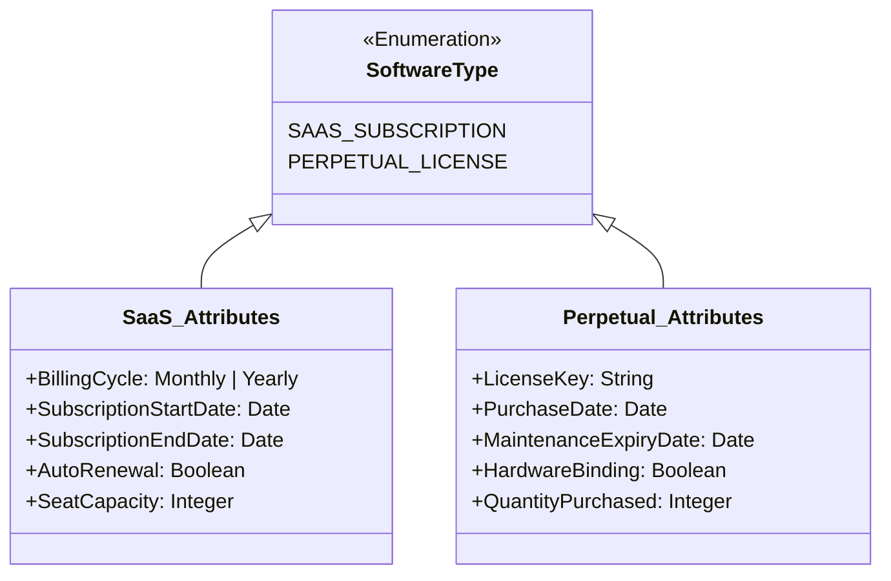
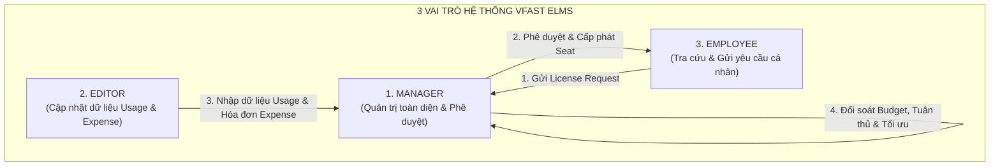
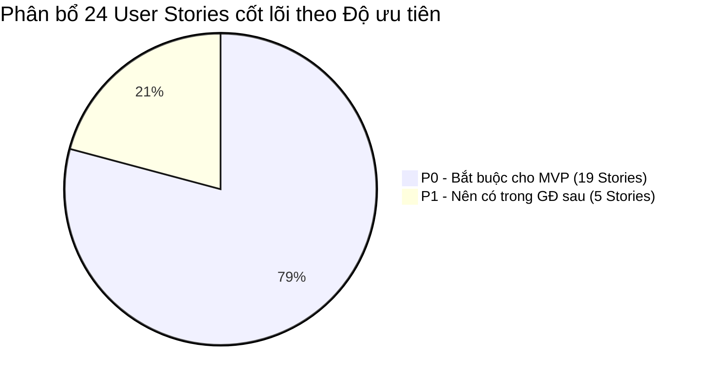
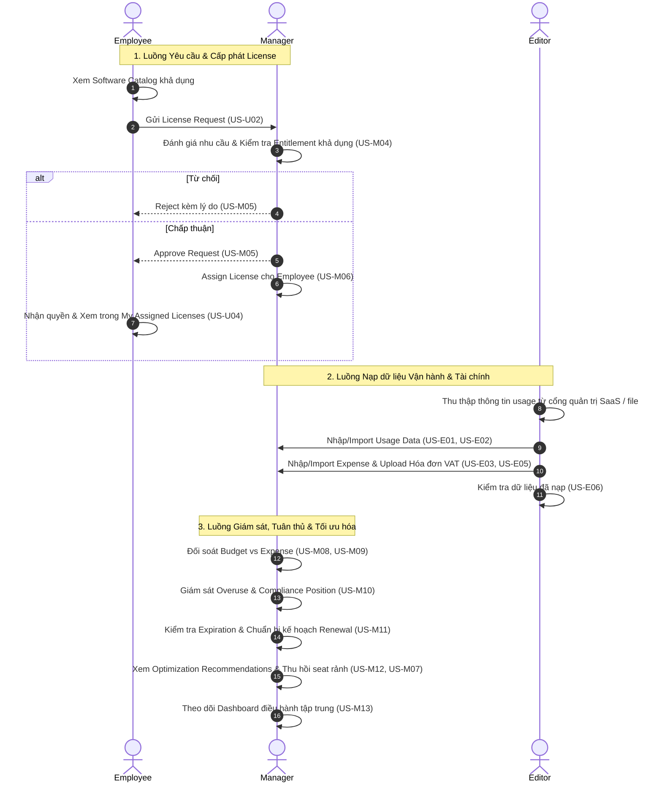

# Tài liệu Đặc tả Phạm vi Sản phẩm Khả dụng Tối thiểu (MVP Specification)
## Dự án: VFast – Enterprise License Management System (ELMS)

---

## 1. Giới thiệu & Bối cảnh Dự án

### 1.1. Đề bài & Định hướng Chiến lược
Dự án **VFast – Enterprise License Management System (ELMS)** là hệ thống quản lý tài sản bản quyền phần mềm nội bộ (**Internal**), hướng tới mục tiêu triển khai thực tế (**Production**) trong thời gian **2 tuần (14 ngày)**.

Hệ thống được thiết kế để giải quyết 3 bài toán lớn của doanh nghiệp:
1. **License Management (Quản lý bản quyền):** Quản trị danh mục phần mềm, nhà cung cấp, quyền sở hữu (Entitlement), hợp đồng, cấp phát và thu hồi license, theo dõi tuân thủ (Compliance).
2. **Budget Management (Quản lý tài chính & ngân sách):** Thiết lập ngân sách phần mềm theo kỳ/phòng ban, ghi nhận chi phí thực tế (Expense), đối chiếu hóa đơn chứng từ, theo dõi tỷ lệ sử dụng ngân sách (Budget Utilization).
3. **License Optimization (Tối ưu hóa chi phí):** Phát hiện license chưa cấp phát (Unallocated), license không hoạt động (Inactive), phát hiện tình trạng sử dụng vượt mức (Overuse), và đưa ra khuyến nghị cắt giảm chi phí (Cost-saving Recommendations).

### 1.2. Hai loại hình License Cốt lõi
Hệ thống hỗ trợ đồng thời cả hai mô hình bản quyền phần mềm phổ biến trong doanh nghiệp:
- **SaaS Subscription (Thuê bao đám mây):** Ví dụ Microsoft 365, Google Workspace, Zoom, Adobe Creative Cloud, Figma. Quản lý theo số lượng seat, chu kỳ thanh toán (tháng/năm), ngày bắt đầu, ngày hết hạn và quy trình gia hạn (Renewal).
- **Perpetual License (Bản quyền vĩnh viễn):** Ví dụ Windows OEM, VMware, AutoCAD, Microsoft Office On-Premise. Quản lý theo license key, mã hợp đồng mua một lần, ngày mua, và theo dõi thời hạn hợp đồng bảo trì/nâng cấp (Maintenance / Software Assurance).

---

## 2. Mô hình 3 Role Tập trung (Core 3-Role Architecture)

Dựa trên yêu cầu tối ưu hóa cấu trúc vận hành cho kế hoạch 2 tuần, hệ thống loại bỏ các vai trò phân tán phức tạp và tinh gọn về **đúng 3 Roles cốt lõi**:

### Chi tiết Quyền hạn 3 Role:
1. **Manager (Quản trị & Phê duyệt):**
   - Quản lý toàn bộ danh mục phần mềm (Software Catalog), Vendor, Entitlement và Hợp đồng.
   - Tiếp nhận, đánh giá và Phê duyệt / Từ chối các yêu cầu cấp license từ Employee.
   - Trực tiếp thực hiện Cấp phát (Assign) và Thu hồi (Revoke) license.
   - Thiết lập Budget, duyệt Expense và phân bổ chi phí.
   - Theo dõi vòng đời hết hạn, gia hạn hợp đồng và rà soát tuân thủ bản quyền (Compliance).
   - Xem toàn bộ hệ thống Dashboard, Báo cáo và Đề xuất tối ưu hóa (Optimization Recommendations).
   - Quản lý tài khoản người dùng và phân quyền 3 role trong hệ thống.
2. **Editor (Quản lý dữ liệu đầu vào):**
   - Cung cấp dữ liệu vận hành: Nhập tay hoặc Import từ file Excel/CSV số liệu sử dụng thực tế (License Usage).
   - Nhập thông tin chi phí thực tế (Expense), Import dữ liệu chi phí và tải lên hóa đơn, chứng từ liên quan.
   - Xem và kiểm tra lại toàn bộ dữ liệu do chính mình nạp vào hệ thống.
   - *Ràng buộc:* Editor không được tự ý sửa đổi Entitlement, không được thay đổi Budget hay quyết định cấp phát/thu hồi license.
3. **Employee (Tự phục vụ & Tra cứu cá nhân):**
   - Xem danh mục các phần mềm khả dụng trong công ty.
   - Gửi yêu cầu xin cấp phát license kèm lý do công việc.
   - Theo dõi tiến độ và trạng thái yêu cầu của bản thân (`Pending`, `Approved`, `Rejected`).
   - Xem danh sách license đã được cấp phát cho bản thân, thời hạn hiệu lực và trạng thái sử dụng.

---

## 3. Ma trận Phân quyền Truy cập (RBAC Matrix)

| Phân hệ chức năng | Manager | Editor | Employee | Ghi chú nghiệp vụ |
| :--- | :---: | :---: | :---: | :--- |
| **Software Catalog** | **CRUD** | **R** | **R** | Employee chỉ thấy phần mềm được phép yêu cầu. |
| **Vendor Management** | **CRUD** | **R** | — | Quản lý thông tin nhà cung cấp và đại lý. |
| **License Entitlement** | **CRUD** | **R** | — | Manager sở hữu quyền xác lập dung lượng mua. |
| **Contract Management** | **CRUD** | **R** | — | Lưu trữ hợp đồng mua sắm và điều khoản. |
| **License Request** | **R / Approve** | — | **Create / Own** | Employee chỉ tạo và xem request của chính mình. |
| **License Assignment** | **CRUD** | — | **Own** | Manager cấp phát; Employee xem seat của mình. |
| **License Revocation** | **CRUD** | — | — | Chỉ Manager có quyền thu hồi seat về kho. |
| **Allocation Tracking** | **R / Manage** | **R** | **Own** | Theo dõi tỷ lệ gán theo phần mềm/phòng ban. |
| **Budget Management** | **CRUD** | **R** | — | Thiết lập hạn mức chi tiêu theo năm/quý/bộ phận. |
| **Expense Management** | **CRUD** | **Input** | — | Editor nhập chi phí; Manager rà soát và phê duyệt. |
| **Cost Allocation** | **CRUD** | **R** | — | Phân bổ chi phí phần mềm theo phòng ban. |
| **Expiration & Renewal** | **CRUD** | **R** | — | Quản lý mốc hết hạn và quyết định gia hạn. |
| **License Usage** | **R** | **Input** | — | Editor nạp dữ liệu tiêu thụ; Manager giám sát. |
| **License Optimization** | **R / Manage** | **R** | — | Xem đề xuất cắt giảm license không dùng/overuse. |
| **Dashboard & Reports** | **R** | **R** | — | Báo cáo trực quan về tài sản, ngân sách, tuân thủ. |
| **User & Role Management** | **CRUD** | — | — | Phân quyền 3 role cho người dùng trong tổ chức. |
| **Data Import (CSV/Excel)** | **R / Manage** | **Input** | — | Editor tải lên file usage/expense; Manager giám sát. |

*(**CRUD**: Toàn quyền Tạo/Xem/Sửa/Xóa; **R**: Chỉ xem; **Input**: Nhập mới và cập nhật; **Approve**: Phê duyệt/Từ chối; **Own**: Chỉ xem dữ liệu cá nhân).*

---

## 4. Phạm vi MVP (14 Ngày) & Phân cấp Ưu tiên (P0 / P1 / P2)

Chiến lược triển khai trong vòng 2 tuần (14 ngày) chia nhỏ backlog thành 3 cấp độ:
- **P0 (Must-Have cho MVP Pilot):** Bắt buộc phải hoàn thành và chạy ổn định để phục vụ mục tiêu Production ban đầu (19 User Stories).
- **P1 (Should-Have):** Các tính năng nâng cao hiệu suất như Import hàng loạt, tải hóa đơn, đề xuất tối ưu hóa (5 User Stories).
- **P2 (Could-Have):** Mở rộng tính năng tự động hóa và tích hợp sâu (dành cho các giai đoạn tiếp theo).

### 4.1. Danh mục 19 User Stories P0 (Phạm vi cốt lõi MVP)
| ID Story | Vai trò | Tóm tắt Nội dung Chức năng Cốt lõi |
| :--- | :---: | :--- |
| **US-M01** | Manager | Quản lý danh mục sản phẩm phần mềm chuẩn (`Software Catalog`). |
| **US-M02** | Manager | Đăng ký và quản lý các khoản Entitlement cho cả SaaS và Perpetual. |
| **US-M04** | Manager | Tiếp nhận và xem xét danh sách các License Request từ nhân viên. |
| **US-M05** | Manager | Phê duyệt hoặc từ chối License Request kèm lý do rõ ràng. |
| **US-M06** | Manager | Cấp phát (Assign) seat license cho nhân viên sau khi duyệt. |
| **US-M07** | Manager | Thu hồi (Revoke) seat bản quyền để giải phóng dung lượng về kho. |
| **US-M08** | Manager | Thiết lập và quản lý ngân sách (Budget) theo phòng ban/năm tài chính. |
| **US-M09** | Manager | Rà soát và quản lý các bản ghi chi phí thực tế (`Expense`). |
| **US-M10** | Manager | Giám sát trạng thái tuân thủ bản quyền, phát hiện rủi ro sử dụng vượt mức (`Overuse`). |
| **US-M11** | Manager | Theo dõi các mốc hết hạn của SaaS Subscription và bảo trì Perpetual. |
| **US-M13** | Manager | Xem Dashboard tổng quan về tình hình bản quyền, ngân sách và phân bổ. |
| **US-M14** | Manager | Quản lý tài khoản người dùng và thiết lập phân quyền 3 role (`Manager, Editor, Employee`). |
| **US-E01** | Editor | Nhập liệu trực tiếp mức độ sử dụng license (`Usage Data`) của các phần mềm. |
| **US-E03** | Editor | Ghi nhận các khoản chi phí phát sinh thực tế (`Expense Records`). |
| **US-E06** | Editor | Xem lại danh sách các dữ liệu usage và expense đã nạp vào hệ thống. |
| **US-U01** | Employee | Xem danh sách phần mềm được phép đăng ký sử dụng trong công ty. |
| **US-U02** | Employee | Gửi yêu cầu xin cấp phát license mới kèm lý do công việc. |
| **US-U03** | Employee | Theo dõi trạng thái phê duyệt của các yêu cầu cá nhân (`Pending/Approved/Rejected`). |
| **US-U04** | Employee | Xem danh sách các license hiện đang được cấp phát cho bản thân. |

### 4.2. Danh mục 5 User Stories P1 (Mở rộng tính năng)
| ID Story | Vai trò | Tóm tắt Nội dung Chức năng |
| :--- | :---: | :--- |
| **US-M03** | Manager | Quản lý hồ sơ hợp đồng pháp lý mua sắm license. |
| **US-M12** | Manager | Xem và đánh giá các đề xuất tối ưu hóa chi phí (Cost-saving Recommendations). |
| **US-E02** | Editor | Import dữ liệu License Usage hàng loạt từ file CSV/Excel. |
| **US-E04** | Editor | Import dữ liệu Expense hàng loạt từ file CSV/Excel. |
| **US-E05** | Editor | Tải lên tệp đính kèm hóa đơn và chứng từ thanh toán hợp lệ. |
| **US-U05** | Employee | Xem thông tin ngày hết hạn của license được cấp phát cho cá nhân. |

---

## 5. Quy trình Nghiệp vụ Tổng thể (End-to-End Workflow)

---

## 6. Kế hoạch Triển khai Sprint 14 Ngày (2-Week Implementation Plan)

| Giai đoạn | Thời gian | Mục tiêu trọng tâm | Deliverables chính |
| :--- | :---: | :--- | :--- |
| **Giai đoạn 1: Foundation & Catalog** | Ngày 1 – 3 | Khởi tạo cấu trúc Database, phân quyền 3 role, xây dựng module Software Catalog và Entitlements. | Schema DB 3 roles, API CRUD Catalog, Entitlement cho SaaS & Perpetual. |
| **Giai đoạn 2: Request & Allocation** | Ngày 4 – 7 | Xây dựng cổng Self-service cho Employee gửi yêu cầu, giao diện Manager duyệt và cấp phát/thu hồi license. | Flow Request-Approval-Assignment hoàn chỉnh, gửi email thông báo trạng thái. |
| **Giai đoạn 3: Financial & Data Input** | Ngày 8 – 10 | Xây dựng giao diện Editor nạp Usage & Expense, tính năng tải hóa đơn và import Excel/CSV. | Module Budget, Expense, tính toán Budget Utilization theo phòng ban. |
| **Giai đoạn 4: Compliance & Dashboard** | Ngày 11 – 12 | Xây dựng thuật toán kiểm tra tuân thủ, phát hiện Overuse, cảnh báo hết hạn và Dashboard tổng quan. | Màn hình Dashboard, cảnh báo Expiration, báo cáo Compliance. |
| **Giai đoạn 5: Testing & Go-Live** | Ngày 13 – 14 | Kiểm thử tích hợp UAT với 3 Role, nạp dữ liệu thử nghiệm, sửa lỗi và đóng gói Production. | Hệ thống sẵn sàng chạy Production nội bộ. |

---

## 7. Tiêu chí Nghiệm thu MVP (MVP Acceptance Criteria)

Hệ thống được coi là đạt yêu cầu nghiệm thu MVP khi đáp ứng đầy đủ các tiêu chuẩn sau:
- [x] **Xác thực & Phân quyền chuẩn xác:** Hệ thống phân định rạch ròi quyền truy cập của Manager, Editor và Employee; ngăn chặn tuyệt đối việc vượt quyền (Privilege Escalation).
- [x] **Quản lý trọn vẹn cả 2 loại License:** Lưu trữ và hiển thị chính xác cả thông tin thuê bao SaaS (ngày hết hạn, chu kỳ thanh toán) và bản quyền vĩnh viễn (key, ngày mua, hạn bảo trì).
- [x] **Luồng Cấp phát khép kín:** Nhân viên gửi yêu cầu -> Quản lý duyệt -> Cấp phát license -> Nhân viên nhìn thấy quyền được cấp trong tài khoản cá nhân.
- [x] **Kiểm soát Ngân sách & Chi phí:** Ghi nhận đầy đủ chi phí thực tế, so sánh trực quan với ngân sách đã đặt ra theo từng bộ phận.
- [x] **Phát hiện Bất thường & Tuân thủ:** Cảnh báo kịp thời khi số lượng gán vượt quá số lượng mua ($Allocated > Capacity$), cảnh báo trước hạn hợp đồng.
- [x] **Bảo toàn dữ liệu:** Dữ liệu do Editor nhập không được tự ý xóa bỏ; lưu vết người tạo (`created_by`) và thời điểm tạo (`created_at`).
