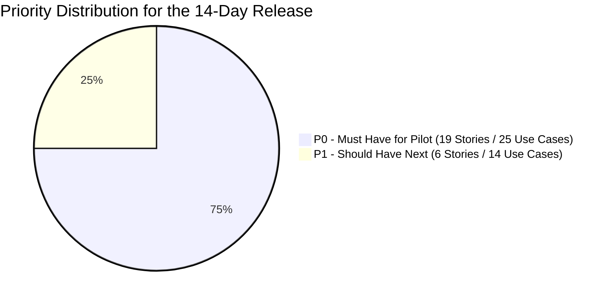
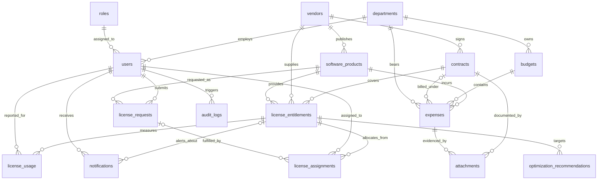

# Minimum Viable Product Scope Specification (MVP Specification)
## Project: VFast – Enterprise License Management System (ELMS)
### Reference: Software Requirements Specification (SRS v1.0)

---

## 1. Introduction & Strategic Objectives of MVP

### 1.1. Delivery Objectives
The **VFast – Enterprise License Management System (ELMS)** is an internal enterprise software license asset management solution targeting a **Production Pilot** deployment within **2 weeks (14 days)**.

Core objectives of the MVP release:
1. **Establish a Centralized License Ledger:** Consolidate all software data, vendors, and ownership rights (SaaS and Perpetual) into a single source of truth (`Single Source of Truth`).
2. **Control Allocation Lifecycle:** Smoothly operate the workflow for requesting, approving, assigning, and revoking licenses between Employee and Manager.
3. **Track Budgets & Expenses:** Provide Staff with tools to input actual usage data (`Usage`) and actual costs (`Expense`), enabling Managers to monitor budget utilization (`Budget Utilization`).
4. **Mitigate Compliance Risks:** Automatically alert when over-allocation (`Over-allocation`) or over-utilization (`Overuse`) occurs, and warn of upcoming contract expirations.

---

## 2. System Boundaries (In-Scope vs. Out-of-Scope)

### 2.1. In-Scope for MVP (8 Feature Groups F01–F08)
- **F01. License Management:** Manage Software Catalog, Vendor, Entitlement (SaaS & Perpetual), and Contract.
- **F02. License Allocation:** Workflow for submitting requests, approval, assignment, revocation, and allocation tracking.
- **F03. Budget Management:** Manage budget limits, record actual expenses and invoice/receipt documents.
- **F04. Lifecycle Management:** Track SaaS expiration dates, Perpetual maintenance dates, and automatic alerts.
- **F05. License Optimization:** Detect unallocated licenses, inactive licenses, and cost optimization recommendations.
- **F06. Analytics & Reporting:** Executive dashboards (License, Finance, Compliance).
- **F07. User & Role Management:** Account management and centralized 3-role RBAC permissions (Manager, Staff, Employee).
- **F08. System Administration:** Authentication (login/logout), immutable Audit Log tracking, and data import.

### 2.2. Out-of-Scope for Initial Pilot
- Direct automatic integration with all software vendor APIs (SaaS Vendor APIs).
- Direct automated provisioning or deprovisioning of accounts on vendor systems (Auto-provisioning / Deprovisioning).
- Deep integration with external accounting or ERP systems (SAP, Oracle, etc.).
- Automated credit card processing or online invoice payments.
- Artificial Intelligence / Machine Learning optimization models (AI/ML Optimization).
- Complex multi-level approval workflows.
- Automatic revocation of licenses immediately upon detecting inactivity without Manager approval.
- Multi-tenancy architecture serving multiple independent organizations.

---

## 3. Feature Prioritization

- **P0 – Must Have (Mandatory for the 14-day Pilot):**
  - Authentication and 3-role RBAC authorization (`Manager, Staff, Employee`).
  - Standard software catalog management (`Software Catalog`), along with a minimalist Vendor catalog (vendor name only) to satisfy BR-02 (see D1, Section 8).
  - Register and manage Entitlements for both **SaaS Subscription** and **Perpetual License**.
  - License request workflow (`License Request`) with Manager approval/rejection.
  - Allocation (`Assign`) and revocation (`Revoke`) of licenses with available quantity enforcement.
  - Budget limit management (`Budget`) and recording of actual expenses (`Expense`).
  - Manual entry of actual usage data (`Usage Data`).
  - Tracking expiration milestones for subscription contracts and maintenance agreements.
  - Executive overview dashboard (`Core Dashboard`) and audit logging (`Audit Logging`).
- **P1 – Should Have (Next immediately following core flow):**
  - Full vendor management (`Vendor`: CRUD, contact details) and detailed contract profiles (`Contract`).
  - Bulk data import from Excel/CSV files (`Import Usage & Expense`).
  - Uploading valid invoice and supporting payment document attachments.
  - Detecting unallocated licenses, licenses inactive for $\ge 60$ days, and displaying optimization recommendations.
  - Compliance reporting (`Compliance Dashboard`) and report export functionality.
- **P2 – Could Have (Future expansion):**
  - Automated integration with vendor systems, advanced SSO synchronization, AI-driven optimization.

---

## 4. 20 Immutable Business Rules (20 Business Rules)

The system strictly adheres to the 20 business rules defined in **Section 7 of SRS v1.0**:
- **BR-01:** The system concurrently supports two license models: SaaS Subscription and Perpetual License.
- **BR-02:** Every Entitlement must be linked to a specific Software Product and a specific Vendor.
- **BR-03:** License quantities may only be compared or calculated (added/subtracted) when using the same measurement metric and compatible data scopes.
- **BR-04:** Capacity formula: $\text{Available Quantity} = \text{Purchased Quantity} - \text{Allocated Quantity}$.
- **BR-05:** Over-allocation beyond the available license quantity is strictly prohibited ($\text{Allocated} \le \text{Purchased}$).
- **BR-06:** Only the Manager role has the authority to approve or reject license requests.
- **BR-07:** Only the Manager role has the authority to assign (Assign) or revoke (Revoke) licenses.
- **BR-08:** Employees are only permitted to view request information and licenses assigned to themselves.
- **BR-09:** Staff are authorized to input usage and expense data, but are strictly prohibited from modifying Entitlements or Budgets.
- **BR-10:** A valid Expense record must contain a valid Amount, Currency, and Payment Date.
- **BR-11:** Expenses in different currencies must not be aggregated unless an explicit exchange rate conversion policy is provided.
- **BR-12:** Perpetual license duration and maintenance agreement duration (Maintenance) must be managed in two independent fields.
- **BR-13:** Revoked license assignments (`Revoked Assignments`) must be preserved in historical records for audit reconciliation.
- **BR-14:** Compliance evaluation based on actual usage requires valid and compatible usage data.
- **BR-15:** Missing usage data must not be automatically assumed to represent zero usage ($Usage \ne 0$).
- **BR-16:** All cost optimization recommendations must be grounded in data evidence and require Manager approval prior to execution.
- **BR-17:** All critical business operations must be recorded in an immutable Audit Log with Actor, Action, and Timestamp.
- **BR-18:** Users in a deactivated state (`Deactivated`) immediately lose system access permissions.
- **BR-19:** A processed License Request (`Approved` or `Rejected`) cannot be processed a second time.
- **BR-20:** Historical archive data is retained in accordance with the enterprise data retention policy.

---

## 5. Non-Functional Requirements (NFRs)

Standardized according to **Section 8 of SRS v1.0**:
- **NFR-01 (Security):**
  - Passwords must be hashed using secure algorithms (BCrypt / Argon2).
  - Session authentication on all endpoints; RBAC permission checks enforced at the Backend API layer.
  - Data in transit must be protected using HTTPS/TLS protocols.
  - License keys and sensitive secrets must never appear in plaintext in log records, URLs/query strings, or export files; license keys must never be used as search criteria.
  - License keys must be encrypted at rest (AES-256-GCM or equivalent), with encryption keys managed outside the database. List and detail APIs only return masked keys; only Managers can view plaintext keys via a dedicated action, with rate limiting, `Cache-Control: no-store` response headers, and `VIEW_LICENSE_KEY` Audit Log recording.
  - User sessions must be revokable from the server side to guarantee BR-18: short-lived access tokens, server-side stored rotating refresh tokens, account status and session version validation on every request; account deactivation or role changes immediately revoke all active sessions (detailed in UC29).
  - File uploads: accept only PDF/PNG/JPG, validate based on actual file magic bytes rather than file extensions, maximum size 10MB, stored outside the webroot with randomized filenames, downloads require per-record authorization checks.
  - Import files must be validated row-by-row with size limits; export files must neutralize spreadsheet formula injection (cells starting with `=`, `+`, `-`, `@`).
- **NFR-02 (Data Integrity):**
  - Database transactions (ACID Transactions) with row-level locking to prevent over-allocation during concurrent operations (Concurrency Control); applies to both Assign and Revoke.
  - Database-level constraints as the final defense layer: `CHECK (allocated_quantity >= 0 AND allocated_quantity <= purchased_quantity)`; partial unique index on `license_assignments (entitlement_id, user_id) WHERE status = 'Active'` and on `license_assignments (request_id) WHERE request_id IS NOT NULL`.
  - `available_quantity` must not be updated independently: it is always calculated from `purchased_quantity - allocated_quantity` (BR-04), e.g., via generated columns.
  - State transitions for `License Request` use conditional updates (`WHERE status = 'Pending'`); if zero rows are updated, raise an error per BR-19. Audit Logs are recorded within the same transaction as the business operation.
  - Preserve transaction history upon license revocation or data archiving.
- **NFR-03 (Performance):**
  - Average response time for standard APIs $\le 2$ seconds under pilot test load.
  - Dashboard query response time $\le 3$ seconds.
  - Support pagination and filtering/search on all list views.
- **NFR-04 (Availability & Reliability):**
  - Graceful exception handling mechanisms to prevent service crashes.
  - Periodic database backup mechanisms and verified recovery procedures.
- **NFR-05 (Maintainability):**
  - Modular Monolith architecture with clear separation of concerns between Controller, Business Service, and Data Persistence layers.
  - Database schema migration history tracked and managed via Flyway Migration.
- **NFR-06 (Auditability):**
  - Complete audit trails recording: Actor, Action, Timestamp, and the Affected Entity.
  - Audit logs are immutable and cannot be arbitrarily modified or overwritten.
- **NFR-07 (Usability):**
  - Intuitive, consistent user interface personalized by user role.
  - Visual color-coded data statuses (Green: Safe/Approved; Red: Over-capacity/Rejected; Yellow: Pending/Warning).

---

## 6. Data Entity Model (12 Core Entities)

Standardized according to **Section 9 of SRS v1.0**, the system utilizes a PostgreSQL relational database with 12 core entities, along with 5 auxiliary entities required for existing use cases and business rules:

| Entity Name (Table) | Business Management Purpose |
| :--- | :--- |
| `users` | Stores user accounts, email, full name, `department_id`, `role_id` (one role per user), active status, and session version. |
| `roles` | Stores the 3 system roles: `MANAGER`, `STAFF`, `EMPLOYEE`. |
| `software_products` | Standardized software product catalog (name, vendor, version, category, status). |
| `vendors` | Directory of vendors, distributors, and contact information. |
| `contracts` | Legal procurement contracts, signing dates, contract values, and attached documents. |
| `license_entitlements` | Owned license entitlement packages (SaaS/Perpetual, purchased, allocated, dates, encrypted license key); `available` is a computed value from `purchased - allocated`. |
| `license_requests` | Requests for 1 seat submitted by employees (requester, `software_id`, justification, approver, status: pending/approved/rejected/fulfilled). |
| `license_assignments` | Specific seat allocation records for employees (`entitlement_id`, `user_id`, optional `request_id`, active/revoked, assigned_date, revoker, and revocation reason). |
| `license_usage` | Actual consumption data by period (`entitlement_id`, `user_id`, reporting period, last activity date, days used, active/inactive status, `created_by`), unique by `entitlement_id`, `user_id`, period. No record in a period means `Unknown` (BR-15). |
| `budgets` | Software budget limits by fiscal year or by department. |
| `expenses` | Actual expenditure records (amount, currency, payment date per BR-10; `software_id`, optional `contract_id`, `department_id`, invoice number, `created_by`). |
| `audit_logs` | Immutable audit log capturing all critical operations in the system. |

**Auxiliary Entities:**

| Entity Name (Table) | Purpose | Priority |
| :--- | :--- | :---: |
| `departments` | Shared department directory for users, budgets, and expenses; prevents free-text department names. | P0 |
| `notifications` | In-system notifications (UC18 expiry warnings, request processing results), with deduplication keys per entitlement and 30/15/7-day milestones. | P0 |
| `exchange_rates` | Exchange rates configured by Manager with effective dates, serving as the explicit conversion policy required by BR-11. Without an active exchange rate, costs are not aggregated. | P0 |
| `attachments` | Invoice and contract file metadata (storage path, file type, file size, uploader). | P1 |
| `optimization_recommendations` | Cost optimization recommendations with data justification and Manager decisions per BR-16. | P1 |

---

## 7. Pilot Acceptance & Delivery Criteria (14 Criteria)

Standardized according to **Section 13 of SRS v1.0**, the MVP version is accepted when meeting all 14 criteria simultaneously:
1. All 3 roles (`Manager, Staff, Employee`) log in successfully and can access only their authorized capabilities.
2. Manager can create, update, and manage the software catalog and Entitlement records.
3. Both **SaaS Subscription** and **Perpetual License** models are registered and tracked accurately.
4. Employees can submit license requests and track their own request statuses.
5. Manager can approve and reject requests; successfully execute license assignments and revocations.
6. Allocated quantities are calculated automatically and never exceed available capacity ($\text{Allocated} \le \text{Purchased}$).
7. Staff can input usage data (`Usage`) and record expenses (`Expense`) with invoice numbers; supporting document file upload (`UC35`) is P1 and not a prerequisite for pilot acceptance.
8. Manager can monitor budget limits and actual disbursed expenses by department.
9. The system identifies and generates alerts prior to contract or maintenance expiration milestones.
10. Dashboard comprehensively and visually presents license and financial metrics (`UC23`, `UC24`), along with compliance alerts from `UC05`, `UC21`; in-depth Compliance Dashboard (`UC25`) is P1.
11. Critical business operations are fully captured in the immutable Audit Log system.
12. All core business workflows pass integration testing (Integration Tests).
13. Database backup and restore procedures are successfully verified.
14. The application is deployed stably in a pilot staging environment and passes user acceptance testing (UAT).

---

## 8. Scope Clarification Decisions (Scope Decisions)

The decisions below resolve specification conflicts across documents. These represent default resolutions **pending team confirmation**; other documents have been aligned with these choices. The priority of each use case and the 20 business rules remain unchanged.

| Code | Issue | Decision | Rationale |
| :---: | :--- | :--- | :--- |
| **D1** | BR-02 requires Vendor, but `UC02` is P1 | P0 includes a minimalist Vendor catalog: select or quick-create by name in `UC01`, `UC03`. Full CRUD remains in `UC02` (P1). | Satisfies BR-02 without altering the priority of `UC02`. |
| **D2** | Acceptance criteria mention invoices, but `UC35` is P1 | P0 Expense records only require an invoice number. File attachments are P1 and optional. | BR-10 does not mandate VAT document files. |
| **D3** | P0 stories link P1 use cases | P0 scope of each story: `US-M01` covers `UC01`; `US-M02` covers `UC03` (Vendor per D1); `US-M10` covers `UC05`, `UC21`; `US-M11` covers `UC15`, `UC18`; `US-M13` covers `UC23`, `UC24`; `US-S06` covers `UC36`. Remaining use cases are delivered in P1. | Preserves story codes and use case priorities. |
| **D4** | Two conflicting financial formulas | Official metrics follow `UC14`: `Actual Spending` is the sum of paid expenses; `Remaining Budget = Total - Actual`; `Budget Utilization = Actual / Total`. Alert thresholds use this `Utilization`. `Committed Spending` is a P1 metric displayed separately, not included in `Utilization`. | Aligns with baseline and avoids double-counting obligations. |
| **D5** | BR-10 requires payment date, but IA includes unpaid expenses | The `expenses` table in P0 only stores disbursed expenses. `PENDING`, `OVERDUE`, and the Mark as Paid action are P1 extensions requiring dedicated rules prior to implementation. `PROJECTED` is a forecasting figure, not an Expense record. | Avoids modifying BR-10 and keeps the 14-day scope focused. |
| **D6** | Requests specify quantity but each Assign adds only 1; multiple assignments possible per request | Each request corresponds to exactly 1 seat for the requester. Add `Fulfilled` status when assigned. An `Approved` request without an available seat remains pending fulfillment without automatic status changes. | Closes the request lifecycle and adheres to BR-19. |
| **D7** | Duplicate assignments only trigger a warning | Prevent assigning additional seats if the employee already has an `Active` assignment for the same software. | Prevents seat waste; `Change Tier` is deferred (D10). |
| **D8** | Standard JWT cannot be revoked, violating BR-18 | Implement server-side revokable session mechanism per NFR-01 and `UC29`. Parameters are configurable defaults. | BR-18 mandates immediate access revocation. |
| **D9** | README allows Staff to read Entitlement and Budget, but IA blocks them | Backend APIs allow Staff read access (excluding license keys). 403 Forbidden applies only to Manager Portal screens; Staff screens will be specified separately. | Staff require this data to input Usage and Expense. |
| **D10** | `Change Tier` lacks use cases or business rules | Deferred to post-MVP. Specifications in IA are retained for reference. | Temporarily substituted by Revoke followed by Assign. |
| **D11** | "Board override" and "soft-stop approval" contradict the exclusion of multi-level approvals | Budget overruns only warn Managers; they do not block expenses or introduce approval tiers. | Adheres to Section 2.2. |
| **D12** | Missing exchange rate source for BR-11 | Manager configures exchange rates with effective dates in `exchange_rates`. Without an active rate, amounts are displayed separately by currency. | Serves as the explicit conversion policy required by BR-11. |
| **D13** | Red threshold is `>100%` in `UC14` but `≥100%` in IA | Standardized red alert when `Budget Utilization` $\ge 100\%$. | At 100%, the budget is fully exhausted with zero remainder. |
| **D14** | Notification channels not yet specified | P0 uses in-system notifications. Email is a post-pilot enhancement. | Eliminates external email infrastructure dependencies during the 14-day pilot. |
| **D15** | `UC21` compares usage quantity, but `license_usage` has no quantity field; missing data representation undefined | For `Per User` metric, usage quantity is the count of distinct employees with `Active` records in the latest period. Absence of records evaluates to `Unknown`; indeterminate status is `Not Evaluated`. `Unknown` is not counted as `Inactive` in `UC20`. | Enables BR-14 and BR-15 using existing data schema. |
| **D16** | Inconsistent API path conventions; behavior on import row errors undefined | All APIs use `/api/v1/` prefix. If an import file contains any invalid row, reject the entire import and return a list of row-level errors. | Unified API contract; prevents partial or corrupted data loading. |
