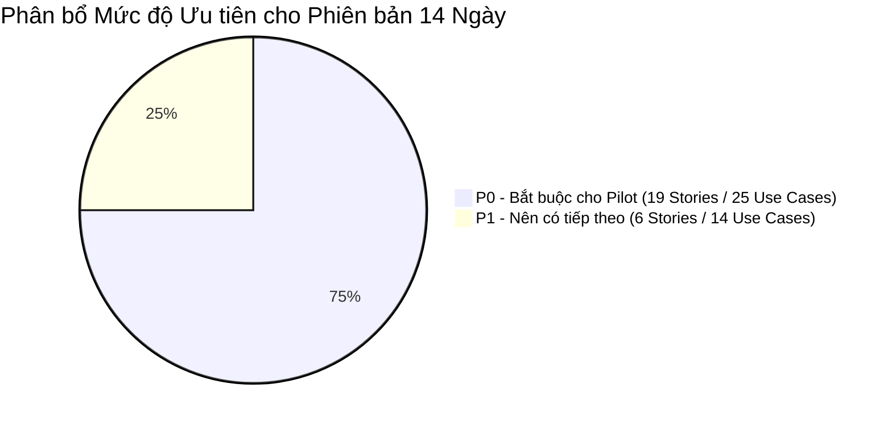
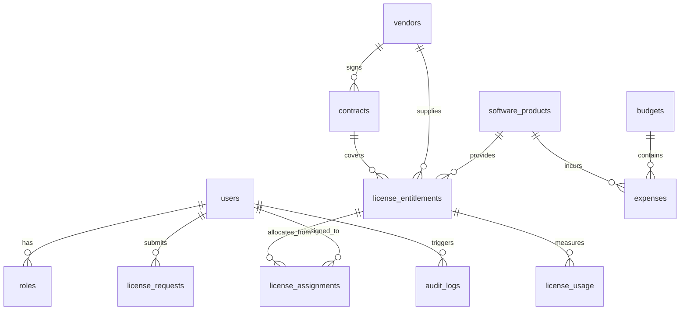

# Tài liệu Đặc tả Phạm vi Sản phẩm Khả dụng Tối thiểu (MVP Specification)
## Dự án: VFast – Enterprise License Management System (ELMS)
### Căn cứ: Bản Đặc tả Yêu cầu Phần mềm (SRS v1.0)

---

## 1. Giới thiệu & Mục tiêu Chiến lược của MVP

### 1.1. Mục tiêu Chuyển giao
Hệ thống **VFast – Enterprise License Management System (ELMS)** là giải pháp quản trị tài sản bản quyền phần mềm nội bộ (**Internal Enterprise**), hướng tới mục tiêu triển khai thử nghiệm đưa vào vận hành thực tế (**Production Pilot**) trong thời gian **2 tuần (14 ngày)**.

Mục tiêu cốt lõi của phiên bản MVP:
1. **Thiết lập Sổ cái Bản quyền Tập trung:** Gom toàn bộ dữ liệu phần mềm, nhà cung cấp, quyền sở hữu (SaaS và Perpetual) về một nguồn dữ liệu duy nhất (`Single Source of Truth`).
2. **Kiểm soát Vòng đời Phân bổ:** Vận hành trơn tru quy trình xin cấp, phê duyệt, cấp phát và thu hồi license giữa Employee và Manager.
3. **Theo dõi Ngân sách & Chi phí:** Cung cấp cho Staff công cụ nạp dữ liệu tiêu thụ (`Usage`) và chi phí thực tế (`Expense`), giúp Manager giám sát tỷ lệ giải ngân (`Budget Utilization`).
4. **Giảm thiểu Rủi ro Tuân thủ:** Tự động cảnh báo khi xảy ra tình trạng cấp phát vượt quyền (`Over-allocation`) hoặc sử dụng vượt mức (`Overuse`), cảnh báo hợp đồng sắp hết hạn.

---

## 2. Ranh giới Hệ thống (In-Scope vs. Out-of-Scope)

### 2.1. Trong Phạm vi MVP (In-Scope - 8 Nhóm Chức năng F01–F08)
- **F01. License Management:** Quản lý Software Catalog, Vendor, Entitlement (SaaS & Perpetual) và Contract.
- **F02. License Allocation:** Quy trình gửi yêu cầu, phê duyệt, cấp phát, thu hồi và theo dõi phân bổ.
- **F03. Budget Management:** Quản lý hạn mức ngân sách, ghi nhận chi phí thực tế và hóa đơn chứng từ.
- **F04. Lifecycle Management:** Theo dõi hạn dùng SaaS, hạn bảo trì Perpetual và cảnh báo tự động.
- **F05. License Optimization:** Phát hiện license chưa gán, license không dùng và đề xuất tối ưu hóa.
- **F06. Analytics & Reporting:** Dashboard điều hành tổng quan (License, Finance, Compliance).
- **F07. User & Role Management:** Quản lý tài khoản và phân quyền 3 role tập trung (Manager, Staff, Employee).
- **F08. System Administration:** Xác thực đăng nhập/đăng xuất, lưu vết Audit Log và import dữ liệu.

### 2.2. Ngoài Phạm vi Ban đầu (Out-of-Scope for Initial Pilot)
- Tự động kết nối trực tiếp với API của tất cả các nhà cung cấp phần mềm (SaaS Vendor APIs).
- Tự động tạo hoặc hủy tài khoản trực tiếp trên hệ thống của vendor (Auto-provisioning / Deprovisioning).
- Tích hợp sâu vào hệ thống kế toán hoặc ERP bên ngoài (SAP, Oracle,...).
- Tự động thanh toán thẻ tín dụng hoặc thanh toán hóa đơn trực tuyến.
- Mô hình tối ưu hóa bằng Trí tuệ Nhân tạo / Học máy (AI/ML Optimization).
- Luồng phê duyệt đa cấp phức tạp (Multi-level approval workflows).
- Tự động thu hồi license ngay khi phát hiện không hoạt động mà không qua Manager duyệt.
- Kiến trúc đa người thuê (Multi-tenancy) phục vụ nhiều doanh nghiệp độc lập.

---

## 3. Phân cấp Ưu tiên Tính năng (Feature Prioritization)

- **P0 – Must Have (Bắt buộc cho Pilot 14 ngày):**
  - Xác thực đăng nhập và phân quyền 3 role RBAC (`Manager, Staff, Employee`).
  - Quản lý danh mục phần mềm chuẩn (`Software Catalog`).
  - Đăng ký và quản lý Entitlement cho cả **SaaS Subscription** và **Perpetual License**.
  - Quy trình gửi yêu cầu (`License Request`) và phê duyệt/từ chối của Manager.
  - Cấp phát (`Assign`) và thu hồi (`Revoke`) license có kiểm soát số lượng khả dụng.
  - Quản lý hạn mức ngân sách (`Budget`) và ghi nhận chi phí thực tế (`Expense`).
  - Nhập dữ liệu mức độ sử dụng thực tế (`Usage Data`).
  - Theo dõi các mốc hết hạn hợp đồng thuê bao và bảo trì.
  - Bảng điều khiển tổng quan (`Core Dashboard`) và lưu vết kiểm toán (`Audit Logging`).
- **P1 – Should Have (Nên có ngay sau luồng cốt lõi):**
  - Quản lý nhà cung cấp (`Vendor`) và hồ sơ hợp đồng chi tiết (`Contract`).
  - Tính năng nạp dữ liệu hàng loạt từ file Excel/CSV (`Import Usage & Expense`).
  - Tải lên tệp đính kèm hóa đơn và chứng từ thanh toán hợp lệ.
  - Phát hiện license chưa gán, license không hoạt động $\ge 60$ ngày và hiển thị khuyến nghị tối ưu.
  - Báo cáo tuân thủ (`Compliance Dashboard`) và chức năng xuất báo cáo.
- **P2 – Could Have (Mở rộng trong tương lai):**
  - Tích hợp tự động với hệ thống nhà cung cấp, đồng bộ SSO nâng cao, tối ưu hóa AI.

---

## 4. 20 Quy tắc Nghiệp vụ Bất biến (20 Business Rules)

Hệ thống tuân thủ nghiêm ngặt 20 quy tắc từ **Mục 7 của bản SRS v1.0**:
- **BR-01:** Hệ thống hỗ trợ song song hai loại hình: SaaS Subscription và Perpetual License.
- **BR-02:** Mọi Entitlement bắt buộc phải liên kết với một Sản phẩm phần mềm và một Nhà cung cấp xác định.
- **BR-03:** Các số lượng license chỉ được phép so sánh hoặc cộng trừ khi sử dụng cùng metric đo lường và phạm vi dữ liệu tương thích.
- **BR-04:** Công thức tính toán dung lượng: $\text{Available Quantity} = \text{Purchased Quantity} - \text{Allocated Quantity}$.
- **BR-05:** Tuyệt đối không cho phép cấp phát vượt quá số lượng bản quyền khả dụng ($\text{Allocated} \le \text{Purchased}$).
- **BR-06:** Chỉ duy nhất vai trò Manager có quyền phê duyệt hoặc từ chối các yêu cầu cấp license.
- **BR-07:** Chỉ duy nhất vai trò Manager có quyền thực hiện cấp phát (Assign) hoặc thu hồi (Revoke) license.
- **BR-08:** Employee chỉ được phép xem thông tin yêu cầu và license thuộc sở hữu của chính bản thân mình.
- **BR-09:** Staff được quyền nhập dữ liệu usage và expense, nhưng tuyệt đối không được sửa đổi Entitlement hoặc Budget.
- **BR-10:** Bản ghi Expense hợp lệ bắt buộc phải có Số tiền hợp lệ, Tiền tệ và Ngày thanh toán.
- **BR-11:** Các khoản chi phí khác loại tiền tệ không được cộng gộp trừ khi có chính sách quy đổi tỷ giá rõ ràng.
- **BR-12:** Thời hạn bản quyền vĩnh viễn và thời hạn thỏa thuận bảo trì (Maintenance) phải được quản lý ở hai trường độc lập.
- **BR-13:** Các lượt gán đã bị thu hồi (`Revoked Assignments`) phải được giữ lại trong lịch sử để đối soát kiểm toán.
- **BR-14:** Việc đánh giá tuân thủ dựa trên mức dùng thực tế bắt buộc phải có dữ liệu usage hợp lệ và tương thích.
- **BR-15:** Dữ liệu usage bị thiếu không được tự động hiểu là mức sử dụng bằng không ($Usage \ne 0$).
- **BR-16:** Mọi đề xuất tối ưu hóa chi phí bắt buộc phải có căn cứ dữ liệu và phải qua sự phê duyệt của Manager trước khi thực thi.
- **BR-17:** Mọi thao tác nghiệp vụ quan trọng bắt buộc phải lưu vết vào Audit Log bất biến kèm Actor, Action và Timestamp.
- **BR-18:** Người dùng ở trạng thái vô hiệu hóa (`Deactivated`) lập tức bị khóa quyền truy cập hệ thống.
- **BR-19:** Một License Request đã xử lý (`Approved` hoặc `Rejected`) không được phép xử lý lại lần thứ hai.
- **BR-20:** Các dữ liệu lưu trữ lịch sử được bảo lưu theo chính sách lưu trữ dữ liệu của doanh nghiệp.

---

## 5. Yêu cầu Phi Chức năng (Non-Functional Requirements - NFRs)

Theo chuẩn hóa tại **Mục 8 của bản SRS v1.0**:
- **NFR-01 (Bảo mật - Security):**
  - Mật khẩu phải được mã hóa bằng thuật toán băm an toàn (BCrypt / Argon2).
  - Xác thực phiên làm việc trên mọi endpoint; kiểm tra quyền hạn RBAC tại tầng Backend API.
  - Bảo vệ dữ liệu truyền tải trên mạng bằng giao thức HTTPS/TLS.
  - License key và thông tin bí mật không được xuất hiện dưới dạng rõ trong nhật ký log hoặc file kết xuất.
- **NFR-02 (Toàn vẹn Dữ liệu - Data Integrity):**
  - Giao dịch cơ sở dữ liệu (ACID Transactions) có khóa dòng để ngăn chặn tình trạng gán vượt dung lượng khi có nhiều người cùng thao tác (Concurrency Control).
  - Giữ nguyên lịch sử giao dịch khi thu hồi license hoặc lưu trữ dữ liệu.
- **NFR-03 (Hiệu năng - Performance):**
  - Thời gian phản hồi trung bình của các API thông thường $\le 2$ giây dưới tải thử nghiệm pilot.
  - Thời gian phản hồi của các truy vấn Dashboard $\le 3$ giây.
  - Hỗ trợ phân trang (Pagination) và lọc tìm kiếm trên tất cả các màn hình danh sách.
- **NFR-04 (Tính Sẵn sàng & Độ tin cậy):**
  - Hệ thống có cơ chế xử lý lỗi ngoại lệ an toàn, tránh treo dịch vụ.
  - Thiết lập cơ chế sao lưu cơ sở dữ liệu định kỳ và quy trình khôi phục được kiểm nghiệm.
- **NFR-05 (Khả năng Bảo trì - Maintainability):**
  - Kiến trúc Modular Monolith phân tách rõ ranh giới giữa Controller, Business Service và Data Persistence.
  - Quản lý lịch sử thay đổi cấu trúc cơ sở dữ liệu thông qua công cụ Flyway Migration.
- **NFR-06 (Khả năng Kiểm toán - Auditability):**
  - Lưu vết đầy đủ thông tin: Người thực hiện (Actor), Thao tác (Action), Dấu thời gian (Timestamp) và Thực thể bị tác động.
  - Nhật ký kiểm toán không thể bị chỉnh sửa hoặc ghi đè tùy tiện.
- **NFR-07 (Tính Tiện dụng - Usability):**
  - Giao diện thân thiện, nhất quán, cá nhân hóa theo vai trò của người dùng.
  - Trạng thái dữ liệu được mã hóa bằng màu sắc trực quan (Xanh: An toàn/Duyệt; Đỏ: Vượt quyền/Từ chối; Vàng: Đang chờ/Cảnh báo).

---

## 6. Mô hình Thực thể Dữ liệu (12 Core Entities)

Theo chuẩn hóa tại **Mục 9 của bản SRS v1.0**, hệ thống sử dụng cơ sở dữ liệu quan hệ PostgreSQL với 12 thực thể cốt lõi:

| Tên Thực thể (Table) | Mục đích Quản lý Nghiệp vụ |
| :--- | :--- |
| `users` | Lưu trữ tài khoản người dùng, email, họ tên, phòng ban và trạng thái hoạt động. |
| `roles` | Lưu trữ 3 vai trò hệ thống: `MANAGER`, `STAFF`, `EMPLOYEE`. |
| `software_products` | Danh mục sản phẩm phần mềm chuẩn hóa (tên, hãng, phiên bản, danh mục, trạng thái). |
| `vendors` | Danh bạ các nhà cung cấp, đại lý phân phối và thông tin liên hệ. |
| `contracts` | Hợp đồng mua sắm pháp lý, ngày ký kết, giá trị và tệp tài liệu đính kèm. |
| `license_entitlements` | Gói quyền sử dụng bản quyền sở hữu (SaaS/Perpetual, purchased, allocated, available, dates). |
| `license_requests` | Yêu cầu xin cấp license từ nhân viên (requester, software, lý do, trạng thái pending/approved/rejected). |
| `license_assignments` | Bản ghi cấp phát seat cụ thể cho nhân viên (active, revoked, assigned_date). |
| `license_usage` | Dữ liệu tiêu thụ thực tế (ngày hoạt động gần nhất, số ngày dùng, mức độ active/inactive). |
| `budgets` | Hạn mức ngân sách phần mềm theo năm tài chính hoặc theo phòng ban. |
| `expenses` | Các bản ghi chi phí phát sinh thực tế, hóa đơn thanh toán và chứng từ VAT. |
| `audit_logs` | Nhật ký kiểm toán bất biến ghi nhận mọi thao tác quan trọng trên hệ thống. |

---

## 7. Tiêu chí Nghiệm thu & Chuyển giao Pilot (14 Criteria)

Theo chuẩn hóa tại **Mục 13 của bản SRS v1.0**, phiên bản MVP được nghiệm thu đạt chuẩn khi thỏa mãn đồng thời 14 tiêu chí:
1. Cả 3 vai trò (`Manager, Staff, Employee`) đăng nhập thành công và chỉ nhìn thấy các chức năng được cấp phép.
2. Manager có thể tạo, chỉnh sửa và quản lý danh mục phần mềm cùng các khoản Entitlement.
3. Cả hai mô hình **SaaS Subscription** và **Perpetual License** được đăng ký và theo dõi chuẩn xác.
4. Employee có thể gửi yêu cầu cấp license và theo dõi trạng thái yêu cầu cá nhân.
5. Manager có thể phê duyệt, từ chối yêu cầu; thực hiện cấp phát và thu hồi license thành công.
6. Số lượng cấp phát được tính toán tự động và không bao giờ vượt quá dung lượng khả dụng ($\text{Allocated} \le \text{Purchased}$).
7. Staff có thể nạp dữ liệu sử dụng (`Usage`) và ghi nhận các khoản chi phí (`Expense`) kèm chứng từ hóa đơn.
8. Manager có thể giám sát hạn mức ngân sách và chi phí giải ngân thực tế theo từng bộ phận.
9. Hệ thống nhận diện và phát sinh cảnh báo trước các mốc hết hạn hợp đồng hoặc bảo trì.
10. Dashboard hiển thị đầy đủ và trực quan các chỉ số về bản quyền, tài chính và tuân thủ.
11. Các thao tác nghiệp vụ quan trọng được ghi nhận đầy đủ vào hệ thống Audit Log bất biến.
12. Toàn bộ các luồng nghiệp vụ kinh doanh chính vượt qua kiểm thử tích hợp (Integration Tests).
13. Quy trình sao lưu (Backup) và phục hồi (Restore) cơ sở dữ liệu được kiểm nghiệm thành công.
14. Ứng dụng được triển khai ổn định trên môi trường thử nghiệm pilot và vượt qua kiểm thử chấp nhận người dùng (UAT).
