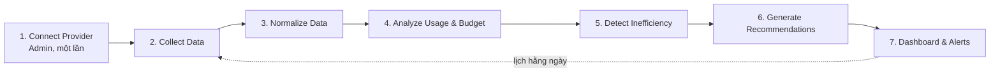
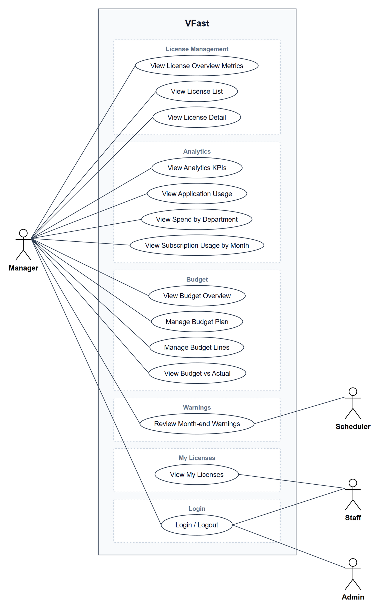

# Định nghĩa Dự án: VFast — Software License Management, Usage Analytics & Budget Optimization Platform

> **Trạng thái:** Bản nháp chờ nhóm xác nhận (2026-11-10).
> **Thay đổi gần nhất:** ba vai trò Admin, Manager, Staff; Manager lập kế hoạch mua sắm và nhận cảnh báo cuối tháng; mỗi license có connector riêng (Microsoft 365 qua Graph API; provider không có API thì nhóm tự viết API để connector gọi vào).

---

## 1. Bài toán

VFast là nền tảng quản lý ngân sách và phân tích hiệu quả sử dụng software license trong doanh nghiệp, hỗ trợ nhiều nhà cung cấp (Microsoft, Google, Adobe, JetBrains, Oracle, OpenAI, Anthropic, AWS, VPN và phần mềm chuyên dụng). Mỗi loại license có mô hình cấp phép, đơn vị đo và cách tính chi phí khác nhau:

| Mô hình | Đơn vị đo |
| :--- | :--- |
| Named User / Seat | Số người dùng được gán |
| Concurrent | Số phiên đồng thời |
| Device-based | Số thiết bị |
| CPU / Core / Server / Instance | Tài nguyên hạ tầng |
| Consumption | Token, request, credit, GB, ... |
| Enterprise / Hybrid | Chỉ số kinh doanh hoặc điều khoản hợp đồng |

Dữ liệu quản lý và sử dụng license phân tán trên hệ thống của từng nhà cung cấp, dẫn đến năm khó khăn:

1. Thiếu một hệ thống tập trung để quản lý thông tin license và chi phí.
2. Khó xác định người dùng nào được cấp license và có thực sự sử dụng hay không.
3. Chưa có cơ chế tự động đo mức sử dụng, mức tiêu thụ và hiệu quả chi phí.
4. Khó đối chiếu ngân sách kế hoạch với số license đã mua, đã cấp và mức sử dụng thực tế.
5. Thiếu dữ liệu để xác định license dư thừa, kém hiệu quả và lập kế hoạch tối ưu ngân sách.

## 2. Mục tiêu

VFast có bốn nhóm chức năng chính:

| Nhóm | Nội dung |
| :--- | :--- |
| **License Management** | Quản lý tập trung danh mục license: nhà cung cấp, sản phẩm, gói, mô hình cấp phép, số lượng đã mua, số lượng đã cấp, chi phí, thời hạn và người sử dụng |
| **Budget Planning & Monitoring** | Lập kế hoạch ngân sách license hằng năm theo P&L, phòng ban hoặc nhóm sử dụng; theo dõi và đối chiếu kế hoạch với số đã mua, đã cấp, mức dùng thực tế và chi phí phát sinh |
| **Automated Usage Analytics** | Connector tự động thu thập dữ liệu từ provider qua API, log, report; chuẩn hóa và phân tích theo từng mô hình cấp phép, liên kết với nhân sự và P&L |
| **Cost Optimization & Recommendation** | Phát hiện license không dùng hoặc kém hiệu quả, chi phí và tiêu thụ bất thường; dự báo nhu cầu; đề xuất điều chỉnh số lượng, cơ cấu gói và phân bổ ngân sách, kèm căn cứ dữ liệu |

Dữ liệu connector cần thu thập:

- Thông tin license và quyền sử dụng.
- Danh sách người dùng được cấp license.
- Hoạt động sử dụng thực tế của từng user, khi provider hỗ trợ.
- Mức tiêu thụ tài nguyên: token, request, credit, session, ...
- Chi phí sử dụng theo thời gian.

**Giá trị cuối cùng:** doanh nghiệp lập được kế hoạch ngân sách license, biết ai đang dùng và dùng bao nhiêu, đánh giá được hiệu quả chi phí và có phương án tối ưu ngân sách dựa trên dữ liệu.

## 3. Phạm vi

| Trong phạm vi | Ngoài phạm vi hiện tại |
| :--- | :--- |
| Quản lý danh mục và thông tin license | Trực tiếp cấp phát hoặc thu hồi license |
| Lập và theo dõi kế hoạch ngân sách theo P&L, phòng ban và năm tài chính | Mua mới, gia hạn hoặc hủy hợp đồng |
| Theo dõi số license dự kiến, đã mua, đã cấp và thực sự sử dụng | Tự động thay đổi subscription hoặc quyền sử dụng trên hệ thống nhà cung cấp |
| Connector tự động thu thập usage | |
| Phân tích utilization, consumption và cost efficiency | |
| Giám sát ngân sách, phát hiện lãng phí, khuyến nghị tối ưu | |
| Dashboard, báo cáo và cảnh báo | |

Hệ thống chỉ phân tích, cảnh báo và khuyến nghị. Hệ thống không thực hiện thay đổi nào trên provider, nên mọi kết nối chỉ cần quyền đọc. "Số lượng đã cấp" là dữ liệu đọc từ provider, không phải thao tác cấp phát trong VFast.

## 4. Vai trò

| Vai trò | Quyền |
| :--- | :--- |
| **Manager** | Lập kế hoạch mua sắm license cho đơn vị mình: bao nhiêu người, bao nhiêu tiền. Theo dõi license, mức sử dụng và ngân sách. Cuối tháng nhận cảnh báo và kiểm tra license có được dùng hay không |
| **Admin** | Quản trị hệ thống: tài khoản và vai trò, cấu hình nguồn dữ liệu, theo dõi đồng bộ. Xem được dữ liệu của mọi đơn vị |
| **Staff** | Người được cấp license. Đăng nhập để xem license của chính mình và tình trạng sử dụng; không thấy dữ liệu của người khác, chi phí hay ngân sách |
| **Scheduler** (tác nhân hệ thống) | Thu thập dữ liệu theo lịch, chuẩn hóa, tính chỉ số, và chạy kiểm tra cuối tháng |

Phân quyền trên các use case đã đặc tả. Phần của Manager và Staff đã rõ từ yêu cầu; phần của Admin là **đề xuất, chờ nhóm xác nhận**:

| Use case | Manager | Admin | Staff |
| :--- | :--- | :--- | :--- |
| UC01–UC07: License Management, Analytics | Xem, trong đơn vị mình quản lý | Xem, mọi đơn vị | Không |
| UC08, UC11: xem ngân sách và đối chiếu | Xem, đơn vị mình | Xem, mọi đơn vị | Không |
| UC09, UC10: lập kế hoạch ngân sách | Tạo, sửa cho đơn vị mình | Chỉ xem | Không |
| UC12: cảnh báo cuối tháng | Xem và ghi quyết định cho đơn vị mình | Chỉ xem | Không |
| UC13: license của tôi | Xem license của chính mình | Xem license của chính mình | Xem license của chính mình |
| UC14: đăng nhập, đăng xuất | Có | Có | Có |

- Phân quyền phải được kiểm tra ở backend; ẩn nút trên giao diện là chưa đủ.
- Dữ liệu usage theo từng người là dữ liệu nhạy cảm, nên mọi API đều yêu cầu đăng nhập.
- Trong các đặc tả ở mục 7, tác nhân được viết là Manager; Admin thực hiện được các thao tác xem tương tự trên toàn bộ dữ liệu.

## 5. Quy trình tự động hóa

Sau khi Admin cấu hình kết nối, hệ thống tự đồng bộ theo lịch, cập nhật chỉ số và tạo insight, không cần thao tác thủ công.

Với provider không có API hoặc không cung cấp dữ liệu ở mức từng người dùng, VFast dùng dữ liệu tổng hợp hoặc import thay thế, và **luôn hiển thị giới hạn và độ tin cậy của dữ liệu** (nguyên tắc A9).

> **Giai đoạn đầu:** mỗi license có connector riêng theo cách kết nối của provider; Microsoft 365 dùng Graph API, provider không có API usage thì nhóm tự viết API để connector gọi vào (mục 6.7). Use case cấu hình kết nối cho Admin chưa được đặc tả (mục 7.11).

### Nguyên tắc thiết kế pipeline

| # | Nguyên tắc | Lý do |
| :---: | :--- | :--- |
| A1 | Chạy theo lịch hằng ngày, không theo sự kiện | Đa số provider không có webhook cho usage và báo cáo thường trễ 1–2 ngày |
| A2 | Lưu dữ liệu thô trước khi chuẩn hóa | Sửa luật chuẩn hóa thì tính lại được mà không gọi lại API |
| A3 | Đồng bộ idempotent và tăng dần | Chạy lại không sinh bản ghi trùng; job lỗi tự bù ở lần sau |
| A4 | Thiếu dữ liệu không được hiểu là usage bằng 0 | Một lần sync lỗi không được sinh cảnh báo lãng phí sai; trạng thái là `Unknown` |
| A5 | Backfill lịch sử khi kết nối lần đầu | Có dữ liệu cho xu hướng và dự báo ngay từ đầu |
| A6 | Chỉ số riêng cho từng mô hình | Không ép một "utilization" chung cho seat, concurrent và consumption |
| A7 | Mọi khuyến nghị kèm bằng chứng và số tiền ước tính | Người dùng kiểm chứng được; hệ thống không tự thực thi |
| A8 | Credential mã hóa khi lưu, scope chỉ đọc | Giảm rủi ro và dễ được doanh nghiệp cấp quyền |
| A9 | Mỗi số liệu mang mức chi tiết và độ tin cậy của nguồn | Phân biệt dữ liệu từng người dùng qua API, dữ liệu tổng hợp và dữ liệu import; không trình bày ước tính như số đo thật |

### Connector theo cấp

Mọi nguồn dữ liệu đi qua một interface chung, theo thứ tự ưu tiên:

1. **API** của provider (tự động hoàn toàn).
2. **Log** (license server, VPN, proxy).
3. **Import file** (CSV/Excel xuất từ trang quản trị hoặc hóa đơn).
4. **Nhập tay** (giá hợp đồng, điều khoản Enterprise).

Provider không có API vẫn vào được hệ thống qua cấp 3–4 thay vì bị loại.

## 6. Mô hình quản lý thống nhất cho mọi loại license

Hệ thống phải quản lý được mọi provider và mọi loại license: theo token, theo seat, theo slot đồng thời, subscription tháng hoặc năm, hợp đồng enterprise, ... Để làm được mà không viết logic riêng cho từng provider, lõi hệ thống không biết "provider" hay "loại license" cụ thể; nó chỉ biết ba trục độc lập dưới đây.

### 6.1. Ba trục độc lập

| Trục | Trả lời câu hỏi | Giá trị |
| :--- | :--- | :--- |
| **Kiểu đo** (archetype) | Đo cái gì, tính hiệu quả thế nào? | Allocation, Concurrent, Metered, Capacity |
| **Điều khoản thương mại** | Trả tiền thế nào, cam kết bao lâu? | Pay-as-you-go, tháng, năm, nhiều năm, trả trước credit, perpetual kèm bảo trì |
| **Cách thu thập** | Dữ liệu đến từ đâu? | API, log, import file, nhập tay |

"Subscription theo tháng" hay "theo năm" là điều khoản thương mại, không phải kiểu đo: seat có thể trả theo tháng hoặc năm, token có thể trả theo lượng dùng hoặc mua credit trước. Tách ba trục thì một license bất kỳ chỉ là một tổ hợp, ví dụ:

| License | Kiểu đo | Thương mại | Thu thập |
| :--- | :--- | :--- | :--- |
| Microsoft 365 E3 | Allocation (seat) | Năm | API |
| OpenAI API | Metered (token) | Pay-as-you-go | API |
| Gói credit AI trả trước | Metered (credit) | Trả trước, có hạn dùng | API |
| Phần mềm kỹ thuật floating | Concurrent (slot) | Năm | Log license server |
| Oracle Database | Capacity (core) | Perpetual kèm bảo trì | Script kiểm kê, nhập tay |
| Hợp đồng Enterprise | Nhiều dòng, mỗi dòng một kiểu đo | Nhiều năm, có cam kết | Hỗn hợp |

### 6.2. Bốn kiểu đo và cách đánh giá hiệu quả

| Kiểu đo | Ví dụ | Quyền đã mua | Tín hiệu usage | KPI chính | Luật phát hiện lãng phí |
| :--- | :--- | :--- | :--- | :--- | :--- |
| **Allocation** | Seat, named user, device | Số lượng | Đã gán cho ai, lần hoạt động cuối | Tỷ lệ gán, tỷ lệ hoạt động | Chưa gán; không hoạt động N ngày; chủ sở hữu đã nghỉ |
| **Concurrent** | Slot, floating, phiên VPN | Số phiên tối đa | Số phiên theo thời gian, lượt bị từ chối | Đỉnh sử dụng / số mua | Đỉnh thấp hơn hẳn số mua trong nhiều kỳ |
| **Metered** | Token, request, credit, GB | Hạn mức, cam kết hoặc không giới hạn | Lượng tiêu thụ theo thời gian và theo chủ thể | Tốc độ tiêu thụ, đơn giá, mức dùng cam kết | Cam kết hoặc credit không dùng hết; tăng đột biến; credit sắp hết hạn |
| **Capacity** | Core, CPU, server, instance | Số đơn vị được cấp phép | Số đơn vị đang triển khai | Đã cấp phép / đang triển khai | Mua thừa; triển khai vượt (rủi ro tuân thủ) |

**Enterprise / Hybrid** không phải kiểu đo thứ năm: đó là một hợp đồng gồm nhiều dòng, mỗi dòng thuộc một trong bốn kiểu trên, cộng thêm điều khoản chung (cam kết tối thiểu, true-up, chiết khấu). Hệ thống phân tích từng dòng theo kiểu đo của nó và tổng hợp mức dùng cam kết ở cấp hợp đồng.

Thêm provider mới không cần thêm logic phân tích: chỉ cần khai báo sản phẩm thuộc kiểu đo nào và viết connector đưa dữ liệu về schema chung.

### 6.3. Mô hình dữ liệu lõi

| Thực thể | Nội dung |
| :--- | :--- |
| `provider` | Nhà cung cấp và connector đang dùng |
| `product` | Sản phẩm hoặc gói của provider |
| `contract` | Hợp đồng hoặc subscription: ngày bắt đầu, ngày gia hạn, thời hạn báo trước, tự gia hạn |
| `entitlement_line` | Một dòng quyền: kiểu đo, đơn vị, số lượng hoặc hạn mức, kỳ hiệu lực |
| `price_term` | Chu kỳ thanh toán, đơn giá, mức cam kết, tiền tệ |
| `subject` | Chủ thể sử dụng: người, thiết bị, dự án, API key |
| `usage_fact` | Dòng quyền, chủ thể, đơn vị, số lượng, kỳ, nguồn, chất lượng dữ liệu |
| `cost_fact` | Ngày, số tiền, tiền tệ, nguồn (billing API, hóa đơn, tính từ đơn giá) |

### 6.4. Chuẩn hóa chi phí

Để so sánh được license trả theo tháng, theo năm và theo lượng dùng:

- Mọi chi phí quy về **chi phí hiệu dụng theo tháng**: gói năm chia 12; perpetual chỉ tính phí bảo trì; pay-as-you-go lấy số thực chi trong tháng.
- Với license có cam kết: tách **phần đã dùng** và **phần cam kết không dùng**; phần sau là lãng phí.
- Khuyến nghị gắn với **thời điểm hành động được**: gói tháng thì có thể giảm ngay; gói năm hoặc enterprise thì khuyến nghị xuất hiện trước ngày gia hạn, tính cả thời hạn báo trước.
- Khác loại tiền tệ chỉ cộng khi có tỷ giá khai báo.

### 6.5. Bao phủ mọi provider

Không thể viết connector riêng cho mọi provider trên thị trường. Mọi provider đều đưa vào hệ thống được nhờ connector theo cấp (mục 5), trong đó các connector dùng chung phủ phần lớn trường hợp:

| Connector dùng chung | Phủ được | Ghi chú |
| :--- | :--- | :--- |
| Log đăng nhập của IdP / SSO | Lần hoạt động cuối cho mọi ứng dụng SaaS đăng nhập qua SSO | Một connector cho rất nhiều provider kiểu Allocation |
| Billing export của cloud | Usage và cost kiểu Metered, Capacity | Ưu tiên định dạng chuẩn chung nếu provider hỗ trợ |
| Log license server, VPN | Kiểu Concurrent | Cần parser theo định dạng log |
| Mẫu import file theo từng kiểu đo | Mọi provider không có API | Bốn mẫu CSV, một cho mỗi kiểu đo |
| Nhập tay | Điều khoản hợp đồng, giá | Luôn có |

Connector riêng (native) chỉ viết cho provider có API tốt và chi phí lớn, theo thứ tự ưu tiên do nhóm chốt.

> Bảng dưới là giả thuyết ban đầu, **cần xác minh trong phần nghiên cứu** với tài liệu chính thức của từng provider.

| Kiểu đo | Khả năng tự động | Nguồn dữ liệu dự kiến |
| :--- | :---: | :--- |
| Allocation (seat) | Cao | Microsoft Graph, Google Admin SDK, log SSO |
| Metered | Cao | Usage/Cost API của OpenAI, Anthropic, AWS |
| Concurrent | Trung bình | Log license server, log VPN |
| Allocation (device) | Thấp | MDM hoặc agent |
| Capacity | Rất thấp | Script kiểm kê, nhập tay |
| Hợp đồng Enterprise | Điều khoản nhập tay, usage theo từng dòng | Hợp đồng |

**Rủi ro cần kiểm tra sớm:** quyền admin cần có để gọi API; độ trễ và giới hạn lịch sử của báo cáo; việc báo cáo usage có ẩn danh người dùng mặc định hay không.

### 6.6. Ngân sách

Ngân sách được lập theo năm tài chính và theo đơn vị tổ chức (P&L, phòng ban hoặc nhóm sử dụng). Bổ sung các thực thể sau vào mô hình ở mục 6.3:

| Thực thể | Nội dung |
| :--- | :--- |
| `org_unit` | P&L, phòng ban, nhóm sử dụng; có quan hệ cha con |
| `employee` | Nhân sự và đơn vị trực thuộc; là `subject` kiểu người, dùng để quy usage và chi phí về đơn vị |
| `budget_plan` | Năm tài chính, đơn vị, tổng ngân sách được phân bổ, tiền tệ |
| `budget_line` | Một dòng kế hoạch: sản phẩm hoặc gói license, số lượng dự kiến, chi phí dự kiến |

Mọi đối chiếu ngân sách đi theo một chuỗi năm mức, tính cho từng đơn vị và từng license:

| Mức | Ý nghĩa | Nguồn |
| :--- | :--- | :--- |
| **Planned** | Số lượng và chi phí dự kiến | `budget_line` |
| **Purchased** | Số lượng đã mua | `entitlement_line` |
| **Assigned** | Số lượng đã cấp cho người dùng | Connector hoặc import |
| **Used** | Số lượng thực sự sử dụng (`Active`, mục 7.4) | `usage_fact` |
| **Actual cost** | Chi phí phát sinh | `cost_fact` |

Mỗi khoảng chênh giữa hai mức liền nhau là một loại vấn đề:

- Planned so với Purchased: mua lệch kế hoạch.
- Purchased so với Assigned: license mua chưa cấp.
- Assigned so với Used: license cấp nhưng không dùng.
- Chi phí dự kiến so với Actual cost: vượt hoặc dư ngân sách.

Quy tắc:

- Chi phí của license dùng chung nhiều đơn vị được chia theo người được gán, giống UC06; phần chưa gán nằm ở `Unallocated`.
- Với license kiểu Metered, "số lượng" ở các mức là lượng tiêu thụ hoặc số tiền, không phải số seat.
- Mức nào thiếu dữ liệu thì hiển thị `Unknown`, không coi là 0 (A4).

### 6.7. Thu thập: mỗi license một cách kết nối

Mỗi license (provider) có **connector riêng**, dùng đúng cách kết nối mà provider đó hỗ trợ để lấy thông tin usage. Có hai trường hợp:

| Trường hợp | Cách lấy usage | Ví dụ |
| :--- | :--- | :--- |
| Provider có API usage | Connector gọi thẳng API của provider | Microsoft 365 qua Microsoft Graph API |
| Provider không có API usage | Nhóm **tự viết một API** đứng thay cho provider; connector gọi vào API đó để lấy dữ liệu. Giai đoạn này API tự viết trả về dữ liệu giả | Phần mềm chuyên dụng, license không có trang quản trị mở API |

**Hợp đồng chung của mọi connector**

Dù gọi API của provider hay API tự viết, mỗi connector phải trả về cùng một bộ dữ liệu theo schema chung (mục 6.3), để phần phân tích không cần biết nguồn:

| Thao tác | Trả về | Bắt buộc |
| :--- | :--- | :---: |
| Lấy license | Gói, số lượng đã mua, ngày hết hạn | Có |
| Lấy người được gán | Tài khoản nào giữ gói nào, từ ngày nào | Có, nếu license theo seat |
| Lấy usage | Hoạt động hoặc lượng tiêu thụ, theo người hoặc tổng hợp | Có |
| Lấy chi phí | Chi phí theo thời gian | Không; thiếu thì tính từ bảng giá |

Mỗi connector khai báo **mức chi tiết** của dữ liệu usage mình cung cấp: theo từng người, hay chỉ tổng hợp. License chỉ có dữ liệu tổng hợp thì không tham gia các bảng theo người và hiển thị nhãn độ tin cậy (A9).

**Nguyên tắc cho API tự viết**

- API tự viết là một dịch vụ tách khỏi VFast; connector gọi nó qua HTTP y như gọi một provider thật, và không biết dữ liệu phía sau là giả.
- Mỗi provider không có API có một API tự viết riêng, với cấu trúc dữ liệu phù hợp kiểu đo của license đó (mục 6.2): seat thì trả người dùng và ngày hoạt động, token thì trả lượng tiêu thụ theo ngày.
- Dữ liệu giả sinh từ một seed cố định, để số liệu trên màn hình lặp lại được khi kiểm thử.
- API nhận một "ngày hiện tại" cấu hình được, để giả lập thời gian trôi và kiểm tra cuối tháng mà không phải chờ.
- Dữ liệu đến từ API tự viết được gắn nguồn là `simulated` trong `usage_fact`, để không bị trình bày như số đo thật (A9).
- Khi sau này có nguồn thật cho provider đó (file xuất từ trang quản trị, log, agent), chỉ thay phần bên trong API tự viết; connector và phần phân tích không đổi.

**Microsoft 365: endpoint Graph cần dùng**

Nếu nhóm chưa có tenant Microsoft 365 để gọi Graph thật, Graph cũng được thay bằng một API tự viết giữ đúng đường dẫn và cấu trúc JSON của Graph (mảng `value`, phân trang bằng `@odata.nextLink`); khi có tenant chỉ đổi base URL và phần xác thực (câu hỏi O1).

> Danh sách dưới đây dựa trên Graph v1.0, **cần đối chiếu với tài liệu chính thức của Microsoft** trước khi viết connector.

| Dữ liệu cần | Endpoint | Trường chính |
| :--- | :--- | :--- |
| Gói license và số lượng | `GET /subscribedSkus` | `skuId`, `skuPartNumber`, `prepaidUnits.enabled`, `consumedUnits` |
| Người dùng và license được gán | `GET /users` | `id`, `displayName`, `userPrincipalName`, `department`, `accountEnabled`, `assignedLicenses` |
| Hoạt động theo từng người | `GET /reports/getOffice365ActiveUserDetail(period='D30')` | `userPrincipalName`, ngày hoạt động gần nhất theo từng dịch vụ |
| Lần đăng nhập gần nhất | `GET /users?$select=signInActivity` | `lastSignInDateTime` |

**Dữ liệu Graph không cung cấp**

| Dữ liệu | Cách xử lý trong giai đoạn đầu |
| :--- | :--- |
| Giá license và chi phí | Bảng giá giả do nhóm nạp sẵn, ghi rõ là dữ liệu bổ sung ngoài Graph |
| P&L và người quản lý đơn vị | Bảng nhân sự giả do nhóm nạp sẵn; Graph chỉ có trường `department` |
| Lịch sử theo tháng | Hệ thống tự chụp số liệu mỗi ngày và lưu lại; biểu đồ theo tháng (UC07) đọc từ lịch sử này. Để có sẵn 12 tháng khi demo, cần nạp trước dữ liệu lịch sử giả |

**Tình huống dữ liệu giả phải bao phủ** — áp dụng cho mọi API tự viết và dữ liệu nạp sẵn.

| Tình huống | Dùng để kiểm tra |
| :--- | :--- |
| Tài khoản hoạt động trong 60 ngày | Trạng thái `Active` |
| Tài khoản từng hoạt động, im hơn 60 ngày | Trạng thái `Inactive` |
| Tài khoản được gán nhưng chưa từng hoạt động | Trạng thái `No activity` |
| Gói có số mua lớn hơn số đã gán | `Unassigned` |
| Gói không có dữ liệu hoạt động | `Not monitored` |
| License chỉ có usage tổng hợp, không theo người | Nhãn độ tin cậy; không vào bảng theo người |
| License theo token có tiêu thụ tăng đột biến | Dữ liệu cho kiểu Metered |
| Tài khoản bị vô hiệu hóa nhưng còn giữ license | License của người đã nghỉ |
| Tài khoản không có `department` | Nhóm `Unknown department` |
| Một người giữ nhiều gói | Không đếm trùng người dùng |
| Tài khoản mới được gán trong tháng | Không bị cảnh báo cuối tháng |
| Đơn vị vượt 80% và 100% ngân sách | Cảnh báo ngân sách ở UC12 |

**Điểm cần lưu ý khi gọi Graph thật:** báo cáo usage có thể trả về CSV thay vì JSON, tên người dùng trong báo cáo có thể bị ẩn danh theo mặc định, `signInActivity` cần gói Entra ID trả phí, và Graph giới hạn tần suất gọi. Nếu giai đoạn này dùng API tự viết thay cho Graph thì nên giả lập cả các trường hợp này, để connector không phải viết lại khi chuyển sang tenant thật.

## 7. Use case và màn hình (giai đoạn hiện tại)

Giai đoạn này làm **ba màn hình** và **kiểm tra cuối tháng**, chủ yếu cho Manager: License Management và Analytics (chỉ xem), Budget (lập kế hoạch mua sắm và theo dõi ngân sách), và danh sách cảnh báo cuối tháng. Staff có một màn hình My Licenses để xem license của chính mình. Chưa có khai báo, cấp phát hay chỉnh sửa license trên giao diện. Phân quyền theo vai trò ở mục 4.

### 7.1. Danh sách use case

| ID | Use Case | Màn hình | Tác nhân chính |
| :---: | :--- | :--- | :--- |
| UC01 | View License Overview Metrics | License Management | Manager |
| UC02 | View License List | License Management | Manager |
| UC03 | View License Detail | License Management | Manager |
| UC04 | View Analytics KPIs | Analytics | Manager |
| UC05 | View Application Usage | Analytics | Manager |
| UC06 | View Spend by Department | Analytics | Manager |
| UC07 | View Subscription Usage by Month | Analytics | Manager |
| UC08 | View Budget Overview | Budget | Manager |
| UC09 | Manage Budget Plan | Budget | Manager |
| UC10 | Manage Budget Lines | Budget | Manager |
| UC11 | View Budget vs Actual | Budget | Manager |
| UC12 | Review Month-end Warnings | Warnings | Manager, Scheduler |
| UC13 | View My Licenses | My Licenses | Staff |
| UC14 | Login / Logout | Login | Admin, Manager, Staff |

Nguồn sơ đồ: [`diagrams/out/uc_vfast.drawio`](diagrams/out/uc_vfast.drawio) (mở bằng draw.io); PNG và SVG xuất từ file này. Sơ đồ vẽ tác nhân chính theo bảng trên; quyền xem của Admin trên các use case khác ghi ở mục 4.

#### Giải thích từng use case

Phần này giải thích bằng lời thường mỗi use case là gì, vì sao cần và trông như thế nào trong thực tế. Luồng xử lý và quy tắc chi tiết nằm ở mục 7.6 (UC01–UC07), 7.8 (UC08–UC11), 7.9 (UC12) và 7.10 (UC13–UC14).

**UC01 – View License Overview Metrics**

- **Là gì:** phần đầu của màn hình License Management, cho thấy công ty đang có tổng cộng bao nhiêu license, chia theo nhóm phần mềm nào, và năm ứng dụng nào có nhiều người dùng nhất.
- **Vì sao cần:** Manager cần một cái nhìn tổng thể trước khi đi vào chi tiết. Không có phần này thì phải tự đếm từ bảng.
- **Ví dụ:** Manager mở màn hình và thấy "42 license", biểu đồ tròn cho thấy 40% là phần mềm văn phòng, và Microsoft 365 đứng đầu với 300 người dùng, trong đó 60 người không dùng.

**UC02 – View License List**

- **Là gì:** bảng liệt kê toàn bộ license, mỗi dòng một license, với nhà phát hành, loại, số lượng đã mua, số người dùng, tiền mua và ngày hết hạn.
- **Vì sao cần:** đây là danh mục tập trung thay cho việc vào trang quản trị của từng nhà cung cấp. Nó trả lời câu hỏi "công ty đang sở hữu gì".
- **Ví dụ:** Manager lọc các license hết hạn trong 30 ngày tới để chuẩn bị quyết định gia hạn, hoặc sắp xếp theo tiền mua để xem license nào tốn nhất.

**UC03 – View License Detail**

- **Là gì:** trang chi tiết của một license: chi phí mỗi tháng, số subscription, số chưa gán, thông tin mô tả, và danh sách từng người đang giữ license kèm tình trạng sử dụng.
- **Vì sao cần:** các con số tổng chỉ cho biết có vấn đề; trang này cho biết vấn đề nằm ở ai. Không có danh sách người dùng thì Manager không hành động được.
- **Ví dụ:** Manager mở Adobe Creative Cloud, thấy 20 seat với chi phí 25 triệu mỗi tháng, trong đó 5 người đã hơn 60 ngày không mở ứng dụng, có tên và phòng ban cụ thể.

**UC04 – View Analytics KPIs**

- **Là gì:** bốn con số ở đầu màn hình Analytics: tổng chi mỗi năm, số license đang quản lý, số tài khoản dùng kém hiệu quả, và số tiền lãng phí tương ứng.
- **Vì sao cần:** quy mức lãng phí ra tiền. Đây là con số Manager dùng để báo cáo và để quyết định có đáng tối ưu hay không.
- **Ví dụ:** "Tổng chi 2,4 tỷ mỗi năm; 85 tài khoản dùng kém hiệu quả; lãng phí 310 triệu mỗi năm".

**UC05 – View Application Usage**

- **Là gì:** biểu đồ thanh ngang cho từng ứng dụng, chia số tài khoản thành ba phần: đang dùng, không hoạt động hơn 60 ngày, và chưa từng dùng.
- **Vì sao cần:** chỉ ra ứng dụng nào đang có nhiều license bị bỏ không nhất. Đây là chỉ số chính cần tối ưu.
- **Ví dụ:** thanh của Jira cho thấy 120 tài khoản, trong đó 30 chưa từng đăng nhập. Manager biết nên xem lại Jira trước tiên.

**UC06 – View Spend by Department**

- **Là gì:** biểu đồ chi phí license chia theo phòng ban.
- **Vì sao cần:** cho biết tiền license đang đi về đâu trong tổ chức, để so sánh giữa các phòng ban và làm căn cứ lập ngân sách.
- **Ví dụ:** Engineering chiếm 55% chi phí license, Sales 20%; 8% thuộc nhóm `Unallocated` vì license đã mua nhưng chưa gán cho ai.

**UC07 – View Subscription Usage by Month**

- **Là gì:** biểu đồ cột theo 12 tháng, mỗi tháng cho thấy bao nhiêu subscription đang dùng, không dùng, không theo dõi được và chưa gán.
- **Vì sao cần:** các màn hình khác chỉ cho thấy hiện tại; biểu đồ này cho thấy xu hướng, tức tình hình đang tốt lên hay xấu đi.
- **Ví dụ:** số subscription không dùng tăng dần từ tháng 6 đến tháng 9, cho thấy công ty mua thêm license nhanh hơn nhu cầu thực.

**UC08 – View Budget Overview**

- **Là gì:** phần đầu của màn hình Budget: tổng ngân sách license của năm, đã chi bao nhiêu, còn lại bao nhiêu, và bảng tình hình của từng đơn vị.
- **Vì sao cần:** Manager cần biết ngân sách đang ở đâu so với kế hoạch trước khi quyết định mua thêm hay cắt giảm.
- **Ví dụ:** ngân sách năm là 500 triệu, đã chi 420 triệu vào tháng 9, tức 84% và đang ở mức cảnh báo.

**UC09 – Manage Budget Plan**

- **Là gì:** Manager tạo kế hoạch ngân sách license cho đơn vị mình trong một năm tài chính: được phân bổ bao nhiêu tiền, rồi kích hoạt kế hoạch.
- **Vì sao cần:** đây là điểm bắt đầu của việc lập kế hoạch mua sắm. Không có kế hoạch thì không có gì để đối chiếu với chi phí thực tế.
- **Ví dụ:** đầu năm, Manager của Engineering tạo kế hoạch 2027 với ngân sách 600 triệu, sao chép các dòng từ kế hoạch 2026 rồi chỉnh lại.

**UC10 – Manage Budget Lines**

- **Là gì:** trong một kế hoạch, Manager khai từng license dự kiến dùng: bao nhiêu người sẽ dùng và tốn bao nhiêu tiền.
- **Vì sao cần:** đây chính là nội dung "mua sắm bao nhiêu người, bao nhiêu tiền". Tổng ngân sách chỉ có ý nghĩa khi biết nó dành cho những license nào.
- **Ví dụ:** Manager thêm dòng "GitHub Copilot, 40 người"; hệ thống gợi ý chi phí từ đơn giá hiện tại, Manager chỉnh lại vì dự kiến giá tăng.

**UC11 – View Budget vs Actual**

- **Là gì:** bảng đối chiếu cho từng license của một đơn vị: dự kiến bao nhiêu, đã mua bao nhiêu, đã cấp bao nhiêu, thực sự dùng bao nhiêu và đã chi bao nhiêu.
- **Vì sao cần:** cho thấy kế hoạch và thực tế lệch nhau ở khâu nào: mua thừa, mua rồi chưa cấp, hay cấp rồi không dùng. Mỗi kiểu lệch cần một cách xử lý khác nhau.
- **Ví dụ:** kế hoạch 40 người dùng Copilot, đã mua 40, đã cấp 35, thực sự dùng 22. Vấn đề không phải mua sai số mà là 13 người được cấp không dùng.

**UC12 – Review Month-end Warnings**

- **Là gì:** đầu mỗi tháng hệ thống tự kiểm tra tháng vừa qua và gửi cho Manager danh sách người được cấp license mà không dùng, kèm chi phí, cùng cảnh báo nếu ngân sách sắp vượt. Manager ghi quyết định cho từng trường hợp.
- **Vì sao cần:** Manager không phải nhớ vào xem dashboard; hệ thống chủ động nhắc. Đây là phần tự động hóa mà người dùng thấy rõ nhất.
- **Ví dụ:** ngày 1 tháng 11, Manager nhận cảnh báo "7 tài khoản không dùng trong tháng 10, tốn 4,2 triệu". Manager đánh dấu 2 người `Giữ lại` vì đang nghỉ phép dài và 5 người `Đề xuất giảm`.

**UC13 – View My Licenses**

- **Là gì:** màn hình của Staff, liệt kê license mà chính người đó đang được cấp và hệ thống ghi nhận có dùng hay không.
- **Vì sao cần:** nhân viên thường không biết mình đang giữ những license nào. Khi thấy mình bị ghi nhận là không dùng, họ có thể chủ động báo với Manager.
- **Ví dụ:** một nhân viên thấy mình đang giữ license Figma với trạng thái "không hoạt động hơn 60 ngày" dù đã chuyển sang nhóm không làm thiết kế.

**UC14 – Login / Logout**

- **Là gì:** đăng nhập bằng email và mật khẩu; hệ thống đưa mỗi người vào đúng phần của vai trò mình.
- **Vì sao cần:** hệ thống chứa dữ liệu ai dùng gì và chi phí của công ty. Manager chỉ được thấy đơn vị mình, Staff chỉ được thấy license của mình.
- **Ví dụ:** Staff đăng nhập thì vào thẳng My Licenses; nếu cố mở màn hình Budget thì bị từ chối.

### 7.2. Màn hình License Management

**Key metrics (UC01)**

- Total Licenses: số license đang quản lý.
- Biểu đồ tròn: tỷ lệ license theo category.
- Application Usage (top 5): rút gọn của biểu đồ ở UC05.

**Bảng license (UC02)** — có tìm kiếm, lọc, sắp xếp và phân trang.

| Cột | Ý nghĩa |
| :--- | :--- |
| License name | Tên license |
| Publisher name | Nhà phát hành |
| License type | Loại license (kiểu đo và điều khoản thương mại, mục 6.1) |
| Compliance status | `Compliant`, `Over-allocated` hoặc `Not evaluated` (mục 7.4) |
| Purchase cost | Số tiền mua |
| License entitlement | Số lượng license đã mua |
| Active users | Số người dùng đang hoạt động |
| Total users | Tổng số người dùng được gán |
| Expiry date | Ngày hết hạn |

**Chi tiết license (UC03)** — mở khi bấm vào một dòng.

| Key indicator | Ý nghĩa |
| :--- | :--- |
| Monthly cost | Chi phí hiệu dụng theo tháng cho ứng dụng (mục 6.4) |
| Subscriptions | Số subscription doanh nghiệp đang sở hữu |
| Subscription types | Số loại gói đang dùng (Free, Plus, Business, Enterprise, ...) |
| Total users | Tổng số tài khoản liên quan đến ứng dụng |
| Unassigned subscriptions | Số license đã mua nhưng chưa gán cho ai |

| Thông tin chi tiết | Ý nghĩa |
| :--- | :--- |
| Vendor | Nhà cung cấp ứng dụng |
| Description | Mô tả chức năng |
| Category | Nhóm ứng dụng |
| Subcategory | Phân nhóm chi tiết |
| Useful links | Đường dẫn liên quan (policy, trang quản trị, ...) |

| Bảng người dùng | Ý nghĩa |
| :--- | :--- |
| User | Tên và email tài khoản |
| Department | Phòng ban |
| Subscription type | Gói đang được gán |
| Status | `Active`, `Inactive`, `No activity` hoặc `Not monitored` (mục 7.4) |
| Last active | Ngày hoạt động gần nhất |
| Assigned date | Ngày được gán |

### 7.3. Màn hình Analytics

**Bốn KPI ở đầu trang (UC04)**

| KPI | Định nghĩa |
| :--- | :--- |
| Total annual spend | Tổng chi phí hiệu dụng theo tháng của các license đang hiệu lực, nhân 12 |
| Managed licenses | Số license đang quản lý; cùng giá trị với Total Licenses ở UC01 |
| Underutilized accounts | Số tài khoản ở trạng thái `Inactive` hoặc `No activity` |
| Underutilized license cost | Chi phí theo năm của các tài khoản trên: số tài khoản nhân đơn giá theo năm của license tương ứng |

**Application Usage (UC05)** — biểu đồ thanh ngang chồng, chọn top 5/10/20 ứng dụng theo số người dùng. Đây là chỉ số mục tiêu cần tối ưu.

| Trạng thái | Màu | Ý nghĩa |
| :--- | :--- | :--- |
| Never used | Cam | Tài khoản chưa từng dùng ứng dụng |
| Inactive (>60 ngày) | Xám | Tài khoản không hoạt động trên 60 ngày |
| Actively used | Xanh | Tài khoản có hoạt động trong 60 ngày gần nhất |

Biểu đồ giúp Manager thấy ứng dụng nào có nhiều license không dùng, đang lãng phí ở đâu và có nên giữ số lượng license hiện tại không. Hệ thống chỉ hiển thị, không thu hồi hay điều chuyển.

**Spend by Department (UC06)** — chi phí license theo phòng ban (Engineering, Sales, Technical Support, Accounting, ...). Chi phí của một license được chia theo phòng ban của người được gán; phần chưa gán cho ai đưa vào nhóm `Unallocated`.

**Subscription Usage by Month (UC07)** — tình trạng sử dụng subscription theo từng tháng trong năm, tính tại cuối mỗi tháng. Mỗi tháng có hai cột:

- Cột chồng: `Active`, `Inactive`, `No activity`, `Not monitored`.
- Cột riêng: `Unassigned`.

### 7.4. Định nghĩa trạng thái dùng chung

Hai biểu đồ và bốn KPI phải dùng cùng một bộ trạng thái, nếu không số liệu giữa các màn hình sẽ lệch nhau. Mỗi subscription/seat thuộc đúng một trạng thái:

| Trạng thái | Điều kiện | Tên ở UC05 |
| :--- | :--- | :--- |
| `Active` | Đã gán, có hoạt động trong 60 ngày gần nhất | Actively used |
| `Inactive` | Đã gán, từng hoạt động nhưng không có hoạt động trong 60 ngày gần nhất | Inactive (>60 ngày) |
| `No activity` | Đã gán, có nguồn dữ liệu usage nhưng chưa từng ghi nhận hoạt động | Never used |
| `Not monitored` | Đã gán, nhưng không có nguồn dữ liệu usage | Không hiển thị |
| `Unassigned` | Đã mua, chưa gán cho ai | Không hiển thị |

- `Not monitored` không được tính là `Inactive` hay lãng phí (nguyên tắc A4).
- **Compliance status:** `Compliant` khi Total users ≤ License entitlement; `Over-allocated` khi vượt; `Not evaluated` khi thiếu dữ liệu.

### 7.5. License không theo seat

Hai màn hình này thiết kế quanh tài khoản người dùng, nên khớp tốt nhất với kiểu Allocation. Với các kiểu đo khác (mục 6.2):

| Kiểu đo | Hiển thị trong bảng license | Trong biểu đồ trạng thái tài khoản |
| :--- | :--- | :--- |
| Metered (token, credit) | Entitlement là hạn mức hoặc credit, không có thì để trống; Active/Total users là số chủ thể có tiêu thụ / tổng chủ thể | Tính theo chủ thể nếu có; không có thì `Not monitored` |
| Concurrent (slot) | Entitlement là số phiên tối đa; Active users là đỉnh phiên trong kỳ | Không tham gia |
| Capacity (core) | Entitlement là số đơn vị được cấp phép; cột users để trống | Không tham gia |

Biểu đồ riêng cho tiêu thụ (token theo thời gian, mức dùng cam kết) chưa có trong hai màn hình này và thuộc phần hoãn lại.

### 7.6. Đặc tả chi tiết từng use case

Mục này đặc tả UC01–UC07; các use case ngân sách ở mục 7.8. Áp dụng chung cho UC01–UC07:

- **Tác nhân:** Manager.
- **Tính chất:** chỉ xem; không use case nào làm thay đổi dữ liệu.
- **Trạng thái:** dùng bộ trạng thái ở mục 7.4.
- **Trạng thái rỗng:** chưa có dữ liệu thì hiển thị thông báo "Chưa có dữ liệu", không hiển thị số 0 hay biểu đồ trống gây hiểu nhầm.
- **Tiền tệ:** các khoản khác loại tiền chỉ được cộng khi có tỷ giá; nếu không thì hiển thị riêng từng loại tiền.

---

#### UC01 – View License Overview Metrics

- **Mục tiêu:** Manager nắm nhanh quy mô và cơ cấu danh mục license ngay khi mở màn hình License Management.
- **Tiền điều kiện:** Manager mở màn hình License Management.
- **Luồng chính:**
  1. Hệ thống hiển thị **Total Licenses**: số license đang hiệu lực.
  2. Hệ thống hiển thị biểu đồ tròn tỷ lệ license theo category; rê chuột vào một phần thấy tên category, số license và phần trăm.
  3. Hệ thống hiển thị **Application Usage (top 5)**: năm ứng dụng có nhiều người dùng nhất, mỗi thanh chia theo `Actively used`, `Inactive`, `Never used`.
  4. Manager bấm vào một phần của biểu đồ tròn để lọc bảng license (UC02) theo category đó.
  5. Manager bấm vào một ứng dụng trong top 5 để mở chi tiết license (UC03).
- **Luồng thay thế:**
  - License chưa có category được gom vào nhóm `Uncategorized`.
  - Có nhiều hơn 6 category thì các category nhỏ nhất gom thành `Other`.
  - Ít hơn 5 ứng dụng có dữ liệu người dùng thì hiển thị đúng số ứng dụng có.
- **Quy tắc:**
  - Total Licenses đếm theo license (một dòng trong bảng UC02), không đếm theo số seat.
  - License đã hết hạn không tính vào Total Licenses và biểu đồ tròn.
  - Top 5 dùng cùng dữ liệu và cách xếp hạng với UC05.
- **Hậu điều kiện:** không thay đổi dữ liệu.

---

#### UC02 – View License List

- **Mục tiêu:** Manager xem toàn bộ license trong một bảng và tìm được license cần quan tâm.
- **Tiền điều kiện:** Manager mở màn hình License Management.
- **Luồng chính:**
  1. Hệ thống hiển thị bảng license với các cột: License name, Publisher name, License type, Compliance status, Purchase cost, License entitlement, Active users, Total users, Expiry date.
  2. Manager tìm theo tên license hoặc publisher.
  3. Manager lọc theo license type, category, compliance status và khoảng ngày hết hạn.
  4. Manager sắp xếp theo một cột bất kỳ; mặc định sắp theo ngày hết hạn gần nhất.
  5. Manager chuyển trang; mỗi trang mặc định 20 dòng.
  6. Manager bấm vào một dòng để mở chi tiết license (UC03).
- **Luồng thay thế:**
  - Không có license khớp điều kiện lọc: hiển thị "Không tìm thấy license phù hợp" kèm nút xóa bộ lọc.
  - License không có ngày hết hạn (perpetual, pay-as-you-go): cột Expiry date hiển thị "Không hết hạn".
  - License không theo seat: các cột entitlement và users hiển thị theo mục 7.5; ô không áp dụng hiển thị "—".
- **Quy tắc:**
  - Compliance status: `Compliant` khi Total users ≤ License entitlement; `Over-allocated` khi vượt; `Not evaluated` khi thiếu dữ liệu.
  - Active users là số tài khoản ở trạng thái `Active`; Total users là số tài khoản được gán.
  - License còn dưới 30 ngày đến hạn được đánh dấu "Sắp hết hạn"; license quá hạn được đánh dấu "Đã hết hạn" và vẫn hiển thị trong bảng.
  - Purchase cost hiển thị kèm loại tiền và chu kỳ thanh toán (tháng, năm, một lần).
- **Hậu điều kiện:** không thay đổi dữ liệu; bộ lọc và sắp xếp được giữ khi Manager quay lại từ trang chi tiết.

---

#### UC03 – View License Detail

- **Mục tiêu:** Manager xem đầy đủ chi phí, số lượng và thông tin mô tả của một ứng dụng.
- **Tiền điều kiện:** Manager chọn một license từ UC01, UC02 hoặc UC05.
- **Luồng chính:**
  1. Hệ thống hiển thị năm key indicator: Monthly cost, Subscriptions, Subscription types, Total users, Unassigned subscriptions.
  2. Hệ thống hiển thị thông tin chi tiết: Vendor, Description, Category, Subcategory, Useful links.
  3. Hệ thống hiển thị bảng người dùng của license: User (tên và email), Department, Subscription type, Status, Last active, Assigned date. Mặc định sắp tài khoản không dùng lên đầu: `No activity`, `Inactive`, `Not monitored`, rồi `Active`.
  4. Manager tìm theo tên hoặc email, lọc theo Status, Department và Subscription type, sắp xếp theo cột và chuyển trang.
  5. Manager bấm vào một đường dẫn trong Useful links; đường dẫn mở ở tab mới.
  6. Manager quay lại bảng license.
- **Luồng thay thế:**
  - License không tồn tại hoặc đã bị gỡ: hiển thị "Không tìm thấy license" và đường quay lại bảng.
  - Thuộc tính mô tả còn trống: hiển thị "—".
  - License không theo seat: Unassigned subscriptions hiển thị "—".
  - License chưa gán cho ai: bảng người dùng hiển thị "Chưa có người dùng được gán".
  - Tài khoản chưa từng hoạt động hoặc `Not monitored`: cột Last active hiển thị "—".
  - Tài khoản không khớp được với nhân viên nào: hiển thị định danh tài khoản trên provider, Department là `Unknown department`.
  - License không theo seat: bảng liệt kê chủ thể sử dụng (dự án, API key, thiết bị) nếu có; không có thì ẩn bảng.
- **Quy tắc:**
  - Monthly cost là chi phí hiệu dụng theo tháng (mục 6.4): gói năm chia 12, pay-as-you-go lấy số thực chi của tháng gần nhất.
  - Subscriptions là tổng số subscription của ứng dụng trên mọi gói; Subscription types là số gói khác nhau.
  - Unassigned subscriptions = License entitlement − Total users, không nhỏ hơn 0.
  - Total users ở đây phải bằng Total users của cùng license trong bảng UC02.
  - Số dòng của bảng người dùng bằng Total users; mỗi tài khoản có đúng một Status theo mục 7.4.
  - Số dòng `Inactive` cộng `No activity` bằng phần của license này trong Underutilized accounts (UC04) và trong biểu đồ Application Usage (UC05).
  - Bảng người dùng chỉ hiển thị tình trạng sử dụng, không có thao tác thu hồi hay gán lại.
- **Hậu điều kiện:** không thay đổi dữ liệu.

---

#### UC04 – View Analytics KPIs

- **Mục tiêu:** Manager thấy ngay tổng chi phí và mức lãng phí của toàn bộ danh mục.
- **Tiền điều kiện:** Manager mở màn hình Analytics.
- **Luồng chính:**
  1. Hệ thống hiển thị bốn KPI ở đầu trang: Total annual spend, Managed licenses, Underutilized accounts, Underutilized license cost.
  2. Manager rê chuột vào một KPI để xem công thức tính và thời điểm dữ liệu được cập nhật gần nhất.
- **Luồng thay thế:**
  - Thiếu tỷ giá: hai KPI về tiền hiển thị riêng từng loại tiền.
  - Không có license nào có dữ liệu usage: hai KPI underutilized hiển thị "Chưa đánh giá được", không hiển thị 0.
- **Quy tắc:**
  - Total annual spend = tổng chi phí hiệu dụng theo tháng của các license đang hiệu lực × 12.
  - Managed licenses bằng Total Licenses ở UC01.
  - Underutilized accounts = số tài khoản `Inactive` + số tài khoản `No activity`. Tài khoản `Not monitored` và license `Unassigned` không tính.
  - Underutilized license cost = tổng, trên từng license, của (số tài khoản underutilized × đơn giá theo năm của một seat).
  - Underutilized license cost không bao giờ lớn hơn Total annual spend.
- **Hậu điều kiện:** không thay đổi dữ liệu.

---

#### UC05 – View Application Usage

- **Mục tiêu:** Manager xác định ứng dụng nào có nhiều tài khoản không dùng nhất. Đây là chỉ số mục tiêu cần tối ưu.
- **Tiền điều kiện:** Manager mở màn hình Analytics.
- **Luồng chính:**
  1. Hệ thống hiển thị biểu đồ thanh ngang chồng cho top 5 ứng dụng theo tổng số người dùng.
  2. Mỗi thanh chia ba phần: `Never used` (cam), `Inactive >60 ngày` (xám), `Actively used` (xanh).
  3. Manager đổi sang top 10 hoặc top 20.
  4. Manager rê chuột vào một phần để xem số tài khoản và phần trăm trong ứng dụng đó.
  5. Manager bấm vào một ứng dụng để mở chi tiết license (UC03).
- **Luồng thay thế:**
  - Số ứng dụng ít hơn mức top đã chọn: hiển thị tất cả ứng dụng có.
  - Ứng dụng không có nguồn dữ liệu usage: không đưa vào biểu đồ; hiển thị ghi chú số ứng dụng `Not monitored` bị loại.
- **Quy tắc:**
  - Xếp hạng theo Total users giảm dần; bằng nhau thì xếp theo tên.
  - Ba phần của một thanh cộng lại bằng Total users của ứng dụng đó.
  - Ngưỡng không hoạt động là 60 ngày tính đến ngày dữ liệu gần nhất.
  - Chỉ áp dụng cho license có tài khoản người dùng (mục 7.5).
- **Hậu điều kiện:** không thay đổi dữ liệu.

---

#### UC06 – View Spend by Department

- **Mục tiêu:** Manager biết phòng ban nào tiêu nhiều ngân sách license nhất và so sánh giữa các phòng ban.
- **Tiền điều kiện:** Manager mở màn hình Analytics.
- **Luồng chính:**
  1. Hệ thống hiển thị biểu đồ chi phí license theo phòng ban, sắp theo chi phí giảm dần.
  2. Manager rê chuột vào một phòng ban để xem số tiền, phần trăm trên tổng và số license liên quan.
- **Luồng thay thế:**
  - Tài khoản không thuộc phòng ban nào: chi phí đưa vào nhóm `Unknown department`.
  - Thiếu tỷ giá: hiển thị riêng từng loại tiền.
- **Quy tắc:**
  - Chi phí theo năm của một license chia đều cho các seat; mỗi seat tính vào phòng ban của người được gán.
  - Phần seat chưa gán đưa vào nhóm `Unallocated`.
  - License không theo seat: chia theo phòng ban của chủ thể sử dụng nếu có, không có thì đưa vào `Unallocated`.
  - Tổng mọi nhóm, gồm `Unallocated` và `Unknown department`, bằng Total annual spend ở UC04.
- **Hậu điều kiện:** không thay đổi dữ liệu.

---

#### UC07 – View Subscription Usage by Month

- **Mục tiêu:** Manager theo dõi tình trạng sử dụng subscription thay đổi thế nào qua từng tháng trong năm.
- **Tiền điều kiện:** Manager mở màn hình Analytics.
- **Luồng chính:**
  1. Hệ thống hiển thị biểu đồ cột cho 12 tháng của năm hiện tại.
  2. Mỗi tháng có hai cột: cột chồng gồm `Active`, `Inactive`, `No activity`, `Not monitored`; cột riêng cho `Unassigned`.
  3. Manager chọn năm khác để xem.
  4. Manager bật hoặc tắt một trạng thái trên chú giải để ẩn hoặc hiện phần đó.
  5. Manager rê chuột vào một cột để xem số subscription của từng trạng thái trong tháng.
- **Luồng thay thế:**
  - Tháng chưa đến: không hiển thị cột.
  - Tháng hiện tại: tính đến ngày dữ liệu gần nhất và được đánh dấu là chưa trọn tháng.
  - Tháng không có dữ liệu: hiển thị "Không có dữ liệu" cho tháng đó, không hiển thị cột bằng 0.
- **Quy tắc:**
  - Trạng thái của mỗi subscription được tính tại ngày cuối tháng.
  - Trong một tháng, tổng cột chồng cộng cột `Unassigned` bằng tổng số subscription đã mua tại cuối tháng đó.
  - `Not monitored` không được gộp vào `Inactive` hay `No activity` (nguyên tắc A4).
  - Số liệu tháng gần nhất phải khớp với Underutilized accounts ở UC04 (`Inactive` + `No activity`).
- **Hậu điều kiện:** không thay đổi dữ liệu.

### 7.7. Màn hình Budget

Màn hình có bộ chọn **năm tài chính** ở đầu trang; mọi số liệu bên dưới theo năm đã chọn.

**Key metrics (UC08)**

| KPI | Định nghĩa |
| :--- | :--- |
| Total budget | Tổng ngân sách license được phân bổ cho mọi đơn vị trong năm |
| Planned cost | Tổng chi phí dự kiến của các dòng kế hoạch |
| Actual cost | Tổng chi phí phát sinh tính đến ngày dữ liệu gần nhất |
| Remaining budget | Total budget − Actual cost |
| Budget utilization | Actual cost / Total budget |

**Bảng ngân sách theo đơn vị (UC08, UC09)**

| Cột | Ý nghĩa |
| :--- | :--- |
| Unit | P&L, phòng ban hoặc nhóm sử dụng |
| Budget | Ngân sách được phân bổ |
| Planned cost | Tổng chi phí dự kiến của các dòng kế hoạch thuộc đơn vị |
| Actual cost | Chi phí phát sinh của đơn vị |
| Remaining | Budget − Actual cost |
| Utilization | Actual cost / Budget, kèm màu theo ngưỡng |
| Status | `Draft` hoặc `Active` |

**Chi tiết ngân sách của một đơn vị (UC10, UC11)** — mở khi bấm vào một dòng. Mỗi dòng kế hoạch là một license dự kiến sử dụng:

| Cột | Ý nghĩa |
| :--- | :--- |
| License | Sản phẩm hoặc gói |
| Planned qty / Planned cost | Số người dự kiến dùng (với license theo seat) và chi phí dự kiến |
| Purchased | Số lượng đã mua tính cho đơn vị |
| Assigned | Số lượng đã cấp cho người của đơn vị |
| Used | Số lượng thực sự sử dụng (`Active`) |
| Actual cost | Chi phí phát sinh |
| Variance | Actual cost − Planned cost |

### 7.8. Đặc tả chi tiết use case ngân sách

Áp dụng chung:

- **Tác nhân:** Manager.
- **Đơn vị tổ chức:** danh sách P&L, phòng ban, nhóm sử dụng lấy từ dữ liệu nhân sự có sẵn; màn hình này không tạo hay sửa đơn vị (câu hỏi O10).
- **Chuỗi đối chiếu:** Planned, Purchased, Assigned, Used, Actual cost theo mục 6.6.
- **Ngưỡng màu:** Utilization dưới 80% là bình thường, từ 80% là cảnh báo, từ 100% là vượt ngân sách. Đây chỉ là màu hiển thị; thông báo chủ động thuộc phần chưa đặc tả.
- **Tiền tệ:** mỗi kế hoạch có một loại tiền; khoản khác loại tiền chỉ được cộng khi có tỷ giá.
- **Phạm vi:** ngân sách chỉ là kế hoạch và đối chiếu trong VFast; không tạo đơn mua, không cấp phát license.
- **Phạm vi dữ liệu:** Manager chỉ thấy và lập kế hoạch cho đơn vị mình quản lý; truy cập kế hoạch của đơn vị khác bị từ chối ở backend. Admin xem được mọi đơn vị nhưng không sửa kế hoạch.
- **Nội dung kế hoạch:** kế hoạch mua sắm trả lời hai câu hỏi cho từng license: bao nhiêu người sẽ dùng và tốn bao nhiêu tiền.

---

#### UC08 – View Budget Overview

- **Mục tiêu:** Manager thấy tổng ngân sách license của năm và đơn vị nào đang dùng nhiều hoặc sắp vượt.
- **Tiền điều kiện:** Manager mở màn hình Budget.
- **Luồng chính:**
  1. Hệ thống hiển thị năm tài chính hiện tại và năm KPI: Total budget, Planned cost, Actual cost, Remaining budget, Budget utilization.
  2. Hệ thống hiển thị bảng ngân sách theo đơn vị, mặc định sắp theo Utilization giảm dần.
  3. Manager chọn năm tài chính khác.
  4. Manager tìm theo tên đơn vị, lọc theo Status và mức Utilization, sắp xếp theo cột.
  5. Manager bấm vào một đơn vị để mở chi tiết (UC11).
- **Luồng thay thế:**
  - Năm chưa có kế hoạch nào: hiển thị "Chưa có kế hoạch ngân sách cho năm này" kèm nút tạo kế hoạch (UC09).
  - Đơn vị có chi phí phát sinh nhưng chưa có kế hoạch: vẫn hiển thị trong bảng với Budget là "Chưa lập" và Utilization là "—".
  - Chưa có dữ liệu chi phí: Actual cost hiển thị `Unknown`, không hiển thị 0.
- **Quy tắc:**
  - KPI chỉ tính kế hoạch `Active`; kế hoạch `Draft` hiển thị trong bảng nhưng không cộng vào Total budget.
  - Actual cost của một đơn vị tính theo cách chia chi phí của UC06, nên tổng Actual cost mọi đơn vị cộng `Unallocated` bằng chi phí phát sinh toàn doanh nghiệp trong năm.
  - Budget utilization không chia cho 0: Budget bằng 0 hoặc chưa lập thì hiển thị "—".
- **Hậu điều kiện:** không thay đổi dữ liệu.

---

#### UC09 – Manage Budget Plan

- **Mục tiêu:** Manager lập và điều chỉnh ngân sách license của một đơn vị cho một năm tài chính.
- **Tiền điều kiện:** Đơn vị tổ chức đã có trong hệ thống.
- **Luồng chính:**
  1. Manager chọn "Tạo kế hoạch", chọn năm tài chính và đơn vị.
  2. Manager nhập ngân sách được phân bổ, loại tiền và ghi chú.
  3. Hệ thống lưu kế hoạch ở trạng thái `Draft`.
  4. Manager thêm các dòng kế hoạch (UC10).
  5. Manager chọn "Kích hoạt"; kế hoạch chuyển sang `Active` và được tính vào các KPI.
  6. Manager sửa ngân sách của kế hoạch `Active` khi được điều chỉnh giữa năm, kèm lý do.
- **Luồng thay thế:**
  - Đơn vị đã có kế hoạch cho năm đó: hệ thống từ chối tạo mới và mở kế hoạch hiện có.
  - Ngân sách nhỏ hơn hoặc bằng 0, hoặc thiếu loại tiền: từ chối lưu và báo lỗi theo trường.
  - Kích hoạt khi tổng Planned cost vượt ngân sách: hệ thống cảnh báo mức vượt và yêu cầu Manager xác nhận.
  - Tạo kế hoạch cho năm mới: Manager có thể sao chép các dòng từ kế hoạch năm trước của cùng đơn vị.
  - Xóa: chỉ xóa được kế hoạch `Draft`; kế hoạch `Active` không xóa.
- **Quy tắc:**
  - Mỗi đơn vị có nhiều nhất một kế hoạch cho một năm tài chính.
  - Mọi thay đổi trên kế hoạch `Active` được lưu lịch sử: giá trị cũ, giá trị mới, lý do, thời điểm.
  - Nếu đơn vị có quan hệ cha con, ngân sách của đơn vị cha không tự cộng từ đơn vị con; hệ thống chỉ cảnh báo khi tổng đơn vị con vượt đơn vị cha.
- **Hậu điều kiện:** kế hoạch được tạo hoặc cập nhật; các KPI ở UC08 tính lại.

---

#### UC10 – Manage Budget Lines

- **Mục tiêu:** Manager xác định đơn vị dự kiến dùng license nào, số lượng bao nhiêu và chi phí tương ứng.
- **Tiền điều kiện:** Kế hoạch ngân sách của đơn vị đã tồn tại (UC09).
- **Luồng chính:**
  1. Manager mở chi tiết kế hoạch và chọn "Thêm dòng".
  2. Manager chọn license (sản phẩm hoặc gói) từ danh mục hiện có.
  3. Manager nhập số lượng dự kiến; hệ thống gợi ý chi phí dự kiến bằng số lượng nhân đơn giá theo năm hiện tại của license.
  4. Manager giữ hoặc sửa chi phí dự kiến rồi lưu.
  5. Manager sửa hoặc xóa một dòng.
  6. Hệ thống cập nhật tổng Planned cost và phần ngân sách chưa phân bổ của kế hoạch.
- **Luồng thay thế:**
  - License đã có trong kế hoạch: hệ thống từ chối thêm trùng và mở dòng hiện có.
  - License dự kiến mua mới, chưa có trong danh mục: Manager nhập tên và đơn giá dự kiến; dòng được đánh dấu "Chưa có trong danh mục" và các cột Purchased, Assigned, Used hiển thị "—".
  - License kiểu Metered: Manager nhập chi phí dự kiến; số lượng là lượng tiêu thụ dự kiến và không bắt buộc.
  - Tổng Planned cost vượt ngân sách: hệ thống vẫn cho lưu và hiển thị mức vượt.
- **Quy tắc:**
  - Số lượng dự kiến không âm; chi phí dự kiến lớn hơn 0.
  - Với license theo seat, số lượng dự kiến là số người trong đơn vị dự kiến được cấp license đó.
  - Chi phí gợi ý chỉ là giá trị khởi đầu; giá trị Manager lưu mới là Planned cost.
  - Sửa hoặc xóa dòng của kế hoạch `Active` được lưu lịch sử như UC09.
- **Hậu điều kiện:** dòng kế hoạch được tạo, sửa hoặc xóa; số liệu ở UC08 và UC11 tính lại.

---

#### UC11 – View Budget vs Actual

- **Mục tiêu:** Manager đối chiếu kế hoạch của một đơn vị với số đã mua, đã cấp, thực sự dùng và chi phí phát sinh, để thấy lệch ở đâu.
- **Tiền điều kiện:** Manager chọn một đơn vị từ UC08.
- **Luồng chính:**
  1. Hệ thống hiển thị tổng quan của đơn vị: Budget, Planned cost, Actual cost, Remaining, Utilization.
  2. Hệ thống hiển thị bảng dòng kế hoạch với các cột: License, Planned qty, Planned cost, Purchased, Assigned, Used, Actual cost, Variance.
  3. Hệ thống đánh dấu từng dòng theo loại chênh lệch (xem Quy tắc).
  4. Manager lọc theo loại chênh lệch và sắp xếp theo Variance.
  5. Manager bấm vào một license để mở chi tiết license (UC03) và xem ai trong đơn vị đang giữ license đó.
- **Luồng thay thế:**
  - License phát sinh chi phí cho đơn vị nhưng không có trong kế hoạch: hiển thị ở nhóm "Ngoài kế hoạch" với Planned là 0.
  - Thiếu dữ liệu ở một mức: ô đó hiển thị `Unknown` và dòng không bị đánh dấu chênh lệch ở mức đó (A4).
  - Dữ liệu chỉ có ở mức tổng hợp, không theo từng người: ô Assigned hoặc Used hiển thị kèm nhãn độ tin cậy (A9).
  - Năm chưa kết thúc: Actual cost là số lũy kế đến ngày dữ liệu gần nhất và được ghi rõ ngày.
- **Quy tắc:**
  - Loại chênh lệch của một dòng:
    - `Over plan`: Purchased lớn hơn Planned qty, hoặc Actual cost lớn hơn Planned cost.
    - `Under plan`: Purchased nhỏ hơn Planned qty.
    - `Unassigned`: Assigned nhỏ hơn Purchased.
    - `Unused`: Used nhỏ hơn Assigned.
  - Một dòng có thể mang nhiều loại chênh lệch.
  - Assigned và Used của đơn vị đếm theo người thuộc đơn vị; phải khớp với bảng người dùng ở UC03 khi lọc theo đơn vị đó.
  - Purchased của đơn vị: nếu license mua riêng cho đơn vị thì lấy số đó; nếu license mua chung toàn doanh nghiệp thì hiển thị "Dùng chung" và không đánh dấu `Unassigned` ở cấp đơn vị.
  - Tổng Actual cost của các dòng, gồm nhóm "Ngoài kế hoạch", bằng Actual cost của đơn vị ở UC08.
- **Hậu điều kiện:** không thay đổi dữ liệu.

### 7.9. Kiểm tra cuối tháng

Cuối mỗi tháng hệ thống tự kiểm tra license của từng đơn vị có được dùng hay không và ngân sách có sắp vượt không, rồi tạo cảnh báo cho Manager của đơn vị đó.

**Danh sách cảnh báo** — mở từ biểu tượng thông báo trên thanh điều hướng. Mỗi cảnh báo thuộc một đơn vị và một tháng, gồm hai nhóm:

| Nhóm | Nội dung |
| :--- | :--- |
| License không dùng | Bảng tài khoản: User, License, Status, Last active, Số tháng liên tiếp không dùng, Chi phí theo tháng của seat, Quyết định |
| Ngân sách | Budget, Actual cost lũy kế, Utilization, mức vượt nếu có |

---

#### UC12 – Review Month-end Warnings

- **Mục tiêu:** cuối tháng Manager biết người nào trong đơn vị được cấp license mà không dùng, tốn bao nhiêu tiền, và ngân sách có sắp vượt không.
- **Tác nhân:** Manager; Scheduler tạo cảnh báo.
- **Tiền điều kiện:** dữ liệu usage của tháng vừa kết thúc đã được đồng bộ.
- **Luồng chính:**
  1. Ngày đầu tháng mới, Scheduler chốt số liệu của tháng vừa kết thúc và tạo cảnh báo cho từng đơn vị có vấn đề.
  2. Manager thấy số cảnh báo chưa xem trên thanh điều hướng và mở danh sách.
  3. Manager mở cảnh báo của một tháng; hệ thống hiển thị tổng số tài khoản không dùng, tổng chi phí không dùng trong tháng và tình trạng ngân sách.
  4. Manager xem bảng tài khoản không dùng, mặc định sắp theo số tháng liên tiếp không dùng giảm dần.
  5. Manager ghi quyết định cho từng tài khoản: `Giữ lại` kèm lý do, hoặc `Đề xuất giảm`.
  6. Manager đánh dấu cảnh báo là đã xem.
  7. Manager bấm sang chi tiết license (UC03) hoặc đối chiếu ngân sách (UC11) để xem thêm.
- **Luồng thay thế:**
  - Đơn vị không có vấn đề trong tháng: không tạo cảnh báo; danh sách hiển thị "Không có cảnh báo cho tháng này".
  - Dữ liệu của tháng chưa đồng bộ đủ: Scheduler hoãn kiểm tra và thử lại hằng ngày; danh sách hiển thị "Chưa đủ dữ liệu để kiểm tra tháng này".
  - License `Not monitored`: không đưa vào cảnh báo; hiển thị riêng số license không kiểm tra được (A4).
  - Tài khoản đã có quyết định `Giữ lại` ở tháng trước mà vẫn không dùng: vẫn xuất hiện, kèm quyết định và lý do cũ.
  - Đơn vị chưa có kế hoạch ngân sách: nhóm Ngân sách hiển thị "Chưa lập kế hoạch".
- **Quy tắc:**
  - Một tài khoản bị coi là **không dùng trong tháng** khi được gán license suốt cả tháng và không có hoạt động nào trong tháng đó. Tài khoản được gán giữa tháng không bị cảnh báo ở tháng đó.
  - Số tháng liên tiếp không dùng từ 2 trở lên tương ứng trạng thái `Inactive` ở mục 7.4; tài khoản chưa từng hoạt động tương ứng `No activity`.
  - Chi phí không dùng trong tháng = tổng chi phí hiệu dụng theo tháng của các seat không dùng.
  - Cảnh báo ngân sách được tạo khi Utilization lũy kế của đơn vị từ 80% (cảnh báo) hoặc từ 100% (vượt), theo ngưỡng ở mục 7.8.
  - Mỗi đơn vị có nhiều nhất một cảnh báo cho một tháng; chạy lại kiểm tra không sinh cảnh báo trùng.
  - `Đề xuất giảm` chỉ là ghi nhận trong VFast; hệ thống không thu hồi license trên provider.
  - Cảnh báo chỉ hiển thị trong hệ thống; kênh email hoặc chat chưa có (câu hỏi O5).
- **Hậu điều kiện:** quyết định của Manager được lưu kèm người ghi và thời điểm; số cảnh báo chưa xem giảm.

### 7.10. Staff và đăng nhập

**Màn hình My Licenses (UC13)** — màn hình duy nhất của Staff, chỉ xem.

| Cột | Ý nghĩa |
| :--- | :--- |
| License | Tên license |
| Publisher | Nhà phát hành |
| Subscription type | Gói đang được gán |
| Assigned date | Ngày được gán |
| Status | `Active`, `Inactive`, `No activity` hoặc `Not monitored` (mục 7.4) |
| Last active | Ngày hoạt động gần nhất |
| Expiry date | Ngày hết hạn của license |

---

#### UC13 – View My Licenses

- **Mục tiêu:** Staff biết mình đang được cấp những license nào và hệ thống ghi nhận mình có dùng hay không.
- **Tác nhân:** Staff.
- **Tiền điều kiện:** Staff đã đăng nhập (UC14).
- **Luồng chính:**
  1. Hệ thống hiển thị bảng license đang được gán cho chính Staff.
  2. Với license ở trạng thái `Inactive` hoặc `No activity`, hệ thống hiển thị ghi chú: license này đang được ghi nhận là không dùng và có thể được Manager xem xét trong kỳ kiểm tra cuối tháng.
  3. Staff sắp xếp bảng theo cột.
- **Luồng thay thế:**
  - Staff chưa được gán license nào: hiển thị "Bạn chưa được cấp license nào".
  - Tài khoản đăng nhập không khớp được với người dùng nào trong dữ liệu thu thập: hiển thị bảng rỗng kèm hướng dẫn liên hệ Admin.
  - License `Not monitored`: cột Status hiển thị "Không theo dõi được", cột Last active hiển thị "—".
- **Quy tắc:**
  - Staff chỉ thấy license của chính mình; yêu cầu dữ liệu của người khác trả về `404`, kiểm tra ở backend.
  - Không hiển thị giá, chi phí, ngân sách hay quyết định của Manager ở UC12.
  - Mỗi dòng ở đây phải khớp với dòng của chính người đó trong bảng người dùng ở UC03.
  - Chỉ xem: không có thao tác xin cấp, trả lại hay xác nhận còn dùng.
- **Hậu điều kiện:** không thay đổi dữ liệu.

---

#### UC14 – Login / Logout

- **Mục tiêu:** mỗi người dùng vào đúng phần của vai trò mình, và dữ liệu usage theo từng người không lộ ra ngoài.
- **Tác nhân:** Admin, Manager, Staff.
- **Tiền điều kiện:** tài khoản đã tồn tại và đang hoạt động. Cho đến khi đặc tả phần quản lý tài khoản, tài khoản và vai trò được tạo sẵn trong dữ liệu ban đầu.
- **Luồng chính:**
  1. Người dùng nhập email và mật khẩu.
  2. Hệ thống kiểm tra thông tin đăng nhập và trạng thái tài khoản, rồi tạo phiên.
  3. Hệ thống chuyển đến màn hình mặc định theo vai trò: Manager và Admin vào Analytics, Staff vào My Licenses.
  4. Người dùng chọn đăng xuất; hệ thống hủy phiên.
- **Luồng thay thế:**
  - Sai email hoặc mật khẩu: hiển thị thông báo chung "Email hoặc mật khẩu không đúng", không tiết lộ tài khoản có tồn tại hay không.
  - Sai 5 lần liên tiếp: tạm khóa đăng nhập 15 phút.
  - Tài khoản bị vô hiệu hóa: từ chối đăng nhập; phiên đang mở bị hủy.
  - Phiên hết hạn: yêu cầu đăng nhập lại và quay về trang đang xem.
  - Truy cập màn hình ngoài quyền của vai trò: từ chối với `403`.
- **Quy tắc:**
  - Mỗi tài khoản có đúng một vai trò: Admin, Manager hoặc Staff.
  - Vai trò và đơn vị quản lý lấy từ máy chủ ở mỗi yêu cầu, không lấy từ dữ liệu do trình duyệt gửi lên.
  - Mật khẩu được lưu dưới dạng băm; phiên lưu trong cookie `HttpOnly`, `Secure`.
  - Tài khoản đăng nhập được khớp với người dùng trong dữ liệu thu thập theo email (`userPrincipalName` của Graph); đây là cơ sở để UC13 biết license nào là "của tôi" và để xác định đơn vị của Manager.
  - Đăng nhập qua SSO và tự đăng ký tài khoản nằm ngoài phạm vi hiện tại.
- **Hậu điều kiện:** phiên được tạo hoặc hủy.

### 7.11. Chưa đặc tả use case

| Hạng mục | Nội dung | Vai trò |
| :--- | :--- | :--- |
| Quản lý tài khoản | Tạo tài khoản, gán vai trò, gán Manager vào đơn vị quản lý, vô hiệu hóa tài khoản | Admin |
| Cấu hình nguồn dữ liệu | Khai báo kết nối cho từng license (API của provider hoặc API tự viết), chạy đồng bộ, xem trạng thái đồng bộ | Admin |
| Staff xác nhận nhu cầu | Staff phản hồi còn cần license hay không khi bị ghi nhận là không dùng | Staff |
| Khai báo và quản lý license | Tạo, sửa provider, license, hợp đồng, điều khoản giá | Chưa chốt |
| Nạp dữ liệu thủ công | Import file hoặc nhập tay usage và chi phí cho provider không có API | Chưa chốt |
| Tối ưu nâng cao | Khuyến nghị tự động, phát hiện bất thường, dự báo, theo dõi tiết kiệm, cấu hình ngưỡng | Chưa chốt |

Nguồn dữ liệu của giai đoạn đầu: license, người dùng và usage đến từ connector của từng license, gọi Graph API hoặc API tự viết (mục 6.7); giá, chi phí và dữ liệu nhân sự đến từ bảng giả nạp sẵn; kế hoạch ngân sách do Manager nhập ở màn hình Budget.

## 8. Kết quả kỳ vọng

Dashboard tập trung phải giúp doanh nghiệp trả lời năm câu hỏi. Cột cuối cho biết phần đã đặc tả ở mục 7 đáp ứng đến đâu:

| # | Câu hỏi | Đã đặc tả |
| :---: | :--- | :--- |
| 1 | **Đang sở hữu gì?** Có những license nào, số lượng và chi phí bao nhiêu? | Có: UC01, UC02, UC03 |
| 2 | **Đã lập kế hoạch gì?** Mỗi P&L, phòng ban được phân bổ bao nhiêu ngân sách và license? | Có: UC08, UC09, UC10 |
| 3 | **Ai đang sử dụng?** User nào được cấp license, ai thực sự dùng và dùng ở mức nào? | Một phần: bảng người dùng ở UC03, UC05, UC07; chưa có mức tiêu thụ theo người |
| 4 | **Hiệu quả ra sao?** Mức tiêu thụ và chi phí có tương xứng với nhu cầu không? | Phần lớn: UC04, UC06, UC11; chưa có biểu đồ tiêu thụ cho license kiểu Metered |
| 5 | **Nên tối ưu thế nào?** License hoặc khoản ngân sách nào cần điều chỉnh? | Một phần: UC12 chỉ ra tài khoản không dùng và chi phí mỗi tháng, Manager ghi quyết định; chưa có khuyến nghị tự động |

## 9. Tiêu chí thành công

| Mức độ | Tiêu chí đo được |
| :--- | :--- |
| Observable Output | Dashboard trả lời được năm câu hỏi ở mục 8 bằng chỉ số và biểu đồ từ dữ liệu thật |
| Research Success | Có bảng phân loại đủ 6 mô hình license; với mỗi mô hình nêu nguồn dữ liệu, cách thu thập và mức tự động hóa, có dẫn tài liệu chính thức của ít nhất 2 provider |
| Technical Success | Lõi phân tích xử lý được cả 4 kiểu đo và hợp đồng nhiều dòng; khi dữ liệu thay đổi, mọi chỉ số và biểu đồ trên các màn hình tự cập nhật mà không cần thao tác thêm; số liệu giữa các màn hình khớp nhau theo các quy tắc đối soát ở mục 7.6 và 7.8 |
| Business Success | Hệ thống chỉ ra được license kém hiệu quả, mỗi khuyến nghị có bằng chứng và số tiền ước tính, kiểm chứng được với trang quản trị của provider |

## 10. Định hướng phát triển

VFast theo kiến trúc provider-agnostic (mục 6): thêm provider không làm thay đổi nghiệp vụ cốt lõi.

- **Giai đoạn đầu:** nền tảng quản lý ngân sách, dữ liệu license, dashboard phân tích, và chứng minh khả năng tự động thu thập usage từ một số provider đại diện.
- **Các giai đoạn sau:** mở rộng hệ thống connector, phân tích sâu ở mức từng người dùng, dự báo nhu cầu, kịch bản tối ưu ngân sách.

**Hiện trạng đặc tả so với giai đoạn đầu:**

| Hạng mục của giai đoạn đầu | Trạng thái |
| :--- | :--- |
| Dữ liệu license và dashboard phân tích | Đã đặc tả: UC01–UC07 (hai màn hình chỉ xem) |
| Quản lý ngân sách | Đã đặc tả: UC08–UC11 (màn hình Budget) |
| Cảnh báo cuối tháng | Đã đặc tả: UC12 |
| Connector cho provider đại diện | Đã chốt cách làm: connector riêng cho từng license, Graph API cho Microsoft 365, API tự viết cho provider không có API (mục 6.7); chưa chốt danh sách license và chưa có use case cấu hình cho Admin |
| Đăng nhập và ba vai trò | Đã đặc tả: UC13 (Staff), UC14 (đăng nhập); quản lý tài khoản của Admin chưa có use case |

## 11. Tóm tắt

> VFast giúp doanh nghiệp lập kế hoạch ngân sách license, tự động theo dõi ai đang sử dụng và sử dụng bao nhiêu, đánh giá hiệu quả chi phí, từ đó đề xuất phương án tối ưu ngân sách và tài nguyên phần mềm.
>
> VFast không trực tiếp cấp phát, thu hồi, mua mới, gia hạn hay thay đổi subscription trên hệ thống nhà cung cấp.

## 12. Vấn đề còn mở

| # | Câu hỏi | Ai quyết định |
| :---: | :--- | :--- |
| O13 | Staff có cần phản hồi "còn cần license" khi bị ghi nhận là không dùng không (hiện Staff chỉ xem)? Staff có được thấy chi phí license của mình không (hiện không)? | Nhóm |
| O14 | Xác nhận bảng phân quyền ở mục 4: Manager chỉ thấy đơn vị mình hay toàn doanh nghiệp? Admin có được lập ngân sách không? | Nhóm |
| O15 | Ai phân bổ tổng ngân sách cho từng đơn vị trước khi Manager lập kế hoạch chi tiết? | Nhóm |
| O9 | Khi nào đặc tả use case quản lý tài khoản và cấu hình nguồn dữ liệu cho Admin? | Nhóm |
| O11 | License mua chung toàn doanh nghiệp thì tính Purchased cho từng đơn vị thế nào (đang hiển thị "Dùng chung", mục 7.8 UC11)? | Nhóm |
| O12 | Kế hoạch ngân sách có cần bước duyệt không (đang chỉ có `Draft` và `Active` do Manager tự kích hoạt)? | Nhóm |
| O10 | P&L và phòng ban quan hệ thế nào (phòng ban thuộc P&L, hay hai chiều độc lập)? Nguồn dữ liệu nhân sự lấy từ đâu? | Nhóm |
| O1 | Nhóm có tenant Microsoft 365 với quyền admin để gọi Graph thật không, hay Graph cũng phải thay bằng API tự viết? | Nhóm |
| O16 | Giai đoạn đầu làm connector cho những license nào, và license nào trong số đó không có API usage (cần API tự viết)? | Nhóm |
| O2 | Nguồn chuẩn cho danh tính nhân viên là IdP nào? | Nhóm |
| O3 | Ngưỡng "không hoạt động" đang lấy 60 ngày theo đặc tả màn hình; có cần cấu hình được không? | Nhóm |
| O7 | Xác nhận cách hiểu 5 trạng thái ở mục 7.4, nhất là `Inactive` so với `No activity`? | Nhóm |
| O8 | License chưa gán có tính vào "Underutilized license cost" không (đang không tính)? | Nhóm |
| O4 | Thời hạn và mốc bàn giao MVP? | Nhóm |
| O5 | Có cần kênh thông báo ngoài hệ thống (email, chat) trong MVP không? | Nhóm |
