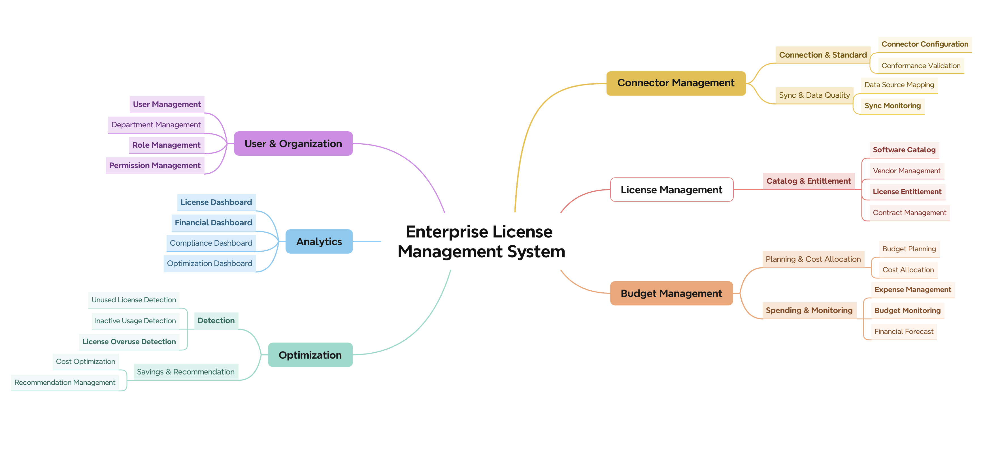

# Top-down Problem Analysis & Research

> Design status: TARGET
>
> Implementation status: NOT STARTED (requirements phase)

System: **Enterprise License Management System (ELMS)**, built by team VFast.

This document decomposes the assignment from the business problem down to user stories:

```text
Business problem → Stakeholders → Goals & metrics → License models and data sources
  → Process → Epics → Features → Use cases (02-use-cases.md) → User stories (03-invest-requirements.md)
```

## 1. Problem context

A company buys software from many providers: Microsoft, Google, Adobe, JetBrains, Oracle, OpenAI, Anthropic, AWS, VPN services, and specialized engineering tools. Each provider sells under a different license model, counts usage in a different unit, and keeps the data in its own admin portal.

| Problem | Consequence |
|---|---|
| No central system for license information and cost | Nobody can answer "what do we own and what does it cost" without visiting every provider portal |
| Hard to tell who holds a license and whether they use it | Seats stay assigned to people who never open the application or have left the company |
| No automatic measurement of usage, consumption, and cost efficiency | Waste is found late, by hand, or not at all |
| Budget plans are not compared with what was bought, assigned, and used | The team cannot tell whether a gap comes from buying too much, not assigning, or not using |
| No data to find surplus or inefficient licenses | Renewal and budget decisions repeat last year's numbers |

**Problem statement:** a company needs one place that collects license, assignment, usage, and cost data from every provider, measures each license in the unit that fits its model, compares the budget plan with reality, and shows managers which licenses are wasted and what to do about it — without ever changing anything on the provider side.

## 2. Stakeholders

| Stakeholder | Role in system | Main interest |
|---|---|---|
| Manager of a P&L (subsidiary) or a department | `MANAGER` | Dashboards and analytics for their unit, budget planning and monitoring, optimization results and recommendations |
| License management team member | `STAFF` | Keeping license data correct: software catalog, vendors, entitlements, contracts, and expenses |
| System administrator | `ADMIN` | Operating the system: users, roles, permissions, and the P&L / department tree; no access to license, budget, or cost data |
| Every employee of the company | `EMPLOYEE` | Knowing which licenses they hold and whether the system sees them as used |
| License providers | External systems | Source of license, assignment, usage, and cost data through their APIs, logs, or exports |

## 3. Goals and success metrics

| Goal | Metric |
|---|---|
| G1 — Centralize licenses | Every license from every provider is listed with publisher, model, quantity, cost, and expiry in one table |
| G2 — Know who uses what | Every assigned seat has exactly one status: `Active`, `Inactive`, `No activity`, or `Not monitored` |
| G3 — Measure automatically | License, assignment, and usage data refresh daily without manual work for providers with an API |
| G4 — Express waste as money | Underutilized accounts and their annual cost are shown on one screen |
| G5 — Plan and reconcile the budget | Each unit has a yearly plan; Planned, Purchased, Assigned, Used, and Actual cost are compared per license |
| G6 — Turn waste into savings | Every unused, inactive, or overused license becomes a recommendation with evidence and an estimated saving, accepted or rejected by a Manager |
| G7 — Trustworthy figures | Numbers match across screens; missing data is shown as `Unknown`, never as zero |

## 4. Research: license models and data sources

### 4.1 Six license models

| Model | Unit of measure |
|---|---|
| Named User / Seat | Number of assigned users |
| Concurrent | Number of simultaneous sessions |
| Device-based | Number of devices |
| CPU / Core / Server / Instance | Infrastructure resources |
| Consumption | Tokens, requests, credits, GB |
| Enterprise / Hybrid | Business metrics or contract terms |

### 4.2 Three independent axes

Writing analysis logic per provider does not scale. A license is described instead by three independent axes:

| Axis | Question | Values |
|---|---|---|
| Measurement archetype | What is measured and how is efficiency judged? | Allocation, Concurrent, Metered, Capacity |
| Commercial term | How is it paid, and for how long? | Pay-as-you-go, monthly, yearly, multi-year, prepaid credit, perpetual with maintenance |
| Collection method | Where does the data come from? | API, log, file import, manual entry |

"Monthly subscription" is a commercial term, not a measurement archetype: a seat can be paid monthly or yearly, and tokens can be paid per use or as prepaid credit.

| Example license | Archetype | Commercial term | Collection |
|---|---|---|---|
| Microsoft 365 E3 | Allocation (seat) | Yearly | API |
| OpenAI API | Metered (token) | Pay-as-you-go | API |
| Prepaid AI credit pack | Metered (credit) | Prepaid, with expiry | API |
| Floating engineering software | Concurrent (slot) | Yearly | License server log |
| Oracle Database | Capacity (core) | Perpetual with maintenance | Inventory script, manual entry |
| Enterprise agreement | Several lines, one archetype each | Multi-year, with commitment | Mixed |

### 4.3 Four archetypes and how efficiency is judged

| Archetype | Examples | Entitlement | Usage signal | Main KPI | Waste signal |
|---|---|---|---|---|---|
| Allocation | Seat, named user, device | Quantity | Who is assigned, last activity | Assignment rate, active rate | Unassigned; inactive for N days; holder has left |
| Concurrent | Slot, floating, VPN session | Maximum sessions | Sessions over time, denials | Peak / purchased | Peak far below purchased for several periods |
| Metered | Token, request, credit, GB | Quota, commitment, or unlimited | Consumption over time and per subject | Burn rate, unit price, commitment used | Unused commitment or credit; spikes; credit about to expire |
| Capacity | Core, CPU, server, instance | Licensed units | Deployed units | Licensed / deployed | Over-bought; over-deployed (compliance risk) |

Enterprise / Hybrid is not a fifth archetype: it is a contract of several lines, each line one of the four archetypes, plus shared terms such as minimum commitment, true-up, and discounts.

### 4.4 Data collection feasibility

Sources are used in this order of preference: **API → log → file import → manual entry**. A provider without an API still enters the system through import or manual entry instead of being left out.

| Archetype | Automation | Expected sources |
|---|---|---|
| Allocation (seat) | High | Microsoft Graph, Google Admin SDK, SSO sign-in logs |
| Metered | High | Usage and cost APIs of OpenAI, Anthropic, AWS |
| Concurrent | Medium | License server logs, VPN logs |
| Allocation (device) | Low | MDM or endpoint agent |
| Capacity | Very low | Inventory scripts, manual entry |
| Enterprise contract | Terms by hand, usage per line | Contract |

For Microsoft 365, the Graph v1.0 endpoints below cover the first phase. They must be checked against Microsoft's official documentation before a connector is built. Every connector, including this one, outputs the ELMS Connector Standard; providers and standards reviewed for it are in [Connector standard](06-connector-standard.md#3-research).

| Data | Endpoint |
|---|---|
| License plans and quantities | `GET /subscribedSkus` |
| Users and assigned licenses | `GET /users` |
| Activity per user | `GET /reports/getOffice365ActiveUserDetail(period='D30')` |
| Last sign-in | `GET /users?$select=signInActivity` |

Graph does not provide prices, cost, P&L, or monthly history: prices and cost come from Staff (import or manual entry), assignments and usage of licenses without a connector also come from Staff (UC03), units from HR data, and history from a daily snapshot kept by ELMS.

**Risks to check early:** admin permissions needed to call each API; report delay and history limits; usage reports that anonymize user names by default; `signInActivity` requiring a paid Entra ID plan; API rate limits.

### 4.5 Cost normalization

- Every cost becomes an **effective monthly cost**: yearly plans divided by 12, perpetual licenses count only maintenance, pay-as-you-go uses the actual spend of the month.
- For committed licenses, the used part and the unused commitment are separated; the unused commitment is waste.
- Amounts in different currencies are added only with a declared exchange rate.

## 5. Process (to-be)

```text
1. Connect provider and check it against ECS (once) → 2. Collect data (daily) → 3. Normalize → 4. Analyze usage and budget
  → 5. Detect inefficiency → 6. Saving opportunities and recommendations → 7. Dashboards → Manager decides
```

Pipeline principles:

| # | Principle | Reason |
|---|---|---|
| A1 | Run on a daily schedule, not on events | Most providers have no usage webhooks, and reports lag 1–2 days |
| A2 | Store raw data before normalizing | Normalization rules can change and be recomputed without calling the API again |
| A3 | Idempotent, incremental sync | Re-running creates no duplicates; a failed run is caught up next time |
| A4 | Missing data is never usage = 0 | A failed sync must not create a false waste warning; the status is `Unknown` |
| A5 | Backfill history on the first connection | Trends are available from day one |
| A6 | One KPI set per archetype | No single "utilization" forced onto seats, sessions, and tokens |
| A7 | Every recommendation shows evidence and an estimated amount | Users can verify it; the system never acts on its own |
| A8 | Encrypted credentials, read-only scopes | Lower risk, easier for the company to grant access |
| A9 | Every figure carries its source and confidence | Per-user API data, aggregated data, and imported data are never presented the same way |

## 6. Functional decomposition (Epic → Feature)

The epics are the six branches of the agreed mind map; each leaf is one use case.



| Epic | Group | Features (use cases) |
|---|---|---|
| E1 License Management | Catalog & Entitlement | Software Catalog (UC01), Vendor Management (UC02), License Entitlement (UC03), Contract Management (UC04) |
| E2 Budget Management | Planning & Cost Allocation | Budget Planning (UC05), Cost Allocation (UC06) |
| | Spending & Monitoring | Expense Management (UC07), Budget Monitoring (UC08), Financial Forecast (UC09) |
| E3 Optimization | Detection | Unused License Detection (UC10), Inactive Usage Detection (UC11), License Overuse Detection (UC12) |
| | Savings & Recommendation | Cost Optimization (UC13), Recommendation Management (UC14) |
| E4 Analytics | Dashboards | License (UC15), Financial (UC16), Compliance (UC17), Optimization (UC18) |
| E5 User & Organization | Administration | User (UC19), P&L and Department (UC20), Role (UC21), Permission Management (UC22) |
| E6 Connector Management | Connection & Standard | Connector Configuration (UC25), Conformance Validation (UC26) |
| | Sync & Data Quality | Data Source Mapping (UC27), Sync Monitoring (UC28) |
| — Self-service and access | | View My Licenses (UC23), Login / Logout (UC24) |

## 7. Scope

### In scope

- License catalog and information for every provider and every license model.
- Budget plans per P&L, department, and fiscal year; tracking of planned, purchased, assigned, and used quantities.
- Automatic usage collection through connectors; file import and manual entry where no connector exists.
- One connector standard (ELMS Connector Standard, ECS) for every connector, with connector configuration, conformance check, data mapping, and sync monitoring ([Connector standard](06-connector-standard.md)).
- Software catalog, vendors, entitlements, contracts, and expenses maintained by the license team.
- Utilization, consumption, and cost-efficiency analysis; unused, inactive, and overuse detection; saving opportunities and recommendations; budget forecast; license, financial, compliance, and optimization dashboards.
- Users, departments, roles, and permissions.
- Four roles: Admin, Manager, Staff, Employee.

### Out of scope

- Assigning or revoking licenses on a provider.
- Buying, renewing, or cancelling contracts.
- Changing subscriptions or permissions on a provider automatically.
- Carrying out a recommendation automatically; anomaly detection with machine learning.
- Notifications outside the application (email, chat).
- Push delivery (providers sending data to ELMS) and SFTP drop folders for ECS files (later phase).

## 8. Constraints and assumptions

- Every provider connection is read-only.
- Employee identity is matched by company email (for Microsoft 365, `userPrincipalName`).
- The group has several P&Ls (subsidiaries), each with departments. Admin maintains the P&L / department tree in ELMS; it can be filled from HR data.
- The 60-day inactivity threshold is fixed in this phase.

## 9. Key risks

| Risk | Mitigation |
|---|---|
| A provider has no usage API | Import or manual entry with a confidence label (A9) |
| Usage reports anonymize users | Check tenant settings early; show aggregated data without per-user tables |
| A sync fails and usage looks like zero | A4: the status becomes `Unknown`, and no warning is created |
| Figures disagree between screens | Shared statuses and reconciliation rules (BR-03, BR-06, BR-09 in [Use cases](02-use-cases.md)) |
| Per-user usage is sensitive personal data | Every API requires login; data scope is enforced on the backend |

## 10. Open questions

- Does the team have a Microsoft 365 tenant with admin rights to call Graph?
- Which licenses get a connector in the first phase, and which of them have no usage API?
- Which IdP is the source of truth for employee identity?
- How do P&L and departments relate, and where does HR data come from?
- For a license bought for the whole company, how is Purchased counted per unit?
- Who allocates the total budget to each P&L or department before a Manager plans the details? Does a plan need approval?
- A person who operates the system may also be an employee or a senior leader. Should one account have several roles (for example Admin and Manager), or should that person use two accounts?
- Should the 60-day threshold be configurable?

**Related:** [Use cases](02-use-cases.md) · [INVEST requirements](03-invest-requirements.md)
