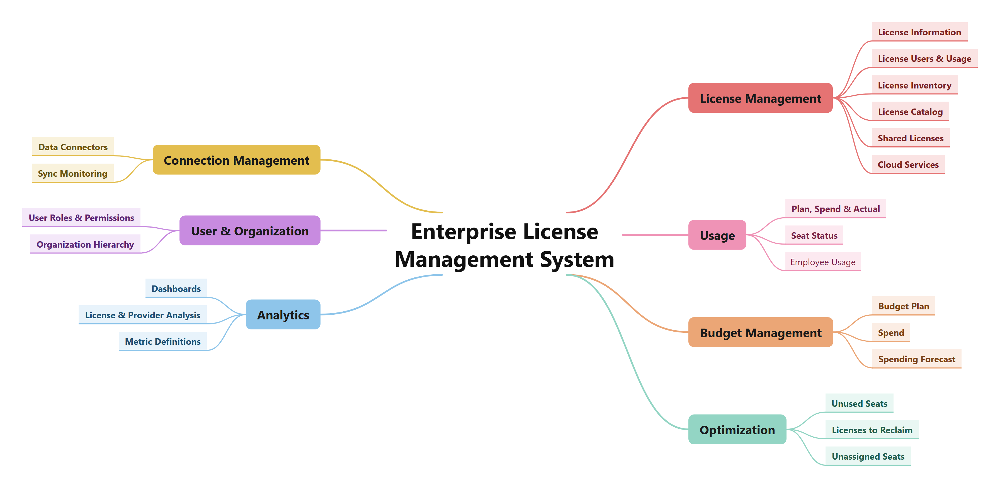

# Top-down Problem Analysis & Research

> Design status: TARGET (P&L API business model, November 2026)
>
> Implementation status: NOT STARTED (requirements phase)

System: **Enterprise License Management System (ELMS)**, built by team VFast.

This document decomposes the assignment from the business problem down to user stories:

```text
Business problem → Stakeholders → Goals & metrics → License models and data sources
  → Process → Epics → Features → Use cases (02-use-cases.md) → User stories (03-invest-requirements.md)
```

## 1. Problem context

A group of companies (P&Ls) buys software from many providers: Microsoft, Atlassian, Adobe, GitHub, SAP, AI services, and specialized engineering tools. Each P&L buys its own licenses, some contracts are signed once for the whole group, each provider counts in its own unit (seats, sessions, tokens, cores), and the data sits in each provider's admin portal.

| Problem | Consequence |
|---|---|
| No central view of the licenses of every P&L | Nobody can answer "what does the group own and what does it cost" without asking every company |
| Hard to tell who holds a license and whether they use it | Seats stay with people who never open the application, moved to another P&L, or left |
| Budget plans are not compared with what was bought and what is used | A gap between plan and reality is found late, and nobody knows whether it comes from over-buying or from not using |
| Waste is not expressed in money per unit | Managers cannot rank their units or licenses by the money lost |
| Group contracts are paid once but used by several companies | Their cost is not charged back, and their free seats belong to nobody |

**Problem statement:** a group needs one place that reads, for every P&L and provider, what each license costs, who holds it, and how much it is used; sets it against the budget plan of every unit from the group down to a project; and shows each Manager, in money, what is planned, purchased, used, and wasted — without ever changing anything at a provider.

## 2. Stakeholders

| Stakeholder | Role in system | Main interest |
|---|---|---|
| Manager of a unit — the group, a P&L, a block, a department, or a project | `MANAGER` | Licenses and who uses them, usage and waste in money, the budget plan of their units |
| License management team member | `STAFF` | Feeding the system: usage connectors, sync monitoring, software catalog, shared licenses, purchases from SAP and accrual, exchange rates |
| System administrator | `ADMIN` | Users, roles, permissions, the organization tree, and which Manager owns which unit; sees no license, usage, budget, or cost data. Accounts come from ILVG |
| Every employee of the group | `EMPLOYEE` | Knowing which licenses they hold and whether they are recorded as used |
| Each P&L | API provider | Provides an API that returns its licenses, holders, and usage in the license data contract (BR-18) |
| ILVG (internal HR application) | Source system | Employees, their unit, their projects, and transfers |
| BCA (usage tracking on company machines) | Source system | How often each employee uses each application |
| SAP (finance) | Source system | The yearly budget plan by month, and the purchases (PR, PO, invoices), each exported to an ELMS Excel template |

## 3. Goals and success metrics

| Goal | Metric |
|---|---|
| G1 Centralize licenses | Every license of every company listed with provider, cost, allocated / purchased, and expiry in one list |
| G2 Know who uses what | Every assigned seat has exactly one status over the last 30 days — `Active`, `Inactive`, `No activity`, or `Not monitored` — and every holder a count of days used |
| G3 Measure automatically | License, assignment, and usage data arrive through usage connectors at their sync interval; nobody types them in |
| G4 Express waste as money | Underutilized accounts and their annual cost on one screen |
| G5 Plan and reconcile the budget | Plan, Purchased, and Used compared per unit, license, and month |
| G6 Make waste visible | Waste shown per unit, license, and month, the units wasting most first, and a unit in red above 20 % of Purchased |
| G7 Trustworthy figures | Numbers match across screens; missing data is `Unknown`, never zero |

## 4. Research: license models and data sources

### 4.1 License models

| Model | Unit of measure |
|---|---|
| Named User / Seat | Number of assigned users |
| Concurrent | Number of simultaneous sessions |
| Device-based | Number of devices |
| CPU / Core / Server / Instance | Infrastructure resources |
| Consumption | Tokens, requests, credits, GB |
| Enterprise / Hybrid | Several lines under one contract, each one of the models above |

### 4.2 How a license is described

A license is described by independent axes, so the analysis does not depend on the provider:

| Axis | Question | Values |
|---|---|---|
| Measurement archetype | What is counted? | Allocation (seats, devices), Concurrent, Metered, Capacity |
| License type (BR-02) | How is it billed? | `monthly`, `yearly`, `usage_based`, as the P&L reports it |
| Source | Where does the data come from? | The usage connector of the P&L; BCA for application usage |

| Example license | Archetype | License type |
|---|---|---|
| Microsoft 365 E3 | Allocation (seat) | Yearly |
| Jira Software | Allocation (seat) | Monthly |
| OpenAI API | Metered (token) | Usage-based |
| Floating engineering software | Concurrent (slot) | Yearly |

### 4.3 One money model for every license

The analysis is in money, so every license, whatever it counts, is judged with the same three figures (BR-09, BR-23):

| Figure | Seat-based license | Usage-based license |
|---|---|---|
| **Purchased** | The accrued cost of the month, spread from the invoices (UC11); in quantity, the seats of the PO lines in force (BR-10) | Same |
| **Used** | Purchased × `Active` seats ÷ purchased seats | The cost of what was consumed |
| **Wasted** | The cost of `Unassigned`, `Inactive`, and `No activity` seats | The cost bought but not consumed |
| **Not evaluated** | The cost of `Not monitored` seats and Unknown data | The cost with no consumption data |

Purchased = Used + Wasted + Not evaluated; the waste rate is Wasted ÷ Purchased. A seat is `Active` when used in the last 30 days, with a 30-day grace period for a new seat (BR-03).

### 4.4 Data sources and feasibility

| Source | What it gives | How |
|---|---|---|
| Usage connector of each P&L | Licenses, holders, last activity, daily activity, consumption | An API the P&L provides for its own data, one connector per company and provider, in the license data contract (BR-18, [Connector standard](06-connector-standard.md)) |
| ILVG | Employees, units in five levels, projects (with allocation), transfers | API, synced like a connector |
| BCA | Application usage per employee and day | API, synced like a connector (fields assumed until the API is known) |
| SAP | Budget plan per unit, license, and month | Exported to the ELMS Excel template and imported by Managers (UC10) |
| SAP purchases | PO lines: purchased quantity and term; invoices: the cost that becomes Purchased | Exported to the ELMS Excel template and imported by Staff each month; a purchase made outside SAP is entered by hand (UC12) |

Behind a P&L API, the P&L reads its providers. For Microsoft 365, for example, the Graph v1.0 endpoints below give what the contract needs; they must be checked against Microsoft's documentation before the P&L builds its API:

| Data | Endpoint |
|---|---|
| License plans and quantities | `GET /subscribedSkus` |
| Users and assigned licenses | `GET /users` |
| Activity per user | `GET /reports/getOffice365ActiveUserDetail(period='D30')` |
| Last sign-in | `GET /users?$select=signInActivity` |

Provider APIs give no organization data, no budget, and no history: units come from ILVG, the plan and the purchases from SAP, and history from the daily snapshots ELMS keeps.

**Risks to check early:** each P&L's readiness to build its API; admin permissions at each provider; report delay and history limits; usage reports that anonymize user names; API rate limits.

### 4.5 Cost

- **Purchased is the accrued cost of the invoices** (UC12, UC11): an invoice is spread over the months of the term of its PO line, rounded to the thousand VND, the difference in the last month (BR-24).
- **One currency per screen:** amounts keep their original currency and are converted with the rate of the invoice date (BR-05, UC13).
- **Charge-back:** the cost of a license is split over its seats and carried by the units of the holders; unassigned seats stay with the owner (BR-06). A license used by two or more companies is owned by the group and charged back to them (BR-25).

## 5. Process (to-be)

```text
1. Staff connect each company's provider (UC23) → 2. Collect at each connector's interval; ILVG and BCA daily
  → 3. Validate against the license data contract → 4. Daily seat status and cost split
  → 5. Usage, budget, and waste analysis per unit → 6. Managers act at the source
```

Pipeline principles:

| # | Principle | Reason |
|---|---|---|
| A1 | Run on a schedule, at each connector's interval | Most providers have no usage webhooks, and reports lag 1–2 days |
| A2 | Store raw data before normalizing | Rules can change and be recomputed without calling the API again |
| A3 | Idempotent, incremental sync and import | Re-running creates no duplicates; a failed run is caught up next time (BR-34) |
| A4 | Missing data is never usage = 0 | A failed sync must not create a false waste figure; the status is `Unknown` (BR-04) |
| A5 | Backfill history on the first connection | Trends are available from day one |
| A6 | One money model for every archetype | Seats, sessions, and tokens are all judged as Purchased, Used, Wasted, Not evaluated |
| A7 | Every result shows its evidence, its cost, and its data date | Users can verify it; ELMS never acts on its own (BR-12) |
| A8 | Encrypted, write-only credentials, read-only scopes | Lower risk; the P&L grants access easily (BR-19) |
| A9 | Every figure carries its source | Real, assumed, and mock data are never presented the same way (BR-13) |

## 6. Functional decomposition (Epic → Feature)

The epics are the seven branches of the mind map; each leaf is one use case. Bold leaves are Must- and Should-have use cases, plain leaves Could-have ([INVEST requirements](03-invest-requirements.md)). The two self-service use cases every role has, View My Licenses (UC25) and Login / Logout (UC26), are not on the map.



| Epic | Use cases |
|---|---|
| E1 License Management | License Information (UC01), License Users and Usage (UC02), License Inventory (UC03), License Catalog (UC04) |
| E2 Usage | Organization Scope (UC05), Plan vs Utilization Balance (UC06), Subordinate Unit Comparison (UC07), Subordinate Units Table (UC08), Employee Usage (UC09) |
| E3 Budget Management | Budget Plan (UC10), Cost Accrual (UC11), Purchases (UC12), Exchange Rates (UC13), Spending Forecast (UC14) |
| E4 Optimization | Wasted Seats (UC15), Waste Ranking and Flag (UC16), Waste Analytics (UC17) |
| E5 Analytics | Dashboards (UC18), License and Provider Analysis (UC19), Metric Definitions (UC20) |
| E6 User & Organization | User Roles and Permissions (UC21), Organization Hierarchy (UC22) |
| E7 Connection Management | Usage Connectors (UC23), Sync Monitoring (UC24) |
| — Self-service (not on the map) | View My Licenses (UC25), Login / Logout (UC26) |

## 7. Scope

### In scope

- The licenses of every P&L and provider, read through one usage connector per company and provider, with their holders and usage; their quantities, terms, and cost from the purchases in SAP.
- A fixed organization of five levels from ILVG — group, P&L, block, department, project — and Managers at any level, the group included.
- Plan, Purchased, Used, Wasted, and Not evaluated in money, per unit, license, and month; waste ranking, trend, risk distribution, and heatmap.
- Budget plans imported from Excel by every Manager for their units, with versions and idempotent imports.
- Purchases imported from SAP or entered by hand, monthly accrual, exchange rates, cost allocation, and charge-back of shared licenses.
- Software catalog: license and application names mapped to software and category.
- Employee application usage from BCA.
- Accounts created from ILVG; roles, data scopes, and permissions set by Admin; four roles: Admin, Manager, Staff, Employee.

### Out of scope

- Assigning, revoking, buying, renewing, or cancelling anything at a provider.
- Entering licenses, holders, or usage by hand in ELMS: they come from the P&L APIs.
- Recommendations and tracking of actions on licenses; a compliance dashboard.
- Detecting a license shortage beyond allocated above purchased.
- Creating accounts by hand; notifications outside the application (chat), other than the account email with the password link; SSO and self-registration.

## 8. Constraints and assumptions

- Every connection is read-only; credentials are write-only.
- Each P&L provides the API behind its connectors, in the license data contract.
- A holder is a person: identities are matched to the ILVG employee by employee code, otherwise by email (BR-26).
- The organization has exactly five levels; units come from ILVG (BR-20).
- Seat status uses a 30-day window with a 30-day grace period (BR-03).
- Assumed until checked: the SAP export carries department codes; BCA reports per day the domain account carrying the ILVG employee code.

## 9. Key risks

| Risk | Mitigation |
|---|---|
| A P&L cannot deliver its API on time | Mock data labelled as mock (BR-13); the connector stays `Pending` |
| Usage reports anonymize users | Seats become `Not monitored`, their cost Not evaluated, never waste |
| A sync fails and usage looks like zero | The figures stay `Unknown`; the connector shows `Failed` or `Delayed` (BR-30) |
| Figures disagree between screens | One set of rules (BR-03, BR-06, BR-09, BR-23) and one definition per metric (UC20) |
| Per-user usage is sensitive personal data | Every API requires login; data scope is enforced on the backend (BR-15) |
| BCA or SAP fields differ from the assumptions | The BCA fields (UC09) and the SAP export (BR-08) are checked against the real sources before the import is built |

**Related:** [Use cases](02-use-cases.md) · [INVEST requirements](03-invest-requirements.md) · [Data fields research](09-data-fields-research.md)
