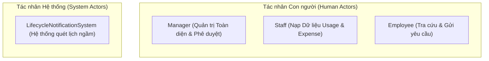
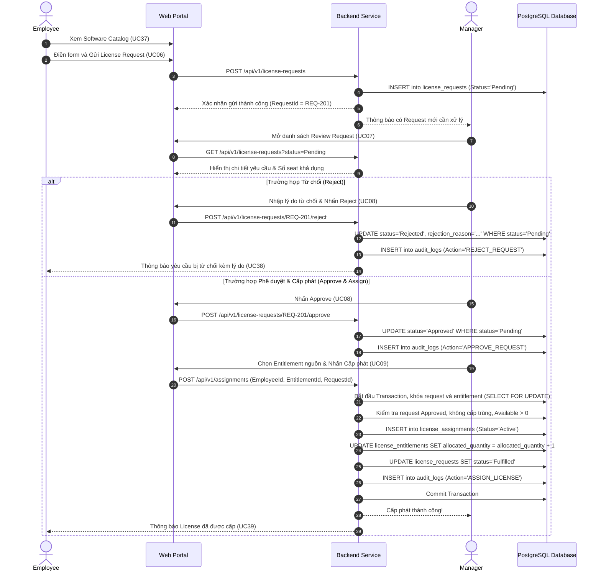
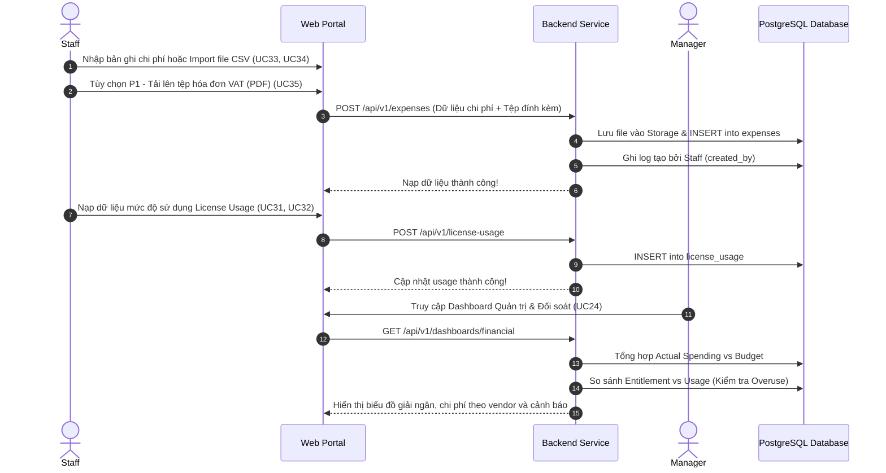

# Tài liệu Đặc tả Trường hợp Sử dụng (Use Case Specification)
## Dự án: VFast – Enterprise License Management System (ELMS)
### Căn cứ: Bản Đặc tả Yêu cầu Phần mềm (SRS v1.0)

---

## 1. Danh sách Tác nhân Hệ thống (System Actors)

Hệ thống ELMS phân định rõ trách nhiệm giữa **3 Tác nhân con người** và **1 Tác nhân hệ thống tự động**:

1. **Manager (Quản lý cấp cao / Quản trị viên hệ thống):**
   - Sở hữu mức truy cập cao nhất (`Full Management`).
   - Chịu trách nhiệm quản lý danh mục phần mềm, nhà cung cấp, hợp đồng, quyền sở hữu bản quyền (`Entitlement`).
   - Phê duyệt / từ chối các yêu cầu cấp license (`License Request`), trực tiếp thực hiện cấp phát (`Assign`) và thu hồi (`Revoke`).
   - Thiết lập ngân sách (`Budget`), duyệt chi phí (`Expense`), theo dõi tuân thủ (`Compliance`), rà soát đề xuất tối ưu hóa (`Optimization`) và quản lý phân quyền 3 role.
2. **Staff (Quản trị viên dữ liệu đầu vào):**
   - Sở hữu mức truy cập nạp liệu (`Data Management`).
   - Chịu trách nhiệm nhập liệu mức độ sử dụng license (`Usage Data`) và chi phí thực tế (`Expense`), nhập lẻ hoặc import qua file CSV/Excel, tải lên hóa đơn chứng từ.
   - Không được phép sửa đổi Entitlement, không thể cấp phát/thu hồi license, và không có quyền can thiệp vào hạn mức ngân sách.
3. **Employee (Nhân viên sử dụng):**
   - Sở hữu mức truy cập cá nhân (`Personal Access`).
   - Tra cứu danh sách các phần mềm được phép sử dụng trong công ty, gửi yêu cầu xin cấp license cá nhân, theo dõi trạng thái yêu cầu và xem danh sách các license đang được cấp phát cho bản thân.
   - Tuyệt đối không thể xem dữ liệu chi phí, ngân sách hoặc license của nhân viên khác.
4. **Lifecycle Notification System (Tác nhân hệ thống):**
   - Tiến trình chạy ngầm theo lịch trình (Cron Scheduler) hằng ngày để quét ngày hết hạn của các hợp đồng thuê bao SaaS (`Subscription Expiry`) và ngày hết hạn bảo trì của Perpetual License (`Maintenance Expiry`), tự động gửi thông báo cảnh báo cho Manager.

---

## 2. Bảng Tổng hợp 39 Use Cases (Use Case Inventory)

Theo chuẩn hóa tại **Mục 5 của bản SRS v1.0**, toàn bộ 39 Use Cases của hệ thống được phân loại theo Tác nhân chính và Mức độ ưu tiên:

| UC ID | Tên Trường hợp Sử dụng (Use Case Name) | Tác nhân chính | Nhóm Chức năng | Độ ưu tiên |
| :---: | :--- | :---: | :---: | :---: |
| **UC01** | **Manage Software Catalog** | Manager | F01 – License Management | **P0** |
| **UC02** | **Manage Vendor** | Manager | F01 – License Management | P1 |
| **UC03** | **Manage License Entitlement** (SaaS & Perpetual) | Manager | F01 – License Management | **P0** |
| **UC04** | **Manage Contract** | Manager | F01 – License Management | P1 |
| **UC05** | **Check License Compliance** | Manager | F01 – License Management | **P0** |
| **UC06** | **Submit License Request** | Employee | F02 – License Allocation | **P0** |
| **UC07** | **Review License Request** | Manager | F02 – License Allocation | **P0** |
| **UC08** | **Approve / Reject Request** | Manager | F02 – License Allocation | **P0** |
| **UC09** | **Assign License** | Manager | F02 – License Allocation | **P0** |
| **UC10** | **Revoke License** | Manager | F02 – License Allocation | **P0** |
| **UC11** | **Track License Allocation** | Manager / Employee | F02 – License Allocation | **P0** |
| **UC12** | **Manage Budget** | Manager | F03 – Budget Management | **P0** |
| **UC13** | **Manage Expense** | Manager / Staff | F03 – Budget Management | **P0** |
| **UC14** | **Monitor Budget Utilization** | Manager | F03 – Budget Management | **P0** |
| **UC15** | **Track License Expiration** | Manager | F04 – Lifecycle Management | **P0** |
| **UC16** | **Manage Renewal** | Manager | F04 – Lifecycle Management | P1 |
| **UC17** | **Track Maintenance** | Manager | F04 – Lifecycle Management | P1 |
| **UC18** | **Generate Lifecycle Notification** | System | F04 – Lifecycle Management | **P0** |
| **UC19** | **Detect Unallocated Licenses** | Manager | F05 – License Optimization | P1 |
| **UC20** | **Detect Inactive Assignments** | Manager | F05 – License Optimization | P1 |
| **UC21** | **Detect License Overuse** | Manager | F05 – License Optimization | **P0** |
| **UC22** | **Review Optimization Recommendations** | Manager | F05 – License Optimization | P1 |
| **UC23** | **View License Dashboard** | Manager | F06 – Analytics & Reporting | **P0** |
| **UC24** | **View Financial Dashboard** | Manager | F06 – Analytics & Reporting | **P0** |
| **UC25** | **View Compliance Dashboard** | Manager | F06 – Analytics & Reporting | P1 |
| **UC26** | **Export Reports** | Manager / Staff | F06 – Analytics & Reporting | P1 |
| **UC27** | **Manage Users** | Manager | F07 – User & Role Management | **P0** |
| **UC28** | **Manage Roles** | Manager | F07 – User & Role Management | **P0** |
| **UC29** | **Login / Logout** | All Roles | F08 – System Administration | **P0** |
| **UC30** | **View Audit Logs** | Manager | F08 – System Administration | **P0** |
| **UC31** | **Input License Usage** | Staff | F01 / F05 – Usage & Optimization | **P0** |
| **UC32** | **Import License Usage** (CSV/Excel) | Staff | F01 / F05 – Usage & Optimization | P1 |
| **UC33** | **Input Expense Data** | Staff | F03 – Budget & Expense | **P0** |
| **UC34** | **Import Expense Data** (CSV/Excel) | Staff | F03 – Budget & Expense | P1 |
| **UC35** | **Upload Supporting Documents** (Invoices) | Staff | F03 – Budget & Expense | P1 |
| **UC36** | **View Submitted Data** | Staff | F08 – Data Administration | **P0** |
| **UC37** | **View Available Software** | Employee | F01 – Software Catalog | **P0** |
| **UC38** | **View Own Request Status** | Employee | F02 – License Allocation | **P0** |
| **UC39** | **View Own Assigned Licenses** | Employee | F02 – License Allocation | **P0** |

---

## 3. Sơ đồ Use Case Tổng quan (Use Case Diagrams)

Sơ đồ theo chuẩn UML: tác nhân là hình người, một khung ranh giới hệ thống, mỗi use case là một hình ellipse. Sơ đồ tổng quan gom các use case theo nhóm chức năng; các sơ đồ chi tiết bên dưới vẽ từng use case và được tách theo tác nhân để các đường nối không chồng chéo. Lifecycle Scheduler là tác nhân hệ thống (Lifecycle Notification System) thực hiện UC18; UC29 (Login / Logout) dùng chung cho mọi vai trò.

### 3.0. Tổng quan

### 3.1. Manager (Quản trị & Ra Quyết định)

#### Manager (1/2) — License, Cấp phát, Vòng đời

#### Manager (2/2) — Ngân sách, Tối ưu hóa, Phân tích, Quản trị

### 3.2. Staff & Employee

#### Staff (Nạp dữ liệu)

#### Employee (Tự phục vụ)

Mã nguồn sơ đồ: [`./diagrams/ve_elms.py`](./diagrams/ve_elms.py); mỗi sơ đồ có thêm bản SVG và file draw.io chỉnh sửa được trong [`./diagrams/out/`](./diagrams/out/).

---

## 4. Ba Luồng Nghiệp vụ Chính (Main Business Workflows)

Dựa trên **Mục 5.1 của bản SRS v1.0**, hệ thống vận hành xoay quanh 3 luồng công việc cốt lõi:

### 4.1. Luồng 1: Quy trình Yêu cầu & Cấp phát License (License Request & Allocation)
1. **Employee** truy cập danh mục phần mềm và xem các công cụ khả dụng (`UC37`).
2. **Employee** gửi yêu cầu cấp phát license (`UC06`) kèm lý do nghiệp vụ.
3. **Manager** xem danh sách các yêu cầu đang ở trạng thái `Pending` (`UC07`).
4. **Manager** thực hiện đánh giá và đưa ra quyết định **Approve** hoặc **Reject** (`UC08`).
5. Nếu chấp thuận (**Approved**), Manager kiểm tra dung lượng khả dụng của Entitlement (`UC03`).
6. **Manager** thực hiện gán seat bản quyền cho Employee (`UC09`).
7. **Employee** nhận thông báo và xem license đã được kích hoạt trong trang cá nhân (`UC39`).

---

### 4.2. Luồng 2: Quản lý Mức dùng & Chi phí Thực tế (Usage & Expense Management)
1. **Staff** thu thập số liệu tiêu thụ phần mềm thực tế và nhập trực tiếp (`UC31`) hoặc import hàng loạt từ file Excel (`UC32`).
2. **Staff** nhập chi phí thực tế (`UC33`), import dữ liệu chi phí (`UC34`) và tải lên file hóa đơn, chứng từ thanh toán đính kèm (`UC35`).
3. **Staff** xem lại toàn bộ dữ liệu do mình đã nạp để đảm bảo tính chính xác (`UC36`).
4. **Manager** kiểm tra dữ liệu do Staff nạp (`UC13`).
5. Hệ thống tự động tính toán và cập nhật các chỉ số tài chính, tỷ lệ giải ngân và mức độ tiêu thụ.
6. **Manager** theo dõi bức tranh tuân thủ (`UC05`), chi phí thực tế (`UC14`) và các cơ hội tối ưu hóa (`UC22`).

---

### 4.3. Luồng 3: Giám sát Ngân sách & Vòng đời Bản quyền (Budget & Lifecycle Monitoring)
1. **Manager** thiết lập hạn mức ngân sách (`Budget`) theo năm hoặc kỳ tài chính cho từng phòng ban (`UC12`).
2. Các khoản chi phí thực tế (`Expense`) được nạp vào hệ thống (`UC13`, `UC33`).
3. Hệ thống tự động tính toán tổng chi phí đã chi trả (`Actual Spending`), ngân sách còn lại (`Remaining Budget`) và tỷ lệ giải ngân (`Budget Utilization`) (`UC14`).
4. **Lifecycle Notification System** tự động quét định kỳ các mốc hết hạn hợp đồng thuê bao và bảo trì (`UC18`).
5. Nếu hợp đồng sắp đến hạn (trong vòng 30, 15, 7 ngày), hệ thống phát sinh cảnh báo đến Manager (`UC15`).
6. **Manager** rà soát hiệu quả sử dụng thực tế, xem các đề xuất tối ưu hóa (`UC22`) và đưa ra quyết định gia hạn (`Renew`), cắt giảm số lượng (`Downsize`) hoặc ngừng hợp đồng (`Cancel`) (`UC16`).

---

## 5. Đặc tả Chi tiết các Use Case Cốt lõi (P0)

---

### UC01 – Quản lý Danh mục Phần mềm (Manage Software Catalog)
- **Tác nhân chính:** Manager
- **Độ ưu tiên:** P0
- **Tiền điều kiện:** Manager đã đăng nhập thành công với quyền `Full Management`.
- **Hậu điều kiện:** Thông tin sản phẩm phần mềm được lưu trữ chuẩn hóa; hiển thị cho Employee tra cứu khi ở trạng thái hoạt động.
- **Luồng sự kiện chính:**
  1. Manager mở màn hình Software Catalog và chọn "Thêm mới sản phẩm".
  2. Nhập các trường: Tên phần mềm, Nhà phát hành (Vendor: chọn từ danh mục hoặc tạo nhanh theo tên, xem D1 tại [MVP](01-MVP.md)), Danh mục (Văn phòng, Kỹ thuật, Thiết kế,...), Mô tả tính năng, Loại license (`SaaS Subscription` hoặc `Perpetual License`), và Trạng thái (`Active` / `Deprecated`).
  3. Hệ thống xác thực tính duy nhất của bộ khóa `Software Name + Vendor`.
  4. Hệ thống lưu bản ghi mới, ghi Audit Log và cập nhật danh mục.
- **Luồng rẽ nhánh:** Nếu phần mềm đã tồn tại, hệ thống từ chối lưu và yêu cầu cập nhật bản ghi hiện hữu.

---

### UC03 – Quản lý Quyền sở hữu Bản quyền (Manage License Entitlement)
- **Tác nhân chính:** Manager
- **Độ ưu tiên:** P0
- **Tiền điều kiện:** Sản phẩm phần mềm và Nhà cung cấp đã tồn tại trong hệ thống; Nhà cung cấp có thể được tạo nhanh theo tên ngay trong luồng này (D1).
- **Hậu điều kiện:** Gói quyền sử dụng được xác lập; dung lượng khả dụng (`Available Quantity`) được khởi tạo.
- **Luồng sự kiện chính:**
  1. Manager chọn phần mềm và chọn "Đăng ký Entitlement mới".
  2. Lựa chọn loại hình cấp phép:
     - **Nếu là SaaS Subscription:** Nhập Gói dịch vụ (`Subscription Plan`), License Metric (ví dụ `Per User`), Số lượng mua (`Purchased Quantity`), Ngày bắt đầu, Ngày hết hạn bắt buộc, Chi phí thuê bao, Chu kỳ thanh toán (`Monthly`/`Yearly`), và Tự động gia hạn (`Yes`/`No`).
     - **Nếu là Perpetual License:** Nhập License Metric, Số lượng mua, Ngày mua, Giá mua, Thỏa thuận bảo trì (`Maintenance Agreement`), và Ngày hết hạn bảo trì (`Maintenance Expiration Date`).
  3. Manager nhấn "Lưu Entitlement".
  4. Hệ thống kiểm tra hợp lệ:
     - Với SaaS: Bắt buộc phải có ngày hết hạn ($StartDate \le ExpirationDate$).
     - Với Perpetual: Thời hạn bảo trì được quản lý ở trường riêng, không gán ngày hết hạn bản quyền vĩnh viễn (BR-12).
  5. Hệ thống khởi tạo: $\text{Available Quantity} = \text{Purchased Quantity}$.
  6. Ghi Audit Log bất biến: Người tạo, Thời điểm, Số lượng, Loại license.

---

### UC06 – Gửi Yêu cầu Cấp License (Submit License Request)
- **Tác nhân chính:** Employee
- **Độ ưu tiên:** P0
- **Tiền điều kiện:** Employee đã đăng nhập hệ thống.
- **Hậu điều kiện:** Bản ghi yêu cầu được tạo ở trạng thái `Pending`; gửi thông báo đến hàng đợi của Manager.
- **Luồng sự kiện chính:**
  1. Employee truy cập danh mục phần mềm khả dụng (`UC37`).
  2. Chọn phần mềm cần xin cấp và nhấn "Gửi yêu cầu cấp phát".
  3. Bắt buộc nhập lý do sử dụng công việc. Mỗi yêu cầu tương ứng đúng 1 seat cho chính người gửi (D6).
  4. Nhấn "Gửi yêu cầu".
  5. Hệ thống xác thực: Trường lý do không được để trống.
  6. Tạo bản ghi `LicenseRequest` ở trạng thái `Pending`, gán mã định danh duy nhất (ví dụ `REQ-2026-001`).
  7. Hiển thị thông báo gửi thành công cho Employee.
- **Luồng ngoại lệ:** Nếu lý do bị bỏ trống, hệ thống hiển thị thông báo lỗi: *"Vui lòng nhập lý do sử dụng để người quản trị xem xét."*

---

### UC08 – Phê duyệt hoặc Từ chối Yêu cầu (Approve / Reject Request)
- **Tác nhân chính:** Manager
- **Độ ưu tiên:** P0
- **Tiền điều kiện:** Tồn tại yêu cầu ở trạng thái `Pending`.
- **Hậu điều kiện:** Trạng thái yêu cầu chuyển sang `Approved` hoặc `Rejected`; lưu vết quyết định và gửi thông báo phản hồi cho Employee.
- **Luồng sự kiện chính:**
  1. Manager mở danh sách Yêu cầu chờ duyệt (`UC07`).
  2. Chọn yêu cầu cần xử lý để xem chi tiết lý do của nhân viên và số seat khả dụng hiện có trong kho.
  3. **Kịch bản Chấp thuận (Approve):**
     - Manager nhấn "Phê duyệt".
     - Hệ thống đổi trạng thái sang `Approved`, lưu `approver_id = Manager_ID` và dấu thời gian duyệt.
     - Yêu cầu được chuyển sang trạng thái sẵn sàng để cấp phát license (`UC09`). Nếu chưa có seat khả dụng, yêu cầu vẫn giữ `Approved` để chờ cấp và không tự chuyển trạng thái.
  4. **Kịch bản Từ chối (Reject):**
     - Manager nhấn "Từ chối" và bắt buộc nhập lý do từ chối.
     - Hệ thống đổi trạng thái sang `Rejected`, lưu lý do giải trình.
     - Gửi thông báo đến Employee kèm lý do từ chối.
- **Quy tắc bất biến:** Một yêu cầu đã được xử lý (`Approved`, `Rejected` hoặc `Fulfilled`) không được phép duyệt lại lần thứ hai (BR-19). Thao tác duyệt dùng cập nhật có điều kiện `WHERE status = 'Pending'`, nên khi hai Manager xử lý đồng thời chỉ một người thành công. Quyết định và Audit Log được ghi trong cùng một transaction.

---

### UC09 – Cấp phát License cho Nhân viên (Assign License)
- **Tác nhân chính:** Manager
- **Độ ưu tiên:** P0
- **Tiền điều kiện:** Yêu cầu đã được `Approved` (hoặc Manager chỉ định trực tiếp); Entitlement nguồn còn seat khả dụng ($\text{Available} > 0$).
- **Hậu điều kiện:** Tạo bản ghi `LicenseAssignment`; giảm số seat khả dụng trong kho; yêu cầu liên quan (nếu có) chuyển sang `Fulfilled`; Employee nhìn thấy license trong tài khoản cá nhân.
- **Luồng sự kiện chính:**
  1. Manager chọn yêu cầu đã duyệt hoặc chọn phần mềm cần cấp phát.
  2. Chọn Entitlement nguồn còn hiệu lực và còn seat khả dụng.
  3. Hệ thống mở một Database Transaction có khóa dòng (`Row Locking`) để chống tranh chấp:
     - Khóa yêu cầu (nếu có) rồi khóa Entitlement. Kiểm tra yêu cầu đang `Approved` và chưa được cấp; nhân viên đang hoạt động (BR-18); Entitlement còn hiệu lực.
     - Kiểm tra nhân viên chưa có assignment `Active` cho cùng phần mềm. Nếu đã có, hủy giao dịch và báo lỗi (D7).
     - Kiểm tra điều kiện: $\text{Available Quantity} = \text{Purchased} - \text{Allocated} > 0$.
     - Nếu $\text{Available} \le 0$: Transaction lập tức bị hủy bỏ (Rollback), hệ thống báo lỗi không đủ bản quyền (BR-05).
  4. Hệ thống tạo bản ghi `LicenseAssignment`: Liên kết `EmployeeId`, `EntitlementId`, ngày gán và trạng thái `Active`.
  5. Cập nhật Entitlement nguồn: $\text{Allocated Quantity} = \text{Allocated Quantity} + 1$ và chuyển yêu cầu (nếu có) sang `Fulfilled`.
  6. Ghi Audit Log rồi cam kết giao dịch (Commit Transaction).
  7. Gửi thông báo cho Employee: License đã sẵn sàng sử dụng.

---

### UC10 – Thu hồi License về Kho (Revoke License)
- **Tác nhân chính:** Manager
- **Độ ưu tiên:** P0
- **Tiền điều kiện:** Tồn tại bản ghi `LicenseAssignment` ở trạng thái `Active`.
- **Hậu điều kiện:** Bản ghi Assignment chuyển sang trạng thái `Revoked`; dung lượng khả dụng trong kho được hoàn trả.
- **Luồng sự kiện chính:**
  1. Manager tra cứu bản ghi cấp phát theo nhân viên hoặc theo phần mềm.
  2. Nhấn "Thu hồi (Revoke)" và nhập lý do thu hồi (Nhân viên chuyển vị trí, Không còn nhu cầu, Nhân sự nghỉ việc).
  3. Hệ thống mở một Database Transaction, khóa Assignment rồi khóa Entitlement và kiểm tra Assignment vẫn đang `Active`. Nếu đã bị thu hồi, hủy giao dịch và báo lỗi, không hoàn trả seat lần hai. Sau đó chuyển trạng thái sang `Revoked`, ghi nhận thời gian thu hồi và người thực hiện.
  4. Hệ thống hoàn trả dung lượng: $\text{Allocated Quantity} = \text{Allocated Quantity} - 1$ (tương đương $\text{Available Quantity}$ tăng 1), ghi Audit Log và cam kết giao dịch.
  5. Bản ghi Assignment cũ vẫn được lưu trữ nguyên vẹn trong lịch sử phục vụ kiểm toán (BR-13).

---

### UC12 & UC14 – Quản lý Ngân sách & Theo dõi Giải ngân (Manage & Monitor Budget)
- **Tác nhân chính:** Manager
- **Độ ưu tiên:** P0
- **Tiền điều kiện:** Manager đã đăng nhập hệ thống.
- **Luồng sự kiện chính:**
  1. Manager thiết lập ngân sách phần mềm theo năm tài chính và theo phòng ban (`UC12`).
  2. Hệ thống tổng hợp tự động các khoản chi phí thực tế (`Expense`) phát sinh trong kỳ:

     $$\text{Actual Spending} = \sum \text{Expense Amount}$$

     Chỉ tính các khoản đã chi trong kỳ của đúng ngân sách đó. Khoản khác loại tiền tệ chỉ được cộng khi có tỷ giá hiệu lực (BR-11, D12); nếu không có thì hiển thị riêng. `Committed Spending` là chỉ số P1 hiển thị riêng, không tính vào các công thức bên dưới (D4).
  3. Hệ thống tính toán các chỉ số:
     - $\text{Remaining Budget} = \text{Total Budget} - \text{Actual Spending}$
     - $\text{Budget Utilization (\%)} = \left(\frac{\text{Actual Spending}}{\text{Total Budget}}\right) \times 100$
  4. Hiển thị tiến độ giải ngân trực quan.
  5. Tự động bật cảnh báo vàng khi đạt $\ge 80\%$ ngân sách, và cảnh báo đỏ khi đạt $\ge 100\%$ ngân sách (D13).

---

### UC21 – Phát hiện Sử dụng Vượt quyền (Detect License Overuse)
- **Tác nhân chính:** Manager
- **Độ ưu tiên:** P0
- **Mục tiêu:** Phát hiện ngay lập tức tình trạng vi phạm hạn ngạch bản quyền để phòng ngừa rủi ro pháp lý.
- **Luồng sự kiện chính:**
  1. Hệ thống định kỳ hoặc theo yêu cầu tính toán chỉ số chênh lệch:
     - Trường hợp 1 (Over-allocation): số assignment `Active` lớn hơn $\text{Purchased Quantity}$. Luồng chuẩn không thể tạo ra tình huống này do BR-05 và ràng buộc `CHECK`; đây là phép đối soát để phát hiện dữ liệu sai lệch, ví dụ từ migration.
     - Trường hợp 2 (Overuse qua Usage Data): $\text{Actual Usage Quantity} > \text{Purchased Quantity}$ (khi có dữ liệu usage hợp lệ). Với metric `Per User`, $\text{Actual Usage Quantity}$ là số nhân viên khác nhau có bản ghi `Active` trong kỳ gần nhất của Entitlement, kể cả người chưa được cấp seat (D15).
     - Nếu kỳ gần nhất chưa có dữ liệu usage, hoặc metric không phải `Per User`, trạng thái là `Not Evaluated`. Không suy diễn mức dùng bằng không và không kết luận vi phạm (BR-03, BR-14, BR-15).
  2. Nếu phát hiện vi phạm, hệ thống gắn cờ trạng thái `Overused` hoặc `At Risk`.
  3. Bật cảnh báo đỏ nổi bật trên Dashboard và gửi thông báo khẩn cấp đến Manager.
  4. Liệt kê danh sách chi tiết các tài khoản hoặc seat đang vượt quyền để Manager đưa ra phương án xử lý (mua thêm hoặc thu hồi).

---

### UC29 – Đăng nhập & Đăng xuất (Login / Logout)
- **Tác nhân chính:** Tất cả các vai trò
- **Độ ưu tiên:** P0
- **Tiền điều kiện:** Tài khoản do Manager tạo (`UC27`) và đang hoạt động. Tự đăng ký và SSO nằm ngoài phạm vi MVP.
- **Hậu điều kiện:** Phiên đăng nhập được tạo hoặc thu hồi; sự kiện được ghi Audit Log.
- **Luồng sự kiện chính:**
  1. Người dùng nhập email và mật khẩu.
  2. Hệ thống đối chiếu mật khẩu với giá trị băm BCrypt/Argon2 và kiểm tra tài khoản đang hoạt động.
  3. Hệ thống cấp access token sống tối đa 15 phút và refresh token xoay vòng được lưu phía máy chủ, hết hạn sau 30 phút không hoạt động hoặc tối đa 8 giờ. Cả hai đặt trong cookie `HttpOnly`, `Secure`, `SameSite`.
  4. Mỗi request kiểm tra chữ ký, thời hạn, trạng thái tài khoản và phiên bản phiên. Role luôn lấy từ máy chủ, không lấy từ dữ liệu do client gửi.
  5. Khi đăng xuất, hệ thống thu hồi refresh token và ghi Audit Log.
- **Luồng ngoại lệ:**
  - Sai thông tin đăng nhập: chỉ hiển thị thông báo chung *"Email hoặc mật khẩu không đúng."*, không tiết lộ tài khoản có tồn tại hay không.
  - Sai 5 lần liên tiếp: tạm khóa đăng nhập 15 phút và ghi Audit Log; có giới hạn tần suất theo tài khoản và địa chỉ IP.
  - Tài khoản `Deactivated` hoặc bị đổi role: tăng phiên bản phiên và thu hồi mọi refresh token, nên request kế tiếp bị từ chối hoặc phải đăng nhập lại (BR-18).
- **Chính sách mật khẩu:** Tối thiểu 12 ký tự. Mật khẩu ban đầu và mật khẩu do Manager đặt lại phải đổi ở lần đăng nhập đầu tiên. Các thông số trong đặc tả này là mặc định có thể cấu hình (D8).

---

### UC31 & UC33 – Nhập Dữ liệu Usage & Chi phí Thực tế (Input Usage & Expense Data)
- **Tác nhân chính:** Staff
- **Độ ưu tiên:** P0
- **Luồng sự kiện chính cho Nhập Usage (UC31):**
  1. Staff chọn Entitlement và nhân viên cần cập nhật mức dùng, kể cả nhân viên chưa được cấp seat, để phát hiện sử dụng ngoài phân bổ.
  2. Nhập các trường: Kỳ dữ liệu, Ngày hoạt động gần nhất (`Last Active Date`), Số ngày sử dụng trong kỳ, Mức độ sử dụng (`Active` / `Inactive`). Nhân viên không có bản ghi trong kỳ được xem là `Unknown`, không phải `Inactive` (BR-15).
  3. Nhấn Lưu. Bản ghi được gắn tự động `created_by = Staff_ID` và dấu thời gian.
- **Luồng sự kiện chính cho Nhập Expense (UC33):**
  1. Staff chọn phần mềm/hợp đồng phát sinh chi phí.
  2. Nhập Số tiền, Loại tiền tệ (VND/USD), Ngày thanh toán, Số hóa đơn và Phòng ban chịu chi phí.
  3. Tùy chọn khi `UC35` (P1) đã sẵn sàng: đính kèm file hóa đơn VAT dạng PDF/PNG/JPG; không bắt buộc ở P0 (D2).
  4. Nhấn Lưu. Hệ thống xác thực số tiền hợp lệ và lưu vào cơ sở dữ liệu.

---

### UC37 & UC39 – Tra cứu Cá nhân (View Available Software & Assigned Licenses)
- **Tác nhân chính:** Employee
- **Độ ưu tiên:** P0
- **Luồng sự kiện chính:**
  1. Employee đăng nhập và mở trang "Danh mục phần mềm khả dụng" (`UC37`): Hiển thị tên phần mềm, mô tả và nút yêu cầu cấp phát; **tuyệt đối không hiển thị giá tiền hoặc key kích hoạt**.
  2. Employee mở trang "License của tôi" (`UC39`): Hiển thị toàn bộ các phần mềm đang được cấp phát cho cá nhân, ngày được cấp, và ngày hết hạn hợp đồng đối với gói SaaS.

---

## 6. Đặc tả Bổ sung các Use Case P0 còn lại

---

### UC05 – Kiểm tra Tuân thủ Bản quyền (Check License Compliance)
- **Tác nhân chính:** Manager (Staff chỉ đọc)
- **Độ ưu tiên:** P0
- **Tiền điều kiện:** Đã có Entitlement; dữ liệu usage là tùy chọn.
- **Hậu điều kiện:** Mỗi Entitlement có một trạng thái tuân thủ; việc đánh giá không làm thay đổi dữ liệu.
- **Luồng sự kiện chính:**
  1. Manager mở danh sách tuân thủ, lọc theo phần mềm, vendor hoặc trạng thái.
  2. Hệ thống tính trạng thái của từng Entitlement theo `UC21`: `Compliant`, `Over-allocated`, `Overused` hoặc `Not Evaluated`.
  3. Manager mở chi tiết để xem số liệu đã dùng và kỳ dữ liệu.
- **Luồng ngoại lệ:** Thiếu usage hợp lệ hoặc metric không tương thích thì trạng thái là `Not Evaluated`, không được hiểu là tuân thủ hay mức dùng bằng không (BR-03, BR-14, BR-15).

---

### UC07 – Xem xét Yêu cầu Cấp License (Review License Request)
- **Tác nhân chính:** Manager
- **Độ ưu tiên:** P0
- **Tiền điều kiện:** Manager đã đăng nhập.
- **Hậu điều kiện:** Không thay đổi dữ liệu.
- **Luồng sự kiện chính:**
  1. Manager mở danh sách yêu cầu, mặc định lọc trạng thái `Pending`; có phân trang và lọc theo phần mềm, phòng ban, trạng thái.
  2. Hệ thống hiển thị mã REQ, nhân viên, phòng ban, phần mềm, lý do, thời điểm gửi và số seat còn trống.
  3. Manager chọn một yêu cầu để xử lý (`UC08`).
- **Luồng ngoại lệ:** Không có yêu cầu thì hiển thị trạng thái rỗng. Số seat ở đây chỉ để tham khảo; `UC09` kiểm tra lại trong transaction.

---

### UC11 – Theo dõi Phân bổ License (Track License Allocation)
- **Tác nhân chính:** Manager, Employee
- **Độ ưu tiên:** P0
- **Tiền điều kiện:** Người dùng đã đăng nhập.
- **Hậu điều kiện:** Không thay đổi dữ liệu.
- **Luồng sự kiện chính:**
  1. Manager xem `Purchased`, `Allocated`, `Available` theo Entitlement và danh sách assignment theo nhân viên hoặc theo phần mềm.
  2. Manager xem lịch sử gán và thu hồi, gồm cả các lượt `Revoked` (BR-13).
  3. Employee chỉ xem được phân bổ của chính mình (BR-08).
- **Luồng ngoại lệ:** Employee truy cập bản ghi của người khác nhận `404`, để không lộ việc bản ghi đó có tồn tại.

---

### UC13 – Quản lý Chi phí (Manage Expense)
- **Tác nhân chính:** Manager, Staff
- **Độ ưu tiên:** P0
- **Tiền điều kiện:** Có bản ghi Expense do Staff nhập (`UC33`) hoặc Manager tạo.
- **Hậu điều kiện:** Thay đổi được ghi Audit Log kèm giá trị cũ và mới; `Actual Spending` được cập nhật.
- **Luồng sự kiện chính:**
  1. Manager xem danh sách chi phí, lọc theo phần mềm, vendor, phòng ban, kỳ và tiền tệ.
  2. Manager tạo hoặc sửa bản ghi. Staff chỉ sửa được bản ghi do chính mình tạo.
  3. Hệ thống xác thực số tiền lớn hơn 0, tiền tệ và ngày thanh toán (BR-10).
  4. Manager có thể hủy bản ghi sai kèm lý do. Bản ghi hủy được giữ lại trong lịch sử và không tính vào `Actual Spending`.
- **Luồng ngoại lệ:** Dữ liệu không hợp lệ thì từ chối lưu và báo lỗi theo từng trường. Không xóa vật lý bản ghi Expense.

---

### UC15 – Theo dõi Hết hạn License (Track License Expiration)
- **Tác nhân chính:** Manager (Staff chỉ đọc)
- **Độ ưu tiên:** P0
- **Tiền điều kiện:** Đã có Entitlement.
- **Hậu điều kiện:** Không thay đổi dữ liệu.
- **Luồng sự kiện chính:**
  1. Manager mở danh sách, sắp xếp theo ngày hết hạn gần nhất.
  2. Hệ thống hiển thị ngày hết hạn SaaS và ngày hết hạn bảo trì Perpetual ở hai trường riêng (BR-12).
  3. Hệ thống phân nhóm: `Upcoming` (trong 30 ngày, gồm các mốc 15 và 7 ngày) và `Expired`.
- **Luồng ngoại lệ:** License Perpetual không có thỏa thuận bảo trì thì không hiển thị là sắp hết hạn. Theo dõi bảo trì chuyên sâu thuộc `UC17` (P1).

---

### UC18 – Phát sinh Thông báo Vòng đời (Generate Lifecycle Notification)
- **Tác nhân chính:** Lifecycle Notification System
- **Độ ưu tiên:** P0
- **Tiền điều kiện:** Tác vụ theo lịch đang hoạt động.
- **Hậu điều kiện:** Mỗi Manager đang hoạt động nhận thông báo trong hệ thống (D14).
- **Luồng sự kiện chính:**
  1. Tác vụ chạy mỗi ngày một lần và quét ngày hết hạn SaaS cùng ngày hết hạn bảo trì Perpetual.
  2. Với mỗi mốc 30, 15, 7 ngày đã đến (số ngày còn lại nhỏ hơn hoặc bằng mốc), hệ thống tạo thông báo nếu chưa có thông báo cho cùng Entitlement, mốc và ngày hết hạn.
  3. Hệ thống ghi Audit Log với Actor là tác nhân hệ thống.
- **Luồng ngoại lệ:** Tác vụ lỗi thì ghi log và lần chạy sau tự bù các mốc bị bỏ lỡ, không gửi trùng. Khi ngày hết hạn được gia hạn, các mốc được tính lại theo ngày mới.

---

### UC23 – Xem Dashboard License (View License Dashboard)
- **Tác nhân chính:** Manager
- **Độ ưu tiên:** P0
- **Tiền điều kiện:** Manager đã đăng nhập.
- **Hậu điều kiện:** Không thay đổi dữ liệu.
- **Luồng sự kiện chính:**
  1. Manager mở Dashboard. Thời gian phản hồi không quá 3 giây (NFR-03).
  2. Hệ thống hiển thị tổng số phần mềm, số seat đã mua và đã cấp, tỷ lệ gán seat, số license sắp hết hạn và số cảnh báo tuân thủ.
- **Luồng ngoại lệ:** Chỉ cộng số lượng có cùng metric (BR-03); metric khác nhau được hiển thị riêng. Chưa có dữ liệu thì hiển thị trạng thái rỗng.

---

### UC24 – Xem Dashboard Tài chính (View Financial Dashboard)
- **Tác nhân chính:** Manager
- **Độ ưu tiên:** P0
- **Tiền điều kiện:** Manager đã đăng nhập.
- **Hậu điều kiện:** Không thay đổi dữ liệu.
- **Luồng sự kiện chính:**
  1. Manager chọn năm tài chính và phòng ban.
  2. Hệ thống hiển thị `Total Budget`, `Actual Spending`, `Remaining Budget`, `Budget Utilization` theo `UC14` và D4, cùng chi phí theo vendor.
  3. Hệ thống hiển thị cảnh báo vàng hoặc đỏ theo ngưỡng của `UC14`.
- **Luồng ngoại lệ:** Chưa thiết lập ngân sách thì hiển thị "Chưa thiết lập" thay vì chia cho 0. Thiếu tỷ giá thì hiển thị riêng từng loại tiền (BR-11).

---

### UC27 – Quản lý Người dùng (Manage Users)
- **Tác nhân chính:** Manager
- **Độ ưu tiên:** P0
- **Tiền điều kiện:** Manager đã đăng nhập.
- **Hậu điều kiện:** Thay đổi được ghi Audit Log.
- **Luồng sự kiện chính:**
  1. Manager tạo tài khoản với email (duy nhất), họ tên, phòng ban, role và mật khẩu ban đầu.
  2. Manager cập nhật thông tin hoặc đặt lại mật khẩu.
  3. Manager vô hiệu hóa tài khoản: phiên bị thu hồi ngay (BR-18) và hệ thống liệt kê các assignment `Active` của người đó để Manager quyết định thu hồi.
- **Luồng ngoại lệ:** Email trùng thì từ chối lưu. Không được vô hiệu hóa Manager đang hoạt động cuối cùng. Không xóa vật lý tài khoản đã có lịch sử.

---

### UC28 – Quản lý Vai trò (Manage Roles)
- **Tác nhân chính:** Manager
- **Độ ưu tiên:** P0
- **Tiền điều kiện:** Tài khoản người dùng đã tồn tại.
- **Hậu điều kiện:** Người dùng có đúng một role; phiên cũ bị thu hồi; Audit Log ghi role cũ và mới.
- **Luồng sự kiện chính:**
  1. Manager chọn người dùng và chọn một trong ba role cố định: `MANAGER`, `STAFF`, `EMPLOYEE`.
  2. Hệ thống lưu thay đổi và thu hồi các phiên đang có của người dùng đó.
- **Luồng ngoại lệ:** Không được đổi role của Manager đang hoạt động cuối cùng. MVP không hỗ trợ tạo role tùy chỉnh.

---

### UC30 – Xem Nhật ký Kiểm toán (View Audit Logs)
- **Tác nhân chính:** Manager
- **Độ ưu tiên:** P0
- **Tiền điều kiện:** Manager đã đăng nhập.
- **Hậu điều kiện:** Không thay đổi dữ liệu.
- **Luồng sự kiện chính:**
  1. Manager lọc nhật ký theo Actor, Action, thực thể và khoảng thời gian, có phân trang.
  2. Hệ thống hiển thị Actor, Action, thực thể, thời điểm, giá trị cũ và mới. License key và dữ liệu bí mật luôn được che (NFR-01).
- **Luồng ngoại lệ:** Không có API sửa hoặc xóa nhật ký (BR-17). Quyền xem "thao tác của chính mình" của Staff được đáp ứng qua `UC36`.

---

### UC36 – Xem Dữ liệu Đã nạp (View Submitted Data)
- **Tác nhân chính:** Staff
- **Độ ưu tiên:** P0
- **Tiền điều kiện:** Staff đã đăng nhập.
- **Hậu điều kiện:** Không thay đổi dữ liệu.
- **Luồng sự kiện chính:**
  1. Staff mở màn hình dữ liệu đã nạp, lọc theo loại (`Usage` / `Expense`) và khoảng thời gian.
  2. Hệ thống chỉ hiển thị bản ghi có `created_by` là chính người đó, kèm trạng thái (`Đã lưu` / `Đã hủy`) và thời gian nạp.
- **Luồng ngoại lệ:** Bản ghi của Staff khác trả về `404`. Chưa có bản ghi thì hiển thị trạng thái rỗng.

---

### UC38 – Xem Trạng thái Yêu cầu Cá nhân (View Own Request Status)
- **Tác nhân chính:** Employee
- **Độ ưu tiên:** P0
- **Tiền điều kiện:** Employee đã đăng nhập.
- **Hậu điều kiện:** Không thay đổi dữ liệu.
- **Luồng sự kiện chính:**
  1. Employee mở trang "Yêu cầu của tôi", có phân trang và lọc theo trạng thái.
  2. Hệ thống hiển thị mã REQ, phần mềm, thời điểm gửi và trạng thái: `Pending`, `Approved`, `Fulfilled` hoặc `Rejected` kèm lý do từ chối.
- **Luồng ngoại lệ:** Yêu cầu của người khác trả về `404` (BR-08). Chưa có yêu cầu thì hiển thị trạng thái rỗng.
