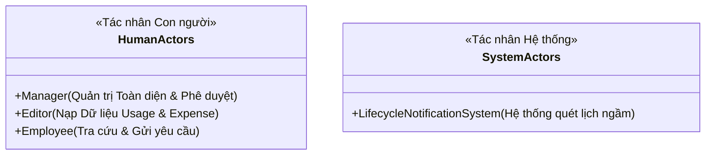
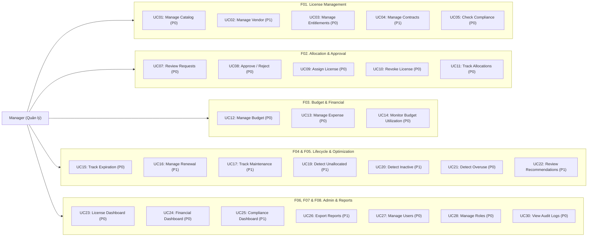
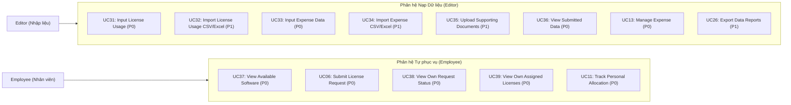
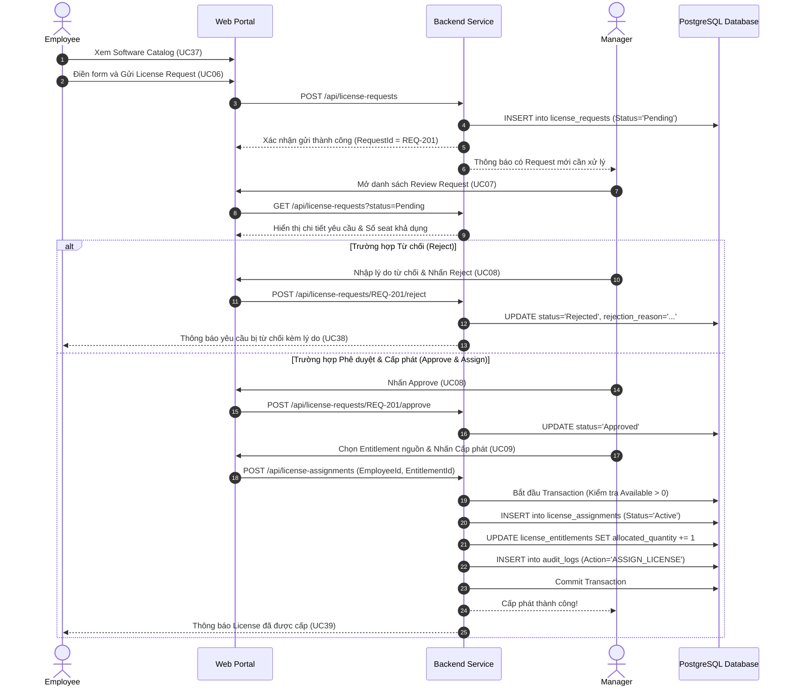
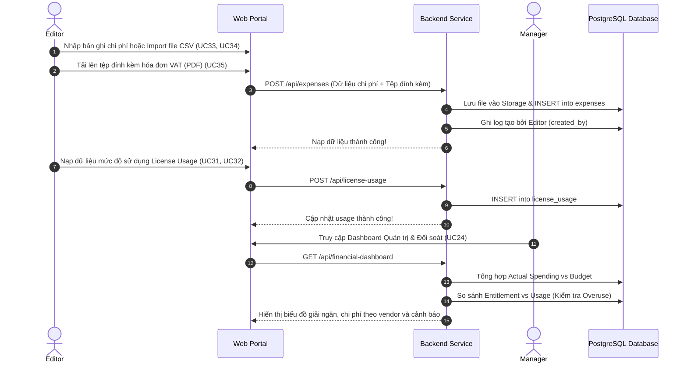

# Tài liệu Đặc tả Trường hợp Sử dụng (Use Case Specification)
## Dự án: VFast – Enterprise License Management System (ELMS)
### Căn cứ: Bản Đặc tả Yêu cầu Phần mềm (SRS v1.0)

---

## 1. Danh sách Tác nhân Hệ thống (System Actors)

Hệ thống ELMS phân định rõ trách nhiệm giữa **3 Tác nhân con người** và **1 Tác nhân hệ thống tự động**:

1. **Manager (Quản lý cấp cao / Quản trị viên hệ thống):**
   - Sở hữu mức truy cập cao nhất (`Full Management`).
   - Chịu trách nhiệm quản lý danh mục phần mềm, nhà cung cấp, hợp đồng, quyền sở hữu bản quyền (`Entitlement`).
   - Phê duyệt / từ chối các yêu cầu cấp license (`License Request`), trực tiếp thực hiện cấp phát (`Assign`) và thu hồi (`Revoke`).
   - Thiết lập ngân sách (`Budget`), duyệt chi phí (`Expense`), theo dõi tuân thủ (`Compliance`), rà soát đề xuất tối ưu hóa (`Optimization`) và quản lý phân quyền 3 role.
2. **Editor (Quản trị viên dữ liệu đầu vào):**
   - Sở hữu mức truy cập nạp liệu (`Data Management`).
   - Chịu trách nhiệm nhập liệu mức độ sử dụng license (`Usage Data`) và chi phí thực tế (`Expense`), nhập lẻ hoặc import qua file CSV/Excel, tải lên hóa đơn chứng từ.
   - Không được phép sửa đổi Entitlement, không thể cấp phát/thu hồi license, và không có quyền can thiệp vào hạn mức ngân sách.
3. **Employee (Nhân viên sử dụng):**
   - Sở hữu mức truy cập cá nhân (`Personal Access`).
   - Tra cứu danh sách các phần mềm được phép sử dụng trong công ty, gửi yêu cầu xin cấp license cá nhân, theo dõi trạng thái yêu cầu và xem danh sách các license đang được cấp phát cho bản thân.
   - Tuyệt đối không thể xem dữ liệu chi phí, ngân sách hoặc license của nhân viên khác.
4. **Lifecycle Notification System (Tác nhân hệ thống):**
   - Tiến trình chạy ngầm theo lịch trình (Cron Scheduler) hằng ngày để quét ngày hết hạn của các hợp đồng thuê bao SaaS (`Subscription Expiry`) và ngày hết hạn bảo trì của Perpetual License (`Maintenance Expiry`), tự động gửi thông báo cảnh báo cho Manager.

---

## 2. Bảng Tổng hợp 39 Use Cases (Use Case Inventory)

Theo chuẩn hóa tại **Mục 5 của bản SRS v1.0**, toàn bộ 39 Use Cases của hệ thống được phân loại theo Tác nhân chính và Mức độ ưu tiên:

| UC ID | Tên Trường hợp Sử dụng (Use Case Name) | Tác nhân chính | Nhóm Chức năng | Độ ưu tiên |
| :---: | :--- | :---: | :---: | :---: |
| **UC01** | **Manage Software Catalog** | Manager | F01 – License Management | **P0** |
| **UC02** | **Manage Vendor** | Manager | F01 – License Management | P1 |
| **UC03** | **Manage License Entitlement** (SaaS & Perpetual) | Manager | F01 – License Management | **P0** |
| **UC04** | **Manage Contract** | Manager | F01 – License Management | P1 |
| **UC05** | **Check License Compliance** | Manager | F01 – License Management | **P0** |
| **UC06** | **Submit License Request** | Employee | F02 – License Allocation | **P0** |
| **UC07** | **Review License Request** | Manager | F02 – License Allocation | **P0** |
| **UC08** | **Approve / Reject Request** | Manager | F02 – License Allocation | **P0** |
| **UC09** | **Assign License** | Manager | F02 – License Allocation | **P0** |
| **UC10** | **Revoke License** | Manager | F02 – License Allocation | **P0** |
| **UC11** | **Track License Allocation** | Manager / Employee | F02 – License Allocation | **P0** |
| **UC12** | **Manage Budget** | Manager | F03 – Budget Management | **P0** |
| **UC13** | **Manage Expense** | Manager / Editor | F03 – Budget Management | **P0** |
| **UC14** | **Monitor Budget Utilization** | Manager | F03 – Budget Management | **P0** |
| **UC15** | **Track License Expiration** | Manager | F04 – Lifecycle Management | **P0** |
| **UC16** | **Manage Renewal** | Manager | F04 – Lifecycle Management | P1 |
| **UC17** | **Track Maintenance** | Manager | F04 – Lifecycle Management | P1 |
| **UC18** | **Generate Lifecycle Notification** | System | F04 – Lifecycle Management | **P0** |
| **UC19** | **Detect Unallocated Licenses** | Manager | F05 – License Optimization | P1 |
| **UC20** | **Detect Inactive Assignments** | Manager | F05 – License Optimization | P1 |
| **UC21** | **Detect License Overuse** | Manager | F05 – License Optimization | **P0** |
| **UC22** | **Review Optimization Recommendations** | Manager | F05 – License Optimization | P1 |
| **UC23** | **View License Dashboard** | Manager | F06 – Analytics & Reporting | **P0** |
| **UC24** | **View Financial Dashboard** | Manager | F06 – Analytics & Reporting | **P0** |
| **UC25** | **View Compliance Dashboard** | Manager | F06 – Analytics & Reporting | P1 |
| **UC26** | **Export Reports** | Manager / Editor | F06 – Analytics & Reporting | P1 |
| **UC27** | **Manage Users** | Manager | F07 – User & Role Management | **P0** |
| **UC28** | **Manage Roles** | Manager | F07 – User & Role Management | **P0** |
| **UC29** | **Login / Logout** | All Roles | F08 – System Administration | **P0** |
| **UC30** | **View Audit Logs** | Manager | F08 – System Administration | **P0** |
| **UC31** | **Input License Usage** | Editor | F01 / F05 – Usage & Optimization | **P0** |
| **UC32** | **Import License Usage** (CSV/Excel) | Editor | F01 / F05 – Usage & Optimization | P1 |
| **UC33** | **Input Expense Data** | Editor | F03 – Budget & Expense | **P0** |
| **UC34** | **Import Expense Data** (CSV/Excel) | Editor | F03 – Budget & Expense | P1 |
| **UC35** | **Upload Supporting Documents** (Invoices) | Editor | F03 – Budget & Expense | P1 |
| **UC36** | **View Submitted Data** | Editor | F08 – Data Administration | **P0** |
| **UC37** | **View Available Software** | Employee | F01 – Software Catalog | **P0** |
| **UC38** | **View Own Request Status** | Employee | F02 – License Allocation | **P0** |
| **UC39** | **View Own Assigned Licenses** | Employee | F02 – License Allocation | **P0** |

---

## 3. Sơ đồ Use Case Tổng quan (Use Case Diagrams)

### 3.1. Phân hệ Quản trị & Ra Quyết định (Manager Use Cases)

### 3.2. Phân hệ Nạp Dữ liệu & Tự phục vụ (Editor & Employee Use Cases)

---

## 4. Ba Luồng Nghiệp vụ Chính (Main Business Workflows)

Dựa trên **Mục 5.1 của bản SRS v1.0**, hệ thống vận hành xoay quanh 3 luồng công việc cốt lõi:

### 4.1. Luồng 1: Quy trình Yêu cầu & Cấp phát License (License Request & Allocation)
1. **Employee** truy cập danh mục phần mềm và xem các công cụ khả dụng (`UC37`).
2. **Employee** gửi yêu cầu cấp phát license (`UC06`) kèm lý do nghiệp vụ.
3. **Manager** xem danh sách các yêu cầu đang ở trạng thái `Pending` (`UC07`).
4. **Manager** thực hiện đánh giá và đưa ra quyết định **Approve** hoặc **Reject** (`UC08`).
5. Nếu chấp thuận (**Approved**), Manager kiểm tra dung lượng khả dụng của Entitlement (`UC03`).
6. **Manager** thực hiện gán seat bản quyền cho Employee (`UC09`).
7. **Employee** nhận thông báo và xem license đã được kích hoạt trong trang cá nhân (`UC39`).

---

### 4.2. Luồng 2: Quản lý Mức dùng & Chi phí Thực tế (Usage & Expense Management)
1. **Editor** thu thập số liệu tiêu thụ phần mềm thực tế và nhập trực tiếp (`UC31`) hoặc import hàng loạt từ file Excel (`UC32`).
2. **Editor** nhập chi phí thực tế (`UC33`), import dữ liệu chi phí (`UC34`) và tải lên file hóa đơn, chứng từ thanh toán đính kèm (`UC35`).
3. **Editor** xem lại toàn bộ dữ liệu do mình đã nạp để đảm bảo tính chính xác (`UC36`).
4. **Manager** kiểm tra dữ liệu do Editor nạp (`UC13`).
5. Hệ thống tự động tính toán và cập nhật các chỉ số tài chính, tỷ lệ giải ngân và mức độ tiêu thụ.
6. **Manager** theo dõi bức tranh tuân thủ (`UC05`), chi phí thực tế (`UC14`) và các cơ hội tối ưu hóa (`UC22`).

---

### 4.3. Luồng 3: Giám sát Ngân sách & Vòng đời Bản quyền (Budget & Lifecycle Monitoring)
1. **Manager** thiết lập hạn mức ngân sách (`Budget`) theo năm hoặc kỳ tài chính cho từng phòng ban (`UC12`).
2. Các khoản chi phí thực tế (`Expense`) được nạp vào hệ thống (`UC13`, `UC33`).
3. Hệ thống tự động tính toán tổng chi phí đã chi trả (`Actual Spending`), ngân sách còn lại (`Remaining Budget`) và tỷ lệ giải ngân (`Budget Utilization`) (`UC14`).
4. **Lifecycle Notification System** tự động quét định kỳ các mốc hết hạn hợp đồng thuê bao và bảo trì (`UC18`).
5. Nếu hợp đồng sắp đến hạn (trong vòng 30, 15, 7 ngày), hệ thống phát sinh cảnh báo đến Manager (`UC15`).
6. **Manager** rà soát hiệu quả sử dụng thực tế, xem các đề xuất tối ưu hóa (`UC22`) và đưa ra quyết định gia hạn (`Renew`), cắt giảm số lượng (`Downsize`) hoặc ngừng hợp đồng (`Cancel`) (`UC16`).

---

## 5. Đặc tả Chi tiết các Use Case Cốt lõi (P0)

---

### UC01 – Quản lý Danh mục Phần mềm (Manage Software Catalog)
- **Tác nhân chính:** Manager
- **Độ ưu tiên:** P0
- **Tiền điều kiện:** Manager đã đăng nhập thành công với quyền `Full Management`.
- **Hậu điều kiện:** Thông tin sản phẩm phần mềm được lưu trữ chuẩn hóa; hiển thị cho Employee tra cứu khi ở trạng thái hoạt động.
- **Luồng sự kiện chính:**
  1. Manager mở màn hình Software Catalog và chọn "Thêm mới sản phẩm".
  2. Nhập các trường: Tên phần mềm, Nhà phát hành (Vendor), Danh mục (Văn phòng, Kỹ thuật, Thiết kế,...), Mô tả tính năng, Loại license (`SaaS Subscription` hoặc `Perpetual License`), và Trạng thái (`Active` / `Deprecated`).
  3. Hệ thống xác thực tính duy nhất của bộ khóa `Software Name + Vendor`.
  4. Hệ thống lưu bản ghi mới, ghi Audit Log và cập nhật danh mục.
- **Luồng rẽ nhánh:** Nếu phần mềm đã tồn tại, hệ thống từ chối lưu và yêu cầu cập nhật bản ghi hiện hữu.

---

### UC03 – Quản lý Quyền sở hữu Bản quyền (Manage License Entitlement)
- **Tác nhân chính:** Manager
- **Độ ưu tiên:** P0
- **Tiền điều kiện:** Sản phẩm phần mềm và Nhà cung cấp đã tồn tại trong hệ thống.
- **Hậu điều kiện:** Gói quyền sử dụng được xác lập; dung lượng khả dụng (`Available Quantity`) được khởi tạo.
- **Luồng sự kiện chính:**
  1. Manager chọn phần mềm và chọn "Đăng ký Entitlement mới".
  2. Lựa chọn loại hình cấp phép:
     - **Nếu là SaaS Subscription:** Nhập Gói dịch vụ (`Subscription Plan`), License Metric (ví dụ `Per User`), Số lượng mua (`Purchased Quantity`), Ngày bắt đầu, Ngày hết hạn bắt buộc, Chi phí thuê bao, Chu kỳ thanh toán (`Monthly`/`Yearly`), và Tự động gia hạn (`Yes`/`No`).
     - **Nếu là Perpetual License:** Nhập License Metric, Số lượng mua, Ngày mua, Giá mua, Thỏa thuận bảo trì (`Maintenance Agreement`), và Ngày hết hạn bảo trì (`Maintenance Expiration Date`).
  3. Manager nhấn "Lưu Entitlement".
  4. Hệ thống kiểm tra hợp lệ:
     - Với SaaS: Bắt buộc phải có ngày hết hạn ($StartDate \le ExpirationDate$).
     - Với Perpetual: Thời hạn bảo trì được quản lý ở trường riêng, không gán ngày hết hạn bản quyền vĩnh viễn (BR-12).
  5. Hệ thống khởi tạo: $\text{Available Quantity} = \text{Purchased Quantity}$.
  6. Ghi Audit Log bất biến: Người tạo, Thời điểm, Số lượng, Loại license.

---

### UC06 – Gửi Yêu cầu Cấp License (Submit License Request)
- **Tác nhân chính:** Employee
- **Độ ưu tiên:** P0
- **Tiền điều kiện:** Employee đã đăng nhập hệ thống.
- **Hậu điều kiện:** Bản ghi yêu cầu được tạo ở trạng thái `Pending`; gửi thông báo đến hàng đợi của Manager.
- **Luồng sự kiện chính:**
  1. Employee truy cập danh mục phần mềm khả dụng (`UC37`).
  2. Chọn phần mềm cần xin cấp và nhấn "Gửi yêu cầu cấp phát".
  3. Nhập số lượng cần cấp (mặc định = 1) và bắt buộc nhập lý do sử dụng công việc.
  4. Nhấn "Gửi yêu cầu".
  5. Hệ thống xác thực: Trường lý do không được để trống.
  6. Tạo bản ghi `LicenseRequest` ở trạng thái `Pending`, gán mã định danh duy nhất (ví dụ `REQ-2026-001`).
  7. Hiển thị thông báo gửi thành công cho Employee.
- **Luồng ngoại lệ:** Nếu lý do bị bỏ trống, hệ thống hiển thị thông báo lỗi: *"Vui lòng nhập lý do sử dụng để người quản trị xem xét."*

---

### UC08 – Phê duyệt hoặc Từ chối Yêu cầu (Approve / Reject Request)
- **Tác nhân chính:** Manager
- **Độ ưu tiên:** P0
- **Tiền điều kiện:** Tồn tại yêu cầu ở trạng thái `Pending`.
- **Hậu điều kiện:** Trạng thái yêu cầu chuyển sang `Approved` hoặc `Rejected`; lưu vết quyết định và gửi thông báo phản hồi cho Employee.
- **Luồng sự kiện chính:**
  1. Manager mở danh sách Yêu cầu chờ duyệt (`UC07`).
  2. Chọn yêu cầu cần xử lý để xem chi tiết lý do của nhân viên và số seat khả dụng hiện có trong kho.
  3. **Kịch bản Chấp thuận (Approve):**
     - Manager nhấn "Phê duyệt".
     - Hệ thống đổi trạng thái sang `Approved`, lưu `approver_id = Manager_ID` và dấu thời gian duyệt.
     - Yêu cầu được chuyển sang trạng thái sẵn sàng để cấp phát license (`UC09`).
  4. **Kịch bản Từ chối (Reject):**
     - Manager nhấn "Từ chối" và bắt buộc nhập lý do từ chối.
     - Hệ thống đổi trạng thái sang `Rejected`, lưu lý do giải trình.
     - Gửi thông báo đến Employee kèm lý do từ chối.
- **Quy tắc bất biến:** Một yêu cầu đã được xử lý (`Approved` hoặc `Rejected`) không được phép duyệt lại lần thứ hai (BR-19).

---

### UC09 – Cấp phát License cho Nhân viên (Assign License)
- **Tác nhân chính:** Manager
- **Độ ưu tiên:** P0
- **Tiền điều kiện:** Yêu cầu đã được `Approved` (hoặc Manager chỉ định trực tiếp); Entitlement nguồn còn seat khả dụng ($\text{Available} > 0$).
- **Hậu điều kiện:** Tạo bản ghi `LicenseAssignment`; giảm số seat khả dụng trong kho; Employee nhìn thấy license trong tài khoản cá nhân.
- **Luồng sự kiện chính:**
  1. Manager chọn yêu cầu đã duyệt hoặc chọn phần mềm cần cấp phát.
  2. Chọn Entitlement nguồn còn hiệu lực và còn seat khả dụng.
  3. Hệ thống mở một Database Transaction có khóa dòng (`Row Locking`) để chống tranh chấp:
     - Kiểm tra điều kiện: $\text{Available Quantity} = \text{Purchased} - \text{Allocated} > 0$.
     - Nếu $\text{Available} \le 0$: Transaction lập tức bị hủy bỏ (Rollback), hệ thống báo lỗi không đủ bản quyền (BR-05).
  4. Hệ thống tạo bản ghi `LicenseAssignment`: Liên kết `EmployeeId`, `EntitlementId`, ngày gán và trạng thái `Active`.
  5. Cập nhật Entitlement nguồn: $\text{Allocated Quantity} = \text{Allocated Quantity} + 1$.
  6. Cam kết giao dịch (Commit Transaction) và ghi Audit Log.
  7. Gửi thông báo cho Employee: License đã sẵn sàng sử dụng.

---

### UC10 – Thu hồi License về Kho (Revoke License)
- **Tác nhân chính:** Manager
- **Độ ưu tiên:** P0
- **Tiền điều kiện:** Tồn tại bản ghi `LicenseAssignment` ở trạng thái `Active`.
- **Hậu điều kiện:** Bản ghi Assignment chuyển sang trạng thái `Revoked`; dung lượng khả dụng trong kho được hoàn trả.
- **Luồng sự kiện chính:**
  1. Manager tra cứu bản ghi cấp phát theo nhân viên hoặc theo phần mềm.
  2. Nhấn "Thu hồi (Revoke)" và nhập lý do thu hồi (Nhân viên chuyển vị trí, Không còn nhu cầu, Nhân sự nghỉ việc).
  3. Hệ thống chuyển trạng thái Assignment sang `Revoked`, ghi nhận thời gian thu hồi và người thực hiện.
  4. Hệ thống hoàn trả dung lượng: $\text{Allocated Quantity} = \text{Allocated Quantity} - 1$ (tương đương $\text{Available Quantity}$ tăng 1).
  5. Bản ghi Assignment cũ vẫn được lưu trữ nguyên vẹn trong lịch sử phục vụ kiểm toán (BR-13).

---

### UC12 & UC14 – Quản lý Ngân sách & Theo dõi Giải ngân (Manage & Monitor Budget)
- **Tác nhân chính:** Manager
- **Độ ưu tiên:** P0
- **Tiền điều kiện:** Manager đã đăng nhập hệ thống.
- **Luồng sự kiện chính:**
  1. Manager thiết lập ngân sách phần mềm theo năm tài chính và theo phòng ban (`UC12`).
  2. Hệ thống tổng hợp tự động các khoản chi phí thực tế (`Expense`) phát sinh trong kỳ:
     $$\text{Actual Spending} = \sum \text{Expense Amount}$$
  3. Hệ thống tính toán các chỉ số:
     - $\text{Remaining Budget} = \text{Total Budget} - \text{Actual Spending}$
     - $\text{Budget Utilization (\%)} = \left(\frac{\text{Actual Spending}}{\text{Total Budget}}\right) \times 100$
  4. Hiển thị tiến độ giải ngân trực quan.
  5. Tự động bật cảnh báo vàng khi đạt $\ge 80\%$ ngân sách, và cảnh báo đỏ khi vượt quá $100\%$ ngân sách.

---

### UC21 – Phát hiện Sử dụng Vượt quyền (Detect License Overuse)
- **Tác nhân chính:** Manager
- **Độ ưu tiên:** P0
- **Mục tiêu:** Phát hiện ngay lập tức tình trạng vi phạm hạn ngạch bản quyền để phòng ngừa rủi ro pháp lý.
- **Luồng sự kiện chính:**
  1. Hệ thống định kỳ hoặc theo yêu cầu tính toán chỉ số chênh lệch:
     - Trường hợp 1 (Over-allocation): $\text{Allocated Quantity} > \text{Purchased Quantity}$.
     - Trường hợp 2 (Overuse qua Usage Data): $\text{Actual Usage Quantity} > \text{Purchased Quantity}$ (khi có dữ liệu usage hợp lệ).
  2. Nếu phát hiện vi phạm, hệ thống gắn cờ trạng thái `Overused` hoặc `At Risk`.
  3. Bật cảnh báo đỏ nổi bật trên Dashboard và gửi thông báo khẩn cấp đến Manager.
  4. Liệt kê danh sách chi tiết các tài khoản hoặc seat đang vượt quyền để Manager đưa ra phương án xử lý (mua thêm hoặc thu hồi).

---

### UC31 & UC33 – Nhập Dữ liệu Usage & Chi phí Thực tế (Input Usage & Expense Data)
- **Tác nhân chính:** Editor
- **Độ ưu tiên:** P0
- **Luồng sự kiện chính cho Nhập Usage (UC31):**
  1. Editor chọn phần mềm và nhân viên cần cập nhật mức dùng.
  2. Nhập các trường: Ngày hoạt động gần nhất (`Last Active Date`), Số ngày sử dụng trong kỳ, Mức độ sử dụng (`Active` / `Inactive`).
  3. Nhấn Lưu. Bản ghi được gắn tự động `created_by = Editor_ID` và dấu thời gian.
- **Luồng sự kiện chính cho Nhập Expense (UC33):**
  1. Editor chọn phần mềm/hợp đồng phát sinh chi phí.
  2. Nhập Số tiền, Loại tiền tệ (VND/USD), Ngày thanh toán, Số hóa đơn và Phòng ban chịu chi phí.
  3. Đính kèm file hóa đơn VAT dạng PDF/ảnh (`UC35`).
  4. Nhấn Lưu. Hệ thống xác thực số tiền hợp lệ và lưu vào cơ sở dữ liệu.

---

### UC37 & UC39 – Tra cứu Cá nhân (View Available Software & Assigned Licenses)
- **Tác nhân chính:** Employee
- **Độ ưu tiên:** P0
- **Luồng sự kiện chính:**
  1. Employee đăng nhập và mở trang "Danh mục phần mềm khả dụng" (`UC37`): Hiển thị tên phần mềm, mô tả và nút yêu cầu cấp phát; **tuyệt đối không hiển thị giá tiền hoặc key kích hoạt**.
  2. Employee mở trang "License của tôi" (`UC39`): Hiển thị toàn bộ các phần mềm đang được cấp phát cho cá nhân, ngày được cấp, và ngày hết hạn hợp đồng đối với gói SaaS.
