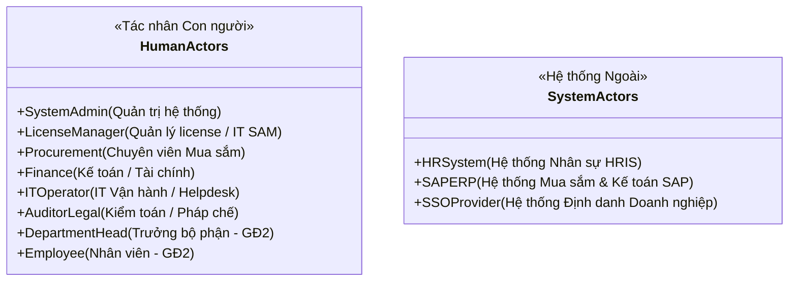
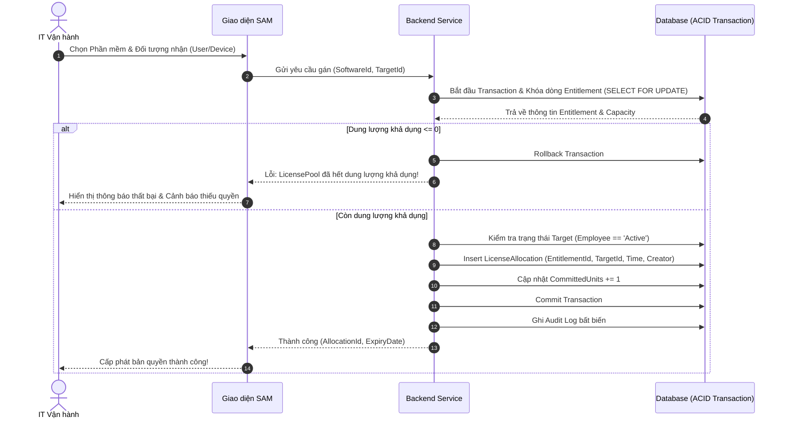
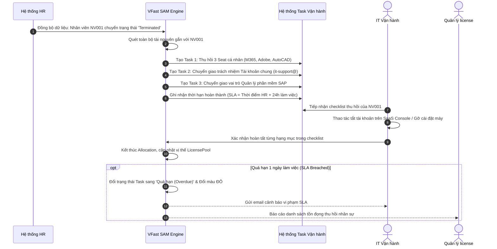
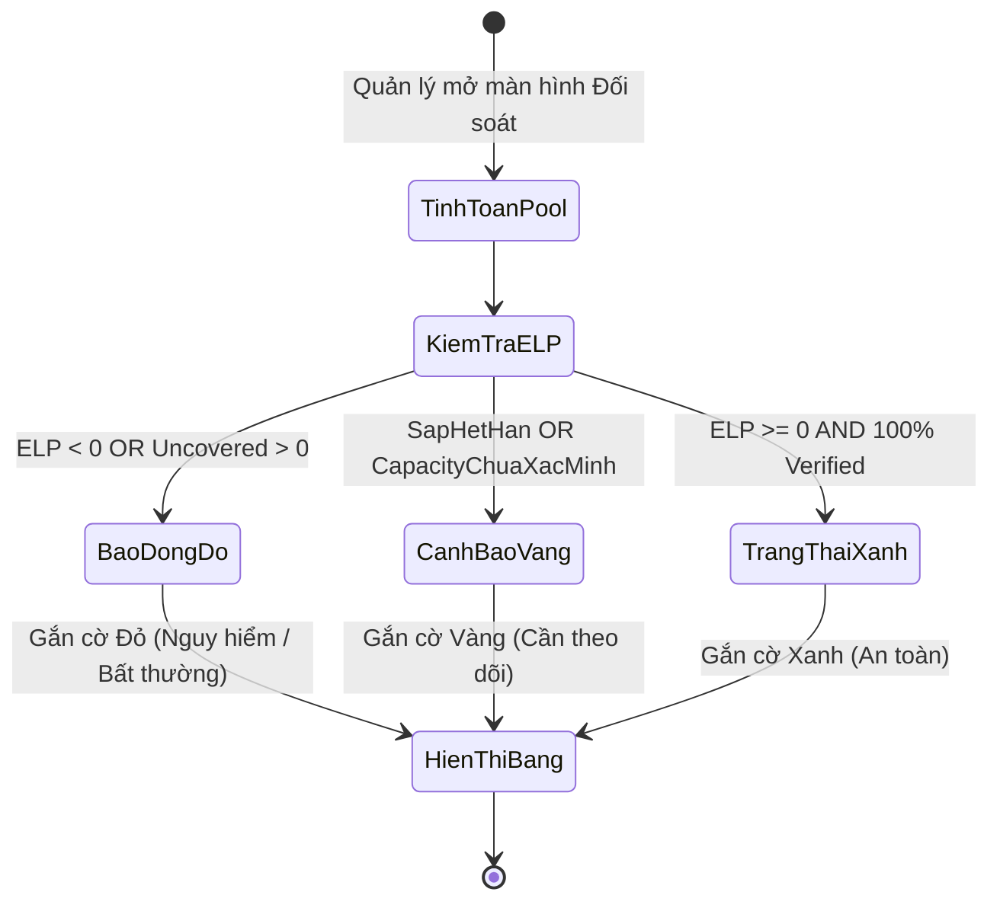

# Tài liệu Đặc tả Trường hợp Sử dụng (Use Case Specification)
## Dự án: VFast – Hệ thống Quản lý Bản quyền Phần mềm (Software Asset Management - SAM)

---

## 1. Danh sách Tác nhân Hệ thống (Actors)

### 1.1. Tác nhân Con người (Human Actors)
1. **Quản trị hệ thống (System Admin):** Cấu hình các tham số toàn hệ thống, quản lý tài khoản người dùng, phân quyền truy cập, giám sát hạ tầng và kiểm tra hệ thống nhật ký bảo mật (Security Audit Log).
2. **Quản lý license (License Manager / IT SAM):** Chịu trách nhiệm nghiệp vụ cao nhất về tài sản bản quyền: quản lý danh mục phần mềm chuẩn, thẩm định quyền sử dụng (`Entitlement`), điều chuyển license giữa các pool, giám sát vị thế tuân thủ (`ELP`), xem license key (có ghi log) và chủ trì chốt bản chụp kiểm kê định kỳ.
3. **Chuyên viên Mua sắm (Procurement):** Khởi tạo và cập nhật hồ sơ hợp đồng mua sắm, đơn mua hàng (`PO`), thông tin nhà cung cấp/đại lý, nạp license key (mù) và theo dõi quy trình thương thảo gia hạn bản quyền.
4. **Kế toán / Tài chính (Finance):** Theo dõi số liệu chi phí bản quyền, kiểm tra tính hợp lệ của hóa đơn, rà soát lịch thanh toán/gia hạn 12 tháng và xuất báo cáo phục vụ kiểm toán tài chính.
5. **IT Vận hành / Helpdesk (IT Operator):** Thực thi các tác vụ vận hành hằng ngày: gán seat cho nhân viên/thiết bị/tài khoản dùng chung, xử lý việc thu hồi seat khi nhân viên nghỉ việc theo SLA 1 ngày làm việc, quản lý danh sách thiết bị tối thiểu.
6. **Kiểm toán / Pháp chế (Auditor / Legal Counsel):** Truy cập quyền chỉ đọc (Read-only) vào toàn bộ sổ cái bản quyền, vị thế ELP và nhật ký kiểm toán; sử dụng bản chụp kiểm kê để đối chiếu rủi ro pháp lý theo Nghị định 341/2025/NĐ-CP.
7. **Trưởng bộ phận (Department Head - Giai đoạn 2):** Xem danh sách bản quyền và chi phí phát sinh của phòng ban mình phụ trách; phê duyệt hoặc từ chối các yêu cầu xin cấp mới phần mềm của nhân viên cấp dưới.
8. **Nhân viên (Employee - Giai đoạn 2):** Tra cứu danh mục phần mềm được phép dùng trong doanh nghiệp; xem danh sách bản quyền đang được gán cho cá nhân; gửi yêu cầu xin cấp license mới.

### 1.2. Tác nhân Hệ thống Ngoài (External System Actors)
1. **Hệ thống Quản lý Nhân sự (HR System):** Nguồn dữ liệu gốc cung cấp danh sách nhân viên, phòng ban, quản lý trực tiếp và trạng thái làm việc (Đang làm / Sắp nghỉ / Đã nghỉ việc).
2. **Hệ thống SAP ERP (SAP MM/FI):** Nguồn dữ liệu xuất đơn mua hàng (`Purchase Order - PO`), hóa đơn tài chính và mã số nhà cung cấp phục vụ nhập liệu tự động.
3. **Cổng Định danh Doanh nghiệp (SSO / Identity Provider):** Cung cấp cơ chế xác thực tập trung một lần (Single Sign-On), quản lý phiên đăng nhập và kích hoạt bảo mật đa yếu tố (MFA).

---

## 2. Sơ đồ Trường hợp Sử dụng Tổng quan (Use Case Diagram)

```mermaid
flowchart TB
    subgraph Admins["Quản trị & Giám sát"]
        LM["Quản lý license (IT SAM)"]
        SA["Quản trị hệ thống"]
        AUD["Kiểm toán / Pháp chế"]
    end

    subgraph Operations["Vận hành & Mua sắm"]
        PRO["Mua sắm"]
        ITO["IT Vận hành"]
        FIN["Tài chính"]
    end

    subgraph External["Hệ thống Tích hợp"]
        HR["Hệ thống HR"]
        SAP["Hệ thống SAP ERP"]
    end

    %% UC Group 1: Catalog & Vendor
    subgraph G1["E1: Danh mục & Nhà cung cấp"]
        UC01["UC-01: Quản lý Danh mục Phần mềm"]
        UC02["UC-02: Quản lý Nhà cung cấp & Đại lý"]
    end

    %% UC Group 2: Contracts & Entitlements
    subgraph G2["E2: Hợp đồng & Quyền sử dụng"]
        UC03["UC-03: Ghi nhận Hợp đồng & Đơn mua"]
        UC04["UC-04: Thẩm định Entitlement & Tính Pool"]
    end

    %% UC Group 3: Allocation & Reclaim
    subgraph G3["E3: Gán & Thu hồi Seat"]
        UC05["UC-05: Gán Seat Nguyên tử"]
        UC06["UC-06: Thu hồi Seat về Kho"]
        UC07["UC-07: Quản trị Tài khoản dùng chung"]
        UC08["UC-08: Quản trị Thiết bị & License OEM"]
    end

    %% UC Group 4: Employee Lifecycle
    subgraph G4["E4: Vòng đời Nhân sự"]
        UC09["UC-09: Đồng bộ Dữ liệu Nhân sự"]
        UC10["UC-10: Xử lý Thu hồi khi Nghỉ việc (SLA 1 ngày)"]
    end

    %% UC Group 5: Renewal
    subgraph G5["E5: Nhắc hạn & Gia hạn"]
        UC11["UC-11: Cảnh báo Nhắc hạn Hợp đồng"]
        UC12["UC-12: Ghi nhận Quyết định Gia hạn"]
    end

    %% UC Group 6: Compliance
    subgraph G6["E7: Đối soát & Tuân thủ"]
        UC13["UC-13: Đối soát LicensePool & Xem ELP"]
        UC14["UC-14: Chốt Snapshot Kiểm kê Định kỳ"]
    end

    %% UC Group 7: Data Exchange
    subgraph G7["E8: Nhập & Xuất Dữ liệu"]
        UC15["UC-15: Nhập Dữ liệu Chuẩn hóa từ Excel"]
        UC16["UC-16: Nhập Đơn mua SAP (Idempotent)"]
        UC17["UC-17: Xuất Dữ liệu & Tra cứu Audit Log"]
    end

    %% Connections
    LM --> UC01
    LM --> UC02
    LM --> UC04
    LM --> UC13
    LM --> UC14
    LM --> UC15
    LM --> UC16

    PRO --> UC02
    PRO --> UC03
    PRO --> UC11
    PRO --> UC12

    ITO --> UC05
    ITO --> UC06
    ITO --> UC07
    ITO --> UC08
    ITO --> UC10

    FIN --> UC11
    FIN --> UC17

    AUD --> UC13
    AUD --> UC14
    AUD --> UC17

    SA --> UC17

    HR -.->|Trigger hằng ngày| UC09
    UC09 -.->|Kích hoạt tự động| UC10
    SAP -.->|File dữ liệu PO| UC16
```

---

## 3. Đặc tả Chi tiết các Use Case Cốt lõi (MVP)

---

### UC-01: Quản lý Danh mục Phần mềm Chuẩn (Software Catalog Management)
- **Mã Use Case:** `UC-01`
- **Tác nhân chính:** Quản lý license (License Manager)
- **Tiền điều kiện:** Người dùng đã đăng nhập hệ thống với vai trò Quản lý license.
- **Hậu điều kiện:** Bản ghi phần mềm được lưu trữ với mã định danh chuẩn hóa; nếu chuyển trạng thái sang `Bị cấm`, các task rà soát thu hồi được tự động khởi tạo.

#### Luồng sự kiện chính (Main Flow):
1. Quản lý license chọn chức năng "Danh mục phần mềm" và nhấn "Thêm phần mềm mới".
2. Hệ thống hiển thị biểu mẫu bao gồm: Hãng phát hành (Publisher), Dòng sản phẩm (Product Name), Phiên bản (Version/Scope), Edition (Standard, Professional, Enterprise), Phân loại bản quyền (Commercial, Open Source, Freeware), Người phụ trách phần mềm phía IT, và Trạng thái cấp phép (`Được phép` / `Bị cấm`).
3. Quản lý license nhập đầy đủ thông tin và nhấn "Lưu".
4. Hệ thống kiểm tra tính duy nhất của bộ khóa: `Publisher + Product + Edition + Version`.
5. Hệ thống lưu bản ghi mới và ghi nhật ký kiểm toán (Audit Log).
6. Màn hình thông báo thành công và hiển thị phần mềm trong danh mục chuẩn.

#### Các luồng rẽ nhánh & Ngoại lệ:
- **A1. Trùng lặp phần mềm:** Nếu đã tồn tại bản ghi có cùng bộ khóa, hệ thống hiển thị thông báo lỗi: *"Phần mềm này đã tồn tại trong danh mục với mã [Mã_SP]. Vui lòng cập nhật bản ghi hiện có thay vì tạo mới."*
- **A2. Chuyển trạng thái sang "Bị cấm" (Prohibited):**
  1. Quản lý license chuyển trạng thái một phần mềm từ `Được phép` sang `Bị cấm` kèm lý do bắt buộc (ví dụ: rủi ro bảo mật, vi phạm chính sách công ty).
  2. Hệ thống kiểm tra xem có allocation nào đang hoạt động trên phần mềm này không.
  3. Nếu có, hệ thống tự động khóa việc cấp phát mới, đánh dấu cảnh báo Đỏ, và tự động tạo danh sách công việc thu hồi (Reclamation Tasks) gửi đến IT Vận hành.

---

### UC-03: Ghi nhận Hợp đồng & Đơn mua License (Entitlement Intake)
- **Mã Use Case:** `UC-03`
- **Tác nhân chính:** Chuyên viên Mua sắm (Procurement)
- **Tác nhân phụ:** Quản lý license (License Manager)
- **Tiền điều kiện:** Nhà cung cấp và Sản phẩm phần mềm đã tồn tại trong hệ thống.
- **Hậu điều kiện:** Hợp đồng và các dòng Entitlement được tạo ở trạng thái `Nháp (Draft)`, license key được lưu trữ dưới dạng mã hóa bí mật.

#### Luồng sự kiện chính (Main Flow):
1. Chuyên viên Mua sắm mở chức năng "Quản lý hợp đồng" và chọn "Tạo hợp đồng mới".
2. Chuyên viên nhập thông tin chung: Số hợp đồng, Số đơn mua (`PO Number`), Nhà cung cấp, Ngày ký, Tổng giá trị hợp đồng, Tiền tệ (VND/USD).
3. Chuyên viên thêm từng dòng quyền sử dụng (`Entitlement Line`):
   - Chọn Sản phẩm và `LicenseProfile`/SKU tương ứng.
   - Chọn Metric đo lường (`NAMED_USER`, `PER_DEVICE`, `SITE_LICENSE`,...).
   - Loại hình thời hạn: `Thuê bao (Subscription)` hoặc `Vĩnh viễn (Perpetual)`.
   - Nếu là Thuê bao: Nhập Ngày bắt đầu và Ngày hết hạn bắt buộc.
   - Nếu là Vĩnh viễn: Nhập Ngày mua; hạn bảo trì (Maintenance Expiry) nhập vào trường riêng.
   - Số lượng quyền mua (Capacity).
   - Nhập License Key / Thông tin kích hoạt (nếu có).
   - Tải lên tệp đính kèm chứng từ (Hợp đồng scan, Hóa đơn VAT, Giấy chứng nhận quyền sử dụng).
4. Chuyên viên Mua sắm nhấn "Lưu hồ sơ".
5. Hệ thống mã hóa License Key bằng thuật toán AES-256 trước khi ghi vào cơ sở dữ liệu.
6. Hệ thống tạo Entitlement ở trạng thái `Nháp (Draft)` và gửi thông báo yêu cầu thẩm định đến Quản lý license.

#### Các luồng rẽ nhánh:
- **A1. Thiếu thông tin bắt buộc:** Nếu hợp đồng thuê bao bị thiếu ngày hết hạn hoặc thiếu tệp chứng từ đính kèm, hệ thống ngăn chặn lưu và làm nổi bật các trường còn thiếu.
- **A2. Nhập key "Mù":** Mua sắm nhập license key vào ô mật khẩu (chỉ hiển thị dấu `*`). Sau khi lưu, Mua sắm không thể đọc lại key này.

---

### UC-04: Thẩm định Quyền sử dụng & Phân bổ vào LicensePool (Entitlement Verification)
- **Mã Use Case:** `UC-04`
- **Tác nhân chính:** Quản lý license (License Manager)
- **Tiền điều kiện:** Tồn tại Entitlement ở trạng thái `Nháp (Draft)`.
- **Hậu điều kiện:** Entitlement chuyển sang trạng thái `Hiệu lực (Active)` và dung lượng được tính vào `LicensePool`.

#### Luồng sự kiện chính (Main Flow):
1. Quản lý license truy cập danh sách "Hồ sơ chờ thẩm định".
2. Mở chi tiết Entitlement `Nháp`, tải và kiểm tra chứng từ đính kèm (hợp đồng, điều khoản cấp phép của vendor).
3. Đối chiếu số lượng, phiên bản, phạm vi pháp nhân và điều kiện tái phân bổ (Transferability / Reassignment rights).
4. Quản lý license nhấn "Xác minh hợp lệ (Approve & Verify)".
5. Hệ thống xác định `LicensePool` tương ứng (hoặc tự tạo pool mới nếu chưa có):
   - Pool được gom nhóm theo: `SoftwareProduct + Metric + Edition + LegalEntity + VersionScope`.
6. Hệ thống chuyển trạng thái Entitlement sang `Hiệu lực (Active)`.
7. Dung lượng của Entitlement được cộng vào `VerifiedActiveCapacity` của Pool.
8. Hệ thống ghi nhật ký thẩm định gồm: Người duyệt, Dấu thời gian, Căn cứ pháp lý.

#### Các luồng rẽ nhánh:
- **A1. Từ chối xác minh:** Quản lý license nhấn "Từ chối" kèm lý do (ví dụ: chứng từ không hợp lệ, thiếu hóa đơn gốc). Entitlement giữ trạng thái `Nháp` hoặc chuyển `Đã hủy`, không được cộng dung lượng.

---

### UC-05: Gán Seat Bản quyền Nguyên tử (Atomic Seat Allocation)
- **Mã Use Case:** `UC-05`
- **Tác nhân chính:** IT Vận hành (IT Operator)
- **Tiền điều kiện:** Entitlement nguồn ở trạng thái `Hiệu lực`, còn dung lượng khả dụng; Đối tượng nhận (nhân viên/thiết bị/tài khoản) đang hoạt động hợp lệ.
- **Hậu điều kiện:** Bản ghi Allocation mới được tạo; dung lượng khả dụng của Entitlement bị giảm đi 1 đơn vị.

#### Luồng sự kiện chính (Main Flow):
1. IT Vận hành chọn chức năng "Cấp phát bản quyền" và chọn phần mềm cần gán.
2. Hệ thống lọc danh sách các `LicensePool` hợp lệ của phần mềm đó.
3. IT Vận hành chọn đối tượng tiếp nhận:
   - **Nhân viên:** Chọn từ danh bạ nhân sự đang làm việc (`Active`).
   - **Thiết bị:** Chọn từ danh mục máy trạm hợp lệ (`Active`).
   - **Tài khoản dùng chung:** Chọn tài khoản dịch vụ có người chịu trách nhiệm rõ ràng.
4. Hệ thống tự động chọn một Entitlement nguồn thuộc Pool còn dung lượng ($Available > 0$) và mở một Database Transaction với cơ chế khóa dòng (`Locking`).
5. Hệ thống kiểm tra lại điều kiện nguyên tử:
   - Nếu $Available \le 0$: Transaction bị hủy, báo lỗi thiếu quyền.
   - Nếu phần mềm đang ở trạng thái `Bị cấm`: Transaction bị hủy, báo lỗi chính sách.
   - Nếu nhân viên đang ở trạng thái `Đã nghỉ việc`: Transaction bị hủy, báo lỗi đối tượng.
6. Hệ thống tạo bản ghi `LicenseAllocation` mới gắn liền với `EntitlementId` và `TargetId`.
7. Trừ 1 đơn vị khỏi dung lượng khả dụng, cam kết giao dịch (Commit Transaction).
8. Hệ thống ghi nhận lịch sử cấp phát vào Audit Log.

---

### UC-06: Thu hồi Seat Bản quyền về Kho (Seat Reclamation)
- **Mã Use Case:** `UC-06`
- **Tác nhân chính:** IT Vận hành (IT Operator)
- **Tiền điều kiện:** Tồn tại bản ghi `LicenseAllocation` ở trạng thái `Đang gán`.
- **Hậu điều kiện:** Allocation chuyển sang trạng thái `Đã thu hồi`; dung lượng khả dụng được hoàn trả nếu quyền cho phép tái phân bổ.

#### Luồng sự kiện chính (Main Flow):
1. IT Vận hành tìm kiếm bản ghi Allocation cần thu hồi (theo nhân viên, máy hoặc phần mềm).
2. IT Vận hành nhấn "Thu hồi bản quyền" và nhập lý do thu hồi (nhân viên không còn nhu cầu, đổi máy tính, tối ưu hóa).
3. Hệ thống kiểm tra điều khoản của Entitlement nguồn:
   - **Trường hợp Quyền tái phân bổ (Reassignable):** Hệ thống chuyển Allocation sang `Đã thu hồi (Revoked)`, giải phóng 1 đơn vị dung lượng trở lại Entitlement nguồn.
   - **Trường hợp Ràng buộc cố định (Fixed Binding - OEM):** Hệ thống đánh dấu Allocation là `Bị ràng buộc (Bound)`, **không giải phóng dung lượng về kho** (ghi rõ lý do: bản quyền OEM gắn liền thiết bị).
4. Hệ thống ghi vết lịch sử thu hồi vào Audit Log.
5. Màn hình cập nhật lại vị thế của LicensePool.

---

### UC-10: Tự động Xử lý Thu hồi License khi Nhân viên Nghỉ việc (Offboarding Reclamation)
- **Mã Use Case:** `UC-10`
- **Tác nhân chính:** Hệ thống (tự động kích hoạt từ UC-09)
- **Tác nhân xử lý:** IT Vận hành (IT Operator)
- **Tác nhân giám sát:** Quản lý license, Trưởng bộ phận
- **Tiền điều kiện:** Hệ thống HR cập nhật trạng thái nhân viên sang `Nghỉ việc (Terminated)` hoặc `Sắp nghỉ (Pending Offboarding)`.
- **Hậu điều kiện:** Mọi bản quyền, tài khoản chung và quyền quản trị liên quan được xử lý triệt để trong SLA 1 ngày làm việc.

#### Các bước thực thi chi tiết:
1. Khi có sự kiện nhân viên nghỉ việc có hiệu lực từ HR:
   - Hệ thống khóa quyền tiếp nhận bản quyền mới của nhân viên này.
   - Tự động tạo một danh mục công việc (Checklist Tasks) gồm:
     - **Danh sách Seat cá nhân:** Tạo task thu hồi cho từng phần mềm đang gán.
     - **Tài khoản dùng chung:** Tạo task yêu cầu chỉ định người tiếp nhận mới (không thu hồi seat của tài khoản dùng chung để tránh gián đoạn dịch vụ).
     - **Phần mềm đang làm chủ quản (Owner):** Tạo task chuyển giao quyền quản lý phần mềm sang nhân sự IT khác.
     - **Thiết bị gắn kèm:** Ghi chú cảnh báo thu hồi máy tính trạm, không thu hồi license OEM theo máy.
2. Hệ thống đếm ngược SLA 24 giờ làm việc.
3. IT Vận hành xử lý thực tế trên các cổng quản trị (Admin Console của Microsoft, Adobe,...) và xác nhận trên hệ thống VFast.
4. Nếu quá 1 ngày làm việc: Tự động gửi email cảnh báo vi phạm SLA cho IT và Trưởng phòng IT; đưa vào danh sách cảnh báo Đỏ trên Dashboard.

---

### UC-11: Cảnh báo & Nhắc hạn Hợp đồng Bản quyền (Expiration Tracking & Reminders)
- **Mã Use Case:** `UC-11`
- **Tác nhân chính:** Hệ thống (Tự động)
- **Tác nhân nhận tin:** Chuyên viên Mua sắm, Quản lý license, Tài chính
- **Tiền điều kiện:** Tồn tại Entitlement thuê bao hoặc gói bảo trì có ngày hết hạn.
- **Hậu điều kiện:** Email thông báo được gửi đúng lịch; công việc gia hạn xuất hiện trên Dashboard.

#### Quy tắc thời gian nhắc hạn:
Hệ thống tự động quét mỗi ngày vào lúc 06:00 AM và gửi cảnh báo tại các mốc:
- **Trước 90 ngày:** Gửi thông báo đầu tiên cho Mua sắm và Người phụ trách phần mềm để bắt đầu rà soát nhu cầu.
- **Trước 60 ngày:** Nhắc nhở lần hai; yêu cầu ghi nhận quyết định gia hạn (`RN-02`).
- **Trước 30 ngày:** Báo động mức Vàng; thông báo cho Tài chính chuẩn bị ngân sách.
- **Trước 7 ngày:** Báo động khẩn cấp; nhắc nhở hoàn tất đơn mua mới trước khi bị ngắt dịch vụ.

#### Nội dung thông báo bắt buộc:
Email và Dashboard phải hiển thị đầy đủ:
- Tên phần mềm, SKU, Hợp đồng gốc, Nhà cung cấp.
- Ngày hết hạn chính xác và số ngày còn lại.
- Thống kê sử dụng: Tổng số seat đã mua, số seat đang gán, số seat đang trống.
- Danh sách nhân viên/bộ phận đang sử dụng bị ảnh hưởng nếu không gia hạn.

---

### UC-12: Ghi nhận Quyết định Gia hạn License (Renewal Decision Logging)
- **Mã Use Case:** `UC-12`
- **Tác nhân chính:** Người phụ trách phần mềm (Software Owner) / Mua sắm
- **Tiền điều kiện:** Hợp đồng đang trong kỳ nhắc hạn gia hạn (trong vòng 90 ngày).
- **Hậu điều kiện:** Quyết định được lưu vết bất biến; kích hoạt quy trình thu hồi (nếu giảm/ngừng) hoặc quy trình mua sắm (nếu giữ nguyên/tăng).

#### Luồng sự kiện chính (Main Flow):
1. Người phụ trách mở màn hình chi tiết hợp đồng sắp hết hạn.
2. Chọn chức năng "Ghi nhận quyết định gia hạn" và chọn 1 trong 4 phương án:
   - **Giữ nguyên (Renew As-Is):** Tiếp tục gia hạn với số lượng và điều khoản hiện tại.
   - **Tăng số lượng (Increase):** Gia hạn và bổ sung thêm seat cho kỳ tiếp theo.
   - **Giảm số lượng (Downsize):** Cắt giảm bớt các seat không dùng hoặc dư thừa.
   - **Ngừng sử dụng (Terminate/Sunset):** Không gia hạn, chuẩn bị chuyển đổi hoặc ngừng hẳn.
3. Nhập lý do giải trình chi tiết và đính kèm biên bản phê duyệt (nếu có).
4. Hệ thống lưu quyết định kèm dấu thời gian và định danh người quyết định.
5. **Xử lý tự động theo phương án:**
   - Nếu chọn `Giảm số lượng`: Hệ thống đối chiếu số seat đang gán với số lượng mới dự kiến. Nếu số đang gán lớn hơn số mới, hệ thống tự động tạo task yêu cầu IT Vận hành thu hồi số lượng seat dôi dư trước ngày hợp đồng hết hạn.
   - Nếu chọn `Ngừng sử dụng`: Hệ thống tạo task thu hồi toàn bộ allocation trước ngày hết hạn.
   - Nếu chọn `Giữ nguyên` hoặc `Tăng`: Hệ thống chuyển tiếp thông tin sang Chuyên viên Mua sắm để lập PO trên hệ thống SAP.

---

### UC-13: Đối soát LicensePool & Xem Vị thế ELP (License Pool Reconciliation)
- **Mã Use Case:** `UC-13`
- **Tác nhân chính:** Quản lý license (License Manager)
- **Tác nhân phụ:** Kiểm toán / Pháp chế
- **Tiền điều kiện:** Hệ thống đã có dữ liệu Entitlement và Allocation.
- **Hậu điều kiện:** Hiển thị bức tranh vị thế bản quyền minh bạch, hỗ trợ lọc và xuất dữ liệu.

#### Luồng sự kiện chính (Main Flow):
1. Quản lý license mở màn hình "Đối soát vị thế bản quyền (ELP Ledger)".
2. Hệ thống tổng hợp theo từng `LicensePool` và hiển thị bảng đối soát gồm các cột:
   - **Mã Pool & Tên phần mềm:** Thông tin định danh chuẩn.
   - **Metric đo lường:** `NAMED_USER`, `PER_DEVICE`,...
   - **Dung lượng xác minh (Verified Capacity):** Tổng quyền hợp lệ đang có hiệu lực.
   - **Dung lượng đã cấp (Committed Units):** Số seat đang gán + số quyền bị ràng buộc cố định.
   - **Dung lượng khả dụng (Available):** $Capacity - Committed$.
   - **Vị thế bản quyền (ELP):** Báo cáo số âm (thiếu quyền) hoặc dương (dư thừa).
   - **Allocation mất bao phủ (Uncovered):** Số lượng seat đang trỏ vào Entitlement đã hết hạn.
   - **Trạng thái cảnh báo:** Xanh / Vàng / Đỏ.
3. Người dùng có thể nhấn vào từng dòng để xem danh sách chi tiết các Entitlement đóng góp và danh sách đối tượng đang nắm giữ seat.

---

### UC-14: Chốt Bản chụp Kiểm kê Tuân thủ Định kỳ (Compliance Snapshot Freezing)
- **Mã Use Case:** `UC-14`
- **Tác nhân chính:** Quản lý license (License Manager)
- **Tác nhân giám sát:** Kiểm toán / Pháp chế
- **Tiền điều kiện:** Đã kết thúc kỳ đánh giá (hằng tháng hoặc hằng quý).
- **Hậu điều kiện:** Bản ghi Snapshot bất biến được tạo lập, không thể sửa đổi hay xóa bỏ.

#### Luồng sự kiện chính (Main Flow):
1. Quản lý license chọn chức năng "Kiểm kê định kỳ" và nhấn "Chốt bản chụp kỳ này (Freeze Snapshot)".
2. Hệ thống yêu cầu xác nhận và nhập ghi chú kiểm kê (ví dụ: *"Kiểm kê Quý 1/2026 chuẩn bị kiểm toán nội bộ"*).
3. Hệ thống chụp lại toàn bộ trạng thái tại thời điểm $T$:
   - Toàn bộ các LicensePool, số lượng Capacity, Committed, Available, ELP.
   - Danh sách chi tiết từng Entitlement và nguồn gốc chứng từ.
   - Toàn bộ danh sách Allocation đang hoạt động (kèm đối tượng và đơn vị sử dụng).
   - Danh sách toàn bộ các trường hợp thiếu quyền, mất bao phủ, hồ sơ chưa xác minh.
4. Hệ thống gán mã định danh duy nhất cho Snapshot, lưu dấu thời gian UTC và ID người chốt.
5. Khóa dữ liệu Snapshot thành dạng chỉ đọc (Read-only / Immutable).
6. Cho phép xuất toàn bộ báo cáo Snapshot ra định dạng Excel chuẩn có chữ ký điện tử/mã xác thực dữ liệu.

---

### UC-16: Nhập Đơn mua Hàng từ SAP ERP (SAP PO Import)
- **Mã Use Case:** `UC-16`
- **Tác nhân chính:** Quản lý license / Chuyên viên Mua sắm
- **Tác nhân hệ thống:** SAP ERP (Cung cấp file kết xuất định kỳ)
- **Tiền điều kiện:** File trích xuất dữ liệu đơn mua phần mềm từ SAP đúng định dạng quy định.
- **Hậu điều kiện:** Dữ liệu PO được nạp vào hệ thống dưới dạng Entitlement `Nháp` mà không gây trùng lặp.

#### Luồng sự kiện chính (Main Flow):
1. Người dùng tải lên file kết xuất PO từ SAP (định dạng CSV/Excel).
2. Hệ thống kiểm tra tính toàn vẹn của tệp và cấu trúc các cột dữ liệu.
3. Hệ thống tạo khóa định danh duy nhất cho từng dòng dữ liệu từ SAP:
   $$\text{SAP_CompositeKey} = \text{SystemId} + \text{CompanyCode} + \text{PONumber} + \text{POLine} + \text{Version}$$
4. Hệ thống kiểm tra tính Idempotent (Chống trùng lặp):
   - Nếu khóa đã tồn tại và không thay đổi: Bỏ qua dòng dữ liệu đó.
   - Nếu khóa đã tồn tại nhưng có cập nhật số lượng/giá: Cập nhật bản ghi tương ứng và lưu lịch sử thay đổi.
   - Nếu khóa mới: Tạo bản ghi Entitlement mới ở trạng thái `Nháp (Draft)`.
5. Tự động liên kết mã nhà cung cấp trong SAP (`VendorCode`) với hồ sơ Vendor trong VFast.
6. Kết thúc quá trình nhập liệu, hệ thống xuất báo cáo tóm tắt: Số dòng nhập mới, số dòng cập nhật, số dòng bỏ qua và danh sách dòng lỗi (nếu có).
