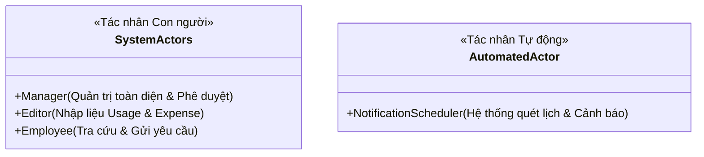
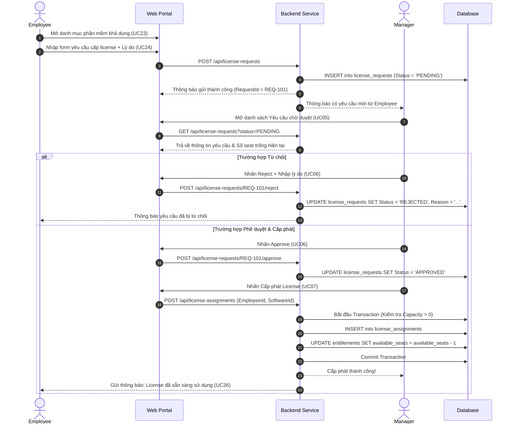
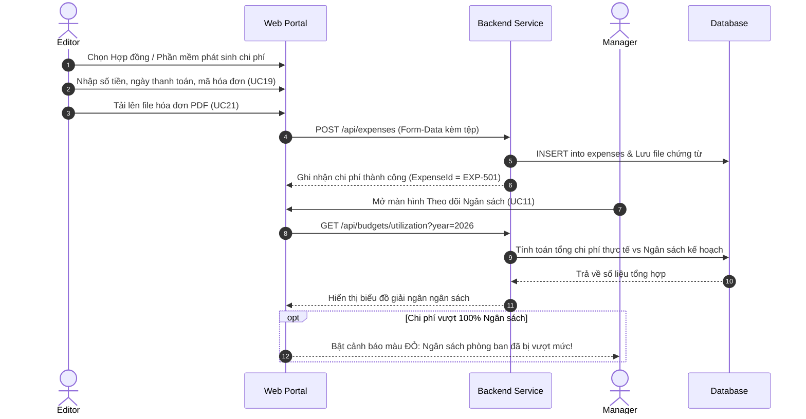

# Tài liệu Đặc tả Trường hợp Sử dụng (Use Case Specification)
## Dự án: VFast – Enterprise License Management System (ELMS)

---

## 1. Danh sách Tác nhân Hệ thống (System Actors)

Hệ thống được thiết kế tinh gọn theo mô hình quản lý tập trung với **3 Tác nhân người dùng chính** và **1 Tác nhân hệ thống tự động**:

1. **Manager (Quản trị & Phê duyệt):** Người có quyền hạn cao nhất trong hệ thống ELMS, chịu trách nhiệm quản trị danh mục phần mềm, hồ sơ nhà cung cấp, hợp đồng, quyền sở hữu (Entitlement), phê duyệt yêu cầu, cấp phát/thu hồi bản quyền, thiết lập ngân sách và theo dõi tuân thủ/tối ưu hóa.
2. **Editor (Quản lý dữ liệu đầu vào):** Người phụ trách nạp số liệu vận hành và chi phí: nhập dữ liệu tiêu thụ thực tế (License Usage), ghi nhận chi phí (Expense), import file Excel/CSV và tải lên hóa đơn, chứng từ liên quan.
3. **Employee (Nhân viên sử dụng):** Người dùng cuối trong tổ chức, có quyền tra cứu danh sách phần mềm được phép dùng, gửi yêu cầu xin cấp license, theo dõi tiến độ phê duyệt và xem danh sách license đang được gán cho bản thân.
4. **Notification Scheduler (Tác nhân ngầm):** Tiến trình chạy nền theo lịch trình (Cron Job) hằng ngày để quét ngày hết hạn hợp đồng thuê bao SaaS hoặc hạn bảo trì của Perpetual License, tự động phát sinh thông báo cảnh báo cho Manager.

---

## 2. Sơ đồ Trường hợp Sử dụng Tổng quan (26 Use Cases)

```mermaid
flowchart TB
    subgraph Actors["Tác nhân Người dùng"]
        M["Manager (Quản lý)"]
        E["Editor (Nhập liệu)"]
        U["Employee (Nhân viên)"]
    end

    subgraph Manager_UCs["Phân hệ Quản trị & Phê duyệt (Manager)"]
        UC01["UC01: Manage Software Catalog"]
        UC02["UC02: Manage Vendor"]
        UC03["UC03: Manage License Entitlement"]
        UC04["UC04: Manage Contract"]
        UC05["UC05: Review License Request"]
        UC06["UC06: Approve / Reject Request"]
        UC07["UC07: Assign License"]
        UC08["UC08: Revoke License"]
        UC09["UC09: Manage Budget"]
        UC10["UC10: Manage Expense"]
        UC11["UC11: Monitor Budget"]
        UC12["UC12: Monitor License Lifecycle"]
        UC13["UC13: Review Compliance & Overuse"]
        UC14["UC14: Manage Optimization"]
        UC15["UC15: View Dashboard & Reports"]
        UC16["UC16: Manage Users & Roles"]
    end

    subgraph Editor_UCs["Phân hệ Nạp Dữ liệu (Editor)"]
        UC17["UC17: Input License Usage"]
        UC18["UC18: Import License Usage"]
        UC19["UC19: Input Expense Data"]
        UC20["UC20: Import Expense Data"]
        UC21["UC21: Upload Documents/Invoices"]
        UC22["UC22: View Submitted Data"]
    end

    subgraph Employee_UCs["Phân hệ Tự phục vụ (Employee)"]
        UC23["UC23: View Available Software"]
        UC24["UC24: Submit License Request"]
        UC25["UC25: View Request Status"]
        UC26["UC26: View Assigned Licenses"]
    end

    M --> UC01 & UC02 & UC03 & UC04 & UC05 & UC06 & UC07 & UC08
    M --> UC09 & UC10 & UC11 & UC12 & UC13 & UC14 & UC15 & UC16

    E --> UC17 & UC18 & UC19 & UC20 & UC21 & UC22

    U --> UC23 & UC24 & UC25 & UC26
```

---

## 3. Đặc tả Chi tiết các Use Case theo 3 Role

---

### Phân hệ 1: Quản trị & Ra Quyết định (Manager Use Cases)

#### UC01 – Quản lý Danh mục Phần mềm (Manage Software Catalog)
- **Actor:** Manager
- **Mục tiêu:** Tạo lập và duy trì danh mục phần mềm chuẩn hóa trong doanh nghiệp.
- **Tiền điều kiện:** Manager đã đăng nhập hệ thống.
- **Luồng sự kiện chính:**
  1. Manager mở màn hình Software Catalog và chọn "Thêm mới sản phẩm".
  2. Nhập các trường: Tên phần mềm, Nhà phát hành (Publisher), Phiên bản (Version), Danh mục phân loại (Văn phòng, Kỹ thuật, Thiết kế, Bảo mật,...), và Trạng thái (`Active` / `Deprecated`).
  3. Hệ thống kiểm tra trùng lặp tên sản phẩm + phiên bản.
  4. Hệ thống lưu bản ghi mới và hiển thị trong danh mục phần mềm khả dụng.
- **Luồng thay thế:** Nếu phần mềm đã tồn tại, hệ thống cảnh báo và yêu cầu chỉnh sửa bản ghi hiện có.

#### UC03 – Quản lý Quyền sở hữu Bản quyền (Manage License Entitlement)
- **Actor:** Manager
- **Mục tiêu:** Đăng ký và theo dõi số lượng quyền sử dụng đã mua cho cả SaaS và Perpetual.
- **Luồng sự kiện chính:**
  1. Manager chọn sản phẩm phần mềm cần khai báo quyền sử dụng.
  2. Chọn loại hình bản quyền:
     - **SaaS Subscription:** Nhập Tổng số seat mua, Chu kỳ thanh toán (Tháng/Năm), Ngày bắt đầu, Ngày hết hạn, và Tự động gia hạn (`Yes/No`).
     - **Perpetual License:** Nhập Số lượng mua, License Key (nếu có), Ngày mua, Hạn bảo trì/hỗ trợ (Maintenance Expiry Date).
  3. Hệ thống lưu trữ Entitlement và tự động cập nhật dung lượng khả dụng (`Available Capacity`).

#### UC05 & UC06 – Xem xét & Phê duyệt Yêu cầu Cấp License (Review & Approve/Reject Request)
- **Actor:** Manager
- **Mục tiêu:** Đánh giá tính hợp lý của nhu cầu từ nhân viên và ra quyết định phê duyệt hoặc từ chối.
- **Luồng sự kiện chính:**
  1. Manager truy cập danh sách "Yêu cầu chờ duyệt" (`Pending Requests`).
  2. Xem chi tiết yêu cầu: Tên nhân viên, Phòng ban, Phần mềm xin cấp, Lý do sử dụng và Ngày gửi.
  3. Hệ thống hiển thị số lượng seat còn trống của phần mềm tương ứng.
  4. **Kịch bản Chấp thuận (Approve):**
     - Manager nhấn "Phê duyệt".
     - Hệ thống chuyển trạng thái yêu cầu sang `Approved`.
     - Tự động chuyển hướng hoặc tạo lối tắt để Manager thực hiện cấp phát seat (UC07).
  5. **Kịch bản Từ chối (Reject):**
     - Manager nhấn "Từ chối" và bắt buộc nhập lý do từ chối (ví dụ: Đã có phần mềm thay thế, Chưa được duyệt ngân sách).
     - Trạng thái yêu cầu chuyển sang `Rejected`.
     - Hệ thống gửi thông báo cho Employee kèm lý do giải trình.

#### UC07 – Cấp phát License cho Nhân viên (Assign License)
- **Actor:** Manager
- **Mục tiêu:** Gán một seat bản quyền khả dụng cho nhân viên cụ thể.
- **Tiền điều kiện:** Entitlement nguồn còn seat trống ($Available > 0$).
- **Luồng sự kiện chính:**
  1. Manager chọn phần mềm và nhấn "Gán License mới".
  2. Chọn nhân viên được cấp (từ danh sách đã được phê duyệt hoặc chỉ định trực tiếp).
  3. Hệ thống kiểm tra dung lượng khả dụng trong Database Transaction.
  4. Hệ thống tạo bản ghi `LicenseAssignment`, giảm 1 seat trống trong Entitlement nguồn.
  5. Thông báo cấp phát thành công; cập nhật trạng thái của Employee sang `Assigned`.

#### UC08 – Thu hồi License về Kho (Revoke License)
- **Actor:** Manager
- **Mục tiêu:** Thu hồi seat bản quyền từ nhân viên không còn sử dụng hoặc đã chuyển vị trí để giải phóng tài nguyên.
- **Luồng sự kiện chính:**
  1. Manager tra cứu bản ghi gán license theo nhân viên hoặc theo phần mềm.
  2. Nhấn "Thu hồi (Revoke)" và nhập lý do thu hồi (Không còn nhu cầu, Nhân viên nghỉ việc, Tối ưu hóa seat không hoạt động).
  3. Hệ thống kết thúc bản ghi gán, đánh dấu trạng thái `Revoked`.
  4. Tăng dung lượng khả dụng của Entitlement lên 1 đơn vị.

#### UC09 & UC11 – Quản lý & Theo dõi Ngân sách (Manage & Monitor Budget)
- **Actor:** Manager
- **Mục tiêu:** Thiết lập hạn mức chi tiêu cho phần mềm và kiểm soát tỷ lệ giải ngân thực tế.
- **Luồng sự kiện chính:**
  1. Manager thiết lập Budget theo kỳ tài chính (Năm 2026, Quý 1/2026) và theo từng Phòng ban.
  2. Hệ thống tổng hợp tự động các khoản chi phí thực tế (`Expense`) phát sinh trong kỳ thuộc phòng ban đó.
  3. Tính toán tỷ lệ sử dụng:
     $$\text{Budget Utilization (\%)} = \left(\frac{\sum \text{Expense}}{\text{Total Budget}}\right) \times 100$$
  4. Hệ thống cảnh báo màu vàng khi chi phí đạt $\ge 80\%$ ngân sách, và cảnh báo màu đỏ khi chi phí vượt quá $100\%$ ngân sách (Over-budget).

#### UC13 – Rà soát Tuân thủ Bản quyền & Phát hiện Overuse (Review Compliance)
- **Actor:** Manager
- **Mục tiêu:** So sánh số lượng quyền sở hữu hợp pháp với số lượng thực tế đang gán/sử dụng để phòng ngừa vi phạm bản quyền.
- **Luồng sự kiện chính:**
  1. Manager mở màn hình Compliance Checking.
  2. Hệ thống tính toán chỉ số chênh lệch:
     $$\text{Compliance Gap} = \text{Purchased Capacity} - \text{Assigned Seats}$$
  3. Nếu $\text{Compliance Gap} < 0$: Hệ thống gắn cờ **Overuse (Sử dụng vượt quyền)**, cảnh báo đỏ và liệt kê danh sách các seat đang vượt mức để Manager xử lý mua bổ sung hoặc thu hồi.

#### UC14 – Quản lý Đề xuất Tối ưu hóa (Manage Optimization Recommendations)
- **Actor:** Manager
- **Mục tiêu:** Nhận diện các điểm lãng phí chi phí phần mềm và đưa ra quyết định tối ưu.
- **Các nhóm khuyến nghị tự động:**
  - **Unallocated Licenses:** License đã mua nhưng chưa gán cho ai trong hơn 30 ngày -> Khuyến nghị giảm số lượng khi gia hạn.
  - **Inactive Licenses:** License được gán nhưng dữ liệu Usage ghi nhận không phát sinh hoạt động trong hơn 60 ngày -> Khuyến nghị thu hồi seat.
  - **Duplicate Tools:** Các phần mềm có tính năng trùng lặp đang được sử dụng ở các phòng ban khác nhau -> Khuyến nghị hợp nhất nhà cung cấp.

#### UC15 – Xem Dashboard Quản trị & Báo cáo (View Dashboard & Reports)
- **Actor:** Manager
- **Mục tiêu:** Nắm bắt bức tranh toàn cảnh về tài sản phần mềm, ngân sách và tuân thủ qua biểu đồ trực quan.
- **Nội dung hiển thị:**
  - Tổng số phần mềm, tổng số license đang quản lý, số lượng seat đang hoạt động.
  - Tỷ lệ giải ngân ngân sách toàn công ty và chi tiết theo từng phòng ban.
  - Cảnh báo các hợp đồng sắp đến hạn trong 30/60/90 ngày tới.
  - Tỷ lệ tuân thủ bản quyền (% phần mềm an toàn, % phần mềm có nguy cơ overuse).

---

### Phân hệ 2: Nạp Dữ liệu Vận hành & Chi phí (Editor Use Cases)

#### UC17 & UC18 – Nhập Dữ liệu Mức độ Sử dụng License (Input & Import License Usage)
- **Actor:** Editor
- **Mục tiêu:** Nạp dữ liệu đo lường mức độ sử dụng thực tế của nhân viên đối với từng phần mềm.
- **Phương thức thực hiện:**
  - **Nhập trực tiếp (UC17):** Chọn nhân viên, chọn phần mềm, nhập Số ngày hoạt động trong tháng, Thời điểm đăng nhập gần nhất (`Last Active Date`), Mức độ sử dụng (`Heavy, Moderate, Inactive`).
  - **Import hàng loạt (UC18):** Tải lên file Excel/CSV theo mẫu cấu trúc chuẩn. Hệ thống xác thực dữ liệu từng dòng, hiển thị xem trước (Preview) và nạp vào cơ sở dữ liệu.
- **Ràng buộc:** Mọi bản ghi usage đều tự động lưu thông tin `created_by = Editor_ID` và dấu thời gian.

#### UC19, UC20 & UC21 – Quản lý Dữ liệu Chi phí & Chứng từ (Expense & Invoices)
- **Actor:** Editor
- **Mục tiêu:** Đưa các thông tin chi tiêu tài chính thực tế và bằng chứng hóa đơn vào hệ thống.
- **Luồng sự kiện chính:**
  1. Editor chọn hợp đồng hoặc phần mềm phát sinh chi phí.
  2. Nhập các thông tin: Số hóa đơn, Ngày thanh toán, Số tiền (VND/USD), Loại chi phí (Phí thuê bao định kỳ, Phí mua mới bản quyền, Phí bảo trì), Phòng ban thụ hưởng.
  3. Tải lên tệp đính kèm hóa đơn (PDF, PNG, JPG) (UC21).
  4. Hệ thống lưu bản ghi chi phí ở trạng thái `Submitted` để Manager theo dõi và đối soát ngân sách.

#### UC22 – Xem Dữ liệu Đã nạp (View Submitted Data)
- **Actor:** Editor
- **Mục tiêu:** Rà soát và kiểm tra tính toàn vẹn của các bản ghi usage và expense do chính mình đưa vào hệ thống.
- **Quy tắc:** Editor có thể xem lịch sử các lần import, trạng thái thành công/thất bại, và số dòng dữ liệu đã được ghi nhận.

---

### Phân hệ 3: Tự phục vụ & Tra cứu Cá nhân (Employee Use Cases)

#### UC23 – Xem Danh mục Phần mềm Khả dụng (View Available Software)
- **Actor:** Employee
- **Mục tiêu:** Khám phá các công cụ phần mềm công ty đang hỗ trợ phục vụ công việc.
- **Nội dung hiển thị:** Tên phần mềm, Nhà phát hành, Phiên bản, Mô tả tính năng, Đối tượng sử dụng phù hợp. Tuyệt đối không hiển thị giá tiền hoặc key kích hoạt.

#### UC24 – Gửi Yêu cầu Cấp License (Submit License Request)
- **Actor:** Employee
- **Mục tiêu:** Đề xuất cấp phát một phần mềm phục vụ trực tiếp cho nhiệm vụ chuyên môn.
- **Luồng sự kiện chính:**
  1. Employee chọn phần mềm từ danh mục khả dụng và nhấn "Yêu cầu cấp phát".
  2. Nhập biểu mẫu gồm: Lý do cần sử dụng (bắt buộc), Thời gian dự kiến cần dùng (Dài hạn / Dự án ngắn hạn), Tên dự án/công việc liên quan.
  3. Nhấn "Gửi yêu cầu".
  4. Hệ thống tạo bản ghi yêu cầu ở trạng thái `Pending` và gửi thông báo đến Manager.

#### UC25 – Theo dõi Trạng thái Yêu cầu (View Request Status)
- **Actor:** Employee
- **Mục tiêu:** Biết được yêu cầu của mình đang được xử lý đến bước nào.
- **Trạng thái hiển thị:**
  - 🟡 `Pending (Đang chờ duyệt)`: Yêu cầu đã gửi, đang chờ Manager đánh giá.
  - 🟢 `Approved (Đã phê duyệt)`: Manager đã chấp thuận, đang tiến hành cấp phát license.
  - 🔴 `Rejected (Bị từ chối)`: Yêu cầu không được duyệt, hiển thị lý do phản hồi từ Manager.

#### UC26 – Xem Danh sách License Được cấp (View Assigned Licenses)
- **Actor:** Employee
- **Mục tiêu:** Nắm bắt toàn bộ các bản quyền công ty đã giao cho cá nhân quản lý và sử dụng.
- **Nội dung hiển thị:** Tên phần mềm, Ngày được cấp phát, Thời hạn bản quyền (đối với SaaS Subscription), Hướng dẫn kích hoạt/truy cập tài khoản.

---

## 4. Biểu đồ Tuần tự cho các Luồng Nghiệp vụ Trọng yếu (Sequence Diagrams)

### Luồng 1: Quy trình Yêu cầu – Phê duyệt – Cấp phát Bản quyền (UC24 -> UC05 -> UC06 -> UC07)

### Luồng 2: Quy trình Nạp Dữ liệu Chi phí & Đối soát Ngân sách (UC19 -> UC21 -> UC11)

