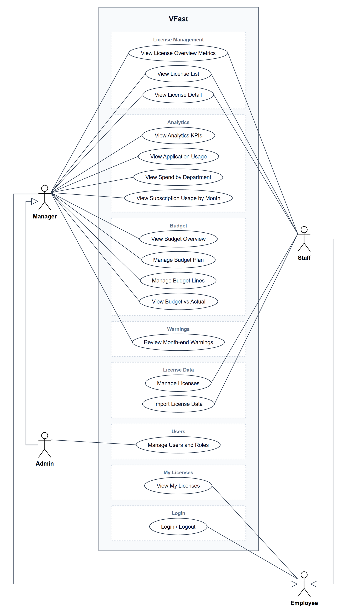

# Actors, Roles, Business Rules, and Use Cases

> Design status: TARGET
>
> Implementation status: NOT STARTED

Product name: **VFast**.

## Actors / roles

| Actor | Description |
|---|---|
| `EMPLOYEE` | Every employee of the company. Sees only the licenses assigned to them and whether the system records them as used |
| `STAFF` | Member of the license management team. Views every license and keeps license data correct: declares and edits licenses, imports usage and cost for providers without an API |
| `MANAGER` | Manager of a unit (P&L, department, team). Mainly uses dashboards and analytics; plans the unit's license budget and reviews month-end warnings |
| `ADMIN` | Has every Manager permission for every unit, plus management of users, roles, and data scope |
| License providers | External systems (Microsoft Graph, other provider APIs, logs, exports). VFast only reads from them |

Every Manager, Staff, and Admin is also an employee, so they have the Employee use cases.

## Role × feature matrix

| Feature | Admin | Manager | Staff | Employee |
|---|---|---|---|---|
| License overview, list, detail (UC01–UC03) | ✓ every unit | ✓ own units | ✓ every license | |
| Analytics (UC04–UC07) | ✓ every unit | ✓ own units | | |
| Budget overview, budget vs actual (UC08, UC11) | ✓ every unit | ✓ own units | | |
| Budget plan and lines (UC09, UC10) | ✓ every unit | ✓ own units | | |
| Month-end warnings (UC12) | ✓ every unit | ✓ own units | | |
| My licenses (UC13) | ✓ | ✓ | ✓ | ✓ |
| Login / logout (UC14) | ✓ | ✓ | ✓ | ✓ |
| Users and roles (UC15) | ✓ | | | |
| Declare and edit licenses (UC16) | | | ✓ | |
| Import license data (UC17) | | | ✓ | |

Menus and buttons are hidden when the user lacks permission, but the API enforces every rule in this table; a URL outside the role returns `403`.

## Business rules

| ID | Rule |
|---|---|
| BR-01 | VFast is read-only toward providers. It never assigns, revokes, buys, renews, or changes a subscription; "Assigned" is data read from the provider. |
| BR-02 | Every assigned seat has exactly one status: `Active` (activity in the last 60 days), `Inactive` (active before, nothing in the last 60 days), `No activity` (a usage source exists but no activity was ever recorded), `Not monitored` (no usage source). A purchased seat without a holder is `Unassigned`. |
| BR-03 | Missing data is `Unknown`, never 0. `Not monitored` is never counted as `Inactive` or as waste. |
| BR-04 | Underutilized accounts = `Inactive` + `No activity`. Underutilized license cost = Σ per license (underutilized accounts × yearly price of one seat); it never exceeds Total annual spend. |
| BR-05 | Every cost is converted to an effective monthly cost: yearly plans ÷ 12, perpetual licenses count only maintenance, pay-as-you-go uses the actual spend of the month. Total annual spend = Σ effective monthly cost of active licenses × 12. |
| BR-06 | Amounts in different currencies are added only with a declared exchange rate; otherwise each currency is shown separately. |
| BR-07 | The yearly cost of a license is split evenly over its seats; each seat counts toward the unit of its holder. Unassigned seats go to `Unallocated`; holders without a department go to `Unknown department`. The sum of every group equals Total annual spend. |
| BR-08 | Compliance status: `Compliant` when Total users ≤ License entitlement, `Over-allocated` when above, `Not evaluated` when data is missing. A license expiring within 30 days is marked "Expiring soon". |
| BR-09 | Budget reconciliation per unit and license: Planned → Purchased → Assigned → Used (`Active`) → Actual cost. Gap types: `Over plan` (Purchased > Planned qty, or Actual cost > Planned cost), `Under plan` (Purchased < Planned qty), `Unassigned` (Assigned < Purchased), `Unused` (Used < Assigned). A line can carry several gap types. |
| BR-10 | A unit has at most one budget plan per fiscal year. A plan is `Draft` or `Active`; only `Active` plans count in the KPIs; only `Draft` plans can be deleted. Every change to an `Active` plan or its lines keeps the old value, new value, reason, and time. |
| BR-11 | Budget utilization = Actual cost / Budget: below 80% is normal, from 80% is a warning, from 100% is over budget. A budget of 0 or not set shows "—". |
| BR-12 | Month-end check: on the first day of each month the system closes the previous month per unit. A seat is **unused in the month** when it was assigned for the whole month and had no activity. A seat assigned during the month is not warned that month. A unit gets at most one warning per month; re-running creates no duplicate. |
| BR-13 | A Manager records one decision per unused seat: `Keep` with a reason, or `Propose reduction`. A decision is a record in VFast only; nothing changes on the provider (BR-01). |
| BR-14 | Every figure carries its source (`api`, `import`, `manual`) and confidence. A license with only aggregated usage does not appear in per-user tables and is labelled as such. |
| BR-15 | For each license, each data type has one primary source at a time. Staff cannot overwrite a value that comes from a connector silently: an override needs a reason and keeps the original value. |
| BR-16 | Every change to license data (UC16, UC17), budgets (UC09, UC10), and users (UC15) is recorded with who, old value, new value, and time. A license is never deleted, only marked as no longer tracked, so its history stays. |
| BR-17 | Data scope comes from the server on every request: a Manager sees only the units assigned to them; Admin sees every unit; Staff sees every license but no budget; an Employee sees only their own licenses, without price or cost. |
| BR-18 | Each account has exactly one role. Wrong credentials show one generic message; 5 failed attempts in a row lock login for 15 minutes; passwords are stored hashed; the session lives in an `HttpOnly`, `Secure` cookie. |

## Use case diagram

One system boundary; use cases are grouped by the screen they belong to. Manager and Admin are on the left, Staff and Employee on the right. Admin inherits Manager; Manager and Staff inherit Employee (hollow triangle), so every role has My Licenses and Login / Logout.

Source: [`diagrams/out/uc_vfast.drawio`](diagrams/out/uc_vfast.drawio) (open with draw.io); the PNG and SVG are exported from it.

| ID | Use case | Screen | Primary actor |
|---|---|---|---|
| UC01 | View License Overview Metrics | License Management | Manager, Staff |
| UC02 | View License List | License Management | Manager, Staff |
| UC03 | View License Detail | License Management | Manager, Staff |
| UC04 | View Analytics KPIs | Analytics | Manager |
| UC05 | View Application Usage | Analytics | Manager |
| UC06 | View Spend by Department | Analytics | Manager |
| UC07 | View Subscription Usage by Month | Analytics | Manager |
| UC08 | View Budget Overview | Budget | Manager |
| UC09 | Manage Budget Plan | Budget | Manager |
| UC10 | Manage Budget Lines | Budget | Manager |
| UC11 | View Budget vs Actual | Budget | Manager |
| UC12 | Review Month-end Warnings | Warnings | Manager |
| UC13 | View My Licenses | My Licenses | Employee |
| UC14 | Login / Logout | Login | Employee (every role) |
| UC15 | Manage Users and Roles | Users | Admin |
| UC16 | Manage Licenses | License Data | Staff |
| UC17 | Import License Data | License Data | Staff |

## Use cases

Common to the viewing use cases (UC01–UC08, UC11, UC13): read-only; an empty result shows "No data yet" instead of zeros or an empty chart; statuses follow BR-02.

### UC01 View License Overview Metrics

- **Actor:** Manager, Staff
- **Main flow:** open License Management → Total Licenses (active licenses, counted per license, not per seat) → pie chart by category (hover: name, count, percent) → Application Usage top 5 split into `Active`, `Inactive`, `No activity` → click a category to filter UC02, click an application to open UC03
- **Alternative:** license without category → `Uncategorized`; more than 6 categories → smallest grouped as `Other`; fewer than 5 applications with user data → show those available
- **Rule:** expired licenses are not counted; top 5 uses the same data and ranking as UC05

### UC02 View License List

- **Actor:** Manager, Staff
- **Main flow:** table with License name, Publisher, License type, Compliance status, Purchase cost, License entitlement, Active users, Total users, Expiry date → search by name or publisher → filter by type, category, compliance status, expiry range → sort (default: nearest expiry) → page (20 rows) → click a row to open UC03
- **Alternative:** no match → "No matching license" with a clear-filters button; no expiry (perpetual, pay-as-you-go) → "Does not expire"; non-seat license → cells that do not apply show "—"
- **Rule:** compliance per BR-08; Purchase cost shows currency and billing cycle; filters are kept when returning from UC03

### UC03 View License Detail

- **Actor:** Manager, Staff
- **Main flow:** five indicators (Monthly cost, Subscriptions, Subscription types, Total users, Unassigned subscriptions) → details (Vendor, Description, Category, Subcategory, Useful links) → user table (User, Department, Subscription type, Status, Last active, Assigned date), unused accounts first → search, filter by status, department, subscription type
- **Alternative:** license not found → message and link back; no holders → "No assigned users"; holder not matched to an employee → provider identity with `Unknown department`; non-seat license → list of subjects (project, API key, device) if any
- **Rule:** Unassigned = entitlement − Total users, never below 0; Total users equals UC02; `Inactive` + `No activity` rows equal this license's share in UC04 and UC05; no assign or revoke action (BR-01)

### UC04 View Analytics KPIs

- **Actor:** Manager
- **Main flow:** Total annual spend, Managed licenses, Underutilized accounts, Underutilized license cost → hover a KPI for its formula and last data update
- **Alternative:** missing exchange rate → money KPIs per currency; no license has usage data → underutilized KPIs show "Not evaluated yet"
- **Rule:** BR-04, BR-05; Managed licenses equals Total Licenses in UC01

### UC05 View Application Usage

- **Actor:** Manager
- **Main flow:** horizontal stacked bars for the top 5 applications by total users, split into `No activity`, `Inactive > 60 days`, `Active` → switch to top 10 or 20 → hover for count and percent → click an application to open UC03
- **Alternative:** fewer applications than the chosen top → show all; applications without a usage source are left out with a note on how many are `Not monitored`
- **Rule:** rank by Total users, then name; the three parts add up to Total users; seat-based licenses only

### UC06 View Spend by Department

- **Actor:** Manager
- **Main flow:** bar chart of license cost per department, highest first → hover for amount, share of total, number of licenses
- **Rule:** BR-07; non-seat licenses are split by the department of their subjects if known, otherwise `Unallocated`

### UC07 View Subscription Usage by Month

- **Actor:** Manager
- **Main flow:** 12 months of the current year; per month a stacked bar (`Active`, `Inactive`, `No activity`, `Not monitored`) and a separate `Unassigned` bar → choose another year → toggle a status in the legend → hover for counts
- **Alternative:** future months are hidden; the current month is marked incomplete; a month without data shows "No data", never a zero bar
- **Rule:** status taken on the last day of the month; stacked total + `Unassigned` = subscriptions purchased at month end; the latest month matches UC04

### UC08 View Budget Overview

- **Actor:** Manager
- **Main flow:** choose fiscal year → Total budget, Planned cost, Actual cost, Remaining budget, Budget utilization → table per unit (Budget, Planned cost, Actual cost, Remaining, Utilization with colour, Status), highest utilization first → search, filter, sort → open a unit (UC11)
- **Alternative:** no plan for the year → message with a create button (UC09); a unit with cost but no plan → Budget "Not set", Utilization "—"; no cost data → `Unknown`
- **Rule:** only `Active` plans count (BR-10); Actual cost per unit uses BR-07, so all units plus `Unallocated` equal the company's actual cost; colours per BR-11

### UC09 Manage Budget Plan

- **Actor:** Manager
- **Main flow:** create plan → choose fiscal year and unit → enter budget, currency, note → saved as `Draft` → add lines (UC10) → activate → plan becomes `Active` → adjust the budget mid-year with a reason
- **Alternative:** the unit already has a plan for that year → open it instead; budget ≤ 0 or no currency → field errors; activating with Planned cost above budget → warning and confirmation; new year → copy lines from last year's plan; delete → `Draft` only
- **Rule:** BR-10; a parent unit's budget is not summed from its children; the system only warns when children exceed the parent

### UC10 Manage Budget Lines

- **Actor:** Manager
- **Main flow:** add line → choose a license from the catalog → enter planned quantity → system suggests cost = quantity × current yearly unit price → keep or change → save → edit or delete lines → plan totals and unallocated budget update
- **Alternative:** license already in the plan → open the existing line; a license not yet in the catalog → name and expected unit price, marked "Not in catalog"; Metered license → planned cost required, quantity optional; Planned cost above budget → saved, with the excess shown
- **Rule:** quantity ≥ 0, cost > 0; for seat licenses the quantity is the number of people in the unit expected to get it; changes on an `Active` plan are kept (BR-10)

### UC11 View Budget vs Actual

- **Actor:** Manager
- **Main flow:** unit summary (Budget, Planned cost, Actual cost, Remaining, Utilization) → line table (License, Planned qty, Planned cost, Purchased, Assigned, Used, Actual cost, Variance) with gap types → filter by gap type, sort by Variance → open a license (UC03) to see who in the unit holds it
- **Alternative:** cost from a license not in the plan → group "Outside plan" with Planned 0; missing data at a level → `Unknown`, no gap flagged at that level; aggregated-only data → confidence label (BR-14); year not finished → Actual cost to date, with the date
- **Rule:** BR-09; a license bought for the whole company shows Purchased as "Shared" and is not flagged `Unassigned` at unit level; line totals equal the unit's Actual cost in UC08

### UC12 Review Month-end Warnings

- **Actor:** Manager (the warning is created by the system, BR-12)
- **Main flow:** unread count on the navigation bar → open the list → open a month: number of unused seats, their cost in the month, budget status → unused-seat table (User, License, Status, Last active, Consecutive unused months, Monthly seat cost, Decision), longest unused first → record a decision per seat (BR-13) → mark the warning as read → open UC03 or UC11
- **Alternative:** no problem in the month → "No warning for this month"; month data not complete → the check is postponed and retried daily; `Not monitored` licenses are excluded and counted separately; a seat kept last month and still unused → shown again with the earlier decision; unit without a plan → budget part shows "No plan"
- **Rule:** unused cost = Σ effective monthly cost of unused seats; a budget warning appears from 80% and from 100% utilization (BR-11); in-app only

### UC13 View My Licenses

- **Actor:** Employee (every role)
- **Main flow:** table of licenses assigned to the user (License, Publisher, Subscription type, Assigned date, Status, Last active, Expiry date) → `Inactive` or `No activity` rows carry a note that the license may be reviewed at the month-end check → sort
- **Alternative:** no license → "You have no licenses assigned"; login email not matched to any collected user → empty table with a hint to contact Admin; `Not monitored` → "Not tracked", Last active "—"
- **Rule:** only the user's own rows; another user's data returns `404`; no price, cost, budget, or Manager decision; rows match the user's row in UC03

### UC14 Login / Logout

- **Actor:** every role
- **Main flow:** email and password → system checks credentials and account status → creates a session → default screen by role (Manager and Admin: Analytics; Staff: License Management; Employee: My Licenses) → logout destroys the session
- **Alternative:** wrong credentials → generic message; 5 failures → locked for 15 minutes; disabled account → refused and open sessions ended; session expired → log in again and return to the page; screen outside the role → `403`
- **Rule:** BR-18; the login email is matched to the collected user list, which tells UC13 which licenses are "mine"; SSO and self-registration are out of scope

### UC15 Manage Users and Roles

- **Actor:** Admin
- **Main flow:** user table (Name, Email, Role, Units, Status, Last login) → search and filter → create an account (name, email, role; units for a Manager) → change role or units → disable or re-enable
- **Alternative:** email already exists → open that account; Manager without a unit → refused; email not in the collected user list → created with a warning that UC13 will be empty; disabling oneself or the last active Admin → refused
- **Rule:** one role per account (BR-18); disabling ends open sessions at once and never deletes the account; every change is recorded (BR-16); the first Admin account comes with the initial data

### UC16 Manage Licenses

- **Actor:** Staff
- **Main flow:** License Data screen lists every license with the source of each field → create a license: provider, product or plan, archetype, contract (start, renewal date, notice period, auto-renew), entitlement line (unit, quantity or quota), price term (billing cycle, unit price, commitment, currency) → edit a license with a reason → system validates, saves, and recomputes the figures
- **Alternative:** missing or invalid field (negative quantity, renewal before start) → field errors; field coming from a connector → override with a reason, original kept (BR-15); same provider and product already exists → warning, open the existing license; stop tracking → marked, not deleted (BR-16)
- **Rule:** editing in VFast never changes the provider (BR-01); manual values carry source `manual` (BR-14)

### UC17 Import License Data

- **Actor:** Staff
- **Main flow:** choose a license → download the template for its archetype (four CSV templates, one per archetype) → upload the filled CSV or Excel file → system checks format, required fields, duplicates → preview: rows to add, update, reject → confirm → data written and accounts matched to employees by email → or enter a single record by hand → view import history (who, when, file, rows)
- **Alternative:** wrong format or missing required field → whole file rejected with the error rows; account not matched → stored with provider identity and `Unknown department`; the license already has a connector for that data type → refused (BR-15)
- **Rule:** imported rows carry source `import` or `manual` (BR-14); re-importing a period replaces it without duplicates; a period without data stays `Unknown` (BR-03)

**Related:** [Research](01-research-top-down.md) · [INVEST requirements](03-invest-requirements.md)
