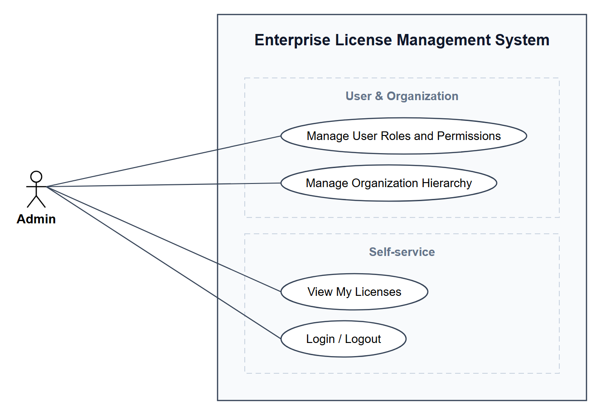

# Actors, Roles, Business Rules, and Use Cases

> Design status: TARGET (November 2026)
>
> Implementation status: NOT STARTED

System: **Enterprise License Management System (ELMS)**, built by team VFast. Use cases follow the seven branches of the [mind map](mindmap.png): License Management, Usage, Budget Management, Optimization, Analytics, User & Organization, Connection Management. The features of each use case are in the [Feature list](08-feature-list.md).

**Business model.** ELMS does not enter or grant licenses. Each P&L exposes a license API that ELMS calls; actual usage comes from BCA, employees and units from ILVG, and the monthly budget plan and the purchases from SAP. Views are built on three figures — Plan, Purchased, Used — in money as well as quantity, over a fixed hierarchy, Group > P&L > Block > Department > Project. A use case is one large flow of action of one actor toward one goal; its smaller branches — the screens, panels, and dialogs that serve that goal — and the cases it handles are not use cases of their own but flows and alternatives in its specification.

**Use cases describe behaviour, not screens.** The UI is designed and updated separately; a use case states what the actor does, what the system answers, and the rules that apply, so it stays true when the screens change.

## Actors / roles

| Actor | Description |
|---|---|
| `EMPLOYEE` | Every employee of the group. Only sees the licenses they hold and whether they are recorded as used |
| `STAFF` | Member of the license management team; does the hands-on work: sets up and edits usage connectors, watches the syncs, checks what each company's connectors deliver, imports the purchases from SAP and enters those made outside it, runs the monthly accrual, records exchange rates and shared licenses, keeps the software catalog and maps license and application names to it. Assigned to one or more companies (P&Ls) and sees only those; a Staff member at group level sees every company. Does not analyse usage or waste |
| `MANAGER` | **The main user.** Manager of a unit at any level: the group, a P&L, a block, a department, or a project. For that unit and everything under it: browses licenses and who uses them, analyses usage and waste, imports and changes the budget plan, reads the dashboards. A Manager of the group sees the whole group |
| `ADMIN` | Runs access to the system and nothing else: gives each user their role and data scope — the units of a Manager, the companies of a Staff member — sets the permissions of each role, and keeps the organization hierarchy. Sees no license, usage, budget, or cost data |
| Usage connectors | One connector per company and provider (Microsoft, Atlassian, Adobe…), answering in the license data contract. Returns the licenses of that provider the company uses, with holders and usage; not the quantities bought or the terms, which come from SAP |
| BCA | Usage tracking on company machines. Returns how often each member uses each application |
| ILVG | Internal application. Returns employees and the unit each belongs to; every account of ELMS is created from it (BR-15) |
| Budget Excel | The yearly budget plan by month, exported from SAP into the ELMS Excel template and imported by the Manager of a unit for that unit and the units under it (BR-08) |
| SAP purchases | Purchase requisitions (PR), purchase orders (PO), and invoices of each company, exported from SAP into the ELMS Excel template and imported by Staff each month (UC04, BR-10) |

Every account belongs to a real employee and is created from ILVG, so View My Licenses and Login / Logout belong to every role.

**Organization.** The hierarchy is fixed: **Group > P&L > Block > Department > Project** (BR-19). In this document a *unit* is a node at any of these levels. A Manager is assigned to one or more units, the group included, and sees them and everything under them. A P&L is also called a company or subsidiary, a block a division.

## Role × feature matrix

| Mind-map branch | Use cases | Admin | Manager | Staff | Employee |
|---|---|---|---|---|---|
| License Management | License detail: list, timeline, details, users and usage, terms (UC01) | | ✓ own units | | |
| | License inventory (UC02) | | ✓ own units | ✓ own companies | |
| | License catalog: software, mapping, shared licenses (UC02 flows C–F) | | read (software and category on every screen; the share of shared licenses their units carry) | ✓ catalog and shared licenses: group level; mapping: own companies | |
| Usage | Plan vs utilization balance: scope, unit comparison, units table and export, employee usage (UC03) | | ✓ own units | | |
| Budget Management | Budget plan: import and monthly plan (UC04) | | ✓ own units and the units under them | | |
| | Purchases from SAP, monthly accrual (UC04 flows B, C) | | | ✓ own companies | |
| | Exchange rates (UC04 flow D) | | read | ✓ group level | |
| Optimization | License waste: wasted seats, ranking, flag, and analytics (UC05) | | ✓ own units | | |
| Analytics | Dashboards: cost per unit, plan variance, license and provider analysis, metric definitions (UC06) | | ✓ own units | | |
| User & Organization | User roles and permissions, organization hierarchy (UC07, UC08) | ✓ | | | |
| Connection Management | Usage connectors, sync monitoring (UC09) | | | ✓ own companies | |
| Self-service | My licenses, login / logout (UC10, UC11) | ✓ | ✓ | ✓ | ✓ |

**In short:** the Manager uses the product; Staff keeps it fed; Admin decides who can do what; the Employee sees their own licenses. Menus and buttons are hidden when the user lacks permission, but the API enforces every rule in this table; a URL outside the role returns `403`.

## Business rules

| ID | Rule |
|---|---|
| BR-01 | ELMS is read-only toward every source: usage connectors, BCA, ILVG, SAP. It never grants, assigns, revokes, buys, or renews a license; "Assigned" is data read from a P&L. |
| BR-02 | A license has one **license type**: `monthly`, `yearly`, or `usage_based`, reported by the P&L. Each type has its own actual-usage table; a new type later is a new table. |
| BR-03 | **Seat status.** Every assigned seat has exactly one status, judged on the data date over the last 30 days: `Active` — used at least once in the last 30 days; `Inactive` — used before, but not in the last 30 days; `No activity` — a usage source exists and the seat was never used in the 30 days or more since it was assigned; `Not monitored` — no usage source. A seat assigned less than 30 days ago and not used yet counts as `Active` until its 30th day (grace period). A paid seat without a holder is `Unassigned`. How often a holder uses the seat is BR-32. Monthly seat counts use the status on the last day of the month; monthly cost weighs the status of every day of the month (BR-06). |
| BR-04 | Missing data is `Unknown`, never 0. `Not monitored` is never counted as `Inactive` or as waste. Whatever cannot be judged — `Not monitored` seats and `Unknown` data — is **Not evaluated**: never Used, never Wasted (BR-22). |
| BR-05 | **Money and quantity.** Every figure has an amount and, where it applies, a quantity. Analysis screens show amounts by default, in VND or USD at the user's choice; quantities are shown per license, never added across licenses of different units of measure. Each amount keeps its original currency; the exchange rate used is shown. **An amount is converted with the rate in force on its invoice date**; a budget line in another currency with the rate of the first day of its month. |
| BR-06 | **Cost allocation** (the Cost roll-up process, shown in UC06): the cost of a license is split **day by day** — each day carries the month's cost divided by its days — evenly over its purchased seats, or over its assigned seats when more are assigned than purchased (BR-31); each assigned seat counts toward the unit of its holder on that day, so a transfer on 15 March gives the old unit 14 days and the new unit 17; a holder who works on several projects counts toward each of them in equal parts — two projects, half a seat and half the cost each — and nothing toward their own unit; **unassigned seats count toward *Unallocated* under the license's owner unit** — the P&L that bought it, or the group for a shared license (BR-24); holders that cannot be placed count toward *Unknown unit* of the nearest known level. The units, *Unallocated*, and *Unknown unit* add up to the total cost. A day without complete data takes the seats of the nearest complete day of the same month; the cost of a day that cannot be split — purchased quantity `Unknown`, or no complete day in the month — is `Not evaluated` under the owner unit (BR-04). |
| BR-07 | **Over-allocation:** a license is `Over-allocated` when the quantity allocated exceeds the quantity purchased (BR-31). Detecting a shortage beyond that is out of scope. |
| BR-08 | **The budget plan is imported from Excel**, in the ELMS template, by month. Each line carries the unit codes as deep as the line goes — P&L, block, department, project (with project name) — and the license, month, planned quantity, planned amount, and currency. A line belongs to the deepest unit it names. There is no *Shared* column: a line whose license is a shared license plans its unit's share of it (BR-24). **A line's license is found by name** — the name SAP uses, which is the name the connector reports unless Staff record another on the license (UC02) — among the licenses of the line's P&L and the shared licenses; no match → `Not mapped`, two matches → the row is rejected (UC04). **Every Manager imports and changes the plan of their own units, and a Manager of a larger unit also does it for every unit inside it**: the Manager of a P&L changes the P&L's own lines and those of each of its blocks, departments, and projects; the Manager of a block only the block and what is under it. An import has a target unit and months, and **changes only the licenses in its file**: for those months, in the target and every unit under it, a license already planned is overwritten — its lines the file no longer has are removed — and a new license is added; every other license and every other unit is left untouched. Example: the group imports only GitHub rows for P&L A and P&L B; their Microsoft 365 and Jira plans do not change. To drop a license from the plan, import it with quantity and amount 0. A unit's Plan = its own lines + the Plan of the units under it (BR-19), so no line is counted twice. Each confirmed import is a new version; earlier versions are kept. ELMS does not write the plan otherwise. Imports are idempotent (BR-33). |
| BR-09 | **Three figures per unit and period:** **Plan** (budget, BR-08); **Purchased** (the cost of what was bought: the accrued cost of the month, spread from the invoices, UC04; in quantity, the seats of the PO lines in force, BR-10; below the P&L, the cost of the seats its members hold, BR-06); **Used** (the value of what is actually used: for a seat-based license, the cost share of its `Active` seats, day by day (BR-06) — with the same seats all month, Purchased × Active seats ÷ purchased seats; for a `usage_based` license, the cost of what was consumed). Purchased = Used + Wasted + Not evaluated (BR-22). **Utilization rate** = Used ÷ Purchased and **waste rate** = Wasted ÷ Purchased; with the share Not evaluated they add up to 100 %. Monitoring and variance compare them month by month, year to date, and year by year. |
| BR-10 | **Purchases come from SAP** (UC04): Staff import each month the SAP export of PR, PO, and invoices of their companies, and enter by hand a purchase made outside SAP. A **PO line** has its company, license, quantity, term (start and end date), amount, currency, PO number and item, and the PR it came from; the PO lines in force on a day give the license's **purchased quantity** (BR-31), and their terms give its terms and expiry (UC01, BR-30). An **invoice** has its number, date, amount, currency, the company that pays it, the PO line it pays, and optionally a file; its amount is the cost the accrual spreads over the term of that PO line (UC04, BR-23). A purchase entered by hand has the same fields without PR and PO numbers; an invoice without a PO line names its license and the period it pays for. The license of a PO line is found by name as in BR-08, among the licenses of its company and the shared licenses. Example: PO 4500012345 item 10, GitHub Enterprise, 500 seats, 1 Mar 2027 – 29 Feb 2028; invoice of 1.2 billion VND dated 15 Mar 2027 → 500 purchased seats over that term, and the 1.2 billion spread over its 12 months. |
| BR-11 | **Detection runs on the collected data.** Unused = `Unassigned` seats; inactive = `Inactive` + `No activity`; overuse per BR-07. A result shows its evidence, its cost, and the data date. |
| BR-12 | **Real data first.** Every figure carries its source (`connector`, `bca`, `ilvg`, `budget_excel`, `sap_excel`, `manual`, `mock`). Mock data is used only for a source that cannot deliver yet, is labelled as mock on every screen, and is never mixed into a real figure. |
| BR-13 | Every change to connectors, budget imports, purchase imports and entries, user roles and scopes, the hierarchy, and permissions is recorded with who, old value, new value, and time. |
| BR-14 | **Data scope comes from the server on every request.** A Manager reads the units assigned to them and everything under those units; a Manager assigned to the group reads the whole group. Admin reads users, roles, permissions, and the hierarchy only — no license, usage, budget, or cost data. Staff see the connectors and license data of the companies they are assigned to — **an input user sees only their own company** — but no usage or waste analysis and no employee usage; group-level Staff see every company. An Employee sees only their own licenses. |
| BR-15 | **Accounts come from ILVG.** Every employee ILVG reports gets one account, with the role Employee, and an email with a one-time link to set the password; an employee who leaves according to ILVG has their account disabled. Nobody creates an account by hand. Each account has exactly one role: Admin, Manager, Staff, or Employee; Admin changes it (UC07). Permissions are granted to roles. The last active Admin cannot be disabled or lose the Admin role. |
| BR-16 | Wrong credentials show one generic message; 5 failed attempts in a row lock login for 15 minutes; passwords are stored hashed; the session lives in an `HttpOnly`, `Secure` cookie. |
| BR-17 | Every usage connector answers in the **license data contract** (system process). A validator checks every run: a record that fails is rejected with its reason; a run that fails writes nothing and the period stays `Unknown` (BR-04). |
| BR-18 | A connection is saved only after its test passes with read-only credentials. Credentials are write-only: never shown, exported, or logged. |
| BR-19 | **The hierarchy is fixed:** Group > P&L > Block > Department > Project. Levels cannot be added, removed, or reordered. Units come from ILVG. Every figure of a unit is the sum of the units under it, plus its own budget lines (BR-08). Under each P&L, and under the group for shared licenses, *Unallocated* holds the unassigned seats (BR-06, BR-24) and *Unknown unit* the holders that cannot be placed; both appear wherever the units below are listed, so totals always add up. |
| BR-20 | **Waste flag:** a unit is shown in red when its **waste rate is above 20 %** — Wasted above 20 % of Purchased in the period (BR-22) — at every level and in every view. Example: Purchased 100 million, Wasted 25 million → 25 % → red; Wasted 15 million → 15 % → not red. A unit whose Purchased or Wasted is Unknown is `Not evaluated`, never red and never "no waste". |
| BR-21 | **Employee usage** is kept in its own table, per employee, application, and period, separate from the license usage tables, so later services and functions can use it. It is read only by the Managers of the employee's units. |
| BR-22 | **Purchased = Used + Wasted + Not evaluated**, per unit, license, and period. **Wasted** = the cost of `Unassigned`, `Inactive`, and `No activity` seats; **Not evaluated** = the cost that cannot be judged (BR-04), never added to Used or Wasted. Example: 100 seats for 100 million, 60 `Active`, 25 `Inactive`, 15 `Not monitored` → Used 60, Wasted 25, Not evaluated 15; waste rate 25 %, utilization rate 60 %. Unspent budget (Plan − Purchased) is not waste; it is its own indicator. Every waste view shows Plan, Purchased, and Used together, and Not evaluated whenever it is above zero, so a unit is judged on all of them. |
| BR-23 | **Accrual:** the cost of a license term is spread over the months of the term. Monthly amounts are **rounded to the thousand VND**; the rounding difference goes to the last month of the term, so the months always add up to the cost. Example: 100,000,000 over 12 months → 8,333,000 for 11 months and 8,337,000 for the last. |
| BR-24 | **Shared license** = one license bought once and used by **two or more companies**. Every license has an **owner unit** — the unit that buys and plans it: the P&L for a license used only inside that P&L (even across its blocks), the group for a shared license. Its cost is still **charged back** to the companies that use it: split over its seats, each held seat to the unit of its holder (BR-06), so each company pays for the seats its people hold and those seats count in the company's Purchased, Used, and Wasted. Its unassigned seats sit in *Unallocated* under the owner, the group, and are the group's waste. **The Manager of the group plans it with one budget line per P&L that uses it**, or deeper, down to blocks and departments, so each P&L's Plan includes its share and is compared with what that P&L is charged; a group-level line for it plans the seats the group keeps free. The budget file has no *Shared* column: a line plans the shared license when its license is the one marked shared (UC02, BR-08). A P&L that also buys its own license of the same software gives it another name in SAP — *GitHub Enterprise* for the shared one, *GitHub Enterprise A* for its own — and Staff record that name on the license when the connector reports another (UC02), so every budget line and PO line finds exactly one license. P&L Managers can then change or add the lines of their own units (BR-08). A license reported by two connectors is counted once. When a license becomes shared or stops being shared, closed months keep their owner and open months follow the new one; an invoice keeps the company that paid it. |
| BR-25 | **A holder is a person, not an email.** Holders are matched to the ILVG employee; one employee can have several emails over time. After a transfer, usage and cost count toward the old unit up to the transfer date and the new unit after it, day by day (BR-06); a transfer ILVG reports late counts from the day ELMS receives it. A license still held by an old email of a transferred employee is flagged `Holder moved` for review *(proposal)*. |
| BR-26 | **Account type:** each license account is `Personal`, `Shared` (group mailbox), or `Service`. A shared or service account counts toward the unit that owns it and is **judged as a whole account**: used by anyone in the last 30 days → `Active`, its cost Used; not used → `Inactive`, its cost Wasted. Its usage is never attributed to an individual, and these accounts are listed separately in waste and inactive-usage views, never as an inactive person. Example: sales@company.com, one M365 seat shared by five people, last used yesterday → Active. |
| BR-27 | **Every metric is defined.** Each metric has a published definition — formula, unit, source, period, and what it excludes — shown in the app wherever the metric appears. Metrics are available along every dimension: organization level, license, provider, license type, and period. |
| BR-28 | **Periods: complete months only.** Analysis shows a month only once it has ended: year to date runs from January to the **previous month**; a past year has 12 months; the current month and later months are never shown or offered. In January the new year has no complete month yet, so the default year is the previous one. A past month whose accrual is not closed yet (UC04) is marked *Provisional*; a P&L month that carries the cost of a shared license stays *Provisional* until the group's month is closed too. |
| BR-29 | **Connector status per license:** `Pending` — never synced (every license of a new connector starts here); `Active` — last sync within its interval; `Delayed` — last sync older than its interval; `Failed` — last run failed; `Paused` — the connector is paused by Staff (UC09). *Sync issues* = `Delayed` + `Failed`; `Paused` is not a sync issue. **The sync interval is chosen per connector** (UC09), every 6 hours by default. While a connector is paused, every scheduled run is recorded as a normal sync run with status `Paused`: it reads nothing and the periods it covers stay `Unknown` (BR-04). Resuming starts a run at once. Editing a connector's company, provider, authentication, or API URL sets all its licenses back to `Pending` and clears its last sync; other edits, the interval included, keep each license's status; a paused connector stays paused. |
| BR-30 | **Expiry.** The expiry date is the end of the license's PO line in force (BR-10). Days to expiry = expiry date − today. Buckets: `≤ 30 days` (urgent), `31–60 days` (warning), `> 60 days`, `Expired`; the final 7 days of a term are marked. A license term without a start date runs one year back from its expiry. |
| BR-31 | **Allocation rate** = Allocated (assigned, from the connector) ÷ Purchased (the seats of the PO lines in force, BR-10). Above 100 % the license is over-allocated (BR-07). Allocation does not measure usage: a seat can be allocated and unused (UC05). |
| BR-32 | **Usage frequency** of a license holder over a period (the last 30 days unless the user picks another): *Days used* = distinct days with activity in the license (connector) or the application (BCA, BR-21); *Working days* = Monday to Friday without public holidays, counted from the later of the period start and the assigned date. It is shown as "days used / working days" with a bar (UC01) — for example 6 / 22 — **without bands**. No usage source, or a source that gives only the last activity date → `Not tracked`, never 0 (BR-04). A `usage_based` license shows its consumption instead. Frequency is information only: the seat status (BR-03) decides Used and Wasted. |
| BR-33 | **Idempotent imports.** An import that changes nothing — for example the same budget file again for the same target unit and months — creates no new version: "No changes". Confirming an import is done once, whatever the number of clicks or retries: each preview has its own key, and a second confirm of that key returns the first result. In a file, a unit, license, and month appear at most once; a duplicate row is rejected. If a line the file would change was changed after the preview by another import — at the same unit, a unit above, or a unit below — the confirm is refused — "The plan changed since your preview" — and the file must be previewed again. A sync run of the same source and period twice replaces the data and never duplicates it (UC09). A purchase file imported again updates the PO lines and invoices with the same numbers and never adds them twice (UC04). |
| BR-34 | **A plan is judged where it is set.** When a license is planned at a unit above the one being viewed — a shared license planned at the group, or a license a P&L plans for all its blocks — the units below carry its cost (BR-06, BR-24) but not its plan. They show that cost as *Planned at <unit>*, and leave it out of their Variance vs plan and their *Over budget* badge; the license is compared with its plan at the unit that holds the plan and above. A unit's Variance vs plan = Purchased of the licenses planned in the unit or under it − Plan. To compare a license at each unit, plan it per unit, as the group does for a shared license (BR-24). Example: GitHub costs 100 million a month — P&L A is charged 50, P&L B 30, and the 20 of the free seats stay with the group. The group plans A 50 and B 40: A compares 50 with 50, B 30 with 40, and the group 100 with 90, over by 10, the free seats being unplanned. Had the group written one group line of 90 instead, A and B would show their cost as *Planned at Tập đoàn* and only the group would compare 100 with 90. |
| BR-35 | **Software catalog.** Every license a connector reports is mapped to one software of the catalog (UC02), and each software has one category and subcategory; several licenses (tiers, SKUs) map to one software — *M365 E3* and *M365 E5* → *Microsoft 365*, category *Productivity*. A license not mapped yet is shown with the name the source gave, marked "Not mapped", and grouped under *Uncategorized*. The catalog is ELMS's own data and is never written to a source (BR-01). |

## Use case diagrams

One diagram per actor, listing every use case the actor can start, grouped by mind-map branch. They are generated from the use case list below by `docs/diagrams/ve_usecase.py` (draw.io sources and SVG in [`diagrams/out/`](diagrams/out/)), so rerun it after changing the list.

| Manager | Staff |
|---|---|
|  |  |

| Admin | Employee |
|---|---|
|  |  |

### Use case list

The use cases, by mind-map branch.

| ID | Use case | What the user can do | Actors |
|---|---|---|---|
| | **License Management** | | |
| UC01 | View License Detail | See every license with its monthly cost, company, allocated / purchased and days to expiry, its term on a validity timeline, and its details; search, filter, sort, page; see who holds it, who is active or inactive, when each last used it and how often; list the terms of the PO lines and those renewing soon | Manager |
| UC02 | Browse License Inventory | See the licenses of a P&L or of any unit, the units that use a license, and the licenses of each provider; Staff also keep the software catalog, map license and application names to it, and mark shared licenses | Manager, Staff |
| | **Usage** | | |
| UC03 | View Plan vs Utilization Balance | Choose the unit to analyse; see its Plan, Purchased and Used, whether it is over budget, and how much of what was bought is used; compare the units below it, read their table and export it; see how often each employee uses each application | Manager |
| | **Budget Management** | | |
| UC04 | Manage Budget Plan | Managers import the budget plan of their units from Excel and see it by month and by version; Staff import the purchases from SAP, enter those made outside it, close the monthly accrual, and keep the exchange rates | Manager, Staff |
| | **Optimization** | | |
| UC05 | Track License Waste | See seats bought but given to nobody and seats not used for 30 days with what they cost; see the units wasting the most money first, those wasting more than 20 % flagged, and what causes it; follow Plan, Used and Wasted month by month, spot units where high spend meets high waste, and see in which months each unit wastes | Manager |
| | **Analytics** | | |
| UC06 | View Dashboards | See licenses, spending against plan with cost per unit and variance, and waste at a glance; read the same figures per license, software, category, provider or license type; look up what each figure means | Manager |
| | **User & Organization** | | |
| UC07 | Manage User Roles and Permissions | Give each user a role and a data scope, disable or re-enable access; grant or remove permissions per role | Admin |
| UC08 | Manage Organization Hierarchy | Review the five-level hierarchy and assign Managers to units | Admin |
| | **Connection Management** | | |
| UC09 | Manage Usage Connectors | See every company's connectors, providers and licenses with their sync status; create, read, edit, and delete a connector; follow sync runs, rerun a period, pause or resume a connector | Staff |
| | **Self-service** | | |
| UC10 | View My Licenses | See the licenses they hold and whether they use them | Everyone |
| UC11 | Login / Logout | Sign in and out, set the password from the link of the account email | Everyone |

**Out of scope:** entering or granting licenses in ELMS; recommendations and tracking of actions on licenses; a compliance dashboard; detecting a license shortage beyond allocated above purchased, which the License List already shows (UC01, BR-07); creating accounts by hand (BR-15). Matching connector data, BCA, ILVG, the license data contract, and holder identity are done by the system, not by a user (see [System processes](#system-processes)).

Money is in scope (BR-05).

## Use cases

Each use case states what the actor does and what the system answers, the data involved, and the business rules that apply. It does not describe screens: layout, labels, page sizes, and chart types belong to the UI design and may change without changing a use case.

### License Management

ELMS shows the licenses each P&L reports; nobody enters or grants a license in ELMS (BR-01).

#### UC01 View License Detail

- **Actor:** Manager (own units)
- **Precondition:** the Manager is logged in and assigned to at least one unit
- **Main flow — license list:**
  1. The Manager opens the licenses of their units.
  2. The system lists every license with: name, provider, company, monthly cost (the accrued cost of the current month, UC04 flow C), allocated and purchased quantity with the allocation rate (BR-31), expiry date and days to expiry with its bucket (BR-30), and the date of the data.
  3. The Manager searches by license, provider, or company; filters by company and expiry bucket; sorts by expiry date (default, soonest first), name, monthly cost, allocation rate, or purchased quantity.
  4. The system shows how many licenses match and lets the Manager clear the filters.
- **Flow A — validity over time:** the Manager follows the term of each license, from its start to its expiry, over a period they move back and forth → the system marks today, the expiry bucket of each term, and the final 7 days of a term (BR-30); a term that runs past the period or lies outside it is marked as such.
- **Flow B — license details:** the Manager selects a license → the system shows provider, company, monthly cost, start and expiry date, expiry status, allocated / purchased with the rate, and the unallocated quantity — or the over-allocated quantity when allocated exceeds purchased (BR-07) — and notes that allocation is not usage → the users of the license follow (flow C).
- **Flow C — license users and usage:**
  1. The system shows the seat counts: allocated, active, inactive (`Inactive` + `No activity`), not monitored, and unallocated (BR-03); each count filters the holders.
  2. The Manager chooses the period for days used: last 30 days (default), last 90 days, or the previous month. The status always uses the last 30 days (BR-03).
  3. The system lists one row per holder: employee and every email they hold (BR-25), company and unit, status, last used, days used, days used / working days or `Not tracked` (BR-32), assigned since.
  4. The Manager searches by name, email, or unit, sorts by last used (default, oldest first), days used, or name, and exports the list as CSV.
  5. The Manager selects an employee → their usage across applications (UC03 flow D).
- **Flow D — license terms:** the Manager lists the terms, one per PO line (BR-10): license, vendor, company, PO, start, expiry, quantity, cost → filters by vendor, company, and renewal within 30 or 60 days → opens a term: the license details (flow B).
- **Alternative:**
  - list: nothing matches → the system says so and offers to clear the filters; allocated above purchased → flagged as exceeding the purchased quantity (BR-07); a Manager below the P&L → allocated counts the seats held in their units, purchased quantity and monthly cost stay those of the P&L; mock data → labelled (BR-12); a field SAP does not give (auto-renew, notice period) → shown as missing, never guessed; a purchase entered by hand → no PO number;
  - users: a shared mailbox or service account → listed apart, judged at account level, never as an inactive person (BR-26); a holder whose unit changed and whose old email still holds the seat → marked `Holder moved` (BR-25); an email not matched to an employee → shown as the email, "Unknown employee", to be corrected at the source; a license without usage source → every holder `Not monitored`, days used `Not tracked` (BR-04); a usage-based license → the consumers (users, API keys, projects) with their consumption instead of days used; allocated above purchased → the holders beyond the purchased quantity are marked (BR-31); holders outside the Manager's units → only counted, "Outside your scope: n" (BR-14)
- **Result:** read-only; one list of every license with what it costs a month, how much of it is allocated, when it expires, and who uses it; the user counts equal Allocated, and the inactive holders feed UC05; terms change only through the purchases of UC04, and their expiry dates drive the list (BR-30)

#### UC02 Browse License Inventory

- **Actor:** Manager (own units) browses the inventory; Staff (own companies) browse the inventory of a P&L, to check what the connectors deliver, and map the license names of their companies to the catalog; Staff (group level) also keep the software catalog and mark shared licenses (flows C–F). Managers see software and category wherever a license appears, and the share of shared licenses their units carry
- **Main flow — by unit:** the user chooses a unit at any level (P&L, block, department, project) → the system lists every license it uses, grouped by provider: license, provider, license type, purchased, assigned, used, purchased cost, status, expiry date, data date → the user searches and filters by license type, provider, and status → opens a license: its fields from the connector, its holders, and its split over the units below
- **Flow A — by license:** the user chooses a license → the system shows which P&Ls, blocks, departments, and projects use it, with their share
- **Flow B — by provider:** the system lists the providers the connectors report, with their number of licenses, companies, and monthly cost → the user opens a provider: its licenses (license type, purchased, allocated, monthly cost) and, for each license, the companies that use it → opens a license (UC01). Quantities are given per license only, never added across licenses of different units of measure (BR-05)
- **Flow C — software catalog** (Staff, group level): the system lists the software of the catalog with provider, category, subcategory, licenses mapped, and companies → Staff search and filter by provider and category → create or edit a software: name, provider, category, subcategory; categories and subcategories are a list kept here, e.g. *Productivity › Office & Collaboration*, *DevOps › Source Control*
- **Flow D — mapping** (Staff, own companies):
  1. The system lists the license names the connectors report, with provider, companies, and the software they map to; Staff filter the names not mapped yet.
  2. Staff choose the software for a name; the system suggests the software of the same provider whose name matches best; the mapping applies to that name from every company of that provider.
  3. **Name in SAP:** when SAP names a license differently from its connector — the P&L's own *GitHub Enterprise A* next to the shared *GitHub Enterprise*, for example — Staff record the SAP name on the license, so the budget lines and PO lines find it (BR-08, BR-10, BR-24).
- **Flow E — applications from BCA** (Staff): the application names BCA reports, with the number of employees using them, are mapped to a software the same way, so employee usage (UC03 flow D) can tell an application in use without a license and the license holders who never open the application.
- **Flow F — shared licenses** (Staff, group level): the system lists the licenses used by two or more companies (provider, purchased, allocated, monthly cost, companies using it, term, source connector) and proposes as *possibly shared* the licenses whose holders belong to two or more companies → Staff confirm: the owner unit becomes the group (BR-24) → for a shared license the system shows the charge-back per company — seats held, share of cost, Used, Wasted — and the unassigned seats left with the group. The charge-back itself is computed by the system (Cost roll-up); Staff only decide which licenses are shared, because that changes who owns, plans, and wastes the license.
- **Example:** Company A reports *Microsoft 365 E3*, Company B *M365 E3*, Company C *Microsoft 365 E5*: all three map to *Microsoft 365* (*Productivity › Office & Collaboration*); the dashboards then count them under one software and one category. GitHub Enterprise, 1,000 seats, 100 million VND a month (100,000 a seat), marked shared: Company A holds 500 seats, B 300; 200 seats are not assigned. A is charged 50 million a month, B 30 million; the 20 million of the 200 free seats sit in *Unallocated* under the group and are the group's waste. If 50 of A's seats are `Inactive`, 5 million of A's share is A's waste.
- **Alternative:**
  - inventory: the P&L has no connector or no successful run → "No data yet", never an empty inventory (BR-04); a license not yet linked to the catalog → shown with the name the P&L gave and marked "Not mapped"; a figure the P&L does not report → `Unknown`; a license or holder that cannot be placed in a unit → counted under "Unknown unit" of the nearest known level, so totals still add up (BR-19); a unit outside the user's scope → refused (BR-14); a provider without licenses in the period → not listed; the same license reported under two names → listed twice until both map to the same software (flow D);
  - catalog: a new license name from a connector → "Not mapped" and grouped under *Uncategorized* until mapped (BR-35); a mapping changed → recorded with who, old and new value (BR-13), and every figure follows it, history included; a software with mapped licenses → cannot be deleted, only merged into another; a category in use → cannot be deleted; a Staff member of one company → maps only the license names their companies report;
  - shared: a license whose holders all belong to one company → not proposed; Staff unmark a shared license → it goes back to the P&L of its connector; marking or unmarking changes the open months only, closed months keep their owner; the same license reported by two connectors → flagged, Staff pick the source, counted once; a holder that cannot be placed → *Unknown unit* (BR-19); a holder who moves to another company → charged to the old company up to the transfer date and to the new one after it (BR-25)
- **Result:** every license is visible per company, block, department, project, and provider, without visiting the P&L; every license and every BCA application carries software, category, and subcategory, used by the dashboards and the analysis by license (UC06), employee usage (UC03 flow D), and the filters; each company's figures include its share of every shared license, the group plans each shared license with one line per P&L that uses it (BR-24), and the free seats are the group's cost and waste; providers and licenses are never created or edited in ELMS, and the catalog never changes a source (BR-01)

### Usage

Usage is analysed in money over the organization hierarchy. Figures (BR-09, BR-22): **Plan**; **Purchased**; **Used** — the cost of the `Active` seats (or of what was consumed), computed from usage data, not an extra fee; **Wasted** — the cost of unassigned and inactive seats; **Not evaluated** — the cost that cannot be judged (BR-04); **Utilization rate** = Used ÷ Purchased; **Waste rate** = Wasted ÷ Purchased, flagged above 20 % (BR-20); with the share Not evaluated they add up to 100 %; **Variance vs plan** = Purchased − Plan, for the licenses planned in the unit or under it (BR-34). Wherever Purchased is split into Used and Wasted, Not evaluated is the third part, shown whenever it is above zero. Unspent budget is not waste. Periods follow BR-28: complete months only, up to the previous month. Every figure is computed for the scope chosen in UC03 flow A and, where units are compared, for the units one level below it, with *Unallocated* and *Unknown unit* under a P&L (BR-19).

#### UC03 View Plan vs Utilization Balance

- **Actor:** Manager (own units)
- **Precondition:** the Manager is assigned to at least one unit
- **Main flow — balance:**
  1. The Manager opens the usage analysis; the scope is their highest assigned unit — the group for a Manager of the group; a Manager of several units starts from the list of those units. The scope changes in flow A.
  2. The Manager chooses the period: year to date (default), one month, or a year (flow B).
  3. The system shows for the scope Plan, Purchased, and Used on one scale, each with its amount.
  4. The system states whether the scope is over budget (Purchased above Plan, by how much) or under it (the saving), and the number of units below it.
  5. The system shows the utilization: the share of Purchased that is used, with the amounts Used, Wasted, Not evaluated (when above zero), and Purchased.
  6. The comparison of the units below the scope (flow B), their table (flow C), and the waste analysis (UC05) follow on the same scope and period.
- **Flow A — choose the scope:** the Manager browses the hierarchy Group > P&L > Block > Department > Project > License, or searches a unit by name → selects a unit: it becomes the scope and every figure is recomputed → the path from the group to the scope is shown, and each unit on it can be selected to go back up → the scope can be shared as a link that opens the same scope. At project level the units below are the project's licenses.
- **Flow B — compare the units below:**
  1. The Manager chooses year to date (January to the previous month, BR-28), one month, or the annual trend; the year (from 2023); the currency, VND or USD (BR-05); and the order — by waste (default, high to low), name, plan, used, or utilization.
  2. The Manager searches the units by name; the system shows how many units are shown out of the total.
  3. For each unit the system shows Plan beside Purchased split into Used and Wasted.
  4. For a unit and period the Manager reads its figure card: Plan; Purchased and its % of plan; Used and its % of purchased; Wasted and its % of purchased.
  5. The Manager selects a unit → it becomes the scope (flow A).
  6. **Annual trend:** per unit and per month from January to the previous month (BR-28), Plan beside Purchased split into Used and Wasted, with the figure card of each month, the unit's utilization for the year, and the year's Plan, Used, and Wasted.
  7. The search, order, year, month, and currency also apply to flow C and to UC05.
- **Flow C — table of the units below:**
  1. The system lists the units one level below the scope, in the order and with the search of flow B, with: rank; unit and its level; Plan; Purchased; Used; Wasted; utilization rate; variance vs plan (over plan or under it; licenses planned above the unit left out, BR-34).
  2. The Manager selects a unit → it becomes the scope (flow A).
  3. **Waste per license and month:** for a P&L — and, the same way, for any unit — the Manager opens the waste of each of its licenses in each month of the year, as a rate (Wasted ÷ Purchased, BR-22) or in money; months not complete yet are not shown (BR-28). The choice between rate and money is the same as in UC05 flow F. The license rows add up to the unit (BR-19); a shared license shows the unit's share and is marked shared (BR-24). The Manager selects a license → its details and users (UC01).
  4. **Export:** the Manager exports the units listed, after search and order: unit, level, period, Plan, Purchased, Used, Wasted (in the chosen currency), utilization rate, and the license rows of the units opened in step 3, under their unit. The file opens in Excel with Vietnamese text intact.
- **Flow D — employee usage:** from a unit of the scope, or from a holder in the users of a license (UC01 flow C), the Manager chooses a unit and a period → the system lists the members with their applications, days used, and last used, from BCA → the Manager filters by application, unit, or frequency of use → opens an employee: the applications they use and the licenses they hold → opens an application: who uses it and how often.
  - **BCA, as assumed until its API is known:** an agent on each company machine reports, per day, the domain account of the user — which carries the ILVG employee code — the machine, and each application used with its active minutes. ELMS joins it to ILVG by employee code, otherwise by email.
- **Alternative:**
  - scope: no unit matches the search → the system says so; a unit above the Manager's units → not shown and refused (BR-14); a license chosen as scope → the balance shows that license, and there are no units below to compare;
  - balance: no plan for the scope → Plan "Not planned" and no over or under budget; cost of licenses planned above the scope (a shared license, or a license the P&L plans for its blocks) → shown as *Planned at <unit>* and left out of the budget comparison (BR-34); Purchased missing or zero → no rate; a missing figure → `Unknown`, never 0 (BR-04);
  - comparison: no unit matches the search → the system says so; the current month or a later one → not offered (BR-28); a past year → 12 months in the annual trend;
  - table: no unit matches → the system says so; a unit without licenses in the period → "No licenses in this period"; a license with a missing figure → `Not evaluated` for that month and the unit marked "Totals incomplete"; a license name not mapped to the catalog → its reported name, marked "Not mapped" (BR-35);
  - employee usage: a member with no machine reporting to BCA → "Not tracked", never "not used" (BR-04); an application in use without a license reported by the P&L, matched through the catalog (UC02 flow E) → listed as "No license reported"; a license holder with no use of the application → listed as a candidate for UC05
- **Result:** read-only; one scope drives the whole usage analysis and the waste analysis (UC05); the figures of a unit equal the sum of the units under it (BR-19); shows which units drift away from plan, over the period and month by month, and in which months each license of each unit wastes, as a rate or in money; the exported file matches the units listed; employee usage is kept in its own table for later services and functions (BR-21)

### Budget Management

The plan is imported from Excel by the Managers (BR-08); the purchases come from SAP and are imported by Staff (BR-10); the usage analysis compares them with what is used (UC03, BR-09).

#### UC04 Manage Budget Plan

- **Actor:** Manager (own units and every unit under them, BR-08) imports and reads the plan; Staff (own companies) import the purchases and run the monthly accrual; Staff (group level) also keep the exchange rates. Managers see the rate used beside every converted amount (BR-05)
- **Main flow — import the plan** (Manager):
  1. The Manager downloads the ELMS Excel template and fills it from SAP.
  2. The Manager chooses the **target unit** — one of their units or any unit under it — and the months (one month or the year), and uploads the file.
  3. The system checks every row and shows a preview per unit — P&L, block code, department code, project code, project name, license, month, planned quantity, planned amount, currency — with the rows to add, replace, remove, and reject, each rejection with its reason.
  4. The Manager confirms; the system saves a new version of the plan of the target unit (BR-08) and records the import: who, when, file, target unit, months, rows (BR-13).
- **Flow A — monthly plan** (Manager): the Manager chooses a fiscal year and a unit → the system shows the plan by license and month, quantity and amount, with the year total → the Manager groups it by P&L, block, or project and compares it with an earlier version; the lines changed by an import are marked with that import and who made it, including an import by the Manager of a larger unit (BR-08)
- **Flow B — purchases from SAP** (Staff):
  1. Staff download the ELMS Excel template and fill it from the SAP export of the month: PR, PO lines, and invoices.
  2. Staff upload the file; the system previews the PO lines (company, PR, PO, item, license, quantity, start, end, amount, currency) and the invoices (company, invoice, date, PO, item, amount, currency) with the rows to add, update, and reject.
  3. Staff confirm; the system updates the purchases — license, company, PO, term, quantity, invoiced amount, source — and records the import (BR-13).
  4. Staff add by hand a purchase made outside SAP: license, quantity, term, amount, currency, and its invoice with an optional file; and edit a hand entry.
- **Flow C — monthly accrual** (Staff): Staff choose a company and a month → the system spreads the cost of every license term — the invoices of its PO line (flow B, BR-10) — over the months of the term (BR-23) and shows per license the term, term cost, accrued this month, accrued to date, and remaining → Staff review the rounding applied → close the month → export the accrual for finance
- **Flow D — exchange rates** (Staff, group level): the system lists the rates — currency, 1 unit = n VND, effective from, entered by → Staff add a rate for a currency from a date; it applies to every amount dated on or after that day until a newer rate starts → Staff open a rate: the invoices and budget lines it converts
- **Example:**
  - plan: the Manager of P&L A targets P&L A for 2027 → for each license in the file, the 2027 plan of P&L A and of all its blocks, departments, and projects is overwritten; licenses not in the file keep their plan. The Manager of Block A1 targets Block A1 → only Block A1 and what is under it change; the other blocks of P&L A keep their plan. The Manager of the group plans GitHub, marked shared (UC02 flow F), with one row per P&L that uses it (P&L A 50 million, P&L B 40 million) → each row plans that P&L's share, each P&L's Plan includes its row, and the other licenses of A and B keep their plan.
  - purchases: the March 2027 export of company A has PO 4500012345 item 10, GitHub Enterprise, 500 seats, 1 Mar 2027 – 29 Feb 2028, and invoice 0001234 of 1.2 billion VND dated 15 Mar 2027 for that item → GitHub of A has 500 purchased seats until 29 Feb 2028 and 100 million accrued a month (flow C). The April export lists the same PO again → nothing is added (BR-33).
  - rates: USD 25,400 from 1 Nov 2026 and 25,600 from 1 Dec 2026 → an invoice of 1,000 USD dated 15 Nov 2026 is 25,400,000 VND.
- **Alternative:**
  - plan import: a target outside the Manager's scope → refused (BR-14); a row for a unit outside the target and the units under it → rejected with the reason; a row whose P&L, block, department, or project is not in the hierarchy → rejected with the reason; the file is not imported until it is fixed or the row is left out on purpose; lines of a license in the file that the file no longer has, in the target or under it → listed as rows to remove, removed on confirm; licenses not in the file are not touched; a license name that matches two licenses — a license of the P&L and a shared license with the same name → rejected with the reason; Staff record another SAP name on one of them (UC02 flow D, BR-24); a file that changes nothing (the same file again, for example) → "No changes", no new version; a confirm repeated or retried after a time-out → applied once; the same unit, license, and month twice in a file → rejected; a line the file would change was changed by another import after the preview, at the same unit, above, or below → "The plan changed since your preview", preview again (BR-33); a license name the connectors do not report → kept and marked "Not mapped" until a connector reports it or Staff record it as the SAP name of a license (UC02 flow D); a unit without a plan → "Not planned", never 0;
  - purchases: a row of a company outside the Staff member's companies → rejected (BR-14); a PO line whose license name matches no license of its company and no shared license → rejected with the reason: declare the license on its connector (UC09) or record its SAP name (UC02 flow D); a name that matches two licenses → rejected (BR-08); an invoice whose PO line is neither in the file nor imported before → rejected; amount 0, quantity below 0, or an end before the start → rejected; the file is not imported until it is fixed or the rejected rows are left out on purpose; a PO line or invoice changed in SAP → updated by the next import in an open month; in a closed month the difference goes to the next open month (flow C); a hand entry → editable until its month is closed, then corrected only by a correcting entry; a PO line without any invoice yet → its seats count, but its accrual waits and its months show Purchased `Unknown` (BR-04);
  - accrual: a term that starts or ends mid-month → accrued by days in that month; an invoice without a PO line, entered by hand → spread over the period it names; a cost that changes mid-term (top-up, downgrade) → the rest of the term is re-spread from the change; a closed month → not recalculated, the difference goes into the next open month;
  - rates: a rate of 0 or less → refused; a second rate for the same currency and day → replaces the first, unless a closed month already uses it; a correction → changes only figures of open months, closed months keep the rate they were computed with (BR-28); an amount with no rate for its date → its VND figure is `Unknown` and the amount is shown in its own currency, never added (BR-04, BR-05)
- **Result:** the Plan figure of BR-09, per unit, license, and month, in quantity and amount, with source `budget_excel` (BR-12); each line belongs to the deepest unit it names and is counted once (BR-08, BR-19); the earlier versions are kept; a budget line is never linked to a duplicate license (BR-24); the plan changes only through an import. PO lines give the purchased quantity and the terms (UC01, BR-30, BR-31); invoices, spread by the accrual into monthly amounts that sum exactly to the term cost, are Purchased in every money figure (BR-09); a closed month removes the *Provisional* mark (BR-28); every amount is converted with the rate in force on its invoice date (BR-05); every import, hand entry, and rate change is recorded (BR-13)

### Optimization

#### UC05 Track License Waste

- **Actor:** Manager (own units)
- **Trigger:** the Manager opens the waste analysis of the scope, lists the wasted seats, or asks to see the units ranked by waste from their highest unit (the group for a Manager of the group)
- Flows B–F use the scope of UC03 flow A, the period, search, and currency of UC03 flow B, and the units one level below the scope; the period is stated, e.g. January to October 2026 in November 2026 (BR-28). Waste per BR-22.
- **Main flow — unused seats:** the Manager lists the licenses with `Unassigned` seats → the system shows per license: P&L, purchased, assigned, unassigned, cost of the unassigned seats per month and per year, data date, sorted by that cost, with the total cost of the list → the Manager filters by unit → opens a license and its users (UC01)
- **Flow A — inactive seats:** the Manager lists the seats in `Inactive` or `No activity` → the system shows per seat: employee, unit, license, status, last used, days without use, cost per month and per year, and the total cost of the listed seats per year, "n inactive seats cost X a year" (goal G4) → the Manager filters by license, unit, and status → opens a license and its users (UC01)
- **Flow B — waste ranking:**
  1. The system ranks the units by Wasted, high to low, the first 10 first, all on request.
  2. Per unit: Purchased split into Used and Wasted on a common scale, the Wasted amount, and the waste rate (Wasted ÷ Purchased).
  3. A unit that wastes more than 20 % of what it buys is flagged (BR-20).
  4. The Manager selects a unit → it becomes the scope (UC03 flow A).
- **Flow C — waste flag:** the Manager opens a flagged unit → the system shows the figures behind the flag (Plan, Purchased, Used, Wasted) and the blocks, departments, projects, and licenses that cause it, each with its own flag, and the wasted seats behind them (main flow, flow A) → the same flag is shown wherever the unit appears (UC03, flows D–F below)
- **Flow D — Plan, usage, and waste trend:**
  1. Per month from January to the previous month (BR-28), the system shows Plan, Used, and Wasted, summed over the units listed after the search of UC03 flow B; while a search is on, it states how many units are included ("5 of 31 units"); without a search, the sum equals the scope (BR-19).
  2. Plan is the planned amount of each month from the latest version of the budget plan (UC04), summed over the same units; all three are on one scale, so Plan above Used shows the unused budget and Wasted the money lost on what was bought.
  3. For a month the Manager reads the figure card of UC03 flow B: Plan, Purchased (% of plan), Used and Wasted (% of purchased).
  4. The current month is not included until it ends, so a full month of Plan and Purchased is never compared with part of a month of Used (BR-28).
- **Flow E — spend against waste rate:** the system places each unit by its Purchased and its waste rate, against the medians of both → the units above both medians — high spend and high waste — are highlighted, and the Wasted amount of each unit is shown → for a unit the Manager reads its figure card (UC03 flow B) → selects a unit → it becomes the scope (UC03 flow A)
- **Flow F — waste per unit and month:** the Manager chooses a year, independent of the year of UC03 flow B → the system shows for each unit, ranked by that year's Wasted (the first 12 first, all on request), its waste in each month from January to December → as a rate (BR-22) or in money, at the Manager's choice; the same choice applies to the waste per license of UC03 flow C → for a unit and month the Manager reads the figure card (UC03 flow B) → selects a unit → it becomes the scope (UC03 flow A)
- **Alternative:**
  - seats: Assigned is `Unknown` → license excluded and counted as "Not evaluated"; a Manager below the P&L → unassigned seats belong to *Unallocated* of the P&L (BR-06), so the unused list is empty and says so; `Not monitored` licenses excluded and counted separately (BR-04); a holder not matched to an employee → shown under "Unknown unit"; a holder who has left the company → listed as `Leaver`; a license left on the old email of a transferred employee → listed as `Holder moved` (BR-25); shared and service accounts → listed apart, never as an inactive person (BR-26);
  - units: no unit matches → the system says so; a unit with missing data → `Not evaluated`, never 0 %, never flagged, and never "no waste" (BR-04); a unit whose figures are mock data → flag shown with the mock label (BR-12); a month without a plan → no Plan for that month, not 0, marked "Not planned"; a month without data → `Unknown` and `Not evaluated`; the current month and later months → not shown (BR-28)
- **Result:** read-only; nothing changes at the P&L or the provider (BR-01); the unused and inactive seats together are the Wasted of BR-22 (BR-03, BR-11); the units wasting the most money come first, and each unit has one answer to "is it wasting licenses": flagged when Wasted is above 20 % of Purchased (BR-20); shows month by month whether usage keeps up with the plan and where waste grows, the units where high spend meets high waste, and when in the year each unit wastes, as a rate or in money

### Analytics

#### UC06 View Dashboards

- **Actor:** Manager (own units)
- **Main flow:** the Manager opens the dashboards and chooses a unit and a year → the system shows three groups of figures:
  - **Licenses:** total licenses; licenses by category, license type, and provider; purchased, assigned, and used per license; licenses expiring within 30 days; top applications by holders split into `Active`, `Inactive`, `No activity` → the Manager opens a license (UC01).
  - **Financial:** total yearly spend (Purchased, BR-09), spend by complete month (BR-28), plan against actual (UC03).
  - **Optimization:** waste, utilization, and Not evaluated (BR-22), unassigned seats, inactive seats, units flagged for waste (UC05).
- **Flow A — cost per unit:** the Manager chooses a period → the system shows per license the total cost, seats, cost per seat, and cost per unit, and the cost per department → the Manager opens a license to see which holders carry its cost (BR-06)
- **Flow B — monthly plan variance:** for each complete month (BR-28) the system shows Plan, Purchased, Used, and the variance against plan (BR-34), and the year-to-date total → the Manager lists the licenses that explain most of a month's variance
- **Flow C — by license and provider:** the Manager chooses a dimension — license, software, category, provider, or license type (BR-35) — and a period → the system shows per item Plan, Purchased, Used, Wasted, utilization, and the number of companies and holders → the Manager opens an item: its split by company, block, department, and project → compares two periods → exports the list
- **Flow D — metric definitions:** the Manager looks up a metric (Plan, Purchased, Used, Wasted, utilization rate, variance against plan, unspent budget, shortage, accrued cost…) → the system gives its formula, unit, data source, period rule, and what it excludes → the same definition is available wherever the metric appears (BR-27)
- **Alternative:** no data → "No data yet", never zeros; no usage data → "Not evaluated yet"; a license shared by several units → split by holders, unassigned seats → *Unallocated* under the owner unit, holders that cannot be placed → *Unknown unit* (BR-06); a month without a plan or without purchased data → no variance for that month, marked "Not planned" or `Unknown`; the current month → not shown until it ends (BR-28); a month whose accrual is not closed → marked *Provisional*; a license reported under two names → one row once both names map to the same software (UC02 flow D), until then listed under each name; a license not mapped → under *Uncategorized*; amounts in several currencies → converted, the rate shown (BR-05); a metric computed on mock or partial data → its definition says so (BR-12)
- **Result:** read-only; counts match the license list (UC01), waste figures match UC05; the cost over all units, *Unallocated*, and *Unknown unit* equals the total cost; the variance shows how actual moved away from the plan month by month; the same metrics along the license axis as along the organization, and one definition per metric across the product (BR-27)

### User & Organization

Accounts are not created in ELMS: every employee ILVG reports has one, with the role Employee, and receives a one-time link to set the password; a leaver's account is disabled (BR-15, [System processes](#system-processes)). Admin decides only what each account may do.

#### UC07 Manage User Roles and Permissions

- **Actor:** Admin
- **Main flow — users:** the system lists the users with name, email, role, unit, managed units or companies, status, and last login → Admin searches and filters by role, unit, and status → opens a user → changes the role; for a Manager, the units they manage, the group included; for Staff, the companies they work on, or group level (BR-14) → disables or re-enables access → saves
- **Flow A — roles:** the system shows the four roles with their description and number of users → Admin sees the users of a role
- **Flow B — permissions:** the system shows which role can read or write each feature → Admin views the effective permissions of a role → grants or removes a permission for Manager, Staff, or Employee → saves with a reason
- **Alternative:** removing the Admin role from the last active Admin, or disabling oneself or the last active Admin → refused (BR-15); a Manager without a managed unit → warning that they will see no data; removing a permission Admin needs to manage permissions → refused; giving Employee access to another person's usage → refused (BR-14); an employee who has left according to ILVG → already disabled, cannot be re-enabled
- **Result:** one role per account (BR-15); permissions are per role; disabling ends open sessions at once and never deletes the account; every change recorded (BR-13)

#### UC08 Manage Organization Hierarchy

- **Actor:** Admin
- **Main flow:** the system shows the group in its five fixed levels: Group > P&L > Block > Department > Project (BR-19), each unit with its code, name, and source → Admin assigns Managers to a unit at any level, the group included → corrects a unit that ILVG placed wrongly, with a reason → marks a unit inactive
- **Alternative:** adding, removing, or reordering a level → not possible; a unit under a parent of the wrong level → refused; a code from the budget plan or a connector that matches no unit → listed as "Unmatched" for Admin to link; a unit with members or an active plan → cannot be marked inactive by Admin; ILVG no longer reports a unit that still has members, a plan, or licenses → the unit is marked inactive and listed for Admin to move them
- **Result:** the hierarchy drives data scope (BR-14), roll-up of every figure, and the choice of scope (UC03 flow A)

### Connection Management

ELMS reads four kinds of source and writes to none of them (BR-01): usage connectors per company and provider, BCA, ILVG, and the Excel files from SAP (UC04). Fields each source can return: [Data fields research](09-data-fields-research.md).

#### UC09 Manage Usage Connectors

- **Actor:** Staff (own companies)
- **Main flow — connectors:**
  1. The system shows the number of companies, providers, licenses, and sync issues (licenses `Delayed` or `Failed`, BR-29).
  2. Staff search by company, provider, connector, API contact, or license; filter by company, provider, and status (`Active`, `Delayed`, `Failed`, `Pending`, `Paused`, BR-29); order by name, number of providers or licenses, or most recent sync.
  3. The system lists per company its connectors — one per provider — and per connector its licenses, with coverage (number of providers and licenses), API contact, creation date, last sync, and status.
- **Flow A — create a connector:**
  1. Staff enter the company, the provider, the API contact and contact email (pre-filled with the company's API contact), the API URL — the HTTPS address of the usage endpoint the P&L provides for its own data, answering in the license data contract (BR-17); ELMS does not call the provider's admin API directly — the authentication (API key or bearer token) with its credential, the sync interval in hours (at least 1, 6 by default, BR-29), and at least one license, picked from the licenses already known for that provider or typed.
  2. The system tests the connection with the credential (BR-18), saves the connector as "<Company> – <Provider> Usage", and sets its licenses to `Pending` until the first sync (BR-29).
- **Flow B — edit or delete a connector:** Staff open a connector → the system shows its fields and licenses, never the credential → Staff change fields, add or remove licenses, and save. Staff delete a connector → after a confirmation that names the licenses concerned, it stops syncing; its licenses become inactive and the data already collected stays for past months (BR-13).
- **Flow C — connector details:** Staff open a connector → the system shows company, connector ID, API contact and email, creation date, last sync, sync interval, paused or running, number of licenses, API URL, and authentication type — never the credential — and each license with its ID and status.
- **Flow D — sync monitoring:** the system lists the connections (source, P&L, status, sync interval, last run) and the runs (source, data period, status — `Running`, `Success`, `Partial`, `Failed`, or `Paused` — records received, accepted, rejected, duration) → Staff open a run: what is complete, partial, or failed, with the reason, and the rejected records with the check that failed → Staff run a connection now, rerun a failed or paused period, or pause or resume a connection
- **Alternative:**
  - list: nothing matches → the system says so; a connector never synced → no last sync; a company outside the Staff member's scope → not listed (BR-14);
  - create: no license → "At least one license is required."; a license already added (case-insensitive) → refused; a required field empty, an invalid email, or a URL that is not HTTPS → refused with the field; the test fails → not saved (BR-18); cancelled → nothing saved and the credential discarded;
  - edit: provider and authentication unchanged → the credential may be left blank to keep the current one; provider or authentication changed → a new credential is required; company, provider, authentication, or API URL changed → every license goes back to `Pending` and the last sync is cleared (BR-29); otherwise — a new sync interval included — a kept license keeps its ID and status, and an added license starts `Pending`; a paused connector stays paused (BR-29);
  - sync: a run failed → nothing written, the period stays `Unknown` (BR-04, BR-17); the same period run twice → replaced, no duplicate (BR-33); a paused connection → its licenses show `Paused`, every scheduled run is recorded as a sync run with status `Paused` that reads nothing, and it is not counted as a sync issue; resume → a run starts at once (BR-29); last sync older than its interval → `Delayed` (BR-29)
- **Result:** one connector per company and provider; shows, per company, which providers and licenses feed ELMS, which are in trouble, and every sync run with what it brought; the credential is never stored in clear, shown again, or logged (BR-18); ELMS reads and reruns only, never writes to a source (BR-01)

### Self-service

#### UC10 View My Licenses

- **Actor:** Employee, Staff, Manager, Admin
- **Main flow:** the system lists the licenses the user holds, across all their emails: license, provider, P&L, assigned date, status, last used, expiry date → seats in `Inactive` or `No activity` carry a note that the seat may be reviewed → the user sorts the list
- **Alternative:** no license → "You have no licenses assigned"; login email not matched → empty list with a hint to contact Admin; `Not monitored` → "Not tracked"
- **Result:** own rows only; another user's data is not found

#### UC11 Login / Logout

- **Actor:** Employee, Staff, Manager, Admin
- **Main flow:** the user enters email and password → the system checks the credentials and the account status → creates the session → opens the starting point of the role (Manager: license list, UC01; Staff: connectors, UC09; Admin: users, UC07; Employee: own licenses, UC10) → on logout the session ends
- **Flow A — set the password:** the account email from ILVG provisioning (BR-15) holds a one-time link → the user chooses a password → logs in; a forgotten password → a new one-time link is sent to the account email
- **Alternative:** wrong credentials → one generic message; 5 failures → locked 15 minutes; disabled account → refused; password not set yet → refused until the user opens the one-time link; an expired or used link → "This link is no longer valid", ask for a new one; session expired → log in again; a function outside the role → refused
- **Result:** BR-16; SSO and self-registration are out of scope

## System processes

Done by ELMS on its own, with no user acting; they feed the use cases above.

| Process | What the system does | Feeds |
|---|---|---|
| Connector sync | Calls each usage connector at its sync interval (BR-29), validates every record against the license data contract (BR-17), stores licenses, holders, and activity | UC01, Usage screen |
| License data contract | One agreed response shape for every connector; versions are managed by the team, not in the product | BR-17 |
| ILVG sync | Reads employees and their units; keeps the organization hierarchy and holder identities up to date | UC01, UC03, UC08 |
| Account provisioning | After each ILVG sync, creates an account with the role Employee for every new employee and emails a one-time link to set the password; disables the account of an employee who has left, ending their sessions (BR-15) | UC07, UC11 |
| BCA sync | Reads how often each employee uses each application on company machines | UC01, UC03 |
| Data matching | Matches units, budget lines, and purchases across connectors, ILVG, the budget file, and the SAP purchase file by their codes; what does not match is flagged `Not mapped` and corrected at the source. Finds the license of each budget line and PO line by its SAP name (BR-08, BR-10). Matches license names to the software catalog by the mappings of UC02; a new name is `Not mapped` until Staff map it (BR-35) | UC02, UC03, UC04 |
| Holder identity | Resolves each license account to an ILVG employee by employee ID; follows transfers and keeps every email of a person (BR-25); types shared mailboxes and service accounts (BR-26) | UC01, UC05, UC10 |
| Seat status and frequency | Every day, after the syncs, sets each seat's status over the last 30 days (BR-03) and each holder's days used (BR-32); keeps the status of every day, the last day of each month giving the monthly seat counts | UC01, UC05, Usage screen |
| Cost roll-up | Every day, splits each license's accrued cost over its seats day by day (BR-06) into Used, Wasted, and Not evaluated (BR-22), and adds them up the hierarchy with *Unallocated* and *Unknown unit* (BR-19) | Usage screen, UC05, UC06 |

**Related:** [Research](01-research-top-down.md) · [INVEST requirements](03-invest-requirements.md) · [Data fields research](09-data-fields-research.md)
