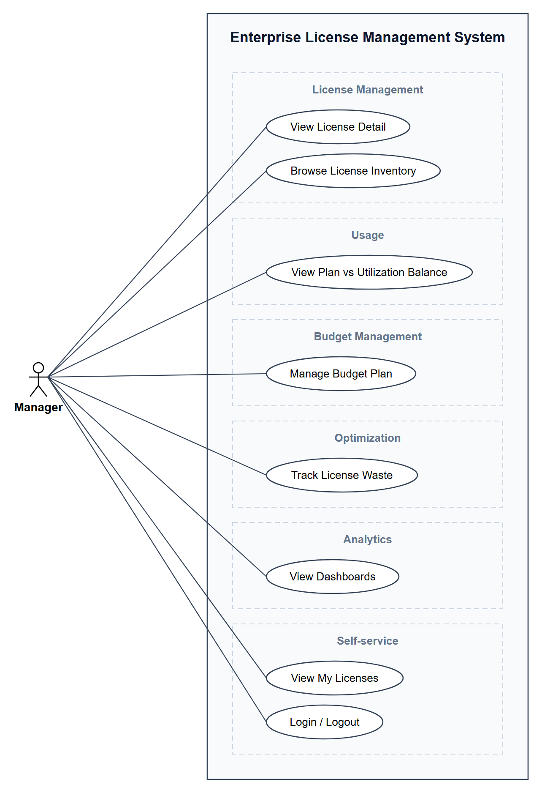
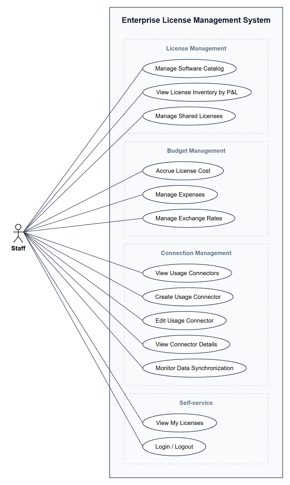

# Actors, Roles, and Use Cases

System: **Enterprise License Management System (ELMS)**, built by team VFast. Use cases are grouped in eight branches: License Management, Optimization, Cloud, Budget Management, Analytics, User & Organization, Connection Management, Access. They are close to the branches of the [mind map](mindmap.png) but not one to one: the mind map collects ideas, the use cases the goals of the actors.

**Business model.** ELMS brings together the software licenses of every company of the group, cloud services included. It does not enter, grant, buy, or pay for anything: licenses and their holders come from each P&L's license API, cloud costs from the APIs or billing files of AWS, Azure, and the other cloud providers, actual usage from VinSOC, employees and units from ILVG, and the purchases from SAP. Everything is shown over a fixed hierarchy, P&L > Block > Department > Project, with three figures — **Plan, Spend, Actual** — from which the user judges waste. Licenses and cloud services have screens of their own.

**What a use case is.** A use case is one large flow of action of one actor toward one goal. Its smaller branches and the cases it handles are not use cases of their own; they belong to its specification. A use case describes behaviour, not screens: one use case can be reached from several screens, and one screen can serve several use cases.

## Actors

| Actor | Description |
|---|---|
| `MANAGER` | **The main user.** Manager of one unit: a P&L, a block, a department, or a project; there is no level above the P&L. For that unit and everything under it: browses licenses and who uses them, tracks waste, follows the cloud costs, plans the budget of licenses and cloud, follows the forecast, reads the dashboards. Can also do every task of Staff in their scope |
| `STAFF` | Member of the license management team; works for exactly one Manager, on that Manager's units. Does the hands-on work: connects the data sources, cloud providers included, imports the purchases from SAP, runs the monthly accrual, keeps the exchange rates, the software catalog, the shared licenses, and the assignment of cloud accounts to units. Does not plan, judge waste, forecast, or read the dashboards |
| `ADMIN` | Runs access to the system and nothing else: accounts, roles, data scopes, permissions, and the organization hierarchy. Sees no license, budget, or cost data |
| Usage connectors | One per company and provider (Microsoft, Atlassian, Adobe…). Return the licenses the company uses, with their holders and usage |
| Cloud providers | AWS, Azure, Google Cloud… Return the monthly cost and usage of each cloud account by service, through their API or a billing file |
| VinSOC | Usage tracking on company machines. Returns how often each employee uses each application |
| ILVG | Internal application. Returns employees, the unit of each, and who has left; every ELMS account belongs to one of its employees |
| SAP | Source of the purchases of licenses (PR, PO, invoices), exported to Excel and imported by Staff |
| Budget Excel | The budget plan of a unit, exported from SAP to the ELMS template and uploaded by its Manager |

Every account belongs to a real employee. Login / Logout belongs to every role.

## Core concepts

- **Organization.** A *unit* is a node of the fixed hierarchy P&L > Block > Department > Project; a P&L is also called a company, and it is the top of the hierarchy. Every figure of a unit is the sum of the units under it. Seats nobody holds are kept under *Unallocated*, holders that cannot be placed under *Unknown unit*, so totals always add up.
- **Data scope.** A Manager sees their unit and everything under it; a Staff member sees the units of the Manager they work for; Admin sees no license or cost data.
- **License.** One license a connector reports for one company, such as *Microsoft 365 E3* of company A. Its quantity bought, terms, and cost come from the purchases in SAP. Licenses are grouped by software and category in a catalog kept by Staff.
- **Shared license.** A license bought once and used by two or more companies. Staff mark it as shared; each company is charged for what its people use. Which P&L owns and plans it is still to be decided.
- **Cloud service.** A special kind of license: a cloud account — Azure, AWS, Google Cloud… — paid as you go, its cost and usage read each month from the provider, usually shared infrastructure rather than seats held by people. Staff assign each cloud account to the unit that uses it, or share it between units like a shared license; Managers set a monthly cloud budget for their units. A cloud service has its own Plan, Spend, and Actual, shown on screens of its own, apart from the licenses.
- **Plan, Spend, Actual.** *Plan* is the budget: the license plan uploaded from SAP and the cloud budget set by Managers. *Spend* is what was bought, month by month: the license invoices spread over their terms, and the cloud cost of the month. *Actual* is the value of what is really used: the seats in use, or the cloud resources consumed. ELMS computes **no waste figure, rate, or flag**: the user compares the three figures and the seat statuses to judge waste.
- **Seat status.** Every assigned seat is *Active* — used, daily or now and then; *Inactive* — its holder has left the company but still holds the license, which must be reclaimed; or *No use* — assigned but not used for a length of time, such as 30 or 60 days. A seat without a usage source is *Not monitored*; a seat bought but given to nobody is *Unassigned*.
- **Forecast.** A projection of Spend to the end of the year, set against the Plan, with the amounts that will fall due: license renewals and the cloud cost to come. It is always shown as a forecast, never as an actual figure. ELMS never pays a bill.
- **Missing data** is *Unknown*, never zero.

## Role × use case matrix

| Mind-map branch | Use cases | Admin | Manager | Staff |
|---|---|---|---|---|
| License Management | View License Detail (UC01) | | ✓ own units | |
| | Maintain License Inventory (UC02) | | ✓ own units | ✓ their Manager's units |
| Optimization | Track License Waste (UC03) | | ✓ own units | |
| Cloud | Track Cloud Costs and Usage (UC04) | | ✓ own units | |
| Budget Management | Manage Budget Plan (UC05) | | ✓ license plan and cloud budget; purchases, accrual, exchange rates | ✓ purchases, accrual, exchange rates |
| | Forecast Spending (UC06) | | ✓ own units | |
| Analytics | View Dashboards (UC07) | | ✓ own units | |
| User & Organization | Manage User Accounts and Access (UC08), Manage Organization Hierarchy (UC09) | ✓ | | |
| Connection Management | Manage Data Connectors (UC10) | | ✓ own units | ✓ their Manager's units |
| Access | Login / Logout (UC11) | ✓ | ✓ | ✓ |

**In short:** the Manager uses the product and makes the decisions; Staff keep it fed; Admin decides who can do what.

## Use cases

### Use case diagrams

One diagram per actor, listing every use case the actor can start, grouped by mind-map branch. They are generated from the use case list below by `docs/diagrams/ve_usecase.py` (draw.io sources and SVG in [`diagrams/out/`](diagrams/out/)), so rerun it after changing the list.

| Manager | Staff |
|---|---|
|  |  |

| Admin |
|---|
|  |

### Use case list

| ID | Use case | Goal | Actors | What the actor does |
|---|---|---|---|---|
| | **License Management** | | | |
| UC01 | View License Detail | Know every license of my units: what it costs, how much of it is allocated, when it expires, and who uses it | Manager | Picks a license; reads its Plan, Spend, and Actual, the seats bought and allocated, and the expiry date; sees the units it is allocated to; sees each holder — still employed or left, using it or not, and for how long |
| UC02 | Maintain License Inventory | Make the figures from every source land on the right units | Staff, Manager | Checks that each company's sources deliver all its licenses; keeps the software catalog and maps license names to it; marks the licenses shared between companies; assigns each cloud account to the unit that uses it |
| | **Optimization** | | | |
| UC03 | Track License Waste | Find which units and licenses waste money, to reclaim seats or cut them | Manager | Picks a unit and a period; compares Plan, Spend, and Actual of the unit and of each unit below it, month by month, down to each license; reviews the seats not used, held by people who have left, or bought and given to nobody; exports |
| | **Cloud** | | | |
| UC04 | Track Cloud Costs and Usage | Follow the cost and usage of my units' cloud services against their budget | Manager | Picks the cloud infrastructure and the year; reads Plan, Spend, and Actual by month; goes down to unit, provider, and service, or by billing account; exports |
| | **Budget Management** | | | |
| UC05 | Manage Budget Plan | Keep the Plan and Spend of my units right and complete every month | Manager, Staff | Manager: uploads or enters the license plan and the cloud budget of their units, and reviews the gap between plan and purchases. Staff and Manager: import the purchases from SAP and enter those made outside it, fill the missing months, close the monthly accrual, keep the exchange rates |
| UC06 | Forecast Spending | Know before the year ends where spending will land against the plan, and what the coming bills will be | Manager | Reads past spending and the forecast of the months left; sees whether year-end spending will be over or under plan, and by how much; sees the amounts falling due: license renewals and cloud cost |
| | **Analytics** | | | |
| UC07 | View Dashboards | See at a glance how the licenses and spending of my units stand, to know where to look closer | Manager | Reads the summary figures — Plan, Spend, and Actual, license counts, licenses expiring soon, seats by status — and their trend by month, unit, and license; from there opens UC01, UC03, or UC04 |
| | **User & Organization** | | | |
| UC08 | Manage User Accounts and Access | Give each user the role and the data scope their job needs | Admin | Gives an employee an account with the role Manager or Staff; assigns a Manager to a unit and a Staff member to a Manager; disables or re-enables an account; reads the change history |
| UC09 | Manage Organization Hierarchy | Keep the organization tree right, so figures add up and data scopes are right | Admin | Reviews the tree from ILVG — P&L, Block, Department, Project; adds, renames, or removes a unit, and corrects a unit placed wrongly |
| | **Connection Management** | | | |
| UC10 | Manage Data Connectors | Bring licenses, usage, and cloud costs into ELMS and keep the syncs healthy | Staff, Manager | Creates or edits the connector of a company and provider, with its licenses and credential; connects the cloud providers; follows the syncs and fixes the failing connectors |
| | **Access** | | | |
| UC11 | Login / Logout | Enter ELMS and work within my own scope | Admin, Manager, Staff | Signs in and out; resets the password from the account email |

### What each use case covers

**UC01 View License Detail** — Manager
- The list of every license of their units: monthly cost, company, allocated against purchased, days to expiry.
- The same licenses by unit — which units use a license, which licenses a unit has — and by provider.
- The term of each license over time, and the renewals coming.
- The details of a license, and its users: who holds a seat, its status, whether the holder is still employed, when and how often they use it.
- The license terms from the PO lines.

**UC02 Maintain License Inventory** — Staff, Manager
- The licenses each company's sources deliver, grouped by provider, to check that nothing is missing.
- Keep the software catalog and map the license and application names to it.
- Mark the licenses used by several companies as shared, and see what each company is charged.
- Assign each cloud account to the unit that uses it, or share it between units; see the accounts not assigned yet.

**UC03 Track License Waste** — Manager
- Choose the unit to look at in the hierarchy, and the period.
- Plan, Spend, and Actual of that unit, and how far Spend is from the plan.
- The same figures for each unit below it, side by side and month by month, down to each license; export them.
- The seats to look at: *No use* seats by how long they have been unused, *Inactive* seats to reclaim, *Unassigned* seats, with their cost.
- How often each employee uses each application, from VinSOC.

**UC04 Track Cloud Costs and Usage** — Manager
- The cloud services of their units — Azure, AWS, Google Cloud… — with Plan, Spend, and Actual of the month and of the year to date.
- The same figures for each unit below, month by month, down to each provider and service.
- For a cloud service, its accounts, the units they are assigned to, and the cost of each month by service; export them.
- The cloud budget is set in UC05, the cloud accounts are assigned to units in UC02, and the cloud providers are connected in UC10.

**UC05 Manage Budget Plan** — Manager, Staff
- Manager: upload the license plan of their unit, or of any unit under it, from the SAP Excel export; see it by month and compare its versions.
- Manager: set the monthly cloud budget of their units.
- Manager: review where purchases are moving away from the plan, unit by unit.
- Staff and Manager: import the purchases — PR, PO, invoices — from SAP, and enter those made outside it; find the months still missing.
- Staff and Manager: close the monthly accrual of license costs.
- Staff and Manager: keep the exchange rates.

**UC06 Forecast Spending** — Manager
- Spend of the past months and the forecast of the months left, licenses and cloud.
- The year-end forecast against the plan: over or under, by how much.
- The amounts that will fall due — license renewals and the cloud cost to come — with their expected value.
- What drives the forecast: the licenses renewing before the year ends, the cloud services growing.

**UC07 View Dashboards** — Manager
- Licenses: counts by category, type, and provider; expiring soon; seats by status.
- Spending: licenses and cloud, by month and by unit, against plan, with the forecast.
- The same figures by license, software, category, or provider.
- The definition of every figure.
- The summary heads the analysis of licenses and cloud; opening a figure leads into UC01, UC03, or UC04.

**UC08 Manage User Accounts and Access** — Admin
- Give an employee an account, a role — Manager or Staff — and a data scope: the unit of a Manager, the Manager a Staff member works for.
- Disable or re-enable access.
- Set what each role may read or change.
- See who changed what, with the old and new value and the time.

**UC09 Manage Organization Hierarchy** — Admin
- See the hierarchy from ILVG: P&L, Block, Department, Project.
- Add, rename, or remove a unit, and correct a unit placed wrongly.

**UC10 Manage Data Connectors** — Staff, Manager
- Create, edit, and delete the connector of a company and provider, with its licenses.
- Connect the cloud providers — AWS, Azure… — through their API, or upload their billing file when there is none.
- See which connectors and licenses have sync problems.
- Follow the sync runs, rerun a period, pause or resume a connector.

**UC11 Login / Logout** — Admin, Manager, Staff
- Sign in and out; set or reset the password with a link sent to the account email.

**Out of scope:** entering, granting, revoking, buying, or renewing licenses; paying anything; computing waste; tracking the actions taken on licenses; creating accounts for people who are not employees in ILVG.

## System processes

Done by ELMS on its own, with no user acting; they feed the use cases above.

| Process | What the system does | Feeds |
|---|---|---|
| Connector sync | Reads each data connector at its interval: licenses, holders, activity, and cloud costs and usage | UC01, UC03, UC04, UC10 |
| ILVG sync | Reads employees, their units, and who has left; disables the account of a leaver | UC03, UC08, UC09, UC11 |
| VinSOC sync | Reads how often each employee uses each application | UC01, UC03 |
| Data matching | Matches units, budget lines, purchases, and cloud accounts across the sources; matches license names to the catalog and holders to employees | UC02, UC04, UC05 |
| Seat status | Every day, sets the status of each seat | UC01, UC03, UC07 |
| Cost roll-up | Every day, spreads the cost of each license over the seats and units that hold it, and the cost of each cloud account over the units it is assigned to, and adds them up the hierarchy | UC03, UC04, UC07 |
| Forecast | Projects Spend to the end of the year from the purchases, the renewals, and the recent cloud costs | UC06, UC07 |

**Related:** [Research](01-research-top-down.md) · [INVEST requirements](03-invest-requirements.md) · [Data fields research](09-data-fields-research.md)
