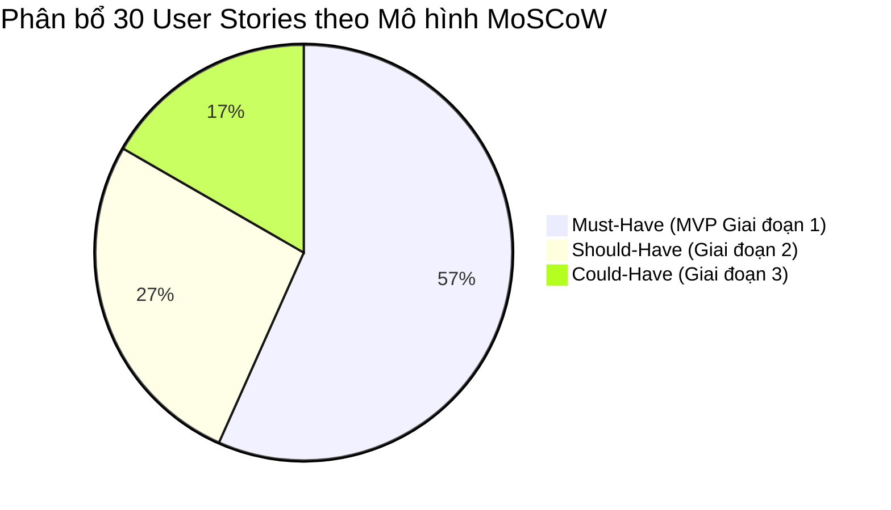

# Tài liệu Đặc tả Câu chuyện Người dùng (User Stories Specification)
## Dự án: VFast – Hệ thống Quản lý Bản quyền Phần mềm (Software Asset Management - SAM)

---

## 1. Phương pháp luận & Tiêu chí Chuẩn hóa INVEST

Toàn bộ 30 User Stories của dự án VFast được xây dựng và kiểm định theo bộ tiêu chuẩn **INVEST** của kỹ nghệ phần mềm linh hoạt (Agile Software Engineering):

| Tiêu chuẩn INVEST | Định nghĩa & Ý nghĩa kiểm soát chất lượng | Cách áp dụng trong VFast |
| :--- | :--- | :--- |
| **I – Independent** *(Độc lập)* | Mỗi story có thể được lập trình, kiểm thử và chuyển giao độc lập mà không bị ràng buộc cứng vào story khác. | Các story trong cùng một Epic (như nhập PO, gán seat, nhắc hạn) được phân tách module và xử lý qua các trạng thái trung gian (`Nháp`, `Hiệu lực`). |
| **N – Negotiable** *(Có thể thương lượng)* | Story nắm bắt bản chất nhu cầu nghiệp vụ, không áp đặt cứng nhắc giải pháp kỹ thuật, cho phép linh hoạt khi thiết kế chi tiết. | Mô tả rõ "Cái gì cần đạt được" và "Ràng buộc nghiệp vụ", không quy định công nghệ frontend/backend hay framework lưu trữ. |
| **V – Valuable** *(Có giá trị rõ ràng)* | Mang lại giá trị nghiệp vụ trực tiếp cho người dùng hoặc giảm thiểu rủi ro tuân thủ cho doanh nghiệp. | Từng story đều gắn với mục tiêu: chống lãng phí seat, ngăn phạt vi phạm bản quyền theo Nghị định 341/2025/NĐ-CP, hoặc tiết kiệm thời gian vận hành. |
| **E – Estimable** *(Có thể ước lượng)* | Đội ngũ kỹ thuật có đủ thông tin nghiệp vụ và tiêu chí nghiệm thu để ước lượng độ phức tạp và thời gian thực hiện. | Kèm theo bảng quy tắc nghiệp vụ, các trường dữ liệu bắt buộc và kịch bản kiểm thử chi tiết. |
| **S – Small** *(Kích thước phù hợp)* | Đủ nhỏ gọn để hoàn thành trong phạm vi một Sprint phát triển (1–2 tuần). | Các tính năng lớn được bẻ nhỏ (ví dụ: tách riêng story gán seat đơn lẻ `AS-01` với gán hàng loạt `AS-04`). |
| **T – Testable** *(Có thể kiểm thử)* | Có tiêu chí chấp nhận rõ ràng để kiểm thử viên (QA/QC) và người dùng cuối xác nhận tính đúng đắn. | 100% User Stories đều có kịch bản chấp nhận định dạng chuẩn **Given - When - Then** (Gherkin format). |

---

## 2. Bảng Phân loại MoSCoW & Lộ trình Triển khai (30 User Stories)

| Epic | Mã Story | Tên User Story | Vai trò chính | Ưu tiên MoSCoW | Giai đoạn |
| :--- | :--- | :--- | :--- | :---: | :---: |
| **E1. Danh mục & Vendor** | **SW-01** | Tạo danh mục phần mềm chuẩn | Quản lý license | **Must** | Giai đoạn 1 |
| | **SW-02** | Lưu thông tin nhà cung cấp & đại lý | Quản lý license | **Must** | Giai đoạn 1 |
| | **SW-03** | Tra cứu danh mục phần mềm được phép | Nhân viên | Should | Giai đoạn 2 |
| **E2. Hợp đồng & Quyền** | **EN-01** | Ghi nhận hợp đồng & quyền sử dụng | Mua sắm | **Must** | Giai đoạn 1 |
| | **EN-02** | Cộng dồn quyền sử dụng theo pool | Quản lý license | **Must** | Giai đoạn 1 |
| | **EN-03** | Phân bổ chi phí theo phòng ban/Cost Center | Tài chính | Should | Giai đoạn 2 |
| | **EN-04** | Ghi nhận quyền mở rộng (Downgrade, Test) | Quản lý license | Could | Giai đoạn 3 |
| **E3. Gán & Thu hồi** | **AS-01** | Gán seat cho nhân viên, máy, tài khoản | IT Vận hành | **Must** | Giai đoạn 1 |
| | **AS-02** | Thu hồi seat về kho | IT Vận hành | **Must** | Giai đoạn 1 |
| | **AC-01** | Quản lý tài khoản dùng chung/dịch vụ | IT Vận hành | **Must** | Giai đoạn 1 |
| | **DV-01** | Quản lý danh sách thiết bị tối thiểu | IT Vận hành | **Must** | Giai đoạn 1 |
| | **AS-03** | Xem license cá nhân đang được gán | Nhân viên | Should | Giai đoạn 2 |
| | **AS-04** | Gán và thu hồi seat hàng loạt | IT Vận hành | Should | Giai đoạn 2 |
| **E4. Vòng đời nhân viên** | **LC-01** | Đồng bộ dữ liệu nhân sự tự động | IT Vận hành | **Must** | Giai đoạn 1 |
| | **LC-02** | Tự động tạo việc thu hồi khi nghỉ việc | IT Vận hành | **Must** | Giai đoạn 1 |
| | **LC-03** | Rà soát license khi nhân viên chuyển phòng | Trưởng bộ phận | Should | Giai đoạn 2 |
| | **LC-04** | Gói license chuẩn theo vị trí chức danh | IT Vận hành | Could | Giai đoạn 3 |
| **E5. Nhắc hạn & Gia hạn** | **RN-01** | Nhắc hạn hợp đồng đa mốc thời gian | Mua sắm | **Must** | Giai đoạn 1 |
| | **RN-02** | Ghi nhận quyết định gia hạn kèm lý do | Người phụ trách | **Must** | Giai đoạn 1 |
| | **RN-03** | Xem lịch dự báo gia hạn 12 tháng | Tài chính | Should | Giai đoạn 2 |
| **E6. Yêu cầu & Phê duyệt**| **RQ-01** | Gửi yêu cầu cấp phần mềm từ danh mục | Nhân viên | Should | Giai đoạn 2 |
| | **RQ-02** | Phê duyệt/từ chối yêu cầu cấp phần mềm | Trưởng bộ phận | Should | Giai đoạn 2 |
| | **RQ-03** | Theo dõi trạng thái tiến độ yêu cầu | Nhân viên | Could | Giai đoạn 3 |
| **E7. Đối soát & Tuân thủ**| **CP-01** | Đối soát LicensePool & vị thế ELP | Quản lý license | **Must** | Giai đoạn 1 |
| | **CP-02** | Chốt bản chụp kiểm kê tuân thủ định kỳ | Quản lý license | **Must** | Giai đoạn 1 |
| | **CP-03** | Đề xuất thu hồi seat không dùng qua SSO | Quản lý license | Should | Giai đoạn 2 |
| | **CP-04** | Phát hiện phần mềm cài đặt trái phép | Quản lý license | Could | Giai đoạn 3 |
| **E8. Nhập & Xuất dữ liệu**| **IM-01** | Nhập dữ liệu ban đầu từ file Excel | Quản lý license | **Must** | Giai đoạn 1 |
| | **IM-02** | Xuất dữ liệu ra file Excel/CSV | Người có quyền | **Must** | Giai đoạn 1 |
| | **IM-03** | Nhập đơn mua từ hệ thống SAP ERP | Quản lý license | **Must** | Giai đoạn 1 |

---

## 3. Đặc tả Chi tiết 30 User Stories theo Từng Epic

---

### Epic 1: Danh mục Phần mềm & Nhà cung cấp (Software Catalog & Vendor Management)

#### SW-01: Tạo danh mục phần mềm chuẩn
- **Mã:** `SW-01` | **Ưu tiên:** `Must – GĐ1` | **Phụ trách:** Quản lý license
- **User Story:**
  > *Là một Quản lý license,*
  > *Tôi muốn tạo danh mục phần mềm chuẩn hóa (Hãng, Tên sản phẩm, Edition, Phiên bản, Loại license, Người phụ trách IT),*
  > *Để mọi quyền sử dụng và phân bổ trong công ty đều quy chiếu về một định danh thống nhất.*
- **Ràng buộc nghiệp vụ:**
  - Không được trùng lặp bộ khóa: `Hãng + Tên sản phẩm + Edition + Phiên bản`.
  - Một sản phẩm được phép có nhiều `LicenseProfile`/SKU khác nhau về metric đo lường và điều khoản.
  - Khi một phần mềm chuyển trạng thái sang `Bị cấm (Prohibited)`, hệ thống lập tức chặn cấp phát mới và tự động kích hoạt task xử lý thu hồi đối với các seat đang hoạt động.
- **Tiêu chí chấp nhận (Given - When - Then):**
  - **Kịch bản 1: Tạo phần mềm hợp lệ thành công**
    - *Given:* Quản lý license đang ở màn hình tạo mới phần mềm.
    - *When:* Nhập Hãng = "Microsoft", Sản phẩm = "Office 365", Edition = "Enterprise E3", Version = "Cloud", Trạng thái = "Được phép", Người phụ trách = "it-admin@company.com" và nhấn Lưu.
    - *Then:* Hệ thống lưu thành công bản ghi, sinh mã định danh duy nhất `SW-MS-O365-E3`, ghi Audit Log và hiển thị phần mềm trên danh mục.
  - **Kịch bản 2: Báo lỗi khi tạo phần mềm trùng lặp**
    - *Given:* Phần mềm với bộ khóa ("Microsoft", "Office 365", "Enterprise E3", "Cloud") đã tồn tại trong cơ sở dữ liệu.
    - *When:* Quản lý license nhập lại thông tin trùng khớp hoàn toàn bộ khóa trên và nhấn Lưu.
    - *Then:* Hệ thống ngăn chặn việc lưu dữ liệu và hiển thị thông báo lỗi: *"Phần mềm đã tồn tại trong danh mục."*
  - **Kịch bản 3: Kích hoạt quy trình thu hồi khi cấm phần mềm**
    - *Given:* Phần mềm "WinRAR" đang có 15 nhân viên được gán license.
    - *When:* Quản lý license đổi trạng thái của WinRAR sang "Bị cấm" kèm lý do "Chính sách bảo mật".
    - *Then:* Trạng thái chuyển thành "Bị cấm", cấm gán mới, và tự động tạo 15 task thu hồi giao cho đội IT Vận hành.

#### SW-02: Quản lý thông tin nhà cung cấp & đại lý phân phối
- **Mã:** `SW-02` | **Ưu tiên:** `Must – GĐ1` | **Phụ trách:** Quản lý license / Mua sắm
- **User Story:**
  > *Là một Quản lý license / Chuyên viên Mua sắm,*
  > *Tôi muốn lưu thông tin nhà cung cấp và đại lý ủy quyền (Đầu mối liên hệ, Email, Mã SAP Vendor, Hợp đồng khung),*
  > *Để biết chính xác đầu mối liên lạc khi cần hỗ trợ kỹ thuật, gia hạn bản quyền hoặc tiếp đoàn kiểm toán của hãng.*
- **Tiêu chí chấp nhận:**
  - *Given:* Đã có mã nhà cung cấp trên hệ thống SAP ERP.
  - *When:* Người dùng tạo mới Vendor và nhập Mã SAP Vendor = "VN-100293".
  - *Then:* Hệ thống lưu thông tin và đảm bảo một phần mềm có thể liên kết mua hàng qua nhiều Vendor khác nhau.

#### SW-03: Tra cứu danh mục phần mềm được phép sử dụng
- **Mã:** `SW-03` | **Ưu tiên:** `Should – GĐ2` | **Phụ trách:** Nhân viên
- **User Story:**
  > *Là một Nhân viên công ty,*
  > *Tôi muốn tra cứu danh mục các phần mềm được phép sử dụng nội bộ,*
  > *Để biết công ty đang cung cấp công cụ nào và không tự ý cài đặt các phần mềm trái phép.*
- **Tiêu chí chấp nhận:**
  - *Given:* Nhân viên đăng nhập vào Cổng thông tin nội bộ.
  - *When:* Tra cứu phần mềm "Photoshop".
  - *Then:* Hệ thống hiển thị Tên sản phẩm, Phiên bản, Mục đích sử dụng, Hướng dẫn đăng ký cấp phát; **tuyệt đối không hiển thị đơn giá mua sắm hoặc license key**.

---

### Epic 2: Hợp đồng & Quyền sử dụng (Contracts & Entitlements)

#### EN-01: Ghi nhận hợp đồng và quyền sử dụng (Entitlement Intake)
- **Mã:** `EN-01` | **Ưu tiên:** `Must – GĐ1` | **Phụ trách:** Chuyên viên Mua sắm
- **User Story:**
  > *Là một Chuyên viên Mua sắm,*
  > *Tôi muốn ghi nhận chi tiết mỗi lần mua bản quyền (Số lượng, Đơn giá, Tiền tệ, Ngày bắt đầu, Ngày hết hạn, Hóa đơn VAT, License key),*
  > *Để thiết lập bằng chứng sở hữu quyền sử dụng hợp pháp của doanh nghiệp.*
- **Ràng buộc nghiệp vụ:**
  - Bắt buộc phải gắn với SKU/LicenseProfile và Metric rõ ràng.
  - Entitlement thuê bao (`Subscription`) bắt buộc phải có Ngày hết hạn.
  - Hạn bảo trì (`Maintenance Expiry`) đối với bản quyền vĩnh viễn phải được lưu ở trường riêng biệt.
  - Entitlement mới tạo luôn ở trạng thái `Nháp (Draft)` và chưa được cộng vào dung lượng khả dụng.
  - License key phải được mã hóa khi lưu trữ; chỉ Quản lý license mới được xem và mỗi lượt xem đều ghi nhận Audit Log.
- **Tiêu chí chấp nhận:**
  - **Kịch bản 1: Ghi nhận hợp đồng thuê bao đầy đủ chứng từ**
    - *Given:* Chuyên viên Mua sắm đang nhập hợp đồng thuê bao phần mềm "Zoom Workplace Pro".
    - *When:* Nhập Số lượng = 50, Ngày bắt đầu = 01/01/2026, Ngày hết hạn = 31/12/2026, đính kèm file PDF hợp đồng và nhấn Lưu.
    - *Then:* Bản ghi Entitlement được tạo ở trạng thái `Nháp`, thông báo yêu cầu Quản lý license thẩm định.
  - **Kịch bản 2: Ngăn chặn lưu hợp đồng thuê bao thiếu ngày hết hạn**
    - *Given:* Hợp đồng thuộc loại "Thuê bao".
    - *When:* Người dùng để trống trường "Ngày hết hạn" và nhấn Lưu.
    - *Then:* Hệ thống báo lỗi: *"Hợp đồng thuê bao bắt buộc phải có ngày hết hạn."*

#### EN-02: Cộng dồn quyền sử dụng theo LicensePool
- **Mã:** `EN-02` | **Ưu tiên:** `Must – GĐ1` | **Phụ trách:** Quản lý license
- **User Story:**
  > *Là một Quản lý license,*
  > *Tôi muốn hệ thống tự động cộng dồn các khoản quyền sử dụng hợp lệ vào đúng LicensePool tương đương,*
  > *Để xác định chính xác tổng dung lượng bản quyền hợp pháp mà công ty đang sở hữu.*
- **Ràng buộc nghiệp vụ:**
  - Chỉ cộng dồn các Entitlement ở trạng thái `Hiệu lực (Active)` và đã được `Xác minh (Verified)`.
  - Tuyệt đối không cộng dồn các quyền khác nhau về Metric (ví dụ: gộp Named User với Per Device) hoặc khác nhau về Edition/Pháp nhân.
- **Tiêu chí chấp nhận:**
  - *Given:* LicensePool "M365-E3-NamedUser" đang có 100 seat từ Hợp đồng A.
  - *When:* Quản lý license phê duyệt thêm Hợp đồng B gồm 50 seat có cùng LicenseProfile.
  - *Then:* Dung lượng `VerifiedActiveCapacity` của Pool được cập nhật tức thì lên thành 150 seat.

#### EN-03: Phân bổ chi phí license theo Phòng ban / Cost Center
- **Mã:** `EN-03` | **Ưu tiên:** `Should – GĐ2` | **Phụ trách:** Kế toán / Tài chính
- **User Story:**
  > *Là một Kế toán chi phí,*
  > *Tôi muốn hệ thống tự động phân bổ chi phí license hằng tháng về từng phòng ban dựa trên số lượng seat thực tế đang gán,*
  > *Để phản ánh chính xác chi phí vận hành CNTT của từng đơn vị.*
- **Tiêu chí chấp nhận:**
  - *Given:* Một seat phần mềm Figma có chi phí 450.000 VNĐ/tháng.
  - *When:* Phòng Thiết kế đang nắm giữ 10 seat trong tháng 3/2026.
  - *Then:* Báo cáo phân bổ chi phí ghi nhận Phòng Thiết kế chịu chi phí 4.500.000 VNĐ trong kỳ.

#### EN-04: Ghi nhận quyền sử dụng mở rộng (Downgrade / Secondary Use)
- **Mã:** `EN-04` | **Ưu tiên:** `Could – GĐ3` | **Phụ trách:** Quản lý license
- **User Story:**
  > *Là một Quản lý license,*
  > *Tôi muốn ghi nhận các điều khoản quyền mở rộng (Quyền hạ cấp phiên bản cũ hơn - Downgrade Rights, quyền cài đặt trên máy thứ hai của nhân viên),*
  > *Để tránh việc tính trùng lặp vi phạm khi đối chiếu thực tế.*

---

### Epic 3: Gán & Thu hồi Bản quyền (License Allocation & Reclamation)

#### AS-01: Gán seat bản quyền nguyên tử (Atomic Allocation)
- **Mã:** `AS-01` | **Ưu tiên:** `Must – GĐ1` | **Phụ trách:** IT Vận hành
- **User Story:**
  > *Là một nhân viên IT Vận hành,*
  > *Tôi muốn gán một seat bản quyền cho một nhân viên, thiết bị hoặc tài khoản dùng chung hợp lệ,*
  > *Để người dùng có đủ quyền sử dụng công cụ làm việc mà hệ thống không bao giờ bị vượt quá số lượng đã mua.*
- **Ràng buộc nghiệp vụ:**
  - Giao dịch phải đảm bảo tính nguyên tử (Atomic ACID transaction).
  - Phải trừ trực tiếp vào một Entitlement nguồn xác định có trạng thái `Hiệu lực` và còn dung lượng ($Available > 0$).
  - Mặc định chặn việc cấp phát nếu Pool hết quyền, nếu phần mềm `Bị cấm`, hoặc nếu nhân viên đã `Nghỉ việc`.
- **Tiêu chí chấp nhận:**
  - **Kịch bản 1: Cấp phát seat thành công cho nhân viên hợp lệ**
    - *Given:* Pool Adobe Photoshop còn 2 seat trống, nhân viên A đang ở trạng thái `Đang làm việc`.
    - *When:* IT chọn gán Photoshop cho nhân viên A.
    - *Then:* Hệ thống tạo bản ghi Allocation mới, giảm số seat trống xuống còn 1, ghi Audit Log thành công.
  - **Kịch bản 2: Chặn cấp phát khi hết seat (Ngăn over-allocation)**
    - *Given:* Pool AutoCAD có 0 seat trống.
    - *When:* IT thực hiện gán AutoCAD cho nhân viên B.
    - *Then:* Giao dịch bị từ chối, hệ thống hiển thị thông báo: *"LicensePool đã hết quyền khả dụng. Không thể cấp phát."*

#### AS-02: Thu hồi seat bản quyền về kho (Seat Reclamation)
- **Mã:** `AS-02` | **Ưu tiên:** `Must – GĐ1` | **Phụ trách:** IT Vận hành
- **User Story:**
  > *Là một nhân viên IT Vận hành,*
  > *Tôi muốn thu hồi một seat bản quyền từ người dùng không còn nhu cầu về kho,*
  > *Để tái cấp phát cho nhân viên khác mà không cần phải mua thêm license mới.*
- **Ràng buộc nghiệp vụ:**
  - Đối với bản quyền tái phân bổ (`Reassignable`): Kết thúc Allocation và hoàn trả 1 đơn vị capacity về Entitlement nguồn.
  - Đối với bản quyền cố định (`Fixed Binding - OEM`): Đánh dấu Allocation thành `Bị ràng buộc`, không hoàn trả capacity về kho.
- **Tiêu chí chấp nhận:**
  - *Given:* Nhân viên C đang giữ 1 seat Microsoft 365 E3 (Reassignable).
  - *When:* IT thực hiện thu hồi seat của nhân viên C.
  - *Then:* Allocation chuyển sang `Đã thu hồi`, dung lượng khả dụng của Pool tăng thêm 1 đơn vị.

#### AC-01: Quản trị tài khoản dùng chung / Dịch vụ (Shared / Service Accounts)
- **Mã:** `AC-01` | **Ưu tiên:** `Must – GĐ1` | **Phụ trách:** IT Vận hành
- **User Story:**
  > *Là một nhân viên IT Vận hành,*
  > *Tôi muốn quản lý danh sách tài khoản dùng chung và tài khoản tích hợp hệ thống (bắt buộc gắn với một nhân viên chịu trách nhiệm),*
  > *Để gán bản quyền chính xác và không bị mất kiểm soát khi nhân sự phụ trách nghỉ việc.*
- **Tiêu chí chấp nhận:**
  - *Given:* IT tạo mới tài khoản dùng chung `marketing-team@company.com`.
  - *When:* Không chọn "Nhân viên chịu trách nhiệm" và nhấn Lưu.
  - *Then:* Hệ thống bắt buộc phải chọn một nhân viên đang làm việc chịu trách nhiệm thì mới cho phép tạo.

#### DV-01: Quản trị danh sách thiết bị tối thiểu (Device Inventory)
- **Mã:** `DV-01` | **Ưu tiên:** `Must – GĐ1` | **Phụ trách:** IT Vận hành
- **User Story:**
  > *Là một nhân viên IT Vận hành,*
  > *Tôi muốn quản lý danh sách thiết bị tối thiểu (Mã máy, Tên máy, Người dùng chính) để gán bản quyền theo thiết bị,*
  > *Để kiểm soát các license bản quyền vĩnh viễn OEM đi kèm theo phần cứng.*
- **Tiêu chí chấp nhận:**
  - *Given:* Thiết bị `WS-ENG-001` đang gán bản quyền Windows 11 Pro OEM.
  - *When:* IT đánh dấu thiết bị `WS-ENG-001` là "Thanh lý / Hỏng hóc".
  - *Then:* License OEM tương ứng chuyển sang trạng thái `Bị ràng buộc / Hết giá trị`, không tự động trả về kho cấp cho máy khác.

#### AS-03: Xem danh sách bản quyền cá nhân đang nắm giữ
- **Mã:** `AS-03` | **Ưu tiên:** `Should – GĐ2` | **Phụ trách:** Nhân viên
- **User Story:**
  > *Là một Nhân viên công ty,*
  > *Tôi muốn xem danh sách toàn bộ các phần mềm đang được cấp phát cho mình,*
  > *Để biết quyền hạn sử dụng cá nhân (tuyệt đối không hiển thị license key).*

#### AS-04: Gán và thu hồi bản quyền hàng loạt (Batch Allocation)
- **Mã:** `AS-04` | **Ưu tiên:** `Should – GĐ2` | **Phụ trách:** IT Vận hành
- **User Story:**
  > *Là một nhân viên IT Vận hành,*
  > *Tôi muốn gán hoặc thu hồi bản quyền hàng loạt cho toàn bộ nhân viên trong một phòng ban,*
  > *Để tiết kiệm thời gian triển khai các dự án quy mô lớn.*
- **Tiêu chí chấp nhận:**
  - *Given:* Phòng Kế toán có 20 nhân viên, Pool phần mềm chỉ còn 15 seat trống.
  - *When:* IT thực hiện gán hàng loạt cho Phòng Kế toán.
  - *Then:* Hệ thống kiểm tra trước, báo lỗi không đủ số lượng (thiếu 5 seat) và dừng toàn bộ giao dịch, không thực hiện dở dang.

---

### Epic 4: Vòng đời Nhân sự & Tự động Thu hồi (Employee Lifecycle)

#### LC-01: Đồng bộ dữ liệu nhân sự tự động (HR Synchronization)
- **Mã:** `LC-01` | **Ưu tiên:** `Must – GĐ1` | **Phụ trách:** IT Vận hành
- **User Story:**
  > *Là một nhân viên IT Vận hành,*
  > *Tôi muốn hệ thống tự động đồng bộ danh sách nhân viên, phòng ban, người quản lý và trạng thái làm việc từ hệ thống HR mỗi ngày,*
  > *Để dữ liệu người dùng luôn chính xác mà không phải nhập liệu thủ công.*
- **Tiêu chí chấp nhận:**
  - *Given:* Hệ thống thiết lập lịch đồng bộ hằng ngày vào 02:00 AM.
  - *When:* Hệ thống HR có 5 nhân viên mới và 2 nhân viên đổi phòng ban.
  - *Then:* Dữ liệu SAM cập nhật đầy đủ thông tin mới trong vòng 24 giờ; các trường đồng bộ bị khóa không cho sửa tay trên SAM; hỗ trợ nhập file CSV dự phòng nếu cổng API gặp sự cố.

#### LC-02: Tự động tạo công việc thu hồi khi nhân viên nghỉ việc (Offboarding Tasks)
- **Mã:** `LC-02` | **Ưu tiên:** `Must – GĐ1` | **Phụ trách:** IT Vận hành
- **User Story:**
  > *Là một nhân viên IT Vận hành,*
  > *Khi có thông báo nhân viên nghỉ việc từ hệ thống HR, tôi muốn SAM tự động lập danh sách các việc cần thu hồi và bàn giao,*
  > *Để thu hồi triệt để tài nguyên bản quyền trong vòng 1 ngày làm việc, tránh lãng phí tiền bạc của công ty.*
- **Ràng buộc nghiệp vụ:**
  - Kích hoạt SLA xử lý nghiêm ngặt: **1 ngày làm việc** kể từ thời điểm trạng thái nghỉ việc có hiệu lực từ HR.
  - Danh sách checklist bao gồm:
    1. Thu hồi các seat cá nhân đang gán (kiểm tra điều kiện OEM vs Reassignable).
    2. Chỉ định người chịu trách nhiệm mới cho các tài khoản dùng chung mà người này đang quản lý.
    3. Chuyển giao vai trò Người phụ trách phần mềm (Software Owner) nếu có.
    4. Ghi chú thông báo thu hồi thiết bị phần cứng.
  - Quá 1 ngày làm việc mà checklist chưa xong: Hệ thống tự động cảnh báo Đỏ và gửi email nhắc nhở vi phạm SLA đến Trưởng phòng IT.
- **Tiêu chí chấp nhận:**
  - *Given:* Nhân viên D chính thức nghỉ việc vào ngày 15/03/2026.
  - *When:* Sự kiện đồng bộ HR ghi nhận trạng thái của D là `Terminated`.
  - *Then:* Hệ thống khóa quyền gán mới cho D, tạo 3 task thu hồi seat cá nhân, tạo 1 task bàn giao tài khoản chung, đếm ngược SLA 24h.

#### LC-03: Rà soát bản quyền khi nhân viên chuyển phòng ban
- **Mã:** `LC-03` | **Ưu tiên:** `Should – GĐ2` | **Phụ trách:** Trưởng bộ phận
- **User Story:**
  > *Là một Trưởng bộ phận,*
  > *Khi có nhân viên chuyển từ phòng khác sang hoặc chuyển đi, tôi muốn hệ thống gửi thông báo rà soát các license phần mềm họ đang giữ,*
  > *Để thu hồi các phần mềm chuyên môn không còn phù hợp và chuyển giao chi phí chính xác.*

#### LC-04: Cấp phát tự động theo gói bản quyền vị trí chức danh (Role-based Bundles)
- **Mã:** `LC-04` | **Ưu tiên:** `Could – GĐ3` | **Phụ trách:** IT Vận hành
- **User Story:**
  > *Là một nhân viên IT Vận hành,*
  > *Tôi muốn định nghĩa các gói bản quyền mẫu theo vị trí chức danh (ví dụ: Designer gồm Adobe CC + Figma; Dev gồm JetBrains + GitHub),*
  > *Để khi có nhân sự mới gia nhập, hệ thống tự động gợi ý danh sách cấp phát trọn gói.*

---

### Epic 5: Nhắc hạn Hợp đồng & Gia hạn (Renewal & Expiration Management)

#### RN-01: Nhắc hạn hợp đồng và gói bảo trì đa mốc (Expiration Reminders)
- **Mã:** `RN-01` | **Ưu tiên:** `Must – GĐ1` | **Phụ trách:** Chuyên viên Mua sắm
- **User Story:**
  > *Là một Chuyên viên Mua sắm,*
  > *Tôi muốn hệ thống tự động gửi thông báo nhắc hạn trước 90, 60, 30 và 7 ngày trước khi hợp đồng thuê bao hoặc gói bảo trì hết hạn,*
  > *Để có đủ thời gian chuẩn bị ngân sách, đàm phán giá với nhà cung cấp và không bị gián đoạn công việc.*
- **Ràng buộc nghiệp vụ:**
  - Thông báo nhắc hạn phải kèm theo: Số seat đã mua, Số seat thực tế đang gán, Danh sách nhân viên bị ảnh hưởng.
  - Không được tự ý tắt thông báo nhắc nhở chỉ vì đã ghi nhận quyết định sơ bộ mà chưa hoàn tất thủ tục mua mới hoặc thu hồi.
- **Tiêu chí chấp nhận:**
  - *Given:* Hợp đồng AutoCAD hết hạn vào ngày 30/06/2026.
  - *When:* Đến ngày 01/04/2026 (trước 90 ngày).
  - *Then:* Hệ thống tự động gửi email thông báo chi tiết đến Chuyên viên Mua sắm và Người phụ trách phần mềm, đồng thời hiển thị công việc gia hạn trên Dashboard.

#### RN-02: Ghi nhận quyết định gia hạn kèm lý do (Renewal Decision Logging)
- **Mã:** `RN-02` | **Ưu tiên:** `Must – GĐ1` | **Phụ trách:** Người phụ trách phần mềm / Mua sắm
- **User Story:**
  > *Là Người phụ trách phần mềm / Chuyên viên Mua sắm,*
  > *Tôi muốn ghi nhận quyết định xử lý gia hạn (Giữ nguyên, Tăng số lượng, Cắt giảm bớt, hoặc Ngừng hẳn) kèm lý do giải trình,*
  > *Để lưu vết trách nhiệm và tự động kích hoạt các công việc kỹ thuật tương ứng.*
- **Tiêu chí chấp nhận:**
  - *Given:* Hợp đồng Slack sắp hết hạn với 100 seat, thực tế chỉ đang gán 60 seat.
  - *When:* Người phụ trách chọn phương án `Cắt giảm số lượng` xuống còn 70 seat cho năm tới kèm lý do "Tối ưu hóa ngân sách".
  - *Then:* Hệ thống lưu vết quyết định và chuyển thông tin số lượng mới (70 seat) sang bộ phận Mua sắm để lập PO trên SAP.

#### RN-03: Lịch dự báo ngân sách gia hạn 12 tháng (12-Month Renewal Schedule)
- **Mã:** `RN-03` | **Ưu tiên:** `Should – GĐ2` | **Phụ trách:** Kế toán / Tài chính
- **User Story:**
  > *Là một Kế toán chi phí,*
  > *Tôi muốn xem lịch trình các khoản gia hạn bản quyền dự kiến trong 12 tháng tới kèm số tiền quy đổi VND,*
  > *Để chủ động lập kế hoạch dòng tiền và điều hòa ngân sách công ty.*

---

### Epic 6: Yêu cầu & Phê duyệt Tự phục vụ (Self-service Portal)

#### RQ-01: Gửi yêu cầu cấp phát phần mềm từ danh mục chuẩn
- **Mã:** `RQ-01` | **Ưu tiên:** `Should – GĐ2` | **Phụ trách:** Nhân viên
- **User Story:**
  > *Là một Nhân viên công ty,*
  > *Tôi muốn gửi yêu cầu xin cấp phát một phần mềm từ danh mục chuẩn kèm lý do công việc,*
  > *Để được phê duyệt và cấp bản quyền chính thức phục vụ dự án.*
- **Tiêu chí chấp nhận:**
  - *Given:* Danh mục phần mềm có hiển thị Microsoft Visio (`Được phép`).
  - *When:* Nhân viên chọn Visio, nhập lý do "Vẽ sơ đồ quy trình ISO" và gửi yêu cầu.
  - *Then:* Yêu cầu được gửi tự động đến Trưởng bộ phận của nhân viên đó. Phần mềm ở trạng thái `Bị cấm` không thể chọn để gửi yêu cầu.

#### RQ-02: Phê duyệt hoặc từ chối yêu cầu cấp phát phần mềm
- **Mã:** `RQ-02` | **Ưu tiên:** `Should – GĐ2` | **Phụ trách:** Trưởng bộ phận
- **User Story:**
  > *Là một Trưởng bộ phận,*
  > *Tôi muốn phê duyệt hoặc từ chối yêu cầu cấp phần mềm của nhân viên cấp dưới và nhìn thấy chi phí phát sinh trước khi duyệt,*
  > *Để kiểm soát chi phí ngân sách của phòng ban mình.*
- **Tiêu chí chấp nhận:**
  - *Given:* Có yêu cầu cấp license giá 300 USD/năm từ nhân viên.
  - *When:* Trưởng bộ phận nhấn "Phê duyệt".
  - *Then:* Nếu kho còn seat trống -> Tự động chuyển task gán cho IT; nếu kho hết seat trống -> Tự động tạo đề xuất mua hàng cho bộ phận Mua sắm.

#### RQ-03: Theo dõi trạng thái tiến độ xử lý yêu cầu
- **Mã:** `RQ-03` | **Ưu tiên:** `Could – GĐ3` | **Phụ trách:** Nhân viên
- **User Story:**
  > *Là một Nhân viên công ty,*
  > *Tôi muốn theo dõi trạng thái xử lý yêu cầu của mình (Mới tạo -> Chờ duyệt -> Chờ mua sắm -> Đã cấp phát / Từ chối),*
  > *Để nắm được tiến độ và chủ động trong kế hoạch công việc.*

---

### Epic 7: Đối soát & Giám sát Tuân thủ Bản quyền (Compliance & Reconciliation)

#### CP-01: Đối soát vị thế LicensePool & Báo cáo ELP tức thì
- **Mã:** `CP-01` | **Ưu tiên:** `Must – GĐ1` | **Phụ trách:** Quản lý license
- **User Story:**
  > *Là một Quản lý license,*
  > *Tôi muốn xem báo cáo đối soát theo từng LicensePool tương đương (Quyền đã xác minh, Quyền đang gán, Quyền ràng buộc cố định, Vị thế ELP và Seat mất bao phủ),*
  > *Để phát hiện ngay lập tức các nguy cơ thiếu hụt bản quyền hoặc mất an toàn tuân thủ.*
- **Ràng buộc nghiệp vụ:**
  - Công thức chuẩn: $ELP = VerifiedActiveCapacity - CommittedUnits$.
  - Cảnh báo Đỏ nếu $ELP < 0$ hoặc tồn tại allocation mất bao phủ.
  - Các phần mềm có Metric không hỗ trợ trừ số học (ví dụ: Core/CPU chưa có dữ liệu phần cứng) phải hiển thị `Chưa đánh giá`, không được mặc định hiển thị màu xanh an toàn.
- **Tiêu chí chấp nhận:**
  - *Given:* Pool JetBrains IntelliJ có Verified Capacity = 20, Committed = 22.
  - *When:* Quản lý license mở bảng đối soát ELP.
  - *Then:* Hệ thống hiển thị ELP = -2, bật cảnh báo Đỏ, hiển thị chi tiết 2 seat đang vượt quyền để xử lý mua bổ sung hoặc thu hồi.

#### CP-02: Chốt bản chụp kiểm kê tuân thủ định kỳ (Snapshot Freezing)
- **Mã:** `CP-02` | **Ưu tiên:** `Must – GĐ1` | **Phụ trách:** Quản lý license
- **User Story:**
  > *Là một Quản lý license,*
  > *Tôi muốn chốt bản chụp kiểm kê định kỳ (Snapshot bất biến kèm dấu thời gian và ID người chốt),*
  > *Để làm bằng chứng tuân thủ phục vụ báo cáo ban lãnh đạo và các đoàn kiểm toán nội bộ/độc lập.*
- **Tiêu chí chấp nhận:**
  - *Given:* Quản lý license hoàn thành đợt kiểm kê Quý 1/2026.
  - *When:* Nhấn "Chốt Snapshot kỳ này".
  - *Then:* Toàn bộ dữ liệu vị thế, danh sách hợp đồng, danh sách gán tại thời điểm đó được đóng băng, không cho phép chỉnh sửa hay xóa bỏ; cho phép xuất file Excel kiểm toán.

#### CP-03: Đề xuất thu hồi seat không sử dụng qua tích hợp SSO/SaaS
- **Mã:** `CP-03` | **Ưu tiên:** `Should – GĐ2` | **Phụ trách:** Quản lý license
- **User Story:**
  > *Là một Quản lý license,*
  > *Tôi muốn hệ thống tự động phân tích dữ liệu đăng nhập từ cổng SSO và API SaaS để đề xuất thu hồi các tài khoản không hoạt động quá 60 ngày,*
  > *Để loại bỏ lãng phí tài nguyên và tái sử dụng cho người có nhu cầu.*

#### CP-04: Phát hiện phần mềm cài đặt trái phép qua kiểm kê thiết bị
- **Mã:** `CP-04` | **Ưu tiên:** `Could – GĐ3` | **Phụ trách:** Quản lý license
- **User Story:**
  > *Là một Quản lý license,*
  > *Tôi muốn hệ thống tự động so khớp phần mềm cài đặt thực tế trên máy trạm với danh mục phần mềm được phép và sổ cái bản quyền,*
  > *Để phát hiện sớm các trường hợp cài đặt phần mềm lậu hoặc phần mềm tự phát (Shadow IT).*

---

### Epic 8: Nhập & Xuất Dữ liệu Hệ thống (Data Import & Export)

#### IM-01: Nhập dữ liệu ban đầu từ file Excel chuẩn hóa
- **Mã:** `IM-01` | **Ưu tiên:** `Must – GĐ1` | **Phụ trách:** Quản lý license
- **User Story:**
  > *Là một Quản lý license,*
  > *Tôi muốn nhập dữ liệu phần mềm, hợp đồng, thiết bị và danh sách gán ban đầu từ file Excel mẫu,*
  > *Để nhanh chóng khởi tạo dữ liệu hệ thống mà không phải nhập tay từng bản ghi.*
- **Ràng buộc nghiệp vụ:**
  - Hệ thống phải xác thực dữ liệu từng dòng trước khi ghi vào cơ sở dữ liệu.
  - Nếu phát hiện lỗi cấu trúc hoặc thiếu thông tin bắt buộc, hệ thống hủy toàn bộ giao dịch (Atomic batch import) và xuất báo cáo chỉ rõ dòng lỗi và nguyên nhân.
- **Tiêu chí chấp nhận:**
  - *Given:* File Excel nạp danh sách 100 allocation có 1 dòng sai định dạng Email nhân viên.
  - *When:* Quản lý license tải file lên và nhấn Thực thi.
  - *Then:* Hệ thống không ghi nhận 99 dòng còn lại, dừng giao dịch và thông báo: *"Dòng 45 lỗi: Email nhân viên không hợp lệ. Vui lòng sửa lại file và nạp lại."*

#### IM-02: Xuất dữ liệu kiểm soát ra file Excel/CSV
- **Mã:** `IM-02` | **Ưu tiên:** `Must – GĐ1` | **Phụ trách:** Người dùng có quyền
- **User Story:**
  > *Là một Người dùng có quyền (Mua sắm, Tài chính, Quản lý license, Kiểm toán),*
  > *Tôi muốn xuất các danh sách dữ liệu ra định dạng Excel hoặc CSV,*
  > *Để phục vụ phân tích chuyên sâu và báo cáo số liệu ngoại tuyến.*
- **Ràng buộc nghiệp vụ:**
  - Phân quyền dữ liệu nghiêm ngặt theo vai trò RBAC (Tài chính chỉ thấy chi phí, Mua sắm chỉ thấy hợp đồng).
  - **Tuyệt đối không bao giờ đưa License Key vào bất kỳ file xuất nào** dưới mọi tình huống.
- **Tiêu chí chấp nhận:**
  - *Given:* Quản lý license xuất danh sách Hợp đồng và Quyền sử dụng ra Excel.
  - *When:* Mở file Excel vừa xuất.
  - *Then:* File hiển thị đầy đủ thông tin số lượng, ngày hạn, nhà cung cấp; **cột License Key hoàn toàn không tồn tại hoặc bị ẩn bỏ hoàn toàn**.

#### IM-03: Nhập dữ liệu đơn mua hàng từ hệ thống SAP ERP
- **Mã:** `IM-03` | **Ưu tiên:** `Must – GĐ1` | **Phụ trách:** Quản lý license
- **User Story:**
  > *Là một Quản lý license,*
  > *Tôi muốn nạp file xuất đơn mua hàng (PO) định kỳ hằng tháng từ hệ thống SAP ERP vào VFast,*
  > *Để tự động cập nhật các khoản mua sắm phần mềm mới mà không bị tạo trùng lặp bản ghi.*
- **Ràng buộc nghiệp vụ:**
  - Khóa định danh tổng hợp: `SAP_System + Company_Code + PO_Number + PO_Line + Version`.
  - Cơ chế Idempotent: Nhập lại cùng một file không sinh thêm Entitlement mới.
  - Các dòng đơn mua mới vào hệ thống ở trạng thái `Nháp` để Quản lý license thẩm định chứng từ trước khi kích hoạt tính capacity.
- **Tiêu chí chấp nhận:**
  - *Given:* File PO SAP chứa đơn mua số PO-88901 gồm 3 dòng phần mềm.
  - *When:* Quản lý license thực hiện import lần thứ nhất, sau đó vô tình import lại chính file đó lần thứ hai.
  - *Then:* Lần thứ hai hệ thống nhận diện khóa SAP đã tồn tại, không sinh thêm bản ghi Entitlement nào và thông báo: *"Dữ liệu đã được nạp trước đó, 0 bản ghi mới."*
