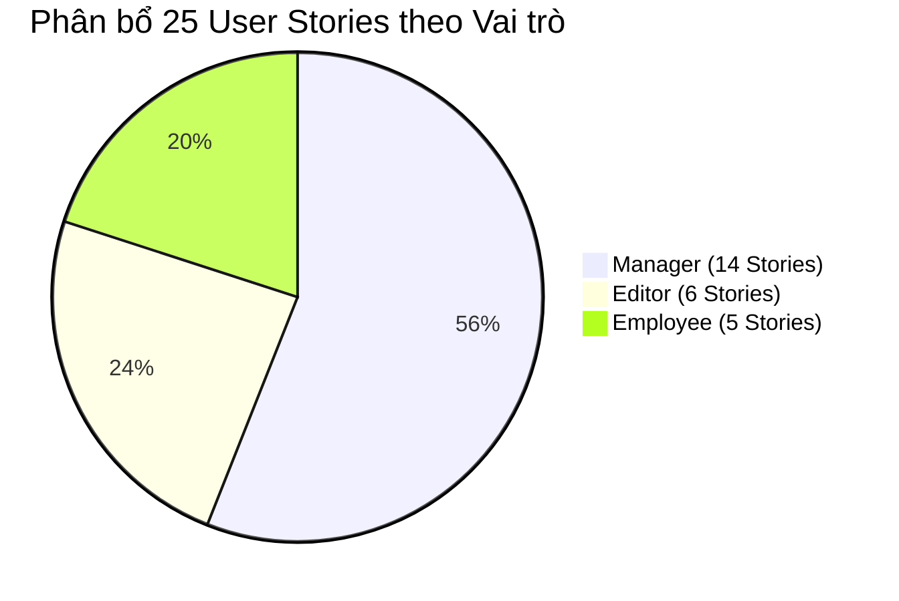

# Tài liệu Đặc tả Câu chuyện Người dùng (User Stories Specification)
## Dự án: VFast – Enterprise License Management System (ELMS)

---

## 1. Phương pháp luận & Tiêu chí Chuẩn hóa INVEST

Toàn bộ 25 User Stories của hệ thống VFast ELMS được thiết kế và kiểm chứng dựa trên bộ nguyên lý **INVEST** của kỹ nghệ phát triển phần mềm linh hoạt:

| Tiêu chí INVEST | Ý nghĩa kiểm định chất lượng | Cách thức áp dụng trong VFast ELMS |
| :--- | :--- | :--- |
| **I – Independent** *(Độc lập)* | Mỗi story có thể được triển khai, kiểm thử và chuyển giao riêng lẻ mà không bị phụ thuộc cứng vào story khác. | Các luồng dữ liệu của Editor (nhập expense) và Employee (gửi request) được xử lý độc lập qua bảng trạng thái trung gian. |
| **N – Negotiable** *(Có thể thương lượng)* | Nắm bắt bản chất mục tiêu nghiệp vụ, không trói buộc vào giải pháp công nghệ cụ thể. | Tập trung vào quy tắc kinh doanh và kết quả cần đạt, cho phép đội ngũ kỹ thuật lựa chọn công nghệ phù hợp trong 14 ngày. |
| **V – Valuable** *(Có giá trị rõ ràng)* | Mang lại giá trị trực tiếp cho người dùng hoặc giúp tổ chức tiết kiệm chi phí, kiểm soát tuân thủ. | Mỗi story đều phục vụ trực tiếp một trong 3 trụ cột: Quản lý bản quyền, Kiểm soát ngân sách hoặc Tối ưu hóa chi phí. |
| **E – Estimable** *(Có thể ước lượng)* | Đủ rõ ràng để đội ngũ phát triển ước tính thời gian hoàn thành trong sprint 2 tuần. | Đi kèm các trường dữ liệu và ràng buộc logic cụ thể. |
| **S – Small** *(Kích thước phù hợp)* | Đủ nhỏ gọn để hoàn thành trong 1 đến 2 ngày làm việc của lập trình viên. | Tách biệt giữa các thao tác nhập tay đơn lẻ (P0) và tính năng import hàng loạt từ file Excel (P1). |
| **T – Testable** *(Có thể kiểm thử)* | Có tiêu chuẩn nghiệm thu rõ ràng để QA/QC và người dùng cuối xác nhận. | 100% User Stories có kịch bản nghiệm thu chuẩn **Given - When - Then** (Gherkin format). |

---

## 2. Bảng Phân bổ 25 User Stories theo 3 Role & Độ ưu tiên (P0 / P1)

| Nhóm Vai trò | Mã Story | Tên User Story | Độ ưu tiên | Liên kết Use Case |
| :--- | :--- | :--- | :---: | :---: |
| **Manager** | **US-M01** | Quản lý danh mục sản phẩm phần mềm chuẩn | **P0** | UC01 |
| | **US-M02** | Đăng ký và quản lý Entitlement (SaaS & Perpetual) | **P0** | UC03 |
| | **US-M03** | Quản lý hợp đồng mua sắm bản quyền | P1 | UC04 |
| | **US-M04** | Xem xét danh sách License Request từ nhân viên | **P0** | UC05 |
| | **US-M05** | Phê duyệt hoặc từ chối License Request | **P0** | UC06 |
| | **US-M06** | Cấp phát (Assign) license cho nhân viên | **P0** | UC07 |
| | **US-M07** | Thu hồi (Revoke) license để giải phóng dung lượng | **P0** | UC08 |
| | **US-M08** | Thiết lập và quản lý ngân sách phần mềm | **P0** | UC09 |
| | **US-M09** | Rà soát và quản lý các bản ghi chi phí thực tế | **P0** | UC10 |
| | **US-M10** | Giám sát tuân thủ bản quyền và phát hiện Overuse | **P0** | UC13 |
| | **US-M11** | Theo dõi hạn hết hạn hợp đồng và kế hoạch gia hạn | **P0** | UC12 |
| | **US-M12** | Đánh giá các đề xuất tối ưu hóa chi phí | P1 | UC14 |
| | **US-M13** | Xem Dashboard tổng quan về tài sản và tài chính | **P0** | UC15 |
| | **US-M14** | Quản trị tài khoản người dùng và phân quyền 3 role | **P0** | UC16 |
| **Editor** | **US-E01** | Nhập dữ liệu mức độ sử dụng license thực tế | **P0** | UC17 |
| | **US-E02** | Import dữ liệu License Usage từ file CSV/Excel | P1 | UC18 |
| | **US-E03** | Ghi nhận các khoản chi phí phát sinh thực tế | **P0** | UC19 |
| | **US-E04** | Import dữ liệu Expense từ file CSV/Excel | P1 | UC20 |
| | **US-E05** | Tải lên hóa đơn và chứng từ thanh toán đính kèm | P1 | UC21 |
| | **US-E06** | Xem và kiểm tra lại toàn bộ dữ liệu đã nạp | **P0** | UC22 |
| **Employee** | **US-U01** | Xem danh mục các phần mềm khả dụng | **P0** | UC23 |
| | **US-U02** | Gửi yêu cầu xin cấp phát license mới | **P0** | UC24 |
| | **US-U03** | Theo dõi trạng thái tiến độ xử lý yêu cầu | **P0** | UC25 |
| | **US-U04** | Xem danh sách các license đang được cấp cho bản thân | **P0** | UC26 |
| | **US-U05** | Xem thời hạn và thông tin hết hạn license cá nhân | P1 | UC26 |

---

## 3. Đặc tả Chi tiết Từng User Story (Given - When - Then)

---

### Nhóm 1: User Stories cho vai trò MANAGER

#### US-M01: Quản lý danh mục sản phẩm phần mềm chuẩn
- **Mã:** `US-M01` | **Ưu tiên:** `P0`
- **Câu chuyện người dùng:**
  > *As a Manager, I want to manage software products, so that the company maintains a centralized software catalog.*
  > *(Là một Manager, tôi muốn quản lý danh mục sản phẩm phần mềm chuẩn hóa, để công ty duy trì một danh mục phần mềm tập trung duy nhất).*
- **Tiêu chí chấp nhận (Acceptance Criteria):**
  - **Kịch bản 1: Tạo mới phần mềm thành công**
    - *Given:* Manager đang ở màn hình Quản lý danh mục phần mềm.
    - *When:* Manager nhập Tên sản phẩm = "Figma", Nhà phát hành = "Figma Inc", Phiên bản = "Enterprise", Danh mục = "Design" và nhấn Lưu.
    - *Then:* Bản ghi phần mềm được lưu thành công vào hệ thống với mã định danh duy nhất.
  - **Kịch bản 2: Báo lỗi khi tạo phần mềm trùng lặp**
    - *Given:* Sản phẩm "Figma" phiên bản "Enterprise" đã tồn tại trong hệ thống.
    - *When:* Manager cố tình tạo một sản phẩm mới có cùng tên và cùng phiên bản trên.
    - *Then:* Hệ thống từ chối lưu và hiển thị thông báo lỗi: *"Sản phẩm phần mềm đã tồn tại trong danh mục."*

#### US-M02: Đăng ký & Quản lý Entitlement (SaaS & Perpetual)
- **Mã:** `US-M02` | **Ưu tiên:** `P0`
- **Câu chuyện người dùng:**
  > *As a Manager, I want to register and manage SaaS and Perpetual entitlements, so that I can track company-owned licenses.*
  > *(Là một Manager, tôi muốn đăng ký và quản lý các khoản quyền sử dụng cả SaaS và Perpetual, để theo dõi chính xác tài sản bản quyền mà công ty đang sở hữu).*
- **Tiêu chí chấp nhận:**
  - **Kịch bản 1: Khai báo gói thuê bao SaaS**
    - *Given:* Manager chọn phần mềm "Microsoft 365 E3".
    - *When:* Khai báo Số lượng = 100 seats, Chu kỳ = Hằng năm, Ngày bắt đầu = 01/01/2026, Ngày kết thúc = 31/12/2026.
    - *Then:* Hệ thống tạo Entitlement SaaS với tổng capacity = 100, dung lượng khả dụng ban đầu = 100.
  - **Kịch bản 2: Khai báo bản quyền vĩnh viễn Perpetual**
    - *Given:* Manager chọn phần mềm "AutoCAD 2026".
    - *When:* Khai báo Loại = Perpetual, Số lượng = 10 licenses, License Key = "XXXX-YYYY-ZZZZ", Hạn bảo trì = 30/06/2027.
    - *Then:* Hệ thống lưu thông tin license vĩnh viễn kèm theo dõi hạn bảo trì độc lập.

#### US-M04: Xem xét danh sách License Request từ nhân viên
- **Mã:** `US-M04` | **Ưu tiên:** `P0`
- **Câu chuyện người dùng:**
  > *As a Manager, I want to review license requests, so that I can understand employees' software needs.*
  > *(Là một Manager, tôi muốn xem xét danh sách các yêu cầu cấp license, để hiểu rõ nhu cầu sử dụng công cụ của nhân viên).*
- **Tiêu chí chấp nhận:**
  - *Given:* Có 3 yêu cầu cấp license đang ở trạng thái `Pending`.
  - *When:* Manager truy cập trang quản lý yêu cầu.
  - *Then:* Hệ thống hiển thị danh sách gồm: Tên nhân viên, Phòng ban, Phần mềm xin cấp, Lý do sử dụng, Thời điểm gửi và số seat còn trống trong kho.

#### US-M05: Phê duyệt hoặc Từ chối License Request
- **Mã:** `US-M05` | **Ưu tiên:** `P0`
- **Câu chuyện người dùng:**
  > *As a Manager, I want to approve or reject license requests, so that license distribution follows company policy.*
  > *(Là một Manager, tôi muốn phê duyệt hoặc từ chối các yêu cầu xin cấp license, để việc phân bổ bản quyền tuân thủ đúng chính sách công ty).*
- **Tiêu chí chấp nhận:**
  - **Kịch bản 1: Phê duyệt yêu cầu**
    - *Given:* Yêu cầu REQ-01 đang chờ duyệt.
    - *When:* Manager nhấn nút "Phê duyệt (Approve)".
    - *Then:* Trạng thái chuyển sang `Approved`, hệ thống gửi thông báo cho nhân viên.
  - **Kịch bản 2: Từ chối yêu cầu bắt buộc có lý do**
    - *Given:* Yêu cầu REQ-02 đang chờ duyệt.
    - *When:* Manager nhấn "Từ chối (Reject)" nhưng không nhập lý do giải trình.
    - *Then:* Hệ thống chặn lại và yêu cầu: *"Vui lòng nhập lý do từ chối để nhân viên được biết."*

#### US-M06: Cấp phát (Assign) License cho nhân viên
- **Mã:** `US-M06` | **Ưu tiên:** `P0`
- **Câu chuyện người dùng:**
  > *As a Manager, I want to assign licenses to employees, so that approved requests can be fulfilled.*
  > *(Là một Manager, tôi muốn cấp phát license cho nhân viên, để hoàn tất các yêu cầu đã được phê duyệt).*
- **Tiêu chí chấp nhận:**
  - *Given:* Pool phần mềm JetBrains còn 5 seat trống, nhân viên A đã được duyệt yêu cầu.
  - *When:* Manager thực hiện thao tác gán seat cho nhân viên A.
  - *Then:* Hệ thống tạo bản ghi gán, giảm số seat trống xuống còn 4, và ghi nhận thời điểm gán.

#### US-M07: Thu hồi (Revoke) License
- **Mã:** `US-M07` | **Ưu tiên:** `P0`
- **Câu chuyện người dùng:**
  > *As a Manager, I want to revoke license assignments, so that unused licenses can be released.*
  > *(Là một Manager, tôi muốn thu hồi các lượt gán license không còn sử dụng, để giải phóng tài nguyên phục vụ người khác).*
- **Tiêu chí chấp nhận:**
  - *Given:* Nhân viên B đang giữ 1 seat Adobe Illustrator nhưng không còn nhu cầu sử dụng.
  - *When:* Manager chọn lệnh "Thu hồi (Revoke)" bản ghi của nhân viên B.
  - *Then:* Trạng thái gán chuyển sang `Revoked`, dung lượng khả dụng của kho bản quyền tăng thêm 1 đơn vị.

#### US-M08: Thiết lập và Quản lý Ngân sách Phần mềm
- **Mã:** `US-M08` | **Ưu tiên:** `P0`
- **Câu chuyện người dùng:**
  > *As a Manager, I want to manage budgets, so that software spending can be controlled.*
  > *(Là một Manager, tôi muốn quản lý ngân sách, để kiểm soát chặt chẽ chi tiêu phần mềm của công ty).*
- **Tiêu chí chấp nhận:**
  - *Given:* Manager đang ở phân hệ Quản lý Ngân sách.
  - *When:* Thiết lập Ngân sách năm 2026 cho Phòng Kỹ thuật = 500.000.000 VNĐ.
  - *Then:* Hệ thống lưu hạn mức ngân sách và tự động liên kết với các khoản chi phí phát sinh của Phòng Kỹ thuật.

#### US-M09: Rà soát & Quản lý Chi phí Thực tế (Expense)
- **Mã:** `US-M09` | **Ưu tiên:** `P0`
- **Câu chuyện người dùng:**
  > *As a Manager, I want to review expense records, so that I can monitor company software costs.*
  > *(Là một Manager, tôi muốn rà soát các bản ghi chi phí, để giám sát tình hình chi tiêu phần mềm của doanh nghiệp).*
- **Tiêu chí chấp nhận:**
  - *Given:* Editor đã nạp một khoản chi phí 12.000.000 VNĐ cho phần mềm Slack.
  - *When:* Manager mở danh sách chi phí.
  - *Then:* Manager có thể xem chi tiết hóa đơn, ngày thanh toán, phòng ban chịu phí và tổng chi phí lũy kế trong kỳ.

#### US-M10: Giám sát Tuân thủ Bản quyền & Phát hiện Overuse
- **Mã:** `US-M10` | **Ưu tiên:** `P0`
- **Câu chuyện người dùng:**
  > *As a Manager, I want to monitor license compliance, so that I can identify overuse risks.*
  > *(Là một Manager, tôi muốn giám sát tính tuân thủ bản quyền, để nhận diện kịp thời các nguy cơ sử dụng vượt quyền).*
- **Tiêu chí chấp nhận:**
  - *Given:* Phần mềm Zoom Pro mua 50 seat, nhưng dữ liệu thực tế đang ghi nhận 52 người sử dụng.
  - *When:* Manager truy cập trang Giám sát Tuân thủ.
  - *Then:* Hệ thống gắn nhãn cảnh báo đỏ `Overuse: +2 seats`, gửi cảnh báo trực quan để Manager xử lý mua thêm hoặc thu hồi.

#### US-M11: Theo dõi Hết hạn Hợp đồng & Kế hoạch Gia hạn
- **Mã:** `US-M11` | **Ưu tiên:** `P0`
- **Câu chuyện người dùng:**
  > *As a Manager, I want to monitor license expiration, so that I can prepare renewal decisions.*
  > *(Là một Manager, tôi muốn theo dõi hạn hết hạn của các bản quyền, để chủ động chuẩn bị kế hoạch gia hạn kịp thời).*
- **Tiêu chí chấp nhận:**
  - *Given:* Hợp đồng thuê bao Google Workspace sẽ hết hạn sau 25 ngày nữa.
  - *When:* Manager đăng nhập hệ thống.
  - *Then:* Bảng điều khiển hiển thị cảnh báo hợp đồng nằm trong nhóm "Hết hạn trong vòng 30 ngày" để xử lý gia hạn.

#### US-M12: Xem & Đánh giá Đề xuất Tối ưu hóa Chi phí
- **Mã:** `US-M12` | **Ưu tiên:** `P1`
- **Câu chuyện người dùng:**
  > *As a Manager, I want to review optimization recommendations, so that I can identify cost-saving opportunities.*
  > *(Là một Manager, tôi muốn xem xét các đề xuất tối ưu hóa, để phát hiện các cơ hội cắt giảm lãng phí ngân sách).*
- **Tiêu chí chấp nhận:**
  - *Given:* Hệ thống phát hiện 10 seat Microsoft 365 không có bất kỳ lượt đăng nhập nào trong 60 ngày qua.
  - *When:* Manager mở màn hình Optimization.
  - *Then:* Hệ thống đưa ra khuyến nghị: *"Thu hồi 10 seat không hoạt động để tiết kiệm ước tính 4.500.000 VNĐ/tháng."*

#### US-M13: Xem Dashboard Điều hành Quản trị
- **Mã:** `US-M13` | **Ưu tiên:** `P0`
- **Câu chuyện người dùng:**
  > *As a Manager, I want to view management dashboards, so that I can understand the overall license and budget situation.*
  > *(Là một Manager, tôi muốn xem các bảng điều khiển trực quan, để nắm bắt toàn diện tình hình bản quyền và ngân sách).*
- **Tiêu chí chấp nhận:**
  - *Given:* Manager truy cập trang chủ hệ thống.
  - *When:* Tải trang Dashboard.
  - *Then:* Hiển thị đầy đủ 4 khối thông tin: Tổng quan tài sản bản quyền, Biểu đồ giải ngân ngân sách, Cảnh báo tuân thủ (Overuse), và Danh sách sắp hết hạn.

#### US-M14: Quản lý Tài khoản & Phân quyền 3 Role
- **Mã:** `US-M14` | **Ưu tiên:** `P0`
- **Câu chuyện người dùng:**
  > *As a Manager, I want to manage user accounts and roles, so that system access follows company policies.*
  > *(Là một Manager, tôi muốn quản lý tài khoản người dùng và gán vai trò, để việc truy cập hệ thống tuân thủ chính sách bảo mật).*
- **Tiêu chí chấp nhận:**
  - *Given:* Một nhân viên mới gia nhập đội ngũ IT hỗ trợ nạp liệu.
  - *When:* Manager chỉnh sửa tài khoản của nhân viên này và gán vai trò `Editor`.
  - *Then:* Tài khoản đó lập tức có quyền truy cập vào các màn hình nhập Usage và Expense, không có quyền phê duyệt license hay đổi budget.

---

### Nhóm 2: User Stories cho vai trò EDITOR

#### US-E01: Nhập liệu Mức độ Sử dụng License (Usage Data)
- **Mã:** `US-E01` | **Ưu tiên:** `P0`
- **Câu chuyện người dùng:**
  > *As an Editor, I want to input license usage data, so that actual software consumption can be monitored.*
  > *(Là một Editor, tôi muốn nhập dữ liệu sử dụng license, để mức độ tiêu thụ phần mềm thực tế được theo dõi chính xác).*
- **Tiêu chí chấp nhận:**
  - *Given:* Editor đang ở màn hình Nhập liệu Usage.
  - *When:* Chọn nhân viên A, phần mềm Photoshop, nhập Số ngày dùng = 18, Ngày hoạt động cuối = 05/03/2026 và nhấn Lưu.
  - *Then:* Bản ghi usage được tạo, tự động gắn `created_by = Editor_ID` và dấu thời gian hệ thống.

#### US-E02: Import Dữ liệu Usage Hàng loạt từ File CSV/Excel
- **Mã:** `US-E02` | **Ưu tiên:** `P1`
- **Câu chuyện người dùng:**
  > *As an Editor, I want to import license usage data from CSV/Excel, so that large amounts of usage information can be updated efficiently.*
  > *(Là một Editor, tôi muốn nạp dữ liệu usage từ file CSV/Excel, để cập nhật nhanh chóng khối lượng lớn thông tin sử dụng).*
- **Tiêu chí chấp nhận:**
  - *Given:* File Excel chứa 200 dòng dữ liệu sử dụng phần mềm hàng tháng kết xuất từ cổng SSO.
  - *When:* Editor tải file lên hệ thống.
  - *Then:* Hệ thống kiểm tra hợp lệ từng dòng, thông báo số dòng hợp lệ và nạp toàn bộ vào cơ sở dữ liệu.

#### US-E03: Ghi nhận Bản ghi Chi phí Thực tế (Expense Records)
- **Mã:** `US-E03` | **Ưu tiên:** `P0`
- **Câu chuyện người dùng:**
  > *As an Editor, I want to input expense records, so that software-related costs are recorded.*
  > *(Là một Editor, tôi muốn ghi nhận các bản ghi chi phí, để mọi khoản chi tiêu liên quan đến phần mềm được lưu trữ đầy đủ).*
- **Tiêu chí chấp nhận:**
  - *Given:* Công ty vừa thanh toán hóa đơn phần mềm GitHub Enterprise.
  - *When:* Editor nhập Số tiền = 25.000.000 VNĐ, Ngày thanh toán = 10/03/2026, Mã hóa đơn = "HD-9921" và nhấn Lưu.
  - *Then:* Bản ghi chi phí được ghi nhận và tự động cộng dồn vào chi phí thực tế của phòng ban liên quan.

#### US-E04: Import Dữ liệu Expense từ File CSV/Excel
- **Mã:** `US-E04` | **Ưu tiên:** `P1`
- **Câu chuyện người dùng:**
  > *As an Editor, I want to import expense data from CSV/Excel, so that financial records can be updated efficiently.*
  > *(Là một Editor, tôi muốn import dữ liệu chi phí từ file bảng tính, để cập nhật chứng từ kế toán nhanh chóng).*

#### US-E05: Tải lên Hóa đơn và Tài liệu Chứng minh
- **Mã:** `US-E05` | **Ưu tiên:** `P1`
- **Câu chuyện người dùng:**
  > *As an Editor, I want to upload invoices and supporting documents, so that expense records have corresponding evidence.*
  > *(Là một Editor, tôi muốn tải lên hóa đơn và chứng từ hỗ trợ, để các khoản chi phí đều có bằng chứng đối soát pháp lý).*
- **Tiêu chí chấp nhận:**
  - *Given:* Editor đang tạo bản ghi chi phí cho phần mềm AWS Cloud.
  - *When:* Editor đính kèm tệp PDF hóa đơn giá trị gia tăng (VAT Invoice).
  - *Then:* Tệp được tải lên máy chủ an toàn, liên kết chặt chẽ với bản ghi chi phí tương ứng.

#### US-E06: Xem lại Dữ liệu Đã nạp vào Hệ thống
- **Mã:** `US-E06` | **Ưu tiên:** `P0`
- **Câu chuyện người dùng:**
  > *As an Editor, I want to view submitted usage and expense data, so that I can verify the information I have entered.*
  > *(Là một Editor, tôi muốn xem lại các dữ liệu usage và expense đã nạp, để kiểm tra và xác nhận tính chính xác của dữ liệu).*
- **Tiêu chí chấp nhận:**
  - *Given:* Editor đã nạp nhiều bản ghi trong ngày.
  - *When:* Truy cập mục "Dữ liệu của tôi (My Submissions)".
  - *Then:* Hiển thị danh sách các bản ghi do chính mình tạo ra kèm trạng thái và thời gian nạp.

---

### Nhóm 3: User Stories cho vai trò EMPLOYEE

#### US-U01: Xem Danh mục Phần mềm Khả dụng
- **Mã:** `US-U01` | **Ưu tiên:** `P0`
- **Câu chuyện người dùng:**
  > *As an Employee, I want to view available software, so that I can identify software relevant to my work.*
  > *(Là một Employee, tôi muốn xem danh sách các phần mềm khả dụng, để nhận biết các công cụ phù hợp với công việc).*
- **Tiêu chí chấp nhận:**
  - *Given:* Employee đăng nhập vào hệ thống.
  - *When:* Mở danh mục phần mềm.
  - *Then:* Hệ thống chỉ hiển thị các phần mềm công ty đang hỗ trợ cấp phát, thông tin mô tả và hướng dẫn đăng ký; **tuyệt đối không hiển thị chi phí hoặc license key**.

#### US-U02: Gửi Yêu cầu Cấp License Mới
- **Mã:** `US-U02` | **Ưu tiên:** `P0`
- **Câu chuyện người dùng:**
  > *As an Employee, I want to submit a license request, so that I can request software access when needed.*
  > *(Là một Employee, tôi muốn gửi yêu cầu cấp license, để được cấp quyền truy cập phần mềm khi có nhu cầu công việc).*
- **Tiêu chí chấp nhận:**
  - **Kịch bản 1: Gửi yêu cầu hợp lệ thành công**
    - *Given:* Nhân viên chọn phần mềm "Postman Professional".
    - *When:* Nhập lý do = "Thực hiện kiểm thử API cho dự án E-Commerce" và nhấn "Gửi yêu cầu".
    - *Then:* Yêu cầu được ghi nhận ở trạng thái `Pending`, sinh mã REQ và chuyển đến hàng đợi của Manager.
  - **Kịch bản 2: Báo lỗi khi thiếu lý do sử dụng**
    - *Given:* Nhân viên chọn phần mềm nhưng để trống ô lý do.
    - *When:* Nhấn Gửi yêu cầu.
    - *Then:* Hệ thống báo lỗi: *"Vui lòng nhập lý do sử dụng để quản lý xem xét."*

#### US-U03: Theo dõi Trạng thái Yêu cầu Cá nhân
- **Mã:** `US-U03` | **Ưu tiên:** `P0`
- **Câu chuyện người dùng:**
  > *As an Employee, I want to view my request status, so that I know whether my request has been approved or rejected.*
  > *(Là một Employee, tôi muốn theo dõi trạng thái yêu cầu của mình, để biết yêu cầu đã được duyệt hay bị từ chối).*
- **Tiêu chí chấp nhận:**
  - *Given:* Yêu cầu của nhân viên vừa được Manager phê duyệt.
  - *When:* Nhân viên mở trang "Yêu cầu của tôi".
  - *Then:* Trạng thái hiển thị biểu tượng xanh `Approved` kèm thông báo license đang được khởi tạo.

#### US-U04: Xem Danh sách License Đang được Gán
- **Mã:** `US-U04` | **Ưu tiên:** `P0`
- **Câu chuyện người dùng:**
  > *As an Employee, I want to view my assigned licenses, so that I know which software I am authorized to use.*
  > *(Là một Employee, tôi muốn xem danh sách các license đang được gán cho bản thân, để biết mình được phép sử dụng những phần mềm nào).*
- **Tiêu chí chấp nhận:**
  - *Given:* Nhân viên C đã được cấp 2 phần mềm: Microsoft 365 và JetBrains.
  - *When:* Nhân viên C truy cập trang "License của tôi".
  - *Then:* Hệ thống hiển thị danh sách 2 phần mềm trên kèm ngày được cấp và tài khoản liên kết.

#### US-U05: Xem Thông tin Hạn Bản quyền Cá nhân
- **Mã:** `US-U05` | **Ưu tiên:** `P1`
- **Câu chuyện người dùng:**
  > *As an Employee, I want to view license expiration information, so that I know when my assigned license is due to expire.*
  > *(Là một Employee, tôi muốn xem thông tin ngày hết hạn của license được cấp, để chủ động kế hoạch công việc trước khi hết hạn).*
- **Tiêu chí chấp nhận:**
  - *Given:* License Zoom Pro của nhân viên có thời hạn đến 31/12/2026.
  - *When:* Nhân viên xem chi tiết license.
  - *Then:* Hệ thống hiển thị rõ ràng ngày hết hạn bản quyền.

---

## 4. Ma trận Liên kết giữa Use Cases và User Stories (Traceability Matrix)

| Use Case ID | Tên Use Case | User Stories liên kết | Vai trò |
| :--- | :--- | :--- | :---: |
| **UC01** | Manage Software Catalog | **US-M01** | Manager |
| **UC02** | Manage Vendor | **US-M01, US-M02** | Manager |
| **UC03** | Manage License Entitlement | **US-M02** | Manager |
| **UC04** | Manage Contract | **US-M03** | Manager |
| **UC05** | Review License Request | **US-M04** | Manager |
| **UC06** | Approve / Reject Request | **US-M05** | Manager |
| **UC07** | Assign License | **US-M06** | Manager |
| **UC08** | Revoke License | **US-M07** | Manager |
| **UC09** | Manage Budget | **US-M08** | Manager |
| **UC10** | Manage Expense | **US-M09** | Manager |
| **UC11** | Monitor Budget | **US-M08, US-M09** | Manager |
| **UC12** | Monitor License Lifecycle | **US-M11** | Manager |
| **UC13** | Review Compliance & Overuse | **US-M10** | Manager |
| **UC14** | Manage Optimization Recommendations | **US-M12** | Manager |
| **UC15** | View Dashboard & Reports | **US-M13** | Manager |
| **UC16** | Manage Users & Roles | **US-M14** | Manager |
| **UC17** | Input License Usage | **US-E01** | Editor |
| **UC18** | Import License Usage | **US-E02** | Editor |
| **UC19** | Input Expense Data | **US-E03** | Editor |
| **UC20** | Import Expense Data | **US-E04** | Editor |
| **UC21** | Upload Documents & Invoices | **US-E05** | Editor |
| **UC22** | View Submitted Data | **US-E06** | Editor |
| **UC23** | View Available Software | **US-U01** | Employee |
| **UC24** | Submit License Request | **US-U02** | Employee |
| **UC25** | View Request Status | **US-U03** | Employee |
| **UC26** | View Assigned Licenses | **US-U04, US-U05** | Employee |
