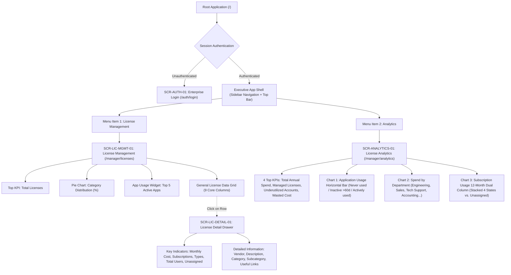

# UI/UX INFORMATION ARCHITECTURE & VIEW SPECIFICATIONS (IA)
## Project: VFast – Enterprise License Management System (ELMS)
### Subsystem: Executive Management Portal (2-View Focused Architecture)

> **Document Baseline:** [README.md](../README.md), [docs/01-MVP.md](01-MVP.md), [docs/02-use-cases.md](02-use-cases.md), [docs/03-user-stories.md](03-user-stories.md)  
> **Architecture Version:** 4.1 – English Standardization & Streamlined 2-View Model  
> **Target Scope:** Executive Portal focused exclusively on **License Management** and **Analytics**  
> **Git Worktree Branch:** `docs/uiux-ia-2-views`

---

## 📋 TABLE OF CONTENTS

1. [Executive Architecture Overview](#-1-executive-architecture-overview)
2. [Master Screen & View Catalog](#-2-master-screen--view-catalog)
3. [Screen Hierarchy & Navigation Flow](#-3-screen-hierarchy--navigation-flow)
4. [Detailed View Specification: View 1 – License Management](#-4-detailed-view-specification-view-1--license-management)
   - 4.1. [Key Metrics & Visualizations (Top Section)](#41-key-metrics--visualizations-top-section)
   - 4.2. [General License Data Grid (9 Core Columns)](#42-general-license-data-grid-9-core-columns)
   - 4.3. [License Detail Drill-Down View (Side Drawer)](#43-license-detail-drill-down-view-side-drawer)
5. [Detailed View Specification: View 2 – Analytics](#-5-detailed-view-specification-view-2--analytics)
   - 5.1. [Top KPI Health Metrics (4 Top Indicators)](#51-top-kpi-health-metrics-4-top-indicators)
   - 5.2. [Application Usage Optimization Chart (Horizontal Bar Chart)](#52-application-usage-optimization-chart-horizontal-bar-chart)
   - 5.3. [Spend by Department Chart](#53-spend-by-department-chart)
   - 5.4. [Subscription Usage 12-Month Comparative Chart (Dual-Column)](#54-subscription-usage-12-month-comparative-chart-dual-column)
6. [UI/UX State Contract & Interaction Rules](#-6-uiux-state-contract--interaction-rules)
7. [Screen-to-API Mapping Matrix](#-7-screen-to-api-mapping-matrix)

---

## 🏛️ 1. EXECUTIVE ARCHITECTURE OVERVIEW

The Information Architecture of the VFast Enterprise License Management System (ELMS) Executive Portal is standardized into a streamlined **2-View Model**:

1. **View 1: License Management (`SCR-LIC-MGMT-01`):** Operational cockpit providing enterprise inventory visibility, publisher and category distribution, seat entitlements, active utilization rates, and an in-context detail drawer for individual licenses.
2. **View 2: Analytics (`SCR-ANALYTICS-01`):** Strategic health and financial intelligence center providing 4 top executive KPIs, user activity status breakdown (Never used / Inactive >60d / Actively used), cross-departmental cost allocations, and 12-month dual-column subscription dynamics (Active, Inactive, No activity, Not monitored vs. Unassigned).

### Core Design Principles
- **Clarity over Clutter:** Consolidate sprawling interfaces into two purpose-built views with zero navigation friction.
- **Actionable Optimization:** Direct visualization of unused/underutilized licenses to support immediate reclamation and renewal negotiation.
- **In-Context Drill-Down:** Single-license inspection operates via a non-intrusive Side Drawer (`SCR-LIC-DETAIL-01`), preserving table scroll position, sorting, and active filters.

---

## 🗂️ 2. MASTER SCREEN & VIEW CATALOG

| Screen ID | Screen / View Name | Presentation Mode | Route URL Path | Mapped Use Cases | Status / Priority |
|:---|---|:---:|:---|---|:---:|
| **SCR-AUTH-01** | Enterprise Authentication | Full Page | `/auth/login` | `UC29`, `US-M14` | MVP P0 |
| **SCR-LIC-MGMT-01** | **View 1: License Management** | Full Page | `/manager/licenses` | `UC01`, `UC02`, `UC05`, `UC15`, `UC23` | MVP P0 Core |
| **SCR-LIC-DETAIL-01**| **License Detail Drill-Down** | Side Drawer (640px) | `/manager/licenses?drawer=detail&id=:id` | `UC02`, `UC03`, `UC20`, `UC21` | MVP P0 Core |
| **SCR-ANALYTICS-01** | **View 2: Analytics & Health** | Full Page | `/manager/analytics` | `UC14`, `UC16`, `UC19`, `UC20`, `UC24` | MVP P0 Core |
| **SCR-ERR-404** | 404 Page Not Found | Full Page | `/404` | System | System |

---

## 🌳 3. SCREEN HIERARCHY & NAVIGATION FLOW



---

## 📊 4. DETAILED VIEW SPECIFICATION: VIEW 1 – LICENSE MANAGEMENT

- **Route:** `/manager/licenses`
- **Presentation:** Full Page responsive layout.
- **Primary Goal:** Operational overview of software inventory, category distribution, top utilized applications, and comprehensive licensing tabular data with instant drawer inspection.

### 4.1. Key Metrics & Visualizations (Top Section)

The top section consists of three visual containers organized in a 12-column grid:

```
+------------------------------------+------------------------------------+----------------------------------------+
| [ Total License Card ] (Col 1-3)  |  [ Category Pie Chart ] (Col 4-7)  |  [ Top 5 Usage Widget ] (Col 8-12)     |
+------------------------------------+------------------------------------+----------------------------------------+
```

#### 1. Metric: Total Licenses (Col 1–3)
- **Primary Display Value:** Total active software licenses provisioned across the organization (e.g., `1,284 Licenses`).
- **Sub-indicators:**
  - `Active Entitlements:` e.g., `1,142` (88.9%).
  - `Expiring in <= 30 Days:` Amber badge with count (e.g., `18`).
  - `MoM Growth:` e.g., `+4.5% vs. previous month`.

#### 2. Visual: Pie Chart – Percentage License Category (Col 4–7)
- **Chart Type:** Interactive Donut / Pie Chart.
- **Enterprise Baseline Categories & Proportions:**
  - **Development & DevOps:** 32% (IDE, Git repositories, CI/CD pipelines, Cloud sandboxes).
  - **Productivity & Office:** 28% (Office suites, Document management, Spreadsheets).
  - **Communication & Collaboration:** 18% (Team chat, Video conferencing, Virtual workspaces).
  - **Design & Creative:** 12% (UI/UX design, Vector graphics, Video editing).
  - **Security & Compliance:** 7% (Endpoint protection, Password managers, SSO).
  - **Other / Utilities:** 3%.
- **Interactivity:**
  - Hovering displays: Category Name, License Count, Total Monthly Spend, and Percentage.
  - Clicking any slice instantly filters the General License Data Grid below (`?category=Development`).

#### 3. Visual: Application Usage (Top 5) (Col 8–12)
- **Widget Type:** Ranked progress list displaying the Top 5 most utilized applications across the organization.
- **Ranked Applications:**
  1. **Microsoft 365 Enterprise:** `94% Active` (470/500 users active) — `Productivity`
  2. **Slack Enterprise Grid:** `91% Active` (410/450 users active) — `Communication`
  3. **GitHub Enterprise:** `88% Active` (264/300 users active) — `Development`
  4. **Jira Software & Confluence:** `85% Active` (255/300 users active) — `Project Management`
  5. **Zoom Business:** `81% Active` (202/250 users active) — `Video Conferencing`
- **Visual Display:** Two-tone progress bar (Green for Active rate, Light Gray for Allocated but Inactive).

---

### 4.2. General License Data Grid (9 Core Columns)

- **Layout:** High-density, paginated table with real-time search, category/type dropdown filters, compliance status filter, and column sorting.
- **Standardized Table Columns:**

| STT | Column Name | Technical Data Key | Display Format & Badges | Alignment | Description & Business Meaning |
|:---:|---|---|---|:---:|---|
| 1 | **License Name** | `software_name` | Bold text with app icon (e.g., *JetBrains All Products Pack*) | Left | Registered name of the software / license entitlement. |
| 2 | **Publisher Name** | `publisher_name` | Secondary muted text (e.g., *JetBrains s.r.o.*, *Microsoft*, *Adobe*) | Left | Software vendor or publisher legal entity. |
| 3 | **License Type** | `license_type` | Standard pill badge:<br>- `SaaS Subscription` (Blue)<br>- `Perpetual License` (Purple)<br>- `User-based (Seat)` (Cyan) | Center | Licensing model and contractual entitlement structure. |
| 4 | **Compliance Status** | `compliance_status` | Status badge with indicator dot:<br>- 🟢 `Compliant` ($Allocated \le Purchased$)<br>- 🟡 `At Risk` ($Expiring \le 30\text{d}$ or $\ge 95\%$ capacity)<br>- 🔴 `Over-allocated` ($Allocated > Purchased$) | Center | Legal compliance and entitlement status to prevent liability. |
| 5 | **Purchased** | `total_purchase_amount` | Currency formatted:<br>`$48,000 USD` / `1,220,000,000 VND` | Right | Total purchase expenditure committed for this entitlement. |
| 6 | **Licence Entitlement** | `purchased_seats` | Numeric badge (e.g., `150 seats`) | Right | Total contractual license seats purchased from publisher. |
| 7 | **Active Users** | `active_users_count` | Numeric (Green text, e.g., `124`) | Right | Number of users actively using the application in the cycle (30 days). |
| 8 | **Total Users** | `allocated_users_count` | Progress string: `140 / 150` ($Allocated / Purchased$) | Right | Total user accounts currently allocated to this entitlement. |
| 9 | **Expiry Date** | `expiration_date` | Date format: `YYYY-MM-DD` (Red if $\le 15$ days, Amber if $\le 30$ days) | Center | Contract expiration date (SaaS) or maintenance renewal date (Perpetual). |

- **Table Interactions:**
  - **Row Click Trigger:** Clicking any row opens **`SCR-LIC-DETAIL-01`** (Side Drawer) with full contextual drill-down.
  - **Quick Search Input:** Filters rows matching `License Name` or `Publisher Name` with 300ms debounce.
  - **Filters:** All, Compliant, At Risk, Over-allocated.
  - **Pagination:** Options for 10, 25, 50 rows per page.

---

### 4.3. License Detail Drill-Down View (Side Drawer `SCR-LIC-DETAIL-01`)

- **Presentation:** Non-intrusive sliding Side Drawer (Width: 640px, sliding from the right edge with backdrop blur).
- **Trigger:** Click on any license item in the General License Data Grid.
- **Header:** License Name, Publisher Logo, License Type Pill, Close Button `[X]`.

#### 1. Key Indicators (Top Cards)
A highlighted grid of 5 metric cards located at the top of the drawer:

```
+------------------------------------+------------------------------------+
| 1. Monthly Cost                    | 2. Subscriptions                   |
|    $4,200 / month                  |    3 Contracts / POs               |
+------------------------------------+------------------------------------+
| 3. Subscription Types              | 4. Total Users                     |
|    2 Types (Enterprise, Business)  |    140 Assigned Users              |
+------------------------------------+------------------------------------+
| 5. Unassigned Subscriptions        |                                    |
|    10 Seats Available (Inventory)  |                                    |
+------------------------------------+------------------------------------+
```

| Key Indicator | Data Attribute | Detailed Definition & Business Meaning |
|---|---|---|
| **Monthly Cost** | `monthly_amortized_cost` | The monthly expenditure incurred by the enterprise for the application (amortized for annual and monthly contracts). |
| **Subscriptions** | `subscriptions_count` | Total count of active subscription agreements or procurement orders held for this application. |
| **Subscription Types** | `subscription_tiers` | Number of service plan tiers currently utilized (e.g., *Free*, *Plus*, *Business*, *Enterprise*). |
| **Total Users** | `total_assigned_users` | Total user accounts associated with the application (holding active license grants). |
| **Unassigned Subscriptions** | `unassigned_seats` | Number of purchased licenses not yet allocated to any user ($Purchased - Allocated$ available in inventory). |

#### 2. Detailed Information (Metadata Specification)

| Attribute | Technical Key | Definition & Data Specification |
|---|---|---|
| **Vendor** | `vendor_company` | Software publisher legal entity, country of origin, technical support contact, and account manager details. |
| **Description** | `software_description` | Functional summary of the application, internal business purpose, and core organizational workflows supported. |
| **Category** | `category_name` | Primary software classification (e.g., *Productivity*, *Engineering*, *Security*, *Design*). |
| **Subcategory** | `subcategory_name` | Granular functional classification (e.g., *IDE & Source Control*, *Team Chat*, *Cloud Infrastructure*, *UI Prototyping*). |
| **Useful links & Policy** | `policy_links` | Essential administrative and compliance links:<br>- **Internal License Policy:** Corporate allocation policy and employee usage guidelines.<br>- **Vendor Terms of Service:** Vendor SLA and master services agreement.<br>- **Security Compliance Policy:** Information security compliance certifications (SOC2, ISO 27001).<br>- **Management Portal:** Direct URL to the vendor administrative console. |

---

## 📈 5. DETAILED VIEW SPECIFICATION: VIEW 2 – ANALYTICS

- **Route:** `/manager/analytics`
- **Presentation:** Full Page executive business intelligence dashboard.
- **Primary Goal:** Evaluate comprehensive license health and financial efficiency through high-impact metrics and analytical charts to eliminate waste and optimize budget allocation.

```
+-------------------------------------------------------------------------------------------------------+
|  [ Total Annual Spend ]  |  [ Managed Licenses ]  |  [ Underutilized Accts ]  |  [ Wasted Lic Cost ]  |
+-------------------------------------------------------------------------------------------------------+
|  [ Chart 1: Application Usage (Horizontal Bar) - Top 5/10/20 ] (Col 1-7)                              |
|  Segments: Never Used (Orange) | Inactive >60d (Gray) | Actively Used (Green)                         |
+-------------------------------------------------------------------------------------------------------+
|  [ Chart 2: Spend by Department ] (Col 8-12)                                                          |
|  Engineering | Sales | Tech Support | Accounting | Marketing | Product                                |
+-------------------------------------------------------------------------------------------------------+
|  [ Chart 3: Subscription Usage (12-Month Comparative Dual-Column) ] (Full Width Col 1-12)            |
|  Col 1 (Stacked): Active | Inactive | No Activity | Not Monitored   vs.   Col 2: Unassigned         |
+-------------------------------------------------------------------------------------------------------+
```

---

### 5.1. Top KPI Health Metrics (4 Top Indicators)

Four standardized executive KPI cards positioned across the top of the Analytics view:

| KPI Metric Name | Display Key & Format | Definition & Business Meaning | Action Threshold / Alert Logic |
|---|---|---|---|
| **1. Total Annual Spend** | `annual_total_spend`<br>`$1,420,000 USD`<br>(or `36,000,000,000 VND`) | **Total annual financial outlay:** Total annualized cash outlay across all software licenses and subscriptions. | Compares actual spending against approved fiscal budget ceiling; triggers alert on budget burn velocity. |
| **2. Managed Licenses** | `total_managed_licenses`<br>`1,284 Licenses` (across 48 Apps) | **Managed licenses volume:** Total volume of software licenses and subscriptions centrally tracked under ELMS. | Provides executive visibility into enterprise software portfolio size. |
| **3. Underutilized Accounts** | `underutilized_accounts`<br>`312 Accounts` (24.3%) | **Underutilized accounts count:** Total user accounts provisioned with licenses that exhibit low, inactive (>60 days), or zero usage. | Amber warning if $> 15\%$; Critical red alert if $> 25\%$ of total allocated accounts. |
| **4. Underutilized License Cost** | `wasted_license_cost`<br>`$285,600 USD / yr` (20.1%) | **Wasted spend on underutilized licenses:** Total annual capital wasted on idle, unassigned, or neglected licenses. | Primary financial recovery target for internal reclamation and renewal downsizing. |

---

### 5.2. Application Usage Optimization Chart (Horizontal Bar Chart)

- **Chart Type:** Horizontal Segmented Stacked Bar Chart.
- **Controls:**
  - Range toggle: **Top 5** | **Top 10** | **Top 20** applications by user count.
  - Sorting: Defaults to *Descending Wasted Accounts* (Never used + Inactive) to spotlight optimization opportunities immediately.

#### 3 User Activity Status Segments:

| Status Segment | Visual Color | Definition & Business Meaning |
|---|:---:|---|
| **Never used** | 🟧 **Orange**<br>(`#FF9800`) | **Account never accessed:** The license was assigned to an employee, but the user has never logged in or performed any action since provisioning. |
| **Inactive (>60 days)** | ⬜ **Gray**<br>(`#9E9E9E`) | **Dormant account (>60 days):** The user was active in the past but has recorded zero activity for over 60 consecutive days (e.g., project completion, role change, departure). |
| **Actively used** | 🟩 **Green**<br>(`#4CAF50`) | **Actively used account:** The user logs in and interacts regularly with the software within the active tracking window (<60 days). |

#### Management Insights & Actionable Decisions:
1. **Identify Wasteful Applications:** Instantly detect software products where Orange (Never used) and Gray (Inactive) bars dominate total allocation.
2. **Quantify Financial Leakage:** Calculate the exact monetary waste per application by multiplying idle seats by unit cost.
3. **Execute Seat Reclamation & Reallocation:** Reclaim licenses from inactive assignees to fulfill pending employee requests without procuring additional seats.
4. **Data-Driven Renewal Negotiations:** Establish solid contractual leverage to downsize seat quantities during annual vendor renewal discussions.

---

### 5.3. Spend by Department Chart

- **Chart Type:** Interactive Donut Chart coupled with Departmental Breakdown Table / Treemap.
- **Standard Cost Centers:**
  - **Engineering & Product:** Core development tools, cloud infrastructure, QA and testing suites.
  - **Sales & Business Development:** CRM, sales automation, prospecting tools.
  - **Technical Support & Helpdesk:** Service desk, ticketing, internal documentation engines.
  - **Accounting & Finance:** Enterprise ERP, payroll, billing, tax software.
  - **Marketing & Creative:** Design suites, marketing automation, digital asset management.
  - **Human Resources & Operations:** HRIS, applicant tracking, learning management systems.

#### Management Insights:
1. **Pinpoint Top SaaS Consumers:** Deliver full transparency into departmental software expenditure across the organization.
2. **Benchmark Cost per Headcount:** Compare average software expenditure per employee across distinct business units.
3. **Validate Strategic Alignment:** Verify whether departmental software spend aligns with corporate strategic priorities.
4. **Enable Internal Chargebacks:** Empower managers to adjust department budgets or implement internal software chargeback models.

---

### 5.4. Subscription Usage 12-Month Comparative Chart (Dual-Column)

- **Chart Type:** 12-Month Dual-Column Grouped & Stacked Chart (January to December).
- **Core Analytical Purpose:** Tracks enterprise subscription utilization dynamics across every month of the fiscal year, highlighting the gap between purchased commitments and operational adoption.

#### Dual-Column Structure per Month:

```
Month N:
+-----------------------------------------+   +-----------------------+
| COLUMN 1: STACKED COLUMN (4 STATES)     |   | COLUMN 2: SINGLE COL  |
|                                         |   |                       |
| [ Not Monitored ] (Indigo - #3F51B5)    |   |                       |
| [ No Activity   ] (Dark Gray - #616161) |   |                       |
| [ Inactive      ] (Amber - #FF9800)     |   | [ Unassigned ]        |
| [ Active        ] (Green - #4CAF50)     |   |   (Rose - #E91E63)    |
+-----------------------------------------+   +-----------------------+
```

#### Detailed 5 Status Definitions:

| Column Assignment | Status Name | Color Coding | Detailed Business Meaning |
|:---:|---|:---:|---|
| **Column 1 (Stacked)** | **1. Active** | 🟩 **Green**<br>(`#4CAF50`) | **Active:** Subscriptions currently utilized by employees in the monthly reporting period. |
| **Column 1 (Stacked)** | **2. Inactive** | 🟧 **Amber / Orange**<br>(`#FF9800`) | **Inactive:** Subscriptions assigned to employees but showing zero activity during the tracking window. |
| **Column 1 (Stacked)** | **3. No activity** | ⬛ **Dark Gray**<br>(`#616161`) | **No activity:** Subscriptions with zero telemetry or activity logs recorded throughout the fiscal period (dormant accounts). |
| **Column 1 (Stacked)** | **4. Not monitored** | 🟦 **Indigo / Slate Blue**<br>(`#3F51B5`) | **Not monitored:** Subscriptions where usage telemetry is unmonitored (e.g., on-premise software lacking telemetry agents or missing vendor API logs). |
| **Column 2 (Single)** | **5. Unassigned** | 🟥 **Rose / Light Gray**<br>(`#E91E63`) | **Unassigned:** Subscriptions purchased under enterprise contract but not assigned to any user (idle inventory capital). |

#### Management Insights:
- **Allocation vs. Inventory Ratio:** Compares assigned licenses (Column 1) against unallocated inventory (Column 2). A persistent Column 2 indicates over-procurement.
- **Utilization Trajectory:** Evaluates whether the Active segment (Green) expands alongside software spend or if Inactive/No activity segments are accumulating.
- **Telemetry Blindspots:** The Not Monitored segment signals blind spots in IT visibility, prioritizing candidates for agent deployment or vendor API integration.

---

## 🎨 6. UI/UX STATE CONTRACT & INTERACTION RULES

Both views adhere strictly to the **5 Core UI States Contract**:


### Detailed UI State Standards:
1. **Loading State:** Skeleton shimmer loaders for the 4 KPI cards, horizontal bars for charts, and a 5-row placeholder grid. Zero cumulative layout shifts (CLS $< 0.1$).
2. **Success State:** Complete record presentation with formatted currency (`USD` / `VND`), date format `YYYY-MM-DD`, and WCAG 2.1 AA compliant color contrast badges.
3. **Empty State:** Illustrated empty state with descriptive guidance and a prominent `[Reset All Filters]` call-to-action button when queries return zero results.
4. **Error State:** Contextual error alerts preserving user filter states, accompanied by a non-destructive `[Retry Request]` action.
5. **Optimization Alert State:** Automatically triggered when underutilized accounts exceed $20\%$ or unassigned inventory spikes, providing actionable shortcuts to initiate seat reclamation.

---

## 🔗 7. SCREEN-TO-API MAPPING MATRIX

RESTful API endpoints powering both views and the detail drawer:

| Screen / Component | User Action / Event | REST API Endpoint & Method | Query / Body Parameters | Response Payload Overview |
|---|---|---|---|---|
| **SCR-LIC-MGMT-01** | Initialize License Management | `GET /api/v1/licenses/overview` | `None` | `total_licenses`, `category_breakdown` (Pie data), `top_5_usage` (Ranked list). |
| **SCR-LIC-MGMT-01** | Fetch General License Grid | `GET /api/v1/licenses` | `page`, `limit`, `search`, `category`, `status`, `sort_by` | Paginated license list containing all 9 core columns. |
| **SCR-LIC-DETAIL-01**| Click License Row | `GET /api/v1/licenses/{id}/detail` | `id` (License Entitlement ID) | Key indicators (`monthly_cost`, `subscriptions_count`, `tiers`, `total_users`, `unassigned_count`) and Detailed metadata (`vendor`, `description`, `category`, `subcategory`, `policy_links`). |
| **SCR-ANALYTICS-01** | Load Top 4 KPIs | `GET /api/v1/analytics/kpis` | `fiscal_year` (Defaults to current) | `total_annual_spend`, `managed_licenses`, `underutilized_accounts`, `wasted_license_cost`. |
| **SCR-ANALYTICS-01** | Load Application Usage Chart | `GET /api/v1/analytics/application-usage` | `limit=5\|10\|20`, `sort=wasted` | Array of applications with 3 segment metrics: `never_used`, `inactive_60d`, `actively_used`. |
| **SCR-ANALYTICS-01** | Load Spend by Department | `GET /api/v1/analytics/spend-by-department` | `fiscal_year`, `currency=USD\|VND` | Departmental data array: `department_name`, `spend_amount`, `percentage_share`, `headcount`. |
| **SCR-ANALYTICS-01** | Load Subscription Usage Chart | `GET /api/v1/analytics/subscription-usage-monthly`| `fiscal_year` | 12-month array: Column 1 (`active`, `inactive`, `no_activity`, `not_monitored`) and Column 2 (`unassigned`). |

---

*This Information Architecture & View Specification document (v4.1) establishes the dedicated 2-View operational standard for VFast ELMS: **License Management** and **Analytics**.*
