# Information Architecture & View Specifications for Manager Role
## Project: VFast – Enterprise License Management System (ELMS)
### Baseline: Software Requirements Specification (SRS v1.0), MVP Specification (01-MVP.md), Use Cases (02-use-cases.md), User Stories (03-use-stories.md)

---

## 1. Information Architecture & Navigation Model

This document establishes the comprehensive **Information Architecture (IA)**, **Sitemap Hierarchy**, and **View / Screen Specifications** tailored specifically for the **Manager** role (System Administrator / IT Asset Director) across three core functional modules:
1. **Module 1: License Management (Entitlements & Software Assets)**
2. **Module 2: License Assignment Management (Allocation, Revocation & Seat Tracking)**
3. **Module 3: Budget Management (Financial Planning, Expense Tracking, Monitoring & Reporting)**

---

### 1.1. Sitemap Hierarchy Tree for Manager Portal

```mermaid
flowchart TD
    Root["Manager Portal Root (/)"] --> Dash["Executive Dashboard (/manager/dashboard)"]
    Root --> M1["Module 1: License Management (/manager/licenses)"]
    Root --> M2["Module 2: Assignment Management (/manager/assignments)"]
    Root --> M3["Module 3: Budget Management (/manager/budget)"]
    Root --> M4["Module 4: Optimization & Compliance (/manager/compliance)"]
    Root --> M5["Module 5: System Admin & Audit Logs (/manager/settings)"]

    %% Module 1 Sub-views
    M1 --> M1_List["1.1 License List View<br/>(Filters, KPI Cards, Data Grid)"]
    M1 --> M1_Create["1.2 Add License Drawer/Modal<br/>(SaaS Subscription & Perpetual)"]
    M1 --> M1_Detail["1.3 License Detail View (/manager/licenses/:id)"]
    M1_Detail --> M1_Tab_Gen["Tab 1: General Info & Contract Profile"]
    M1_Detail --> M1_Tab_Alloc["Tab 2: Active Assigned Users List"]
    M1_Detail --> M1_Tab_History["Tab 3: Allocation & Revocation History"]
    M1_Detail --> M1_Tab_Audit["Tab 4: License Record Change Audit Log"]
    M1_Detail --> M1_Edit["1.4 Edit License Drawer/Modal"]
    M1_Detail --> M1_Delete["1.5 Delete/Decommission Modal (Safe Guard)"]

    %% Module 2 Sub-views
    M2 --> M2_Hub["2.1 Assignment Hub (/manager/assignments)"]
    M2_Hub --> M2_View_Emp["View A: By Employee Perspective"]
    M2_Hub --> M2_View_Soft["View B: By Software & Seat Perspective"]
    M2_Hub --> M2_View_Avail["View C: Real-time Seat Availability Monitor"]
    M2_Hub --> M2_View_Hist["View D: Global Assignment Audit History"]
    M2_Hub --> M2_Assign["2.2 Assign License Drawer/Modal (Seat Check)"]
    M2_Hub --> M2_Revoke["2.3 Revoke License Modal (Pool Reclaim)"]
    M2_Hub --> M2_Change["2.4 Change License Type Modal (Atomic Swap)"]
    M2_Hub --> M2_Tracking["2.5 Active User Tracking (Inactive >= 60d)"]

    %% Module 3 Sub-views
    M3 --> M3_Plan["3.1 Budget Planning (/manager/budget/planning)<br/>(Annual, Monthly, Dept, Vendor/Software)"]
    M3 --> M3_Exp["3.2 Expense Tracking (/manager/budget/expenses)<br/>(Monthly, Annual, Paid, Unpaid, Projected)"]
    M3 --> M3_Mon["3.3 Budget Monitoring (/manager/budget/monitoring)<br/>(5 Metrics, Threshold Alerts, Burn-down)"]
    M3 --> M3_Rep["3.4 Financial Reporting (/manager/budget/reports)<br/>(Monthly Trends, By Vendor, Variance, Renewal Forecast)"]
```

---

### 1.2. Manager User Journey & Interaction Flow

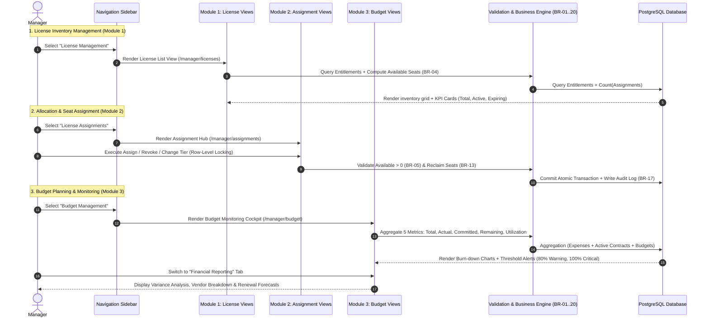

---

## 2. Manager Functional Matrix & RBAC Boundaries

| Feature Code | Feature Name | UI Path / Screen | Business Rules & RBAC Permissions |
| :--- | :--- | :--- | :--- |
| **M1-F01** | View License Inventory & KPIs | `/manager/licenses` | Displays all company-wide software licenses (SaaS & Perpetual). |
| **M1-F02** | Advanced Search & Multi-Filters | `/manager/licenses` | Filter by Vendor, Status, Licensing Model, Expiration Range, Department. |
| **M1-F03** | Register New License (Create) | Modal / Side Drawer | Distinguishes SaaS vs Perpetual (BR-01, BR-12). Initializes $Available = Purchased$. |
| **M1-F04** | Edit License Metadata (Edit) | Modal / Side Drawer | Prevents lowering $Purchased < Allocated$ (BR-05). Change reason mandatory. |
| **M1-F05** | Delete / Decommission License | Modal Confirmation | Blocks deletion if $Allocated > 0$. Supports Soft-delete / Archiving (BR-13, BR-20). |
| **M1-F06** | View License Details & Metrics | `/manager/licenses/:id` | Masked license key with reveal control, dynamic seat progress bar. |
| **M1-F07** | Track License Modification Audit | `/manager/licenses/:id#audit` | Immutable audit log: Actor, Timestamp, Old Value $\to$ New Value (BR-17). |
| **M2-F01** | Check Available Seats Real-time | `/manager/assignments` | Formula: $Available = Purchased - Allocated$ (BR-04, BR-05). Red/Yellow alerts. |
| **M2-F02** | Assign License to Employee | Side Drawer / Modal | Exclusive Manager permission (BR-07). Concurrency row-locking prevents overuse. |
| **M2-F03** | Revoke License Seat to Pool | Modal Confirmation | Reclaims +1 seat to Available pool. Mandatory reason required. Preserves audit history (BR-13). |
| **M2-F04** | Change License Type (Upgrade/Downgrade)| Modal Dialog | Switches employee license tier (e.g., Standard $\to$ Pro). Atomic swap transaction. |
| **M2-F05** | Track Active Users & Inactivity | `/manager/assignments` | Classifies Active / Idle / Inactive $\ge 60$ days to identify reclamation candidates. |
| **M2-F06** | View Global Assignment History | History Tab | Comprehensive chronological ledger of all assign, revoke, and tier change events. |
| **M3-F01** | Annual & Monthly Budget Setup | `/manager/budget/planning` | Exclusive Manager privilege to define/edit budget ceilings (BR-09, UC12). |
| **M3-F02** | Departmental Budget Allocation | `/manager/budget/planning` | Boundary constraint: $\sum Budget_{dept} \le Budget_{annual}$. |
| **M3-F03** | Software & Vendor Budget Buckets | `/manager/budget/planning` | Sets specific expenditure ceilings per vendor or software category. |
| **M3-F04** | Monthly & Annual Expense Tracking | `/manager/budget/expenses` | Manages recurring SaaS payments and perpetual maintenance contracts. |
| **M3-F05** | Paid, Unpaid & Projected Tracking | `/manager/budget/expenses` | Enforces valid VAT invoices (BR-10) and currency conversion policies (BR-11). |
| **M3-F06** | Monitor 5 Core Financial Metrics | `/manager/budget/monitoring`| Monitors Total, Actual, Committed, Remaining, Utilization. Alerts at 80% and 100%. |
| **M3-F07** | Budget vs. Actual Variance Report | `/manager/budget/reports` | Analyzes favorable vs unfavorable variances across cost centers. |
| **M3-F08** | Renewal Cost Forecasting | `/manager/budget/reports` | Projects 30/90/365-day renewal cash flows coupled with optimization insights (UC22). |

---

## 3. Module 1: License Management (Detailed View Specifications)

---

### 3.1. Screen 1.1: License List View (`/manager/licenses`)

The central operational hub for enterprise license inventory control. Enables Managers to instantly review license holdings, expiration milestones, and seat utilization.

#### A. UI Layout Blueprint
1. **Header Action Bar:**
   - Page Title: `License Management`.
   - Subtitle: `Centralized registry of SaaS subscriptions and perpetual software entitlements`.
   - Action Buttons: `[Export Report (CSV/Excel)]` and `[+ Add New License]` (Primary CTA).
2. **KPI Summary Cards:**
   - **Card 1 - Active Licenses:** Count of entitlements with `Active` status.
   - **Card 2 - Total Purchased Seats:** Aggregate seat capacity across all tools.
   - **Card 3 - Average Allocation Rate:** $\frac{\sum Allocated}{\sum Purchased} \times 100\%$ (Visual progress bar).
   - **Card 4 - Expiring Soon ($\le 30$ Days):** Count of subscriptions or maintenance agreements expiring within 30 days.
   - **Card 5 - Over-allocated / At Risk:** Number of entitlements flagged for compliance warnings.
3. **Advanced Filter & Search Toolbar:**
   - **Search Input:** Real-time search by Software Name, Entitlement ID, License Key, or Vendor (300ms debounce).
   - **Filter Dropdowns:**
     - `Vendor:` All, Microsoft, Google, JetBrains, Adobe, Autodesk, Atlassian, Oracle, etc.
     - `Licensing Model:` All, SaaS Subscription, Perpetual License.
     - `Status:` All, Active, Expiring Soon ($\le 30$ days), Expired, Suspended.
     - `Expiration Range:` All, Next 7 Days, Next 30 Days, Next 90 Days, Custom Date Range.
     - `Seat Availability:` All, Available ($Available > 0$), Fully Allocated ($Available = 0$), Under-allocated ($Available > 30\%$).
   - **Action Buttons:** `[Apply Filters]` and `[Reset]`.
4. **License Data Table Columns:**
   - `License Code:` Hyperlink text (e.g., `LIC-2026-001`) navigating to `/manager/licenses/:id`.
   - `Software & Edition:` Product name and tier badge (e.g., `Microsoft 365 Enterprise E5`).
   - `Vendor:` Vendor name badge (e.g., `Microsoft Corp`).
   - `Model:` Pill badge (`SaaS Subscription` in Indigo, `Perpetual` in Amber).
   - `Seat Utilization:` Mini progress bar with numeric breakdown: `Allocated / Purchased` (e.g., `45/50 seats` - 90%).
   - `Available Seats:` Integer count ($Available = Purchased - Allocated$), green if available, muted if 0.
   - `Expiration / Maintenance:` Date with warning icon if expiring within 30 days.
   - `Status:` Status badge (`Active`, `Expiring Soon`, `Expired`, `Archived`).
   - `Row Actions [...]:` Menu containing: *View Details, Quick Assign (+ Seat), Edit License, Renew Agreement, Delete/Archive*.
5. **Pagination Controls:** Supports 10, 25, 50, 100 records per page with total count indicators.

---

### 3.2. Screen 1.2: Add License Drawer / Modal (`/manager/licenses/create`)

A side drawer or full modal allowing Managers to register a new software entitlement into the system.

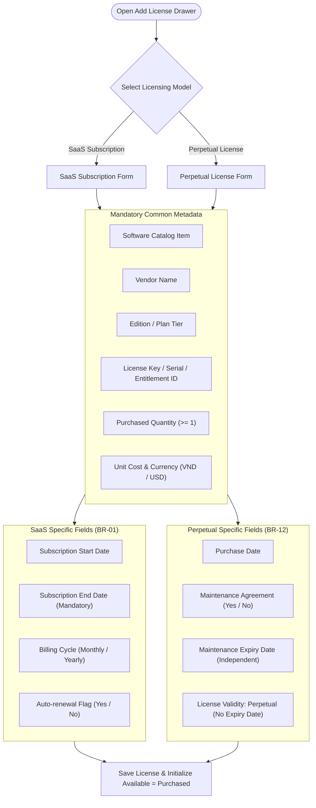

#### A. Form Fields & Validation Logic
1. **Model & Classification:**
   - `Licensing Model (Radio buttons):` `SaaS Subscription` (Default) | `Perpetual License`.
   - `Software Product (Dropdown):` Select from active Software Catalog items (supports inline quick-add).
   - `Vendor:` Auto-populated based on software catalog selection.
   - `Edition / Plan Tier:` Text field (e.g., `Enterprise E5`, `All Products Pack`).
   - `License Key / Code:` Serial key string input. Includes `[Generate Random Key]` option for account-based licenses.
2. **Metrics & Sizing:**
   - `Licensing Metric:` Dropdown: `Per User (Seat)` (Default), `Per Core`, `Concurrent User`, `Per Device`.
   - `Purchased Quantity:` Integer $> 0$ (Mandatory).
   - `Unit Cost & Currency:` Numeric value $\ge 0$ with currency selector (`VND` or `USD` per BR-10, BR-11).
3. **Term & Validity:**
   - **For SaaS Subscriptions:**
     - `Start Date:` Date picker (Mandatory).
     - `Expiration Date:` Date picker (Mandatory, must be $\ge Start Date$).
     - `Billing Cycle:` Dropdown: `Monthly`, `Annual`, `Multi-year`.
     - `Auto-renewal:` Toggle `On / Off`.
   - **For Perpetual Licenses:**
     - `Purchase Date:` Date picker (Mandatory).
     - `Core License Term:` Fixed label `Perpetual (No Expiration Date)` (Enforces BR-12).
     - `Maintenance Agreement Included:` Checkbox toggle.
     - `Maintenance Expiration Date:` Mandatory if maintenance agreement is selected.
4. **Contract Documents & Supporting Assets:**
   - `Contract / PO Reference Code:` Text field linking to Contract Management.
   - `File Upload:` Attach invoice or executed contract (PDF, PNG $\le 10$MB).
   - `Administrative Notes:` Text area for procurement notes and project attribution.
5. **Form Submission Behavior:**
   - Canceling prompts confirmation if data was modified.
   - On save, system automatically initializes: $Allocated = 0$, $Available = Purchased$.
   - Writes immutable audit log record `CREATE_LICENSE_ENTITLEMENT` (Actor: Manager, Timestamp per BR-17).

---

### 3.3. Screen 1.3: Edit License Drawer / Modal (`/manager/licenses/:id/edit`)

Allows Managers to update license attributes while enforcing database integrity constraints.

#### A. Mutable vs. Immutable Field Separation
- **Immutable Fields (Locked to prevent data corruption):**
  - `Licensing Model:` Cannot convert SaaS to Perpetual or vice versa.
  - `Licensing Metric:` Locked to maintain consistency (BR-03).
  - `System Entitlement ID:` Permanent immutable identifier.
- **Conditionally Guarded Fields:**
  - `Purchased Quantity:`
    - Upward increments permitted at all times (e.g., purchasing 10 additional seats).
    - **Downward Reduction Guard:** Downward adjustments are strictly blocked if $Purchased_{new} < Allocated_{current}$ (Enforces BR-05). If requested, system alerts: *"Cannot reduce purchased seats below currently allocated count (X seats). Please revoke allocated seats first."*
  - `Expiration Date:` Modifiable when recording renewal extensions.
- **Freely Mutable Fields:** Edition name, Administrative notes, Contract attachments, Auto-renewal flag.
- **Mandatory Audit Requirement:**
  - Every update requires a non-empty `Change Reason` input (e.g., *"Contract renewed for 12 months under PO-2026-88"*).
  - Appends full before/after diff to `license_audit_logs`.

---

### 3.4. Screen 1.4: Delete / Decommission License Modal (`/manager/licenses/:id/delete`)

Safeguards against accidental data loss and breaks in employee software access.

#### A. Pre-condition Safety Check Workflow

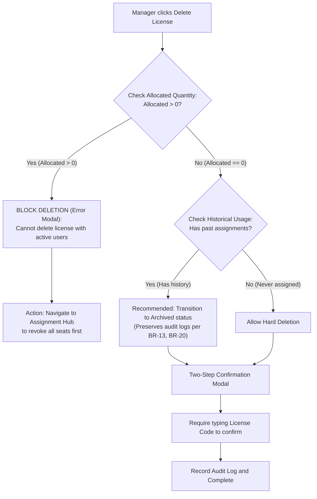

---

### 3.5. Screen 1.5: License Detail View (`/manager/licenses/:id`)

Comprehensive 360-degree management cockpit for an individual license entitlement.

#### A. Header & Seat Utilization Gauge
- **Header Profile:** Software name, Vendor logo, Status badge, Expiration countdown, Masked License Key (`XXXX-XXXX-****-9872` with click-to-reveal toggle restricted to Managers and logged in audit trails).
- **Seat Utilization Gauge:**
  - Visual tripartite progress bar:
    - Blue Segment: Active seats ($Allocated_{active}$).
    - Amber Segment: Idle/Inactive seats ($Allocated_{idle}$).
    - Green Segment: Unassigned seats ($Available = Purchased - Allocated$).
  - Mathematical integrity check (BR-04): $Purchased = Allocated + Available$.

#### B. 4 Specialized Management Tabs
1. **Tab 1: General Info & Contract Profile:**
   - Technical specifications, host servers, annual recurring expense, linked contract profile (`CON-2026-042`), downloadable invoice PDF.
2. **Tab 2: Active Assigned Users List:**
   - Interactive table of all employees currently holding a seat for this license.
   - Columns: Employee Name & Avatar, Department, Assigned Date, Usage Activity Status (`Active`, `Idle`, `Inactive $\ge 60$ days` with red alert badge).
   - In-line action buttons: `[Change Tier]` and `[Revoke Seat]`.
3. **Tab 3: Allocation & Revocation History:**
   - Chronological audit ledger of all assignments and revocations for this license (Enforces BR-13).
4. **Tab 4: License Record Change Audit Log:**
   - Immutable record of every administrative modification made to this entitlement (seat expansions, term renewals, price revisions per BR-17).

---

### 3.6. Contextual Allocation & Revocation Quick Actions

Directly from the License Detail View, Managers can trigger two in-context actions:
1. **Quick Assign Seat:** `[+ Assign Seat]` button opens a drawer pre-configured with this license, requiring only employee selection.
2. **Quick Bulk Revoke:** Multi-select checkboxes for inactive users in Tab 2 with a single `[Revoke Selected Seats]` button to instantly return unused seats to the available pool.

---

## 4. Module 2: License Assignment Management (Detailed View Specifications)

---

### 4.1. Screen 2.1: Assignment Hub (`/manager/assignments`)

The operational control center for distributing software licenses across the entire workforce.

#### A. Top-level Metrics & Perspective Sub-views
1. **Macro Sizing Cards:** Total Assigned Seats ($\sum Allocated$), Available Pool ($\sum Available$), Unique Active Assignees, Under-utilized / Wasteful Seats (Inactive $\ge 60$ days).
2. **4 Perspective Sub-views:**
   - **View A: By Employee (Default):** Employee-centric directory showing software assigned to each individual.
   - **View B: By Software & Seat:** Tool-centric view displaying each individual seat and its current holder.
   - **View C: Real-time Seat Availability Monitor:** Capacity overview across all software pools.
   - **View D: Global Assignment Audit History:** Complete event log across the organization.

---

### 4.2. View A: By Employee Perspective

Displays the organization's workforce and their allocated software assets. Expanding an employee row reveals:
- Detailed cards for each held license.
- Individual action buttons: `[Change License Tier]` and `[Revoke Seat]`.
- Last usage timestamp and activity status badge.

---

### 4.3. Assign License Workflow & Drawer (`/manager/assignments/new`)

Side drawer triggered via `[+ Assign License]` or approving a pending request (UC09).

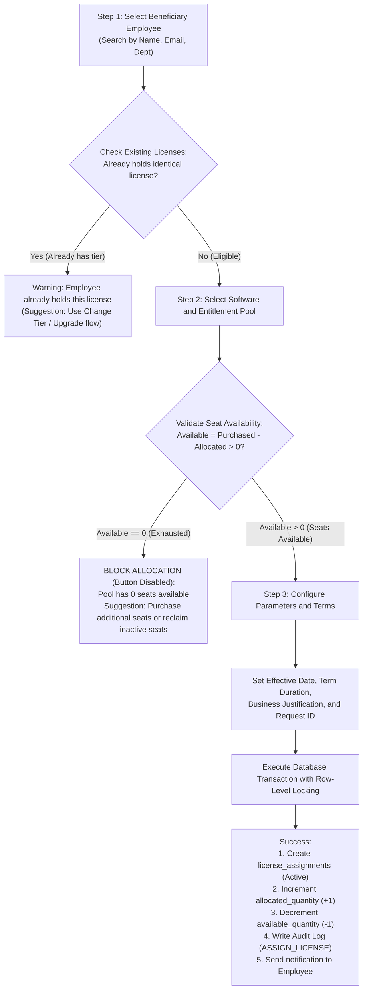

#### A. Drawer Form Specification
1. **Step 1: Employee Selection:** Type-ahead search (Name, Email, Staff ID); displays current licenses to prevent duplicate grants.
2. **Step 2: Software & Pool Selection:** Displays real-time capacity badge (e.g., `Microsoft 365 E5: 5 seats available`). Exhausted pools ($Available = 0$) are disabled with explanatory tooltips.
3. **Step 3: Parameters & Justification:** Effective date, duration (Permanent vs. Project-bound 3/6 months), mandatory business justification text.
4. **Concurrency Safety:** Executes within a database transaction with row-level locking (`SELECT ... FOR UPDATE`) to guarantee zero over-allocation (BR-05).

---

### 4.4. Revoke License Workflow & Modal (`Revoke License Modal`)

Enforces formal, audit-compliant seat de-allocation (UC10).
- Displays employee name, software title, original grant date, and inactivity duration.
- **Mandatory Revocation Reasons (Dropdown):**
  - Employee departure / Contract termination.
  - Project completion / Role transition.
  - Cost optimization: Inactive $\ge 60$ days (per UC20).
  - Voluntary return by employee.
  - Other (requires detailed justification).
- Optional email notification toggle to the employee.
- **System Impact (BR-04, BR-13, BR-17):**
  - Assignment record status updated: `Active` $\to$ `Revoked`. Record is **never deleted** from the database.
  - Immediately restores seat capacity: $Allocated -= 1$ and $Available += 1$.
  - Generates immutable audit log entry: `REVOKE_LICENSE_ASSIGNMENT`.

---

### 4.5. Change License Type Workflow & Modal (Upgrade / Downgrade)

Enables smooth transitioning between license tiers without orphan records or capacity drift.

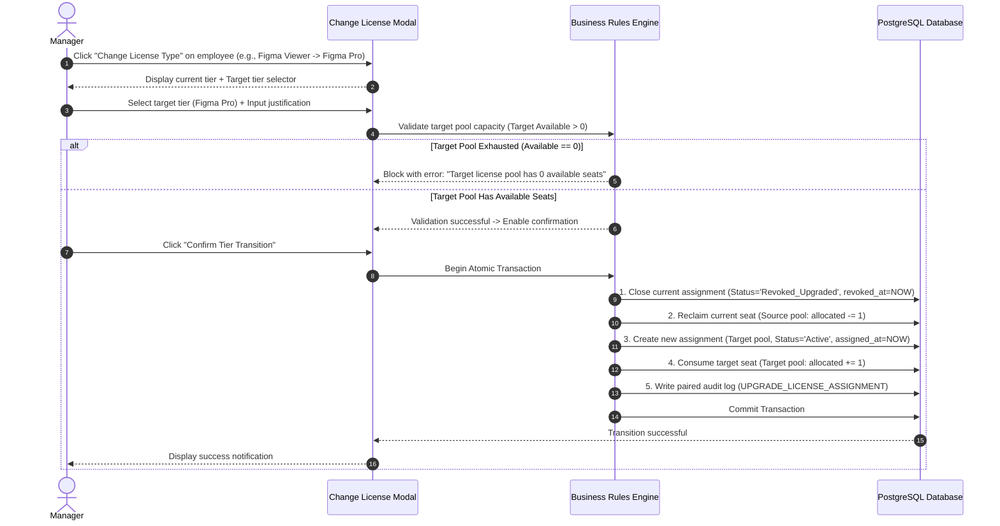

---

### 4.6. Active User Tracking & Inactivity Detection

Monitors software consumption to uncover under-utilized licenses (UC20, US-M10).
- **4 Activity Spectrum Tiers:**
  - `Active (Green):` Activity recorded within the last **7 days**.
  - `Moderate (Blue):` Activity between **8 and 30 days** ago.
  - `Idle / At Risk (Amber):` No activity between **31 and 59 days** ago.
  - `Inactive / Wasteful (Red):` Zero activity for $\ge \mathbf{60}$ **consecutive days**. Flagged as **Reclamation Candidates** with a prominent `[Reclaim Seat]` quick action.

---

### 4.7. Real-time Seat Availability Monitor

Visual capacity dashboard categorized into 4 alert bands:
- 🔴 **Critical Red (Capacity Exhausted):** $Available = 0$ or $Allocated > Purchased$.
- 🟡 **Warning Yellow (Low Capacity):** $Available \le 10\%$ of purchased capacity.
- 🟢 **Optimal Green:** $10\% < Available \le 30\%$.
- 🔵 **Under-utilized Blue:** $Available > 30\%$, indicating excessive software expenditure (UC19).

---

### 4.8. Global Assignment Audit History View

Dedicated chronological ledger recording all license events across the enterprise:
- Filters: Date range, Employee, Actor (Manager), Action (`ASSIGN`, `REVOKE`, `UPGRADE`, `DOWNGRADE`).
- Audit columns: Timestamp, Action, Recipient Employee, Software & Tier, Actor, Reason, Transaction ID.

---

## 5. Module 3: Budget Management (Financial Planning, Expense Tracking, Monitoring & Reporting)

Module 3 delivers comprehensive financial control across software expenditures, organized into **4 strategic business groups**:
- **A. Budget Planning**
- **B. Expense Tracking**
- **C. Budget Monitoring**
- **D. Financial Reporting**

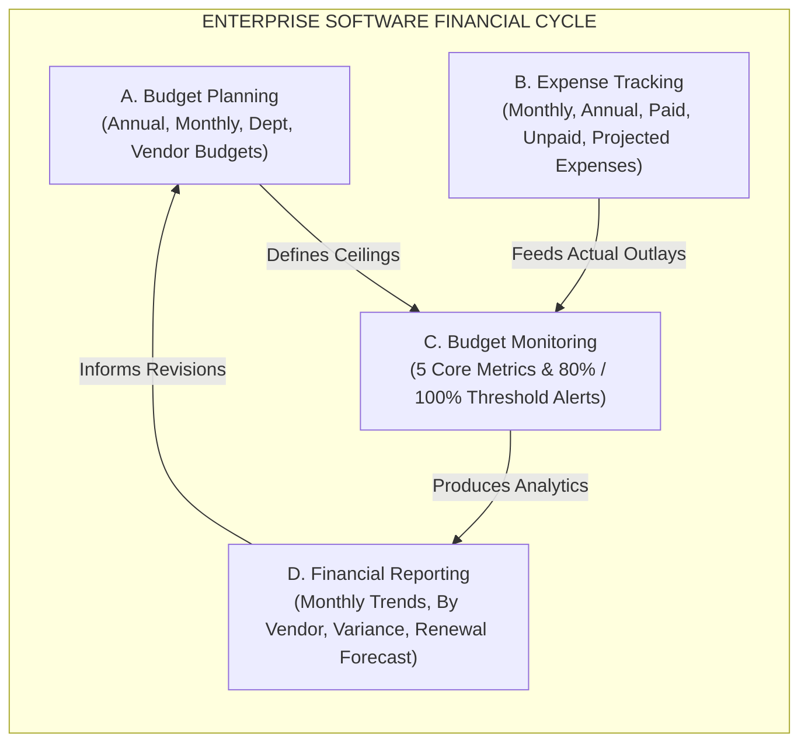

---

### 5.1. Business Group A: Budget Planning

Enables Managers to define and partition financial allocations prior to each fiscal year (UC12, US-M08, BR-09).

#### 1. Annual Total Budget Setup
- **Screen / Drawer:** `/manager/budget/planning?action=new-annual`
- **Configuration Parameters:**
  - `Fiscal Year:` Selector (e.g., `FY2026`, `FY2027`).
  - `Base Currency:` `VND` or `USD` (Uniform across the fiscal year per BR-10, BR-11).
  - `Total Approved Software Ceiling:` Total financial cap (e.g., `5,000,000,000 VND` or `$200,000 USD`).
  - `Validity Period:` Standard `01/01` to `12/31`.
  - `Board Approval Reference:` Board resolution or executive approval memo code.
  - `Supporting Attachment:` Upload signed budget plan PDF.

#### 2. Monthly Budget Breakdown
Offers two allocation strategies:
- **Strategy 1 – Even Distribution:** Automatically partitions: $\text{Monthly Budget} = \frac{\text{Total Annual Budget}}{12}$.
- **Strategy 2 – Seasonal / Custom Allocation:**
  - Manager directly enters allocation values for Month 1 through Month 12 to accommodate seasonal renewal peaks (e.g., March Microsoft renewal, November AWS/Dev tools renewal).
  - **Validation Constraint:**
    $$\sum_{m=1}^{12} \text{Monthly Budget}_m \le \text{Total Annual Budget}$$
    Displays validation errors if the 12-month sum exceeds the annual ceiling.

#### 3. Departmental Budget Allocation
Assigns expenditure caps to internal cost centers:
- Engineering & Technology
- Product & Design
- Sales & Marketing
- Operations & Finance
- HR & Administration
- Unallocated Contingency Buffer
- Constraint check: $\sum \text{Dept Budgets} + \text{Buffer} = \text{Total Annual Budget}$.

#### 4. Software & Vendor Budget Buckets
Establishes specific spending caps for major software vendors or categories:
- *Vendor Buckets:* Microsoft, Adobe, JetBrains, Atlassian, Google Workspace, AWS.
- *Category Buckets:* Productivity & Collaboration, Dev & Infrastructure, Creative Design, Specialized CAD/Engineering.

#### 5. Budget Revisions & Audit Versioning
- Modifications create formal revision versions (`v1.0 (Initial)`, `v1.1 (Q2 Adjustment)`).
- Requires a mandatory `Revision Justification` and records to `audit_logs` (BR-17).

---

### 5.2. Business Group B: Expense Tracking

Maintains a comprehensive ledger of all software expenditures incurred across SaaS subscriptions and perpetual maintenance (UC13, UC33, UC34, US-M09).

#### 1. Core Expense Dimensions
- **Monthly License Expenses:** All monthly billing outlays for cloud-based SaaS tools.
- **Annual License Expenses:** Yearly subscription commitments and perpetual maintenance fees (BR-12).
- **Paid Expenses:** Outlays settled via bank transfer with verified VAT invoices attached. Status: `PAID`. Feeds **Actual Spending**.
- **Unpaid / Pending Expenses:** Invoices received but pending approval or disbursement. Status: `PENDING` or `OVERDUE`. Feeds **Committed Spending**.
- **Projected Future Commitments:** Future liabilities calculated from active subscription contracts and scheduled maintenance renewals. Status: `PROJECTED`.

#### 2. Expense Ledger Grid (`/manager/budget/expenses`)

| Expense / Invoice ID | Software & Tier | Vendor | Amount & Currency | Cycle | Invoice Date | Payment Due Date | Status | VAT Invoice | Actions |
| :--- | :--- | :--- | :---: | :---: | :---: | :---: | :---: | :---: | :--- |
| `EXP-2026-081` | Microsoft 365 E5 | Microsoft Corp | $1,750 USD | Monthly | 2026-11-01 | 2026-11-15 | `PAID` 🟢 | [INV-881.pdf] | View |
| `EXP-2026-082` | Figma Enterprise | Figma Inc | $900 USD | Monthly | 2026-11-05 | 2026-11-20 | `PENDING` 🟡 | [INV-892.pdf] | Approve |
| `EXP-2026-079` | JetBrains All Pack | JetBrains s.r.o | 320,000,000 VND | Annual | 2026-10-15 | 2026-10-30 | `PAID` 🟢 | [VAT-012.pdf]| View |
| `EXP-2026-090` | AutoCAD 2026 Maint | Autodesk Inc | 145,000,000 VND | Annual (Maint)| 2026-12-01 | 2026-12-15 | `PROJECTED` 🔵| [Draft PO] | View |

#### 3. Invoice Compliance & Currency Policies (BR-10 & BR-11)
- **Rule BR-10:** Expense records require: Positive amount, designated currency (`VND` or `USD`), invoice date, invoice serial number, and beneficiary vendor.
- **Rule BR-11:** Different currencies are never aggregated directly. The system utilizes an administrative exchange rate table (e.g., $1 \text{ USD} = 25,400 \text{ VND}$) to standardize reporting into the fiscal base currency.

---

### 5.3. Business Group C: Budget Monitoring

Executive dashboard monitoring enterprise software financial health (`/manager/budget/monitoring`), featuring 5 key metrics and automatic threshold triggers (UC14, US-M08, US-M13).

#### 1. 5 Core Financial Metrics

| Metric Name | Business Meaning | Mathematical Formula | Management Objective |
| :--- | :--- | :--- | :--- |
| **1. Total Budget** | Total approved financial allocation for the fiscal cycle. | $\text{Total Budget} = \sum \text{Department Budgets}$ | Defines the authorized legal expenditure ceiling. |
| **2. Actual Spending** | Total expenses settled and disbursed to date. | $\text{Actual Spending} = \sum \text{Paid Expenses}$ | Measures net cash disbursed from corporate accounts. |
| **3. Committed Spending** | Obligated future expenditures (Pending invoices + Active contracts).| $\text{Committed} = \sum \text{Pending} + \sum \text{Active Contracts in Period}$ | Captures legally binding contractual obligations. |
| **4. Remaining Budget** | Uncommitted funds available for new software procurement. | $\text{Remaining} = \text{Total} - (\text{Actual} + \text{Committed})$ | Quantifies exact headroom for new license requests. |
| **5. Budget Utilization** | Percentage of budget consumed and obligated against the plan. | $\text{Utilization (\%)} = \left(\frac{\text{Actual} + \text{Committed}}{\text{Total Budget}}\right) \times 100\%$ | Evaluates spending velocity and overrun risks. |

---

#### 2. Automatic Budget Threshold Alert Cockpit (UC14)

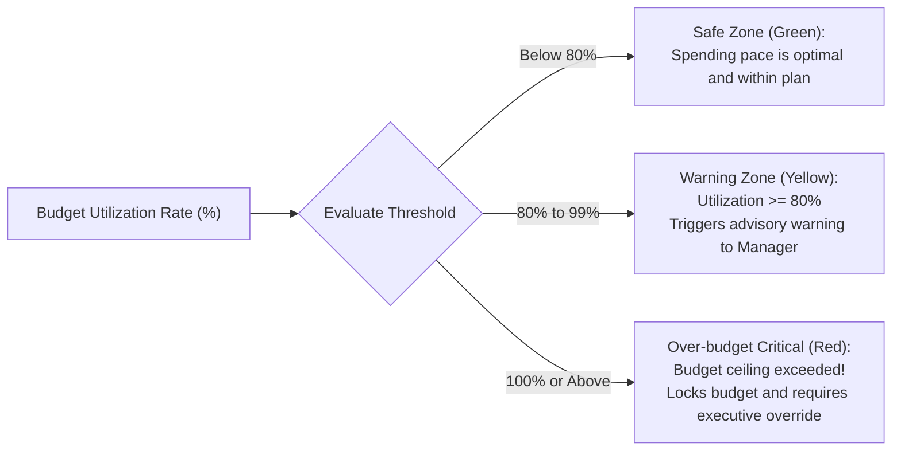

- **Green Zone (Safe - Under 80%):** Normal disbursement pace.
- **Yellow Zone (Warning - 80% to 99%):** Dispatches early warning notifications to the Manager dashboard to review upcoming renewals and reclaim unused seats before breaching ceilings.
- **Red Zone (Critical Over-budget - $\ge 100\%$):** Displays prominent red alerts across the Manager portal. Approving new cost-incurring licenses triggers a soft-stop dialog: *"Department budget has reached 100% capacity. Executive approval required to proceed."*

#### 3. Cumulative Spending Burn-down / Burn-up Chart
- Grey Line: Planned linear budget path across 12 months.
- Blue Line: Net actual spending disbursed.
- Amber Dotted Line: Cumulative committed spending (Actual + Committed).
- Forecasts projected year-end variance and anticipates potential budget exhaustion points.

---

### 5.4. Business Group D: Financial Reporting

Produces executive-grade financial reports for board reviews, accounting reconciliation, and renewal planning (UC24, UC26, US-M13).

#### 1. Report 1: Monthly Expense Trend Report
- **Format:** Stacked bar chart with tabular breakdown.
- **Components:** SaaS Subscriptions, Perpetual Maintenance, and Professional Support Fees across 12 months.
- **Metrics:** Month-over-Month (MoM) growth rates and anomaly detection for spikes.

#### 2. Report 2: Expense Breakdown by Vendor
- **Format:** Donut chart and Treemap.
- **Analysis:** Market share of software spending per vendor (e.g., Microsoft 42%, Adobe 18%, JetBrains 14%, Atlassian 10%, Others 16%). Identifies Top 5 strategic vendors for enterprise volume discount negotiations.

#### 3. Report 3: Budget vs. Actual Variance Analysis
- **Objective:** Compares planned budgets against actuals and commitments across cost centers.
- **Variance Matrix Structure:**

| Cost Center / Department | Planned Budget | Actual Outlays | Committed Spending | Total Incurred | Variance | Variance % | Status Assessment |
| :--- | :---: | :---: | :---: | :---: | :---: | :---: | :---: |
| **Engineering (Tech)** | 1,800,000,000 ₫ | 1,420,000,000 ₫ | 180,000,000 ₫ | 1,600,000,000 ₫ | +200,000,000 ₫ | +11.1% | 🟢 Favorable (Under-budget) |
| **Design & UX** | 600,000,000 ₫ | 510,000,000 ₫ | 115,000,000 ₫ | 625,000,000 ₫ | -25,000,000 ₫ | -4.2% | 🔴 Unfavorable (Over-budget) |
| **Sales & Marketing** | 450,000,000 ₫ | 340,000,000 ₫ | 60,000,000 ₫ | 400,000,000 ₫ | +50,000,000 ₫ | +11.1% | 🟢 Favorable (Under-budget) |
| **Contingency Buffer** | 300,000,000 ₫ | 0 ₫ | 0 ₫ | 0 ₫ | +300,000,000 ₫ | +100% | 🟢 Available |

- **Variance Calculation:** $\text{Variance} = \text{Budget} - (\text{Actual} + \text{Committed})$. Positive variance indicates savings (Favorable), negative indicates overruns (Unfavorable).

#### 4. Report 4: Renewal Cost Forecasting with Optimization Insights
- **Forecasting Horizons:** 30-Day, 90-Day, and 365-Day forward cash-flow horizons.
- **Integrated Optimization Recommendation Engine:** Cross-references upcoming contract renewals with **Inactive Users ($\ge 60$ days)** from Module 2:
  - *Example Actionable Insight:* *"JetBrains All Products Pack is scheduled for renewal on 2026-12-15 for 50 seats ($15,000). System identified 8 users inactive for $\ge 60$ days. Downsizing to 42 seats prior to renewal will save $2,400 USD annually."*
- **Export Options:** `[Export Board-Ready PDF]` with executive charts and `[Export Raw CSV/Excel]` for accounting audits.

---

## 6. State Machines & Data Integrity Mechanisms

### 6.1. License Entitlement State Lifecycle (Module 1)

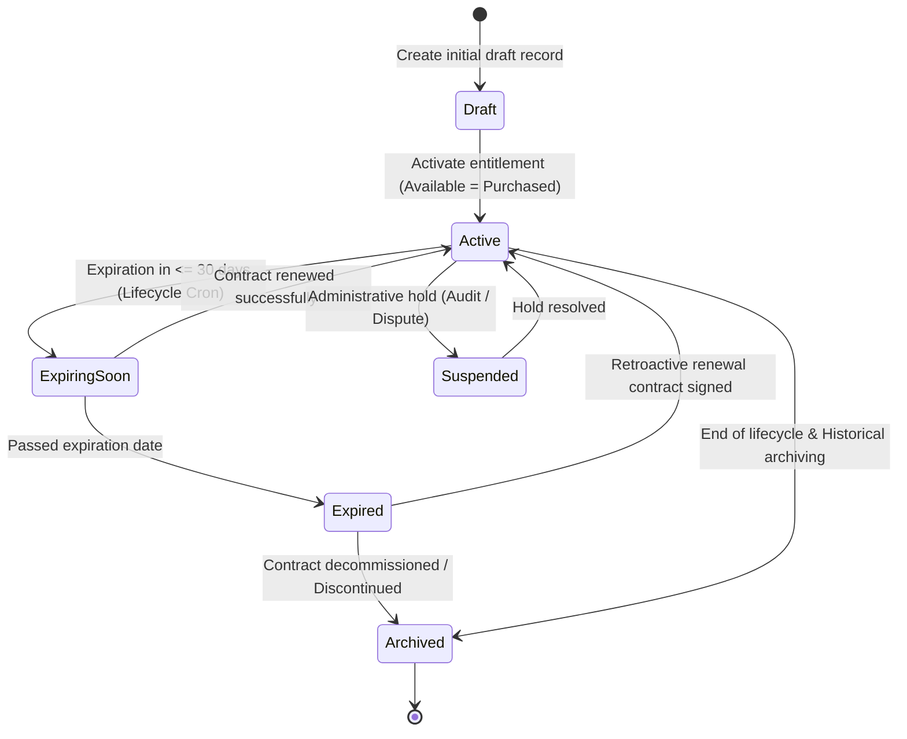

---

### 6.2. License Seat Assignment State Lifecycle (Module 2)

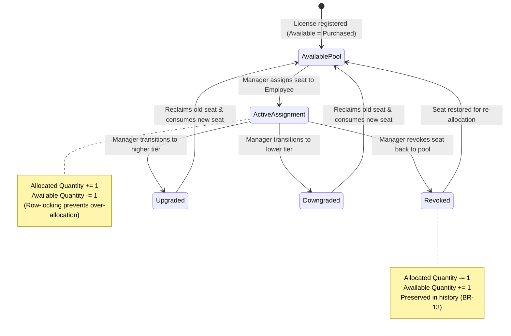

---

### 6.3. Expense Record State Lifecycle (Module 3)

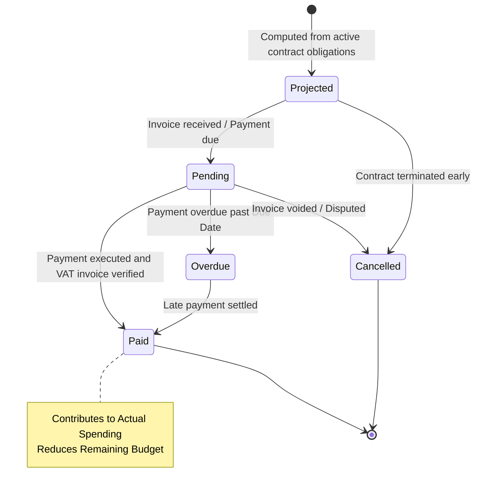

---

### 6.4. Budget Plan State Lifecycle (Module 3)

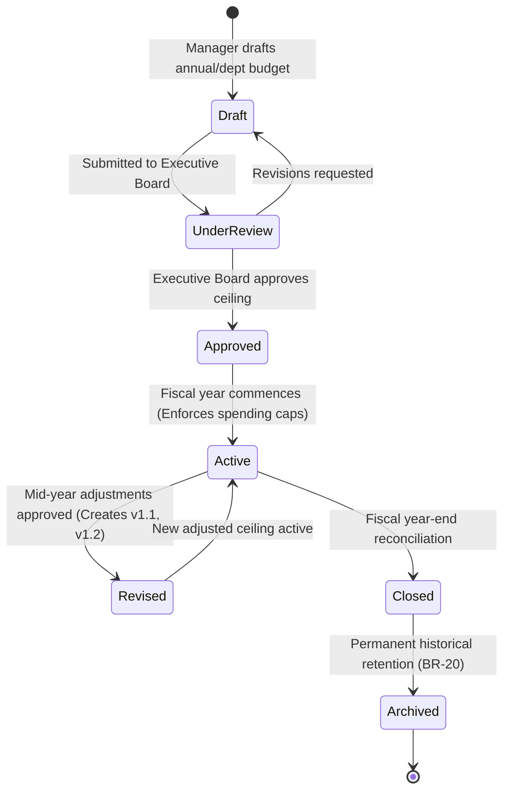

---

## 7. Detailed UI Layout Wireframes

### 7.1. Wireframe: License Management List View (`/manager/licenses`)

```text
+--------------------------------------------------------------------------------------------------------------------+
|  VFast ELMS  |  [Dashboard]  [Licenses*]  [Assignments]  [Budgets]  [Optimization]  [Audit Logs]   | (Mgr) Dat Nguyen |
+--------------------------------------------------------------------------------------------------------------------+
| HOME / LICENSE MANAGEMENT                                                                                          |
|                                                                                                                    |
| License Management                                                            [ Export Report ]  [ + Add License ] |
| Centralized inventory of SaaS subscriptions and perpetual software entitlements                                    |
|                                                                                                                    |
| +--------------------+ +--------------------+ +--------------------+ +--------------------+ +--------------------+ |
| | ACTIVE LICENSES    | | TOTAL SEATS        | | ALLOCATION RATE    | | EXPIRING (30D)     | | OVER-ALLOCATED     | |
| | 42 Entitlements    | | 1,250 Seats        | | 86.4% Utilized     | | 4 Contracts        | | 0 Violations       | |
| | 36 SaaS - 6 Perp   | | 1,080 / 1,250      | | [=========-] 86%   | | (Urgent Action)    | | (Fully Compliant)  | |
| +--------------------+ +--------------------+ +--------------------+ +--------------------+ +--------------------+ |
|                                                                                                                    |
| FILTER & SEARCH TOOLBAR                                                                                            |
| [ Search software, vendor, key... ] [ Vendor: All v ] [ Model: All v ] [ Status: All v ] [ Reset Filters ]         |
|                                                                                                                    |
| LICENSE INVENTORY                                                                                                  |
| +----+----------------------+-------------------+-------------+---------------+---------+------------+----------+--+
| |[x] | Software & Edition   | Vendor            | Model       | Capacity      | Avail   | Expires    | Status   |..|
| +----+----------------------+-------------------+-------------+---------------+---------+------------+----------+--+
| |[ ] | Microsoft 365 E5     | Microsoft Corp    | SaaS Sub    | 45/50 (90%)   | 5 seats | 2026-12-31 | [Active] |..|
| |[ ] | JetBrains All Pack   | JetBrains s.r.o   | SaaS Sub    | 50/50 (100%)  | 0 seats | 2026-10-15 | [Active] |..|
| |[ ] | Adobe CC All Apps    | Adobe Systems     | SaaS Sub    | 18/20 (90%)   | 2 seats | 2026-11-25 | [ExpSoon]|..|
| |[ ] | AutoCAD 2026 Pro     | Autodesk Inc      | Perpetual   | 11/15 (73%)   | 4 seats | 2027-05-10*| [Active] |..|
| |[ ] | Windows 11 Pro OEM   | Microsoft Corp    | Perpetual   | 120/150 (80%) | 30 seats| Perpetual  | [Active] |..|
| +----+----------------------+-------------------+-------------+---------------+---------+------------+----------+--+
| Showing 1 - 5 of 42 licenses                                 [<<] [<] Page 1 of 9 [>] [>>]   Rows: [ 10 / page v ] |
+--------------------------------------------------------------------------------------------------------------------+
```

---

### 7.2. Wireframe: Assignment Hub & Availability Monitor (`/manager/assignments`)

```text
+--------------------------------------------------------------------------------------------------------------------+
|  VFast ELMS  |  [Dashboard]  [Licenses]  [Assignments*]  [Budgets]  [Optimization]  [Audit Logs]   | (Mgr) Dat Nguyen |
+--------------------------------------------------------------------------------------------------------------------+
| HOME / LICENSE ASSIGNMENT HUB                                                                                      |
|                                                                                                                    |
| License Assignment Hub                                                        [ Batch Revoke ]  [ + Assign Seat ]  |
| Employee software allocation, seat availability tracking, and tier transitions                                     |
|                                                                                                                    |
| [ View: By Employee (A) ]  [ View: By Software & Seat (B) ]  [ Seat Availability Monitor (C) ]  [ Global History ] |
|                                                                                                                    |
| +----------------------------------------------------------------------------------------------------------------+ |
| | REAL-TIME SEAT AVAILABILITY MONITOR                                                                            | |
| +------------------------------------+-----------+-----------+----------+---------------+----------------+-------+ |
| | Software & Entitlement Tier        | Purchased | Allocated | Available| Capacity %    | Alert Status   |Action | |
| +------------------------------------+-----------+-----------+----------+---------------+----------------+-------+ |
| | Microsoft 365 Enterprise E5        | 50 seats  | 45 seats  | 5 seats  | [========-]90%| 🟡 Low Cap     |[Assign| |
| | JetBrains All Products Pack        | 50 seats  | 50 seats  | 0 seats  | [=========]100%| 🔴 Exhausted   |[View] | |
| | Adobe Creative Cloud All Apps      | 20 seats  | 18 seats  | 2 seats  | [========-]90%| 🟡 Low Cap     |[Assign| |
| | Figma Enterprise Design            | 40 seats  | 22 seats  | 18 seats | [====-----]55%| 🔵 Under-used  |[Optmz]| |
| | AutoCAD 2026 Maintenance           | 15 seats  | 11 seats  | 4 seats  | [======---]73%| 🟢 Optimal     |[Assign| |
| +------------------------------------+-----------+-----------+----------+---------------+----------------+-------+ |
|                                                                                                                    |
| EMPLOYEE ALLOCATIONS DIRECTORY (ACTIVE USER TRACKING)                                                              |
| Search: [ Enter employee name, email, department... ]         Activity Filter: [ Inactive >= 60 Days v ]           |
| +----------------------+------------------+---------------------+----------------+------------------+------------+ |
| | Employee             | Department       | Allocated Software  | Last Activity  | Usage Status     | Actions    | |
| +----------------------+------------------+---------------------+----------------+------------------+------------+ |
| | John Doe (j.doe)     | Engineering      | JetBrains All Pack  | 68 days ago    | 🔴 Inactive 68d  |[Revoke]    | |
| | Sarah Lee (s.lee)    | Product Design   | Adobe CC All Apps   | 62 days ago    | 🔴 Inactive 62d  |[Revoke]    | |
| | Emma Vance (e.vance) | Marketing        | Canva Pro           | Yesterday      | 🟢 Active        |[ChangeTier]| |
| +----------------------+------------------+---------------------+----------------+------------------+------------+ |
+--------------------------------------------------------------------------------------------------------------------+
```

---

### 7.3. Wireframe: Assign License Drawer (`/manager/assignments/new`)

```text
+-------------------------------------------------------------+
| ASSIGN LICENSE SEAT TO EMPLOYEE                         [X] |
+-------------------------------------------------------------+
| STEP 1: SELECT BENEFICIARY EMPLOYEE                         |
| Search employee: [ Alex Mercer                            ] |
| +---------------------------------------------------------+ |
| | [Avatar] Alex Mercer (a.mercer@vfast.com)               | |
| | Dept: Engineering | Title: Senior Backend Engineer      | |
| | Current Licenses: [Windows 11 Pro Enterprise]           | |
| +---------------------------------------------------------+ |
|                                                             |
| STEP 2: SELECT SOFTWARE & ENTITLEMENT POOL                  |
| Software: [ Microsoft 365                               v ] |
| Entitlement Pool:                                           |
| (o) Microsoft 365 E5 (PO-2026-01) - 5 SEATS AVAILABLE 🟢    |
| ( ) Microsoft 365 Business (PO-2025-11) - 0 SEATS LEFT 🔴   |
|                                                             |
| STEP 3: ASSIGNMENT PARAMETERS                               |
| Effective Date: [ 2026-11-09   📅 ]                         |
| Duration Terms:                                             |
| (o) Permanent (Follows master license contract term)        |
| ( ) Temporary Project Bound -> Until [ 2027-02-09 ]         |
|                                                             |
| Business Justification: (Mandatory)                         |
| [ Required for enterprise email and Teams integration for ] |
| [ VFast Core System development during Q4                 ] |
|                                                             |
| [!] System automatically reserves 1 seat in database pool   |
|     and sends onboarding email instructions to the user.    |
+-------------------------------------------------------------+
|                       [ Cancel ]   [ Confirm Seat Allocation ]|
+-------------------------------------------------------------+
```

---

### 7.4. Wireframe: Change License Type Modal (Upgrade / Downgrade)

```text
+-----------------------------------------------------------------------+
| CHANGE LICENSE TIER (UPGRADE / DOWNGRADE)                         [X] |
+-----------------------------------------------------------------------+
| Employee: Lisa Chang (l.chang@vfast.com) - UI/UX Designer             |
|                                                                       |
| +--------------------------------+   +------------------------------+ |
| | CURRENT TIER                   |   | TARGET TIER                  | |
| | Figma Viewer Only              |   | Figma Enterprise Editor      | |
| | Status: Active                 |==>| Pool: 6 seats available      | |
| | Cost: $0 / month               |   | New Cost: $45 / month        | |
| +--------------------------------+   +------------------------------+ |
|                       Transaction Type: [ ⬆ UPGRADE TIER ]            |
|                                                                       |
| Effective Transition Date: [ 2026-11-10   📅 ]                        |
|                                                                       |
| Business Justification: (Mandatory)                                   |
| [ Promoted to Lead Designer; requires full editing rights for the    ]|
| [ enterprise design system repository                                ]|
|                                                                       |
| [i] Atomic Transaction Execution:                                     |
|     1. Reclaims 1 Viewer seat back to source pool (+1).               |
|     2. Consumes 1 Enterprise Editor seat from target pool (-1).       |
|     3. Automatically updates Design department budget ledger.         |
+-----------------------------------------------------------------------+
|                       [ Cancel ]   [ Confirm Tier Transition ]        |
+-----------------------------------------------------------------------+
```

---

### 7.5. Wireframe: Budget Monitoring Cockpit (`/manager/budget/monitoring`)

```text
+--------------------------------------------------------------------------------------------------------------------+
|  VFast ELMS  |  [Dashboard]  [Licenses]  [Assignments]  [Budgets*]  [Optimization]  [Audit Logs]   | (Mgr) Dat Nguyen |
+--------------------------------------------------------------------------------------------------------------------+
| HOME / BUDGET MANAGEMENT & FINANCIAL CONTROL                                                                       |
|                                                                                                                    |
| Budget Monitoring Cockpit                                                     [ Export Report ]  [ + Budget Plan ] |
| Fiscal Year: [ FY2026 (2026-01-01 - 2026-12-31) v ]        Currency: [ VND (Millions) v ]                          |
|                                                                                                                    |
| 5 CORE FINANCIAL HEALTH METRICS                                                                                    |
| +--------------------+ +--------------------+ +--------------------+ +--------------------+ +--------------------+ |
| | 1. TOTAL BUDGET    | | 2. ACTUAL SPENT    | | 3. COMMITTED       | | 4. REMAINING       | | 5. UTILIZATION     | |
| | 5,000,000,000 ₫    | | 3,450,000,000 ₫    | | 750,000,000 ₫      | | 800,000,000 ₫      | | 84.0% (Warning)    | |
| | Approved FY2026    | | Disbursed to date  | | Pending Invoices+PO| Available Headroom   | 🟡 Breached 80% Cap  | |
| +--------------------+ +--------------------+ +--------------------+ +--------------------+ +--------------------+ |
|                                                                                                                    |
| [!] WARNING: Budget utilization has reached 84.0% (Warning threshold: 80%). Review Q4 expenditures.               |
|                                                                                                                    |
| [ Monitoring Cockpit* ]   [ Budget Planning ]   [ Expense Tracking Ledger ]   [ Financial Reporting Center ]       |
|                                                                                                                    |
| 12-MONTH CUMULATIVE SPENDING BURN-DOWN / BURN-UP CHART                                                             |
| 5,000M ₫ |------------------------------------------------------------------------------[ ANNUAL BUDGET CEILING ]  |
| 4,000M ₫ |                                                          /----(Committed 4,200M)                        |
| 3,000M ₫ |                                         /---------------/ (Actual 3,450M)                               |
| 2,000M ₫ |                         /--------------/                                                                |
| 1,000M ₫ |         /--------------/                                                                                |
|     0 ₫   +---------+---------+---------+---------+---------+---------+---------+---------+---------+---------+     |
|           M01       M02       M03       M04       M05       M06       M07       M08       M09(Now)  M10  M11  M12     |
|           --- Planned Linear Pace           === Actual Disbursed          ... Committed Total                      |
|                                                                                                                    |
| DEPARTMENTAL BUDGET UTILIZATION PROGRESS                                                                           |
| Engineering (Tech)       | Budget: 2,200M ₫ | Used: 1,920M (87%) | [====================----] 87% 🟡 Warning       |
| Product & Design         | Budget:   700M ₫ | Used:   650M (93%) | [======================--] 93% 🟡 Warning       |
| Sales & Marketing        | Budget:   900M ₫ | Used:   630M (70%) | [================--------] 70% 🟢 On Track      |
| Operations & Admin       | Budget: 1,200M ₫ | Used: 1,000M (83%) | [===================-----] 83% 🟡 Warning       |
+--------------------------------------------------------------------------------------------------------------------+
```

---

### 7.6. Wireframe: Budget Planning Matrix (`/manager/budget/planning`)

```text
+--------------------------------------------------------------------------------------------------------------------+
| BUDGET PLANNING & PARTITIONING (BUDGET PLANNING)                                                                   |
| Fiscal Year: [ FY2026 v ]      Ceiling: [ 5,000,000,000 ] VND            [ Auto Split 12 Months ] [ Save Plan ]    |
+--------------------------------------------------------------------------------------------------------------------+
| DEPARTMENTAL & MONTHLY ALLOCATION MATRIX (Units: Million VND)                                                      |
| +--------------------+-------+-------+-------+-------+-------+-------+-------+-------+-------+------+------+------+ |
| | Department / Month | M01   | M02   | M03*  | M04   | M05   | M06   | M07   | M08   | M09   | M10  | M11* | M12  | |
| +--------------------+-------+-------+-------+-------+-------+-------+-------+-------+-------+------+------+------+ |
| | Engineering (Tech) |  150  |  150  |  350  |  150  |  150  |  200  |  150  |  150  |  150  |  150 |  300 |  100 | |
| | Design & UX        |   50  |   50  |   80  |   50  |   50  |   60  |   50  |   50  |   50  |   50 |   60 |   40 | |
| | Marketing & Sales  |   70  |   70  |   70  |   70  |   70  |  100  |   70  |   70  |   70  |   70 |   70 |   90 | |
| | Ops & Admin        |   80  |   80  |  120  |   80  |   80  |   80  |   80  |   80  |   80  |   80 |  120 |  240 | |
| | Buffer Contingency |   20  |   20  |   20  |   20  |   20  |   40  |   20  |   20  |   20  |   20  |   20  |   60 | |
| +--------------------+-------+-------+-------+-------+-------+-------+-------+-------+-------+------+------+------+ |
| | TOTAL MONTHLY      |  370  |  370  |  640  |  370  |  370  |  480  |  370  |  370  |  370  |  370 |  570 |  530 | |
| +--------------------+-------+-------+-------+-------+-------+-------+-------+-------+-------+------+------+------+ |
| (*) Heavy renewal months (March: Microsoft Enterprise; November: Cloud Infrastructure & Dev suites).               |
| Aggregate 12-Month Allocation: 5,000 / 5,000 Million VND [ PERFECTLY BALANCED 100% 🟢 ]                            |
+--------------------------------------------------------------------------------------------------------------------+
```

---

### 7.7. Wireframe: Financial Reporting Center (`/manager/budget/reports`)

```text
+--------------------------------------------------------------------------------------------------------------------+
| FINANCIAL REPORTING CENTER                                                      [ Export Board PDF ] [ Export CSV ]|
| Report Type: (o) Monthly Trends   ( ) By Vendor   ( ) Budget vs. Actual Variance   ( ) Renewal Cashflow Forecast   |
+--------------------------------------------------------------------------------------------------------------------+
| BUDGET VS. ACTUAL VARIANCE ANALYSIS (FY2026 TO DATE)                                                               |
| +------------------------+------------------+------------------+------------------+----------------+--------------+|
| | Cost Center / Category | Planned Budget   | Actual Outlays   | Committed Liab   | Net Variance   | Evaluation   ||
| +------------------------+------------------+------------------+------------------+----------------+--------------+|
| | Engineering (Tech)     | 2,200,000,000 ₫  | 1,720,000,000 ₫  |   200,000,000 ₫  | +280,000,000 ₫ | 🟢 Favorable ||
| | Product & Design       |   700,000,000 ₫  |   580,000,000 ₫  |   140,000,000 ₫  |  -20,000,000 ₫ | 🔴 Over-run  ||
| | Sales & Marketing      |   900,000,000 ₫  |   630,000,000 ₫  |    80,000,000 ₫  | +190,000,000 ₫ | 🟢 Favorable ||
| | Operations & Admin     | 1,200,000,000 ₫  |   820,000,000 ₫  |   180,000,000 ₫  | +200,000,000 ₫ | 🟢 Favorable ||
| +------------------------+------------------+------------------+------------------+----------------+--------------+|
| | ENTERPRISE TOTAL       | 5,000,000,000 ₫  | 3,750,000,000 ₫  |   600,000,000 ₫  | +650,000,000 ₫ | 🟢 Under Cap ||
| +------------------------+------------------+------------------+------------------+----------------+--------------+|
|                                                                                                                    |
| 90-DAY FORWARD RENEWAL FORECAST & COST OPTIMIZATION INSIGHTS                                                       |
| 1. Microsoft 365 E5: Renews 2026-12-31. Projected Renewal Outlay: $21,000 USD (50 seats).                         |
|    -> Optimization Insight: 5 seats inactive >= 60 days. Downsizing to 45 seats yields $2,100 USD/year savings.     |
| 2. JetBrains All Pack: Renews 2026-10-15. Projected Renewal Outlay: 320,000,000 VND (50 seats).                   |
|    -> Optimization Insight: 8 seats inactive >= 60 days. Reclaiming yields 51,200,000 VND/year savings.           |
+--------------------------------------------------------------------------------------------------------------------+
```

---

## 8. User Interface Interaction Guidelines & Edge Cases

### 8.1. Feedback States, Toasts & Confirmation Modals
- **Successful Assignment Toast (Green):** *"Successfully assigned license [Software Name] to employee [Employee Name]. Available seats remaining: X."*
- **Successful Revocation Toast (Green):** *"Successfully revoked license [Software Name] to inventory pool. Available capacity increased by +1."*
- **Capacity Exhaustion Dialog (Red Alert - BR-05):** *"Allocation Failed: License pool has 0 available seats ($Available = 0$). Please procure additional seats or reclaim inactive allocations."*
- **Deletion Safeguard Modal (Red Alert - BR-05, BR-13):** *"Cannot delete license: Active allocations exist (X seats). Please revoke all active seats prior to deletion."*
- **Budget Warning Banner (Amber - UC14):** *"Warning: Department budget [Department Name] has reached 80% utilization ceiling."*

### 8.2. Empty States
- When inventory contains 0 licenses: Displays welcome graphic with call-to-action button `[+ Register First License]`.
- When fiscal year has no budget: Displays *"No budget configured for this fiscal cycle"* with CTA button `[+ Setup Budget Plan]`.
- When search filters return zero results: Displays *"No records match the selected filter criteria"* with `[Clear Filters]` button.

### 8.3. Security, RBAC & Audit Trail Enforcement
- All Add, Edit, Delete, Assign, Revoke, and Budget Setup buttons are strictly restricted to the **Manager** role (RBAC Enforcement per **BR-06, BR-07, BR-09**). Unauthorized attempts by Editor or Employee roles return HTTP `403 Forbidden`.
- 100% of state transitions, capacity adjustments, and financial revisions are persisted to `audit_logs` with fields: `actor_id`, `actor_role = 'Manager'`, `action`, `target_id`, `old_value`, `new_value`, `ip_address`, `timestamp` (Enforces **BR-17**).
