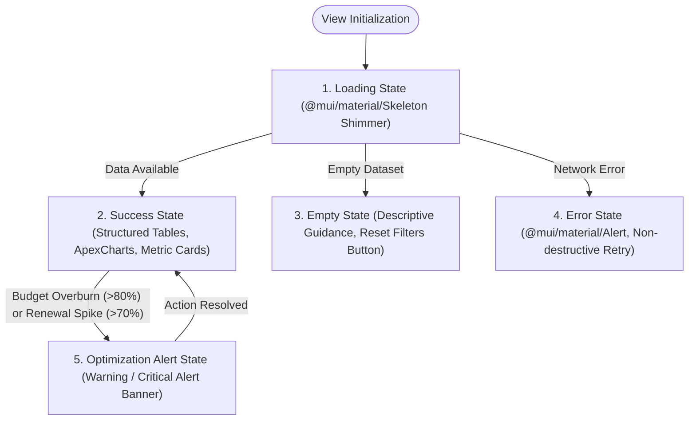

# UI/UX INFORMATION ARCHITECTURE & VIEW SPECIFICATIONS (IA)
## Project: VFast – Enterprise License Management System (ELMS)
### Subsystem: Enterprise Management & Admin Portal (Unified 3-Pillar Architecture)

> **Document Baseline:** [README.md](../README.md), [docs/01-MVP.md](01-MVP.md), [docs/02-use-cases.md](02-use-cases.md), [docs/03-user-stories.md](03-user-stories.md)  
> **Architecture Version:** 5.2 – Concise Card & Chart Titles, Minimalist KPI Ergonomics & Renewal Drill-Down  
> **Target Scope:** Executive Portal focused on **License Management**, **Analytics Hub (Health & Budget Analytics)**, and **Admin User & Tenant Management**  
> **Git Branch:** `docs/ia-clean-kpi-renewal-detail`

---

## 📋 TABLE OF CONTENTS

1. [Executive Architecture Overview](#-1-executive-architecture-overview)
2. [Master Screen & View Catalog](#-2-master-screen--view-catalog)
3. [Screen Hierarchy & Navigation Flow](#-3-screen-hierarchy--navigation-flow)
4. [Detailed View Specification: View 1 – License Management](#-4-detailed-view-specification-view-1--license-management)
   - 4.1. [Top Cards & Visuals (Total Licenses, Category Breakdown, Top 5 Apps)](#41-top-cards--visuals-total-licenses-category-breakdown-top-5-apps)
   - 4.2. [License Data Grid (9 Core Columns)](#42-license-data-grid-9-core-columns)
   - 4.3. [License Detail Drawer / Dialog (SCR-LIC-DETAIL-01 / SRC-LIC-ANALYTICS-01)](#43-license-detail-drawer--dialog-scr-lic-detail-01--src-lic-analytics-01)
     - 4.3.1. [Top Actions & Direct In-Place Edit](#431-top-actions--direct-in-place-edit)
     - 4.3.2. [Key Indicators (Compact 2x3 Grid)](#432-key-indicators-compact-2x3-grid)
     - 4.3.3. [Metadata & Policies](#433-metadata--policies)
     - 4.3.4. [Granted Accounts Roster](#434-granted-accounts-roster)
5. [Detailed View Specification: View 2 – Analytics Hub](#-5-detailed-view-specification-view-2--analytics-hub)
   - **View 2A: License Health Analytics (`SCR-ANALYTICS-01`)**
     - 5.1. [Top 4 KPIs: Spend, Licenses, Idle Accounts, Wasted Spend](#51-top-4-kpis-spend-licenses-idle-accounts-wasted-spend)
     - 5.2. [Chart: Application Usage (Horizontal Bar)](#52-chart-application-usage-horizontal-bar)
     - 5.3. [Chart: Department Spend (Horizontal Bar)](#53-chart-department-spend-horizontal-bar)
     - 5.4. [Chart: Subscription Dynamics (Dual-Column Bar)](#54-chart-subscription-dynamics-dual-column-bar)
   - **View 2B: Budget Analytics (`SCR-BUDGET-ANALYTICS-01`)**
     - 5.5. [Top Controls & Monthly Budget Trigger](#55-top-controls--monthly-budget-trigger)
     - 5.6. [Top 4 Budget KPIs: Remaining Budget, Next Month Renewals, Consumed, Waste](#56-top-4-budget-kpis-remaining-budget-next-month-renewals-consumed-waste)
     - 5.7. [Upcoming Renewals Drawer (SCR-BUDGET-RENEWALS-01)](#57-upcoming-renewals-drawer-scr-budget-renewals-01)
     - 5.8. [Chart: Budget by Category (Horizontal Stacked Bar)](#58-chart-budget-by-category-horizontal-stacked-bar)
     - 5.9. [Chart: Historical Spend Trend (Area / Line Timeline)](#59-chart-historical-spend-trend-area--line-timeline)
     - 5.10. [Set Monthly Budget Modal (SCR-BUDGET-SET-01)](#510-set-monthly-budget-modal-scr-budget-set-01)
6. [Detailed View Specification: View 3 – User Management: Role & Tenant Administration](#-6-detailed-view-specification-view-3--user-management-role--tenant-administration)
   - 6.1. [Top 4 Identity KPIs: Users, Active Users, Tenants, Privileged Roles](#61-top-4-identity-kpis-users-active-users-tenants-privileged-roles)
   - 6.2. [Header Filters & Actions](#62-header-filters--actions)
   - 6.3. [User & Tenant Data Grid (9 Core Columns)](#63-user--tenant-data-grid-9-core-columns)
   - 6.4. [Edit Role & Tenant Drawer (SCR-USER-EDIT-01)](#64-edit-role--tenant-drawer-scr-user-edit-01)
7. [UI/UX State Contract, Technical Constraints & Interaction Rules](#-7-uiux-state-contract-technical-constraints--interaction-rules)
   - 7.1. [The 5 Core UI States Contract](#71-the-5-core-ui-states-contract)
   - 7.2. [Concise Titles & Zero-Bloat Information Minimization Constraint](#72-concise-titles--zero-bloat-information-minimization-constraint)
   - 7.3. [Icon Integrity Constraint](#73-icon-integrity-constraint)
   - 7.4. [Component Library Standard (@mui/material)](#74-component-library-standard-muimaterial)
   - 7.5. [Data Visualization Standard (ApexCharts)](#75-data-visualization-standard-apexcharts)
8. [Screen-to-API Mapping Matrix](#-8-screen-to-api-mapping-matrix)

---

## 🏛️ 1. EXECUTIVE ARCHITECTURE OVERVIEW

The Information Architecture of the VFast Enterprise License Management System (ELMS) Executive & Admin Portal is standardized into a unified **3-Pillar Enterprise Model**:

1. **Pillar 1: License Management (`SCR-LIC-MGMT-01` & `SCR-LIC-DETAIL-01` / `SRC-LIC-ANALYTICS-01`):** Operational software inventory, category distribution, seat entitlements, active utilization rates, and an in-context detail drawer with direct metadata editing and granted user account roster.
2. **Pillar 2: Analytics Hub (`SCR-ANALYTICS-01` & `SCR-BUDGET-ANALYTICS-01`):** Strategic health and financial intelligence center divided into two high-signal views:
   - **View 2A – License Health:** 4 clean executive KPIs, user activity status breakdown (Never used / Inactive >60d / Actively used), cross-departmental cost allocations, and 12-month dual-column subscription dynamics.
   - **View 2B – Budget Analytics:** Dedicated financial control center enabling Admins to set monthly budget plans, monitor real-time **Remaining Budget**, evaluate **Next Month Renewals** (% of upcoming budget consumed by renewal obligations) with direct drill-down access to specific expiring licenses (`SCR-BUDGET-RENEWALS-01`), assess category budget distribution, and track historical spending trajectories.
3. **Pillar 3: User Management (`SCR-USER-MGMT-01` & `SCR-USER-EDIT-01`):** Centralized administration portal empowering Admins to oversee multi-tenant boundaries, system roles (`Admin`, `Manager`, `Staff`, `Employee`), active license allocations, and account lifecycle states with strict session invalidation security guards.

### Core Design Principles
- **Punchy, Concise Titles:** Card and chart titles are strictly 2 to 4 words, stating immediately and unambiguously what the card conveys (e.g., `Remaining Budget`, `Next Month Renewals`, `Budget by Category`). Verbose or descriptive titles are strictly banned from UI cards and charts.
- **Clarity over Clutter (Minimalist KPI Standard):** Eliminate distracting walls of secondary text and sub-metrics under primary numbers. All metric cards strictly implement the **"Single Focal Number + Punchy Title + Single Chip + Interactive Tooltip"** layout.
- **Direct Drill-Down for Actionable Commitments:** Next month renewal commitments feature direct interactive links (`[View Renewals (6) →]`) to inspect every license expiring next month in a dedicated Side Drawer (`SCR-BUDGET-RENEWALS-01`), preventing surprise cash squeezes.
- **In-Context Direct Manipulation:** Single-license inspection operates via a 640px Side Drawer (`SCR-LIC-DETAIL-01` / `SRC-LIC-ANALYTICS-01`) with top in-place editing controls and granted account rosters.
- **Theme & Design Consistency:** Strict implementation of the minimal **Grey - White - Ocean Blue** theme (`#F8FAFC`, `#FFFFFF`, `#0F67B1`, `#E2E8F0`, `#475569`, `#0F172A`), native `@mui/material` components, and official `@mui/icons-material` symbols across all screens.

---

## 🗂️ 2. MASTER SCREEN & VIEW CATALOG

| Screen ID | Screen / View Name | Presentation Mode | Route URL Path | Mapped Use Cases | Status / Priority |
|:---|---|:---:|:---|---|:---:|
| **SCR-AUTH-01** | Enterprise Authentication | Full Page | `/auth/login` | `UC29`, `US-M14` | MVP P0 |
| **SCR-LIC-MGMT-01** | **View 1: License Management** | Full Page | `/manager/licenses` | `UC01`, `UC02`, `UC05`, `UC15`, `UC23` | MVP P0 Core |
| **SCR-LIC-DETAIL-01**<br>*(alias: `SRC-LIC-ANALYTICS-01`)* | **License Detail & Analytics** | Side Drawer (640px) / Dialog | `/manager/licenses?drawer=detail&id=:id` | `UC02`, `UC03`, `UC20`, `UC21` | MVP P0 Core |
| **SCR-ANALYTICS-01** | **View 2A: License Health** | Full Page | `/manager/analytics` | `UC14`, `UC16`, `UC19`, `UC20`, `UC24` | MVP P0 Core |
| **SCR-BUDGET-ANALYTICS-01** | **View 2B: Budget Analytics** | Full Page | `/manager/analytics/budget` | `UC12`, `UC14`, `UC16`, `UC24` | MVP P0 Core |
| **SCR-BUDGET-RENEWALS-01** | **Upcoming Renewals Drawer** | Side Drawer (640px) | `/manager/analytics/budget?drawer=renewals&month=next` | `UC15`, `UC16`, `UC24` | MVP P0 Core |
| **SCR-BUDGET-SET-01** | Set Monthly Budget Modal | Modal / Drawer (640px) | `/manager/analytics/budget?action=set-budget` | `UC12`, `US-M08` | MVP P0 Core |
| **SCR-USER-MGMT-01** | **View 3: User Management** | Full Page | `/admin/users` | `UC27`, `UC28`, `US-M14` | MVP P0 Core |
| **SCR-USER-EDIT-01** | Edit Role & Tenant Drawer | Side Drawer (560px) | `/admin/users?drawer=edit&id=:id` | `UC27`, `UC28`, `US-M14` | MVP P0 Core |
| **SCR-ERR-404** | 404 Page Not Found | Full Page | `/404` | System | System |

---

## 🌳 3. SCREEN HIERARCHY & NAVIGATION FLOW

```mermaid
flowchart TD
    Root["Root Application (/)"] --> AuthCheck{"Session Authentication"}
    AuthCheck -->|"Unauthenticated"| SCR_AUTH["SCR-AUTH-01: Enterprise Login (/auth/login)"]
    AuthCheck -->|"Authenticated"| Shell["Executive App Shell (Sidebar Navigation + Top Bar)"]

    Shell --> Nav1["Menu Item 1: License Management"]
    Shell --> Nav2["Menu Item 2: Analytics Hub"]
    Shell --> Nav3["Menu Item 3: User Management (Admin Only)"]

    %% View 1: License Management
    Nav1 --> SCR_LIC_MGMT["SCR-LIC-MGMT-01: License Management (/manager/licenses)"]
    SCR_LIC_MGMT --> Sub_KPI1["Card: Total Licenses (1,284 | +4.5% MoM)"]
    SCR_LIC_MGMT --> Sub_Pie["Chart: Category Breakdown (ApexCharts Donut)"]
    SCR_LIC_MGMT --> Sub_Top5["Widget: Top 5 App Usage (LinearProgress)"]
    SCR_LIC_MGMT --> Sub_Table["Data Grid: Licenses (9 Core Columns)"]

    Sub_Table -.->|"Click on Row"| SCR_LIC_DETAIL["SCR-LIC-DETAIL-01 / SRC-LIC-ANALYTICS-01: License Detail Drawer"]
    SCR_LIC_DETAIL --> Det_EditBtn["Header Action: [Edit] Direct In-Place Edit Mode"]
    SCR_LIC_DETAIL --> Det_Key["Key Indicators: Monthly Cost, Subscriptions, Tiers, Users, Available, Renewal"]
    SCR_LIC_DETAIL --> Det_Info["Metadata: Vendor, Description, Category, Subcategory, Useful Links"]
    SCR_LIC_DETAIL --> Det_Accounts["Granted Accounts: User Roster Table (User, Tenant, Tier, Date, Status)"]

    %% View 2: Analytics Hub
    Nav2 --> SubNav_Health["Sub-Tab: License Health"]
    Nav2 --> SubNav_Budget["Sub-Tab: Budget Analytics"]

    SubNav_Health --> SCR_ANALYTICS["SCR-ANALYTICS-01: License Health (/manager/analytics)"]
    SCR_ANALYTICS --> Ana_KPI1["Card: Annual Spend ($1.42M | On Budget)"]
    SCR_ANALYTICS --> Ana_KPI2["Card: Managed Licenses (1,284 | 48 Apps)"]
    SCR_ANALYTICS --> Ana_KPI3["Card: Idle Accounts (312 | 24.3% Rate)"]
    SCR_ANALYTICS --> Ana_KPI4["Card: Wasted Spend ($285.6k | 20.1% Leakage)"]
    SCR_ANALYTICS --> Ana_Chart1["Chart: Application Usage (Horizontal Bar)"]
    SCR_ANALYTICS --> Ana_Chart2["Chart: Department Spend (Horizontal Bar)"]
    SCR_ANALYTICS --> Ana_Chart3["Chart: Subscription Dynamics (Dual-Column Bar)"]

    SubNav_Budget --> SCR_BUDGET["SCR-BUDGET-ANALYTICS-01: Budget Analytics (/manager/analytics/budget)"]
    SCR_BUDGET --> Bdg_SetBtn["Header Action: [Set Monthly Budget] Button"]
    Bdg_SetBtn -.->|"Click Trigger"| SCR_BUDGET_SET["SCR-BUDGET-SET-01: Set Monthly Budget Modal"]
    SCR_BUDGET --> Bdg_KPI1["Card: Remaining Budget ($28,400 | 23.7% Left)"]
    SCR_BUDGET --> Bdg_KPI2["Card: Next Month Renewals (72.5% | Warning Chip)"]
    SCR_BUDGET --> Bdg_KPI3["Card: Budget Consumed (77.8% | Surplus Chip)"]
    SCR_BUDGET --> Bdg_KPI4["Card: Recoverable Waste ($23,800/mo | Idle Chip)"]

    %% Drill-down from Next Month Renewals Card
    Bdg_KPI2 -.->|"Click [View Renewals (6) →]"| SCR_BUDGET_RENEWALS["SCR-BUDGET-RENEWALS-01: Upcoming Renewals Drawer"]
    SCR_BUDGET_RENEWALS -.->|"Click [Inspect License]"| SCR_LIC_DETAIL

    SCR_BUDGET --> Bdg_Chart1["Chart: Budget by Category (Horizontal Stacked Bar)"]
    SCR_BUDGET --> Bdg_Chart2["Chart: Historical Spend Trend (Area/Line Timeline)"]

    %% View 3: User Management
    Nav3 --> SCR_USER_MGMT["SCR-USER-MGMT-01: User Management (/admin/users)"]
    SCR_USER_MGMT --> Usr_KPI1["Card: Total Users (850 | +5.2% MoM)"]
    SCR_USER_MGMT --> Usr_KPI2["Card: Active Users (92.0% | 782 Active)"]
    SCR_USER_MGMT --> Usr_KPI3["Card: Tenants (12 BUs | Active)"]
    SCR_USER_MGMT --> Usr_KPI4["Card: Privileged Roles (14 Admins/Mgrs)"]
    SCR_USER_MGMT --> Usr_Filters["Controls: Search, Tenant, Role, Status, [+ Add User]"]
    SCR_USER_MGMT --> Usr_Table["Data Grid: Users (9 Core Columns)"]
    Usr_Table -.->|"Row Click / Edit Action"| SCR_USER_EDIT["SCR-USER-EDIT-01: Edit Role & Tenant Drawer"]
    SCR_USER_EDIT --> Usr_EditRole["Update System Role with Session Revocation Guard"]
    SCR_USER_EDIT --> Usr_EditTenant["Reassign Organization / Tenant Boundary"]
    SCR_USER_EDIT --> Usr_StatusToggle["Toggle Account Status (Active, Suspended, Deactivated)"]
```



---

## 📊 4. DETAILED VIEW SPECIFICATION: VIEW 1 – LICENSE MANAGEMENT

- **Route:** `/manager/licenses`
- **Presentation:** Full Page responsive layout built with `@mui/material/Grid` and `@mui/material/Box`.
- **Primary Goal:** Operational overview of software inventory, category distribution, top utilized applications, and comprehensive licensing tabular data with instant drawer inspection.

### 4.1. Top Cards & Visuals (Total Licenses, Category Breakdown, Top 5 Apps)

The top section consists of three visual containers organized in a 12-column `@mui/material/Grid`:

```
+------------------------------------+------------------------------------+----------------------------------------+
| [ Total Licenses Card ] (Col 1-3)  |  [ Category Breakdown ] (Col 4-7)  |  [ Top 5 App Usage ] (Col 8-12)        |
+------------------------------------+------------------------------------+----------------------------------------+
```

#### 1. Card: Total Licenses (`@mui/material/Card`, Col 1–3)
- **Card Title:** **`Total Licenses`** (`variant="body2"`, `color="text.secondary"`) with Info Tooltip on right.
- **Hero Number:** **`1,284`** (Large font `variant="h3"`, bold, `color="#0F172A"`).
- **Single Bottom Chip:** `+4.5% MoM` (`@mui/material/Chip`, `size="small"`, `color="success"`).
- **Zero Subtitle Clutter:** Secondary breakdown metrics are strictly housed in the Tooltip (`@mui/icons-material/InfoOutlined`):
  - *Tooltip Content:* `"Active Entitlements: 1,142 (88.9%) | Expiring in <=30 Days: 18 Licenses | Net Growth: +4.5% vs. previous month."*

#### 2. Chart: Category Breakdown (`ApexCharts Donut`, Col 4–7)
- **Chart Title:** **`Category Breakdown`** (Clear, concise 2-word header).
- **Chart Component:** `react-apexcharts` (`type="donut"`).
- **Chart Options Baseline:**
  ```javascript
  {
    chart: { type: 'donut', height: 260 },
    labels: ['Dev & DevOps', 'Productivity', 'Communication', 'Design', 'Security', 'Utilities'],
    series: [32, 28, 18, 12, 7, 3],
    colors: ['#0F67B1', '#0288D1', '#0097A7', '#7B1FA2', '#E64A19', '#757575'],
    legend: { position: 'bottom', fontSize: '12px' },
    plotOptions: { pie: { donut: { size: '68%' } } }
  }
  ```
- **Interactivity:** Clicking any slice filters the General License Data Grid below (`?category=Development`).

#### 3. Widget: Top 5 App Usage (`@mui/material/Card`, Col 8–12)
- **Widget Title:** **`Top 5 App Usage`** (Concise title indicating ranked utilization).
- **Widget Component:** Ranked progress list built using `@mui/material/LinearProgress` and `@mui/material/Typography`.
- **Ranked Applications:**
  1. **Microsoft 365:** `94% Active` (470/500 users active)
  2. **Slack Grid:** `91% Active` (410/450 users active)
  3. **GitHub Enterprise:** `88% Active` (264/300 users active)
  4. **Jira Software:** `85% Active` (255/300 users active)
  5. **Zoom Business:** `81% Active` (202/250 users active)
- **Visual Display:** Two-tone `@mui/material/LinearProgress` (Emerald `#10B981` for Active rate, Gray `#E0E0E0` for Allocated but Inactive).

---

### 4.2. License Data Grid (9 Core Columns)

- **Layout:** Standard `@mui/material/Table` inside `@mui/material/TableContainer` with `@mui/material/Paper`. No extraneous columns or decorative elements.
- **Standardized Table Columns:**

| STT | Column Name | Technical Data Key | Display Format & MUI Components | Alignment | Description & Business Meaning |
|:---:|---|---|---|:---:|---|
| 1 | **License Name** | `software_name` | Plain text + publisher logo monogram avatar (`@mui/material/Avatar`) | Left | Registered name of the software / license entitlement. |
| 2 | **Publisher** | `publisher_name` | `@mui/material/Typography` (variant="body2", color="text.secondary") | Left | Software vendor or publisher legal entity. |
| 3 | **License Type** | `license_type` | Standard `@mui/material/Chip` (size="small", variant="outlined") | Center | Licensing model and contractual entitlement structure. |
| 4 | **Compliance** | `compliance_status` | Status `@mui/material/Chip`:<br>- `success` (Compliant: $Allocated \le Purchased$)<br>- `warning` (At Risk: $Expiring \le 30\text{d}$ or $\ge 95\%$ capacity)<br>- `error` (Over-allocated: $Allocated > Purchased$) | Center | Legal compliance and entitlement status to prevent liability. |
| 5 | **Purchased** | `total_purchase_amount` | Currency formatted (`$48,000 USD` / `1,220,000,000 VND`) | Right | Total purchase expenditure committed for this entitlement. |
| 6 | **Entitlement** | `purchased_seats` | Plain numeric string (`150 seats`) | Right | Total contractual license seats purchased from publisher. |
| 7 | **Active Users** | `active_users_count` | Plain numeric text (`124`) | Right | Number of users actively using the application in the cycle (30 days). |
| 8 | **Total Users** | `allocated_users_count` | Plain ratio string (`140 / 150`) | Right | Total user accounts currently allocated to this entitlement. |
| 9 | **Expiry Date** | `expiration_date` | Date format: `YYYY-MM-DD` | Center | Contract expiration date (SaaS) or maintenance renewal date (Perpetual). |

- **Table Interactions:**
  - **Row Click Trigger:** Clicking any row opens **`SCR-LIC-DETAIL-01`** (`@mui/material/Drawer`) with full contextual drill-down.
  - **Quick Search Input:** Standard `@mui/material/TextField` with `@mui/icons-material/Search` input adornment and 300ms debounce.
  - **Filters:** `@mui/material/Select` dropdowns for Compliance and Category.
  - **Pagination:** Standard `@mui/material/TablePagination` (10, 25, 50 rows).

---

### 4.3. License Detail Drawer / Dialog (`SCR-LIC-DETAIL-01` / `SRC-LIC-ANALYTICS-01`)

- **Identifier Note:** Formally cataloged as `SCR-LIC-DETAIL-01` and cross-referenced as `SRC-LIC-ANALYTICS-01` (License Detail & Analytics Dialog).
- **Presentation:** `@mui/material/Drawer` (`anchor="right"`, PaperProps width: `640px`, backdrop blur enabled) or modal `@mui/material/Dialog`.
- **Trigger:** Click on any license row in `SCR-LIC-MGMT-01`, `SCR-BUDGET-RENEWALS-01`, or through direct drill-down links in `SCR-ANALYTICS-01`.

#### 4.3.1. Top Actions & Direct In-Place Edit

```
+-------------------------------------------------------------------------------+
| [Monogram] Microsoft 365 Enterprise  [Compliant Chip]   [Edit Button]  [Close]|
| Publisher: Microsoft Corporation                                              |
+-------------------------------------------------------------------------------+
```

- **Top Action Controls:**
  - **Direct Edit Button:** Positioned prominently at the top header of the drawer using `@mui/material/Button` with `@mui/icons-material/Edit` (`variant="outlined"`, `size="small"`, `color="primary"`).
  - **In-Place Edit Interaction:**
    - Clicking `[Edit]` switches the drawer fields from view mode into an active inline edit state.
    - Editable fields include: Software Display Name, Publisher Name, Subscription Tiers, Purchased Seat Quantity, Monthly / Annual Cost, Category, Subcategory, Contract Renewal Date, and Policy Hyperlinks.
    - Top action bar dynamically transitions to display `[Save Changes]` (`variant="contained"`, `color="primary"`, with `@mui/icons-material/Save`) and `[Cancel]` (`variant="text"`).
    - Preserves field validation: Purchased seats cannot be lower than currently allocated active users; renewal date must be valid `YYYY-MM-DD`.
  - **Close Button:** `@mui/material/IconButton` with standard `@mui/icons-material/Close`.

#### 4.3.2. Key Indicators (Compact 2x3 Grid)

A compact 2x3 grid built with `@mui/material/Grid` and `@mui/material/Paper` using concise labels:

```
+------------------------------------+------------------------------------+
| 1. Monthly Cost                    | 2. Subscriptions                   |
|    $15,000 / month                 |    3 Contracts                     |
+------------------------------------+------------------------------------+
| 3. Tiers                           | 4. Assigned Users                  |
|    2 Tiers (E3, E5)                |    470 Users                       |
+------------------------------------+------------------------------------+
| 5. Available Seats                 | 6. Renewal Date                    |
|    30 Seats (Inventory)            |    2027-05-31                      |
+------------------------------------+------------------------------------+
```

| Concise Metric Name | Data Attribute | Definition & Business Meaning |
|---|---|---|
| **Monthly Cost** | `monthly_amortized_cost` | Monthly amortized expenditure incurred by the enterprise for this software. |
| **Subscriptions** | `subscriptions_count` | Count of active subscription agreements or procurement orders. |
| **Tiers** | `subscription_tiers` | Service plan tiers utilized (e.g., *Free*, *Plus*, *Business*, *Enterprise*). |
| **Assigned Users** | `total_assigned_users` | User accounts currently allocated active license grants. |
| **Available Seats** | `unassigned_seats` | Contractual seats not yet allocated ($Purchased - Allocated$ available in inventory). |
| **Renewal Date** | `contract_renewal_date` | Next upcoming contract expiration or auto-renewal date. |

#### 4.3.3. Metadata & Policies

Presented cleanly using an `@mui/material/List` or 2-column key-value grid without decorative icon clutter:

| Attribute | Technical Key | Definition & Data Specification |
|---|---|---|
| **Vendor** | `vendor_company` | Software publisher legal entity, country of origin, technical support contact, and account manager details. |
| **Description** | `software_description` | Functional summary of the application, internal business purpose, and core organizational workflows supported. |
| **Category** | `category_name` | Primary software classification (e.g., *Productivity*, *Engineering*, *Security*, *Design*). |
| **Subcategory** | `subcategory_name` | Granular functional classification (e.g., *IDE & Source Control*, *Team Chat*, *Cloud Infrastructure*, *UI Prototyping*). |
| **Policy Links** | `policy_links` | Standard text hyperlinks using `@mui/material/Link` with standard `@mui/icons-material/OpenInNew` icon only:<br>- **Internal License Policy**<br>- **Vendor Terms of Service**<br>- **Security Compliance Policy**<br>- **Management Portal** |

#### 4.3.4. Granted Accounts Roster

A dedicated section within the drawer displaying user accounts provisioned with this software entitlement:

- **Section Title:** **`Granted Accounts (470)`** (Concise title with instant count).
- **Component:** Embedded responsive `@mui/material/Table` with sticky header inside `@mui/material/TableContainer` (`maxHeight: 280px`).
- **Columns & Data Attributes:**

| STT | Field Name | Data Key | UI Format & Component | Description |
|:---:|---|---|---|---|
| 1 | **User** | `user_name`, `email` | Avatar monogram + Text (`body2`) | Employee name and enterprise email. |
| 2 | **Tenant** | `tenant_name` | `@mui/material/Chip` (size="small", variant="outlined") | Multi-tenant organization unit or branch. |
| 3 | **Tier** | `plan_tier` | `@mui/material/Typography` (variant="caption") | Specific license tier assigned (e.g. `E3`, `E5`). |
| 4 | **Allocated** | `assigned_at` | Formatted date (`YYYY-MM-DD`) | Date the license grant was provisioned. |
| 5 | **Status** | `usage_status` | Status `@mui/material/Chip`:<br>- `Actively used` (`#10B981`)<br>- `Inactive >60d` (`#9E9E9E`)<br>- `Never used` (`#F59E0B`) | User activity telemetry state in the current tracking window. |
| 6 | **Actions** | `action_controls` | `@mui/material/IconButton` with `@mui/icons-material/PersonRemove` | Inline seat revocation or reallocation trigger. |

---

## 📈 5. DETAILED VIEW SPECIFICATION: VIEW 2 – ANALYTICS HUB

The Analytics Hub provides comprehensive software telemetry and financial intelligence through two specialized views:
- **View 2A: License Health (`SCR-ANALYTICS-01`)**
- **View 2B: Budget Analytics (`SCR-BUDGET-ANALYTICS-01`)**

---

### VIEW 2A: LICENSE HEALTH ANALYTICS (`SCR-ANALYTICS-01`)

- **Route:** `/manager/analytics`
- **Presentation:** Full Page executive dashboard built using `@mui/material/Grid` and `ApexCharts`.
- **Primary Goal:** Evaluate comprehensive license health and operational efficiency through high-impact metrics and analytical charts to eliminate waste.

```
+-------------------------------------------------------------------------------------------------------+
|  [ Annual Spend: $1.42M ]  |  [ Managed Licenses: 1,284 ]  |  [ Idle Accounts: 312 ]  |  [ Wasted Spend: $285.6k ]  |
+-------------------------------------------------------------------------------------------------------+
|  [ Chart: Application Usage (Horizontal Bar) - Top 5/10/20 ] (Col 1-7)                                 |
|  Segments: Never Used (Orange) | Inactive >60d (Gray) | Actively Used (Green)                         |
+-------------------------------------------------------------------------------------------------------+
|  [ Chart: Department Spend (Horizontal Bar) ] (Col 8-12)                                              |
|  Engineering | Sales | Tech Support | Accounting | Marketing | Operations                             |
+-------------------------------------------------------------------------------------------------------+
|  [ Chart: Subscription Dynamics (Dual-Column Bar) ] (Full Width Col 1-12)                             |
|  Col 1 (Stacked): Active | Inactive | No Activity | Not Monitored   vs.   Col 2: Unassigned         |
+-------------------------------------------------------------------------------------------------------+
```

#### 5.1. Top 4 KPIs: Spend, Licenses, Idle Accounts, Wasted Spend

All 4 KPI cards strictly adhere to concise titles and the Minimalist Card Standard:

| Concise Card Title | Hero Value | Single Bottom Chip | Interactive Tooltip Content (`@mui/icons-material/InfoOutlined`) |
|---|:---:|:---:|---|
| **Annual Spend** | **`$1,420,000`** | `Within Budget Cap` (Emerald) | *"Approved Annual Ceiling: $1,440,000 USD \| Cash Burn Pace: Normal (77.8% YTD) \| Normalized to fiscal base currency (USD)."* |
| **Managed Licenses** | **`1,284`** | `48 Active Apps` (Slate) | *"Total portfolio volume: 48 software products centrally tracked under ELMS across SaaS, Perpetual, and Cloud licenses."* |
| **Idle Accounts** | **`312`** | `24.3% Rate` (Amber) | *"Accounts with zero logins (>60 days) or never accessed since initial provisioning. Priority targets for seat reclamation."* |
| **Wasted Spend** | **`$285,600`** / yr | `20.1% Leakage` (Crimson) | *"Estimated annual financial outlay tied up in idle or unassigned seats that can be reclaimed during upcoming contract renewals."* |

#### 5.2. Chart: Application Usage (Horizontal Bar)

- **Chart Title:** **`Application Usage`** (Concise 2-word title).
- **Component:** `react-apexcharts` (`type="bar"` horizontal).
- **Configuration Standard:**
  ```javascript
  {
    chart: { type: 'bar', height: 350, stacked: true },
    plotOptions: { bar: { horizontal: true, barHeight: '60%' } },
    colors: ['#F59E0B', '#9E9E9E', '#10B981'], // Never used (Amber), Inactive (Gray), Actively used (Emerald)
    series: [
      { name: 'Never used', data: [45, 30, 25, 20, 15] },
      { name: 'Inactive (>60 days)', data: [65, 50, 40, 35, 25] },
      { name: 'Actively used', data: [390, 370, 235, 200, 162] }
    ],
    xaxis: { categories: ['Microsoft 365', 'Slack', 'GitHub', 'Jira', 'Zoom'], title: { text: 'Users' } },
    legend: { position: 'top', horizontalAlign: 'left' }
  }
  ```
- **Controls:** Standard `@mui/material/ToggleButtonGroup` for Top 5 | Top 10 | Top 20 range selection.

#### 5.3. Chart: Department Spend (Horizontal Bar)

- **Chart Title:** **`Department Spend`** (Punchy 2-word title).
- **Component:** `react-apexcharts` (`type="bar"` horizontal).
- **Configuration Standard:**
  ```javascript
  {
    chart: { type: 'bar', height: 320 },
    plotOptions: { bar: { horizontal: true, barHeight: '55%' } },
    colors: ['#0F67B1'], // Ocean Blue
    series: [{ name: 'Annual Spend', data: [580000, 320000, 180000, 140000, 120000, 80000] }],
    xaxis: {
      categories: ['Engineering', 'Sales & BD', 'Tech Support', 'Accounting', 'Marketing', 'Operations'],
      labels: { formatter: (val) => `$${(val / 1000).toFixed(0)}k` }
    },
    tooltip: { y: { formatter: (val) => `$${val.toLocaleString()} USD` } }
  }
  ```

#### 5.4. Chart: Subscription Dynamics (Dual-Column Bar)

- **Chart Title:** **`Subscription Dynamics`** (Punchy 2-word title).
- **Component:** `react-apexcharts` (`type="bar"`).
- **Configuration Standard:**
  ```javascript
  {
    chart: { type: 'bar', height: 380, stacked: true },
    plotOptions: { bar: { columnWidth: '65%' } },
    series: [
      // Column 1: Stacked allocated composition
      { name: 'Active', group: 'allocated', data: [780, 810, 840, 860, 890, 920, 950, 970, 990, 1010, 1030, 1050], color: '#10B981' },
      { name: 'Inactive', group: 'allocated', data: [110, 105, 95, 90, 85, 80, 75, 70, 68, 65, 62, 60], color: '#F59E0B' },
      { name: 'No activity', group: 'allocated', data: [45, 42, 40, 38, 35, 33, 30, 28, 26, 25, 24, 22], color: '#616161' },
      { name: 'Not monitored', group: 'allocated', data: [50, 48, 45, 42, 40, 38, 35, 32, 30, 28, 25, 22], color: '#3F51B5' },
      // Column 2: Single unassigned column
      { name: 'Unassigned', group: 'inventory', data: [220, 200, 180, 160, 140, 120, 110, 100, 90, 80, 75, 70], color: '#EF4444' }
    ],
    xaxis: { categories: ['Jan', 'Feb', 'Mar', 'Apr', 'May', 'Jun', 'Jul', 'Aug', 'Sep', 'Oct', 'Nov', 'Dec'] },
    legend: { position: 'top' }
  }
  ```

---

### VIEW 2B: BUDGET ANALYTICS (`SCR-BUDGET-ANALYTICS-01`)

- **Route:** `/manager/analytics/budget` (accessible to Admin and Manager roles).
- **Presentation:** Full Page financial dashboard built using `@mui/material/Grid`, `@mui/material/Card`, and `ApexCharts`.
- **Primary Goal:** Financial oversight, predictive expenditure control, monthly budget planning, and renewal risk quantification.

```
+-------------------------------------------------------------------------------------------------------------------------+
|  [ Top Controls: Fiscal Year Selector | Currency Toggle (USD/VND) | [Set Monthly Budget Button] ]                       |
+-------------------------------------------------------------------------------------------------------------------------+
|  [ Remaining Budget: $28,400 ]          |  [ Next Month Renewals: 72.5% ]                                               |
|  - Chip: 23.7% Left                     |  - Chip: High Load  |  Action: [View Renewals (6) →]                          |
+-------------------------------------------------------------------------------------------------------------------------+
|  [ Budget Consumed: 77.8% ]             |  [ Recoverable Waste: $23,800/mo ]                                            |
|  - Chip: -$45k Surplus                  |  - Chip: 312 Idle Seats  |  Action: [Reclaim Seats →]                         |
+-------------------------------------------------------------------------------------------------------------------------+
|  [ Chart: Budget by Category (Horizontal Stacked Bar) ] (Col 1-6)                                                       |
|  Compares Allocated Budget vs Actual Spend across 6 Software Categories                                                 |
+-------------------------------------------------------------------------------------------------------------------------+
|  [ Chart: Historical Spend Trend (Area / Line Timeline) ] (Col 7-12)                                                    |
|  Past 12-24 Months Timeline: Monthly Budget Ceilings vs Actual Incurred Expenses                                       |
+-------------------------------------------------------------------------------------------------------------------------+
```

#### 5.5. Top Controls & Monthly Budget Trigger

- **Fiscal Year Selector:** `@mui/material/Select` dropdown (defaulting to current fiscal year `FY 2026`).
- **Currency Toggle:** `@mui/material/ToggleButtonGroup` allowing immediate switching between `USD ($)` and `VND (₫)`.
- **Primary Action Button:** `[Set Monthly Budget]` (`@mui/material/Button` with `@mui/icons-material/Tune`, `variant="contained"`, `color="primary"`). Clicking opens **`SCR-BUDGET-SET-01`**.

---

#### 5.6. Top 4 Budget KPIs: Remaining Budget, Next Month Renewals, Consumed, Waste

All 4 cards implement concise, punchy titles and zero sub-metric clutter:

##### 1. Card 1: Remaining Budget (`current_month_budget_card`)

```
+-------------------------------------------------------------+
| Remaining Budget                            [ (i) Tooltip ] |
|                                                             |
| $28,400                                                     |
|                                                             |
| [Emerald Chip: 23.7% Balance Remaining]                     |
+-------------------------------------------------------------+
```

- **Card Title:** **`Remaining Budget`** (`variant="body2"`, `color="text.secondary"`) with Tooltip on right.
- **Hero Value:** **`$28,400`** (Large font `variant="h3"`, bold, `color="#0F172A"`).
- **Single Footer Chip:** `23.7% Left` (`@mui/material/Chip`, `size="small"`, `color="success"`).
- **Interactive Tooltip Content:**
  - *Tooltip Content:* `"Allocated Monthly Budget: $120,000 USD | Actual Spent MTD: $91,600 USD (76.3%) | Billing cycle days remaining: 11 days | Burn Velocity: On Track."*

---

##### 2. Card 2: Next Month Renewals (`next_month_fixed_commitments_card`)

```
+-------------------------------------------------------------+
| Next Month Renewals                         [ (i) Tooltip ] |
|                                                             |
| 72.5%                                                       |
|                                                             |
| [Amber Chip: High Renewal Load]                             |
|                                                             |
| [View Renewals (6) →]                                       |
+-------------------------------------------------------------+
```

- **Card Title:** **`Next Month Renewals`** (`variant="body2"`, `color="text.secondary"`) with Tooltip on right.
- **Hero Value:** **`72.5%`** (Large font `variant="h3"`, bold, `color="#0F172A"`).
- **Single Footer Chip:** `High Renewal Load` (`@mui/material/Chip`, `size="small"`, `color="warning"`, Warm Amber `#F59E0B`).
- **Interactive Tooltip Content:**
  - *Tooltip Content:* `"Fixed Recurring Renewal Outlay: $87,000 USD | Anticipated Monthly Budget: $120,000 USD | Expiring Subscriptions: 6 Licenses | Uncommitted Discretionary Cash: $33,000 USD (27.5%)."`
- **Direct Drill-Down Action Link / Button:**
  - Component: `@mui/material/Button` with endIcon `@mui/icons-material/ArrowForward` (`size="small"`, `variant="text"`, `color="primary"`, `sx={{ mt: 1, textTransform: 'none', fontWeight: 600 }}`).
  - Label: **`[View Renewals (6) →]`** (hoặc *Xem chi tiết license tới hạn*).
  - **Interaction:** Clicking instantly opens the dedicated Side Drawer **`SCR-BUDGET-RENEWALS-01`**.

---

##### 3. Card 3: Budget Consumed (`annual_budget_utilization_card`)

```
+-------------------------------------------------------------+
| Budget Consumed                             [ (i) Tooltip ] |
|                                                             |
| 77.8%                                                       |
|                                                             |
| [Emerald Chip: -$45k Surplus]                               |
+-------------------------------------------------------------+
```

- **Card Title:** **`Budget Consumed`** (`variant="body2"`, `color="text.secondary"`) with Tooltip.
- **Hero Value:** **`77.8%`** (Large font `variant="h3"`, bold).
- **Single Footer Chip:** `-$45k Surplus` (`@mui/material/Chip`, `size="small"`, `color="success"`).
- **Interactive Tooltip Content:**
  - *Tooltip Content:* `"Authorized Fiscal Ceiling: $1,440,000 USD | Actual YTD Spend: $1,120,000 USD | Forecast Year-End Variance: 3.1% Favorable Under-Run."*

---

##### 4. Card 4: Recoverable Waste (`recoverable_budget_leakage_card`)

```
+-------------------------------------------------------------+
| Recoverable Waste                           [ (i) Tooltip ] |
|                                                             |
| $23,800 / mo                                                |
|                                                             |
| [Amber Chip: 312 Idle Seats]                                |
|                                                             |
| [Reclaim Seats →]                                           |
+-------------------------------------------------------------+
```

- **Card Title:** **`Recoverable Waste`** (`variant="body2"`, `color="text.secondary"`) with Tooltip.
- **Hero Value:** **`$23,800`** / mo (`variant="h3"`, bold).
- **Single Footer Chip:** `312 Idle Seats` (`@mui/material/Chip`, `size="small"`, `color="warning"`).
- **Action Link:** Text button `[Reclaim Seats →]` linking directly to filtered `SCR-LIC-MGMT-01?status=underutilized`.

---

#### 5.7. Upcoming Renewals Drawer (`SCR-BUDGET-RENEWALS-01`)

- **Drawer Title:** **`Upcoming Renewals`** (Drawer width: `640px`).
- **Trigger:** Click `[View Renewals (6) →]` on Card 2 of `SCR-BUDGET-ANALYTICS-01`.
- **Header Sub-caption:** `December 2026 · $87,000 USD Total Outlay (6 Subscriptions)`
- **Top Financial Summary Alert:**
  > *"These 6 recurring software contracts consume **72.5%** of your projected **$120,000 USD** monthly budget ceiling. Inspect seat utilization before renewal commitment."*

##### Expiring Licenses Data Grid (7 Core Columns)

| STT | Software | Publisher | Expiry Date | Renewal Cost | Category | Active Rate | Action |
|:---:|---|---|:---:|:---:|---|:---:|:---:|
| 1 | **Microsoft 365** | Microsoft Corp | `2026-12-15` | **`$45,000 USD`** | Productivity | `94% Active` (470/500) | `[Inspect License]` |
| 2 | **AWS Support** | AWS | `2026-12-18` | **`$22,000 USD`** | Cloud & Infra | `100% Active` (Core) | `[Inspect License]` |
| 3 | **GitHub Enterprise** | GitHub | `2026-12-22` | **`$12,000 USD`** | Development | `88% Active` (264/300) | `[Inspect License]` |
| 4 | **Datadog Pro** | Datadog | `2026-12-28` | **`$4,500 USD`** | DevOps | `78% Active` (39/50) | `[Inspect License]` |
| 5 | **Figma Enterprise** | Figma | `2026-12-30` | **`$2,500 USD`** | Design | `65% Active` (39/60) | `[Inspect License]` |
| 6 | **Zoom Business** | Zoom | `2026-12-31` | **`$1,000 USD`** | Communication | `81% Active` (202/250) | `[Inspect License]` |

- **In-Context Action:** Clicking `[Inspect License]` opens **`SCR-LIC-DETAIL-01`** (`SRC-LIC-ANALYTICS-01`) to inspect granted accounts, reclaim unused seats, or edit contract terms prior to renewal billing.

---

#### 5.8. Chart: Budget by Category (Horizontal Stacked Bar)

- **Chart Title:** **`Budget by Category`** (Concise 3-word title).
- **Component:** `react-apexcharts` (`type="bar"` horizontal).
- **Core Purpose:** Compares allocated budget ceilings against actual realized expenditures across software categories.
- **Configuration Standard:**
  ```javascript
  {
    chart: { type: 'bar', height: 340, toolbar: { show: false } },
    plotOptions: { bar: { horizontal: true, barHeight: '50%', borderRadius: 4 } },
    colors: ['#0F67B1', '#10B981'], // Allocated Budget (Ocean Blue), Actual Spend (Emerald Green)
    series: [
      { name: 'Allocated Budget', data: [450000, 380000, 240000, 180000, 120000, 70000] },
      { name: 'Actual Spend', data: [420000, 365000, 260000, 145000, 110000, 62000] }
    ],
    xaxis: {
      categories: ['Dev & DevOps', 'Productivity', 'Security', 'Cloud & Infra', 'Collaboration', 'Design'],
      labels: { formatter: (val) => `$${(val / 1000).toFixed(0)}k` }
    },
    tooltip: { y: { formatter: (val) => `$${val.toLocaleString()} USD` } },
    legend: { position: 'top', horizontalAlign: 'right' }
  }
  ```

---

#### 5.9. Chart: Historical Spend Trend (Area / Line Timeline)

- **Chart Title:** **`Historical Spend Trend`** (Concise 3-word title).
- **Component:** `react-apexcharts` (`type="area"`).
- **Core Purpose:** Chronological auditing of monthly budget ceilings versus actual incurred expenditures across past billing cycles (past 12-24 months).
- **Configuration Standard:**
  ```javascript
  {
    chart: { type: 'area', height: 350, toolbar: { show: false } },
    stroke: { curve: 'smooth', width: [3, 2], dashArray: [0, 5] },
    colors: ['#0F67B1', '#64748B'], // Actual Incurred Spend (Solid Blue), Monthly Budget Ceiling (Dashed Slate)
    series: [
      { name: 'Actual Spend', data: [88000, 92000, 95000, 89000, 102000, 98000, 105000, 99000, 94000, 96000, 91600, null] },
      { name: 'Monthly Budget Ceiling', data: [100000, 100000, 100000, 110000, 110000, 110000, 120000, 120000, 120000, 120000, 120000, 120000] }
    ],
    xaxis: { categories: ['Jan', 'Feb', 'Mar', 'Apr', 'May', 'Jun', 'Jul', 'Aug', 'Sep', 'Oct', 'Nov (Current)', 'Dec'] },
    yaxis: { labels: { formatter: (val) => `$${(val / 1000).toFixed(0)}k` } },
    fill: { type: ['gradient', 'solid'], gradient: { opacityFrom: 0.35, opacityTo: 0.05 } },
    legend: { position: 'top', horizontalAlign: 'left' }
  }
  ```

---

#### 5.10. Set Monthly Budget Modal (`SCR-BUDGET-SET-01`)

- **Modal Title:** **`Set Monthly Budget`** (`@mui/material/Dialog`, width: `680px`).
- **Trigger:** Click `[Set Monthly Budget]` button on `SCR-BUDGET-ANALYTICS-01`.
- **Admin Functionality & Form Elements:**
  1. **Fiscal Year:** Dropdown (`2026`, `2027`).
  2. **Annual Ceiling Target:** Currency input field establishing total authorized expenditure limit (e.g., `$1,440,000 USD`).
  3. **12-Month Allocation Matrix:**
     - 12 controlled numeric input fields (January to December).
     - **Quick-Fill:** `[Distribute Evenly]` button divides the annual ceiling equally (e.g., `$120,000 / month`).
     - **Dynamic Validation:** Live summary footer displaying `Sum of 12 Months` and `Remaining to Allocate`.
  4. **Category Caps:** Sliders apportioning the budget across software categories.
  5. **Actions:** `[Save Budget Plan]` (`variant="contained"`, `color="primary"`) and `[Cancel]`.

---

## 👥 6. DETAILED VIEW SPECIFICATION: VIEW 3 – USER MANAGEMENT: ROLE & TENANT ADMINISTRATION

- **Route:** `/admin/users`
- **Presentation:** Full Page responsive layout built with `@mui/material/Grid`, `@mui/material/Card`, and `@mui/material/TableContainer`.
- **Target Access Role:** System Administrator (`Admin`).
- **Primary Goal:** Multi-tenant enterprise identity management, role-based access control (RBAC), tenant boundary administration, seat assignment auditing, and account lifecycle security enforcement.

```
+-------------------------------------------------------------------------------------------------------+
|  [ Total Users: 850 ]   |  [ Active Users: 92.0% ]   |  [ Tenants: 12 ]   |  [ Privileged Roles: 14 ] |
+-------------------------------------------------------------------------------------------------------+
|  [ Search Bar (Name/Email) ] [ Tenant Selector Dropdown ] [ Role Filter ] [ Status Filter ] [ + Add ] |
+-------------------------------------------------------------------------------------------------------+
|  General User & Tenant Data Grid (9 Core Columns)                                                     |
|  - Columns: User Profile, Tenant/Org, Assigned Role, Allocated Licenses, Dept, Status, Last Active, Created, Actions|
+-------------------------------------------------------------------------------------------------------+
|  Pagination Controls: 10 / 25 / 50 rows per page                                                      |
+-------------------------------------------------------------------------------------------------------+
```

### 6.1. Top 4 Identity KPIs: Users, Active Users, Tenants, Privileged Roles

Each card presents a concise title and clean hero metric with sub-metrics relegated to the Tooltip:

| Concise Card Title | Hero Value | Single Bottom Chip | Interactive Tooltip Content (`@mui/icons-material/InfoOutlined`) |
|---|:---:|:---:|---|
| **Total Users** | **`850`** | `+5.2% MoM` (Emerald) | *"Total registered employee identities across all corporate business units and tenant domains."* |
| **Active Users** | **`92.0%`** | `782 Active` (Slate) | *"782 employees have authenticated or recorded software telemetry within the last 30 calendar days."* |
| **Tenants** | **`12`** | `Isolation Active` | *"Independent enterprise subsidiaries and corporate business units managed under unified ELMS."* |
| **Privileged Roles** | **`14`** | `4 Admins, 10 Mgrs` (Amber) | *"Accounts holding elevated administrative or approval permissions. Subject to audit logging and session guards."* |

---

### 6.2. Header Filters & Actions

Located directly above the User Data Grid:
- **Search Bar:** `@mui/material/TextField` with `@mui/icons-material/Search` adornment (searches Name, Email, Employee ID; 300ms debounce).
- **Tenant Selector:** `@mui/material/Select` dropdown allowing Admin to filter by organizational tenant (`All Tenants`, `HQ - Vietnam`, `North America Branch`, `EU Operations`, `R&D Lab Alpha`).
- **Role Selector:** `@mui/material/Select` dropdown filtering by RBAC role (`All Roles`, `Admin`, `Manager`, `Staff`, `Employee`).
- **Status Selector:** `@mui/material/Select` dropdown filtering by account state (`All`, `Active`, `Suspended`, `Deactivated`).
- **Add User Action:** `@mui/material/Button` with `@mui/icons-material/PersonAdd` (`variant="contained"`, `color="primary"`) for provisioning new enterprise accounts.

---

### 6.3. User & Tenant Data Grid (9 Core Columns)

- **Component:** Responsive `@mui/material/Table` inside `@mui/material/Paper`.
- **Columns Specification:**

| STT | Column Name | Technical Data Key | Display Format & MUI Components | Alignment | Description & Business Meaning |
|:---:|---|---|---|:---:|---|
| 1 | **User Profile** | `full_name`, `email` | `@mui/material/Avatar` (2-letter monogram) + Full Name (`body1`, bold) + Email (`caption`, `text.secondary`) | Left | User identity and primary login credential. |
| 2 | **Tenant / Org** | `tenant_name`, `tenant_id` | Plain text + `@mui/material/Chip` (size="small", variant="outlined") | Left | Organizational entity or tenant boundary assigned to this user. |
| 3 | **Assigned Role** | `system_role` | Color-coded `@mui/material/Chip`:<br>- `Admin`: Deep Blue (`primary`)<br>- `Manager`: Emerald (`#10B981`)<br>- `Staff`: Slate (`#475569`)<br>- `Employee`: Outlined | Center | RBAC permission level. Modifying triggers session invalidation guard (BR-18, UC28). |
| 4 | **Allocated Licenses** | `assigned_licenses_count` | Plain integer badge (e.g., `4 Licenses`) | Right | Number of active software licenses provisioned to this user. |
| 5 | **Department** | `department_name` | Plain text (`Engineering`, `Marketing`, `Finance`, `HR`) | Left | Internal departmental cost center. |
| 6 | **Account Status** | `account_status` | Status `@mui/material/Chip`:<br>- `Active` (`success`)<br>- `Suspended` (`warning`)<br>- `Deactivated` (`error`) | Center | Account authentication and lifecycle state. |
| 7 | **Last Active** | `last_login_at` | Formatted timestamp (`YYYY-MM-DD HH:mm`) | Center | Telemetry timestamp of last user authentication. |
| 8 | **Created Date** | `created_at` | Date format (`YYYY-MM-DD`) | Center | Date account was provisioned in ELMS. |
| 9 | **Actions** | `action_controls` | Action Stack:<br>- `[Edit Role & Tenant]` (`@mui/icons-material/ManageAccounts`)<br>- `[Suspend / Activate]` (`@mui/icons-material/Block` / `CheckCircleOutline`) | Center | Administrative action triggers opening `SCR-USER-EDIT-01`. |

---

### 6.4. Edit Role & Tenant Drawer (`SCR-USER-EDIT-01`)

- **Drawer Title:** **`Edit Role & Tenant`** (PaperProps width: `560px`, anchor="right").
- **Trigger:** Click on any user row or click `[Edit Role & Tenant]` action button in `SCR-USER-MGMT-01`.
- **Admin Configuration Controls:**
  1. **User Identity Profile:** Non-editable account Monogram Avatar, User ID, and Creation Timestamp.
  2. **Tenant Reassignment Dropdown:**
     - Select from configured corporate tenants (`HQ - Vietnam`, `North America Branch`, etc.).
     - Automatically updates organizational tenant boundary and shifts departmental license cost allocations.
  3. **Role Assignment Control:**
     - Select between `Admin`, `Manager`, `Staff`, `Employee`.
     - **Security Invalidation Guard (BR-18, UC28):** When the Admin selects a different role, an in-drawer security confirmation banner warns:
       > *"Modifying this user's role will immediately revoke all active refresh tokens and terminate all live sessions across all devices."*
  4. **Account Status Toggle:**
     - Radio group or segmented control: `Active`, `Suspended` (temporary lock), or `Deactivated` (deprovisioned).
  5. **Assigned Licenses Summary:**
     - Lists all active software licenses provisioned to this user (e.g. Microsoft 365, GitHub, Figma) with quick action `[Revoke Seat]` to release licenses back to inventory.
  6. **Drawer Footer Actions:** `[Save Changes]` (`variant="contained"`, `color="primary"`) and `[Cancel]`.

---

## 🎨 7. UI/UX STATE CONTRACT, TECHNICAL CONSTRAINTS & INTERACTION RULES

### 7.1. The 5 Core UI States Contract

All views across the portal adhere strictly to the **5 Core UI States Contract**:



1. **Loading State:** Native `@mui/material/Skeleton` shimmer placeholders for all KPI metric cards, linear progress bars for charts, and 5-row table placeholders. Zero layout shift (Cumulative Layout Shift $< 0.1$).
2. **Success State:** Complete record presentation with formatted currency (`USD` / `VND`), date format `YYYY-MM-DD`, and WCAG 2.1 AA compliant color contrast badges.
3. **Empty State:** Clean empty state with descriptive guidance and a prominent `@mui/material/Button` (`[Reset All Filters]`) when queries return zero results.
4. **Error State:** Contextual error alerts using `@mui/material/Alert` preserving user filter states, accompanied by a non-destructive `@mui/material/Button` (`[Retry Request]`).
5. **Optimization Alert State:** Standard `@mui/material/Alert` banner (`severity="warning"` or `"error"`):
   - In `SCR-BUDGET-ANALYTICS-01`: Triggered when current month spend exceeds $80\%$ burn rate, or when next month fixed renewal commitments consume $>70\%$ of the budget ceiling.
   - In `SCR-ANALYTICS-01`: Triggered when underutilized accounts exceed $20\%$ of total entitlements.

---

### 7.2. Concise Titles & Zero-Bloat Information Minimization Constraint

To maintain executive clarity and high cognitive ergonomics, the interface enforces a strict **Zero-Bloat Information Constraint**:
1. **Mandatory Concise Title Rule:** Every card title and chart header is strictly restricted to **2 to 4 words** conveying directly what data is represented (e.g., `Remaining Budget`, `Next Month Renewals`, `Budget by Category`, `Historical Spend Trend`). Verbose descriptions (such as "Current Month Remaining Budget Status" or "Multi-Dimensional Historical Spend Trajectory") are strictly banned.
2. **Subtitles as Interactive Tooltips:** To keep KPI cards and chart headers uncluttered, all secondary descriptive explanations are rendered as interactive tooltips (`@mui/material/Tooltip` paired with `@mui/icons-material/InfoOutlined`).
3. **High Signal-to-Noise Ratio:** Every rendered field directly supports documented administrative workflows: inventory tracking, cost quantification, seat reclamation, budget limit enforcement, or role/tenant governance.

#### 7.2.1. Strict Rule on Minimalist KPI Cards (Zero Sub-metric Clutter)
Every metric card across all dashboard views must strictly implement the standard **4-Element Compact Structure**:
- **Row 1 (Header):** Concise Category Label (`variant="body2"`, `color="text.secondary"`) with Info Tooltip button (`@mui/icons-material/InfoOutlined`) aligned right.
- **Row 2 (Hero Value):** Single prominent numerical metric (`variant="h3"`, bold, `color="#0F172A"`).
- **Row 3 (Status Indicator):** Exactly **ONE** concise status chip (`@mui/material/Chip`, `size="small"`).
- **Row 4 (Optional Action Trigger):** Clean text button (e.g. `[View Renewals (6) →]`).
- **PROHIBITED:** Displaying walls of secondary bullet points, stacked micro-metrics, or multi-line calculation breakdowns directly in the card body. All secondary operational context must be cleanly encapsulated in the Tooltip.

---

### 7.3. Icon Integrity Constraint (No Arbitrary / Auto-Generated Icons)

1. **Strictly No Auto-Generated or Hallucinated Icons:** The system prohibits inventing custom glyphs, generating arbitrary SVG artwork, or inserting arbitrary decorative emojis into UI labels, table headers, or KPI metric cards.
2. **Curated Iconography Standard:** All functional icons must be imported strictly from `@mui/icons-material`:
   - Search: `@mui/icons-material/Search`
   - Filter: `@mui/icons-material/FilterList`
   - Drawer / Modal Close: `@mui/icons-material/Close`
   - Direct Edit: `@mui/icons-material/Edit`
   - Save: `@mui/icons-material/Save`
   - Budget Configuration: `@mui/icons-material/Tune`
   - User Add: `@mui/icons-material/PersonAdd`
   - Role Management: `@mui/icons-material/ManageAccounts`
   - Seat Revocation: `@mui/icons-material/PersonRemove`
   - External Links: `@mui/icons-material/OpenInNew`
   - Information Tooltips: `@mui/icons-material/InfoOutlined`
   - Drill-down Arrows: `@mui/icons-material/ArrowForward`
3. **Monogram Avatars:** Software vendor logos and user profile pictures are rendered as clean `@mui/material/Avatar` elements with 2-letter textual monograms (e.g., `MS`, `GH`, `SL` for software; `DN`, `CM` for users).

---

### 7.4. Component Library Standard: `@mui/material` & `@mui/icons-material`

All interface elements across all views are implemented using the `@mui/material` (v5/v6) design system:

| UI Pattern | Standard `@mui/material` Component | Props / Styling Standards |
|---|---|---|
| **App Shell & Layout** | `Box`, `Stack`, `Container` | Responsive flexbox layout, theme spacing tokens (`spacing(2)`, `spacing(3)`). |
| **Grid System** | `Grid` (v2) | 12-column responsive layout (`xs={12}`, `md={6}`, `lg={3}`). |
| **KPI & Metric Cards** | `Card`, `CardContent`, `Typography` | `variant="h3"` for numerical hero values, `variant="body2"` with `color="text.secondary"` for concise labels. |
| **Data Grid & Tables** | `TableContainer`, `Table`, `TableHead`, `TableRow`, `TableCell`, `TableBody`, `TablePagination` | `size="medium"`, sticky headers, high contrast row borders (`#E2E8F0`). |
| **Status Chips** | `Chip` | `size="small"`, `variant="outlined"` or filled with theme status colors (`success`, `warning`, `error`, `default`). |
| **Side Drawers & Modals** | `Drawer`, `Dialog` | `anchor="right"`, PaperProps width: `640px` (or `560px`), backdrop blur enabled. |
| **Form Inputs** | `TextField`, `Select`, `MenuItem`, `Button`, `IconButton`, `ToggleButtonGroup` | Standardized controlled inputs with clean debouncing and accessible aria labels. |

---

### 7.5. Data Visualization Standard: ApexCharts

All charts across all views are implemented strictly using `ApexCharts` (`react-apexcharts`):
1. **Responsive Rendering:** All charts must set `width="100%"` and explicit responsive height breakpoints (`320px` to `380px`).
2. **Semantic Color Palette:**
   - Ocean Blue (Primary / Budget Ceiling / Allocated): `#0F67B1`
   - Emerald Green (Active / Compliant / Healthy Budget): `#10B981` / `#4CAF50`
   - Warm Amber (Warning / Never Used / Renewal Alert): `#F59E0B` / `#FF9800`
   - Gray / Slate (Dormant / Inactive >60d / Ceilings): `#9E9E9E` / `#64748B`
   - Crimson / Rose (Unassigned Inventory / Budget Overrun): `#EF4444` / `#E91E63`
   - Indigo / Slate Blue (Not Monitored): `#3F51B5`
3. **Data Tooltips:** Tooltips format currency figures (`$`, `VND`) and integer user counts cleanly without raw technical keys.

---

## 🔗 8. SCREEN-TO-API MAPPING MATRIX

Comprehensive matrix mapping all views, drawers, and administrative actions to backend RESTful API endpoints:

| Screen / Component | User Action / Event | REST API Endpoint & Method | Query / Body Parameters | Response Payload Overview |
|---|---|---|---|---|
| **SCR-LIC-MGMT-01** | Initialize License Management | `GET /api/v1/licenses/overview` | `None` | `total_licenses`, `category_breakdown` (Pie data), `top_5_usage` (Ranked list). |
| **SCR-LIC-MGMT-01** | Fetch General License Grid | `GET /api/v1/licenses` | `page`, `limit`, `search`, `category`, `status`, `sort_by` | Paginated license list containing all 9 core columns. |
| **SCR-LIC-DETAIL-01**<br>*(alias: `SRC-LIC-ANALYTICS-01`)* | Open License Detail Drawer | `GET /api/v1/licenses/{id}/detail` | `id` (License Entitlement ID) | Key indicators (`monthly_cost`, `subscriptions_count`, `tiers`, `total_users`, `unassigned_count`, `renewal_date`), metadata (`vendor`, `description`, `category`, `subcategory`, `policy_links`). |
| **SCR-LIC-DETAIL-01**<br>*(alias: `SRC-LIC-ANALYTICS-01`)* | Fetch Granted User Accounts | `GET /api/v1/licenses/{id}/accounts` | `id`, `page`, `limit`, `status` | Array of allocated accounts: `user_name`, `email`, `tenant_name`, `tier`, `assigned_at`, `usage_status`. |
| **SCR-LIC-DETAIL-01**<br>*(alias: `SRC-LIC-ANALYTICS-01`)* | Save In-Place License Edits | `PUT /api/v1/licenses/{id}` | `software_name`, `publisher_name`, `purchased_seats`, `cost`, `category_id`, `renewal_date` | Updated license entity with recalculated compliance and seat utilization. |
| **SCR-ANALYTICS-01** | Load Top 4 Health KPIs | `GET /api/v1/analytics/kpis` | `fiscal_year` (Defaults to current) | `total_annual_spend`, `managed_licenses`, `underutilized_accounts`, `wasted_license_cost`. |
| **SCR-ANALYTICS-01** | Load Application Usage Chart | `GET /api/v1/analytics/application-usage` | `limit=5\|10\|20`, `sort=wasted` | Array of applications with 3 segment metrics: `never_used`, `inactive_60d`, `actively_used`. |
| **SCR-ANALYTICS-01** | Load Spend by Department | `GET /api/v1/analytics/spend-by-department` | `fiscal_year`, `currency=USD\|VND` | Departmental spend data array: `department_name`, `spend_amount`, `percentage_share`, `headcount`. |
| **SCR-ANALYTICS-01** | Load Subscription Usage Chart | `GET /api/v1/analytics/subscription-usage-monthly` | `fiscal_year` | 12-month array: Column 1 (`active`, `inactive`, `no_activity`, `not_monitored`) and Column 2 (`unassigned`). |
| **SCR-BUDGET-ANALYTICS-01** | Load Budget Overview & KPIs | `GET /api/v1/analytics/budget/overview` | `fiscal_year`, `month`, `currency` | Current month metrics (`allocated_budget`, `actual_spend_mtd`, `remaining_budget`, `burn_rate`), next month fixed commitment load metrics (`fixed_renewals_amount`, `expiring_licenses_count`, `commitment_percentage`), annual utilization, and recoverable inactive seat spend. |
| **SCR-BUDGET-RENEWALS-01** | Fetch Next Month Expiring Licenses | `GET /api/v1/analytics/budget/upcoming-renewals` | `month=next`, `fiscal_year`, `currency` | Roster of subscriptions expiring next month: `software_name`, `publisher_name`, `renewal_date`, `renewal_cost`, `category`, `active_utilization_rate`, `license_id`. |
| **SCR-BUDGET-ANALYTICS-01** | Load Budget Allocation by Category | `GET /api/v1/analytics/budget/by-category` | `fiscal_year`, `currency` | Category comparison array: `category_name`, `allocated_budget`, `actual_spend`, `variance`. |
| **SCR-BUDGET-ANALYTICS-01** | Load Historical Budget Trajectory | `GET /api/v1/analytics/budget/historical` | `months=12\|24`, `currency` | Historical timeline array: `month_label`, `budget_ceiling`, `actual_spend`, `over_budget_flag`. |
| **SCR-BUDGET-SET-01** | Save Monthly Budget Plan | `POST /api/v1/budgets/monthly-plan` | `fiscal_year`, `annual_ceiling`, `monthly_allocations` (Array of 12 values), `category_caps` | Validated budget configuration object; recalculates real-time variance and alerts. |
| **SCR-USER-MGMT-01** | Load User Summary Metrics | `GET /api/v1/users/overview` | `tenant_id` (Optional) | `total_users`, `active_users_30d`, `total_tenants`, `privileged_accounts_breakdown`. |
| **SCR-USER-MGMT-01** | Fetch User & Tenant Data Grid | `GET /api/v1/users` | `page`, `limit`, `search`, `tenant_id`, `role`, `status` | Paginated user roster containing all 9 core columns. |
| **SCR-USER-EDIT-01** | Fetch User Detail & Grants | `GET /api/v1/users/{id}` | `id` (User ID) | User profile, current tenant, assigned role, account status, and provisioned license grants. |
| **SCR-USER-EDIT-01** | Update User Role (RBAC) | `PUT /api/v1/users/{id}/role` | `role` (`Admin`\|`Manager`\|`Staff`\|`Employee`) | Updated role object; invalidates all active sessions and refresh tokens for that user (BR-18, UC28). |
| **SCR-USER-EDIT-01** | Reassign Tenant / Org Unit | `PUT /api/v1/users/{id}/tenant` | `tenant_id`, `department_id` | Updated tenant mapping; shifts cost attribution and seat allocations. |
| **SCR-USER-EDIT-01** | Toggle Account Lifecycle Status| `PATCH /api/v1/users/{id}/status`| `status` (`ACTIVE`\|`SUSPENDED`\|`DEACTIVATED`)| Status transition confirmation; writes immutable security audit log (UC27, UC30). |

---

*This Information Architecture & View Specification document (v5.2) establishes the unified UI/UX contract, @mui/material components, ApexCharts configurations, Concise Title standards, and RESTful API mappings for VFast Enterprise License Management System (ELMS).*
