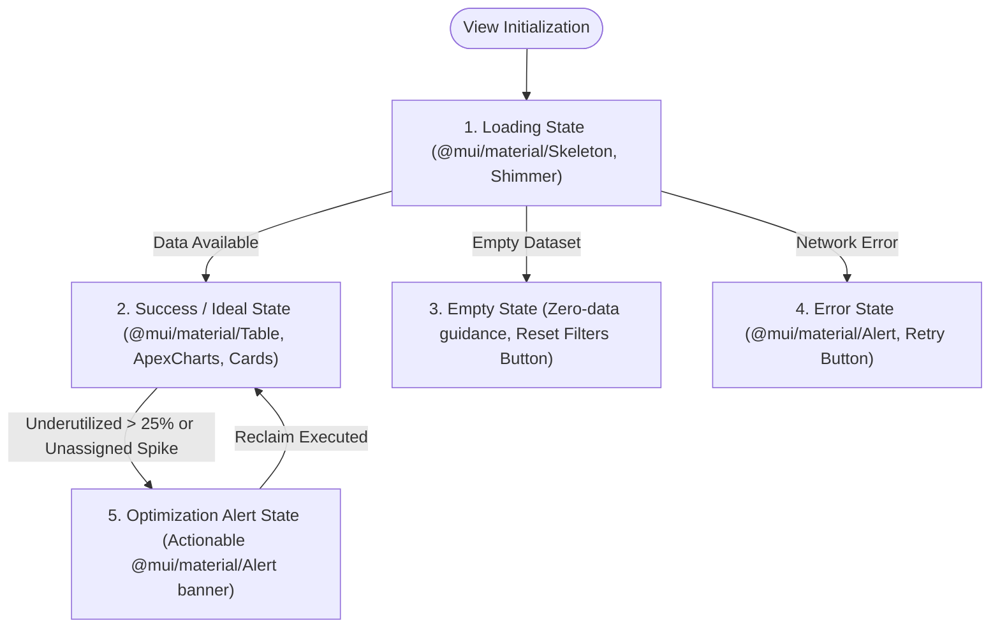

# UI/UX INFORMATION ARCHITECTURE & VIEW SPECIFICATIONS (IA)
## Project: VFast – Enterprise License Management System (ELMS)
### Subsystem: Executive Management Portal (2-View Focused Architecture)

> **Document Baseline:** [README.md](../README.md), [docs/01-MVP.md](01-MVP.md), [docs/02-use-cases.md](02-use-cases.md), [docs/03-user-stories.md](03-user-stories.md)  
> **Architecture Version:** 4.2 – MUI & ApexCharts Standards, Zero-Bloat & Icon Integrity Constraints  
> **Target Scope:** Executive Portal focused exclusively on **License Management** and **Analytics**  
> **Git Worktree Branch:** `docs/uiux-ia-2-views`

---

## 📋 TABLE OF CONTENTS

1. [Executive Architecture Overview](#-1-executive-architecture-overview)
2. [Master Screen & View Catalog](#-2-master-screen--view-catalog)
3. [Screen Hierarchy & Navigation Flow](#-3-screen-hierarchy--navigation-flow)
4. [Detailed View Specification: View 1 – License Management](#-4-detailed-view-specification-view-1--license-management)
   - 4.1. [Key Metrics & Visualizations (Top Section)](#41-key-metrics--visualizations-top-section)
   - 4.2. [General License Data Grid (9 Core Columns)](#42-general-license-data-grid-9-core-columns)
   - 4.3. [License Detail Drill-Down View (Side Drawer)](#43-license-detail-drill-down-view-side-drawer)
5. [Detailed View Specification: View 2 – Analytics](#-5-detailed-view-specification-view-2--analytics)
   - 5.1. [Top KPI Health Metrics (4 Top Indicators)](#51-top-kpi-health-metrics-4-top-indicators)
   - 5.2. [Application Usage Optimization Chart (ApexCharts Horizontal Bar)](#52-application-usage-optimization-chart-apexcharts-horizontal-bar)
   - 5.3. [Spend by Department Chart (ApexCharts Donut / Treemap)](#53-spend-by-department-chart-apexcharts-donut--treemap)
   - 5.4. [Subscription Usage 12-Month Comparative Chart (ApexCharts Dual-Column)](#54-subscription-usage-12-month-comparative-chart-apexcharts-dual-column)
6. [UI/UX State Contract, Technical Constraints & Interaction Rules](#-6-uiux-state-contract-technical-constraints--interaction-rules)
   - 6.1. [The 5 Core UI States Contract](#61-the-5-core-ui-states-contract)
   - 6.2. [Zero-Bloat Information Minimization Constraint](#62-zero-bloat-information-minimization-constraint)
   - 6.3. [Icon Integrity Constraint (No Arbitrary / Auto-Generated Icons)](#63-icon-integrity-constraint-no-arbitrary--auto-generated-icons)
   - 6.4. [Component Library Standard: @mui/material & @mui/icons-material](#64-component-library-standard-muimaterial--muiicons-material)
   - 6.5. [Data Visualization Standard: ApexCharts](#65-data-visualization-standard-apexcharts)
7. [Screen-to-API Mapping Matrix](#-7-screen-to-api-mapping-matrix)

---

## 🏛️ 1. EXECUTIVE ARCHITECTURE OVERVIEW

The Information Architecture of the VFast Enterprise License Management System (ELMS) Executive Portal is standardized into a streamlined **2-View Model**:

1. **View 1: License Management (`SCR-LIC-MGMT-01`):** Operational cockpit providing enterprise inventory visibility, publisher and category distribution, seat entitlements, active utilization rates, and an in-context detail drawer for individual licenses.
2. **View 2: Analytics (`SCR-ANALYTICS-01`):** Strategic health and financial intelligence center providing 4 top executive KPIs, user activity status breakdown (Never used / Inactive >60d / Actively used), cross-departmental cost allocations, and 12-month dual-column subscription dynamics (Active, Inactive, No activity, Not monitored vs. Unassigned).

### Core Design Principles
- **Clarity over Clutter:** Consolidate sprawling interfaces into two purpose-built views with zero navigation friction.
- **Actionable Optimization:** Direct visualization of unused/underutilized licenses to support immediate reclamation and renewal negotiation.
- **In-Context Drill-Down:** Single-license inspection operates via a non-intrusive Side Drawer (`SCR-LIC-DETAIL-01`), preserving table scroll position, sorting, and active filters.
- **Technical Rigor:** Strict adherence to `@mui/material` component architecture and `ApexCharts` visualization standards with zero decorative bloat and zero hallucinated icons.

---

## 🗂️ 2. MASTER SCREEN & VIEW CATALOG

| Screen ID | Screen / View Name | Presentation Mode | Route URL Path | Mapped Use Cases | Status / Priority |
|:---|---|:---:|:---|---|:---:|
| **SCR-AUTH-01** | Enterprise Authentication | Full Page | `/auth/login` | `UC29`, `US-M14` | MVP P0 |
| **SCR-LIC-MGMT-01** | **View 1: License Management** | Full Page | `/manager/licenses` | `UC01`, `UC02`, `UC05`, `UC15`, `UC23` | MVP P0 Core |
| **SCR-LIC-DETAIL-01**| **License Detail Drill-Down** | Side Drawer (640px) | `/manager/licenses?drawer=detail&id=:id` | `UC02`, `UC03`, `UC20`, `UC21` | MVP P0 Core |
| **SCR-ANALYTICS-01** | **View 2: Analytics & Health** | Full Page | `/manager/analytics` | `UC14`, `UC16`, `UC19`, `UC20`, `UC24` | MVP P0 Core |
| **SCR-ERR-404** | 404 Page Not Found | Full Page | `/404` | System | System |

---

## 🌳 3. SCREEN HIERARCHY & NAVIGATION FLOW


---

## 📊 4. DETAILED VIEW SPECIFICATION: VIEW 1 – LICENSE MANAGEMENT

- **Route:** `/manager/licenses`
- **Presentation:** Full Page responsive layout built with `@mui/material/Grid` and `@mui/material/Box`.
- **Primary Goal:** Operational overview of software inventory, category distribution, top utilized applications, and comprehensive licensing tabular data with instant drawer inspection.

### 4.1. Key Metrics & Visualizations (Top Section)

The top section consists of three visual containers organized in a 12-column `@mui/material/Grid`:

```
+------------------------------------+------------------------------------+----------------------------------------+
| [ Total License Card ] (Col 1-3)  |  [ Category Donut Chart ] (Col 4-7)|  [ Top 5 Usage Widget ] (Col 8-12)     |
+------------------------------------+------------------------------------+----------------------------------------+
```

#### 1. Metric: Total Licenses (`@mui/material/Card`, Col 1–3)
- **Primary Display Value:** Total active software licenses provisioned across the organization (e.g., `1,284 Licenses`).
- **Sub-indicators:**
  - `Active Entitlements:` e.g., `1,142` (88.9%).
  - `Expiring in <= 30 Days:` Amber `@mui/material/Chip` with count (e.g., `18`).
  - `MoM Growth:` e.g., `+4.5% vs. previous month`.

#### 2. Visual: Category Distribution (`ApexCharts Donut`, Col 4–7)
- **Chart Component:** `react-apexcharts` (`type="donut"`).
- **Chart Options Baseline:**
  ```javascript
  {
    chart: { type: 'donut', height: 260 },
    labels: ['Development & DevOps', 'Productivity & Office', 'Communication & Collaboration', 'Design & Creative', 'Security & Compliance', 'Other / Utilities'],
    series: [32, 28, 18, 12, 7, 3],
    colors: ['#1976D2', '#0288D1', '#0097A7', '#7B1FA2', '#E64A19', '#757575'],
    legend: { position: 'bottom', fontSize: '12px' },
    plotOptions: { pie: { donut: { size: '68%' } } }
  }
  ```
- **Interactivity:**
  - Hovering displays: Category Name, License Count, Total Monthly Spend, and Percentage.
  - Clicking any slice instantly filters the General License Data Grid below (`?category=Development`).

#### 3. Visual: Application Usage (Top 5) (`@mui/material/Card`, Col 8–12)
- **Widget Component:** Ranked progress list built using `@mui/material/LinearProgress` and `@mui/material/Typography`.
- **Ranked Applications:**
  1. **Microsoft 365 Enterprise:** `94% Active` (470/500 users active) — `Productivity`
  2. **Slack Enterprise Grid:** `91% Active` (410/450 users active) — `Communication`
  3. **GitHub Enterprise:** `88% Active` (264/300 users active) — `Development`
  4. **Jira Software & Confluence:** `85% Active` (255/300 users active) — `Project Management`
  5. **Zoom Business:** `81% Active` (202/250 users active) — `Video Conferencing`
- **Visual Display:** Two-tone `@mui/material/LinearProgress` (Green `#4CAF50` for Active rate, Gray `#E0E0E0` for Allocated but Inactive).

---

### 4.2. General License Data Grid (9 Core Columns)

- **Layout:** Standard `@mui/material/Table` inside `@mui/material/TableContainer` with `@mui/material/Paper`. No extraneous columns or decorative elements.
- **Standardized Table Columns:**

| STT | Column Name | Technical Data Key | Display Format & MUI Components | Alignment | Description & Business Meaning |
|:---:|---|---|---|:---:|---|
| 1 | **License Name** | `software_name` | Plain text + publisher logo asset (no arbitrary icons) | Left | Registered name of the software / license entitlement. |
| 2 | **Publisher Name** | `publisher_name` | `@mui/material/Typography` (variant="body2", color="text.secondary") | Left | Software vendor or publisher legal entity. |
| 3 | **License Type** | `license_type` | Standard `@mui/material/Chip` (size="small", variant="outlined") | Center | Licensing model and contractual entitlement structure. |
| 4 | **Compliance Status** | `compliance_status` | Status `@mui/material/Chip` with standard color prop:<br>- `success` (Compliant: $Allocated \le Purchased$)<br>- `warning` (At Risk: $Expiring \le 30\text{d}$ or $\ge 95\%$ capacity)<br>- `error` (Over-allocated: $Allocated > Purchased$) | Center | Legal compliance and entitlement status to prevent liability. |
| 5 | **Purchased** | `total_purchase_amount` | Currency formatted (`$48,000 USD` / `1,220,000,000 VND`) | Right | Total purchase expenditure committed for this entitlement. |
| 6 | **Licence Entitlement** | `purchased_seats` | Plain numeric string (`150 seats`) | Right | Total contractual license seats purchased from publisher. |
| 7 | **Active Users** | `active_users_count` | Plain numeric text (`124`) | Right | Number of users actively using the application in the cycle (30 days). |
| 8 | **Total Users** | `allocated_users_count` | Plain ratio string (`140 / 150`) | Right | Total user accounts currently allocated to this entitlement. |
| 9 | **Expiry Date** | `expiration_date` | Date format: `YYYY-MM-DD` | Center | Contract expiration date (SaaS) or maintenance renewal date (Perpetual). |

- **Table Interactions:**
  - **Row Click Trigger:** Clicking any row opens **`SCR-LIC-DETAIL-01`** (`@mui/material/Drawer`) with full contextual drill-down.
  - **Quick Search Input:** Standard `@mui/material/TextField` with `@mui/icons-material/Search` input adornment and 300ms debounce.
  - **Filters:** `@mui/material/Select` dropdowns for Compliance and Category.
  - **Pagination:** Standard `@mui/material/TablePagination` (10, 25, 50 rows).

---

### 4.3. License Detail Drill-Down View (Side Drawer `SCR-LIC-DETAIL-01`)

- **Presentation:** `@mui/material/Drawer` (`anchor="right"`, PaperProps width: `640px`, backdrop blur enabled).
- **Trigger:** Click on any license item in the General License Data Grid.
- **Header:** License Name, Publisher text, Status Chip, Close button (`@mui/material/IconButton` with standard `@mui/icons-material/Close`).

#### 1. Key Indicators (Top Cards)
A compact 2x3 grid built with `@mui/material/Grid` and `@mui/material/Paper`:

```
+------------------------------------+------------------------------------+
| 1. Monthly Cost                    | 2. Subscriptions                   |
|    $4,200 / month                  |    3 Contracts / POs               |
+------------------------------------+------------------------------------+
| 3. Subscription Types              | 4. Total Users                     |
|    2 Types (Enterprise, Business)  |    140 Assigned Users              |
+------------------------------------+------------------------------------+
| 5. Unassigned Subscriptions        |                                    |
|    10 Seats Available (Inventory)  |                                    |
+------------------------------------+------------------------------------+
```

| Key Indicator | Data Attribute | Detailed Definition & Business Meaning |
|---|---|---|
| **Monthly Cost** | `monthly_amortized_cost` | The monthly expenditure incurred by the enterprise for the application (amortized for annual and monthly contracts). |
| **Subscriptions** | `subscriptions_count` | Total count of active subscription agreements or procurement orders held for this application. |
| **Subscription Types** | `subscription_tiers` | Number of service plan tiers currently utilized (e.g., *Free*, *Plus*, *Business*, *Enterprise*). |
| **Total Users** | `total_assigned_users` | Total user accounts associated with the application (holding active license grants). |
| **Unassigned Subscriptions** | `unassigned_seats` | Number of purchased licenses not yet allocated to any user ($Purchased - Allocated$ available in inventory). |

#### 2. Detailed Information (Metadata Specification)

Presented cleanly using an `@mui/material/List` or 2-column key-value grid without decorative icon clutter:

| Attribute | Technical Key | Definition & Data Specification |
|---|---|---|
| **Vendor** | `vendor_company` | Software publisher legal entity, country of origin, technical support contact, and account manager details. |
| **Description** | `software_description` | Functional summary of the application, internal business purpose, and core organizational workflows supported. |
| **Category** | `category_name` | Primary software classification (e.g., *Productivity*, *Engineering*, *Security*, *Design*). |
| **Subcategory** | `subcategory_name` | Granular functional classification (e.g., *IDE & Source Control*, *Team Chat*, *Cloud Infrastructure*, *UI Prototyping*). |
| **Useful links & Policy** | `policy_links` | Standard text hyperlinks using `@mui/material/Link` with standard `@mui/icons-material/OpenInNew` icon only:<br>- **Internal License Policy**<br>- **Vendor Terms of Service**<br>- **Security Compliance Policy**<br>- **Management Portal** |

---

## 📈 5. DETAILED VIEW SPECIFICATION: VIEW 2 – ANALYTICS

- **Route:** `/manager/analytics`
- **Presentation:** Full Page executive dashboard built using `@mui/material/Grid` and `ApexCharts`.
- **Primary Goal:** Evaluate comprehensive license health and financial efficiency through high-impact metrics and analytical charts to eliminate waste and optimize budget allocation.

```
+-------------------------------------------------------------------------------------------------------+
|  [ Total Annual Spend ]  |  [ Managed Licenses ]  |  [ Underutilized Accts ]  |  [ Wasted Lic Cost ]  |
+-------------------------------------------------------------------------------------------------------+
|  [ Chart 1: Application Usage (ApexCharts Horizontal Bar) - Top 5/10/20 ] (Col 1-7)                   |
|  Segments: Never Used (Orange) | Inactive >60d (Gray) | Actively Used (Green)                         |
+-------------------------------------------------------------------------------------------------------+
|  [ Chart 2: Spend by Department (ApexCharts Donut / Treemap) ] (Col 8-12)                            |
|  Engineering | Sales | Tech Support | Accounting | Marketing | Product                                |
+-------------------------------------------------------------------------------------------------------+
|  [ Chart 3: Subscription Usage (ApexCharts 12-Month Dual-Column) ] (Full Width Col 1-12)              |
|  Col 1 (Stacked): Active | Inactive | No Activity | Not Monitored   vs.   Col 2: Unassigned         |
+-------------------------------------------------------------------------------------------------------+
```

---

### 5.1. Top KPI Health Metrics (4 Top Indicators)

Four executive KPI cards built with `@mui/material/Card` and `@mui/material/Typography`:

| KPI Metric Name | Display Key & Format | Definition & Business Meaning | Action Threshold / Alert Logic |
|---|---|---|---|
| **1. Total Annual Spend** | `annual_total_spend`<br>`$1,420,000 USD`<br>(or `36,000,000,000 VND`) | **Total annual financial outlay:** Total annualized cash outlay across all software licenses and subscriptions. | Compares actual spending against approved fiscal budget ceiling; triggers alert on budget burn velocity. |
| **2. Managed Licenses** | `total_managed_licenses`<br>`1,284 Licenses` (across 48 Apps) | **Managed licenses volume:** Total volume of software licenses and subscriptions centrally tracked under ELMS. | Provides executive visibility into enterprise software portfolio size. |
| **3. Underutilized Accounts** | `underutilized_accounts`<br>`312 Accounts` (24.3%) | **Underutilized accounts count:** Total user accounts provisioned with licenses that exhibit low, inactive (>60 days), or zero usage. | Amber warning if $> 15\%$; Critical red alert if $> 25\%$ of total allocated accounts. |
| **4. Underutilized License Cost** | `wasted_license_cost`<br>`$285,600 USD / yr` (20.1%) | **Wasted spend on underutilized licenses:** Total annual capital wasted on idle, unassigned, or neglected licenses. | Primary financial recovery target for internal reclamation and renewal downsizing. |

---

### 5.2. Application Usage Optimization Chart (ApexCharts Horizontal Bar)

- **Component:** `react-apexcharts` (`type="bar"`).
- **Configuration Standard:**
  ```javascript
  {
    chart: { type: 'bar', height: 350, stacked: true },
    plotOptions: { bar: { horizontal: true, barHeight: '60%' } },
    colors: ['#FF9800', '#9E9E9E', '#4CAF50'], // Never used (Orange), Inactive (Gray), Actively used (Green)
    series: [
      { name: 'Never used', data: [45, 30, 25, 20, 15] },
      { name: 'Inactive (>60 days)', data: [65, 50, 40, 35, 25] },
      { name: 'Actively used', data: [390, 370, 235, 200, 162] }
    ],
    xaxis: { categories: ['Microsoft 365', 'Slack', 'GitHub Enterprise', 'Jira', 'Zoom'], title: { text: 'Number of Users' } },
    legend: { position: 'top', horizontalAlign: 'left' }
  }
  ```
- **Controls:** Standard `@mui/material/ToggleButtonGroup` for Top 5 | Top 10 | Top 20 range selection.

#### 3 User Activity Status Segments:

| Status Segment | ApexCharts Color | Definition & Business Meaning |
|---|:---:|---|
| **Never used** | 🟧 **Orange** (`#FF9800`) | **Account never accessed:** The license was assigned to an employee, but the user has never logged in or performed any action since provisioning. |
| **Inactive (>60 days)** | ⬜ **Gray** (`#9E9E9E`) | **Dormant account (>60 days):** The user was active in the past but has recorded zero activity for over 60 consecutive days (e.g., project completion, role change, departure). |
| **Actively used** | 🟩 **Green** (`#4CAF50`) | **Actively used account:** The user logs in and interacts regularly with the software within the active tracking window (<60 days). |

#### Management Insights:
1. **Identify Wasteful Applications:** Instantly detect software products where Orange and Gray segments dominate total allocation.
2. **Quantify Financial Leakage:** Calculate the exact monetary waste per application by multiplying idle seats by unit cost.
3. **Execute Seat Reclamation & Reallocation:** Reclaim licenses from inactive assignees to fulfill incoming employee requests without procuring additional seats.
4. **Data-Driven Renewal Negotiations:** Establish solid contractual leverage to downsize seat quantities during annual vendor renewal discussions.

---

### 5.3. Spend by Department Chart (ApexCharts Donut / Treemap)

- **Component:** `react-apexcharts` (`type="donut"` or `type="treemap"`).
- **Configuration Standard:**
  ```javascript
  {
    chart: { type: 'donut', height: 320 },
    labels: ['Engineering & Product', 'Sales & BD', 'Tech Support', 'Accounting & Finance', 'Marketing & Creative', 'HR & Operations'],
    series: [580000, 320000, 180000, 140000, 120000, 80000],
    colors: ['#1976D2', '#388E3C', '#F57C00', '#7B1FA2', '#0097A7', '#616161'],
    legend: { position: 'bottom' },
    tooltip: { y: { formatter: (val) => `$${val.toLocaleString()} USD` } }
  }
  ```

#### Management Insights:
1. **Pinpoint Top SaaS Consumers:** Deliver full transparency into departmental software expenditure across the organization.
2. **Benchmark Cost per Headcount:** Compare average software expenditure per employee across distinct business units.
3. **Validate Strategic Alignment:** Verify whether departmental software spend aligns with corporate strategic priorities.
4. **Enable Internal Chargebacks:** Empower managers to adjust department budgets or implement internal software chargeback models.

---

### 5.4. Subscription Usage 12-Month Comparative Chart (ApexCharts Dual-Column)

- **Component:** `react-apexcharts` (`type="bar"`).
- **Core Purpose:** Tracks enterprise subscription utilization dynamics across every month of the fiscal year (January to December), comparing deployed status composition against unassigned inventory.
- **Configuration Standard:**
  ```javascript
  {
    chart: { type: 'bar', height: 380, stacked: true },
    plotOptions: { bar: { columnWidth: '65%' } },
    series: [
      // Column 1: Stacked allocated composition
      { name: 'Active', group: 'allocated', data: [780, 810, 840, 860, 890, 920, 950, 970, 990, 1010, 1030, 1050], color: '#4CAF50' },
      { name: 'Inactive', group: 'allocated', data: [110, 105, 95, 90, 85, 80, 75, 70, 68, 65, 62, 60], color: '#FF9800' },
      { name: 'No activity', group: 'allocated', data: [45, 42, 40, 38, 35, 33, 30, 28, 26, 25, 24, 22], color: '#616161' },
      { name: 'Not monitored', group: 'allocated', data: [50, 48, 45, 42, 40, 38, 35, 32, 30, 28, 25, 22], color: '#3F51B5' },
      // Column 2: Single unassigned column
      { name: 'Unassigned', group: 'inventory', data: [220, 200, 180, 160, 140, 120, 110, 100, 90, 80, 75, 70], color: '#E91E63' }
    ],
    xaxis: { categories: ['Jan', 'Feb', 'Mar', 'Apr', 'May', 'Jun', 'Jul', 'Aug', 'Sep', 'Oct', 'Nov', 'Dec'] },
    legend: { position: 'top' }
  }
  ```

#### Detailed 5 Status Definitions:

| Column Assignment | Status Name | ApexCharts Color | Detailed Business Meaning |
|:---:|---|:---:|---|
| **Column 1 (Stacked)** | **1. Active** | 🟩 **Green** (`#4CAF50`) | **Active:** Subscriptions currently utilized by employees in the monthly reporting period. |
| **Column 1 (Stacked)** | **2. Inactive** | 🟧 **Amber / Orange** (`#FF9800`) | **Inactive:** Subscriptions assigned to employees but showing zero activity during the tracking window. |
| **Column 1 (Stacked)** | **3. No activity** | ⬛ **Dark Gray** (`#616161`) | **No activity:** Subscriptions with zero telemetry or activity logs recorded throughout the fiscal period (dormant accounts). |
| **Column 1 (Stacked)** | **4. Not monitored** | 🟦 **Indigo / Slate Blue** (`#3F51B5`) | **Not monitored:** Subscriptions where usage telemetry is unmonitored (e.g., on-premise software lacking telemetry agents or missing vendor API logs). |
| **Column 2 (Single)** | **5. Unassigned** | 🟥 **Rose** (`#E91E63`) | **Unassigned:** Subscriptions purchased under enterprise contract but not assigned to any user (idle inventory capital). |

#### Management Insights:
- **Allocation vs. Inventory Ratio:** Compares assigned licenses (Column 1) against unallocated inventory (Column 2). A persistent Column 2 indicates over-procurement.
- **Utilization Trajectory:** Evaluates whether the Active segment (Green) expands alongside software spend or if Inactive/No activity segments are accumulating.
- **Telemetry Blindspots:** The Not Monitored segment signals blind spots in IT visibility, prioritizing candidates for agent deployment or vendor API integration.

---

## 🎨 6. UI/UX STATE CONTRACT, TECHNICAL CONSTRAINTS & INTERACTION RULES

### 6.1. The 5 Core UI States Contract

Both views adhere strictly to the **5 Core UI States Contract** implemented with native `@mui/material` components:



1. **Loading State:** Native `@mui/material/Skeleton` shimmer placeholders for all 4 KPI cards, linear loading bars for charts, and a 5-row table placeholder. Zero layout shift (CLS $< 0.1$).
2. **Success State:** Complete record presentation with formatted currency (`USD` / `VND`), date format `YYYY-MM-DD`, and WCAG 2.1 AA compliant color contrast badges.
3. **Empty State:** Clean empty state with descriptive guidance and a prominent `@mui/material/Button` (`[Reset All Filters]`) when queries return zero results.
4. **Error State:** Contextual error alerts using `@mui/material/Alert` preserving user filter states, accompanied by a non-destructive `@mui/material/Button` (`[Retry Request]`).
5. **Optimization Alert State:** Standard `@mui/material/Alert` banner (`severity="warning"` or `"error"`) triggered when underutilized accounts exceed $20\%$ or unassigned inventory spikes.

---

### 6.2. Zero-Bloat Information Minimization Constraint

To maintain executive clarity and high cognitive ergonomics, the user interface enforces a strict **Zero-Bloat Information Constraint**:
1. **No Redundant / Speculative Information:** Display **strictly** the exact KPI cards, data attributes, chart series, and table columns specified in this document. Adding speculative fields, hypothetical scores, decorative widgets, or placeholder metrics not defined in this IA is strictly prohibited.
2. **High Signal-to-Noise Ratio:** Every rendered field must directly support a documented managerial action (inventory tracking, cost quantification, seat reclamation, or renewal negotiation).
3. **No Decorative Nesting:** Avoid superfluous nested cards, multi-level accordion wrappers, or redundant summary labels that duplicate existing grid data.

---

### 6.3. Icon Integrity Constraint (No Arbitrary / Auto-Generated Icons)

To preserve visual professionalism and avoid visual pollution:
1. **Strictly No Auto-Generated or Hallucinated Icons:** The system prohibits inventing custom glyphs, generating arbitrary SVG artwork, or inserting arbitrary decorative emojis into UI labels, table headers, or KPI metric cards.
2. **Standard Curated Iconography Only:** All functional icons must be imported strictly from `@mui/icons-material`:
   - Search: `@mui/icons-material/Search`
   - Filter: `@mui/icons-material/FilterList`
   - Drawer Close: `@mui/icons-material/Close`
   - Sorting: `@mui/icons-material/ArrowUpward`, `@mui/icons-material/ArrowDownward`
   - Pagination: `@mui/icons-material/KeyboardArrowLeft`, `@mui/icons-material/KeyboardArrowRight`
   - External Links: `@mui/icons-material/OpenInNew`
   - Status Dots: Standard CSS colored dots or `@mui/material/Badge` (no custom illustrative status icons)
3. **Application Brand Icons:** Software vendor logos (e.g., Microsoft, GitHub, Slack) must be rendered from verified publisher SVG/PNG assets only. When a logo is absent, display a clean `@mui/material/Avatar` with standard 2-letter textual monogram (e.g., `MS`, `GH`).

---

### 6.4. Component Library Standard: `@mui/material` & `@mui/icons-material`

All interface elements across both views are implemented using the `@mui/material` (v5/v6) design system:

| UI Pattern | Standard `@mui/material` Component | Props / Styling Standards |
|---|---|---|
| **App Shell & Layout** | `Box`, `Stack`, `Container` | Responsive flexbox layout, theme spacing tokens (`spacing(2)`, `spacing(3)`). |
| **Grid System** | `Grid` (v2) | 12-column executive responsive grid (`xs={12}`, `md={6}`, `lg={3}`). |
| **KPI & Metric Cards** | `Card`, `CardContent`, `Typography` | `variant="h4"` for numerical values, `variant="body2"` with `color="text.secondary"` for labels. |
| **Data Grid & Table** | `TableContainer`, `Table`, `TableHead`, `TableRow`, `TableCell`, `TableBody`, `TablePagination` | `size="medium"`, sticky headers, high contrast row borders. |
| **Status Chips** | `Chip` | `size="small"`, `variant="outlined"` or filled with theme status colors (`success`, `warning`, `error`, `default`). |
| **Side Drawer** | `Drawer` | `anchor="right"`, `PaperProps={{ sx: { width: 640, p: 3 } }}`, backdrop blur. |
| **Form Inputs** | `TextField`, `Select`, `MenuItem`, `Button`, `IconButton` | Standardized controlled inputs with clean debouncing and accessible aria labels. |
| **Feedback Elements** | `Skeleton`, `Alert`, `Snackbar`, `LinearProgress` | Built-in theme animations, zero layout shift. |

---

### 6.5. Data Visualization Standard: ApexCharts

All charts across both views are implemented strictly using `ApexCharts` (`react-apexcharts`):
1. **Responsive Rendering:** All charts must set `width="100%"` and explicit responsive height breakpoints.
2. **Color Palette Alignment:** Colors must adhere strictly to the specified executive semantic palette:
   - Green (Active / Healthy): `#4CAF50`
   - Orange / Amber (Warning / Never used / Inactive): `#FF9800`
   - Gray (Dormant / Inactive >60d / No activity): `#9E9E9E` / `#616161`
   - Indigo / Slate Blue (Not monitored): `#3F51B5`
   - Rose / Red (Unassigned / Over-allocated): `#E91E63` / `#D32F2F`
3. **Data Tooltips:** Tooltips must format currency figures and user counts cleanly without technical keys or raw unformatted timestamps.

---

## 🔗 7. SCREEN-TO-API MAPPING MATRIX

RESTful API endpoints powering both views and the detail drawer:

| Screen / Component | User Action / Event | REST API Endpoint & Method | Query / Body Parameters | Response Payload Overview |
|---|---|---|---|---|
| **SCR-LIC-MGMT-01** | Initialize License Management | `GET /api/v1/licenses/overview` | `None` | `total_licenses`, `category_breakdown` (Pie data), `top_5_usage` (Ranked list). |
| **SCR-LIC-MGMT-01** | Fetch General License Grid | `GET /api/v1/licenses` | `page`, `limit`, `search`, `category`, `status`, `sort_by` | Paginated license list containing all 9 core columns. |
| **SCR-LIC-DETAIL-01**| Click License Row | `GET /api/v1/licenses/{id}/detail` | `id` (License Entitlement ID) | Key indicators (`monthly_cost`, `subscriptions_count`, `tiers`, `total_users`, `unassigned_count`) and Detailed metadata (`vendor`, `description`, `category`, `subcategory`, `policy_links`). |
| **SCR-ANALYTICS-01** | Load Top 4 KPIs | `GET /api/v1/analytics/kpis` | `fiscal_year` (Defaults to current) | `total_annual_spend`, `managed_licenses`, `underutilized_accounts`, `wasted_license_cost`. |
| **SCR-ANALYTICS-01** | Load Application Usage Chart | `GET /api/v1/analytics/application-usage` | `limit=5\|10\|20`, `sort=wasted` | Array of applications with 3 segment metrics: `never_used`, `inactive_60d`, `actively_used`. |
| **SCR-ANALYTICS-01** | Load Spend by Department | `GET /api/v1/analytics/spend-by-department` | `fiscal_year`, `currency=USD\|VND` | Departmental data array: `department_name`, `spend_amount`, `percentage_share`, `headcount`. |
| **SCR-ANALYTICS-01** | Load Subscription Usage Chart | `GET /api/v1/analytics/subscription-usage-monthly`| `fiscal_year` | 12-month array: Column 1 (`active`, `inactive`, `no_activity`, `not_monitored`) and Column 2 (`unassigned`). |

---

*This Information Architecture & View Specification document (v4.2) defines the strict UI/UX contract, @mui/material components, ApexCharts configurations, and zero-bloat constraints for VFast ELMS.*
