# UI/UX INFORMATION ARCHITECTURE & VIEW SPECIFICATIONS (IA)
## Project: VFast – Enterprise License Management System (ELMS)
### Subsystem: Enterprise Management & Admin Portal (Unified 3-Pillar Architecture)

> **Document Baseline:** [README.md](../README.md), [docs/01-MVP.md](01-MVP.md), [docs/02-use-cases.md](02-use-cases.md), [docs/03-user-stories.md](03-user-stories.md)  
> **Architecture Version:** 5.0 – Unified Executive & Admin Architecture: License Management, Budget Analytics & Multi-Tenant User Administration  
> **Target Scope:** Executive Portal focused on **License Management**, **Analytics Hub (Health & Budget Analytics)**, and **Admin User & Tenant Management**  
> **Git Worktree Branch:** `docs/ia-admin-user-mgmt-budget`

---

## 📋 TABLE OF CONTENTS

1. [Executive Architecture Overview](#-1-executive-architecture-overview)
2. [Master Screen & View Catalog](#-2-master-screen--view-catalog)
3. [Screen Hierarchy & Navigation Flow](#-3-screen-hierarchy--navigation-flow)
4. [Detailed View Specification: View 1 – License Management](#-4-detailed-view-specification-view-1--license-management)
   - 4.1. [Key Metrics & Visualizations (Top Section)](#41-key-metrics--visualizations-top-section)
   - 4.2. [General License Data Grid (9 Core Columns)](#42-general-license-data-grid-9-core-columns)
   - 4.3. [License Detail & Analytics Drill-Down Drawer / Dialog (SCR-LIC-DETAIL-01 / SRC-LIC-ANALYTICS-01)](#43-license-detail--analytics-drill-down-drawer--dialog-scr-lic-detail-01--src-lic-analytics-01)
     - 4.3.1. [Top Action Bar & Direct In-Place Edit Button](#431-top-action-bar--direct-in-place-edit-button)
     - 4.3.2. [Key Indicators (Top Cards)](#432-key-indicators-top-cards)
     - 4.3.3. [Detailed Information (Metadata Specification)](#433-detailed-information-metadata-specification)
     - 4.3.4. [Granted License Accounts Field & Roster Grid](#434-granted-license-accounts-field--roster-grid)
5. [Detailed View Specification: View 2 – Analytics Hub](#-5-detailed-view-specification-view-2--analytics-hub)
   - **View 2A: License Health & Usage Analytics (`SCR-ANALYTICS-01`)**
     - 5.1. [Top KPI Health Metrics (4 Top Indicators)](#51-top-kpi-health-metrics-4-top-indicators)
     - 5.2. [Application Usage Optimization Chart (ApexCharts Horizontal Bar)](#52-application-usage-optimization-chart-apexcharts-horizontal-bar)
     - 5.3. [Spend by Department Chart (ApexCharts Horizontal Bar / Treemap)](#53-spend-by-department-chart-apexcharts-horizontal-bar--treemap)
     - 5.4. [Subscription Usage 12-Month Comparative Chart (ApexCharts Dual-Column)](#54-subscription-usage-12-month-comparative-chart-apexcharts-dual-column)
   - **View 2B: Budget Analytics & Intelligence (`SCR-BUDGET-ANALYTICS-01`)**
     - 5.5. [Budget Analytics Overview & Action Controls](#55-budget-analytics-overview--action-controls)
     - 5.6. [Executive Budget KPI Cards (Current Month Remaining & Next Month Fixed Commitments Load %)](#56-executive-budget-kpi-cards-current-month-remaining--next-month-fixed-commitments-load-)
     - 5.7. [Budget Allocation by Category Chart (ApexCharts Horizontal Stacked Bar)](#57-budget-allocation-by-category-chart-apexcharts-horizontal-stacked-bar)
     - 5.8. [Historical Budget & Spend Trajectory Chart (ApexCharts Area / Line)](#58-historical-budget--spend-trajectory-chart-apexcharts-area--line)
     - 5.9. [Monthly Budget Planning & Configuration Modal (SCR-BUDGET-SET-01)](#59-monthly-budget-planning--configuration-modal-scr-budget-set-01)
6. [Detailed View Specification: View 3 – User Management: Role & Tenant Administration](#-6-detailed-view-specification-view-3--user-management-role--tenant-administration)
   - 6.1. [Top Admin Key Indicators (4 Metrics)](#61-top-admin-key-indicators-4-metrics)
   - 6.2. [Header Controls & Multi-Tenant Filters](#62-header-controls--multi-tenant-filters)
   - 6.3. [User & Tenant Data Grid (9 Core Columns)](#63-user--tenant-data-grid-9-core-columns)
   - 6.4. [Admin Role & Tenant Assignment Drawer (SCR-USER-EDIT-01)](#64-admin-role--tenant-assignment-drawer-scr-user-edit-01)
7. [UI/UX State Contract, Technical Constraints & Interaction Rules](#-7-uiux-state-contract-technical-constraints--interaction-rules)
   - 7.1. [The 5 Core UI States Contract](#71-the-5-core-ui-states-contract)
   - 7.2. [Zero-Bloat Information Minimization Constraint](#72-zero-bloat-information-minimization-constraint)
   - 7.3. [Icon Integrity Constraint (No Arbitrary / Auto-Generated Icons)](#73-icon-integrity-constraint-no-arbitrary--auto-generated-icons)
   - 7.4. [Component Library Standard: @mui/material & @mui/icons-material](#74-component-library-standard-muimaterial--muiicons-material)
   - 7.5. [Data Visualization Standard: ApexCharts](#75-data-visualization-standard-apexcharts)
8. [Screen-to-API Mapping Matrix](#-8-screen-to-api-mapping-matrix)

---

## 🏛️ 1. EXECUTIVE ARCHITECTURE OVERVIEW

The Information Architecture of the VFast Enterprise License Management System (ELMS) Executive & Admin Portal is standardized into a unified **3-Pillar Enterprise Model**:

1. **Pillar 1: License Management (`SCR-LIC-MGMT-01` & `SCR-LIC-DETAIL-01` / `SRC-LIC-ANALYTICS-01`):** Operational cockpit providing enterprise inventory visibility, publisher and category distribution, seat entitlements, active utilization rates, and an in-context detail drawer with direct metadata editing and granted user account roster.
2. **Pillar 2: Analytics Hub (`SCR-ANALYTICS-01` & `SCR-BUDGET-ANALYTICS-01`):** Strategic health and financial intelligence center divided into two high-signal views:
   - **View 2A – License Health & Usage Analytics:** Top 4 KPIs, user activity status breakdown (Never used / Inactive >60d / Actively used), cross-departmental cost allocations, and 12-month dual-column subscription dynamics.
   - **View 2B – Budget Analytics:** Dedicated financial control center enabling Admins to set monthly budget plans, monitor real-time **Current Month Remaining Budget**, evaluate the **Next Month Fixed Commitments & Renewals Load Card** (% of upcoming budget consumed by renewal obligations), assess category budget distribution, and track historical spending trajectories over past billing periods.
3. **Pillar 3: User & Tenant Management (`SCR-USER-MGMT-01` & `SCR-USER-EDIT-01`):** Centralized administration portal empowering Admins to oversee multi-tenant boundaries, system roles (`Admin`, `Manager`, `Staff`, `Employee`), active license allocations, and account lifecycle states with strict session invalidation security guards.

### Core Design Principles
- **Clarity over Clutter:** Consolidate sprawling interfaces into three cohesive, purpose-built pillars with zero navigation friction.
- **Actionable Optimization:** Direct visualization of unused/underutilized licenses, immediate seat reallocation, and forward-looking renewal budget commitment quantification.
- **In-Context Direct Manipulation:** Single-license inspection operates via a 640px Side Drawer (`SCR-LIC-DETAIL-01` / `SRC-LIC-ANALYTICS-01`) with top in-place editing controls, preserving background table scroll position, sorting, and active filters.
- **Theme & Design Consistency:** Strict implementation of the minimal **Grey - White - Ocean Blue** theme (`#F8FAFC`, `#FFFFFF`, `#0F67B1`, `#E2E8F0`, `#475569`, `#0F172A`), native `@mui/material` components, and official `@mui/icons-material` symbols across all screens.
- **Zero-Bloat & Icon Integrity:** Display strictly documented metrics and structured columns; convert secondary metadata to clean interactive tooltips; prohibit arbitrary icons and emojis in controls.

---

## 🗂️ 2. MASTER SCREEN & VIEW CATALOG

| Screen ID | Screen / View Name | Presentation Mode | Route URL Path | Mapped Use Cases | Status / Priority |
|:---|---|:---:|:---|---|:---:|
| **SCR-AUTH-01** | Enterprise Authentication | Full Page | `/auth/login` | `UC29`, `US-M14` | MVP P0 |
| **SCR-LIC-MGMT-01** | **View 1: License Management** | Full Page | `/manager/licenses` | `UC01`, `UC02`, `UC05`, `UC15`, `UC23` | MVP P0 Core |
| **SCR-LIC-DETAIL-01**<br>*(alias: `SRC-LIC-ANALYTICS-01`)* | **License Detail & Analytics Drill-Down** | Side Drawer (640px) / Dialog | `/manager/licenses?drawer=detail&id=:id` | `UC02`, `UC03`, `UC20`, `UC21` | MVP P0 Core |
| **SCR-ANALYTICS-01** | **View 2A: License Health Analytics** | Full Page | `/manager/analytics` | `UC14`, `UC16`, `UC19`, `UC20`, `UC24` | MVP P0 Core |
| **SCR-BUDGET-ANALYTICS-01** | **View 2B: Budget Analytics** | Full Page | `/manager/analytics/budget` | `UC12`, `UC14`, `UC16`, `UC24` | MVP P0 Core |
| **SCR-BUDGET-SET-01** | Monthly Budget Configuration Modal | Modal / Drawer (640px) | `/manager/analytics/budget?action=set-budget` | `UC12`, `US-M08` | MVP P0 Core |
| **SCR-USER-MGMT-01** | **View 3: User & Tenant Management** | Full Page | `/admin/users` | `UC27`, `UC28`, `US-M14` | MVP P0 Core |
| **SCR-USER-EDIT-01** | Role & Tenant Assignment Drawer | Side Drawer (560px) | `/admin/users?drawer=edit&id=:id` | `UC27`, `UC28`, `US-M14` | MVP P0 Core |
| **SCR-ERR-404** | 404 Page Not Found | Full Page | `/404` | System | System |

---

## 🌳 3. SCREEN HIERARCHY & NAVIGATION FLOW

```mermaid
flowchart TD
    Root["Root Application (/)"] --> AuthCheck{"Session Authentication"}
    AuthCheck -->|"Unauthenticated"| SCR_AUTH["SCR-AUTH-01: Enterprise Login (/auth/login)"]
    AuthCheck -->|"Authenticated"| Shell["Executive App Shell (Sidebar Navigation + Top Bar)"]

    Shell --> Nav1["Menu Item 1: License Management"]
    Shell --> Nav2["Menu Item 2: Analytics Hub"]
    Shell --> Nav3["Menu Item 3: User Management (Admin Only)"]

    %% View 1: License Management
    Nav1 --> SCR_LIC_MGMT["SCR-LIC-MGMT-01: License Management (/manager/licenses)"]
    SCR_LIC_MGMT --> Sub_KPI1["Top KPI: Total Licenses"]
    SCR_LIC_MGMT --> Sub_Pie["ApexCharts: Category Distribution (%)"]
    SCR_LIC_MGMT --> Sub_Top5["App Usage Widget: Top 5 Active Apps"]
    SCR_LIC_MGMT --> Sub_Table["General License Data Grid (9 Core Columns)"]

    Sub_Table -.->|"Click on Row"| SCR_LIC_DETAIL["SCR-LIC-DETAIL-01 / SRC-LIC-ANALYTICS-01: License Detail & Analytics Drawer"]
    SCR_LIC_DETAIL --> Det_EditBtn["Top Action: [Edit] Direct In-Place Edit Mode"]
    SCR_LIC_DETAIL --> Det_Key["Key Indicators: Monthly Cost, Subscriptions, Types, Total Users, Unassigned"]
    SCR_LIC_DETAIL --> Det_Info["Detailed Information: Vendor, Description, Category, Subcategory, Useful Links"]
    SCR_LIC_DETAIL --> Det_Accounts["Granted License Accounts: Assigned Accounts Table (User, Tenant, Tier, Grant Date, Status)"]

    %% View 2: Analytics Hub
    Nav2 --> SubNav_Health["Sub-Tab: License Health"]
    Nav2 --> SubNav_Budget["Sub-Tab: Budget Analytics"]

    SubNav_Health --> SCR_ANALYTICS["SCR-ANALYTICS-01: License Health Analytics (/manager/analytics)"]
    SCR_ANALYTICS --> Ana_KPIs["4 Top KPIs: Total Annual Spend, Managed Licenses, Underutilized Accounts, Wasted Cost"]
    SCR_ANALYTICS --> Ana_Chart1["ApexCharts 1: Application Usage Horizontal Bar (Never used / Inactive >60d / Actively used)"]
    SCR_ANALYTICS --> Ana_Chart2["ApexCharts 2: Spend by Department (Horizontal Bar Chart)"]
    SCR_ANALYTICS --> Ana_Chart3["ApexCharts 3: Subscription Usage 12-Month Dual Column (Stacked 4 States vs. Unassigned)"]

    SubNav_Budget --> SCR_BUDGET["SCR-BUDGET-ANALYTICS-01: Budget Analytics (/manager/analytics/budget)"]
    SCR_BUDGET --> Bdg_SetBtn["Top Action: [Set Monthly Budget] Button"]
    Bdg_SetBtn -.->|"Click Trigger"| SCR_BUDGET_SET["SCR-BUDGET-SET-01: Monthly Budget Planning Modal"]
    SCR_BUDGET --> Bdg_KPI1["KPI 1: Current Month Remaining Budget (Allocated, MTD Spend, Remainder, Burn Rate)"]
    SCR_BUDGET --> Bdg_KPI2["KPI 2: Next Month Fixed Commitments & Renewals Load (% of Next Month Budget)"]
    SCR_BUDGET --> Bdg_KPI3["KPI 3: Annual Budget Utilization & YTD Spend"]
    SCR_BUDGET --> Bdg_KPI4["KPI 4: Recoverable Inactive Seat Spend"]
    SCR_BUDGET --> Bdg_Chart1["ApexCharts: Budget Allocation by Category (Allocated vs. Actual)"]
    SCR_BUDGET --> Bdg_Chart2["ApexCharts: Historical Budget & Spend Trajectory (Multi-Period Timeline)"]

    %% View 3: User Management
    Nav3 --> SCR_USER_MGMT["SCR-USER-MGMT-01: User & Tenant Management (/admin/users)"]
    SCR_USER_MGMT --> Usr_KPIs["4 Summary Cards: Total Users, Active Users, Managed Tenants, Privileged Roles"]
    SCR_USER_MGMT --> Usr_Filters["Admin Controls: Search, Tenant Selector, Role Filter, Status Filter"]
    SCR_USER_MGMT --> Usr_Table["User & Tenant Data Grid (9 Core Columns)"]
    Usr_Table -.->|"Row Click / Edit Action"| SCR_USER_EDIT["SCR-USER-EDIT-01: Role & Tenant Assignment Drawer"]
    SCR_USER_EDIT --> Usr_EditRole["Update System Role (Admin, Manager, Staff, Employee) with Session Revocation Guard"]
    SCR_USER_EDIT --> Usr_EditTenant["Reassign Organization / Tenant Boundary"]
    SCR_USER_EDIT --> Usr_StatusToggle["Toggle Account Status (Active, Suspended, Deactivated)"]
```



---

## 📊 4. DETAILED VIEW SPECIFICATION: VIEW 1 – LICENSE MANAGEMENT

- **Route:** `/manager/licenses`
- **Presentation:** Full Page responsive layout built with `@mui/material/Grid` and `@mui/material/Box`.
- **Primary Goal:** Operational overview of software inventory, category distribution, top utilized applications, and comprehensive licensing tabular data with instant drawer inspection.

### 4.1. Key Metrics & Visualizations (Top Section)

The top section consists of three visual containers organized in a 12-column `@mui/material/Grid`:

```
+------------------------------------+------------------------------------+----------------------------------------+
| [ Total License Card ] (Col 1-3)  |  [ Category Donut Chart ] (Col 4-7)|  [ Top 5 Usage Widget ] (Col 8-12)     |
+------------------------------------+------------------------------------+----------------------------------------+
```

#### 1. Metric: Total Licenses (`@mui/material/Card`, Col 1–3)
- **Primary Display Value:** Total active software licenses provisioned across the organization (e.g., `1,284 Licenses`).
- **Sub-indicators:**
  - `Active Entitlements:` e.g., `1,142` (88.9%).
  - `Expiring in <= 30 Days:` Amber `@mui/material/Chip` with count (e.g., `18`).
  - `MoM Growth:` e.g., `+4.5% vs. previous month`.

#### 2. Visual: Category Distribution (`ApexCharts Donut`, Col 4–7)
- **Chart Component:** `react-apexcharts` (`type="donut"`).
- **Chart Options Baseline:**
  ```javascript
  {
    chart: { type: 'donut', height: 260 },
    labels: ['Development & DevOps', 'Productivity & Office', 'Communication & Collaboration', 'Design & Creative', 'Security & Compliance', 'Other / Utilities'],
    series: [32, 28, 18, 12, 7, 3],
    colors: ['#0F67B1', '#0288D1', '#0097A7', '#7B1FA2', '#E64A19', '#757575'],
    legend: { position: 'bottom', fontSize: '12px' },
    plotOptions: { pie: { donut: { size: '68%' } } }
  }
  ```
- **Interactivity:**
  - Hovering displays: Category Name, License Count, Total Monthly Spend, and Percentage.
  - Clicking any slice instantly filters the General License Data Grid below (`?category=Development`).

#### 3. Visual: Application Usage (Top 5) (`@mui/material/Card`, Col 8–12)
- **Widget Component:** Ranked progress list built using `@mui/material/LinearProgress` and `@mui/material/Typography`.
- **Ranked Applications:**
  1. **Microsoft 365 Enterprise:** `94% Active` (470/500 users active) — `Productivity`
  2. **Slack Enterprise Grid:** `91% Active` (410/450 users active) — `Communication`
  3. **GitHub Enterprise:** `88% Active` (264/300 users active) — `Development`
  4. **Jira Software & Confluence:** `85% Active` (255/300 users active) — `Project Management`
  5. **Zoom Business:** `81% Active` (202/250 users active) — `Video Conferencing`
- **Visual Display:** Two-tone `@mui/material/LinearProgress` (Emerald `#10B981` for Active rate, Gray `#E0E0E0` for Allocated but Inactive).

---

### 4.2. General License Data Grid (9 Core Columns)

- **Layout:** Standard `@mui/material/Table` inside `@mui/material/TableContainer` with `@mui/material/Paper`. No extraneous columns or decorative elements.
- **Standardized Table Columns:**

| STT | Column Name | Technical Data Key | Display Format & MUI Components | Alignment | Description & Business Meaning |
|:---:|---|---|---|:---:|---|
| 1 | **License Name** | `software_name` | Plain text + publisher logo monogram avatar (`@mui/material/Avatar`) | Left | Registered name of the software / license entitlement. |
| 2 | **Publisher Name** | `publisher_name` | `@mui/material/Typography` (variant="body2", color="text.secondary") | Left | Software vendor or publisher legal entity. |
| 3 | **License Type** | `license_type` | Standard `@mui/material/Chip` (size="small", variant="outlined") | Center | Licensing model and contractual entitlement structure. |
| 4 | **Compliance Status** | `compliance_status` | Status `@mui/material/Chip` with standard color prop:<br>- `success` (Compliant: $Allocated \le Purchased$)<br>- `warning` (At Risk: $Expiring \le 30\text{d}$ or $\ge 95\%$ capacity)<br>- `error` (Over-allocated: $Allocated > Purchased$) | Center | Legal compliance and entitlement status to prevent liability. |
| 5 | **Purchased** | `total_purchase_amount` | Currency formatted (`$48,000 USD` / `1,220,000,000 VND`) | Right | Total purchase expenditure committed for this entitlement. |
| 6 | **Licence Entitlement** | `purchased_seats` | Plain numeric string (`150 seats`) | Right | Total contractual license seats purchased from publisher. |
| 7 | **Active Users** | `active_users_count` | Plain numeric text (`124`) | Right | Number of users actively using the application in the cycle (30 days). |
| 8 | **Total Users** | `allocated_users_count` | Plain ratio string (`140 / 150`) | Right | Total user accounts currently allocated to this entitlement. |
| 9 | **Expiry Date** | `expiration_date` | Date format: `YYYY-MM-DD` | Center | Contract expiration date (SaaS) or maintenance renewal date (Perpetual). |

- **Table Interactions:**
  - **Row Click Trigger:** Clicking any row opens **`SCR-LIC-DETAIL-01`** (`@mui/material/Drawer`) with full contextual drill-down.
  - **Quick Search Input:** Standard `@mui/material/TextField` with `@mui/icons-material/Search` input adornment and 300ms debounce.
  - **Filters:** `@mui/material/Select` dropdowns for Compliance and Category.
  - **Pagination:** Standard `@mui/material/TablePagination` (10, 25, 50 rows).

---

### 4.3. License Detail & Analytics Drill-Down Drawer / Dialog (`SCR-LIC-DETAIL-01` / `SRC-LIC-ANALYTICS-01`)

- **Identifier Note:** Formally cataloged as `SCR-LIC-DETAIL-01` and cross-referenced in architecture specifications as `SRC-LIC-ANALYTICS-01` (License Detail & Analytics Dialog).
- **Presentation:** `@mui/material/Drawer` (`anchor="right"`, PaperProps width: `640px`, backdrop blur enabled) or modal `@mui/material/Dialog`.
- **Trigger:** Click on any license row in `SCR-LIC-MGMT-01` or through direct drill-down links in `SCR-ANALYTICS-01`.

#### 4.3.1. Top Action Bar & Direct In-Place Edit Button

The top header bar provides clear software identity, compliance badge, and administrative controls:

```
+-------------------------------------------------------------------------------+
| [Monogram] Microsoft 365 Enterprise  [Compliant Chip]   [Edit Button]  [Close]|
| Publisher: Microsoft Corporation                                              |
+-------------------------------------------------------------------------------+
```

- **Top Action Controls:**
  - **Direct Edit Button:** Positioned prominently at the top header of the drawer using `@mui/material/Button` with `@mui/icons-material/Edit` (`variant="outlined"`, `size="small"`, `color="primary"`).
  - **In-Place Edit Interaction:**
    - Clicking `[Edit]` switches the drawer fields from view mode into an active inline edit state.
    - Editable fields include: Software Display Name, Publisher / Vendor Name, Subscription Tiers, Purchased Seat Quantity, Monthly / Annual Cost, Category, Subcategory, Contract Renewal Date, and Policy Hyperlinks.
    - Top action bar dynamically transitions to display `[Save Changes]` (`variant="contained"`, `color="primary"`, with `@mui/icons-material/Save`) and `[Cancel]` (`variant="text"`).
    - Preserves field validation: Purchased seats cannot be lower than currently allocated active users; renewal date must be valid `YYYY-MM-DD`.
  - **Close Button:** `@mui/material/IconButton` with standard `@mui/icons-material/Close`.

#### 4.3.2. Key Indicators (Top Cards)

A compact 2x3 grid built with `@mui/material/Grid` and `@mui/material/Paper`:

```
+------------------------------------+------------------------------------+
| 1. Monthly Cost                    | 2. Subscriptions                   |
|    $15,000 / month                 |    3 Contracts / POs               |
+------------------------------------+------------------------------------+
| 3. Subscription Types              | 4. Total Users                     |
|    2 Types (E3, E5 Enterprise)     |    470 Assigned Users              |
+------------------------------------+------------------------------------+
| 5. Unassigned Subscriptions        | 6. Renewal Date                    |
|    30 Seats Available (Inventory)  |    2027-05-31 (Auto-renew)         |
+------------------------------------+------------------------------------+
```

| Key Indicator | Data Attribute | Detailed Definition & Business Meaning |
|---|---|---|
| **Monthly Cost** | `monthly_amortized_cost` | The monthly expenditure incurred by the enterprise for the application (amortized for annual and monthly contracts). |
| **Subscriptions** | `subscriptions_count` | Total count of active subscription agreements or procurement orders held for this application. |
| **Subscription Types** | `subscription_tiers` | Number of service plan tiers currently utilized (e.g., *Free*, *Plus*, *Business*, *Enterprise*). |
| **Total Users** | `total_assigned_users` | Total user accounts associated with the application (holding active license grants). |
| **Unassigned Subscriptions** | `unassigned_seats` | Number of purchased licenses not yet allocated to any user ($Purchased - Allocated$ available in inventory). |
| **Renewal Date** | `contract_renewal_date` | Next upcoming contract expiration or auto-renewal date. |

#### 4.3.3. Detailed Information (Metadata Specification)

Presented cleanly using an `@mui/material/List` or 2-column key-value grid without decorative icon clutter:

| Attribute | Technical Key | Definition & Data Specification |
|---|---|---|
| **Vendor** | `vendor_company` | Software publisher legal entity, country of origin, technical support contact, and account manager details. |
| **Description** | `software_description` | Functional summary of the application, internal business purpose, and core organizational workflows supported. |
| **Category** | `category_name` | Primary software classification (e.g., *Productivity*, *Engineering*, *Security*, *Design*). |
| **Subcategory** | `subcategory_name` | Granular functional classification (e.g., *IDE & Source Control*, *Team Chat*, *Cloud Infrastructure*, *UI Prototyping*). |
| **Useful links & Policy** | `policy_links` | Standard text hyperlinks using `@mui/material/Link` with standard `@mui/icons-material/OpenInNew` icon only:<br>- **Internal License Policy**<br>- **Vendor Terms of Service**<br>- **Security Compliance Policy**<br>- **Management Portal** |

#### 4.3.4. Granted License Accounts Field & Roster Grid

A dedicated section within the drawer displaying the exact user accounts provisioned with this software entitlement:

- **Section Title:** `Granted License Accounts (470 Accounts)` with interactive search and status filter.
- **Component:** Embedded responsive `@mui/material/Table` with sticky header inside `@mui/material/TableContainer` (`maxHeight: 280px`).
- **Columns & Data Attributes:**

| STT | Field Name | Data Key | UI Format & Component | Description |
|:---:|---|---|---|---|
| 1 | **Account Holder** | `user_name`, `email` | Avatar monogram + Text (`body2`) | Employee name and enterprise email. |
| 2 | **Tenant / Org** | `tenant_name` | `@mui/material/Chip` (size="small", variant="outlined") | Multi-tenant organization unit or branch. |
| 3 | **Entitlement Tier** | `plan_tier` | `@mui/material/Typography` (variant="caption") | Specific license tier assigned (e.g. `E3`, `E5`). |
| 4 | **Allocated Date** | `assigned_at` | Formatted date (`YYYY-MM-DD`) | Date the license grant was provisioned. |
| 5 | **Activity Status** | `usage_status` | Status `@mui/material/Chip`:<br>- `Actively used` (`#10B981`)<br>- `Inactive >60d` (`#9E9E9E`)<br>- `Never used` (`#F59E0B`) | User activity telemetry state in the current tracking window. |
| 6 | **Actions** | `action_controls` | `@mui/material/IconButton` with `@mui/icons-material/PersonRemove` | Inline seat revocation or reallocation trigger. |

- **Empty State:** When no accounts are currently allocated, displays a clean guidance banner with `[+ Assign Seat]` button.

---

## 📈 5. DETAILED VIEW SPECIFICATION: VIEW 2 – ANALYTICS HUB

The Analytics Hub provides comprehensive software telemetry and financial intelligence through two specialized views:
- **View 2A: License Health Analytics (`SCR-ANALYTICS-01`)**
- **View 2B: Budget Analytics (`SCR-BUDGET-ANALYTICS-01`)**

---

### VIEW 2A: LICENSE HEALTH ANALYTICS (`SCR-ANALYTICS-01`)

- **Route:** `/manager/analytics`
- **Presentation:** Full Page executive dashboard built using `@mui/material/Grid` and `ApexCharts`.
- **Primary Goal:** Evaluate comprehensive license health and operational efficiency through high-impact metrics and analytical charts to eliminate waste.

```
+-------------------------------------------------------------------------------------------------------+
|  [ Total Annual Spend ]  |  [ Managed Licenses ]  |  [ Underutilized Accts ]  |  [ Wasted Lic Cost ]  |
+-------------------------------------------------------------------------------------------------------+
|  [ Chart 1: Application Usage (ApexCharts Horizontal Bar) - Top 5/10/20 ] (Col 1-7)                   |
|  Segments: Never Used (Orange) | Inactive >60d (Gray) | Actively Used (Green)                         |
+-------------------------------------------------------------------------------------------------------+
|  [ Chart 2: Spend by Department (ApexCharts Horizontal Bar Chart) ] (Col 8-12)                        |
|  Engineering | Sales | Tech Support | Accounting | Marketing | Product                                |
+-------------------------------------------------------------------------------------------------------+
|  [ Chart 3: Subscription Usage (ApexCharts 12-Month Dual-Column) ] (Full Width Col 1-12)              |
|  Col 1 (Stacked): Active | Inactive | No Activity | Not Monitored   vs.   Col 2: Unassigned         |
+-------------------------------------------------------------------------------------------------------+
```

#### 5.1. Top KPI Health Metrics (4 Top Indicators)

Four executive KPI cards built with `@mui/material/Card` and `@mui/material/Typography`:

| KPI Metric Name | Display Key & Format | Definition & Business Meaning | Action Threshold / Alert Logic |
|---|---|---|---|
| **1. Total Annual Spend** | `annual_total_spend`<br>`$1,420,000 USD`<br>(or `36,000,000,000 VND`) | **Total annual financial outlay:** Total annualized cash outlay across all software licenses and subscriptions. | Compares actual spending against approved fiscal budget ceiling; triggers alert on budget burn velocity. |
| **2. Managed Licenses** | `total_managed_licenses`<br>`1,284 Licenses` (across 48 Apps) | **Managed licenses volume:** Total volume of software licenses and subscriptions centrally tracked under ELMS. | Provides executive visibility into enterprise software portfolio size. |
| **3. Underutilized Accounts** | `underutilized_accounts`<br>`312 Accounts` (24.3%) | **Underutilized accounts count:** Total user accounts provisioned with licenses that exhibit low, inactive (>60 days), or zero usage. | Amber warning if $> 15\%$; Critical red alert if $> 25\%$ of total allocated accounts. |
| **4. Underutilized License Cost** | `wasted_license_cost`<br>`$285,600 USD / yr` (20.1%) | **Wasted spend on underutilized licenses:** Total annual capital wasted on idle, unassigned, or neglected licenses. | Primary financial recovery target for internal reclamation and renewal downsizing. |

#### 5.2. Application Usage Optimization Chart (ApexCharts Horizontal Bar)

- **Component:** `react-apexcharts` (`type="bar"`).
- **Configuration Standard:**
  ```javascript
  {
    chart: { type: 'bar', height: 350, stacked: true },
    plotOptions: { bar: { horizontal: true, barHeight: '60%' } },
    colors: ['#F59E0B', '#9E9E9E', '#10B981'], // Never used (Amber), Inactive (Gray), Actively used (Emerald)
    series: [
      { name: 'Never used', data: [45, 30, 25, 20, 15] },
      { name: 'Inactive (>60 days)', data: [65, 50, 40, 35, 25] },
      { name: 'Actively used', data: [390, 370, 235, 200, 162] }
    ],
    xaxis: { categories: ['Microsoft 365', 'Slack', 'GitHub Enterprise', 'Jira', 'Zoom'], title: { text: 'Number of Users' } },
    legend: { position: 'top', horizontalAlign: 'left' }
  }
  ```
- **Controls:** Standard `@mui/material/ToggleButtonGroup` for Top 5 | Top 10 | Top 20 range selection.

#### 5.3. Spend by Department Chart (ApexCharts Horizontal Bar / Treemap)

- **Component:** `react-apexcharts` (`type="bar"` horizontal).
- **Configuration Standard:**
  ```javascript
  {
    chart: { type: 'bar', height: 320 },
    plotOptions: { bar: { horizontal: true, barHeight: '55%' } },
    colors: ['#0F67B1'], // Ocean Blue
    series: [{ name: 'Annual Spend', data: [580000, 320000, 180000, 140000, 120000, 80000] }],
    xaxis: {
      categories: ['Engineering', 'Sales & BD', 'Tech Support', 'Accounting', 'Marketing', 'Operations'],
      labels: { formatter: (val) => `$${(val / 1000).toFixed(0)}k` }
    },
    tooltip: { y: { formatter: (val) => `$${val.toLocaleString()} USD` } }
  }
  ```

#### 5.4. Subscription Usage 12-Month Comparative Chart (ApexCharts Dual-Column)

- **Component:** `react-apexcharts` (`type="bar"`).
- **Core Purpose:** Tracks enterprise subscription utilization dynamics across every month of the fiscal year (January to December), comparing deployed status composition against unassigned inventory.
- **Configuration Standard:**
  ```javascript
  {
    chart: { type: 'bar', height: 380, stacked: true },
    plotOptions: { bar: { columnWidth: '65%' } },
    series: [
      // Column 1: Stacked allocated composition
      { name: 'Active', group: 'allocated', data: [780, 810, 840, 860, 890, 920, 950, 970, 990, 1010, 1030, 1050], color: '#10B981' },
      { name: 'Inactive', group: 'allocated', data: [110, 105, 95, 90, 85, 80, 75, 70, 68, 65, 62, 60], color: '#F59E0B' },
      { name: 'No activity', group: 'allocated', data: [45, 42, 40, 38, 35, 33, 30, 28, 26, 25, 24, 22], color: '#616161' },
      { name: 'Not monitored', group: 'allocated', data: [50, 48, 45, 42, 40, 38, 35, 32, 30, 28, 25, 22], color: '#3F51B5' },
      // Column 2: Single unassigned column
      { name: 'Unassigned', group: 'inventory', data: [220, 200, 180, 160, 140, 120, 110, 100, 90, 80, 75, 70], color: '#EF4444' }
    ],
    xaxis: { categories: ['Jan', 'Feb', 'Mar', 'Apr', 'May', 'Jun', 'Jul', 'Aug', 'Sep', 'Oct', 'Nov', 'Dec'] },
    legend: { position: 'top' }
  }
  ```

---

### VIEW 2B: BUDGET ANALYTICS & INTELLIGENCE (`SCR-BUDGET-ANALYTICS-01`)

- **Route:** `/manager/analytics/budget` (accessible to Admin and Manager roles).
- **Presentation:** Full Page financial dashboard built using `@mui/material/Grid`, `@mui/material/Card`, and `ApexCharts`.
- **Primary Goal:** Provide executive financial transparency, allow Admins to establish monthly budget ceilings, monitor real-time remaining budget balances, assess renewal commitment loads, analyze category allocation efficiency, and evaluate historical spending trajectories.

```
+-------------------------------------------------------------------------------------------------------------------------+
|  [ Top Controls: Fiscal Year Selector | Currency Toggle (USD/VND) | [Set Monthly Budget Button] ]                       |
+-------------------------------------------------------------------------------------------------------------------------+
|  [ Current Month Budget Card ]          |  [ Next Month Fixed Commitments Load Card ]                                   |
|  - Allocated Budget: $120,000 USD       |  - Next Month Fixed Costs: $87,000 USD                                        |
|  - Actual Spend MTD: $91,600 USD        |  - Expiring Subscriptions: 6 Licenses                                         |
|  - REMAINING BUDGET: $28,400 USD (23.7%)|  - COMMITMENT LOAD: 72.5% OF BUDGET [Amber Chip]                              |
+-------------------------------------------------------------------------------------------------------------------------+
|  [ Annual Budget Utilization Card ]     |  [ Recoverable Inactive Seat Spend Card ]                                     |
|  - $1,120,000 / $1,440,000 USD (77.8%)  |  - $23,800 USD / mo Recoverable Idle Capital                                  |
+-------------------------------------------------------------------------------------------------------------------------+
|  [ Chart 1: Budget Allocation by Category (ApexCharts Horizontal Stacked Bar) ] (Col 1-6)                               |
|  Compares Allocated Budget vs Actual Spend across 6 Software Categories                                                 |
+-------------------------------------------------------------------------------------------------------------------------+
|  [ Chart 2: Historical Budget & Spend Trajectory (ApexCharts Multi-Period Area/Line) ] (Col 7-12)                       |
|  Past 12-24 Months Timeline: Monthly Budget Ceilings vs Actual Incurred Expenses                                       |
+-------------------------------------------------------------------------------------------------------------------------+
```

#### 5.5. Budget Analytics Overview & Action Controls

- **Top Action Bar:**
  - **Fiscal Year Selector:** `@mui/material/Select` dropdown (defaulting to current fiscal year `FY 2026`).
  - **Currency Toggle:** `@mui/material/ToggleButtonGroup` allowing immediate switching between `USD ($)` and `VND (₫)`.
  - **Primary Action Button:** `[Set Monthly Budget]` (`@mui/material/Button` with `@mui/icons-material/Tune`, `variant="contained"`, `color="primary"`). Clicking opens **`SCR-BUDGET-SET-01`**.

#### 5.6. Executive Budget KPI Cards (Current Month Remaining & Next Month Fixed Commitments Load %)

##### 1. Card 1: Current Month Budget Status (`current_month_budget_card`)
- **Primary Value (Prominent Display):** **`$28,400 USD Remaining`** (or `721,360,000 VND`).
- **Sub-metrics & Indicators:**
  - `Allocated Monthly Budget:` `$120,000 USD` (Budget ceiling configured by Admin).
  - `Actual Spend MTD:` `$91,600 USD` (76.3% consumed, with 11 calendar days remaining).
  - `Burn Velocity Status:`
    - **Safe Zone (<80% consumed):** Emerald `@mui/material/Chip` (`#10B981`, "On Track").
    - **Warning Zone (80% - 99%):** Amber `@mui/material/Chip` (`#F59E0B`, "Pacing High").
    - **Critical Zone ($\ge 100\%$):** Crimson `@mui/material/Chip` (`#EF4444`, "Over Budget").
- **Secondary Guidance Tooltip:** Interactive info icon (`@mui/icons-material/InfoOutlined`) explaining: *"Unencumbered operating cash remaining for the current calendar month after accounting for paid software invoices and amortized SaaS recurring fees."*

##### 2. Card 2: Next Month Fixed Commitments & Renewals Load Card (`next_month_fixed_commitments_card`)
- **Primary Value (Prominent Display):** **`72.5% of Next Month Budget Committed`** (Large font `variant="h4"`, color `#0F172A`).
- **Sub-metrics & Indicators:**
  - `Fixed Recurring Renewal Outlay:` `$87,000 USD` in unavoidable recurring renewal contracts due next month.
  - `Expiring / Due Licenses Count:` `6 Enterprise Subscriptions` reaching mandatory renewal or expiry in the next 30 days (e.g., Microsoft 365, AWS Enterprise, GitHub Enterprise).
  - `Discretionary Balance Available:` `$33,000 USD` (27.5% flexibility remaining for new seat requests or ad-hoc tooling).
  - `Commitment Risk Alert:`
    - Healthy (<65% committed): Standard `@mui/material/Chip` ("Low Risk").
    - Constrained (65% - 85% committed): Amber `@mui/material/Chip` (`#F59E0B`, "High Commitment Load").
    - Severe Lock-In (>85% committed): Crimson `@mui/material/Chip` (`#EF4444`, "Critical Renewal Squeeze").
- **Secondary Guidance Tooltip:** Interactive info icon (`@mui/icons-material/InfoOutlined`) explaining: *"The proportion of next month's anticipated monthly budget already committed to non-negotiable contract renewals and fixed SaaS subscriptions. High percentages restrict discretionary software purchasing."*

##### 3. Card 3: Annual Budget Utilization (`annual_budget_utilization_card`)
- **Primary Value:** `$1,120,000 / $1,440,000 USD` (77.8% YTD).
- **Sub-metrics:** `Projected Year-End Variance: -$45,000 USD (3.1% Favorable Surplus)`.
- **Secondary Guidance Tooltip:** *"Cumulative software outlay year-to-date compared to total authorized annual budget."*

##### 4. Card 4: Recoverable Inactive Seat Spend (`recoverable_budget_leakage_card`)
- **Primary Value:** `$23,800 USD / month` (Potential cash reclaimable).
- **Sub-metrics:** Derived from `312 underutilized accounts` flagged across active licenses.
- **Action Trigger:** Hyperlink button `[View Reclaimable Seats]` linking directly to filtered `SCR-LIC-MGMT-01`.

---

#### 5.7. Budget Allocation by Category Chart (ApexCharts Horizontal Stacked Bar)

- **Component:** `react-apexcharts` (`type="bar"` horizontal).
- **Core Purpose:** Visualizes how the software budget is apportioned across organizational software categories and compares allocated budget ceilings against actual realized expenditures.
- **Configuration Standard:**
  ```javascript
  {
    chart: { type: 'bar', height: 340, toolbar: { show: false } },
    plotOptions: { bar: { horizontal: true, barHeight: '50%', borderRadius: 4 } },
    colors: ['#0F67B1', '#10B981'], // Allocated Budget (Ocean Blue), Actual Spend (Emerald Green)
    series: [
      { name: 'Allocated Budget', data: [450000, 380000, 240000, 180000, 120000, 70000] },
      { name: 'Actual Spend', data: [420000, 365000, 260000, 145000, 110000, 62000] }
    ],
    xaxis: {
      categories: ['Dev & DevOps', 'Productivity & Office', 'Security & Compliance', 'Cloud & Infra', 'Collaboration', 'Design & Creative'],
      labels: { formatter: (val) => `$${(val / 1000).toFixed(0)}k` }
    },
    tooltip: { y: { formatter: (val) => `$${val.toLocaleString()} USD` } },
    legend: { position: 'top', horizontalAlign: 'right' }
  }
  ```
- **Management Insights:**
  - Instantly reveals categories operating at a deficit (e.g., Security actual spend exceeds allocated cap).
  - Highlights categories with surplus allocation available for internal budget rebalancing.

---

#### 5.8. Historical Budget & Spend Trajectory Chart (ApexCharts Area / Line)

- **Component:** `react-apexcharts` (`type="area"`).
- **Core Purpose:** Provides chronological auditing of monthly budget ceilings versus actual incurred software expenditures across past billing cycles (past 12-24 months), illustrating seasonality, renewal spikes, and fiscal governance compliance.
- **Configuration Standard:**
  ```javascript
  {
    chart: { type: 'area', height: 350, toolbar: { show: false } },
    stroke: { curve: 'smooth', width: [3, 2], dashArray: [0, 5] },
    colors: ['#0F67B1', '#64748B'], // Actual Incurred Spend (Solid Ocean Blue), Monthly Budget Ceiling (Dashed Slate)
    series: [
      { name: 'Actual Spend', data: [88000, 92000, 95000, 89000, 102000, 98000, 105000, 99000, 94000, 96000, 91600, null] },
      { name: 'Monthly Budget Ceiling', data: [100000, 100000, 100000, 110000, 110000, 110000, 120000, 120000, 120000, 120000, 120000, 120000] }
    ],
    xaxis: { categories: ['Jan', 'Feb', 'Mar', 'Apr', 'May', 'Jun', 'Jul', 'Aug', 'Sep', 'Oct', 'Nov (Current)', 'Dec'] },
    yaxis: { labels: { formatter: (val) => `$${(val / 1000).toFixed(0)}k` } },
    fill: { type: ['gradient', 'solid'], gradient: { opacityFrom: 0.35, opacityTo: 0.05 } },
    legend: { position: 'top', horizontalAlign: 'left' }
  }
  ```
- **Management Insights:**
  - Audits historical budget discipline: identifies months where actual spend breached the monthly ceiling.
  - Pinpoints cyclical spending spikes (e.g., mid-year annual SaaS renewals).
  - Supplies reliable empirical baseline data for setting the upcoming fiscal year's monthly limits.

---

#### 5.9. Monthly Budget Planning & Configuration Modal (`SCR-BUDGET-SET-01`)

- **Presentation:** `@mui/material/Dialog` (PaperProps width: `680px`) or `@mui/material/Drawer` (anchor="right", 640px).
- **Trigger:** Click `[Set Monthly Budget]` button on `SCR-BUDGET-ANALYTICS-01`.
- **Admin Functionality & Form Elements:**
  1. **Fiscal Year Selector:** Dropdown selecting target fiscal year (`2026`, `2027`).
  2. **Annual Budget Ceiling Target:** Currency input field establishing total authorized expenditure limit (e.g., `$1,440,000 USD`).
  3. **12-Month Allocation Matrix:**
     - 12 controlled numeric input fields (January to December) allowing custom budget caps per calendar month.
     - **Quick-Fill Utility:** `[Distribute Evenly]` button that divides the annual ceiling equally across all 12 months (e.g., `$120,000 / month`).
     - **Real-Time Dynamic Validation:** A live summary footer displaying:
       - `Sum of 12 Months:` Automatically computed sum.
       - `Remaining to Allocate:` Red badge if sum exceeds annual ceiling; Amber badge if sum is below ceiling.
  4. **Category Caps (Optional Breakdown):** Sliders or percentage inputs apportioning the budget across the 6 software categories.
  5. **Action Buttons:** `[Save Budget Plan]` (`variant="contained"`, `color="primary"`) and `[Cancel]`.

---

## 👥 6. DETAILED VIEW SPECIFICATION: VIEW 3 – USER MANAGEMENT: ROLE & TENANT ADMINISTRATION

- **Route:** `/admin/users`
- **Presentation:** Full Page responsive layout built with `@mui/material/Grid`, `@mui/material/Card`, and `@mui/material/TableContainer`.
- **Target Access Role:** System Administrator (`Admin`).
- **Primary Goal:** Multi-tenant enterprise identity management, role-based access control (RBAC), tenant boundary administration, seat assignment auditing, and account lifecycle security enforcement.

```
+-------------------------------------------------------------------------------------------------------+
|  [ Total Users: 850 ]   |  [ Active: 782 (92%) ]   |  [ Tenants: 12 BUs ]   |  [ Privileged: 14 Admins/Mgrs ] |
+-------------------------------------------------------------------------------------------------------+
|  [ Search Bar (Name/Email) ] [ Tenant Selector Dropdown ] [ Role Filter ] [ Status Filter ] [ + Add User ] |
+-------------------------------------------------------------------------------------------------------+
|  General User & Tenant Data Grid (9 Core Columns)                                                     |
|  - Columns: User Profile, Tenant/Org, Assigned Role, Allocated Licenses, Dept, Status, Last Active, Created, Actions|
+-------------------------------------------------------------------------------------------------------+
|  Pagination Controls: 10 / 25 / 50 rows per page                                                      |
+-------------------------------------------------------------------------------------------------------+
```

### 6.1. Top Admin Key Indicators (4 Metrics)

Four executive metric cards providing high-level identity governance metrics:

| Metric Name | Display Key & Format | Business Definition | Management Relevance |
|---|---|---|---|
| **1. Total Provisioned Users** | `total_users_count`<br>`850 Accounts` | Total employee accounts registered across all enterprise tenants. | Tracks overall workforce identity volume. |
| **2. Active Users** | `active_users_30d`<br>`782 Active (92.0%)` | Accounts that have authenticated or interacted within the past 30 days. | Identifies dormant accounts eligible for de-provisioning. |
| **3. Managed Tenants** | `total_tenants_count`<br>`12 Tenants / BUs` | Distinct corporate entities, subsidiaries, or departmental business units. | Multi-tenant boundary oversight. |
| **4. Privileged Access Accounts** | `privileged_accounts_count`<br>`14 Privileged` | Accounts with elevated privileges (`Admin`: 4, `Manager`: 10). | Security compliance and zero-trust audit verification. |

---

### 6.2. Header Controls & Multi-Tenant Filters

Located directly above the User Data Grid:
- **Search Bar:** `@mui/material/TextField` with `@mui/icons-material/Search` adornment (searches Name, Email, Employee ID; 300ms debounce).
- **Tenant Selector:** `@mui/material/Select` dropdown allowing Admin to filter by organizational tenant (`All Tenants`, `HQ - Vietnam`, `North America Branch`, `EU Operations`, `R&D Lab Alpha`).
- **Role Selector:** `@mui/material/Select` dropdown filtering by RBAC role (`All Roles`, `Admin`, `Manager`, `Staff`, `Employee`).
- **Status Selector:** `@mui/material/Select` dropdown filtering by account state (`All`, `Active`, `Suspended`, `Deactivated`).
- **Add User Action:** `@mui/material/Button` with `@mui/icons-material/PersonAdd` (`variant="contained"`, `color="primary"`) for provisioning new enterprise accounts.

---

### 6.3. User & Tenant Data Grid (9 Core Columns)

- **Component:** Responsive `@mui/material/Table` inside `@mui/material/Paper`.
- **Columns Specification:**

| STT | Column Name | Technical Data Key | Display Format & MUI Components | Alignment | Description & Business Meaning |
|:---:|---|---|---|:---:|---|
| 1 | **User Profile** | `full_name`, `email` | `@mui/material/Avatar` (2-letter monogram) + Full Name (`body1`, bold) + Email (`caption`, `text.secondary`) | Left | User identity and primary login credential. |
| 2 | **Tenant / Org** | `tenant_name`, `tenant_id` | Plain text + `@mui/material/Chip` (size="small", variant="outlined") | Left | Organizational entity or tenant boundary assigned to this user. |
| 3 | **Assigned Role** | `system_role` | Color-coded `@mui/material/Chip`:<br>- `Admin`: Deep Blue (`primary`)<br>- `Manager`: Emerald (`#10B981`)<br>- `Staff`: Slate (`#475569`)<br>- `Employee`: Outlined | Center | RBAC permission level. Modifying triggers session invalidation guard (BR-18, UC28). |
| 4 | **Allocated Licenses** | `assigned_licenses_count` | Plain integer badge (e.g., `4 Licenses`) | Right | Number of active software licenses provisioned to this user. |
| 5 | **Department** | `department_name` | Plain text (`Engineering`, `Marketing`, `Finance`, `HR`) | Left | Internal departmental cost center. |
| 6 | **Account Status** | `account_status` | Status `@mui/material/Chip`:<br>- `Active` (`success`)<br>- `Suspended` (`warning`)<br>- `Deactivated` (`error`) | Center | Account authentication and lifecycle state. |
| 7 | **Last Active** | `last_login_at` | Formatted timestamp (`YYYY-MM-DD HH:mm`) | Center | Telemetry timestamp of last user authentication. |
| 8 | **Created Date** | `created_at` | Date format (`YYYY-MM-DD`) | Center | Date account was provisioned in ELMS. |
| 9 | **Actions** | `action_controls` | Action Stack:<br>- `[Edit Role & Tenant]` (`@mui/icons-material/ManageAccounts`)<br>- `[Suspend / Activate]` (`@mui/icons-material/Block` / `CheckCircleOutline`) | Center | Administrative action triggers opening `SCR-USER-EDIT-01`. |

---

### 6.4. Admin Role & Tenant Assignment Drawer (`SCR-USER-EDIT-01`)

- **Presentation:** `@mui/material/Drawer` (`anchor="right"`, PaperProps width: `560px`, backdrop blur enabled).
- **Trigger:** Click on any user row or click `[Edit Role & Tenant]` action button in `SCR-USER-MGMT-01`.
- **Admin Configuration Controls:**
  1. **User Identity Profile:** Non-editable account Monogram Avatar, User ID, and Creation Timestamp.
  2. **Tenant Reassignment Dropdown:**
     - Select from configured corporate tenants (`HQ - Vietnam`, `North America Branch`, etc.).
     - Automatically updates organizational tenant boundary and shifts departmental license cost allocations.
  3. **Role Assignment Control:**
     - Select between `Admin`, `Manager`, `Staff`, `Employee`.
     - **Security Invalidation Guard (BR-18, UC28):** When the Admin selects a different role, an in-drawer security confirmation banner warns:
       > *"Modifying this user's role will immediately revoke all active refresh tokens and terminate all live sessions across all devices."*
  4. **Account Status Toggle:**
     - Radio group or segmented control: `Active`, `Suspended` (temporary lock), or `Deactivated` (deprovisioned).
  5. **Assigned Licenses Summary:**
     - Lists all active software licenses provisioned to this user (e.g. Microsoft 365, GitHub, Figma) with quick action `[Revoke Seat]` to release licenses back to inventory.
  6. **Drawer Footer Actions:** `[Save Changes]` (`variant="contained"`, `color="primary"`) and `[Cancel]`.

---

## 🎨 7. UI/UX STATE CONTRACT, TECHNICAL CONSTRAINTS & INTERACTION RULES

### 7.1. The 5 Core UI States Contract

All views across the portal adhere strictly to the **5 Core UI States Contract**:


1. **Loading State:** Native `@mui/material/Skeleton` shimmer placeholders for all KPI metric cards, linear progress bars for charts, and 5-row table placeholders. Zero layout shift (Cumulative Layout Shift $< 0.1$).
2. **Success State:** Complete record presentation with formatted currency (`USD` / `VND`), date format `YYYY-MM-DD`, and WCAG 2.1 AA compliant color contrast badges.
3. **Empty State:** Clean empty state with descriptive guidance and a prominent `@mui/material/Button` (`[Reset All Filters]`) when queries return zero results.
4. **Error State:** Contextual error alerts using `@mui/material/Alert` preserving user filter states, accompanied by a non-destructive `@mui/material/Button` (`[Retry Request]`).
5. **Optimization Alert State:** Standard `@mui/material/Alert` banner (`severity="warning"` or `"error"`):
   - In `SCR-BUDGET-ANALYTICS-01`: Triggered when current month spend exceeds $80\%$ burn rate, or when next month fixed renewal commitments consume $>75\%$ of the budget ceiling.
   - In `SCR-ANALYTICS-01`: Triggered when underutilized accounts exceed $20\%$ of total entitlements.

---

### 7.2. Zero-Bloat Information Minimization Constraint

To maintain executive clarity and high cognitive ergonomics, the interface enforces a strict **Zero-Bloat Information Constraint**:
1. **No Redundant / Speculative Information:** Display **strictly** the exact KPI cards, data attributes, chart series, and table columns specified in this document. Speculative metrics, arbitrary scorecards, or placeholder widgets are strictly prohibited.
2. **Subtitles as Interactive Tooltips:** To keep KPI cards and chart headers uncluttered, all secondary descriptive explanations are rendered as interactive tooltips (`@mui/material/Tooltip` paired with `@mui/icons-material/InfoOutlined`).
3. **High Signal-to-Noise Ratio:** Every rendered field directly supports documented administrative workflows: inventory tracking, cost quantification, seat reclamation, budget limit enforcement, or role/tenant governance.

---

### 7.3. Icon Integrity Constraint (No Arbitrary / Auto-Generated Icons)

1. **Strictly No Auto-Generated or Hallucinated Icons:** The system prohibits inventing custom glyphs, generating arbitrary SVG artwork, or inserting arbitrary decorative emojis into UI labels, table headers, or KPI metric cards.
2. **Curated Iconography Standard:** All functional icons must be imported strictly from `@mui/icons-material`:
   - Search: `@mui/icons-material/Search`
   - Filter: `@mui/icons-material/FilterList`
   - Drawer / Modal Close: `@mui/icons-material/Close`
   - Direct Edit: `@mui/icons-material/Edit`
   - Save: `@mui/icons-material/Save`
   - Budget Configuration: `@mui/icons-material/Tune`
   - User Add: `@mui/icons-material/PersonAdd`
   - Role Management: `@mui/icons-material/ManageAccounts`
   - Seat Revocation: `@mui/icons-material/PersonRemove`
   - External Links: `@mui/icons-material/OpenInNew`
   - Information Tooltips: `@mui/icons-material/InfoOutlined`
3. **Monogram Avatars:** Software vendor logos and user profile pictures are rendered as clean `@mui/material/Avatar` elements with 2-letter textual monograms (e.g., `MS`, `GH`, `SL` for software; `DN`, `CM` for users).

---

### 7.4. Component Library Standard: `@mui/material` & `@mui/icons-material`

All interface elements across all views are implemented using the `@mui/material` (v5/v6) design system:

| UI Pattern | Standard `@mui/material` Component | Props / Styling Standards |
|---|---|---|
| **App Shell & Layout** | `Box`, `Stack`, `Container` | Responsive flexbox layout, theme spacing tokens (`spacing(2)`, `spacing(3)`). |
| **Grid System** | `Grid` (v2) | 12-column responsive layout (`xs={12}`, `md={6}`, `lg={3}`). |
| **KPI & Metric Cards** | `Card`, `CardContent`, `Typography` | `variant="h4"` for numerical values, `variant="body2"` with `color="text.secondary"` for labels. |
| **Data Grid & Tables** | `TableContainer`, `Table`, `TableHead`, `TableRow`, `TableCell`, `TableBody`, `TablePagination` | `size="medium"`, sticky headers, high contrast row borders (`#E2E8F0`). |
| **Status Chips** | `Chip` | `size="small"`, `variant="outlined"` or filled with theme status colors (`success`, `warning`, `error`, `default`). |
| **Side Drawers & Modals** | `Drawer`, `Dialog` | `anchor="right"`, PaperProps width: `640px` (or `560px`), backdrop blur enabled. |
| **Form Inputs** | `TextField`, `Select`, `MenuItem`, `Button`, `IconButton`, `ToggleButtonGroup` | Standardized controlled inputs with clean debouncing and accessible aria labels. |

---

### 7.5. Data Visualization Standard: ApexCharts

All charts across all views are implemented strictly using `ApexCharts` (`react-apexcharts`):
1. **Responsive Rendering:** All charts must set `width="100%"` and explicit responsive height breakpoints (`320px` to `380px`).
2. **Semantic Color Palette:**
   - Ocean Blue (Primary / Budget Ceiling / Allocated): `#0F67B1`
   - Emerald Green (Active / Compliant / Healthy Budget): `#10B981` / `#4CAF50`
   - Warm Amber (Warning / Never Used / Renewal Alert): `#F59E0B` / `#FF9800`
   - Gray / Slate (Dormant / Inactive >60d / Ceilings): `#9E9E9E` / `#64748B`
   - Crimson / Rose (Unassigned Inventory / Budget Overrun): `#EF4444` / `#E91E63`
   - Indigo / Slate Blue (Not Monitored): `#3F51B5`
3. **Data Tooltips:** Tooltips format currency figures (`$`, `VND`) and integer user counts cleanly without raw technical keys.

---

## 🔗 8. SCREEN-TO-API MAPPING MATRIX

Comprehensive matrix mapping all views, drawers, and administrative actions to backend RESTful API endpoints:

| Screen / Component | User Action / Event | REST API Endpoint & Method | Query / Body Parameters | Response Payload Overview |
|---|---|---|---|---|
| **SCR-LIC-MGMT-01** | Initialize License Management | `GET /api/v1/licenses/overview` | `None` | `total_licenses`, `category_breakdown` (Pie data), `top_5_usage` (Ranked list). |
| **SCR-LIC-MGMT-01** | Fetch General License Grid | `GET /api/v1/licenses` | `page`, `limit`, `search`, `category`, `status`, `sort_by` | Paginated license list containing all 9 core columns. |
| **SCR-LIC-DETAIL-01**<br>*(alias: `SRC-LIC-ANALYTICS-01`)* | Open License Detail Drawer | `GET /api/v1/licenses/{id}/detail` | `id` (License Entitlement ID) | Key indicators (`monthly_cost`, `subscriptions_count`, `tiers`, `total_users`, `unassigned_count`, `renewal_date`), metadata (`vendor`, `description`, `category`, `subcategory`, `policy_links`). |
| **SCR-LIC-DETAIL-01**<br>*(alias: `SRC-LIC-ANALYTICS-01`)* | Fetch Granted User Accounts | `GET /api/v1/licenses/{id}/accounts` | `id`, `page`, `limit`, `status` | Array of allocated accounts: `user_name`, `email`, `tenant_name`, `tier`, `assigned_at`, `usage_status`. |
| **SCR-LIC-DETAIL-01**<br>*(alias: `SRC-LIC-ANALYTICS-01`)* | Save In-Place License Edits | `PUT /api/v1/licenses/{id}` | `software_name`, `publisher_name`, `purchased_seats`, `cost`, `category_id`, `renewal_date` | Updated license entity with recalculated compliance and seat utilization. |
| **SCR-ANALYTICS-01** | Load Top 4 Health KPIs | `GET /api/v1/analytics/kpis` | `fiscal_year` (Defaults to current) | `total_annual_spend`, `managed_licenses`, `underutilized_accounts`, `wasted_license_cost`. |
| **SCR-ANALYTICS-01** | Load Application Usage Chart | `GET /api/v1/analytics/application-usage` | `limit=5\|10\|20`, `sort=wasted` | Array of applications with 3 segment metrics: `never_used`, `inactive_60d`, `actively_used`. |
| **SCR-ANALYTICS-01** | Load Spend by Department | `GET /api/v1/analytics/spend-by-department` | `fiscal_year`, `currency=USD\|VND` | Departmental spend data array: `department_name`, `spend_amount`, `percentage_share`, `headcount`. |
| **SCR-ANALYTICS-01** | Load Subscription Usage Chart | `GET /api/v1/analytics/subscription-usage-monthly` | `fiscal_year` | 12-month array: Column 1 (`active`, `inactive`, `no_activity`, `not_monitored`) and Column 2 (`unassigned`). |
| **SCR-BUDGET-ANALYTICS-01** | Load Budget Overview & KPIs | `GET /api/v1/analytics/budget/overview` | `fiscal_year`, `month`, `currency` | Current month metrics (`allocated_budget`, `actual_spend_mtd`, `remaining_budget`, `burn_rate`), next month fixed commitment load metrics (`fixed_renewals_amount`, `expiring_licenses_count`, `commitment_percentage`), annual utilization, and recoverable inactive seat spend. |
| **SCR-BUDGET-ANALYTICS-01** | Load Budget Allocation by Category | `GET /api/v1/analytics/budget/by-category` | `fiscal_year`, `currency` | Category comparison array: `category_name`, `allocated_budget`, `actual_spend`, `variance`. |
| **SCR-BUDGET-ANALYTICS-01** | Load Historical Budget Trajectory | `GET /api/v1/analytics/budget/historical` | `months=12\|24`, `currency` | Historical timeline array: `month_label`, `budget_ceiling`, `actual_spend`, `over_budget_flag`. |
| **SCR-BUDGET-SET-01** | Save Monthly Budget Plan | `POST /api/v1/budgets/monthly-plan` | `fiscal_year`, `annual_ceiling`, `monthly_allocations` (Array of 12 values), `category_caps` | Validated budget configuration object; recalculates real-time variance and alerts. |
| **SCR-USER-MGMT-01** | Load User Summary Metrics | `GET /api/v1/users/overview` | `tenant_id` (Optional) | `total_users`, `active_users_30d`, `total_tenants`, `privileged_accounts_breakdown`. |
| **SCR-USER-MGMT-01** | Fetch User & Tenant Data Grid | `GET /api/v1/users` | `page`, `limit`, `search`, `tenant_id`, `role`, `status` | Paginated user roster containing all 9 core columns. |
| **SCR-USER-EDIT-01** | Fetch User Detail & Grants | `GET /api/v1/users/{id}` | `id` (User ID) | User profile, current tenant, assigned role, account status, and provisioned license grants. |
| **SCR-USER-EDIT-01** | Update User Role (RBAC) | `PUT /api/v1/users/{id}/role` | `role` (`Admin`\|`Manager`\|`Staff`\|`Employee`) | Updated role object; invalidates all active sessions and refresh tokens for that user (BR-18, UC28). |
| **SCR-USER-EDIT-01** | Reassign Tenant / Org Unit | `PUT /api/v1/users/{id}/tenant` | `tenant_id`, `department_id` | Updated tenant mapping; shifts cost attribution and seat allocations. |
| **SCR-USER-EDIT-01** | Toggle Account Lifecycle Status| `PATCH /api/v1/users/{id}/status`| `status` (`ACTIVE`\|`SUSPENDED`\|`DEACTIVATED`)| Status transition confirmation; writes immutable security audit log (UC27, UC30). |

---

*This Information Architecture & View Specification document (v5.0) establishes the unified UI/UX contract, @mui/material components, ApexCharts configurations, Zero-Bloat constraints, and RESTful API mappings for VFast Enterprise License Management System (ELMS).*
