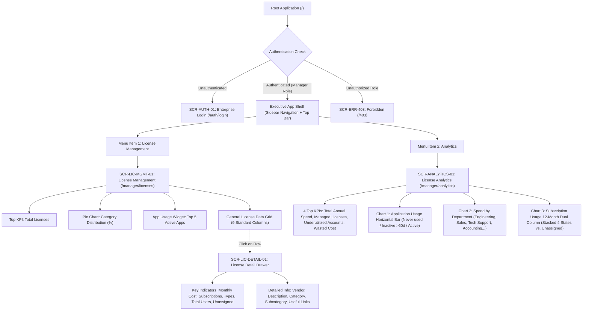
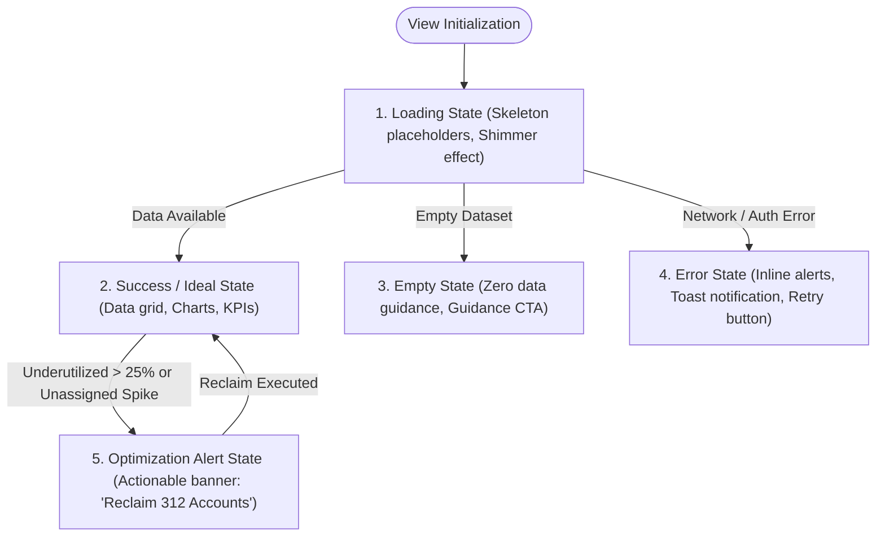

# UI/UX INFORMATION ARCHITECTURE & VIEW SPECIFICATIONS (IA)
## Project: VFast – Enterprise License Management System (ELMS)
### Subsystem: Executive Management Portal (2-View Focused Architecture)

> **Document Baseline:** [README.md](../README.md), [docs/01-MVP.md](01-MVP.md), [docs/02-use-cases.md](02-use-cases.md), [docs/03-user-stories.md](03-user-stories.md)  
> **Architecture Version:** 4.0 – Redesigned 2-View Core Model  
> **Target Scope:** Streamlined Executive Portal focusing strictly on **License Management** and **Analytics**  
> **Git Worktree Branch:** `docs/uiux-ia-2-views`

---

## 📋 TABLE OF CONTENTS

1. [Executive Architecture Overview](#-1-executive-architecture-overview)
2. [Master Screen & View Catalog](#-2-master-screen--view-catalog)
3. [Screen Hierarchy & Navigation Flow](#-3-screen-hierarchy--navigation-flow)
4. [Detailed View Specification: View 1 – License Management](#-4-detailed-view-specification-view-1--license-management)
   - 4.1. [Key Metrics & Visualizations (Top Section)](#41-key-metrics--visualizations-top-section)
   - 4.2. [General License Data Grid (Bảng thông tin chung)](#42-general-license-data-grid-bảng-thông-tin-chung)
   - 4.3. [License Detail Drill-Down View (Thông tin chi tiết 1 License)](#43-license-detail-drill-down-view-thông-tin-chi-tiết-1-license)
5. [Detailed View Specification: View 2 – Analytics](#-5-detailed-view-specification-view-2--analytics)
   - 5.1. [Top KPI Health Metrics (4 Chỉ số hàng đầu)](#51-top-kpi-health-metrics-4-chỉ-số-hàng-đầu)
   - 5.2. [Application Usage Optimization Chart (Horizontal Bar Chart)](#52-application-usage-optimization-chart-horizontal-bar-chart)
   - 5.3. [Spend by Department Chart (Chi tiêu theo phòng ban)](#53-spend-by-department-chart-chi-tiêu-theo-phòng-ban)
   - 5.4. [Subscription Usage 12-Month Comparative Chart (Biểu đồ cột đôi)](#54-subscription-usage-12-month-comparative-chart-biểu-đồ-cột-đôi)
6. [UI/UX State Contract & Interaction Rules](#-6-uiux-state-contract--interaction-rules)
7. [Screen-to-API Mapping Matrix](#-7-screen-to-api-mapping-matrix)
8. [RBAC & Permission Matrix](#-8-rbac--permission-matrix)

---

## 🏛️ 1. EXECUTIVE ARCHITECTURE OVERVIEW

The Information Architecture of the VFast Enterprise License Management System (ELMS) Manager Portal is refactored into a high-efficiency **2-View Model**:

1. **View 1: License Management (`SCR-LIC-MGMT-01`):** Operational control cockpit providing inventory visibility, publisher and category distribution, seat entitlements, utilization rates, and deep-dive drawer inspection for individual licenses.
2. **View 2: Analytics (`SCR-ANALYTICS-01`):** Strategic license health & financial intelligence center providing 4 top executive KPIs, user activity status breakdown (Never used / Inactive >60d / Actively used), cross-departmental cost allocations, and 12-month dual-column subscription dynamics (Active, Inactive, No activity, Not monitored vs. Unassigned).

### Core Design Principles
- **Clarity over Clutter:** Consolidate fragmented pages into two purpose-built views with zero navigation friction.
- **Actionable Optimization:** Direct visualization of unused/underutilized licenses to support immediate reclamation and renewal negotiation.
- **Non-destructive In-context Inspection:** License drill-downs operate via a non-intrusive Side Drawer / Detail Overlay, preserving table scroll position and active filters.

---

## 🗂️ 2. MASTER SCREEN & VIEW CATALOG

| Screen ID | Screen / View Name | Presentation Mode | Route URL Path | Mapped Use Cases | Status / Priority |
|:---|---|:---:|:---|---|:---:|
| **SCR-AUTH-01** | Enterprise Authentication | Full Page | `/auth/login` | `UC29`, `US-M14` | MVP P0 |
| **SCR-LIC-MGMT-01** | **View 1: License Management** | Full Page | `/manager/licenses` | `UC01`, `UC02`, `UC05`, `UC15`, `UC23` | MVP P0 Core |
| **SCR-LIC-DETAIL-01**| **License Detail Drill-Down** | Side Drawer (640px) / Modal | `/manager/licenses?drawer=detail&id=:id` | `UC02`, `UC03`, `UC20`, `UC21` | MVP P0 Core |
| **SCR-ANALYTICS-01** | **View 2: Analytics & Health** | Full Page | `/manager/analytics` | `UC14`, `UC16`, `UC19`, `UC20`, `UC24` | MVP P0 Core |
| **SCR-ERR-403** | 403 Forbidden Access | Full Page | `/403` | `US-M14` | System |
| **SCR-ERR-404** | 404 Page Not Found | Full Page | `/404` | System | System |

---

## 🌳 3. SCREEN HIERARCHY & NAVIGATION FLOW



---

## 📊 4. DETAILED VIEW SPECIFICATION: VIEW 1 – LICENSE MANAGEMENT

- **Route:** `/manager/licenses`
- **Presentation:** Full Page with responsive multi-tier grid layout.
- **Primary Goal:** Executive overview of software inventory, distribution across categories, top utilized applications, and detailed licensing tabular data with instant drill-down.

### 4.1. Key Metrics & Visualizations (Top Section)

The top section consists of three primary visual containers arranged in a 12-column executive dashboard grid:

```
+---------------------------------------------------------------------------------------------------------+
| [ Total License Card ] (Col 1-3)  |  [ Category Pie Chart ] (Col 4-7)  |  [ Top 5 Usage Widget ] (Col 8-12) |
+---------------------------------------------------------------------------------------------------------+
```

#### 1. Metric: Total Licenses (Col 1–3)
- **Primary Display Value:** Total active software licenses currently provisioned (e.g., `1,284 Licenses`).
- **Sub-indicators:**
  - `Active Entitlements:` e.g., `1,142` (88.9%).
  - `Expiring in <= 30 Days:` Amber pill badge with count (e.g., `18`).
  - `MoM Change:` Growth indicator (e.g., `+4.5% vs. previous month`).

#### 2. Visual: Pie Chart – Percentage License Category (Col 4–7)
- **Chart Type:** Interactive Donut / Pie Chart.
- **Data Categories & Proportions (Enterprise Standard Baseline):**
  - **Development & DevOps:** 32% (IDE, Git repositories, CI/CD pipelines, Cloud sandboxes).
  - **Productivity & Office:** 28% (Office suites, Document management, Spreadsheets).
  - **Communication & Collaboration:** 18% (Team chat, Video conferencing, Virtual workspaces).
  - **Design & Creative:** 12% (UI/UX design, Vector graphics, Video editing).
  - **Security & Compliance:** 7% (Endpoint protection, Password managers, SSO).
  - **Other / Utility:** 3%.
- **Interactivity:**
  - Hovering reveals: Category Name, Count of Licenses, Total Monthly Expense, and Percentage.
  - Clicking a category slice applies an instant filter to the License Data Grid below (`?category=Development`).

#### 3. Visual: Application Usage (Top 5) (Col 8–12)
- **Widget Type:** Ranked progress bar list displaying the Top 5 most utilized applications across the organization.
- **Card Content Structure (Ranked 1 to 5):**
  1. **Microsoft 365 Enterprise:** `94% Active` (470/500 users active) — `Productivity`
  2. **Slack Enterprise Grid:** `91% Active` (410/450 users active) — `Communication`
  3. **GitHub Enterprise:** `88% Active` (264/300 users active) — `Development`
  4. **Jira Software & Confluence:** `85% Active` (255/300 users active) — `Project Management`
  5. **Zoom Business:** `81% Active` (202/250 users active) — `Video Conferencing`
- **Indicator Bars:** Two-tone fill bar (Green for Active rate, Gray for Allocated but Inactive).

---

### 4.2. General License Data Grid (Bảng thông tin chung các license)

- **Layout:** High-density, paginated table with real-time text search, category/type filter dropdowns, compliance status filter, and column sorting.
- **Table Columns Specification:**

| STT | Column Name | Technical Data Key | Display Format & Badges | Alignment | Description & Business Meaning |
|:---:|---|---|---|:---:|---|
| 1 | **License Name** | `software_name` | Bold text with app icon (e.g., *JetBrains All Products Pack*) | Left | Tên của phần mềm / bản quyền đăng ký. |
| 2 | **Publisher Name** | `publisher_name` | Secondary text (e.g., *JetBrains s.r.o.*, *Microsoft*, *Adobe*) | Left | Tên nhà phát hành hoặc nhà cung cấp ứng dụng (Vendor/Publisher). |
| 3 | **License Type** | `license_type` | Standard pill badge:<br>- `SaaS Subscription` (Blue)<br>- `Perpetual License` (Purple)<br>- `User-based (Seat)` (Cyan) | Center | Hình thức cấp phép và mô hình bản quyền sử dụng. |
| 4 | **Compliance Status** | `compliance_status` | Status badge with status dot:<br>- 🟢 `Compliant` ($Allocated \le Purchased$)<br>- 🟡 `At Risk` ($Expiring \le 30\text{d}$ or $\ge 95\%$ cap)<br>- 🔴 `Over-allocated` ($Allocated > Purchased$) | Center | Trạng thái tuân thủ bản quyền của tổ chức để phòng tránh rủi ro pháp lý. |
| 5 | **Purchased** | `total_purchase_amount` | Currency formatted:<br>`$48,000 USD` / `1,220,000,000 VND` | Right | Tổng số tiền đã chi trả để mua số lượng license này. |
| 6 | **License Entitlement** | `purchased_seats` | Numeric badge (e.g., `150 seats`) | Right | Tổng số lượng bản quyền (seats/entitlements) đã mua theo hợp đồng. |
| 7 | **Active Users** | `active_users_count` | Numeric (Green text, e.g., `124`) | Right | Số người dùng thực tế đang có hoạt động trong kỳ giám sát (30 ngày). |
| 8 | **Total Users** | `allocated_users_count` | Progress string: `140 / 150` ($Allocated / Purchased$) | Right | Tổng số tài khoản người dùng đã được cấp phát / gán license. |
| 9 | **Expiry Date** | `expiration_date` | Date format: `YYYY-MM-DD` (Red if $\le 15$ days, Amber if $\le 30$ days) | Center | Ngày hết hạn hợp đồng thuê bao (SaaS) hoặc hạn bảo trì (Perpetual Maintenance). |

- **Table Interactions:**
  - **Row Click Trigger:** Clicking any row opens **`SCR-LIC-DETAIL-01`** (Side Drawer) with full contextual drill-down.
  - **Quick Search Input:** Filters rows matching `License Name` or `Publisher Name` with 300ms debounce.
  - **Status Filter:** All, Compliant, At Risk, Over-allocated.
  - **Pagination:** Options for 10, 25, 50 rows per page.

---

### 4.3. License Detail Drill-Down View (`SCR-LIC-DETAIL-01`)

- **Presentation:** Non-intrusive Sliding Side Drawer (Width: 640px, sliding from right with background backdrop blur).
- **Trigger:** Click on any license item in the General License Data Grid.
- **Header:** License Name, Publisher Logo, License Type Pill, Close Button `[X]`.

#### 1. Key Indicators (Chỉ số trọng yếu)
A highlighted grid of 5 metric cards located at the top of the drawer:

```
+------------------------------------+------------------------------------+
| 1. Monthly Cost                    | 2. Subscriptions                   |
|    $4,200 / month                  |    3 Contracts / POs               |
+------------------------------------+------------------------------------+
| 3. Subscription Types              | 4. Total Users                     |
|    2 Types (Enterprise, Business)  |    140 Assigned Users              |
+------------------------------------+------------------------------------+
| 5. Unassigned Subscriptions        |                                    |
|    10 Seats Available (Inventory)  |                                    |
+------------------------------------+------------------------------------+
```

| Key Indicator | Data Attribute | Detailed Definition & Business Meaning |
|---|---|---|
| **Monthly Cost** | `monthly_amortized_cost` | Cho biết doanh nghiệp đang phải chi trả bao nhiêu tiền mỗi tháng cho ứng dụng (tính theo tháng bình quân đối với cả gói năm và gói tháng). |
| **Subscriptions** | `subscriptions_count` | Cho biết số lượng subscription / hợp đồng bản quyền mà doanh nghiệp đang sở hữu hoặc quản lý cho ứng dụng này. |
| **Subscription Types** | `subscription_tiers` | Cho biết doanh nghiệp đang sử dụng bao nhiêu loại gói dịch vụ (ví dụ: *Free*, *Plus*, *Business*, *Enterprise*). |
| **Total Users** | `total_assigned_users` | Tổng số tài khoản người dùng liên quan đến ứng dụng (đã được cấp phát quyền sử dụng). |
| **Unassigned Subscriptions** | `unassigned_seats` | Số lượng license đã mua nhưng chưa được phân bổ cho bất kỳ người dùng nào (License tồn kho sẵn sàng cấp phát ngay: $Purchased - Allocated$). |

#### 2. Detailed Information (Thông tin chi tiết thuộc tính)

Structured tabular / metadata specification list:

| Thuộc tính (Attribute) | Technical Key | Ý nghĩa & Quy chuẩn dữ liệu (Meaning & Data Specification) |
|---|---|---|
| **Vendor** | `vendor_company` | Nhà cung cấp ứng dụng: Tên pháp nhân, quốc gia, đầu mối liên hệ kỹ thuật và tài khoản đại diện kinh doanh. |
| **Description** | `software_description` | Mô tả chức năng của ứng dụng: Tóm tắt năng lực cốt lõi, phạm vi sử dụng nội bộ và mục đích nghiệp vụ doanh nghiệp. |
| **Category** | `category_name` | Nhóm ứng dụng cấp 1: Phân loại tổng quát (e.g., *Productivity*, *Engineering*, *Security*, *Design*). |
| **Subcategory** | `subcategory_name` | Phân nhóm chi tiết cấp 2: Xác định chính xác vai trò công cụ (e.g., *IDE & Source Control*, *Team Chat*, *Cloud Infrastructure*, *UI Prototyping*). |
| **Useful links & Policy** | `policy_links` | Các đường dẫn liên quan phục vụ quản trị và tuân thủ:<br>- **Internal License Policy:** Quy định phân bổ & trách nhiệm người dùng của công ty.<br>- **Vendor Terms of Service:** Điều khoản dịch vụ và SLA của nhà cung cấp.<br>- **Security Compliance Policy:** Báo cáo tuân thủ an toàn thông tin (SOC2, ISO 27001).<br>- **Management Portal:** Đường dẫn trực tiếp đến trang quản trị của hãng. |

---

## 📈 5. DETAILED VIEW SPECIFICATION: VIEW 2 – ANALYTICS

- **Route:** `/manager/analytics`
- **Presentation:** Full Page executive business intelligence cockpit.
- **Primary Goal:** Thể hiện các thông số của sức khỏe License qua các metric và biểu đồ phân tích chuyên sâu nhằm tối ưu hóa chi phí, phát hiện lãng phí và hỗ trợ ra quyết định phân bổ ngân sách.

```
+-------------------------------------------------------------------------------------------------------+
|  [ Total Annual Spend ]  |  [ Managed Licenses ]  |  [ Underutilized Accts ]  |  [ Wasted Lic Cost ]  |
+-------------------------------------------------------------------------------------------------------+
|  [ Chart 1: Application Usage (Horizontal Bar) - Top 5/10/20 ] (Col 1-7)                              |
|  Segments: Never Used (Orange) | Inactive >60d (Gray) | Actively Used (Green)                         |
+-------------------------------------------------------------------------------------------------------+
|  [ Chart 2: Spend by Department ] (Col 8-12)                                                          |
|  Engineering | Sales | Tech Support | Accounting | Marketing | Product                                |
+-------------------------------------------------------------------------------------------------------+
|  [ Chart 3: Subscription Usage (12-Month Comparative Dual-Column) ] (Full Width Col 1-12)            |
|  Col 1 (Stacked): Active | Inactive | No Activity | Not Monitored   vs.   Col 2: Unassigned         |
+-------------------------------------------------------------------------------------------------------+
```

---

### 5.1. Top KPI Health Metrics (4 Chỉ số hàng đầu)

Bốn thẻ chỉ số KPI chuẩn hóa đặt tại vị trí trên cùng của màn hình Analytics:

| KPI Metric Name | Display Key & Format | Definition & Business Meaning (Ý nghĩa nghiệp vụ) | Action Threshold / Alert Logic |
|---|---|---|---|
| **1. Total Annual Spend** | `annual_total_spend`<br>`$1,420,000 USD`<br>(hoặc `36,000,000,000 VND`) | **Lượng tiền đang chi trả annual:** Tổng ngân sách thực tế doanh nghiệp phải chi trả hàng năm cho toàn bộ danh mục phần mềm và dịch vụ SaaS. | So sánh với Hạn mức Ngân sách phê duyệt (Fiscal Budget Cap). Báo động nếu tốc độ chi tiêu vượt kế hoạch. |
| **2. Managed Licenses** | `total_managed_licenses`<br>`1,284 Licenses` (across 48 Apps) | **Số lượng license đang quản lý:** Tổng số lượng bản quyền phần mềm và dịch vụ đang được hệ thống ELMS kiểm soát tập trung. | Cung cấp cái nhìn bao quát về quy mô tài sản phần mềm của tổ chức. |
| **3. Underutilized Accounts** | `underutilized_accounts`<br>`312 Accounts` (24.3%) | **Số lượng account đang sử dụng license ít hiệu quả/thấp:** Tổng số tài khoản người dùng được cấp phát nhưng rơi vào trạng thái không hoạt động (>60 ngày) hoặc chưa từng sử dụng. | Cảnh báo Amber nếu $> 15\%$, Red nếu $> 25\%$ trên tổng số tài khoản đã phân bổ. |
| **4. Underutilized License Cost** | `wasted_license_cost`<br>`$285,600 USD / yr` (20.1%) | **Lượng tiền lãng phí để mua license ít hiệu quả/thấp:** Tổng chi phí tài chính bị lãng phí do chi trả cho các tài khoản không sử dụng hoặc bỏ quên. | Đây là con số tiềm năng thu hồi ngân sách trực tiếp (Cost Optimization Target). |

---

### 5.2. Application Usage Optimization Chart (Horizontal Bar Chart)

- **Chart Type:** Horizontal Segmented Stacked Bar Chart (Biểu đồ thanh ngang phân tầng).
- **Control Bar:**
  - Selector toggle: **Top 5** | **Top 10** | **Top 20** ứng dụng có lượng users nhiều nhất.
  - Sắp xếp: Mặc định sắp xếp theo *Lượng tài khoản lãng phí giảm dần* (Never Used + Inactive) để Manager tập trung tối ưu ngay.

#### 3 Trạng thái phân bổ người dùng (User Activity Statuses):

| Trạng thái (Status) | Mã màu & Hiển thị | Ý nghĩa nghiệp vụ (Business Meaning) |
|---|:---:|---|
| **Never used** | 🟧 **Màu Cam**<br>(`#FF9800`) | **Tài khoản chưa từng sử dụng ứng dụng:** Đã cấp license cho nhân viên nhưng người dùng chưa từng đăng nhập hoặc không phát sinh bất kỳ thao tác nào từ khi nhận bàn giao. |
| **Inactive (>60 days)** | ⬜ **Màu Xám**<br>(`#9E9E9E`) | **Tài khoản không hoạt động trên 60 ngày:** Đã từng sử dụng trong quá khứ nhưng không ghi nhận bất kỳ hoạt động nào trong vòng 60 ngày gần nhất (nhân viên đổi dự án, nghỉ việc hoặc không còn nhu cầu). |
| **Actively used** | 🟩 **Màu Xanh**<br>(`#4CAF50`) | **Tài khoản đang hoạt động:** Người dùng đăng nhập và tương tác thường xuyên với ứng dụng trong chu kỳ giám sát chuẩn (dưới 60 ngày). |

#### Ý nghĩa quản trị của biểu đồ:
1. **Xác định ứng dụng lãng phí:** Nhận diện ngay ứng dụng nào có dải màu Cam (Never used) và dải màu Xám (Inactive) chiếm tỷ trọng áp đảo.
2. **Tính toán ngân sách lãng phí:** Nhân số lượng seat không dùng với đơn giá license để biết số tiền lãng phí cụ thể trên từng app.
3. **Quyết định thu hồi & điều chuyển (Reclaim & Reallocate):** Hỗ trợ Manager thực hiện thu hồi quyền sử dụng từ nhân viên không dùng để cấp phát cho nhân viên mới mà không cần mua thêm license mới.
4. **Cơ sở đàm phán gia hạn (Downsizing Negotiations):** Cung cấp số liệu chính xác để giảm bớt số lượng seat khi đàm phán gia hạn hợp đồng thường niên với nhà cung cấp.

---

### 5.3. Spend by Department Chart (Chi tiêu theo phòng ban)

- **Chart Type:** Interactive Donut Chart kết hợp Breakdown Table / Treemap.
- **Phân nhóm phòng ban (Cost Centers):**
  - **Engineering & Product:** Chiếm tỷ trọng lớn nhất (Dev tools, Cloud infra, Testing suites).
  - **Sales & Business Development:** CRM, Sales intelligence, Dialing tools.
  - **Technical Support & Customer Care:** Helpdesk, Ticketing, Knowledge base.
  - **Accounting & Finance:** ERP, Invoicing, Payroll software.
  - **Marketing:** Marketing automation, Graphic design, Social media management.
  - **HR & Operations:** HRM, Learning management, Office collaboration tools.

#### Ý nghĩa quản trị:
1. **Xác định phòng ban tiêu thụ ngân sách lớn nhất:** Minh bạch hóa dòng tiền SaaS phân bổ cho từng bộ phận nghiệp vụ.
2. **So sánh chi phí giữa các phòng ban:** Đối chiếu chi phí bản quyền trung bình trên mỗi nhân sự (Cost per Headcount) giữa các khối phòng ban.
3. **Đánh giá mức độ phân bổ ngân sách:** Kiểm tra việc chi tiêu phần mềm có đúng định hướng chiến lược kinh doanh của công ty hay không.
4. **Hỗ trợ Manager điều chỉnh budget:** Cung cấp căn cứ định lượng để cấp thêm, cắt giảm, hoặc thực hiện cơ chế ghi nhận chi phí nội bộ (Internal Chargeback) giữa các phòng ban.

---

### 5.4. Subscription Usage 12-Month Comparative Chart (Biểu đồ cột đôi)

- **Chart Type:** 12-Month Dual-Column Grouped & Stacked Chart (Biểu đồ so sánh hai cột cho mỗi tháng từ Tháng 1 đến Tháng 12).
- **Mục tiêu phân tích:** Cho biết tình trạng sử dụng các gói subscription/license của doanh nghiệp diễn biến qua từng tháng trong năm, phát hiện sự chênh lệch giữa số lượng bản quyền mua về và số lượng thực tế vận hành.

#### Cấu trúc 2 cột hàng tháng:

```
Tháng N:
+-----------------------------------------+   +-----------------------+
| CỘT THỨ NHẤT: STACKED COLUMN (4 STATES) |   | CỘT THỨ HAI: (1 STATE)|
|                                         |   |                       |
| [ Not Monitored ] (Chàm - #3F51B5)      |   |                       |
| [ No Activity   ] (Xám đậm - #616161)   |   |                       |
| [ Inactive      ] (Cam - #FF9800)       |   | [ Unassigned ]        |
| [ Active        ] (Xanh lá - #4CAF50)   |   |   (Đỏ/Xám - #E91E63)  |
+-----------------------------------------+   +-----------------------+
```

#### Chi tiết 5 trạng thái phân biệt bằng màu sắc:

| Cột phân bổ | Tên trạng thái | Màu sắc nhận diện | Ý nghĩa nghiệp vụ chi tiết |
|:---:|---|:---:|---|
| **Cột 1 (Stacked)** | **1. Active** | 🟩 **Xanh lá**<br>(`#4CAF50`) | **Đang hoạt động:** Subscription đang được người dùng sử dụng thường xuyên trong kỳ thống kê hàng tháng. |
| **Cột 1 (Stacked)** | **2. Inactive** | 🟧 **Vàng / Cam**<br>(`#FF9800`) | **Không hoạt động:** Subscription đã được gán cho người dùng nhưng không ghi nhận hoạt động sử dụng trong khoảng thời gian theo dõi. |
| **Cột 1 (Stacked)** | **3. No activity** | ⬛ **Xám đậm**<br>(`#616161`) | **Không có hoạt động:** Không ghi nhận bất kỳ dữ liệu sử dụng hoặc hoạt động phát sinh nào của subscription trong kỳ thống kê (tài khoản đóng băng hoàn toàn). |
| **Cột 1 (Stacked)** | **4. Not monitored** | 🟦 **Xanh tím / Chàm**<br>(`#3F51B5`) | **Chưa được giám sát:** Hệ thống ELMS chưa theo dõi được trạng thái sử dụng của subscription (do phần mềm on-premise chưa gắn agent telemetry hoặc nhà cung cấp chưa hỗ trợ API log). |
| **Cột 2 (Single)** | **5. Unassigned** | 🟥 **Đỏ / Xám nhạt**<br>(`#E91E63`) | **Chưa phân bổ:** Subscription doanh nghiệp đã chi tiền mua nhưng chưa được cấp cho bất kỳ người dùng nào (tồn kho nhàn rỗi, lãng phí chi phí đầu tư). |

#### Ý nghĩa quản trị của biểu đồ cột đôi:
- **Tương quan Cột 1 vs Cột 2:** So sánh tỷ lệ giữa số lượng đã phân bổ vào sử dụng (Cột 1) với số lượng mua thừa đang để trống (Cột 2 - Unassigned). Nếu Cột 2 cao liên tục trong nhiều tháng, cảnh báo quản lý ngay lập tức về tình trạng mua sắm lãng phí.
- **Xu hướng chuyển dịch trạng thái:** Đánh giá dải màu Xanh (Active) trong Cột 1 có tăng trưởng tương ứng với chi phí bỏ ra hay tỷ lệ Inactive / No activity ngày càng phình to.
- **Thúc đẩy tích hợp giám sát:** Dải Not monitored giúp quản trị viên biết được tỷ lệ license "điểm mù" để bổ sung phương thức kiểm soát và đo lường.

---

## 🎨 6. UI/UX STATE CONTRACT & INTERACTION RULES

To guarantee consistency, data integrity, and a responsive experience, both views strictly implement the **5 Core UI States Contract**:



### Chi tiết 5 Trạng thái UI:
1. **Loading State:** Sử dụng Skeleton Shimmer Loader cho 4 thẻ KPI, thanh ngang cho Biểu đồ cột và bảng giả lập 5 hàng dữ liệu. Loại bỏ hoàn toàn tình trạng giật layout (Cumulative Layout Shift $< 0.1$).
2. **Success State:** Hiển thị trọn vẹn số liệu, định dạng tiền tệ chuẩn hóa (`VND` / `USD`), định dạng ngày tháng `YYYY-MM-DD`, các badge màu sắc tương phản cao theo chuẩn WCAG 2.1 AA.
3. **Empty State:** Khi không có bản ghi (ví dụ lọc không ra kết quả), hiển thị minh họa vector, thông điệp rõ ràng và nút bấm `[Xóa bộ lọc]`.
4. **Error State:** Hiển thị thông báo lỗi thân thiện, giữ nguyên các bộ lọc đã chọn và cung cấp nút `[Thử lại]` mà không bắt buộc F5 tải lại toàn trang.
5. **Optimization Alert State:** Tự động kích hoạt khi tỷ lệ tài khoản không sử dụng vượt quá ngưỡng an toàn ($> 20\%$) hoặc có license sắp hết hạn trong 30 ngày.

---

## 🔗 7. SCREEN-TO-API MAPPING MATRIX

Hệ thống API RESTful chuẩn hóa cung cấp dữ liệu trực tiếp cho 2 View và Detail Drawer:

| Screen / Component | User Action / Event | REST API Endpoint & Method | Request / Query Parameters | Response Payload Overview |
|---|---|---|---|---|
| **SCR-LIC-MGMT-01** | Khởi tạo trang License | `GET /api/v1/licenses/overview` | `None` | `total_licenses`, `category_breakdown` (Pie data), `top_5_usage` (Ranked list). |
| **SCR-LIC-MGMT-01** | Tải danh sách bảng dữ liệu | `GET /api/v1/licenses` | `page`, `limit`, `search`, `category`, `status`, `sort_by` | Danh sách phân trang các license với 9 cột dữ liệu chuẩn hóa. |
| **SCR-LIC-DETAIL-01**| Click vào 1 dòng license | `GET /api/v1/licenses/{id}/detail` | `id` (License Entitlement ID) | Key indicators (`monthly_cost`, `subscriptions_count`, `tiers`, `total_users`, `unassigned_count`) và Detailed attributes (`vendor`, `description`, `category`, `subcategory`, `policy_links`). |
| **SCR-ANALYTICS-01** | Tải 4 KPI hàng đầu | `GET /api/v1/analytics/kpis` | `fiscal_year` (Mặc định năm hiện tại) | `total_annual_spend`, `managed_licenses`, `underutilized_accounts`, `wasted_license_cost`. |
| **SCR-ANALYTICS-01** | Tải biểu đồ Application Usage | `GET /api/v1/analytics/application-usage` | `limit=5\|10\|20`, `sort=wasted` | Danh sách ứng dụng với 3 phân khúc số liệu: `never_used`, `inactive_60d`, `actively_used`. |
| **SCR-ANALYTICS-01** | Tải biểu đồ Spend by Dept | `GET /api/v1/analytics/spend-by-department` | `fiscal_year`, `currency=USD\|VND` | Mảng dữ liệu phòng ban: `department_name`, `spend_amount`, `percentage_share`, `headcount`. |
| **SCR-ANALYTICS-01** | Tải biểu đồ Subscription Usage | `GET /api/v1/analytics/subscription-usage-monthly`| `fiscal_year` | Dữ liệu 12 tháng: Cột 1 (`active`, `inactive`, `no_activity`, `not_monitored`) và Cột 2 (`unassigned`). |

---

## 🔐 8. RBAC & PERMISSION MATRIX

| Screen / Data Component | Manager (Executive Admin) | Staff (Operations & Ingestion) | Employee (End User) |
|---|:---:|:---:|:---:|
| **SCR-LIC-MGMT-01 (View 1: License Management)** | ✅ Xem đầy đủ & Xuất báo cáo | 👁️ Xem danh sách (Read-only) | ❌ Chặn truy cập (403) |
| **SCR-LIC-DETAIL-01 (License Detail Drawer)** | ✅ Xem chi tiết & Thao tác quản trị | 👁️ Xem chi tiết thông số | ❌ Chặn truy cập (403) |
| **SCR-ANALYTICS-01 (View 2: Analytics & KPIs)** | ✅ Toàn quyền phân tích & Xem chi phí | ❌ Chặn truy cập thông tin tài chính (403) | ❌ Chặn truy cập (403) |
| **Hiển thị Số tiền Chi phí (Costs / Spend)** | ✅ Hiển thị đầy đủ | ❌ Ẩn trường giá tiền | ❌ Ẩn trường giá tiền |
| **Hiển thị Đường dẫn Chính sách & Policy Links** | ✅ Xem & Truy cập | ✅ Xem & Truy cập | 👁️ Xem chính sách chung |

---

*Tài liệu Information Architecture & View Specifications phiên bản 4.0 được thiết kế chuyên biệt và tối ưu hóa theo đúng 2 View nghiệp vụ của người dùng: **License Management** và **Analytics**.*
