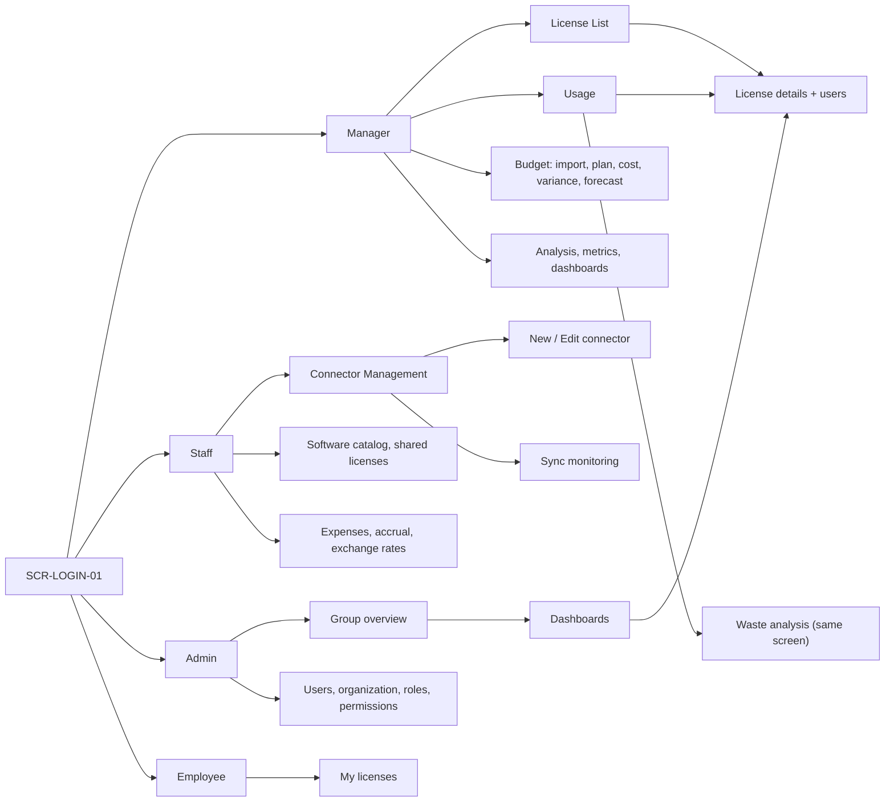

# Information Architecture — ELMS

> Design status: TARGET (49 use cases of the third revision, 15 November 2026)
>
> Baseline: [Use cases](02-use-cases.md), [Feature list](08-feature-list.md), the UI demos D1 (`UI/VFast_Usage_Connector_Management (5).html`, on branch `update-usage-connector-management`) and D2 (waste analytics). Where a demo exists, the screen follows it; what the use cases add on top of it is marked *(not in the demo)*.

This document lists the screens of ELMS, who reaches them and how, what each screen holds, the UI conventions every screen follows, and the API each screen calls. Rules and figures are defined once in the use cases (`BR-xx`, `UCxx`) and only referenced here.

## 1. Overview

**App shell.** A header with the product name, the **company picker** (the scope of the Usage screen, UC37), the user menu, and logout; a left **sidebar** whose menu depends on the role. Screens open inside the shell; dialogs and drawers open over them.

**Principles.**

| # | Principle | Source |
|---|---|---|
| P1 | Money first: analysis screens show amounts, in VND or USD at the user's choice, with the rate used | BR-05 |
| P2 | One scope drives the whole Usage screen; the scope is in the page address | UC37 |
| P3 | Plan, Purchased, Used, and Wasted are always shown together; Not evaluated whenever it is above zero | BR-24 |
| P4 | Missing data reads `Unknown`, `Not evaluated`, `Not tracked`, or "No data yet", never 0 | BR-04 |
| P5 | Complete months only; an open month is *Provisional* | BR-31 |
| P6 | Every figure has a definition behind an info icon | BR-29, UC45 |
| P7 | Mock data is labelled on every screen it reaches | BR-14 |
| P8 | Menus and buttons follow the permissions, but the API enforces them (`403`) | BR-16 |

## 2. Screen catalog

| ID | Screen | Roles | Use cases | Demo |
|---|---|---|---|---|
| SCR-LIC-LIST-01 | License List with validity timeline | Manager | UC57, UC58 | D1 |
| SCR-LIC-DETAIL-01 | License details dialog with users | Manager; Admin from a dashboard | UC59, UC61 | D1, users requested |
| SCR-LIC-INV-01 | License inventory by P&L | Manager, Staff | UC27 | — |
| SCR-LIC-ORG-01 | Licenses by organization | Manager | UC28 | — |
| SCR-LIC-PROV-01 | Providers and licenses | Manager | UC02 | — |
| SCR-LIC-TERMS-01 | License terms (contracts) | Manager | UC04 | — |
| SCR-LIC-SHARED-01 | Shared licenses | Staff; Manager reads | UC47 | — |
| SCR-CATALOG-01 | Software catalog and mapping | Staff | UC01 | — |
| SCR-USAGE-01 | Usage: scope, balance, comparison, trend, units table, waste analysis | Manager | UC37, UC08, UC48–UC51, UC43, UC52–UC54, UC10, UC11, UC35 | D1, D2 |
| SCR-EMP-USAGE-01 | Employee usage (BCA) | Manager | UC32 | — |
| SCR-BUDGET-IMPORT-01 | Budget import | Manager | UC33 | — |
| SCR-BUDGET-PLAN-01 | Monthly budget plan and versions | Manager | UC05 | — |
| SCR-COST-01 | Cost allocation | Manager | UC06 | — |
| SCR-ACCRUAL-01 | Cost accrual and month close | Staff; Manager reads | UC42 | — |
| SCR-EXPENSES-01 | Expenses | Staff | UC07 | — |
| SCR-RATES-01 | Exchange rates | Staff | UC62 | — |
| SCR-VARIANCE-01 | Monthly plan variance | Manager | UC34 | — |
| SCR-FORECAST-01 | Spending forecast | Manager | UC09 | — |
| SCR-GROUP-01 | Group overview | Admin | UC36 | D1, D2 (group scope) |
| SCR-ANALYSIS-01 | Analysis by license, software, category, provider | Manager | UC44 | — |
| SCR-METRICS-01 | Metric definitions | Manager | UC45 | — |
| SCR-DASH-LIC-01, -FIN-01, -OPT-01 | License, financial, optimization dashboards | Manager, Admin | UC15, UC16, UC18 | — |
| SCR-CONN-01 | Connector Management | Staff | UC38 | D1 |
| SCR-CONN-FORM-01 | New / Edit connector dialog | Staff | UC55, UC60 | D1 |
| SCR-CONN-DETAIL-01 | Connector details drawer | Staff | UC56 | D1 v1 |
| SCR-SYNC-01 | Sync monitoring | Staff | UC26 | — |
| SCR-USERS-01 | Users | Admin | UC19 | — |
| SCR-ORG-01 | Organization hierarchy | Admin | UC20 | — |
| SCR-ROLES-01 | Roles | Admin | UC21 | — |
| SCR-PERMS-01 | Permission matrix | Admin | UC22 | — |
| SCR-MY-01 | My licenses | Everyone | UC23 | — |
| SCR-LOGIN-01 | Login | Everyone | UC24 | — |

## 3. Navigation

**Default screen after login (UC24):** Manager → License List; Staff → Connector Management; Admin → Group overview; Employee → My licenses.

**Sidebar by role** (every role also has *My licenses*):

| Manager | Staff | Admin |
|---|---|---|
| License List · Usage (organization tree) · Xếp hạng lãng phí · Licenses (inventory, by organization, providers, terms, shared) · Budget (import, plan, cost allocation, accrual, variance, forecast) · Employee usage · Analysis · Dashboards · Metric definitions | Connector Management · Sync monitoring · Software catalog · Shared licenses · License inventory · Expenses · Accrual · Exchange rates | Group overview · Dashboards · Users · Organization · Roles · Permissions |

## 4. Screen specifications

### 4.1 License List and license details (D1)

**SCR-LIC-LIST-01 — License List (UC57, UC58).**

- Header: *License List*, number of licenses, "As of <date>".
- Toolbar: search *Search license or provider…*; filters *All companies* and expiry (*0–30 days*, *31–60 days*, *after 60 days*, *Expired*); sort (expiry, name, monthly cost, allocation rate, purchased quantity) with reverse; "n of N licenses match your filters" with *Clear filters*.
- Table, one row per license: logo and name (opens details), monthly cost (accrued from the invoices, "$4,125 / mo"), company, Allocated / Purchased with rate and bar (red above 100 %), *Expires in* badge and date, and the **validity timeline**: six months, ‹ *Today* ›, today line, colour by expiry bucket, final 7 days striped, hover card.
- Paging 10 / 20 / 50; legend of the expiry colours.

**SCR-LIC-DETAIL-01 — License details dialog (UC59, UC61).**

- Top: logo, name, provider; company, monthly cost, start, expiry, expiry badge, unallocated or over-allocated quantity, Allocated / Purchased bar, note "Allocated quantity represents assigned licenses. Actual usage is tracked separately in Usage."
- **Users** *(not in the demo)*: counts Allocated, Active, Inactive, Not monitored, Unallocated (each a filter); period 30 / 90 days or previous month; table of holders (name and every email, company and unit, status, last used, days used / working days with a bar, assigned since); *Shared & service accounts* apart; "Outside your scope: n"; search, sort, paging, CSV.

### 4.2 License views and catalog

| Screen | Content |
|---|---|
| SCR-LIC-INV-01 (UC27) | P&L picker → licenses grouped by provider: license type, Purchased, Assigned, Used, cost, status, expiry, data date; "No data yet" for a P&L without a successful run |
| SCR-LIC-ORG-01 (UC28) | Unit picker → its licenses; switch to *by license* → the units using it with their share |
| SCR-LIC-PROV-01 (UC02) | Providers with number of licenses, companies, monthly cost → a provider's licenses with Purchased and Allocated per license |
| SCR-LIC-TERMS-01 (UC04) | Terms: license, provider, company, start, expiry, auto-renew ("—" when not reported), cost; filter renewal within 30 / 60 days |
| SCR-LIC-SHARED-01 (UC47) | Shared licenses and *Possibly shared* proposals (confirm, unmark); per license, the charge-back per company and *Unallocated* of the group |
| SCR-CATALOG-01 (UC01) | Tabs *Software* (software, provider, category › subcategory, licenses mapped; create, edit, merge) and *Mapping* (license names and BCA application names, filter *Not mapped*, suggested software) |

### 4.3 Usage (D1 menu *Usage*, D2 *Tổng quan chi phí & sử dụng*)

**SCR-USAGE-01** is one long screen driven by the scope (UC37):

1. **Sidebar tree** Group > Company > Division > Department > Project > License, search in the tree, keyboard; *Unallocated* and *Unknown unit* nodes under a P&L. **Breadcrumb**; **company picker** in the header; title by level (*License Monitoring* at project level).
2. **Balance (UC08):** three bars Plan Budget, Purchased Cost, Actual Used; badge "Over budget +X" / "Savings vs budget −X"; donut Utilized, Wasted, Not evaluated, Purchased.
3. **Period and filters (UC48):** tabs *YTD* / *Monthly Comparison* / *Annual Trend*; Year, Month; sort (7 orders); search with "shown / total"; currency USD / VND.
4. **Unit comparison (UC48)** — cards of 8 units, Plan beside Purchased split into Used, Wasted, Not evaluated; or **annual trend (UC49)** — one card per unit by month with Efficiency.
5. **Units table (UC50):** rank, unit, Plan, Purchased, Used, Wasted, utilization, variance; paging 10 / 25 / 50; **license heatmap** under each P&L row (chevron) with the *Rate / Cost* switch; *Export CSV* (UC51).
6. **Waste analysis:** ranking (UC43, D2) — top 10, Used / Waste bar, "% chưa khai thác"; **trend (UC52)** — Plan, Used, Wasted by month, "Filtered: n of N units"; **risk distribution (UC53)** — scatter Purchased × waste rate with medians; **monthly heatmap (UC54)** — own year selector, top 12, *Rate / Cost* switch.
7. Waste flag in red (Wasted above 20 % of Purchased, UC35) on the tree, the table, and the scatter. Unused and inactive seats (UC10, UC11) open from the license panel and the dashboards.

The sidebar item **Xếp hạng lãng phí** opens this screen at the Manager's highest unit, sorted by waste, scrolled to the waste analysis.

**SCR-EMP-USAGE-01 (UC32):** unit and period → employees, application, days used, last used (BCA); "Not tracked" without BCA; "No license reported" for an application without a license.

### 4.4 Budget and cost

| Screen | Content |
|---|---|
| SCR-BUDGET-IMPORT-01 (UC33) | Download template → choose target unit and months → upload → preview per unit: add, replace, remove, reject with reasons → *Confirm*; "No changes" for the same file; "The plan changed since your preview"; import history |
| SCR-BUDGET-PLAN-01 (UC05) | Year and unit → plan by month and license, year total; group by P&L, block, project; compare with an earlier version |
| SCR-COST-01 (UC06) | Period → per license: cost, seats, cost per seat, cost per unit; *Unallocated* and *Unknown unit*; chart by unit |
| SCR-ACCRUAL-01 (UC42) | Company and month → per license term: term cost, accrued this month, to date, remaining; rounding applied; *Close month*; export for finance |
| SCR-EXPENSES-01 (UC07) | Expenses with invoice and term; add, edit, CSV import; correcting entries for closed months |
| SCR-RATES-01 (UC62) | Rates per currency and date; add, correct (open months only) |
| SCR-VARIANCE-01 (UC34) | Unit and year → per complete month Plan, Purchased, Used, variance; chart; licenses behind a month's variance |
| SCR-FORECAST-01 (UC09) | Unit and year → actual by month, forecast for the rest, year-end against plan, upcoming renewals |

### 4.5 Analytics

| Screen | Content |
|---|---|
| SCR-GROUP-01 (UC36) | Every P&L with Plan, Purchased, Used, Waste, utilization, waste flag; group totals; month or year |
| SCR-ANALYSIS-01 (UC44) | Dimension license, software, category, provider, license type → figures per item → split by unit; compare two periods; CSV |
| SCR-METRICS-01 (UC45) | Catalog of metrics with formula, unit, source, period, exclusions; the same definition behind every info icon |
| SCR-DASH-LIC-01 (UC15) | License counts by category, license type, provider; Purchased vs Assigned vs Used; expiring within 30 days |
| SCR-DASH-FIN-01 (UC16) | Yearly spend, spend by month and unit, plan against actual, forecast |
| SCR-DASH-OPT-01 (UC18) | Waste, utilization, Not evaluated; unassigned and inactive seats; flagged P&Ls |

### 4.6 Connector Management (D1)

**SCR-CONN-01 (UC38):** tiles *Companies*, *Providers*, *Licenses*, *Sync Issues*; search *Search company, provider, license…*; filters company, provider, status (`Active`, `Delayed`, `Failed`, `Pending`, `Paused`); sort (5 orders); tree table *Company / Provider / License* with coverage, API contact, created, last sync, status; *Edit* on a provider row; paging by company.

**SCR-CONN-FORM-01 (UC55, UC60):** *General* (company, provider, API contact and email); *API Connection* (HTTPS API URL of the P&L, API Key or Bearer Token, masked credential); *Sync interval* in hours *(not in the demo)*; *Licenses* as chips with suggestions; *Test connection* *(not in the demo)*; *Create Connector* / *Save Changes*; *Delete* with confirmation *(not in the demo)*.

**SCR-CONN-DETAIL-01 (UC56):** drawer with company, connector ID, contact, created, last sync, interval, paused or running, API base URL, authentication type, licenses with status — never the credential.

**SCR-SYNC-01 (UC26):** connections (source, P&L, status, interval, last run) → runs (data period, status `Running` / `Success` / `Partial` / `Failed` / `Paused`, records received, accepted, rejected, duration) → a run's rejected records with the check that failed; *Run now*, *Rerun period*, *Pause* / *Resume*, change interval, replace credential.

### 4.7 Administration

| Screen | Content |
|---|---|
| SCR-USERS-01 (UC19) | Users (name, email, role, unit, managed units or companies, status, last login); create for an ILVG employee; one-time password link; disable, re-enable |
| SCR-ORG-01 (UC20) | Five-level tree with codes and source; assign Managers at any level, the group included; correct a unit with a reason; "Unmatched" codes; mark inactive |
| SCR-ROLES-01 (UC21) | Four roles with users; change a user's role |
| SCR-PERMS-01 (UC22) | Matrix feature × role (read, write); change with a reason |

### 4.8 Self-service

- **SCR-MY-01 (UC23):** licenses held across all the user's emails: license, provider, P&L, assigned date, status, last used, expiry; a note on Inactive seats; no cost.
- **SCR-LOGIN-01 (UC24):** email and password; generic error; lock after 5 failures; first password through the one-time link.

## 5. UI conventions

### 5.1 States

Every screen implements five states:

1. **Loading** — `Skeleton` placeholders for cards, charts, and five table rows; no layout shift.
2. **Success** — formatted amounts (VND or USD), dates `YYYY-MM-DD`, WCAG 2.1 AA contrast.
3. **Empty** — a sentence saying why ("No licenses found — Try a different search or clear the filters") and *Clear filters* when filters caused it.
4. **Error** — an `Alert` that keeps the user's filters and offers *Retry*.
5. **Partial data** — `Unknown`, `Not evaluated`, `Not tracked`, *Provisional*, and *Mock data* labels where the rules require them (P4, P5, P7); a figure is never replaced by 0.

### 5.2 Text and cards

- Card and chart titles are 2–3 words; a subtitle only for domain figures (waste rate, Not evaluated, accrued cost), otherwise the info icon (P6).
- A metric card has four parts: label with info icon, one value, at most one status chip, an optional action link. No stacked micro-metrics.

### 5.3 Components and icons

- Components from `@mui/material`; icons from `@mui/icons-material` only (Search, FilterList, Close, Edit, InfoOutlined, ArrowForward, OpenInNew …); no invented glyphs or emojis.
- Provider and software logos from the catalog; otherwise a two-letter monogram `Avatar`.
- Drawers open on the right (560–640 px); dialogs close with Esc or a click outside; Tab stays inside a dialog.

### 5.4 Charts

- Charts use ApexCharts; no numbers painted on bars or slices — values appear in tooltips (the figure card of UC48).
- Horizontal bars have a calibrated bottom axis with light gridlines.
- Colours: Plan `#8FB3DD`, Used `#648FC3`, Wasted `#D39B5C`, Not evaluated `#9E9E9E`, waste flag red `#EF4444`; heatmap from low to high waste in one hue.
- The current month is not drawn (P5).

## 6. Screen-to-API mapping

All endpoints are under `/api/v1`, read data scope from the session (BR-16), and return `403` outside it.

| Screen | Action | Endpoint |
|---|---|---|
| SCR-LIC-LIST-01 | List licenses | `GET /licenses?search&company&expiry&sort&page&size` |
| SCR-LIC-DETAIL-01 | Details; users | `GET /licenses/{id}`; `GET /licenses/{id}/holders?status&period&page` |
| SCR-LIC-INV-01, -ORG-01 | Inventory; by unit or license | `GET /org-units/{id}/licenses`; `GET /licenses/{id}/units` |
| SCR-LIC-PROV-01, -TERMS-01 | Providers; terms | `GET /providers`; `GET /license-terms?renewalWithin` |
| SCR-LIC-SHARED-01 | Shared licenses; confirm, unmark | `GET /shared-licenses`; `POST /licenses/{id}/shared`; `DELETE /licenses/{id}/shared` |
| SCR-CATALOG-01 | Software; mapping | `GET/POST/PUT /software`; `POST /software/{id}/merge`; `GET /mappings?status=not_mapped`; `PUT /mappings/{name}` |
| SCR-USAGE-01 | Balance, comparison, trend, table, waste panels, heatmaps | `GET /usage/{scopeId}/balance`, `/units`, `/trend`, `/waste-ranking`, `/risk`, `/heatmap?unit=rate\|cost`, `/units/{id}/license-heatmap` with `period, year, month, search, sort, currency` |
| SCR-USAGE-01 | Export | `GET /usage/{scopeId}/units.csv` |
| SCR-EMP-USAGE-01 | Employee usage | `GET /employee-usage?unit&period&application` |
| SCR-BUDGET-IMPORT-01 | Template; preview; confirm | `GET /budget/template`; `POST /budget/imports` (file, target, months) → preview with `previewKey`; `POST /budget/imports/{previewKey}/confirm` |
| SCR-BUDGET-PLAN-01 | Plan; versions | `GET /budget/plan?unit&year`; `GET /budget/versions?unit` |
| SCR-COST-01, -VARIANCE-01, -FORECAST-01 | Cost, variance, forecast | `GET /cost-allocation`, `/variance`, `/forecast` |
| SCR-ACCRUAL-01 | Accrual; close month | `GET /accrual?company&month`; `POST /accounting-periods/{company}/{month}/close` |
| SCR-EXPENSES-01, -RATES-01 | Expenses; rates | `GET/POST/PUT /expenses`, `POST /expenses/import`; `GET/POST /exchange-rates` |
| SCR-GROUP-01, SCR-ANALYSIS-01, SCR-METRICS-01 | Overview, analysis, definitions | `GET /group/overview`; `GET /analysis?dimension`; `GET /metrics` |
| SCR-DASH-* | Dashboards | `GET /dashboards/licenses`, `/financial`, `/optimization` |
| SCR-CONN-01, -FORM-01, -DETAIL-01 | Connectors | `GET /connectors`; `POST /connectors/test`; `POST /connectors`; `PUT /connectors/{id}`; `DELETE /connectors/{id}`; `GET /connectors/{id}` |
| SCR-SYNC-01 | Runs; rerun; pause | `GET /sync-runs?connector`; `POST /connectors/{id}/runs`; `POST /connectors/{id}/pause`, `/resume` |
| SCR-USERS-01, -ORG-01, -ROLES-01, -PERMS-01 | Administration | `GET/POST/PUT /users`, `POST /users/{id}/password-link`, `PATCH /users/{id}/status`; `GET /org-units`, `PUT /org-units/{id}/managers`, `POST /org-units/{id}/overrides`; `PUT /users/{id}/role`; `GET/PUT /permissions` |
| SCR-MY-01, SCR-LOGIN-01 | Self-service | `GET /me/licenses`; `POST /auth/login`, `POST /auth/logout` |

**Related:** [Use cases](02-use-cases.md) · [Feature list](08-feature-list.md) · [Folder structure and architecture](05-folder-structure.md)
