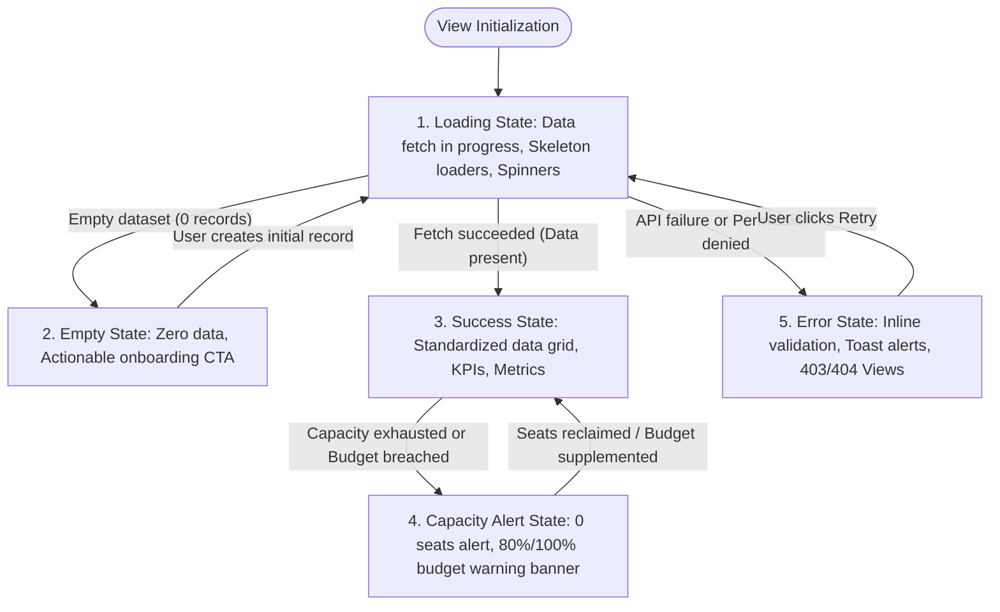
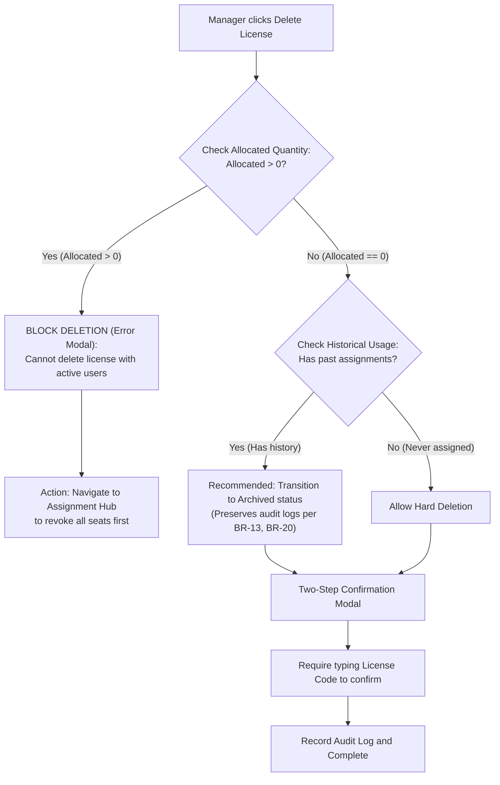
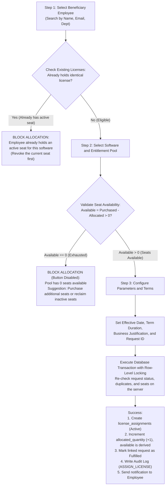

# COMPREHENSIVE INFORMATION ARCHITECTURE & VIEW SPECIFICATIONS (IA)
## Project: VFast – Enterprise License Management System (ELMS)
### Subsystem: Executive Management Portal for Manager Role (Module 1, Module 2, Module 3)

> **Document Baselines:** [README.md](../README.md), [docs/01-MVP.md](01-MVP.md), [docs/02-use-cases.md](02-use-cases.md), [docs/03-user-stories.md](03-use-stories.md)  
> **Structural Reference:** [PMDC-BATCH4-DATNT250 / 09-information-architecture.md](https://github.com/DatTienNguyenn/PMDC-BATCH4-DATNT250/blob/main/docs/09-information-architecture.md)  
> **Version:** 3.0 (Comprehensive Standardization of Screen IDs, Routes, Hierarchy, UI/UX State Contract, Screen-to-API Mapping Matrix, View Specifications, and RBAC Matrix)  
> **Development Branch:** `docs/manager-information-architecture`

---

## 📋 TABLE OF CONTENTS

1. [Master Screen Catalog](#-1-master-screen-catalog)
2. [Screen Hierarchy](#-2-screen-hierarchy)
3. [UI/UX State Contract & Interaction Rules](#-3-uiux-state-contract--interaction-rules)
4. [Screen-to-API Mapping Matrix](#-4-screen-to-api-mapping-matrix)
5. [Detailed View Specifications](#-5-detailed-view-specifications)
6. [RBAC Screen Access Matrix](#-6-rbac-screen-access-matrix)

---

## 🗂️ 1. MASTER SCREEN CATALOG

The Manager Portal is standardized into **18 Screens & Interactive Views** (comprising Full Pages, Side Drawers, Modal Overlays, and System Error Views). 100% of views are provisioned with a **Unique Screen ID**, **Designated Route Path**, **Presentation Mode**, **Mapped User Stories**, and **Implementation Scope**.

| Screen ID | Screen Name / Modal | Presentation | Route URL Path | Related Stories | Scope / Status |
|:---|:---|:---:|:---|:---|:---:|
| **SCR-AUTH-01** | Enterprise Authentication (Login) | Full Page | `/auth/login` | `US-M14` | MVP P0 |
| **SCR-LIC-01** | License Inventory & Executive KPIs | Full Page | `/manager/licenses` | `US-M01`, `US-M02` | MVP P0 |
| **SCR-LIC-ADD-01** | Add License Drawer (SaaS & Perpetual) | Side Drawer | `/manager/licenses?action=create` | `US-M02` | MVP P0 |
| **SCR-LIC-DETAIL-01**| License Detail View & Seat Gauge (4 Tabs) | Full Page | `/manager/licenses/[id]` | `US-M02`, `US-M06` | MVP P0 |
| **SCR-LIC-EDIT-01** | Edit License Drawer (Seat Floor Guard) | Side Drawer | `/manager/licenses/[id]?action=edit` | `US-M02` | MVP P0 |
| **SCR-LIC-DEL-01** | Delete / Decommission Modal (Safety Check) | Modal Overlay | `/manager/licenses/[id]?action=delete` | `US-M02` | MVP P0 |
| **SCR-ASGN-01** | License Assignment Hub (4 Views) | Full Page (4 Views) | `/manager/assignments` | `US-M06`, `US-M07` | MVP P0 |
| **SCR-ASGN-ADD-01** | Assign License Drawer (Seat Validation) | Side Drawer | `/manager/assignments?action=assign` | `US-M06` | MVP P0 |
| **SCR-ASGN-REVOKE-01**| Revoke License Modal (Mandatory Reason) | Modal Overlay | `/manager/assignments?action=revoke` | `US-M07` | MVP P0 |
| **SCR-ASGN-CHANGE-01**| Change License Tier Modal (Atomic Swap) | Modal Overlay | `/manager/assignments?action=change-tier`| `US-M06`, `US-M07` | Deferred post-MVP (D10) |
| **SCR-ASGN-AVAIL-01** | Real-time Seat Availability Monitor | Sub-view / Table | `/manager/assignments?view=availability`| `US-M06`, `US-M10` | MVP P0 |
| **SCR-ASGN-HIST-01** | Global Assignment Audit History View | Sub-view / Table | `/manager/assignments?view=history` | `US-M06`, `US-M07` | MVP P0 |
| **SCR-BDG-MONITOR-01**| Budget Monitoring Cockpit (4 P0 Metrics, Committed in P1) | Full Page | `/manager/budget` | `US-M08`, `US-M13` | MVP P0 |
| **SCR-BDG-PLAN-01** | Multi-dimensional Budget Planning Matrix | Full Page | `/manager/budget/planning` | `US-M08` | MVP P0 (annual per department); P1 (12-month matrix) |
| **SCR-BDG-EXP-01** | Comprehensive License Expense Ledger | Full Page | `/manager/budget/expenses` | `US-M09` | MVP P0 (paid expenses); P1 (other statuses) |
| **SCR-BDG-REPORT-01** | Financial Reporting & Renewal Forecast | Full Page | `/manager/budget/reports` | `US-M13` | P1 (UC16, UC22, UC26) |
| **SCR-ERR-403** | 403 Forbidden Access (RBAC Guard) | Full Page | `/403` | `US-M14` | MVP P0 |
| **SCR-ERR-404** | 404 Page Not Found (Resource Error) | Full Page | `/404` | System | MVP P0 |

---

## 🌳 2. SCREEN HIERARCHY

### 2.1. Screen Hierarchy Tree (Mermaid Diagram)

---

### 2.2. Level Hierarchy Table

| Level | Concept & Architecture Responsibility | Screen / Component Catalog | Display & Navigation Constraints |
|:---:|---|---|---|
| **Level 0** | **Global Layout & Context Shell** | Root App Context, Auth State Provider, Role Guard Provider, Toast & Modal Provider | Maintains active JWT session, enforces `Manager` role authentication before DOM render. |
| **Level 1** | **Root Layout Shells** | 1. `AuthShell`: Minimalist centered authentication card. 2. `ManagerShell`: Left navigation sidebar, top executive header, breadcrumbs, user profile. 3. `ErrorShell`: Full-page boundary view without administrative navigation. | Strict security isolation between Manager, Editor, and Employee portals; blocks unauthorized roles at shell level. |
| **Level 2** | **Primary Pages** | `SCR-LIC-01`, `SCR-LIC-DETAIL-01`, `SCR-ASGN-01`, `SCR-BDG-MONITOR-01`, `SCR-BDG-PLAN-01`, `SCR-BDG-EXP-01`, `SCR-BDG-REPORT-01`. | Direct routing destinations linked to primary sidebar navigation; preserves full browser history. |
| **Level 3** | **Nested Sub-Views & Tabs** | - 4 Tabs in `SCR-LIC-DETAIL-01`: General Info, Active Assignments, History, Audit Logs. - 4 Views in `SCR-ASGN-01`: By Employee, By Software, Availability Monitor, Global History. - 4 Reports in `SCR-BDG-REPORT-01`: Monthly Trends, By Vendor, Variance, Renewal Forecast. | Tab selection state persisted in URL query parameters (e.g., `?tab=active-users` or `?view=availability`). |
| **Level 4** | **Overlay Modals & Side Drawers** | `SCR-LIC-ADD-01`, `SCR-LIC-EDIT-01`, `SCR-LIC-DEL-01`, `SCR-ASGN-ADD-01`, `SCR-ASGN-REVOKE-01`, `SCR-ASGN-CHANGE-01`. | Backdrop blur overlay; background scroll-locked (`overflow: hidden`); supports `Esc` key dismiss and top-right close `X`. |

---

### 2.3. Navigation & Breadcrumb Hierarchy Rules
- **Standardized Breadcrumb Syntax:**
  - `License List:` `Administration > License Management`
  - `License Detail:` `Administration > License Management > [Software Name & Edition] ([License Code])`
  - `Assignment Hub:` `Administration > License Assignments > [View Name]`
  - `Budget Monitoring:` `Administration > Budget & Finance > Budget Monitoring`
  - `Budget Planning:` `Administration > Budget & Finance > Budget Planning`
  - `Expense Ledger:` `Administration > Budget & Finance > Expense Ledger`
  - `Financial Reporting:` `Administration > Budget & Finance > Financial Reporting > [Report Type]`

---

## 🎨 3. UI/UX STATE CONTRACT & INTERACTION RULES

To guarantee data consistency, completely eliminate over-allocation liabilities (**BR-05**), and maintain enterprise-grade reliability, all screens strictly adhere to the **5 Core UI States Contract** and **6 Core UX Interaction Rules**.

### 3.1. The 5 Core UI States Contract

| UI State | Technical UI Standard | Mandatory Interface Components | UX Interaction Behavior |
|:---|---|---|---|
| **1. Loading State** | - Zero blank white screen flashes. - Zero layout shifts (CLS $< 0.1$). | - **Skeleton Placeholders:** Muted rectangular pulse loaders for KPI cards, charts, and table rows. - **Button Spinner:** Submitting buttons disabled with animated spinning indicator. | Prevents duplicate click submissions; provides continuous feedback for asynchronous network jobs. |
| **2. Empty State** | - Never display bare empty tables or blank zeros. - Provide guiding visual prompts. | - Vector illustration matching operational context. - Explicit messaging (e.g., *"No software licenses registered in inventory"*). - **Primary CTA Button:** Prominent button triggering initial workflow (e.g., `+ Register First License`). | Transforms empty spaces into actionable onboarding pathways. |
| **3. Success / Ideal State** | - Displays complete, standardized records. - Strict number formatting with thousands separators. | - Formatted currency: `5,000,000,000 VND`, `$12,500 USD`. - Formatted seat quantities: `45/50 seats (90%)`. - Standardized status badges: Green (`Active`, `Paid`), Amber (`Expiring Soon`, `Pending`), Red (`Expired`, `Overdue`). - Pagination: 10, 25, 50 rows per page. | Conveys reliability, transparency, and actionable clarity to executive managers. |
| **4. Capacity Alert State** | - Visual warnings when approaching operational ceilings. | - Amber warning banner when budget reaches 80% or available seats drop to $\le 10\%$. - Critical red banner when available seats equal 0 ($Available = 0$) or budget reaches $\ge 100\%$. - Action button `[Assign Seat]` dynamically disabled with explanatory tooltip. | Preempts over-allocation legal violations and corporate budget overruns. |
| **5. Error / Failure State** | - Contextual error messages without exposing technical stack traces. | - **Inline Field Errors:** Crisp red text under invalid input fields for validation errors (422). - **Toast Alert:** Top-right toast notification for server errors (500) with Transaction ID. - **System Error Views (403/404):** Dedicated pages with "Return to Dashboard" action buttons. | Guides Manager toward corrective action or IT support channels. |

---

### 3.2. 6 Core UX Interaction Rules

1. **Rule 1: Concurrency Row-Level Locking Against Over-allocation (BR-04, BR-05):**
   - License assignments execute within an atomic database transaction with pessimistic row-level locking (`SELECT ... FOR UPDATE`).
   - If $Available = Purchased - Allocated \le 0$, the transaction rolls back immediately and displays: *"License pool has 0 available seats. Allocation blocked."*
2. **Rule 2: Purchased Seat Reduction Guard ($Purchased \ge Allocated$ - BR-05):**
   - When modifying the purchased quantity of an entitlement, the system enforces: $Purchased_{new} \ge Allocated_{current}$.
   - If a Manager inputs a number below the active assigned seats, the Save button is disabled with the error: *"Cannot reduce purchased seats below active assigned count. Reclaim seats first."*
3. **Rule 3: Mandatory Audit Change Reason on Significant Events (BR-17):**
   - Every Edit License, Revoke Seat, Change Tier, or Budget Revision action requires a non-empty `Change Reason` of at least 10 characters.
   - Persisted immutably to `audit_logs` containing Actor ID, Action Type, Target ID, Old Value, New Value, and Timestamp.
4. **Rule 4: Non-destructive Historical Data Retention (BR-13, BR-20):**
   - Physical deletion (`HARD DELETE`) is strictly forbidden for entitlements and assignments that have operational history.
   - Revoking a seat transitions status to `Revoked` and restores $Available += 1$, retaining historical records indefinitely for corporate audits.
5. **Rule 5: Multi-currency Separation & Administrative Normalization (BR-10, BR-11):**
   - `VND` and `USD` expenditure figures are never summed directly across raw tables.
   - The system applies an administrative exchange rate table (e.g., $1 \text{ USD} = 25,400 \text{ VND}$) to standardize reporting into the fiscal base currency.
6. **Rule 6: Automated 3-Tier Budget Threshold Alerting (UC14, BR-16):**
   - Below 80%: Safe Zone (Green). Normal disbursement pace.
   - 80% to 99%: Warning Zone (Amber). Alerts Manager to review upcoming renewals and audit inactive users.
   - 100% or Above: Critical Zone (Red). Flags over-budget status and alerts the Manager. New expenses are not blocked and no additional approval tier is added (D11).
   - Zones use `Budget Utilization` $= Actual / Total$ (D4).

---

## 🔗 4. SCREEN-TO-API MAPPING MATRIX

Comprehensive matrix mapping all 18 Manager Portal screens to backend REST API endpoints:

| Screen ID | UI Action / Trigger | API Endpoint & Method | Business Purpose & Data Payload | RBAC Role |
|:---|---|---|---|:---:|
| **SCR-AUTH-01** | Login Form Submit | `POST /api/v1/auth/login` | Authenticates credentials, issues a server-revocable session per UC29 and returns the role context. Applies lockout and rate limiting. | Public |
| **SCR-LIC-01** | Fetch Inventory & KPIs | `GET /api/v1/licenses?status={}&vendor={}` | Retrieves paginated entitlements list and 5 executive KPI summary cards. Never returns license keys in clear. | Manager; Staff (read-only, D9) |
| **SCR-LIC-01** | Export Inventory Data | `GET /api/v1/licenses/export?format=csv` | P1 (UC26). Exports the company-wide license register as CSV/Excel for auditing, excluding license keys and neutralizing spreadsheet formulas. | Manager Only |
| **SCR-LIC-ADD-01** | Submit New License Form | `POST /api/v1/licenses` | Registers new entitlement (SaaS / Perpetual), initializes $Available = Purchased$. | Manager Only |
| **SCR-LIC-DETAIL-01**| Load License Details | `GET /api/v1/licenses/{id}` | Fetches license metadata, contract profile, attachments, and capacity gauge, with the key masked. | Manager; Staff (read-only, D9) |
| **SCR-LIC-DETAIL-01**| Click "Reveal License Key" | `POST /api/v1/licenses/{id}/reveal-key` | Decrypts serial key for one response with `Cache-Control: no-store` and rate limiting; writes security audit log `VIEW_LICENSE_KEY`. The key never appears in URLs or logs (NFR-01). | Manager Only |
| **SCR-LIC-DETAIL-01**| Tab 2: Active Assigned Users | `GET /api/v1/licenses/{id}/assignments?status=Active` | Retrieves list of employees currently holding a seat with usage status. | Manager Only |
| **SCR-LIC-DETAIL-01**| Tab 3: Allocation History | `GET /api/v1/licenses/{id}/assignments/history` | Retrieves complete chronological assignment/revocation log (BR-13). | Manager Only |
| **SCR-LIC-DETAIL-01**| Tab 4: Configuration Audit | `GET /api/v1/licenses/{id}/audit-logs` | Retrieves audit trail of quantity changes, renewals, and price edits (BR-17). | Manager Only |
| **SCR-LIC-EDIT-01**| Submit Edit Form | `PUT /api/v1/licenses/{id}` | Updates renewal terms, notes, and purchased count ($Purchased \ge Allocated$). | Manager Only |
| **SCR-LIC-DEL-01** | Confirm Decommission | `DELETE /api/v1/licenses/{id}` | Verifies $Allocated = 0$, marks status as `Archived` or deletes draft. | Manager Only |
| **SCR-ASGN-01** | Load Assignment Hub | `GET /api/v1/assignments/summary` | Retrieves macro sizing metrics: Total Allocated, Available Pool, Inactive. | Manager Only |
| **SCR-ASGN-01** | View A: By Employee | `GET /api/v1/assignments/by-employee` | Lists employees with expandable cards showing held software tools. | Manager Only |
| **SCR-ASGN-01** | View B: By Software | `GET /api/v1/assignments/by-software` | Displays discrete seat-level allocations per software catalog item. | Manager Only |
| **SCR-ASGN-AVAIL-01**| Load Seat Monitor | `GET /api/v1/licenses/availability-monitor` | Fetches real-time capacity percentages and alert flags (Red/Yellow/Green/Blue). | Manager Only |
| **SCR-ASGN-HIST-01** | Load Global Audit Log | `GET /api/v1/assignments/global-history` | Fetches company-wide chronological assignment event register. | Manager Only |
| **SCR-ASGN-ADD-01** | Confirm Seat Allocation | `POST /api/v1/assignments` | Assigns seat to employee; verifies $Available > 0$ with row-level locking, rejects duplicates (D7) and marks any linked request `Fulfilled` (D6). | Manager Only |
| **SCR-ASGN-REVOKE-01**| Confirm Seat Revocation | `POST /api/v1/assignments/{id}/revoke` | Locks the assignment and entitlement, rejects an assignment that is no longer `Active`, revokes seat to pool ($Available += 1$); logs mandatory reason (BR-13). | Manager Only |
| **SCR-ASGN-CHANGE-01**| Confirm Tier Transition | `POST /api/v1/assignments/{id}/change-tier` | Deferred post-MVP (D10). Atomic swap transaction: Revokes current tier and assigns target tier. | Manager Only |
| **SCR-BDG-MONITOR-01**| Load Budget Cockpit | `GET /api/v1/budgets/monitoring?fiscalYear={year}` | Retrieves core financial metrics per D4, burn-down trajectory, and alerts. | Manager; Staff (read-only, D9) |
| **SCR-BDG-PLAN-01** | Load Budget Matrix | `GET /api/v1/budgets/planning?fiscalYear={year}` | Fetches annual departmental budgets; the 12-month allocation matrix is P1. | Manager; Staff (read-only, D9) |
| **SCR-BDG-PLAN-01** | Save Budget Allocations | `POST /api/v1/budgets/planning` | Establishes fiscal budget ceiling or saves departmental revisions. | Manager Only |
| **SCR-BDG-EXP-01** | Load Expense Ledger | `GET /api/v1/expenses?fiscalYear={year}&status={}` | Retrieves paid expenses; other statuses are P1 (D5). Staff see only records they created (UC36). | Manager; Staff (own records) |
| **SCR-BDG-EXP-01** | Create Expense | `POST /api/v1/expenses` | Records a paid expense: amount, currency, payment date (BR-10), invoice number. Sets `created_by` on the server. | Manager, Staff |
| **SCR-BDG-EXP-01** | Update Expense | `PUT /api/v1/expenses/{id}` | Corrects an expense; Staff may update only records they created. Writes an audit log. | Manager; Staff (own records) |
| **SCR-BDG-EXP-01** | Mark Expense as Paid | `PATCH /api/v1/expenses/{id}/mark-paid` | P1 (D5). Transitions a payable to `PAID` and records the payment date; a VAT invoice attachment (UC35) is optional. | Manager Only |
| **SCR-BDG-REPORT-01** | Load Variance Report | `GET /api/v1/budgets/reports/variance?fiscalYear={year}`| P1. Computes budget vs. actuals variance across departments and vendors. | Manager Only |
| **SCR-BDG-REPORT-01** | Load Renewal Forecast | `GET /api/v1/budgets/reports/renewal-forecast?days=90` | P1. Forecasts forward cash outlays and integrates inactive seat reductions. | Manager Only |
| **SCR-BDG-REPORT-01** | Export Executive PDF | `GET /api/v1/budgets/reports/export-pdf?type={}` | P1 (UC26). Generates board-ready graphical PDF financial report. | Manager Only |

---

## 📱 5. DETAILED VIEW SPECIFICATIONS

---

### BLOCK 1: LICENSE INVENTORY MANAGEMENT (MODULE 1)

#### 1.1. `SCR-LIC-01`: License Inventory & Executive KPIs
- **Route:** `/manager/licenses`
- **Presentation:** Full Page
- **Permissions:** Manager Only.
- **Layout & Functional Components:**
  - **Header Bar:** Title `License Management`, buttons `[Export Report (CSV/Excel)]` and `[+ Add New License]`.
  - **KPI Summary Cards (5 Cards):**
    - *Card 1:* Active Licenses count (`Active` status).
    - *Card 2:* Total Purchased Seats enterprise-wide.
    - *Card 3:* Average Allocation Rate ($\frac{\sum Allocated}{\sum Purchased} \times 100\%$).
    - *Card 4:* Expiring Soon within $\le 30$ days.
    - *Card 5:* Over-allocated / Compliance Risk count.
  - **Filter & Search Toolbar:**
    - Instant search input matching software name, vendor, license code (300ms debounce). License keys are never searchable (NFR-01).
    - Dropdowns: Vendor, Model (`SaaS Subscription` / `Perpetual License`), Status (`Active`, `Expiring Soon`, `Expired`, `Suspended`), Expiration Range, Seat Availability.
  - **License Data Grid:**
    - Columns: License Code, Software & Edition, Vendor, Model, Capacity Utilization ($Allocated / Purchased$), Available Seats ($Available$), Expiration Date, Status (Pill Badge), Row Actions `[...]`.
  - **Pagination:** 10, 25, 50 rows per page.

#### 1.2. `SCR-LIC-ADD-01`: Add License Drawer (SaaS & Perpetual)
- **Triggered from:** `[+ Add New License]` button on `SCR-LIC-01`.
- **Presentation:** Side Drawer (Width: 640px)
- **Permissions:** Manager Only.
- **Form Fields:**
  - Licensing Model: Radio buttons `SaaS Subscription` or `Perpetual License`.
  - Software selector from Software Catalog; auto-populates Vendor.
  - Edition/Tier, License Key / Serial Number (with inline random generator).
  - Metric: `Per User (Seat)` (Default), `Per Core`, `Concurrent`, `Per Device`.
  - Purchased Quantity ($Purchased \ge 1$), Unit Cost, Currency (`VND` or `USD` per BR-10, BR-11).
  - **SaaS Specifics:** Start Date, Expiration Date (Mandatory), Billing Cycle, Auto-renewal Toggle.
  - **Perpetual Specifics:** Purchase Date, Core Validity fixed to `Perpetual` (BR-12), Maintenance Agreement Checkbox, Maintenance Expiration Date.
  - Contract/PO Code, optional Supporting Invoice Upload (P1; PDF, PNG, JPG $\le 10$MB, validated by file content per NFR-01).
- **Post-condition:** Initializes $Allocated = 0$, $Available = Purchased$. Records audit log `CREATE_LICENSE_ENTITLEMENT`.

#### 1.3. `SCR-LIC-DETAIL-01`: License Detail View & Seat Gauge (4 Tabs)
- **Route:** `/manager/licenses/[id]`
- **Presentation:** Full Page
- **Interface Structure:**
  - **Header:** License Code, Vendor, Status Badge, Masked Key `XXXX-XXXX-****-1234` with reveal button (writes `VIEW_LICENSE_KEY` audit log).
  - **Seat Utilization Gauge:** Tripartite progress bar: Blue (Active seats), Amber (Idle seats), Green (Available seats).
  - **Quick Action Bar:** `[+ Assign Seat]` (opens `SCR-ASGN-ADD-01`), `[Renew Agreement]`, `[Edit License]`, `[Delete/Archive]`.
  - **4 Management Tabs:**
    - *Tab 1 (General Info & Contract Profile):* Pricing, billing frequency, contract reference, invoice attachment.
    - *Tab 2 (Active Assigned Users):* Interactive table of employees holding a seat, usage status (`Active`, `Idle`, `Inactive $\ge 60$ days` with red alert badge), inline action button `[Revoke]` (`[Change Tier]` is deferred post-MVP per D10).
    - *Tab 3 (Allocation History):* Chronological audit log of all grants and revocations for this license (BR-13).
    - *Tab 4 (License Change Audit Log):* Immutable log of seat changes, renewals, and price modifications (BR-17).

#### 1.4. `SCR-LIC-EDIT-01`: Edit License Drawer
- **Triggered from:** "Edit" button on `SCR-LIC-01` or `SCR-LIC-DETAIL-01`.
- **Presentation:** Side Drawer
- **Data Safeguards:**
  - Model, Metric, and License ID fields are permanently locked.
  - **Seat Reduction Guard:** Restricts $Purchased$ reduction if $Purchased_{new} < Allocated_{current}$ (BR-05).
  - Mandatory `Change Reason` input required to save changes (BR-17).

#### 1.5. `SCR-LIC-DEL-01`: Delete / Decommission Modal (Safety Check)
- **Triggered from:** "Delete" button on `SCR-LIC-DETAIL-01`.
- **Presentation:** Modal Overlay (Width: 520px)

---

### BLOCK 2: SEAT ALLOCATION & ASSIGNMENT MANAGEMENT (MODULE 2)

#### 2.1. `SCR-ASGN-01`: License Assignment Hub
- **Route:** `/manager/assignments`
- **Presentation:** Full Page
- **Macro Sizing Cards:** Total Assigned Seats, Available Pool, Unique Active Assignees, Under-utilized Seats (Inactive $\ge 60$ days).
- **4 Perspective Sub-views:**
  - *View A (By Employee - Default):* Employee directory with expandable rows displaying software tools held and action buttons.
  - *View B (By Software & Seat):* Seat-by-seat inventory breakdown per software product.
  - *View C (Seat Availability Monitor - `SCR-ASGN-AVAIL-01`):* Real-time capacity monitor across all pools.
  - *View D (Global History - `SCR-ASGN-HIST-01`):* Enterprise assignment event ledger.

#### 2.2. `SCR-ASGN-ADD-01`: Assign License Drawer
- **Triggered from:** `[+ Assign License]` button or approving a request (UC09).
- **Presentation:** Side Drawer (Width: 560px)

#### 2.3. `SCR-ASGN-REVOKE-01`: Revoke License Modal
- **Triggered from:** "Revoke" button on an employee's software record.
- **Presentation:** Modal Overlay (Width: 500px)
- **Form Components:**
  - Summary: Employee name, Software title, Seat code, Duration utilized, Last active timestamp.
  - Standardized Revocation Reasons (Dropdown): *Employee departure, Project completion, Inactive $\ge 60$ days (UC20), Project term expired, Voluntary return, Other*.
  - Detailed justification text input (Mandatory, minimum 10 characters).
  - Optional email notification toggle to the employee.
- **System Execution:** Updates status to `Revoked`, restores $Available += 1$, preserves audit record indefinitely (BR-13).

#### 2.4. `SCR-ASGN-CHANGE-01`: Change License Tier Modal (Atomic Swap) — Deferred post-MVP

> Not part of the pilot: no use case or business rule defines this flow (D10). During the pilot, revoke the current seat and then assign the target tier. The specification below is kept for later reference.

- **Triggered from:** "Change Tier" button on an employee's software record.
- **Presentation:** Modal Overlay (Width: 620px)
- **Components:**
  - Left Column (Current): Current Tier, Current monthly cost.
  - Right Column (Target): Dropdown of compatible tiers displaying real-time available seats in target pool.
  - Automatic transaction classification: `Upgrade` or `Downgrade`.
  - Mandatory justification input.
- **Atomic Transaction:** Closes old assignment (+1 seat to source pool) and provisions new assignment (-1 seat from target pool) in a single database transaction.

#### 2.5. `SCR-ASGN-AVAIL-01`: Real-time Seat Availability Monitor
- **Route:** `/manager/assignments?view=availability`
- **Presentation:** Sub-view / Table
- **4 Alert Bands:**
  - 🔴 **Critical Red (Capacity Exhausted):** $Available = 0$.
  - 🟡 **Warning Yellow (Low Capacity):** $Available \le 10\%$.
  - 🟢 **Optimal Green:** $10\% < Available \le 30\%$.
  - 🔵 **Under-utilized Blue:** $Available > 30\%$ (Cost optimization opportunity per UC19).

#### 2.6. `SCR-ASGN-HIST-01`: Global Assignment Audit History View
- **Route:** `/manager/assignments?view=history`
- **Presentation:** Sub-view / Table
- **Content:** Complete chronological audit ledger recording timestamp, action (`ASSIGN`, `REVOKE`, `UPGRADE`, `DOWNGRADE`), employee, software, actor (Manager), and business justification (BR-13, BR-17).

---

### BLOCK 3: FINANCIAL & BUDGET MANAGEMENT (MODULE 3)

#### 3.1. `SCR-BDG-MONITOR-01`: Budget Monitoring Cockpit
- **Route:** `/manager/budget`
- **Presentation:** Full Page
- **Permissions:** Manager Only.
- **Interface Layout:**
  - **Fiscal Year Selector:** `FY2026`, `FY2027` and Base Currency Toggle (`VND`, `USD`).
  - **Core Financial Health Metrics (Cards), per UC14 and D4:**
    1. `Total Budget:` Approved financial ceiling for the fiscal year.
    2. `Actual Spending:` Cash settled and disbursed to date ($\sum \text{Paid}$).
    3. `Remaining Budget:` $\text{Total} - \text{Actual}$.
    4. `Budget Utilization:` $\frac{\text{Actual}}{\text{Total}} \times 100\%$. All threshold banners use this value.
    5. `Committed Spending` (P1, shown separately): Unpaid invoices plus remaining contract obligations that have no invoice yet, so no obligation is counted twice. It is excluded from metrics 3 and 4.
  - **Automated Threshold Banners:**
    - Amber warning banner at $\ge 80\%$: Prompts Manager to review Q4 expenditure.
    - Red critical banner at $\ge 100\%$: Over-budget alert to the Manager, with no additional approval tier (D11).
  - **Cumulative Spending Burn-down / Burn-up Chart:** 12-month trajectory comparing Planned vs. Actual vs. Committed.
  - **Departmental Utilization Progress Bars:** Visual spending velocity per cost center.

#### 3.2. `SCR-BDG-PLAN-01`: Multi-dimensional Budget Planning Matrix
- **Route:** `/manager/budget/planning`
- **Presentation:** Full Page
- **Interface Structure:**
  - Annual ceiling input and base currency selection (`VND`/`USD`).
  - Allocation strategy toggle: *Even 12-Month Partition* vs. *Custom Seasonal Input*.
  - **Allocation Matrix Grid:**
    - Rows: Cost centers (Engineering, Design, Sales, Marketing, Operations, HR, Buffer).
    - Columns: 12 Months (M01 to M12) and Annual Total.
    - Asterisk indicators (*) on peak renewal months (March, November).
    - Balance validation column: Green checkmark when $\sum = \text{Annual Budget}$, red alert when unbalanced.
  - `[Save Budget Plan]` button (appends revision version `v1.0`, `v1.1` to Audit Log).

#### 3.3. `SCR-BDG-EXP-01`: Comprehensive License Expense Ledger
- **Route:** `/manager/budget/expenses`
- **Presentation:** Full Page
- **Features:**
  - Filters: Vendor, Frequency (`Monthly` / `Annual`), Cost Center. In P0 the ledger holds paid expenses only. `PENDING` and `OVERDUE` payables are a P1 extension that needs its own rule, because BR-10 requires a payment date. `PROJECTED` is forecast data from reports, not an expense record (D5).
  - **Expense Ledger Data Grid:**
    - Columns: Invoice ID, Software & Tier, Vendor, Amount & Currency, Frequency, Invoice Date, Payment Due Date, Status, VAT Invoice PDF link, Actions (View, Approve).
  - Enforces amount, currency, and payment date (**BR-10**) and currency standardization (**BR-11**). The VAT invoice attachment is optional and arrives with UC35 in P1 (D2).

#### 3.4. `SCR-BDG-REPORT-01`: Financial Reporting & Renewal Forecast
- **Route:** `/manager/budget/reports`
- **Presentation:** Full Page
- **Scope:** P1 in full. The P0 financial overview is provided by `SCR-BDG-MONITOR-01`.
- **4 Specialized Report Types:**
  1. *Report 1: Monthly Trends:* Stacked bar chart of SaaS vs. Perpetual over 12 months with MoM growth rates.
  2. *Report 2: By Vendor:* Donut & Treemap market share analysis identifying Top 5 suppliers for volume negotiations.
  3. *Report 3: Budget vs. Actual Variance Analysis:* Variance matrix ($Variance = Budget - (Actual + Committed)$) highlighting favorable (green) and unfavorable (red) cost deviations.
  4. *Report 4: Renewal Cashflow Forecast:* 30/90/365-day forward cash flow forecast linked to **Inactive Users ($\ge 60$ days)** from Module 2 to recommend seat downsizing before renewal (UC22).
  - Export actions: `[Export Executive PDF]` and `[Export CSV / Excel]`.

---

### BLOCK 4: SYSTEM ERROR & SECURITY VIEWS

#### 4.1. `SCR-ERR-403`: 403 Forbidden Access
- **Route:** `/403`
- **Presentation:** Full Page
- **Content:** Access denied illustration, explanation that current role lacks Manager privileges, `[Return to Personal Portal]` action button.

#### 4.2. `SCR-ERR-404`: 404 Page Not Found
- **Route:** `/404`
- **Presentation:** Full Page
- **Content:** Resource not found illustration, `[Return to Dashboard]` action button.

---

## 🔐 6. RBAC SCREEN ACCESS MATRIX

Comprehensive access permission matrix for all 18 Manager Portal Screens & Dialogs:

| Screen ID | Screen Name / Modal | Public | Manager (Full Admin) | Editor (Data Ingestion) | Employee (End User) |
|:---|---|:---:|:---:|:---:|:---:|
| **SCR-AUTH-01** | Enterprise Authentication | ✅ | ✅ | ✅ | ✅ |
| **SCR-LIC-01** | License Inventory & KPIs | ❌ | ✅ (Full Access) | ❌ (Blocked 403) | ❌ (Blocked 403) |
| **SCR-LIC-ADD-01** | Add License Drawer | ❌ | ✅ | ❌ | ❌ |
| **SCR-LIC-DETAIL-01**| License Details & Seat Gauge | ❌ | ✅ (Full Access) | ❌ (Blocked 403) | ❌ (Blocked 403) |
| **SCR-LIC-EDIT-01** | Edit License Drawer | ❌ | ✅ | ❌ | ❌ |
| **SCR-LIC-DEL-01** | Delete / Decommission Modal | ❌ | ✅ | ❌ | ❌ |
| **SCR-ASGN-01** | Assignment Hub | ❌ | ✅ (Full Access) | ❌ (Blocked 403) | ❌ (Blocked 403) |
| **SCR-ASGN-ADD-01** | Assign License Drawer | ❌ | ✅ | ❌ | ❌ |
| **SCR-ASGN-REVOKE-01**| Revoke License Modal | ❌ | ✅ | ❌ | ❌ |
| **SCR-ASGN-CHANGE-01**| Change License Tier Modal | ❌ | ✅ | ❌ | ❌ |
| **SCR-ASGN-AVAIL-01** | Real-time Seat Monitor | ❌ | ✅ (Full Access) | ❌ | ❌ |
| **SCR-ASGN-HIST-01** | Global Assignment History | ❌ | ✅ (Full Access) | ❌ | ❌ |
| **SCR-BDG-MONITOR-01**| Budget Monitoring Cockpit | ❌ | ✅ (Full Access) | ❌ (Blocked 403) | ❌ (Blocked 403) |
| **SCR-BDG-PLAN-01** | Budget Planning Matrix | ❌ | ✅ (Full Access) | ❌ (Blocked 403) | ❌ (Blocked 403) |
| **SCR-BDG-EXP-01** | License Expense Ledger | ❌ | ✅ (Full Access) | ✅ (Input & View) | ❌ (Blocked 403) |
| **SCR-BDG-REPORT-01** | Financial Reporting Center | ❌ | ✅ (Full Access) | ❌ (Blocked 403) | ❌ (Blocked 403) |
| **SCR-ERR-403** | 403 Forbidden | ✅ | ✅ | ✅ | ✅ |
| **SCR-ERR-404** | 404 Not Found | ✅ | ✅ | ✅ | ✅ |

**Screen access versus data access (D9):** This matrix covers Manager Portal screens only. A 403 here does not remove the read access granted to Staff in the [README permissions matrix](../README.md); Staff read that data through the APIs in Section 4 and through Staff screens that will be specified separately. Enforcement happens on the backend for every API, and hiding a screen is not an access control.

---

*This Information Architecture & View Specifications document is 100% aligned with [README.md](../README.md), [docs/01-MVP.md](01-MVP.md), [docs/02-use-cases.md](02-use-cases.md), and [docs/03-user-stories.md](03-user-stories.md).*
