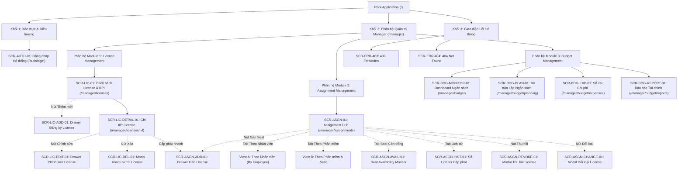
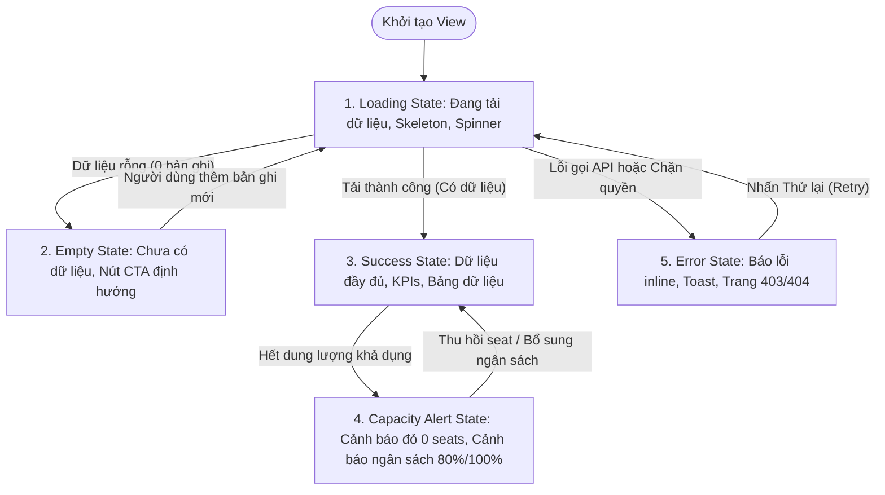
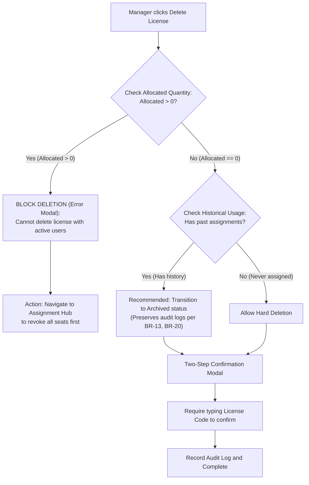
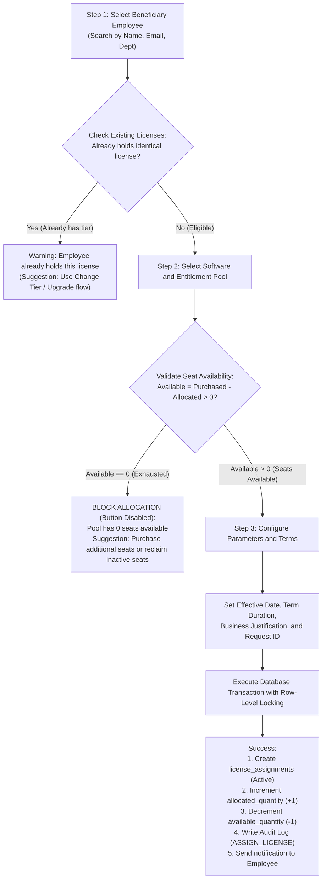

# KIẾN TRÚC THÔNG TIN & THIẾT KẾ VIEW TOÀN DIỆN (INFORMATION ARCHITECTURE - IA)
## Dự án: VFast – Enterprise License Management System (ELMS)
### Phân hệ: Quản trị Toàn diện Dành cho Manager (Module 1, Module 2, Module 3)

> **Căn cứ tài liệu:** [README.md](../README.md), [docs/01-MVP.md](01-MVP.md), [docs/02-use-cases.md](02-use-cases.md), [docs/03-user-stories.md](03-user-stories.md)  
> **Tham chiếu cấu trúc:** [PMDC-BATCH4-DATNT250 / 09-information-architecture.md](https://github.com/DatTienNguyenn/PMDC-BATCH4-DATNT250/blob/main/docs/09-information-architecture.md)  
> **Phiên bản:** 3.0 (Chuẩn hóa toàn diện Danh mục Screen ID, Route, Screen Hierarchy, UI/UX State Contract, Screen-to-API Mapping Matrix và Ma trận Phân quyền RBAC)  
> **Nhánh phát triển:** `docs/manager-information-architecture`

---

## 📋 MỤC LỤC TỔNG QUAN

1. [Master Screen Catalog (Danh mục Toàn bộ Màn hình Chuẩn hóa)](#-1-master-screen-catalog-danh-mục-màn-hình-chuẩn-hóa)
2. [Screen Hierarchy (Cấu trúc Phân cấp Màn hình)](#-2-screen-hierarchy-cấu-trúc-phân-cấp-màn-hình)
3. [UI/UX State Contract & Interaction Rules](#-3-uiux-state-contract--interaction-rules)
4. [Screen-to-API Mapping Matrix (Ánh xạ Giao diện - API Operations)](#-4-screen-to-api-mapping-matrix)
5. [Đặc tả Chi tiết Giao diện & Thành phần Tương tác (View Specifications)](#-5-đặc-tả-chi-tiết-giao-diện--thành-phần-tương-tác)
6. [Ma trận Phân quyền Truy cập Màn hình (RBAC Matrix)](#-6-ma-trận-phân-quyền-truy-cập-màn-hình-rbac-matrix)

---

## 🗂️ 1. MASTER SCREEN CATALOG (DANH MỤC MÀN HÌNH CHUẨN HÓA)

Toàn bộ hệ thống quản trị dành cho Manager được chuẩn hóa thành **18 Màn hình & Giao diện tương tác** (bao gồm Full Pages, Modals, Drawers và Error Views). 100% các view đều được cấp phát **Screen ID duy nhất**, **Route định danh rõ ràng**, **hình thức hiển thị (Presentation)**, **User Story ánh xạ trực tiếp** và **trạng thái triển khai**.

| Screen ID | Tên Màn hình / Modal | Hình thức (Presentation) | Đường dẫn Route (URL Path) | Stories Relate | Trạng thái (Scope) |
|:---|:---|:---:|:---|:---|:---:|
| **SCR-AUTH-01** | Đăng nhập Hệ thống (Enterprise Login) | Full Page | `/auth/login` | `US-M14` | MVP P0 |
| **SCR-LIC-01** | Quản lý Kho License & KPI Tổng quan | Full Page | `/manager/licenses` | `US-M01`, `US-M02` | MVP P0 |
| **SCR-LIC-ADD-01** | Drawer Đăng ký License Mới (SaaS & Perpetual) | Side Drawer | `/manager/licenses?action=create` | `US-M02` | MVP P0 |
| **SCR-LIC-DETAIL-01**| Chi tiết License & Đo lường Seat (4 Tabs) | Full Page | `/manager/licenses/[id]` | `US-M02`, `US-M06` | MVP P0 |
| **SCR-LIC-EDIT-01** | Drawer Chỉnh sửa License & Ràng buộc Seat | Side Drawer | `/manager/licenses/[id]?action=edit` | `US-M02` | MVP P0 |
| **SCR-LIC-DEL-01** | Modal Xóa / Lưu trữ License (Safety Check) | Modal Overlay | `/manager/licenses/[id]?action=delete` | `US-M02` | MVP P0 |
| **SCR-ASGN-01** | Trung tâm Phân bổ Bản quyền (Assignment Hub) | Full Page (4 Views) | `/manager/assignments` | `US-M06`, `US-M07` | MVP P0 |
| **SCR-ASGN-ADD-01** | Drawer Cấp phát License cho Nhân viên | Side Drawer | `/manager/assignments?action=assign` | `US-M06` | MVP P0 |
| **SCR-ASGN-REVOKE-01**| Modal Thu hồi License về Kho (Lý do Bắt buộc)| Modal Overlay | `/manager/assignments?action=revoke` | `US-M07` | MVP P0 |
| **SCR-ASGN-CHANGE-01**| Modal Thay đổi Loại License (Atomic Swap) | Modal Overlay | `/manager/assignments?action=change-tier`| `US-M06`, `US-M07` | MVP P0 |
| **SCR-ASGN-AVAIL-01** | Bảng Giám sát Dung lượng Seat Còn trống | Sub-view / Table | `/manager/assignments?view=availability`| `US-M06`, `US-M10` | MVP P0 |
| **SCR-ASGN-HIST-01** | Sổ Lịch sử Cấp phát Toàn hệ thống | Sub-view / Table | `/manager/assignments?view=history` | `US-M06`, `US-M07` | MVP P0 |
| **SCR-BDG-MONITOR-01**| Dashboard Giám sát Ngân sách & Cảnh báo Ngưỡng| Full Page | `/manager/budget` | `US-M08`, `US-M13` | MVP P0 |
| **SCR-BDG-PLAN-01** | Ma trận Lập Kế hoạch & Phân bổ Ngân sách | Full Page | `/manager/budget/planning` | `US-M08` | MVP P0 |
| **SCR-BDG-EXP-01** | Sổ cái Theo dõi Chi phí Bản quyền Toàn diện | Full Page | `/manager/budget/expenses` | `US-M09` | MVP P0 |
| **SCR-BDG-REPORT-01** | Trung tâm Báo cáo Tài chính & Dự báo Dòng tiền | Full Page | `/manager/budget/reports` | `US-M13` | MVP P0 |
| **SCR-ERR-403** | Trang 403 Forbidden (Chặn quyền RBAC) | Full Page | `/403` | `US-M14` | MVP P0 |
| **SCR-ERR-404** | Trang 404 Not Found (Không tìm thấy tài nguyên)| Full Page | `/404` | System | MVP P0 |

---

## 🌳 2. SCREEN HIERARCHY (CẤU TRÚC PHÂN CẤP MÀN HÌNH)

### 2.1. Sơ đồ Phân cấp Cây Màn hình (Mermaid Diagram)

---

### 2.2. Bảng Phân cấp Theo Cấp độ Giao diện (Level Hierarchy Table)

| Cấp độ (Level) | Khái niệm & Trách nhiệm | Danh sách Màn hình / Thành phần | Quy tắc Hiển thị & Điều hướng |
|:---:|---|---|---|
| **Level 0** | **Global Layout & Context Shell** | Root App Context, Auth State Provider, Role Guard Provider, Toast & Modal Provider | Duy trì phiên làm việc JWT, xác thực quyền `Manager` trước khi render. |
| **Level 1** | **Root Layout Shells** | 1. `AuthShell`: Bố cục tối giản, thẻ form đăng nhập trung tâm. 2. `ManagerShell`: Sidebar menu trái, Header trên, Breadcrumbs, User Profile. 3. `ErrorShell`: Giao diện toàn màn hình không có sidebar menu. | Phân tách không gian bảo mật giữa Manager, Editor và Employee; chặn 403 ngay tại Shell. |
| **Level 2** | **Trang Chính (Primary Pages)** | `SCR-LIC-01`, `SCR-LIC-DETAIL-01`, `SCR-ASGN-01`, `SCR-BDG-MONITOR-01`, `SCR-BDG-PLAN-01`, `SCR-BDG-EXP-01`, `SCR-BDG-REPORT-01`. | Gắn trực tiếp với thanh điều hướng chính (Navigation Bar); hỗ trợ URL routing đầy đủ. |
| **Level 3** | **Phân đoạn / Tabs lồng nhau (Sub-Views)** | - 4 Tabs trong `SCR-LIC-DETAIL-01`: Thông tin chung, Danh sách phân bổ, Lịch sử cấp phát, Audit Log. - 4 Views trong `SCR-ASGN-01`: By Employee, By Software, Availability Monitor, Global History. - 4 Báo cáo trong `SCR-BDG-REPORT-01`: Monthly, Vendor, Variance, Renewal Forecast. | Duy trì trạng thái chuyển tab trên URL qua query parameters (ví dụ: `?tab=active-users` hoặc `?view=availability`). |
| **Level 4** | **Lớp phủ / Modals / Drawers (Overlay Dialogs)** | `SCR-LIC-ADD-01`, `SCR-LIC-EDIT-01`, `SCR-LIC-DEL-01`, `SCR-ASGN-ADD-01`, `SCR-ASGN-REVOKE-01`, `SCR-ASGN-CHANGE-01`. | Lớp phủ làm mờ nền (backdrop blur); khóa cuộn trang (`overflow: hidden`); hỗ trợ phím `Esc` và nút đóng `X`. |

---

### 2.3. Quy tắc Điều hướng & Phân cấp Breadcrumbs
- **Cấu trúc Breadcrumbs chuẩn:**
  - `License List:` `Quản trị > Quản lý Bản quyền`
  - `License Detail:` `Quản trị > Quản lý Bản quyền > [Tên Phần mềm & Gói] ([Mã License])`
  - `Assignment Hub:` `Quản trị > Phân bổ Bản quyền > [Tên Chế độ Xem]`
  - `Budget Monitoring:` `Quản trị > Ngân sách & Chi phí > Giám sát Ngân sách`
  - `Budget Planning:` `Quản trị > Ngân sách & Chi phí > Lập Kế hoạch Ngân sách`
  - `Expense Ledger:` `Quản trị > Ngân sách & Chi phí > Sổ cái Chi phí`
  - `Financial Reporting:` `Quản trị > Ngân sách & Chi phí > Báo cáo Tài chính > [Loại Báo cáo]`

---

## 🎨 3. UI/UX STATE CONTRACT & INTERACTION RULES

Nhằm bảo đảm tính toàn vẹn dữ liệu, loại bỏ hoàn toàn rủi ro cấp phát vượt mức (**Over-allocation**) và duy trì trải nghiệm vận hành chuẩn mực, mọi màn hình bắt buộc phải tuân thủ nghiêm ngặt **Hợp đồng 5 Cung bậc Trạng thái UI** và **6 Quy tắc Tương tác Cốt lõi**.

### 3.1. Hợp đồng 5 Cung bậc Trạng thái UI (The 5 Core UI States Contract)

| Cung bậc Trạng thái | Tiêu chuẩn Kỹ thuật UI | Thành phần Giao diện Bắt buộc | Hành vi Trải nghiệm (UX Behavior) |
|:---|---|---|---|
| **1. Loading State** (Đang nạp) | - Tuyệt đối không để màn hình trắng. - Không dịch chuyển bố cục (CLS $< 0.1$). | - **Skeleton Placeholders:** Giả lập khung xám mờ cho thẻ KPI, biểu đồ và các dòng bảng dữ liệu. - **Button Spinner:** Vô hiệu hóa nút và hiện icon xoay tròn khi form đang submit. | Tránh người dùng nhấp đúp (Double-click submit); người dùng nhận biết hệ thống đang xử lý giao dịch. |
| **2. Empty State** (Chưa có dữ liệu) | - Không hiển thị bảng trống trơn hoặc số `0` trơ trọi. - Trình bày hướng dẫn hành động rõ ràng. | - Vector minh họa thân thiện. - Thông điệp rõ nghĩa (ví dụ: *"Doanh nghiệp chưa có bản quyền nào trong kho"*). - **Primary CTA Button:** Nút nổi bật mở form hành động (ví dụ: `+ Đăng ký License Đầu Tiên`). | Biến không gian trống thành cơ hội Onboarding người dùng tiếp tục luồng công việc. |
| **3. Success / Ideal State** (Lý tưởng) | - Hiển thị đầy đủ thông tin chuẩn hóa. - Định dạng số liệu phân tách hàng nghìn rõ ràng. | - Số liệu định dạng chuẩn: Tiền tệ (`5,000,000,000 VND`, `$12,500 USD`), Số lượng seat (`45/50 seats`). - Huy hiệu trạng thái chuẩn: Xanh lá (`Active`, `Paid`), Vàng cam (`Expiring Soon`, `Pending`), Đỏ (`Expired`, `Overdue`). - Phân trang rõ ràng (10, 25, 50 dòng/trang). | Mang lại cảm giác tin cậy, minh bạch và giúp Manager nắm bắt nhanh tình trạng kho bản quyền. |
| **4. Capacity Alert / Degraded State** | - Bật cảnh báo trực quan khi chạm ngưỡng dung lượng hoặc ngân sách. | - Banner cảnh báo màu vàng nhạt khi đạt 80% ngân sách hoặc còn $\le 10\%$ seats. - Banner đỏ đậm khi hết seat ($Available = 0$) hoặc vượt trần ngân sách ($\ge 100\%$). - Vô hiệu hóa nút `[Gán Seat]` kèm Tooltip giải thích nguyên nhân. | Phòng ngừa vi phạm hạn ngạch bản quyền (**Over-allocation**) và bội chi ngân sách. |
| **5. Error / Failure State** (Sự cố) | - Thông báo lỗi chuẩn xác theo ngữ cảnh nghiệp vụ, không lộ stack-trace kỹ thuật. | - **Inline Field Errors:** Dòng chữ đỏ ngay dưới ô nhập liệu cho lỗi Validation (422). - **Toast Alert:** Góc phải trên cho lỗi máy chủ (500) kèm Transaction ID. - **Error View (403/404):** Minh họa thân thiện kèm nút "Quay lại trang chủ". | Hướng dẫn Manager xử lý sự cố hoặc chuyển tiếp thông tin cho đội ngũ hỗ trợ kỹ thuật. |

---

### 3.2. 6 Quy tắc Tương tác Cốt lõi (Core UX Interaction Rules)

1. **Quy tắc 1: Khóa Dòng Chống Cấp phát Vượt Mức (Concurrency Row-Locking - BR-04, BR-05):**
   - Khi Manager bấm gán license, hệ thống thực thi giao dịch Database Transaction với cơ chế khóa dòng (`SELECT ... FOR UPDATE`).
   - Nếu $Available = Purchased - Allocated \le 0$, hệ thống lập tức hủy giao dịch (Rollback) và hiển thị thông báo lỗi: *"Kho license đã hết chỗ khả dụng. Không thể cấp phát."*
2. **Quy tắc 2: Chặn Hạ Dung lượng Thấp hơn Số lượng Đang Cấp ($Purchased \ge Allocated$ - BR-05):**
   - Khi chỉnh sửa số lượng mua của License, hệ thống kiểm tra: $Purchased_{mới} \ge Allocated_{hiện tại}$.
   - Nếu Manager nhập số lượng thấp hơn số seat đã cấp phát cho nhân viên, nút Lưu bị vô hiệu hóa kèm thông báo: *"Vui lòng thu hồi bớt seat trước khi giảm số lượng mua."*
3. **Quy tắc 3: Bắt buộc Nhập Lý do Điều chỉnh cho Mọi Thay đổi Quan trọng (Audit Trail - BR-17):**
   - Mọi thao tác Chỉnh sửa License, Thu hồi License, Đổi loại License hoặc Điều chỉnh Ngân sách đều yêu cầu trường `Lý do thay đổi (Change Reason)` tối thiểu 10 ký tự.
   - Bản ghi được lưu bất biến vào `audit_logs` kèm Actor, Action, Old Value, New Value và Timestamp.
4. **Quy tắc 4: Bảo toàn Dữ liệu Lịch sử Không Phá hủy (Non-destructive Soft Delete / Revoke - BR-13, BR-20):**
   - Tuyệt đối không xóa vật lý (Hard delete) các bản ghi License hoặc Assignment đã từng phát sinh lịch sử.
   - Thu hồi license chuyển trạng thái sang `Revoked`, hoàn trả dung lượng $Available += 1$, nhưng bản ghi cũ được giữ nguyên để đối soát kiểm toán.
5. **Quy tắc 5: Phân tách Đồng tiền Độc lập & Quy đổi Tỷ giá Chuẩn hóa (BR-10, BR-11):**
   - Chi phí `VND` và `USD` không được cộng gộp trực tiếp.
   - Hệ thống sử dụng bảng tỷ giá tham chiếu quản trị để quy đổi toàn bộ chi phí về đồng tiền cơ sở của năm tài chính khi tính toán ngân sách tổng thể.
6. **Quy tắc 6: Cơ chế Cảnh báo Ngưỡng Ngân sách 3 Cấp độ Tự động (UC14, BR-16):**
   - Dưới 80%: Vùng an toàn (Xanh lá).
   - Từ 80% đến 99%: Cảnh báo sớm (Vàng hổ phách), nhắc nhở rà soát các hợp đồng sắp gia hạn.
   - Đạt $\ge 100\%$: Báo động đỏ (Over-budget), bật cờ cảnh báo nguy hiểm và kích hoạt quy trình phê duyệt ngoại lệ khi duyệt chi phí mới.

---

## 🔗 4. SCREEN-TO-API MAPPING MATRIX

Bảng ánh xạ toàn bộ 18 màn hình và giao diện tương tác với các Endpoints backend API:

| Screen ID | Thao tác Giao diện (UI Action) | API Endpoint & Method | Ý nghĩa Nghiệp vụ & Dữ liệu Trao đổi | Phân quyền (RBAC) |
|:---|---|---|---|:---:|
| **SCR-AUTH-01** | Form Đăng nhập | `POST /api/v1/auth/login` | Xác thực email/mật khẩu, trả về JWT Token và Role `Manager`. | Public |
| **SCR-LIC-01** | Tải danh sách & KPI License | `GET /api/v1/licenses?status={}&vendor={}` | Lấy danh sách entitlements, phân trang và 5 thẻ số liệu KPI tổng quan. | Manager Only |
| **SCR-LIC-01** | Xuất Báo cáo License | `GET /api/v1/licenses/export?format=csv` | Xuất toàn bộ kho license ra file CSV/Excel phục vụ kiểm toán nội bộ. | Manager Only |
| **SCR-LIC-ADD-01** | Nút "Lưu License Mới" | `POST /api/v1/licenses` | Đăng ký entitlement mới (SaaS / Perpetual), khởi tạo $Available = Purchased$. | Manager Only |
| **SCR-LIC-DETAIL-01**| Tải chi tiết License | `GET /api/v1/licenses/{id}` | Lấy metadata, hợp đồng, file đính kèm và tỷ lệ lấp đầy seat. | Manager Only |
| **SCR-LIC-DETAIL-01**| Nút Xem License Key (Reveal) | `POST /api/v1/licenses/{id}/reveal-key` | Trả về License Key đầy đủ và ghi log hành vi `VIEW_LICENSE_KEY`. | Manager Only |
| **SCR-LIC-DETAIL-01**| Tab 2: Danh sách Active Users | `GET /api/v1/licenses/{id}/assignments?status=Active` | Lấy danh sách nhân viên đang nắm giữ seat và trạng thái sử dụng thực tế. | Manager Only |
| **SCR-LIC-DETAIL-01**| Tab 3: Lịch sử Cấp phát | `GET /api/v1/licenses/{id}/assignments/history` | Lấy toàn bộ lịch sử gán và thu hồi seat của license này (BR-13). | Manager Only |
| **SCR-LIC-DETAIL-01**| Tab 4: Lịch sử Đổi cấu hình | `GET /api/v1/licenses/{id}/audit-logs` | Lấy nhật ký biến động số lượng, ngày gia hạn và giá trị thay đổi (BR-17). | Manager Only |
| **SCR-LIC-EDIT-01**| Nút "Lưu Chỉnh sửa" | `PUT /api/v1/licenses/{id}` | Cập nhật ngày gia hạn, số lượng mua (Kiểm tra $Purchased \ge Allocated$). | Manager Only |
| **SCR-LIC-DEL-01** | Nút "Xác nhận Xóa/Lưu trữ" | `DELETE /api/v1/licenses/{id}` | Kiểm tra $Allocated = 0$, chuyển trạng thái sang `Archived` hoặc xóa nháp. | Manager Only |
| **SCR-ASGN-01** | Tải Assignment Hub | `GET /api/v1/assignments/summary` | Lấy 4 chỉ số vĩ mô: Total Allocated, Available Pool, Active Assignees, Inactive. | Manager Only |
| **SCR-ASGN-01** | View A: Danh sách theo User | `GET /api/v1/assignments/by-employee` | Lấy danh sách nhân viên kèm các license họ đang nắm giữ. | Manager Only |
| **SCR-ASGN-01** | View B: Danh sách theo Seat | `GET /api/v1/assignments/by-software` | Lấy danh sách chi tiết từng vị trí ghế (seat) của từng phần mềm. | Manager Only |
| **SCR-ASGN-AVAIL-01**| Tải Bảng Seat Còn trống | `GET /api/v1/licenses/availability-monitor` | Lấy tỷ lệ lấp đầy real-time và cờ cảnh báo (Đỏ/Vàng/Xanh/Lam). | Manager Only |
| **SCR-ASGN-HIST-01** | Tải Sổ Lịch sử Phân bổ | `GET /api/v1/assignments/global-history` | Lấy nhật ký toàn bộ sự kiện gán, thu hồi, đổi loại theo dòng thời gian. | Manager Only |
| **SCR-ASGN-ADD-01** | Nút "Xác nhận Cấp phát" | `POST /api/v1/assignments` | Cấp phát seat cho nhân viên, kiểm tra $Available > 0$ với khóa dòng. | Manager Only |
| **SCR-ASGN-REVOKE-01**| Nút "Xác nhận Thu hồi" | `POST /api/v1/assignments/{id}/revoke` | Thu hồi seat về kho, hoàn trả $Available += 1$, lưu lý do thu hồi (BR-13). | Manager Only |
| **SCR-ASGN-CHANGE-01**| Nút "Xác nhận Chuyển đổi"| `POST /api/v1/assignments/{id}/change-tier` | Giao dịch nguyên tử (Atomic Swap): Thu hồi gói cũ và cấp phát gói mới. | Manager Only |
| **SCR-BDG-MONITOR-01**| Tải Dashboard Ngân sách | `GET /api/v1/budgets/monitoring?fiscalYear={year}` | Lấy 5 chỉ số tài chính, tiến độ giải ngân lũy kế và cảnh báo ngưỡng. | Manager Only |
| **SCR-BDG-PLAN-01** | Tải Ma trận Kế hoạch | `GET /api/v1/budgets/planning?fiscalYear={year}` | Lấy bảng phân bổ ngân sách 12 tháng, theo phòng ban và theo vendor. | Manager Only |
| **SCR-BDG-PLAN-01** | Nút "Lưu Kế hoạch Ngân sách" | `POST /api/v1/budgets/planning` | Thiết lập hạn mức ngân sách năm tài chính mới hoặc lưu điều chỉnh phân bổ. | Manager Only |
| **SCR-BDG-EXP-01** | Tải Sổ cái Chi phí | `GET /api/v1/expenses?fiscalYear={year}&status={}` | Lấy danh sách chi phí hàng tháng, hàng năm, Paid, Unpaid và Projected. | Manager Only |
| **SCR-BDG-EXP-01** | Nút "Xác nhận Thanh toán" | `PATCH /api/v1/expenses/{id}/mark-paid` | Chuyển trạng thái chi phí sang `PAID`, xác thực hóa đơn VAT đính kèm. | Manager Only |
| **SCR-BDG-REPORT-01** | Tải Báo cáo Variance | `GET /api/v1/budgets/reports/variance?fiscalYear={year}`| Lấy ma trận đối soát Ngân sách Kế hoạch vs Thực chi vs Cam kết. | Manager Only |
| **SCR-BDG-REPORT-01** | Tải Dự báo Gia hạn | `GET /api/v1/budgets/reports/renewal-forecast?days=90` | Dự phóng dòng tiền gia hạn và gợi ý cắt giảm seat từ nhân viên Inactive. | Manager Only |
| **SCR-BDG-REPORT-01** | Nút "Xuất PDF Ban Giám Đốc"| `GET /api/v1/budgets/reports/export-pdf?type={}` | Xuất file PDF đồ họa chuyên nghiệp phục vụ báo cáo Hội đồng Quản trị. | Manager Only |

---

## 📱 5. ĐẶC TẢ CHI TIẾT GIAO DIỆN & THÀNH PHẦN TƯƠNG TÁC

---

### KHỐI 1: QUẢN LÝ KHO BẢN QUYỀN (MODULE 1: LICENSE MANAGEMENT)

#### 1.1. `SCR-LIC-01`: Quản lý Kho License & KPI Tổng quan
- **Đường dẫn (Route):** `/manager/licenses`
- **Presentation:** Full Page
- **Quyền hạn:** Manager Only.
- **Bố cục giao diện (Layout):**
  - **Header Bar:** Tiêu đề `Quản lý Bản quyền`, nút `[Xuất Báo cáo CSV/Excel]` và nút nổi bật `[+ Thêm License Mới]`.
  - **Thẻ KPI Tổng quan (5 Cards):**
    - *Thẻ 1:* Tổng số License đang hoạt động (`Active`).
    - *Thẻ 2:* Tổng số Seats sở hữu toàn công ty.
    - *Thẻ 3:* Tỷ lệ phân bổ trung bình ($\frac{\sum Allocated}{\sum Purchased} \times 100\%$).
    - *Thẻ 4:* Cảnh báo sắp hết hạn trong $\le 30$ ngày.
    - *Thẻ 5:* Cảnh báo quá hạn hoặc vi phạm hạn ngạch.
  - **Toolbar Lọc & Tìm kiếm:**
    - Ô tìm kiếm tức thì theo tên phần mềm, vendor, license key (Debounce 300ms).
    - Dropdowns lọc: Vendor, Mô hình (`SaaS Subscription` / `Perpetual License`), Trạng thái (`Active`, `Expiring Soon`, `Expired`, `Suspended`), Khoảng thời gian hết hạn, Tình trạng còn trống/hết seat.
  - **Bảng dữ liệu License Grid:**
    - Cột: Mã License, Tên & Phiên bản, Vendor, Loại hình, Tỷ lệ lấp đầy ($Allocated / Purchased$), Số seat còn trống ($Available$), Hạn dùng/Bảo trì, Trạng thái (Pill Badge), Menu thao tác dòng `[...]`.
  - **Phân trang:** 10, 25, 50 dòng/trang.

#### 1.2. `SCR-LIC-ADD-01`: Drawer Đăng ký License Mới
- **Kích hoạt từ:** Nút `[+ Thêm License Mới]` tại `SCR-LIC-01`.
- **Presentation:** Side Drawer (Độ rộng 640px)
- **Quyền hạn:** Manager Only.
- **Thành phần nhập liệu (Form Fields):**
  - Radio button chọn mô hình: `SaaS Subscription` hoặc `Perpetual License`.
  - Dropdown chọn phần mềm từ Software Catalog; tự động điền Vendor tương ứng.
  - Tên gói/phiên bản, License Key / Serial Number (hỗ trợ nút tự sinh mã ngẫu nhiên).
  - Metric: `Per User (Seat)` (Mặc định), `Per Core`, `Concurrent`, `Per Device`.
  - Số lượng mua ($Purchased \ge 1$), Đơn giá, Đơn vị tiền tệ (`VND` hoặc `USD` per BR-10, BR-11).
  - **Nhánh SaaS:** Ngày bắt đầu, Ngày hết hạn (bắt buộc), Chu kỳ thanh toán, Cờ tự động gia hạn.
  - **Nhánh Perpetual:** Ngày mua, Thời hạn gốc cố định `Vĩnh viễn` (BR-12), Checkbox gói bảo trì và Ngày hết hạn bảo trì độc lập.
  - Số hợp đồng/PO, Tải tệp đính kèm hóa đơn/hợp đồng (PDF, PNG $\le 10$MB).
- **Hậu điều kiện:** Khởi tạo $Allocated = 0$, $Available = Purchased$. Ghi nhận Audit Log `CREATE_LICENSE_ENTITLEMENT`.

#### 1.3. `SCR-LIC-DETAIL-01`: Chi tiết License & Đo lường Seat (4 Tabs)
- **Đường dẫn (Route):** `/manager/licenses/[id]`
- **Presentation:** Full Page
- **Thành phần giao diện:**
  - **Header:** Mã license, Vendor, Trạng thái badge, License Key ẩn `XXXX-XXXX-****-1234` kèm icon con mắt để Manager nhấn mở xem (ghi log `VIEW_LICENSE_KEY`).
  - **Seat Utilization Gauge:** Thanh đo lấp đầy 3 màu: Xanh dương (Active seats), Vàng (Idle seats), Xanh lá (Available seats).
  - **Nút thao tác nhanh:** `[+ Cấp phát Seat Mới]` (mở `SCR-ASGN-ADD-01`), `[Gia hạn]`, `[Chỉnh sửa]`, `[Xóa/Lưu trữ]`.
  - **Hệ thống 4 Tabs Nghiệp vụ:**
    - *Tab 1 (Thông tin chung & Hợp đồng):* Đơn giá, chu kỳ thanh toán, hợp đồng liên kết, file hóa đơn đính kèm.
    - *Tab 2 (Active Users):* Danh sách nhân viên đang giữ seat, trạng thái sử dụng (`Active`, `Idle`, `Inactive $\ge 60$ ngày` có cảnh báo đỏ), nút inline `[Đổi loại]` và `[Thu hồi]`.
    - *Tab 3 (Lịch sử Cấp phát):* Nhật ký mọi sự kiện gán và thu hồi của license này (BR-13).
    - *Tab 4 (Audit Log):* Lưu vết mọi sửa đổi cấu hình gói bản quyền (BR-17).

#### 1.4. `SCR-LIC-EDIT-01`: Drawer Chỉnh sửa License
- **Kích hoạt từ:** Nút "Chỉnh sửa" tại `SCR-LIC-01` hoặc `SCR-LIC-DETAIL-01`.
- **Presentation:** Side Drawer
- **Ràng buộc bảo vệ dữ liệu:**
  - Khóa chết trường Model, Metric và Mã định danh ID.
  - **Ràng buộc hạ seat:** Chỉ cho phép giảm $Purchased$ nếu $Purchased_{mới} \ge Allocated_{hiện tại}$ (BR-05).
  - Bắt buộc nhập `Lý do thay đổi (Change Reason)` để ghi Audit Log (BR-17).

#### 1.5. `SCR-LIC-DEL-01`: Modal Xóa / Lưu trữ License (Safety Check)
- **Kích hoạt từ:** Nút "Xóa" tại `SCR-LIC-DETAIL-01`.
- **Presentation:** Modal Overlay (Độ rộng 520px)

---

### KHỐI 2: PHÂN BỔ & ĐIỀU CHUYỂN SEAT (MODULE 2: LICENSE ASSIGNMENT MANAGEMENT)

#### 2.1. `SCR-ASGN-01`: Trung tâm Phân bổ Bản quyền (Assignment Hub)
- **Đường dẫn (Route):** `/manager/assignments`
- **Presentation:** Full Page
- **Thống kê Vĩ mô:** Tổng Seats Đang Cấp Phát, Tổng Seats Còn Trống Trong Kho, Số Nhân Viên Sở Hữu License, Số Seats Bị Lãng Phí (Inactive $\ge 60$ ngày).
- **Bộ chuyển đổi 4 Chế độ Xem:**
  - *View A (Theo Nhân viên - Mặc định):* Danh sách nhân viên, phòng ban, click mở rộng để xem các license cá nhân đang giữ kèm nút Đổi loại / Thu hồi.
  - *View B (Theo Phần mềm & Seat):* Quản lý chi tiết từng vị trí ghế của từng phần mềm.
  - *View C (Seat Availability Monitor - `SCR-ASGN-AVAIL-01`):* Giám sát sức chứa kho license real-time.
  - *View D (Global History - `SCR-ASGN-HIST-01`):* Sổ nhật ký cấp phát toàn công ty.

#### 2.2. `SCR-ASGN-ADD-01`: Drawer Cấp phát License cho Nhân viên
- **Kích hoạt từ:** Nút `[+ Gán License Mới]` hoặc duyệt License Request (UC09).
- **Presentation:** Side Drawer (Độ rộng 560px)

#### 2.3. `SCR-ASGN-REVOKE-01`: Modal Thu hồi License về Kho
- **Kích hoạt từ:** Nút "Thu hồi" tại tài khoản nhân viên.
- **Presentation:** Modal Overlay (Độ rộng 500px)
- **Thành phần giao diện:**
  - Thông tin tóm tắt: Nhân viên, Phần mềm, Mã seat, Thời gian sử dụng, Lần hoạt động cuối.
  - Dropdown lý do thu hồi chuẩn hóa: *Nghỉ việc, Chuyển dự án, Inactive $\ge 60$ ngày (UC20), Hết hạn dự án, Hoàn trả tự nguyện, Khác*.
  - Ô nhập chi tiết lý do thu hồi (Bắt buộc tối thiểu 10 ký tự).
  - Tùy chọn gửi email thông báo tự động cho nhân viên.
- **Hệ thống xử lý:** Chuyển trạng thái sang `Revoked`, hoàn trả dung lượng $Available += 1$, bản ghi cũ được giữ nguyên vẹn trong lịch sử (BR-13).

#### 2.4. `SCR-ASGN-CHANGE-01`: Modal Thay đổi Loại License (Atomic Swap)
- **Kích hoạt từ:** Nút "Đổi loại" trên dòng license của nhân viên.
- **Presentation:** Modal Overlay (Độ rộng 620px)
- **Thành phần giao diện:**
  - Cột trái (Hiện tại): Tên gói, Chi phí hiện tại.
  - Cột phải (Mục tiêu): Dropdown chọn gói mới tương thích, hiển thị số seat còn trống của gói mới.
  - Tự động gắn nhãn giao dịch: `Nâng cấp (Upgrade)` hoặc `Hạ cấp (Downgrade)`.
  - Ô nhập lý do thay đổi gói bản quyền (Bắt buộc).
- **Giao dịch nguyên tử:** Thu hồi gói cũ (+1 pool cũ) và cấp phát gói mới (-1 pool mới) trong cùng một Database Transaction.

#### 2.5. `SCR-ASGN-AVAIL-01`: Bảng Giám sát Dung lượng Seat Còn trống
- **Đường dẫn (Route):** `/manager/assignments?view=availability`
- **Presentation:** Sub-view / Table
- **Thước đo 4 Cấp độ Cảnh báo:**
  - 🔴 **Báo động Đỏ (Hết Seat):** $Available = 0$.
  - 🟡 **Báo động Vàng (Sắp Hết):** $Available \le 10\%$.
  - 🟢 **Báo động Xanh Lục (Tối ưu):** $10\% < Available \le 30\%$.
  - 🔵 **Báo động Xanh Lam (Dư thừa):** $Available > 30\%$ (Cơ hội tối ưu hóa chi phí theo UC19).

#### 2.6. `SCR-ASGN-HIST-01`: Sổ Lịch sử Cấp phát Toàn hệ thống
- **Đường dẫn (Route):** `/manager/assignments?view=history`
- **Presentation:** Sub-view / Table
- **Nội dung:** Bảng nhật ký đối soát toàn diện ghi nhận thời điểm, loại hành động (`ASSIGN`, `REVOKE`, `UPGRADE`, `DOWNGRADE`), nhân viên, phần mềm, người thực hiện và lý do nghiệp vụ (BR-13, BR-17).

---

### KHỐI 3: QUẢN TRỊ TÀI CHÍNH BẢN QUYỀN (MODULE 3: BUDGET MANAGEMENT)

#### 3.1. `SCR-BDG-MONITOR-01`: Dashboard Giám sát Ngân sách & Cảnh báo Ngưỡng
- **Đường dẫn (Route):** `/manager/budget`
- **Presentation:** Full Page
- **Quyền hạn:** Manager Only.
- **Bố cục giao diện:**
  - **Dropdown chọn Năm tài chính:** `FY2026`, `FY2027` và Đơn vị tiền tệ hiển thị (`VND`, `USD`).
  - **Hàng 5 Chỉ số Tài chính Cốt lõi (Metric Cards):**
    1. `Total Budget:` Ngân sách được phân bổ cho kỳ tài khóa đã duyệt.
    2. `Actual Spending:` Chi phí thực tế đã thanh toán ($\sum \text{Paid}$).
    3. `Committed Spending:` Chi phí đã cam kết (Hóa đơn chờ trả + Hợp đồng đang chạy).
    4. `Remaining Budget:` Ngân sách còn lại ($\text{Remaining} = \text{Total} - (\text{Actual} + \text{Committed})$).
    5. `Budget Utilization:` Tỷ lệ sử dụng ngân sách ($\frac{\text{Actual} + \text{Committed}}{\text{Total}} \times 100\%$).
  - **Banner Cảnh báo Ngưỡng Tự động:**
    - Cảnh báo Vàng khi đạt $\ge 80\%$: Nhắc nhở Manager kiểm soát chi phí quý tới.
    - Cảnh báo Đỏ khi đạt $\ge 100\%$: Thông báo vượt trần ngân sách, yêu cầu trình ngoại lệ.
  - **Biểu đồ Tiến độ Giải ngân Lũy kế:** Cumulative Spending Burn-down / Burn-up Chart so sánh Kế hoạch vs Thực chi vs Cam kết qua 12 tháng.
  - **Tiến độ theo Phòng ban:** Thanh tiến độ tỷ lệ giải ngân của từng phòng ban.

#### 3.2. `SCR-BDG-PLAN-01`: Ma trận Lập Kế hoạch & Phân bổ Ngân sách
- **Đường dẫn (Route):** `/manager/budget/planning`
- **Presentation:** Full Page
- **Thành phần giao diện:**
  - Ô thiết lập Tổng ngân sách năm và tiền tệ cơ sở (`VND`/`USD`).
  - Nút chuyển chế độ: *Dàn đều tự động 12 tháng* hoặc *Nhập tùy biến theo chu kỳ*.
  - **Bảng Ma trận Phân bổ Đa chiều (Allocation Matrix Grid):**
    - Hàng: Các phòng ban (Tech, Design, Sales, Marketing, Ops, HR, Buffer).
    - Cột: 12 Tháng (T1 đến T12) và Tổng cộng cả năm.
    - Đánh dấu sao (*) tại các tháng cao điểm gia hạn (Tháng 3, Tháng 11).
    - Cột kiểm tra cân bằng: Hệ thống báo xanh khi $\sum = \text{Annual Budget}$ và báo đỏ khi vượt trần.
  - Nút `[Lưu Kế Hoạch Ngân Sách]` (Ghi phiên bản mới `v1.0`, `v1.1` vào Audit Log).

#### 3.3. `SCR-BDG-EXP-01`: Sổ cái Theo dõi Chi phí Bản quyền Toàn diện
- **Đường dẫn (Route):** `/manager/budget/expenses`
- **Presentation:** Full Page
- **Thành phần giao diện:**
  - Bộ lọc: Trạng thái (`Tất cả`, `PAID`, `PENDING`, `OVERDUE`, `PROJECTED`), Vendor, Chu kỳ (`Tháng` / `Năm`), Phòng ban.
  - **Bảng Sổ cái Chi phí (Expense Ledger):**
    - Cột: Mã hóa đơn, Tên phần mềm & Gói, Vendor, Số tiền & Tiền tệ, Chu kỳ, Ngày phát sinh, Hạn thanh toán, Trạng thái, Chứng từ VAT đính kèm (Link tải PDF), Hành động (Xem, Duyệt chi).
  - Tuân thủ kiểm tra hóa đơn VAT (**BR-10**) và quy đổi ngoại tệ chuẩn hóa (**BR-11**).

#### 3.4. `SCR-BDG-REPORT-01`: Trung tâm Báo cáo Tài chính & Dự báo Dòng tiền
- **Đường dẫn (Route):** `/manager/budget/reports`
- **Presentation:** Full Page
- **Bộ chọn 4 Báo cáo Chuyên sâu:**
  1. *Báo cáo 1: Chi phí theo Tháng (Monthly Trends):* Biểu đồ cột chồng phân tách SaaS vs Perpetual qua 12 tháng, đo lường tăng trưởng MoM.
  2. *Báo cáo 2: Chi phí theo Vendor (By Vendor):* Biểu đồ Donut & Treemap phân tích Top 5 Nhà cung cấp chiếm chi tiêu lớn nhất để đàm phán Volume Discount.
  3. *Báo cáo 3: So sánh Ngân sách vs Thực tế (Budget vs. Actual Variance Analysis):* Bảng ma trận đối soát kế hoạch vs thực tế vs cam kết; đánh dấu Thuận lợi (*Favorable - Xanh*) khi tiết kiệm chi phí và Bất lợi (*Unfavorable - Đỏ*) khi bội chi.
  4. *Báo cáo 4: Dự báo Chi phí Gia hạn (Renewal Cashflow Forecast):* Dự phóng dòng tiền 30 ngày, 90 ngày và 12 tháng tới; tự động liên kết dữ liệu **Inactive $\ge 60$ ngày** (từ Module 2) để đề xuất cắt giảm seat trước khi gia hạn nhằm tiết kiệm ngân sách (UC22).
  - Nút hành động: `[Xuất PDF Chuẩn Ban Giám Đốc]` và `[Xuất Excel / CSV Thô]`.

---

### KHỐI 4: GIAO DIỆN LỖI & ĐIỀU HƯỚNG BẢO MẬT (SYSTEM ERROR VIEWS)

#### 4.1. `SCR-ERR-403`: 403 Forbidden Access
- **Đường dẫn (Route):** `/403`
- **Presentation:** Full Page
- **Nội dung:** Minh họa truy cập trái phép, giải thích vai trò hiện tại không có quyền truy cập vào phân hệ Quản trị Manager, kèm nút `[Quay lại Trang Cá Nhân]`.

#### 4.2. `SCR-ERR-404`: 404 Page Not Found
- **Đường dẫn (Route):** `/404`
- **Presentation:** Full Page
- **Nội dung:** Minh họa trang không tồn tại, kèm nút `[Quay lại Dashboard]`.

---

## 🔐 6. MA TRẬN PHÂN QUYỀN TRUY CẬP MÀN HÌNH (RBAC MATRIX)

Bảng tổng hợp quyền hạn truy cập đối với toàn bộ 18 Màn hình & Modal trong hệ thống:

| Screen ID | Tên Màn hình / Modal | Khách Vãng Lai | Quản lý Cấp cao (Manager) | Quản trị Nhập liệu (Editor) | Nhân viên (Employee) |
|:---|---|:---:|:---:|:---:|:---:|
| **SCR-AUTH-01** | Đăng nhập Hệ thống | ✅ | ✅ | ✅ | ✅ |
| **SCR-LIC-01** | Danh sách License & KPI | ❌ | ✅ (Toàn quyền) | ❌ (Chặn 403) | ❌ (Chặn 403) |
| **SCR-LIC-ADD-01** | Drawer Đăng ký License | ❌ | ✅ | ❌ | ❌ |
| **SCR-LIC-DETAIL-01**| Chi tiết License & Seat | ❌ | ✅ (Toàn quyền) | ❌ (Chặn 403) | ❌ (Chặn 403) |
| **SCR-LIC-EDIT-01** | Drawer Chỉnh sửa License | ❌ | ✅ | ❌ | ❌ |
| **SCR-LIC-DEL-01** | Modal Xóa/Lưu trữ License | ❌ | ✅ | ❌ | ❌ |
| **SCR-ASGN-01** | Assignment Hub | ❌ | ✅ (Toàn quyền) | ❌ (Chặn 403) | ❌ (Chặn 403) |
| **SCR-ASGN-ADD-01** | Drawer Gán License | ❌ | ✅ | ❌ | ❌ |
| **SCR-ASGN-REVOKE-01**| Modal Thu hồi License | ❌ | ✅ | ❌ | ❌ |
| **SCR-ASGN-CHANGE-01**| Modal Đổi loại License | ❌ | ✅ | ❌ | ❌ |
| **SCR-ASGN-AVAIL-01** | Bảng Seat Còn trống | ❌ | ✅ (Toàn quyền) | ❌ | ❌ |
| **SCR-ASGN-HIST-01** | Sổ Lịch sử Cấp phát | ❌ | ✅ (Toàn quyền) | ❌ | ❌ |
| **SCR-BDG-MONITOR-01**| Dashboard Ngân sách | ❌ | ✅ (Toàn quyền) | ❌ (Chặn 403) | ❌ (Chặn 403) |
| **SCR-BDG-PLAN-01** | Ma trận Lập Ngân sách | ❌ | ✅ (Toàn quyền) | ❌ (Chặn 403) | ❌ (Chặn 403) |
| **SCR-BDG-EXP-01** | Sổ cái Chi phí | ❌ | ✅ (Toàn quyền) | ✅ (Chỉ nạp & xem) | ❌ (Chặn 403) |
| **SCR-BDG-REPORT-01** | Báo cáo Tài chính | ❌ | ✅ (Toàn quyền) | ❌ (Chặn 403) | ❌ (Chặn 403) |
| **SCR-ERR-403** | 403 Forbidden | ✅ | ✅ | ✅ | ✅ |
| **SCR-ERR-404** | 404 Not Found | ✅ | ✅ | ✅ | ✅ |

---

*Tài liệu Kiến trúc Thông tin & Đặc tả View này đồng bộ 100% với [README.md](../README.md), [docs/01-MVP.md](01-MVP.md), [docs/02-use-cases.md](02-use-cases.md) và [docs/03-user-stories.md](03-user-stories.md).*
