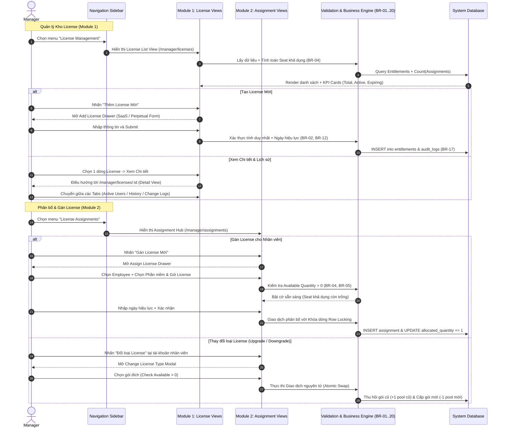
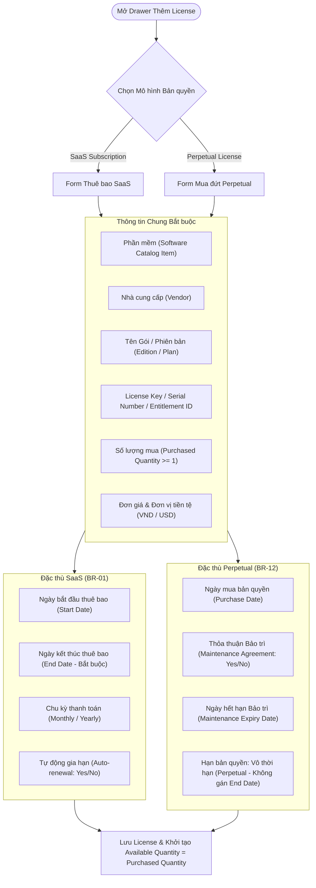
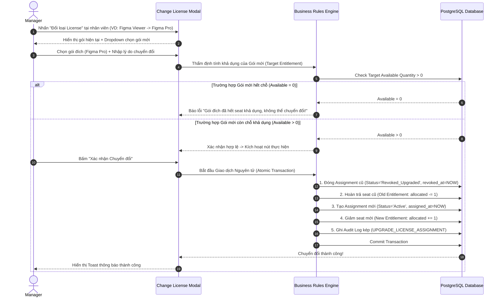
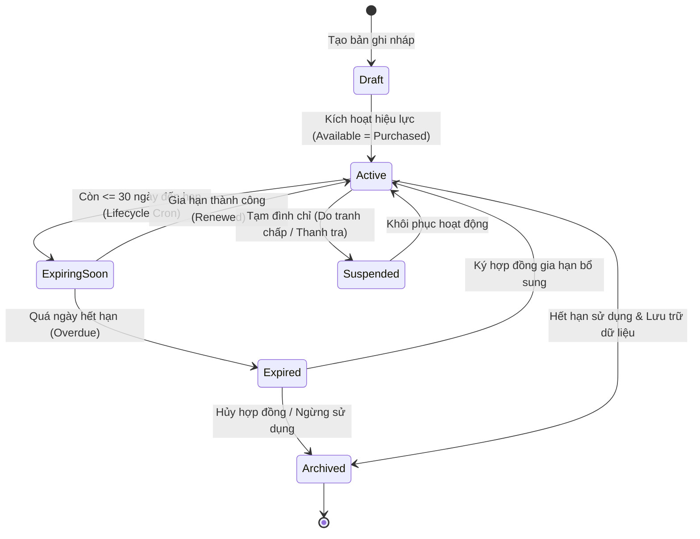
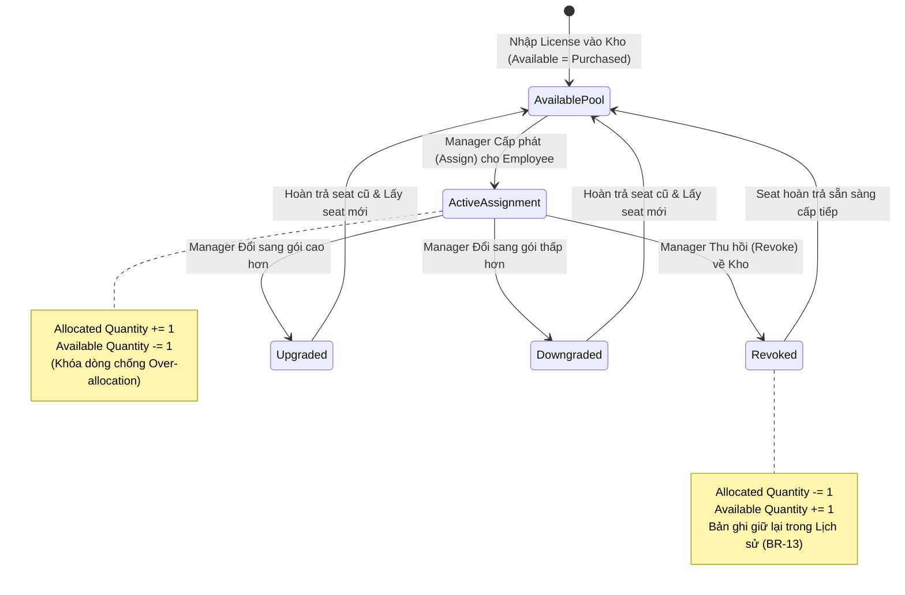

# Kiến trúc Thông tin & Đặc tả Thiết kế Giao diện Phân hệ Quản trị (Manager)
## Dự án: VFast – Enterprise License Management System (ELMS)
### Căn cứ: SRS v1.0, MVP Specification (01-MVP.md), Use Cases (02-use-cases.md), User Stories (03-use-stories.md)

---

## 1. Tổng quan Kiến trúc Thông tin & Mô hình Điều hướng (Information Architecture & Navigation)

Tài liệu này xác lập **Kiến trúc Thông tin (Information Architecture - IA)** và **Đặc tả Thiết kế Giao diện (View Specifications)** toàn diện dành riêng cho vai trò **Manager (Quản trị viên / Quản lý cấp cao)** đối với hai phân hệ nghiệp vụ hạt nhân:
1. **Module 1: License Management (Quản lý Quyền sở hữu Bản quyền / Entitlements)**
2. **Module 2: License Assignment Management (Quản lý Phân bổ & Gán License cho Nhân viên)**

### 1.1. Bản đồ Cấu trúc Cây Thông tin (Sitemap Tree for Manager)

```mermaid
flowchart TD
    Root["Manager Portal Portal Root (/)"] --> Dash["Dashboard Tổng quan (/manager/dashboard)"]
    Root --> M1["Module 1: License Management (/manager/licenses)"]
    Root --> M2["Module 2: Assignment Management (/manager/assignments)"]
    Root --> M3["Module 3: Finance & Budget (/manager/budget)"]
    Root --> M4["Module 4: Optimization & Compliance (/manager/compliance)"]
    Root --> M5["Module 5: System Admin & Audit Logs (/manager/settings)"]

    %% Module 1 Sub-views
    M1 --> M1_List["1.1 License List View<br/>(Bộ lọc, KPI Cards, Bảng tra cứu)"]
    M1 --> M1_Create["1.2 Add License Drawer/Modal<br/>(SaaS Subscription & Perpetual)"]
    M1 --> M1_Detail["1.3 License Detail View (/manager/licenses/:id)"]
    M1_Detail --> M1_Tab_Gen["Tab 1: Thông tin chung & Hợp đồng"]
    M1_Detail --> M1_Tab_Alloc["Tab 2: Danh sách người đang được gán"]
    M1_Detail --> M1_Tab_History["Tab 3: Lịch sử cấp phát/thu hồi"]
    M1_Detail --> M1_Tab_Audit["Tab 4: Nhật ký thay đổi bản ghi (Audit Log)"]
    M1_Detail --> M1_Edit["1.4 Edit License Drawer/Modal"]
    M1_Detail --> M1_Delete["1.5 Delete/Decommission Modal (Safe Check)"]

    %% Module 2 Sub-views
    M2 --> M2_Hub["2.1 Assignment Hub (/manager/assignments)"]
    M2_Hub --> M2_View_Emp["View A: Theo Nhân viên (By Employee)"]
    M2_Hub --> M2_View_Soft["View B: Theo Phần mềm & Seat (By Software/Seat)"]
    M2_Hub --> M2_View_Avail["View C: Bảng Kiểm tra Seat Còn trống (Availability Monitor)"]
    M2_Hub --> M2_View_Hist["View D: Sổ Lịch sử Cấp phát Toàn hệ thống (Global History)"]

    M2_Hub --> M2_Assign["2.2 Assign License Drawer/Modal<br/>(Real-time Seat Validation)"]
    M2_Hub --> M2_Revoke["2.3 Revoke License Modal<br/>(Reclaim to Pool & Mandatory Reason)"]
    M2_Hub --> M2_Change["2.4 Change License Type Modal<br/>(Upgrade / Downgrade Atomic Flow)"]
    M2_Hub --> M2_Tracking["2.5 Active User Tracking<br/>(Nhận diện Inactive >= 60 ngày)"]
```



---

### 1.2. Sơ đồ Luồng Điều hướng Người dùng (Manager User Journey Flow)



---

## 2. Ma trận Chức năng & Ràng buộc Nghiệp vụ (Manager Functional Matrix)

| Mã Tính Năng | Tên Chức Năng | Màn hình Hiện diện | Ràng buộc Nghiệp vụ & Quyền hạn |
| :--- | :--- | :--- | :--- |
| **M1-F01** | Xem danh sách License & KPI | `/manager/licenses` | Hiển thị toàn bộ license nội bộ công ty (SaaS & Perpetual). |
| **M1-F02** | Tìm kiếm & Lọc nâng cao | `/manager/licenses` | Lọc theo Vendor, Trạng thái, Loại hình, Hạn sử dụng, Phòng ban. |
| **M1-F03** | Thêm mới License (Create) | Modal / Drawer | Phân loại SaaS vs Perpetual (BR-01, BR-12). Khởi tạo $Available = Purchased$. |
| **M1-F04** | Chỉnh sửa License (Edit) | Modal / Drawer | Không cho phép hạ $Purchased < Allocated$ (BR-05). Yêu cầu nhập lý do đổi. |
| **M1-F05** | Xóa/Hủy License (Delete) | Modal Confirmation | Chặn xóa nếu $Allocated > 0$. Hỗ trợ Soft-delete / Decommission (BR-13). |
| **M1-F06** | Xem chi tiết & Đo lường Seat | `/manager/licenses/:id` | Hiển thị License Key (Masked/Reveal), Thanh tiến độ phân bổ % trực quan. |
| **M1-F07** | Theo dõi Lịch sử Thay đổi | `/manager/licenses/:id#audit` | Xem Audit Log bất biến: Ai đổi, Ngày giờ, Giá trị cũ $\to$ mới (BR-17). |
| **M2-F01** | Kiểm tra License còn trống | `/manager/assignments` | Công thức: $Available = Purchased - Allocated$ (BR-04, BR-05). Cảnh báo Đỏ/Vàng. |
| **M2-F02** | Gán License cho nhân viên | Drawer / Modal | Chỉ Manager có quyền gán (BR-07). Row-locking chống cấp vượt mức. |
| **M2-F03** | Thu hồi License về kho | Modal Confirmation | Hoàn trả +1 seat vào Available. Bắt buộc nhập lý do. Giữ lịch sử (BR-13). |
| **M2-F04** | Thay đổi loại License | Modal Dialog | Chuyển đổi gói (VD: Standard $\to$ Pro). Hoán đổi Atomic Transaction. |
| **M2-F05** | Theo dõi Người đang dùng | `/manager/assignments` | Quản lý trạng thái Active / Idle / Inactive $\ge 60$ ngày phục vụ tối ưu hóa. |
| **M2-F06** | Xem Lịch sử Cấp phát | Tab Lịch sử | Nhật ký cấp phát toàn diện (Assign, Revoke, Upgrade, Downgrade). |

---

## 3. Module 1: License Management (Đặc tả Chi tiết Màn hình)

---

### 3.1. Màn hình 1.1: License List View (`/manager/licenses`)

Màn hình trung tâm quản lý toàn bộ kho bản quyền của doanh nghiệp. Cho phép Manager nắm bắt tức thời số lượng bản quyền sở hữu, tình trạng hết hạn và phân bổ.

#### A. Cấu trúc Thành phần Giao diện (Layout Blueprint)
1. **Header Bar:**
   - Tiêu đề: `Quản lý Bản quyền (License Management)`.
   - Mô tả phụ: `Quản trị danh mục quyền sở hữu phần mềm SaaS và Perpetual tập trung`.
   - Action Buttons:
     - `[Xuất Báo cáo CSV/Excel]` (Secondary button).
     - `[+ Thêm License Mới]` (Primary CTA button - Mở Modal/Drawer M1-Create).
2. **Thẻ Thống kê Tức thời (KPI Summary Cards):**
   - **Card 1 - Tổng License Đang Hoạt động (Active Licenses):** Số lượng bản quyền có trạng thái `Active`.
   - **Card 2 - Tổng Số Seat Sở hữu (Total Purchased Seats):** Tổng dung lượng seat toàn công ty.
   - **Card 3 - Tỷ lệ Phân bổ Trung bình (Allocation Rate):** $\frac{\sum Allocated}{\sum Purchased} \times 100\%$ (Thanh tiến độ màu Xanh/Vàng).
   - **Card 4 - Cảnh báo Sắp Hết hạn (Expiring $\le 30$ Days):** Số license SaaS hoặc bảo trì Perpetual sắp đến hạn.
   - **Card 5 - Vi phạm Hạn ngạch (At Risk / Over-allocated):** Số license bị cờ vi phạm (nếu có).
3. **Thanh Công cụ Tìm kiếm & Bộ lọc Đa chiều (Filter & Search Toolbar):**
   - **Search Input:** Tìm kiếm theo Tên phần mềm, Mã Entitlement ID, License Key hoặc Tên Vendor (Tìm kiếm dạng Instant search với Debounce 300ms).
   - **Bộ lọc Dropdowns:**
     - `Nhà cung cấp (Vendor):` All, Microsoft, Google, JetBrains, Adobe, Autodesk, Atlassian, Oracle,...
     - `Mô hình License (Model):` All, SaaS Subscription, Perpetual License.
     - `Trạng thái (Status):` All, Đang hiệu lực (Active), Sắp hết hạn (Expiring Soon - 30 ngày), Đã hết hạn (Expired), Tạm đình chỉ (Suspended).
     - `Hạn sử dụng (Expiration Date Range):` Tất cả, 7 ngày tới, 30 ngày tới, 90 ngày tới, Tuỳ chọn khoảng ngày (Date Range Picker).
     - `Tình trạng Dung lượng (Seat Availability):` All, Còn trống ($Available > 0$), Đã hết chỗ ($Available = 0$), Dư thừa cao ($Available > 30\%$).
   - **Nút Thao tác Lọc:** `[Áp dụng]` và `[Đặt lại bộ lọc]`.
4. **Bảng Danh sách License (License Data Table):**

| Tên Cột | Kiểu Dữ liệu / Hiển thị | Mô tả & Tương tác |
| :--- | :--- | :--- |
| **Mã License** | Link text (`LIC-2026-001`) | Nhấn để chuyển sang trang Chi tiết (`/manager/licenses/:id`). |
| **Phần mềm & Phiên bản** | Text + Avatar Logo | Tên sản phẩm phần mềm kèm gói/phiên bản (VD: `Microsoft 365 E5`). |
| **Nhà cung cấp** | Badge / Tag | Tên Vendor (VD: `Microsoft Corp`). |
| **Loại hình** | Pill Badge | `SaaS Subscription` (Xanh tím) hoặc `Perpetual` (Cam hổ phách). |
| **Dung lượng Seat** | Thanh tiến độ nhỏ + Số | Hiển thị: `Allocated / Purchased` (VD: `42/50 seats` - 84%). Tô màu đỏ nếu đầy 100%. |
| **Seat Còn trống** | Số nguyên | $Available = Purchased - Allocated$ (Tô xanh lá nếu còn, xám nếu = 0). |
| **Thời hạn / Bảo trì** | Date + Warning Icon | Với SaaS: Ngày hết hạn thuê bao; Với Perpetual: Hạn bảo trì bảo dưỡng. Bật icon cam nếu $\le 30$ ngày. |
| **Trạng thái** | Status Badge | `Active` (Xanh lá), `Expiring Soon` (Cam), `Expired` (Đỏ), `Archived` (Xám). |
| **Hành động (Actions)** | Dropdown Menu `[...]` | - `Xem chi tiết`<br/>- `Cấp phát nhanh (+ Assign)`<br/>- `Chỉnh sửa`<br/>- `Gia hạn hợp đồng`<br/>- `Xóa / Lưu trữ` |

5. **Phân trang & Tùy biến:**
   - Dropdown chọn số bản ghi mỗi trang: `10`, `25`, `50`, `100`.
   - Pagination Controls: Previous, Page Numbers, Next. Hiển thị: `Hiển thị 1-10 của 128 bản ghi`.

---

### 3.2. Màn hình 1.2: Thêm mới License (Add License Modal / Drawer)

Cửa sổ trượt (Side Drawer) bên phải màn hình hoặc Modal lớn cho phép Manager đăng ký mới một quyền sở hữu bản quyền vào hệ thống.



#### A. Các Trường Dữ liệu & Quy tắc Xác thực (Validation Rules)
1. **Khối 1: Phân loại & Định danh**
   - `Mô hình License (Radio buttons):` `SaaS Subscription` (Mặc định) | `Perpetual License`.
   - `Sản phẩm phần mềm (Software Dropdown):` Chọn từ Software Catalog đã kích hoạt (hỗ trợ Quick-add nếu phần mềm chưa có).
   - `Nhà cung cấp (Vendor):` Tự động điền theo Catalog hoặc chọn từ danh sách Vendor.
   - `Tên gói / Phiên bản (Plan / Edition):` Text field (VD: `Enterprise`, `Professional`, `Standard`).
   - `Mã bản quyền (License Key / Code):` Input mã kích hoạt hoặc chuỗi Serial. Hỗ trợ nút `[Tự sinh mã ngẫu nhiên]` nếu quản trị theo User Account không có key.
2. **Khối 2: Định lượng & Số chỗ ngồi (Seats)**
   - `Metric tính toán:` Dropdown: `Per User (Seat)` (Mặc định), `Per Core`, `Concurrent User`, `Per Device`.
   - `Số lượng mua (Purchased Quantity):` Số nguyên $> 0$. (Bắt buộc).
   - `Hạn mức chi phí (Unit Cost):` Số thực $\ge 0$.
   - `Tiền tệ:` Dropdown `VND` hoặc `USD` (Tuân thủ BR-10, BR-11).
3. **Khối 3: Thời hạn hiệu lực**
   - **Đối với SaaS Subscription:**
     - `Ngày bắt đầu (Start Date):` Datepicker (Bắt buộc).
     - `Ngày hết hạn (Expiration Date):` Datepicker (Bắt buộc). Ràng buộc: $ExpirationDate \ge StartDate$.
     - `Chu kỳ thanh toán:` Dropdown: `Hàng tháng`, `Hàng năm`, `Đa năm (Multi-year)`.
     - `Tự động gia hạn (Auto-renewal):` Toggle `Bật / Tắt`.
   - **Đối với Perpetual License:**
     - `Ngày mua bản quyền (Purchase Date):` Datepicker (Bắt buộc).
     - `Thời hạn bản quyền gốc:` Hiển thị cố định nhãn `Vĩnh viễn (Perpetual - No Expiry)` (Tuân thủ BR-12).
     - `Có gói bảo trì / nâng cấp không? (Maintenance Agreement):` Checkbox.
     - `Ngày hết hạn bảo trì (Maintenance Expiration Date):` Bắt buộc nếu chọn có gói bảo trì.
4. **Khối 4: Quản lý Chứng từ & Hợp đồng**
   - `Số hợp đồng / Mã PO:` Text field (Liên kết với Contract Management).
   - `Tài liệu đính kèm:` Upload hóa đơn VAT / Hợp đồng quét (PDF, PNG $\le 10$MB).
   - `Ghi chú quản trị:` TextArea (Mục đích mua sắm, dự án cấp ngân sách).
5. **Nút Thao tác Form:**
   - `[Hủy bỏ]` (Đóng Drawer, cảnh báo nếu form đã điền dở).
   - `[Lưu License & Khởi tạo Kho]` (Primary button):
     - Hệ thống khởi tạo: $Allocated = 0$, $Available = Purchased$.
     - Ghi Audit Log hành động `CREATE_LICENSE_ENTITLEMENT` (Actor: Manager, Timestamp).

---

### 3.3. Màn hình 1.3: Chỉnh sửa License (Edit License Modal / Drawer)

Cho phép Manager cập nhật các thông số của License sau khi đã vận hành.

#### A. Phân định Trường Được sửa vs Trường Bất biến (Mutable vs. Immutable Fields)
- **Trường Bất biến (Khóa chết để bảo vệ toàn vẹn dữ liệu):**
  - `Mô hình License (SaaS vs Perpetual):` Không được chuyển đổi loại hình sau khi đã tạo.
  - `Metric tính toán:` Không được sửa đổi (BR-03).
  - `Mã định danh hệ thống (License ID):` Bất biến.
- **Trường Có điều kiện bảo vệ đặc biệt (Conditional Guarded Fields):**
  - `Số lượng mua (Purchased Quantity):`
    - Được phép tăng dung lượng (VD: Mua bổ sung thêm 10 seats).
    - **Ràng buộc hạ dung lượng:** Chỉ được phép giảm $Purchased$ nếu $Purchased_{mới} \ge Allocated_{hiện tại}$. Tuyệt đối cấm hạ số lượng mua xuống thấp hơn số lượng seat đã cấp cho nhân viên (Tuân thủ BR-05). Nếu Manager muốn giảm sâu hơn, hệ thống hiển thị thông báo lỗi: *"Vui lòng thu hồi bớt seat trước khi giảm số lượng license đã mua."*
  - `Ngày hết hạn (Expiration Date):` Cho phép cập nhật khi gia hạn thêm thời gian.
- **Trường Tự do chỉnh sửa:** Tên gói, Ghi chú, Tài liệu hợp đồng đính kèm, Cờ tự động gia hạn.
- **Yêu cầu Bắt buộc khi Lưu Chỉnh sửa:**
  - Bắt buộc điền vào trường: `Lý do thay đổi (Change Reason)` (VD: *"Gia hạn hợp đồng thêm 1 năm theo PO-2026-88"*, *"Mua thêm 15 seats phục vụ tuyển dụng Q3"*).
  - Lưu vào bảng `license_audit_logs` với `diff` chi tiết (Giá trị cũ vs Giá trị mới).

---

### 3.4. Màn hình 1.4: Xóa / Lưu trữ License (Delete / Decommission Modal)

Nhằm đảm bảo dữ liệu không bị thất thoát và không phá vỡ liên kết của nhân viên đang dùng.

#### A. Luồng Thẩm định Điều kiện Chặn (Safety Pre-condition Check)
```mermaid
flowchart TD
    ClickDel[Manager nhấn 'Xóa License'] --> CheckSeats{Kiểm tra số Seat đã cấp:<br/>Allocated Quantity > 0?}
    CheckSeats -->|CÓ (Allocated > 0)| Block["CHẶN XÓA (Error Modal)<br/>'Không thể xóa license đang có người sử dụng'"]
    Block --> Guide["Hướng dẫn: Chuyển sang màn hình Assignment<br/>để Thu hồi toàn bộ seat trước."]
    
    CheckSeats -->|KHÔNG (Allocated = 0)| CheckHistory{Kiểm tra Lịch sử:<br/>Đã từng có Assignment cũ?}
    CheckHistory -->|CÓ từng cấp phát| SoftDelete["Khuyến nghị: Chuyển sang trạng thái 'Archived'<br/>(Lưu trữ bảo toàn lịch sử theo BR-13, BR-20)"]
    CheckHistory -->|KHÔNG (Bản ghi mới tạo nhầm)| HardDelete["Cho phép Xóa hoàn toàn (Hard Delete)"]
    
    SoftDelete --> ConfirmStep[Hộp thoại Xác nhận 2 Bước]
    HardDelete --> ConfirmStep
    ConfirmStep --> TypeCode[Yêu cầu gõ lại Mã License để xác nhận]
    TypeCode --> Done[Ghi Audit Log & Hoàn tất]
```

---

### 3.5. Màn hình 1.5: Chi tiết License (License Detail View - `/manager/licenses/:id`)

Màn hình chi tiết toàn diện của một gói bản quyền. Đây là trung tâm điều phối và theo dõi mọi hoạt động liên quan đến license đó.

```
+----------------------------------------------------------------------------------------------------+
| <-- Quay lại danh sách License            Mã License: LIC-M365-E5-001             [Active] Badge   |
| Microsoft 365 Enterprise E5 (SaaS Subscription) - Vendor: Microsoft Corporation                   |
+----------------------------------------------------------------------------------------------------+
| [KPI 1: Dung lượng]          [KPI 2: Tỷ lệ sử dụng]       [KPI 3: Thời hạn]      [KPI 4: Chi phí]   |
| 45 / 50 Seats Allocated       90% Utilized (High)          Còn 48 Ngày            $1,750 / tháng   |
| [====================----]   (5 seats Available)          Hết hạn: 2026-12-31    Budget: IT Dept   |
|                                                                                                    |
| Thao tác nhanh: [ + Cấp phát Seat mới ]   [ Gia hạn Hợp đồng ]   [ Chỉnh sửa ]   [ ... Khác ]      |
+----------------------------------------------------------------------------------------------------+
| [ Tab 1: Thông tin Chung ] [ Tab 2: Danh sách Phân bổ (45) ] [ Tab 3: Lịch sử Cấp phát ] [ Tab 4: Audit Logs ] |
+----------------------------------------------------------------------------------------------------+
| Nội dung chi tiết tương ứng với từng Tab được kích hoạt...                                         |
+----------------------------------------------------------------------------------------------------+
```

#### A. Thanh Đo Tỷ lệ Lấp đầy Seat (Seat Utilization Gauge)
- Hiển thị trực quan thanh Progress bar phân giải:
  - Màu Xanh dương: Số seat đã cấp cho nhân viên đang hoạt động ($Allocated_{active}$).
  - Màu Vàng: Số seat cấp cho nhân viên đang không dùng / Inactive ($Allocated_{idle}$).
  - Màu Xanh lá: Số seat còn trống sẵn sàng cấp ($Available = Purchased - Allocated$).
- Công thức kiểm soát tính toán (BR-04): $Purchased = Allocated + Available$.

#### B. Cấu trúc 4 Tabs Nghiệp vụ Chuyên sâu

##### 1. Tab 1: Thông tin Chung & Hợp đồng (General & Contract Info)
- **Thông số kỹ thuật:** License Key (chuỗi ẩn dạng `XXXX-XXXX-****-9872` kèm icon con mắt để Manager bấm mở xem khi cần, có ghi log `VIEW_LICENSE_KEY`), Gói dịch vụ, Metric, Server/Host (nếu là on-premise).
- **Hồ sơ tài chính:** Đơn giá mỗi seat, Tổng giá trị hàng năm, Hợp đồng liên kết (`CON-2026-042`), Hóa đơn đính kèm tải về xem trực tiếp.
- **Cấu hình vòng đời:** Ngày kích hoạt, Ngày hết hạn, Trạng thái tự động gia hạn, Người tạo bản ghi, Ngày tạo.

##### 2. Tab 2: Danh sách Phân bổ Đang kích hoạt (Active Assignments Tab)
- Danh sách bảng gồm 45 nhân viên đang nắm giữ seat của license này:
  - Cột 1: Tên nhân viên & Avatar, Email công ty.
  - Cột 2: Phòng ban & Chức danh.
  - Cột 3: Ngày bắt đầu được cấp phát (`Assigned Date`).
  - Cột 4: Mức độ hoạt động thực tế (`Usage Status`): `Active` (Dùng hôm qua), `Idle` (15 ngày chưa mở), `Inactive` (65 ngày không mở - Có cờ cảnh báo đỏ).
  - Cột 5: Hành động nhanh trực tiếp trên dòng:
    - Nút `[Đổi loại]`: Nâng cấp hoặc hạ cấp gói license của nhân viên này.
    - Nút `[Thu hồi (Revoke)]`: Mở popup thu hồi seat về kho ngay lập tức.

##### 3. Tab 3: Lịch sử Cấp phát & Thu hồi của License này (Allocation History Tab)
- Bảng nhật ký toàn bộ sự kiện diễn ra đối với các seat của gói license này (Tuân thủ BR-13):
  - Thời điểm, Loại hành động (`ASSIGN`, `REVOKE`, `UPGRADE`, `DOWNGRADE`), Nhân viên thụ hưởng/bị thu hồi, Manager thực hiện, Lý do nghiệp vụ ghi nhận.

##### 4. Tab 4: Lịch sử Thay đổi Bản quyền (License Change Audit Trail)
- Theo dõi lịch sử cấu hình của chính gói License này (Tuân thủ BR-17):
  - Biến động số lượng mua (VD: từ 40 $\to$ 50 seats vào ngày 15/03/2026).
  - Biến động ngày hết hạn (Gia hạn thêm 12 tháng).
  - Biến động trạng thái (`Draft` $\to$ `Active`, v.v.).
  - Ghi nhận chi tiết: Ai sửa, Giờ sửa, Địa chỉ IP, Giá trị trước và sau.

---

### 3.6. Quản lý Cấp phát & Thu hồi Trực tiếp trong Ngữ cảnh License (Contextual Allocation)

Ngay tại trang chi tiết của License, Manager có thể thực thi 2 hành động tác động trực tiếp vào kho seat:
1. **Quick Assign Seat:** Bấm `[+ Cấp phát Seat mới]` $\to$ Mở Popup gán nhanh đã điền sẵn License hiện tại, Manager chỉ cần gõ tên nhân viên và xác nhận.
2. **Quick Bulk Revoke:** Cho phép chọn checkbox nhiều nhân viên có trạng thái `Inactive $\ge 60$ ngày` trong Tab 2 và nhấn `[Thu hồi các seat đã chọn]` để giải phóng đồng loạt dung lượng về kho khả dụng.

---

## 4. Module 2: License Assignment Management (Đặc tả Chi tiết Màn hình)

---

### 4.1. Màn hình 2.1: Bảng Điều hướng Phân bổ Toàn hệ thống (Assignment Hub - `/manager/assignments`)

Đây là trung tâm điều hành chuyên trách việc phân phối license tới từng con người trong tổ chức.

#### A. Cấu trúc Thành phần Giao diện
1. **Header & Thống kê Phân bổ Tổng thể (Macro Metrics):**
   - **Tổng Seats Đang Cấp Phát (Total Assigned Seats):** $\sum Allocated$ toàn doanh nghiệp.
   - **Tổng Seats Còn Trống Trong Kho (Available Pool):** $\sum Available$ sẵn sàng sử dụng.
   - **Số Nhân Viên Đang Nắm Giữ License (Active Assignees):** Số cá nhân duy nhất.
   - **Cảnh báo Lãng phí (Under-utilized / Inactive Seats):** Số seat cấp phát nhưng nhân viên không dùng $\ge 60$ ngày.
2. **Nút Thao tác Chính (Action Toolbar):**
   - Nút `[+ Gán License Mới]` (Mở Drawer cấp phát chuẩn).
   - Nút `[Thu hồi Hàng loạt (Batch Revoke)]`.
   - Nút `[Xuất Danh sách Phân bổ (Export CSV)]`.
3. **Bộ chuyển đổi 4 Chế độ Xem (4 Perspective Sub-views):**
   - `[Chế độ Xem A: Theo Nhân viên (By Employee)]` (Mặc định).
   - `[Chế độ Xem B: Theo Phần mềm & Seat (By Software & Seat)]`.
   - `[Chế độ Xem C: Bảng Kiểm tra Seat Còn trống (Real-time Availability Checker)]`.
   - `[Chế độ Xem D: Sổ Lịch sử Cấp phát Toàn hệ thống (Global History)]`.

---

### 4.2. Chế độ Xem A: Theo Nhân viên (By Employee Perspective)

Góc nhìn tập trung vào từng cá nhân trong tổ chức.

```
+----------------------------------------------------------------------------------------------------+
| Tìm kiếm: [ Nhập tên, email, phòng ban...           ]   Phòng ban: [ Tất cả v ]   Trạng thái: [ Tất cả v ] |
+----------------------------------------------------------------------------------------------------+
| Nhân viên                   Phòng ban         Tổng License      Danh sách License đang giữ    Thao tác |
+----------------------------------------------------------------------------------------------------+
| [Avatar] Nguyễn Văn A       Kỹ thuật (Tech)   3 Licenses        [M365 E5] [JetBrains] [Figma]  [ + Gán ] |
| a.nguyen@vfast.com          Senior Dev                          (Nhấn để xem chi tiết / sửa)  [ Revoke ] |
+----------------------------------------------------------------------------------------------------+
| [Avatar] Trần Thị B         Thiết kế (Design) 2 Licenses        [Adobe CC] [Figma Pro]        [ + Gán ] |
| b.tran@vfast.com            UI/UX Lead                          (Nhấn để xem chi tiết / sửa)  [ Revoke ] |
+----------------------------------------------------------------------------------------------------+
```

- Khi click mở rộng dòng của một nhân viên (Expand row):
  - Hiển thị danh sách chi tiết các license nhân viên đó đang dùng.
  - Từng dòng license đi kèm nút:
    - `[Đổi loại license]`: Nâng cấp / Hạ cấp gói.
    - `[Thu hồi]`: Thu hồi seat cụ thể này về kho.
    - Thông tin ngày cấp phát và mức dùng gần nhất.

---

### 4.3. Nghiệp vụ Gán License cho Nhân viên (Assign License Flow & Drawer)

Màn hình Side Drawer mở ra khi Manager bấm `[+ Gán License Mới]` hoặc bấm duyệt từ License Request (UC09).

```mermaid
flowchart TD
    Step1["BƯỚC 1: Chọn Nhân viên Thụ hưởng<br/>(Tìm kiếm theo Tên, Email, Dept)"]
    Step1 --> CheckDuplicate{Nhân viên đã có<br/>License này chưa?}
    CheckDuplicate -->|Đã có gói tương đương| DupWarn["Cảnh báo: Nhân viên đã sở hữu license này!<br/>(Gợi ý: Dùng tính năng Đổi loại/Upgrade)"]
    CheckDuplicate -->|Chưa có| Step2["BƯỚC 2: Chọn Phần mềm & Gói License"]

    Step2 --> RealtimeCheck{"Kiểm tra Dung lượng Khả dụng:<br/>Available = Purchased - Allocated > 0 ?"}
    RealtimeCheck -->|Available = 0 (HẾT SEAT)| SeatBlock["CHẶN CẤP PHÁT (Button Disabled)<br/>'Kho license này đã hết chỗ (0 seats available)'<br/>Gợi ý: Mua bổ sung hoặc Thu hồi từ người không dùng."]
    RealtimeCheck -->|Available > 0 (CÒN SEAT)| Step3["BƯỚC 3: Thiết lập Thông số & Điều kiện Gán"]

    Step3 --> Params["- Ngày bắt đầu hiệu lực (Mặc định: Hôm nay)<br/>- Thời hạn cấp (Vô thời hạn HOẶC Dự án tạm thời 3/6 tháng)<br/>- Lý do cấp phát nghiệp vụ<br/>- Liên kết License Request ID (nếu có)"]
    Params --> LockTx["Thực thi Giao dịch Database với Khóa dòng (Row Locking)"]
    LockTx --> Success["Thành công:<br/>1. Tạo bản ghi license_assignments (Active)<br/>2. Tăng allocated_quantity += 1<br/>3. Giảm available_quantity -= 1<br/>4. Ghi Audit Log (ASSIGN_LICENSE)<br/>5. Bắn thông báo cho Employee"]
```

#### A. Các Trường Form Thiết kế trong Drawer
1. **Mục 1: Thông tin Nhân viên (Assignee Selector):**
   - Dropdown hỗ trợ Type-ahead Search (Tìm theo Tên, Email công ty, Mã nhân sự).
   - Card hiển thị tóm tắt: Tên, Chức danh, Phòng ban, Trình trạng hợp đồng lao động (`Chính thức` / `Thử việc`).
   - Danh sách các phần mềm nhân viên này đang sở hữu (Tránh gán thừa/gán trùng).
2. **Mục 2: Chọn License & Kiểm tra Dung lượng Khả dụng (Real-time Seat Validation):**
   - Chọn Sản phẩm phần mềm (Software Catalog).
   - Chọn Gói bản quyền (Entitlement Pool):
     - Hiển thị trực quan: `[Microsoft 365 E5 - PO-2026-01] | Còn 5 / 50 seats khả dụng` (Tag xanh lá).
     - Nếu gói đã hết seat: `[Adobe CC All Apps - PO-2025-99] | Hết chỗ (0/20 seats)` $\to$ Hiển thị màu xám, cấm chọn kèm tooltip giải thích.
3. **Mục 3: Tham số Phân bổ (Assignment Parameters):**
   - `Ngày hiệu lực (Effective Date):` Mặc định ngày hiện tại, cho phép chọn ngày trong tương lai.
   - `Thời hạn phân bổ (Assignment Duration):`
     - Radio: `Theo thời hạn tối đa của License` (Mặc định).
     - Radio: `Phân bổ tạm thời theo dự án` $\to$ Bật Datepicker chọn ngày hết hạn phân bổ (VD: Cấp 3 tháng cho dự án Pilot).
   - `Lý do cấp phát (Purpose / Justification):` Textarea bắt buộc (VD: *"Phục vụ dự án ERP mới cho phòng Kỹ thuật"*).
   - `Mã yêu cầu liên kết (Request ID):` Tự động điền nếu đi từ luồng duyệt yêu cầu của nhân viên.
4. **Nút Thao tác:**
   - `[Hủy bỏ]`.
   - `[Xác nhận Cấp phát]` (Chỉ kích hoạt khi đã thỏa mãn mọi điều kiện kiểm tra).

---

### 4.4. Nghiệp vụ Thu hồi License về Kho (Revoke License Flow & Modal)

Đặc tả hộp thoại xác nhận thu hồi bản quyền (UC10), bảo đảm tính minh bạch và bảo toàn lịch sử kiểm toán.

#### A. Cấu trúc Modal Thu hồi (Revoke Modal Layout)
1. **Tiêu đề:** `Thu hồi Bản quyền Phần mềm (Revoke License Seat)`.
2. **Khối Thông tin Tóm tắt Đối tượng Bị Thu hồi:**
   - Nhân viên: `Nguyễn Văn A (a.nguyen@vfast.com) - Phòng Kỹ thuật`.
   - Phần mềm & Gói: `JetBrains All Products Pack (Per-User Seat)`.
   - Ngày cấp phát: `10/01/2026` (Đã sử dụng: 58 ngày).
   - Mức độ hoạt động gần nhất: `Inactive (Không mở phần mềm 42 ngày qua)`.
3. **Khối Lý do Thu hồi (Bắt buộc chọn & ghi chú):**
   - Dropdown lý do chuẩn hóa:
     - `1. Nhân viên chuyển phòng ban / Thay đổi vị trí công việc`.
     - `2. Nhân viên thôi việc / Chấm dứt hợp đồng lao động`.
     - `3. Tối ưu hóa chi phí: License không hoạt động >= 60 ngày (Theo UC20)`.
     - `4. Dự án kết thúc / Hết thời gian phân bổ tạm thời`.
     - `5. Nhân viên chủ động hoàn trả (Không còn nhu cầu)`.
     - `6. Thu hồi để tái phân bổ cho trường hợp ưu tiên hơn`.
     - `7. Khác (Yêu cầu giải trình chi tiết)`.
   - Ô nhập text: `Ghi chú chi tiết lý do thu hồi` (Bắt buộc tối thiểu 10 ký tự).
4. **Tùy chọn Thông báo (Notification Option):**
   - Checkbox: `[x] Tự động gửi email thông báo cho nhân viên về việc thu hồi này kèm lý do`.
5. **Cơ chế Xử lý Hệ thống (System Effects - BR-04, BR-13, BR-17):**
   - Bản ghi Assignment chuyển trạng thái: `Active` $\to$ `Revoked`. Lưu dấu thời gian `revoked_at` và người thu hồi `revoked_by = Manager_ID`.
   - Bản ghi cũ **KHÔNG bị xóa khỏi cơ sở dữ liệu** (Lưu vết vĩnh viễn phục vụ kiểm toán - BR-13).
   - Hoàn trả tức thì vào kho seat:
     $$\text{Allocated Quantity} = \text{Allocated Quantity} - 1$$
     $$\text{Available Quantity} = \text{Available Quantity} + 1$$
   - Ghi bản ghi Audit Log: `REVOKE_LICENSE_ASSIGNMENT`.

---

### 4.5. Nghiệp vụ Thay đổi Loại License (Change License Type / Upgrade / Downgrade)

Nghiệp vụ cho phép chuyển đổi hạng mức bản quyền của nhân viên một cách liền mạch mà không làm mất lịch sử hoặc gây sai lệch dung lượng kho.



#### A. Các Trường Giao diện trong Modal Đổi loại License
- **Khung Bên trái (Hiện tại - Current License):**
  - Gói đang dùng: `Microsoft 365 Business Standard`.
  - Seat ID: `ASSIGN-8821`.
  - Chi phí hiện tại: `$12.50 / tháng`.
- **Icon Chuyển đổi:** Mũi tên chuyển tiếp $\to$
- **Khung Bên phải (Đích đến - Target License):**
  - Dropdown: Chọn gói phần mềm đích tương thích.
  - Hiển thị tình trạng kho đích: `Microsoft 365 Enterprise E5 | Còn 8 seats trống` (Xanh lá).
  - Chi phí mới: `$38.00 / tháng` (Hiển thị phần chênh lệch chi phí: `+$25.50/tháng`).
- **Phân loại Nghiệp vụ:** Hệ thống tự động gán nhãn:
  - `Nâng cấp (Upgrade)` nếu gói mới có tính năng hoặc giá trị cao hơn.
  - `Hạ cấp (Downgrade)` nếu gói mới thấp hơn để tối ưu chi phí.
- **Trường Bắt buộc:** `Lý do thay đổi gói bản quyền`.
- **Nút Thao tác:** `[Hủy bỏ]` và `[Xác nhận Chuyển đổi Ngay]`.

---

### 4.6. Theo dõi Người đang Sử dụng & Phát hiện Không hoạt động (Active User Tracking & Optimization)

Màn hình hỗ trợ Manager theo dõi trực quan mức độ hoạt động của từng nhân viên được cấp bản quyền (Căn cứ UC20, UC21, US-M10).

#### A. Phân loại 4 Cấp độ Trạng thái Hoạt động (Activity Spectrum)
Hệ thống đối chiếu dữ liệu tiêu thụ thực tế (do Editor nạp hoặc tích hợp) để gắn nhãn màu:
1. **Cấp 1 - Đang Sử dụng Tích cực (Active - Xanh lá):**
   - Đăng nhập hoặc phát sinh thao tác trong vòng **7 ngày gần nhất**.
   - Không có nguy cơ lãng phí.
2. **Cấp 2 - Sử dụng Vừa phải (Moderate - Xanh dương):**
   - Phát sinh hoạt động từ **8 đến 30 ngày qua**.
3. **Cấp 3 - Cảnh báo Ngừng trệ (Idle / At Risk - Vàng cam):**
   - Không có hoạt động từ **31 đến 59 ngày qua**.
   - Hệ thống đánh dấu cờ cảnh báo sớm.
4. **Cấp 4 - Không Hoạt động Lãng phí (Inactive / Wasteful - Đỏ đậm):**
   - Hoàn toàn không phát sinh hoạt động $\ge \mathbf{60}$ **ngày liên tục**.
   - Tự động đưa vào danh sách đề xuất: **"Ứng cử viên Thu hồi Seat để Tối ưu Chi phí"** (Căn cứ UC20).
   - Nút thao tác nhanh nổi bật: `[Thu hồi ngay (Reclaim)]`.

#### B. Bộ lọc & Danh sách Tra cứu Trạng thái
- Lọc theo: Tất cả, Chỉ hiện Inactive $\ge 60$ ngày, Theo phần mềm, Theo phòng ban.
- Hiển thị: Tên nhân viên, Phần mềm, Ngày gán, Lần hoạt động cuối (`Last Active Timestamp`), Tổng số ngày không dùng, Chi phí lãng phí ước tính hàng tháng.

---

### 4.7. Kiểm tra Số lượng License Còn trống (Real-time Seat Availability Monitor)

Góc nhìn chuyên biệt giúp Manager kiểm soát tức thời dung lượng kho bản quyền toàn doanh nghiệp, phòng ngừa nguy cơ hết seat hoặc cấp phát quá tải.

#### A. Thước đo Cảnh báo Dung lượng (3-Level Capacity Alert Gauge)
- **Cảnh báo Đỏ (Hết Seat / Nguy cơ Vi phạm):**
  - Điều kiện: $\text{Available Quantity} = 0$ HOẶC $\text{Allocated} > \text{Purchased}$ (Overuse - BR-05).
  - Trạng thái: `Hết chỗ (0 Seats Available)`.
  - Khuyến nghị: Cần mua bổ sung hạn ngạch hoặc thu hồi seat từ nhân viên Inactive.
- **Cảnh báo Vàng (Sắp Hết Seat):**
  - Điều kiện: $\text{Available Quantity} \le 10\%$ tổng số mua.
  - Trạng thái: `Sắp hết (Low Capacity)`.
  - Khuyến nghị: Chuẩn bị đề xuất ngân sách mua thêm.
- **Cảnh báo Xanh Lục (Dung lượng Ổn định):**
  - Điều kiện: $10\% < \text{Available Quantity} \le 30\%$.
  - Trạng thái: `Tối ưu (Optimal)`.
- **Cảnh báo Xanh Lam (Dư thừa Dung lượng Cao):**
  - Điều kiện: $\text{Available Quantity} > 30\%$.
  - Trạng thái: `Dư thừa Lãng phí (Under-allocated)`. Căn cứ UC19 để xem xét cắt giảm khi gia hạn hợp đồng.

#### B. Bảng Đối soát Dung lượng Toàn bộ Phần mềm (Seat Inventory Grid)

| Tên Phần mềm | Gói / Edition | Tổng Mua | Đã Cấp | Còn Trống | Tỷ lệ Lấp đầy | Trạng thái Cảnh báo | Đề xuất Hành động |
| :--- | :--- | :---: | :---: | :---: | :---: | :---: | :--- |
| **Microsoft 365** | Enterprise E5 | 100 | 98 | **2** | 98% | 🟡 Sắp hết seat | Chuẩn bị mua thêm |
| **JetBrains All Pack**| Commercial | 50 | 50 | **0** | 100% | 🔴 Hết chỗ (Full) | Thu hồi người Inactive / Mua thêm |
| **Figma** | Enterprise | 40 | 22 | **18** | 55% | 🔵 Dư thừa (Underused) | Tối ưu hóa khi gia hạn |
| **AutoCAD 2026** | Perpetual (Maint) | 15 | 11 | **4** | 73% | 🟢 Tối ưu | Ổn định |

---

### 4.8. Xem Lịch sử Cấp phát Toàn hệ thống (Global Assignment History View)

Màn hình sổ nhật ký kiểm toán độc lập ghi nhận toàn bộ hoạt động cấp phát và thu hồi license trong doanh nghiệp (Tuân thủ BR-13, BR-17).

#### A. Bộ Lọc Đa Chiều
- Tìm kiếm theo: Tên nhân viên, Email, Người thực hiện (Manager ID).
- Lọc theo Hành động: `Tất cả`, `ASSIGN (Cấp mới)`, `REVOKE (Thu hồi)`, `UPGRADE (Nâng cấp)`, `DOWNGRADE (Hạ cấp)`.
- Khoảng thời gian: Hôm nay, 7 ngày qua, Tháng này, Quý này, Tùy chọn khoảng ngày.

#### B. Cấu trúc Bảng Lịch sử Cấp phát

| Dấu Thời Gian | Hành Động | Nhân Viên Thụ Hưởng | Phần Mềm & Gói Bản Quyền | Người Thực Hiện | Lý Do Nghiệp Vụ | Mã Giao Dịch |
| :--- | :--- | :--- | :--- | :--- | :--- | :--- |
| `09/11/2026 14:30` | `ASSIGN` | Nguyễn Văn A (`TECH-01`) | Microsoft 365 E5 | Manager Dat Nguyen | Cấp mới theo Request REQ-201 | `TX-89012` |
| `08/11/2026 10:15` | `REVOKE` | Lê Thị C (`SALE-04`) | Zoom Pro | Manager Dat Nguyen | Nhân sự thôi việc | `TX-89004` |
| `05/11/2026 16:45` | `UPGRADE` | Trần Văn B (`ENG-12`) | JetBrains Pro $\to$ All Pack | Manager Dat Nguyen | Chuyển sang dự án đa ngôn ngữ | `TX-88941` |

---

## 5. Sơ đồ Luồng Trạng thái & Cơ chế Bảo toàn Dữ liệu (State Machines & Data Integrity)

### 5.1. Vòng đời Trạng thái của License Entitlement (Module 1)



---

### 5.2. Vòng đời Trạng thái của Phân bổ Seat - License Assignment (Module 2)



---

## 6. Thiết kế Wireframes Trực quan (UI Layout Wireframes)

### 6.1. Wireframe: License Management List View (`/manager/licenses`)

```text
+--------------------------------------------------------------------------------------------------------------------+
|  VFast ELMS  |  [Dashboard]  [Licenses*]  [Assignments]  [Budgets]  [Optimization]  [Audit Logs]   | (Mgr) Dat Nguyen |
+--------------------------------------------------------------------------------------------------------------------+
| TRANG CHỦ / QUẢN LÝ BẢN QUYỀN                                                                                      |
|                                                                                                                    |
| Quản lý Bản quyền (License Management)                                        [ Xuất Báo Cáo ]  [ + Thêm License ] |
| Theo dõi và quản lý tập trung toàn bộ danh mục license SaaS và Perpetual                                           |
|                                                                                                                    |
| +--------------------+ +--------------------+ +--------------------+ +--------------------+ +--------------------+ |
| | TỔNG LICENSE       | | TỔNG SỐ SEATS      | | TỶ LỆ PHÂN BỔ      | | SẮP HẾT HẠN (30D)  | | CẢNH BÁO OVERUSE   | |
| | 42 Bản quyền       | | 1,250 Seats        | | 86.4% Đã dùng      | | 4 Hợp đồng         | | 0 Vi phạm          | |
| | 36 SaaS - 6 Perp   | | 1,080 / 1,250      | | [=========-] 86%   | | (Cần xem xét gấp)  | | (Hệ thống an toàn) | |
| +--------------------+ +--------------------+ +--------------------+ +--------------------+ +--------------------+ |
|                                                                                                                    |
| BỘ LỌC TÌM KIẾM                                                                                                    |
| [ Tìm theo phần mềm, vendor, key... ] [ Vendor: Tất cả v ] [ Loại: Tất cả v ] [ Trạng thái: Tất cả v ] [ Đặt lại ]  |
|                                                                                                                    |
| DANH SÁCH LICENSE                                                                                                  |
| +----+----------------------+-------------------+-------------+---------------+---------+------------+----------+--+
| |[x] | Phần mềm & Phiên bản | Nhà cung cấp      | Loại hình   | Dung lượng    | Còn lại | Hết hạn    | Trạngthái|..|
| +----+----------------------+-------------------+-------------+---------------+---------+------------+----------+--+
| |[ ] | Microsoft 365 E5     | Microsoft Corp    | SaaS Sub    | 45/50 (90%)   | 5 seats | 31/12/2026 | [Active] |..|
| |[ ] | JetBrains All Pack   | JetBrains s.r.o   | SaaS Sub    | 50/50 (100%)  | 0 seats | 15/10/2026 | [Active] |..|
| |[ ] | Adobe CC All Apps    | Adobe Systems     | SaaS Sub    | 18/20 (90%)   | 2 seats | 25/11/2026 | [ExpSoon]|..|
| |[ ] | AutoCAD 2026 Pro     | Autodesk Inc      | Perpetual   | 11/15 (73%)   | 4 seats | 10/05/2027*| [Active] |..|
| |[ ] | Windows 11 Pro OEM   | Microsoft Corp    | Perpetual   | 120/150 (80%) | 30 seats| Vĩnh viễn  | [Active] |..|
| +----+----------------------+-------------------+-------------+---------------+---------+------------+----------+--+
| Hiển thị 1 - 5 của 42 bản quyền                              [<<] [<] Trang 1 / 9 [>] [>>]   Số dòng: [ 10 / trang v ]
+--------------------------------------------------------------------------------------------------------------------+
```

---

### 6.2. Wireframe: Assignment Hub & Availability Monitor (`/manager/assignments`)

```text
+--------------------------------------------------------------------------------------------------------------------+
|  VFast ELMS  |  [Dashboard]  [Licenses]  [Assignments*]  [Budgets]  [Optimization]  [Audit Logs]   | (Mgr) Dat Nguyen |
+--------------------------------------------------------------------------------------------------------------------+
| TRANG CHỦ / PHÂN BỔ BẢN QUYỀN                                                                                      |
|                                                                                                                    |
| Quản lý Phân bổ Bản quyền (License Assignment Hub)                             [ Thu hồi nhóm ]  [ + Gán License ] |
| Theo dõi nhân viên sử dụng, kiểm tra seat trống và điều chuyển bản quyền                                           |
|                                                                                                                    |
| [ View: Theo Nhân Viên (A) ]  [ View: Theo Phần Mềm & Seat (B) ]  [ Bảng Seat Còn Trống (C) ]  [ Lịch Sử Toàn Cục ]|
|                                                                                                                    |
| +----------------------------------------------------------------------------------------------------------------+ |
| | BẢNG KIỂM TRA SỐ LƯỢNG SEAT CÒN TRỐNG (REAL-TIME SEAT AVAILABILITY MONITOR)                                    | |
| +------------------------------------+-----------+-----------+----------+---------------+----------------+-------+ |
| | Phần mềm & Gói Entitlement         | Tổng mua  | Đã cấp    | Còn trống| Tỷ lệ lấp đầy | Cảnh báo       |Thao tác| |
| +------------------------------------+-----------+-----------+----------+---------------+----------------+-------+ |
| | Microsoft 365 Enterprise E5        | 50 seats  | 45 seats  | 5 seats  | [========-]90%| 🟡 Sắp hết     |[Gán]..| |
| | JetBrains All Products Pack        | 50 seats  | 50 seats  | 0 seats  | [=========]100%| 🔴 Hết chỗ    |[Xem]..| |
| | Adobe Creative Cloud All Apps      | 20 seats  | 18 seats  | 2 seats  | [========-]90%| 🟡 Sắp hết     |[Gán]..| |
| | Figma Enterprise Design            | 40 seats  | 22 seats  | 18 seats | [====-----]55%| 🔵 Dư thừa cao |[Tốiưu]| |
| | AutoCAD 2026 Maintenance           | 15 seats  | 11 seats  | 4 seats  | [======---]73%| 🟢 Tối ưu      |[Gán]..| |
| +------------------------------------+-----------+-----------+----------+---------------+----------------+-------+ |
|                                                                                                                    |
| DANH SÁCH NHÂN VIÊN ĐANG SỬ DỤNG (THEO DÕI ACTIVE / INACTIVE)                                                      |
| Tìm kiếm: [ Nhập tên nhân viên, email, phòng ban... ]           Lọc hoạt động: [ Inactive >= 60 ngày v ]           |
| +----------------------+------------------+---------------------+----------------+------------------+------------+ |
| | Nhân viên            | Phòng ban        | Phần mềm đang giữ   | Hoạt động cuối | Trạng thái dùng  | Thao tác   | |
| +----------------------+------------------+---------------------+----------------+------------------+------------+ |
| | Trần Văn C (c.tran)  | Kỹ thuật (Tech)  | JetBrains All Pack  | 68 ngày trước  | 🔴 Inactive 68d  |[Thu hồi]| |
| | Lê Hoàng D (d.le)    | Thiết kế (Design)| Adobe CC All Apps   | 62 ngày trước  | 🔴 Inactive 62d  |[Thu hồi]| |
| | Vũ Thị E (e.vu)      | Marketing        | Canva Pro           | Hôm qua        | 🟢 Active        |[Đổi loại]  | |
| +----------------------+------------------+---------------------+----------------+------------------+------------+ |
+--------------------------------------------------------------------------------------------------------------------+
```

---

### 6.3. Wireframe: Assign License Drawer (`/manager/assignments/new`)

```text
+-------------------------------------------------------------+
| CẤP PHÁT LICENSE CHO NHÂN VIÊN (ASSIGN SEAT)            [X] |
+-------------------------------------------------------------+
| BƯỚC 1: CHỌN NHÂN VIÊN THỤ HƯỞNG                            |
| Tìm kiếm nhân viên: [ Nguyen Van A                        ] |
| +---------------------------------------------------------+ |
| | [Avatar] Nguyễn Văn A (a.nguyen@vfast.com)              | |
| | Phòng ban: Kỹ thuật (Tech) | Chức danh: Backend Dev     | |
| | License đang sở hữu: [Windows 11 Pro]                   | |
| +---------------------------------------------------------+ |
|                                                             |
| BƯỚC 2: CHỌN PHẦN MỀM & GÓI LICENSE CẤP PHÁT               |
| Phần mềm: [ Microsoft 365                               v ] |
| Gói bản quyền (Entitlement Pool):                           |
| (o) Microsoft 365 E5 (PO-2026-01) - CÒN 5 SEAT TRỐNG 🟢    |
| ( ) Microsoft 365 Business (PO-2025-11) - HẾT CHỖ (0) 🔴   |
|                                                             |
| BƯỚC 3: THIẾT LẬP THAM SỐ GÁN                               |
| Ngày hiệu lực: [ 09/11/2026   📅 ]                           |
| Thời hạn phân bổ:                                           |
| (o) Theo thời hạn hợp đồng license                          |
| ( ) Cấp phát tạm thời theo dự án -> Đến ngày [ 09/02/2027 ] |
|                                                             |
| Lý do cấp phát: (Bắt buộc)                                  |
| [ Cần tài khoản email Enterprise và Teams phục vụ dự án   ] |
| [ VFast Core System trong quý 4                           ] |
|                                                             |
| [!] Lưu ý: Hệ thống sẽ tự động trừ 1 seat trong kho khả dụng|
|     và gửi email thông báo kèm thông tin kích hoạt cho User.|
+-------------------------------------------------------------+
|                       [ Hủy bỏ ]   [ Xác nhận Cấp phát Seat ]|
+-------------------------------------------------------------+
```

---

### 6.4. Wireframe: Change License Type Modal (Upgrade / Downgrade)

```text
+-----------------------------------------------------------------------+
| THAY ĐỔI LOẠI LICENSE (UPGRADE / DOWNGRADE)                       [X] |
+-----------------------------------------------------------------------+
| Nhân viên: Trần Văn B (b.tran@vfast.com) - UI/UX Designer             |
|                                                                       |
| +--------------------------------+   +------------------------------+ |
| | GÓI HIỆN TẠI (CURRENT)         |   | GÓI MỤC TIÊU (TARGET)        | |
| | Figma Viewer Only              |   | Figma Enterprise Editor      | |
| | Trạng thái: Đang sử dụng       |==>| Còn trống: 6 seats khả dụng  | |
| | Chi phí: $0 / tháng            |   | Chi phí mới: $45 / tháng     | |
| +--------------------------------+   +------------------------------+ |
|                       Loại giao dịch: [ ⬆ NÂNG CẤP (UPGRADE) ]        |
|                                                                       |
| Ngày áp dụng thay đổi: [ 10/11/2026   📅 ]                            |
|                                                                       |
| Lý do chuyển đổi loại license: (Bắt buộc)                             |
| [ Nhân sự chuyển sang vị trí Lead Designer, cần quyền chỉnh sửa trực ]|
| [ tiếp toàn bộ thư viện Design System của dự án                      ]|
|                                                                       |
| [i] Cơ chế xử lý nguyên tử:                                           |
|     1. Hoàn trả 1 seat gói Viewer về kho khả dụng (+1).               |
|     2. Trích xuất 1 seat gói Enterprise Editor cấp cho nhân viên (-1).|
|     3. Tự động cập nhật ngân sách phòng Thiết kế.                    |
+-----------------------------------------------------------------------+
|                       [ Hủy bỏ ]   [ Xác nhận Chuyển đổi Ngay ]       |
+-----------------------------------------------------------------------+
```

---

## 7. Quy tắc Tương tác Giao diện & Xử lý Ngoại lệ (Interaction & Feedback Guidelines)

### 7.1. Trạng thái Phản hồi Người dùng (Toast Notifications & Dialogs)
- **Cấp phát thành công:** Toast xanh lá: *"Đã cấp phát thành công license [Tên phần mềm] cho nhân viên [Tên NV]. Dung lượng còn lại: X seats."*
- **Thu hồi thành công:** Toast xanh lá: *"Đã thu hồi license [Tên phần mềm] về kho. Dung lượng khả dụng đã tăng +1."*
- **Lỗi hết Seat (BR-05):** Hộp thoại cảnh báo đỏ: *"Cấp phát thất bại: License đã hết dung lượng khả dụng trong kho ($Available = 0$). Vui lòng kiểm tra lại."*
- **Chặn Xóa License (BR-05, BR-13):** Modal cảnh báo: *"Không thể xóa license này vì đang có X nhân viên sử dụng. Vui lòng thu hồi toàn bộ phân bổ trước khi xóa."*

### 7.2. Xử lý Trạng thái Rỗng (Empty States)
- Khi kho chưa có License: Hiển thị minh họa đồ họa + Dòng chữ *"Doanh nghiệp chưa có bản quyền nào trong kho"* + Nút bấm lớn `[+ Đăng ký License Đầu Tiên]`.
- Khi bộ lọc không có kết quả: Hiển thị *"Không tìm thấy license nào khớp với tiêu chí tìm kiếm"* + Nút `[Xóa bộ lọc]`.
- Khi nhân viên chưa được gán license: Hiển thị *"Nhân viên này hiện chưa được phân bổ bản quyền nào"* + Nút `[+ Gán License Ngay]`.

### 7.3. Bảo mật Phân quyền & Giám sát (Security & Audit Trail)
- Mọi nút Cấp phát, Thu hồi, Thêm, Sửa, Xóa chỉ hiển thị và cho phép thao tác đối với vai trò **Manager** (RBAC Enforcement). Editor và Employee khi truy cập vào URL này sẽ bị hệ thống chặn và chuyển hướng về trang báo lỗi `403 Forbidden`.
- 100% các thao tác thay đổi trạng thái đều được ghi nhận vào `audit_logs` với các trường: `actor_id`, `actor_role = 'Manager'`, `action`, `target_id`, `old_value`, `new_value`, `ip_address`, `timestamp` (Tuân thủ BR-17).
