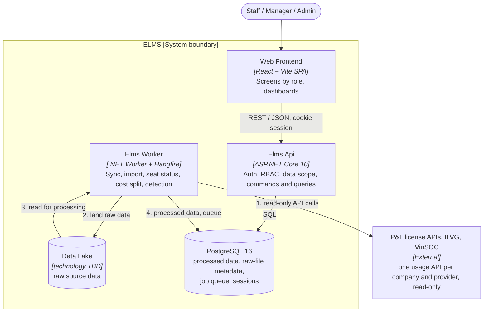

# 05 — Code structure and solution architecture

Design status: **TARGET** for the backend, aligned with the 11 use cases (November 2026). The frontend (`src/frontend`) is already coded but still follows the previous model; its target screens are in [Information architecture](04-information-architecture-manager.md). Items marked *assumption* need team confirmation.


## 1. Repository layout

```text
VFast/
├─ README.md
├─ docs/
│  ├─ 01-research-top-down.md … 04-information-architecture-manager.md
│  ├─ 05-code-structure.md        ← this file
│  ├─ 06-connector-standard.md, 08-feature-list.md, 09-data-fields-research.md
│  ├─ architecture/
│  │  ├─ arc42/                     Chapters 1–12
│  │  ├─ c4/                        C1 Context → C4 Code
│  │  └─ uml/                       Class and sequence diagrams
│  ├─ database/
│  │  ├─ elms.dbml                  Database design (source of truth), schema.sql, tables.md
│  │  └─ diagrams/                  ERDs (draw.io, png, svg)
│  ├─ diagrams/                     ve_usecase.py, ve_erd.py, ve_mindmap.py, srsdiagram.py
│  │  └─ out/                       Use case diagrams per actor (draw.io, png, svg)
│  └─ mindmap/vfast.xmind           Editable mind map
├─ UI/                              HTML demos (v90 = FE baseline)
└─ src/
   ├─ frontend/                     React SPA
   └─ backend/                      .NET solution
```


## 2. Solution architecture

One monolith built with Clean Architecture, deployed as two processes (`Elms.Api` and `Elms.Worker`) that share one PostgreSQL database, plus a data lake for raw source data. Data from a source never goes straight into PostgreSQL: the worker lands it in the lake, processes it, and only then writes the result. The API serves users only; every slow operation (provider calls, large CSV imports, detection) is queued and run by the worker. The queue lives in PostgreSQL, so no Redis or message broker is needed.

| Layer | Choice |
|---|---|
| Frontend | React 19, Vite, TypeScript, MUI v6, Tailwind CSS v4, ApexCharts, React Router v7, axios |
| Backend | ASP.NET Core 10 (.NET 10 LTS), controllers, Command/Query handlers |
| Worker | .NET Worker Service running a Hangfire server |
| Data access | EF Core 10 + Npgsql for writes; Dapper over views for dashboards |
| Database | PostgreSQL 16 |
| Raw data storage | Data lake (technology TBD), behind `IRawDataStore` |
| Jobs | Hangfire + Hangfire.PostgreSql |
| Connectors | One generic ECS client for every P&L API, plus ILVG and VinSOC clients; `IHttpClientFactory` + Polly |
| Auth | ASP.NET Core Identity, server-side cookie session, antiforgery |
| API contract | OpenAPI + Scalar; TypeScript client generated with `openapi-typescript` |
| Libraries | FluentValidation, CsvHelper, Serilog / OpenTelemetry, HybridCache |
| Tests | xUnit, Testcontainers (PostgreSQL), NetArchTest |
| Delivery | Docker (Compose for dev), Nginx or Caddy, GitHub Actions |

### Assumptions (non-functional)

| Property | Target |
|---|---|
| Scale | ~30 P&Ls, ~5,000 accounts, 100–300 daily users, ~500 licenses, ~150,000 assignments *(assumption)* |
| Latency | Dashboards p95 < 1 s; lists p95 < 500 ms (server-side paging) |
| Freshness | License data as old as each connector's sync interval (6 hours by default); ILVG and VinSOC daily; analysis on complete months |
| Availability | 99.5 % in business hours; RPO ≤ 24 h, RTO ≤ 4 h |

### Key decisions

| Decision | Alternative | Revisit when |
|---|---|---|
| Monolith: 1 Api + 1 Worker | Microservices | Several teams edit one codebase, or ingestion needs its own scaling |
| PostgreSQL for data, queue, and session; no Redis or broker | Add Redis / broker | The job queue becomes a bottleneck |
| Raw source data in a data lake, processed data in PostgreSQL | Raw payloads in PostgreSQL (`raw_records.payload`) | Lake technology chosen; volume or retention outgrows the database |
| Scheduled sync at each connector's interval | Realtime events | P&L APIs push changes and users need same-hour numbers |
| Clean Architecture, modules as folders | Module-first modular monolith | A module must become its own service |
| EF Core to write, Dapper + views to read | EF Core only | Too many views to keep in sync with the schema |
| Cookie session | JWT | A mobile app or third-party API is needed |
| One `AppDbContext`, one schema per module | One DbContext per module | A module is split out |


### Container view




## 3. Frontend

React 19 + Vite + TypeScript, MUI v6 and Tailwind CSS v4, ApexCharts, routing with React Router v7, HTTP with axios.

The **target** tree below is decomposed from the UI demo [`UI/VFast_UI_v90.html`](../UI/VFast_UI_v90.html) (D1 v90: login, role-based shell, Usage, Budget Plan, Cloud Usage, Connector Management, User Management). It is organized **by feature**: one folder per business area holds its pages, components, hooks, and types; every API call is in `services/`, one service per area that the feature hooks import; and only UI that two or more features use moves to `shared/`. It replaces today's layered folders (`pages/`, `sections/`, `components/`). The component-level zoom of each screen is in [C4 Level 4 — Web Frontend code](architecture/c4/04-code.md).

### 3.1 Target frontend flow

```text
Page / Component → Feature Hook → Feature Service → apiClient → ASP.NET Core API
```

| Step | Where | Does |
|---|---|---|
| Page / Component | `features/<area>/pages/`, `components/` | Renders; gets data and actions only from the feature hook |
| Feature Hook | `features/<area>/hooks/use<Area>.ts` | Loading, error, and paging state; calls the feature service |
| Feature Service | `services/<module>/<module>Service.ts` | One function per endpoint; returns `res.data` |
| apiClient | `services/apiClient.ts` | The one axios instance built from `config/api.ts`: prefix, cookie, XSRF, `401` → login, `ProblemDetails` → `ApiError` |
| ASP.NET Core API | `Elms.Api` | `/api/v1/<module>/<resource>` ([§5](#5-api-conventions)) |

### 3.2 Code structure (target)

```text
src/frontend/
├─ index.html, main.tsx                       Entry point
├─ index.css, vite.config.ts, tsconfig*.json
├─ app/                                       Wiring only, no business logic
│  ├─ App.tsx                                 Theme → Auth → Router
│  ├─ router.tsx                              Lazy-loads each feature's pages
│  ├─ paths.ts                                URL constants
│  ├─ RequireRole.tsx                         Role → allowed pages
│  └─ layout/
│     ├─ MainLayout.tsx                       Sidebar | Topbar + <Outlet/>
│     ├─ Topbar.tsx                           Breadcrumb, sync, year, user
│     └─ sidebar/
│        ├─ Sidebar.tsx
│        ├─ MainRail.tsx                      Menu by role
│        ├─ UsageSubnav.tsx                   Org tree, License items
│        ├─ CloudSubnav.tsx                   P&L, Infrastructure
│        └─ SideFooter.tsx                    Avatar, identity
├─ config/                                    App settings, no logic
│  ├─ env.ts                                  Reads import.meta.env once
│  ├─ api.ts                                  API prefix, XSRF names, timeout
│  └─ index.ts                                Re-exports every config
├─ features/
│  ├─ auth/                                   UC11 · SCR-LOGIN-01
│  │  ├─ pages/LoginPage.tsx                  Role, organization, sign in
│  │  ├─ AuthContext.tsx                      User, role, signIn, signOut
│  │  ├─ hooks/
│  │  │  └─ useAuth.ts                        Calls authService
│  │  └─ index.ts
│  ├─ usage/                                  UC03 · SCR-USAGE-01
│  │  ├─ pages/UsagePage.tsx
│  │  ├─ components/
│  │  │  ├─ OverviewStrip.tsx                 Plan / Spend / Actual KPIs
│  │  │  ├─ PlanActualAnalytics.tsx           Chart per P&L or license
│  │  │  ├─ MonthlyHeatmap.tsx                Heatmap, by license
│  │  │  ├─ SubordinateUnitsTable.tsx         Ranking, Export CSV
│  │  │  ├─ LicenseWastePanel.tsx             Waste list, filters
│  │  │  └─ LicenseAnalysisDialog.tsx         Causes, contributors
│  │  ├─ hooks/
│  │  │  └─ useUsage.ts                       Calls usageService
│  │  ├─ types.ts
│  │  └─ index.ts
│  ├─ licenses/                               UC01 · SCR-LIC-LIST-01, -DETAIL-01
│  │  ├─ pages/
│  │  │  ├─ LicenseOverviewPage.tsx           License Overview
│  │  │  └─ LicenseDetailPage.tsx             One license, its users
│  │  ├─ components/
│  │  │  ├─ LicensePickerFilter.tsx
│  │  │  ├─ LicenseKpiStrip.tsx
│  │  │  ├─ LicenseCostChart.tsx              Plan / Spend / Used
│  │  │  ├─ LicenseSeatChart.tsx              Seat status
│  │  │  ├─ UnitAllocationChart.tsx           By child unit
│  │  │  ├─ LicenseDenseList.tsx              License List + pager
│  │  │  └─ AssignedUsersTable.tsx
│  │  ├─ hooks/
│  │  │  └─ useLicenses.ts                    Calls licenseService
│  │  ├─ types.ts
│  │  └─ index.ts
│  ├─ budget/                                 UC05, UC06 · SCR-BUDGET-*
│  │  ├─ pages/BudgetPlanPage.tsx
│  │  ├─ components/
│  │  │  ├─ BudgetFilters.tsx                 Hierarchy, year, import
│  │  │  ├─ BudgetKpis.tsx
│  │  │  ├─ BudgetForecastCard.tsx            Spending Forecast
│  │  │  ├─ MonthlyAllocationTable.tsx        Monthly details
│  │  │  ├─ QuickEditBudgetDialog.tsx         Update Monthly Budget
│  │  │  └─ ImportBudgetDialog.tsx            Upload, preview, confirm
│  │  ├─ hooks/
│  │  │  ├─ useBudget.ts                      Calls budgetService
│  │  │  └─ useBudgetImport.ts                Calls budgetService
│  │  ├─ types.ts
│  │  └─ index.ts
│  ├─ cloud/                                  UC04 · SCR-CLOUD-PNL-01, -INFRA-01
│  │  ├─ pages/
│  │  │  ├─ CloudPnlPage.tsx                  By P&L hierarchy
│  │  │  └─ CloudInfrastructurePage.tsx       By provider
│  │  ├─ components/
│  │  │  ├─ CloudPnlBreadcrumb.tsx
│  │  │  ├─ SpendingOverviewChart.tsx
│  │  │  ├─ CloudBreakdownTable.tsx
│  │  │  ├─ CostRecordsDialog.tsx
│  │  │  ├─ BudgetSummaryOnMonth.tsx
│  │  │  ├─ InfrastructureSources.tsx
│  │  │  └─ InfrastructureCostDialog.tsx
│  │  ├─ hooks/
│  │  │  └─ useCloudSpend.ts                  Calls cloudService
│  │  ├─ types.ts
│  │  └─ index.ts
│  ├─ connectors/                             UC10 · SCR-CONN-01, -FORM-01
│  │  ├─ pages/ConnectorManagementPage.tsx
│  │  ├─ components/
│  │  │  ├─ ConnectorMetrics.tsx              4 KPI cards
│  │  │  ├─ ConnectorToolbar.tsx              Search, filters, New
│  │  │  ├─ ConnectorTable.tsx                Coverage, sync, status
│  │  │  └─ ConnectorFormDialog.tsx           New / Edit connector
│  │  ├─ hooks/
│  │  │  └─ useConnectors.ts                  Calls connectorService
│  │  ├─ types.ts
│  │  └─ index.ts
│  └─ admin/                                  UC08, UC09 · SCR-USERS-01
│     ├─ pages/UserManagementPage.tsx
│     ├─ components/
│     │  ├─ UsersTable.tsx
│     │  └─ UserEditDialog.tsx                Role and data scope
│     ├─ hooks/
│     │  └─ useUsers.ts                       Calls userService
│     ├─ types.ts
│     └─ index.ts
├─ services/                                  Every API call lives here
│  ├─ apiClient.ts                            axios instance from config/
│  ├─ schema.d.ts                             Types from openapi-typescript
│  ├─ index.ts                                Re-exports every service
│  ├─ auth/
│  │  └─ authService.ts                       login, logout, me
│  ├─ org/
│  │  └─ orgService.ts                        tree
│  ├─ usage/
│  │  └─ usageService.ts                      balance, units, trend, waste
│  ├─ license/
│  │  └─ licenseService.ts                    list, get, holders, mine
│  ├─ budget/
│  │  └─ budgetService.ts                     plan, preview, confirm
│  ├─ cloud/
│  │  └─ cloudService.ts                      byPnl, infrastructure
│  ├─ connector/
│  │  └─ connectorService.ts                  list, test, create, update
│  └─ user/
│     └─ userService.ts                       list, updateScope, setStatus
├─ shared/                                    Used by ≥ 2 features
│  ├─ components/
│  │  ├─ KpiCard.tsx
│  │  ├─ AppDialog.tsx
│  │  ├─ ProviderLogo.tsx
│  │  ├─ charts/                              ApexCharts wrappers
│  │  ├─ table/                               DataTable, Pagination
│  │  ├─ filters/                             Search, select, month, org tree
│  │  └─ feedback/                            Badge, tooltip, empty, mock
│  ├─ hooks/                                  useOrgScope, usePagination, useCsv
│  ├─ types/                                  Page<T>, Money, OrgUnit, Role
│  └─ utils/                                  formatCurrency, formatDate, csv
└─ theme/                                     MUI theme, design tokens
```

### 3.3 Frontend responsibilities

| Folder | Responsibility | May import | Must not |
|---|---|---|---|
| `app/` | Providers, router, `RequireRole`, app shell (Topbar, Sidebar) | everything | hold business logic |
| `config/` | API prefix, timeout, XSRF cookie / header names, `VITE_*` variables; `env.ts` is the only reader of `import.meta.env` | nothing | import from the app |
| `features/<area>/` | Pages, components, hooks, and types of one business area; only its hooks call services; exposes its pages through `index.ts` | `services/`, `shared/`, `config/` | import another feature; call a service from a component; call axios or `fetch` |
| `services/` | `apiClient.ts`: the one axios instance (`withCredentials`, XSRF, `401` → login, `ProblemDetails` → `ApiError`); `<module>/<module>Service.ts`: the endpoints of one area, returning `res.data` | `config/` | import UI (`features/`, `shared/components`, `app/`) |
| `shared/` | UI, hooks, types, and utils used by two or more features | `services/`, `config/` | import `features/` or `app/` |
| `theme/` | MUI theme and design tokens | nothing | — |

## 4. Backend

ASP.NET Core 10 (.NET 10 LTS), EF Core 10 + Npgsql, Dapper, Hangfire, PostgreSQL 16, and a data lake for raw source data. One solution in `src/backend/`, built with Clean Architecture: modules are feature folders inside each layer, not separate projects.

### 4.1 Target backend flow

```text
HTTP:   Controller → Mediator → Behaviours → Handler → Domain Rules
        → IAppDbContext → PostgreSQL
Worker: Hangfire Job → Pipeline step → ILicenseSource → IRawDataStore
        → Handler → IAppDbContext → PostgreSQL
```

| Step | Where | Does |
|---|---|---|
| Controller | `Elms.Api/Controllers/<Module>/` | Maps HTTP to a command or query; `Mediator.Send` only, no logic |
| Hangfire Job | `Elms.Worker/Jobs/` | Starts a sync, an import confirm, or the daily pipeline ([§6](#6-background-jobs-hangfire-in-elmsworker)) |
| Behaviours | `SharedKernel.Application` | Logging, validation (FluentValidation), authorization by policy |
| Handler | `Elms.Application/<Module>/<Feature>/` | One use case step; command or query and its handler in one file |
| Pipeline step | `Elms.Application/Ingestion/Pipeline/` | Fetch, land raw data in the lake, record metadata, validate (BR-17), normalize, coverage |
| Domain Rules | `Elms.Domain/Rules/` | Pure business rules, unit-tested without a database |
| Source and lake interfaces | `Elms.Application/Interfaces/` | `ILicenseSource`, `IIlvgSource`, `IVinSocSource`, `IRawDataStore`; implemented in Infrastructure |
| IAppDbContext | `Elms.Infrastructure/Data/` | EF Core writes, scoped by `AccessScope`; an interceptor writes the audit log |
| Read views | `Elms.Application/Analytics/` | Dapper queries over views for dashboards |
| PostgreSQL | One schema per module | Processed data, job queue, sessions ([§10](#10-database)) |

### 4.2 Code structure (target)

```text
src/backend/
├─ Elms.slnx                             Solution file
├─ global.json, Directory.*.props        SDK, build, package versions
├─ docker-compose.yml                    postgres, lake, api, worker, web
├─ src/
│  ├─ SharedKernel.Domain/               BaseEntity, Money
│  ├─ SharedKernel.Application/          Behaviours, AccessScope, base command
│  ├─ SharedKernel.Infrastructure/       BaseDbContext, audit interceptor
│  ├─ SharedKernel.Api/                  BaseApiController, error handler
│  ├─ Elms.Domain/
│  │  ├─ Entities/<Module>/              Identity, Catalog, Usage, Finance…
│  │  ├─ Enums/                          OrgLevel, LicenseType, SeatStatus…
│  │  └─ Rules/
│  │     ├─ SeatStatusRule.cs            BR-03
│  │     ├─ CostAllocator.cs             BR-06, BR-22
│  │     ├─ AccrualCalculator.cs         BR-23
│  │     └─ WasteFlagRule.cs             BR-20
│  ├─ Elms.Application/
│  │  ├─ Interfaces/
│  │  │  ├─ IAppDbContext.cs             Tables, filtered by AccessScope
│  │  │  ├─ IRawDataStore.cs             Data lake read / write
│  │  │  ├─ ILicenseSource.cs            Every P&L API (ECS)
│  │  │  ├─ IIlvgSource.cs               Employees, units
│  │  │  └─ IVinSocSource.cs             Application usage
│  │  ├─ <Module>/<Feature>/             e.g. Finance/BudgetImports
│  │  │  ├─ Commands/                    Command + handler in one file
│  │  │  ├─ Queries/                     Query + handler in one file
│  │  │  ├─ Validators/                  FluentValidation
│  │  │  └─ DTO/                         Request / response shapes
│  │  ├─ Analytics/<Dashboard>/Queries/  Dapper over views
│  │  ├─ Ingestion/Pipeline/             Fetch, land, validate, normalize
│  │  └─ ConfigureServices.cs
│  ├─ Elms.Infrastructure/
│  │  ├─ Data/
│  │  │  ├─ AppDbContext.cs              EF Core 10 + Npgsql
│  │  │  ├─ Configurations/<Module>/     One EF config per entity
│  │  │  └─ Migrations/
│  │  ├─ Connectors/
│  │  │  ├─ Ecs/                         EcsClient: every P&L API
│  │  │  ├─ Ilvg/                        IlvgClient
│  │  │  ├─ VinSoc/                      VinSocClient
│  │  │  └─ Simulated/                   Mock P&L data (BR-12)
│  │  ├─ DataLake/                       DataLakeStore
│  │  └─ ConfigureServices.cs
│  ├─ Elms.Api/
│  │  ├─ Controllers/<Module>/           /api/v1/<module>/<resource>
│  │  └─ Program.cs                      Auth, OpenAPI, DI
│  └─ Elms.Worker/
│     ├─ Jobs/                           Sync, imports, daily pipeline (§6)
│     └─ Program.cs                      Hangfire server, DI
└─ tests/
   ├─ Elms.UnitTests/                    Domain rules, handlers
   ├─ Elms.IntegrationTests/             Testcontainers PostgreSQL
   └─ Elms.ArchitectureTests/            NetArchTest layer rules
```

### 4.3 Backend responsibilities

| Project | Responsibility | May reference | Must not |
|---|---|---|---|
| `SharedKernel.*` | Base types any host can reuse: entities, `Money`, behaviours, `AccessScope`, `BaseDbContext`, audit interceptor, error handler | other `SharedKernel.*` | reference `Elms.*` |
| `Elms.Domain` | Entities, enums, pure business rules | `SharedKernel.Domain` | reference EF Core, HTTP, or `Elms.Application` |
| `Elms.Application` | Commands, queries, handlers, validators, DTOs per module and feature; the interfaces it needs; the ingestion pipeline | `Elms.Domain`, `SharedKernel.Application` | reference EF Core, Npgsql, HTTP clients, or the lake SDK |
| `Elms.Infrastructure` | `AppDbContext`, one EF configuration per entity, migrations, ECS / ILVG / VinSOC clients, `DataLakeStore` | `Elms.Application`, `Elms.Domain` | hold business rules |
| `Elms.Api` | Controllers, authentication, antiforgery, OpenAPI, global `IExceptionHandler` → `ProblemDetails` | `Elms.Application`, `Elms.Infrastructure` (DI only) | call a source, run jobs, or put logic in a controller |
| `Elms.Worker` | Hangfire server and jobs; the only process that calls sources and the lake | `Elms.Application`, `Elms.Infrastructure` (DI only) | serve user requests |
| `tests/` | Unit (rules, handlers), integration (Testcontainers PostgreSQL), architecture (NetArchTest fails the build on a broken rule) | every project | — |

Dependency direction: `Api / Worker → Infrastructure → Application → Domain → SharedKernel`. Data access: no lazy loading, `.Select(...)` or `Include`, `AsNoTracking()` for reads; business constraints live in the database (check constraints, unique indexes, `Restrict` foreign keys, BR-13); columns `snake_case` via `EFCore.NamingConventions`. Check licenses before choosing MediatR or AutoMapper; free alternatives are Mediator (source generator) and Mapperly.

### 4.4 Modules

The modules follow the mind-map branches, plus two technical modules (`ingestion`, `usage`) where data errors are most likely. A module owns its tables ([Database design](database/README.md)); other modules read them only through a service or a public view.

| Module | Use cases | Owns | Responsibility |
|---|---|---|---|
| `identity` | UC08, UC11 | user accounts, roles, permissions, sessions | Accounts for ILVG employees (BR-15), password links, login, lockout, RBAC, policies |
| `organization` | UC09, ILVG sync, holder identity | org units, employees, user scopes, overrides | Four-level tree from ILVG, P&L the highest (BR-19), employee and project membership, Manager and Staff scope (BR-14), holder identity (BR-25) |
| `catalog` | UC01, UC02 | vendors, software, categories, licenses, terms | Software catalog and mapping (BR-35), licenses as the connectors report them, owner unit and shared licenses (BR-24), expiry (BR-30) |
| `ingestion` | UC10 | connectors, plan data sources, sync runs, coverage, raw records, files, imports | Create, test, edit, delete, pause connectors; run them at their interval (BR-29); validate the license data contract (BR-17); budget and expense imports (preview → confirm, idempotent, BR-33) |
| `usage` | UC01, UC03 | subjects, assignments, usage records, snapshots, employee app usage | Seat status with grace period (BR-03), days used (BR-32), daily snapshots, VinSOC usage (BR-21) |
| `finance` | UC05, UC06, UC07 | budget versions and lines, expenses, accounting periods, exchange rates, cost allocations | Budget versions (BR-08), accrual (BR-23), currency (BR-05), cost split into Used, Wasted, Not evaluated (BR-06, BR-22), variance (BR-34) |
| `optimization` | UC03 | detection runs and results | Unused and inactive seats (BR-11), waste flag above 20 % (BR-20), waste analysis |
| `analytics` | UC07 | read models only | Dashboards, analysis by license, metric definitions (BR-27) |
| `audit` (shared) | BR-13 | audit logs | Who, old value, new value, time, reason for every change |

Dependency rules between modules (enforced by NetArchTest):

- `analytics` may read every module; no module depends on `analytics`.
- `optimization` reads `usage`, `finance`, `catalog` and never writes to them.
- `finance` reads seat counts from `usage` to split the cost; `usage` never reads money.
- `ingestion` writes raw data, then calls `usage` and `catalog` to normalize; no business module calls a provider directly.
- Only `identity` and `organization` decide access; other modules receive an `AccessScope`.

Every P&L provides an API for its own data in the license data contract (BR-17), so one generic client reads every usage connector: `fetchLicenses`, `fetchTerms`, `fetchHolders`, `fetchActivity`, `fetchUsage(period)`. A dataset a P&L does not deliver returns `NotSupported`, never an empty list, so "no source" stays distinct from "source reports zero". Every record passes the same validator before it is written ([Connector standard](06-connector-standard.md#4-proposal-elms-connector-standard-ecs-v1)). ILVG and VinSOC have their own clients behind the same interface style.

## 5. API conventions

| Item | Rule |
|---|---|
| URL | `/api/v1/<module>/<resource>`, plural kebab-case nouns, e.g. `/api/v1/catalog/software` |
| Business actions | `POST` to a sub-resource, e.g. `POST /ingestion/connectors/{id}/pause`, `POST /finance/budget-imports/{previewKey}/confirm` |
| Lists | `page`, `pageSize` (max 100), `sort`, typed filters; returns `{ items, page, pageSize, total }` |
| Errors | `ProblemDetails` (RFC 9457): 400 validation, 401, 403, 404 (outside scope), 409 (duplicate, wrong state, write conflict) |
| Concurrency | Optimistic, PostgreSQL `xmin`; the second writer gets 409 |
| Idempotency | Confirming an import is keyed by its `previewKey`; a repeat returns the first result; the same budget file again is `unchanged` (BR-33) |
| Data types | ISO 8601 dates; money as `amount` + `currency`; missing data is `null` with a reason, never `0` (BR-04) |
| Dashboards | Every response carries `dataDate` and the data source (BR-12) |


## 6. Background jobs (Hangfire, in `Elms.Worker`)

| Job | Trigger | Work |
|---|---|---|
| `SyncSchedulerJob` | Every minute | Start the runs of connectors whose interval has elapsed; write a `paused` run for a paused connector (BR-29) |
| `ConnectorRunJob` | Scheduler, *Run now*, *Rerun period* | Fetch, validate, normalize one connector and data date; replace, never duplicate (BR-33) |
| `IlvgSyncJob`, `VinSocSyncJob` | Daily | Employees, units, projects, transfers; disable the account of a leaver (BR-15); application usage |
| `DailyPipelineJob` | Daily, after the syncs | Seat status and days used, snapshots, cost split of open months, detection, refresh views |
| `ImportConfirmJob` | A Manager or Staff confirms an import | Write the budget version or the expenses in one transaction |
| `MonthCloseJob` | Day 10 of each month | Close the previous month of every company not closed by Staff (UC05) |

All jobs are idempotent (upsert by source key + data date), retried (Polly for API calls, Hangfire up to 3 times), and never overlap. When retries run out the source is marked `failed` and its figures are `Unknown`, not `0`. Jobs run as `SystemUser`, so the audit actor is `system`.


## 7. Caching

`HybridCache` in the Application layer; L1 in-memory first, Redis as L2 only when the API scales to several instances.

| Data | Key | TTL | Invalidated when |
|---|---|---|---|
| Permission matrix | `perm:{role}` | 10 min | Admin edits permissions |
| User `AccessScope` | `scope:{userId}` | 10 min | Role, managed units, or org tree change |
| Reference data (catalog, rates, organization) | `ref:{type}` | 30 min | Staff / Admin write, ILVG sync |
| Dashboard results | `dash:{name}:{scopeHash}:{filter}:{dataVersion}` | 1 h | `dataVersion` increments |

Keys always include the user's scope (BR-14). `dataVersion` is a counter in the database, bumped whenever a job refreshes the views, so all dashboards show the same version of the numbers (G7). API responses use `Cache-Control: private, no-store`.


## 8. Authorization and security

Three independent checks per request (hiding a button is not protection, BR-14):

1. **Authentication** — session cookie, user must be `ACTIVE`; otherwise 401.
2. **RBAC** — `[Authorize(Policy = "budget.plan:write")]` per endpoint, matched against role permissions; otherwise 403.
3. **Data scope** — an `AccessScope` (role; the unit of a Manager, or of the Manager a Staff member works for, with everything under it) is applied by a global query filter; out-of-scope records return 404.

Also: login uses ASP.NET Core Identity with lockout after 5 failures for 15 minutes (BR-16); cookies are `HttpOnly`, `Secure`, `SameSite=Lax` with a CSRF token; sessions are stored server-side so disabling a user revokes them immediately; connector credentials are write-only, read-only in scope, encrypted with Data Protection, and only the worker can decrypt them (BR-18). Postgres Row-Level Security is planned after the MVP.


## 9. Deployment

A reverse proxy (Nginx or Caddy) serves the SPA and forwards `/api/*` to `Elms.Api` on the same domain, so no CORS is needed. One Api and one Worker instance; Hangfire's distributed lock prevents duplicate jobs. Migrations run as a separate pipeline step (EF migration bundle) before the apps start, never at application startup. Environments: dev (Docker Compose: postgres, a local data lake, api, worker, web, a simulated P&L API), staging (a P&L test API), prod. Operations: `/health`, structured logs with `request_id`, Hangfire dashboard (Admin only), alert when a source fails two days in a row.


## 10. Database

40 tables, 7 table groups, PostgreSQL. See [Database design](database/README.md) for the ERDs and rules; [`database/elms.dbml`](database/elms.dbml) is the source of truth. Each module maps to one Postgres schema (`identity`, `org`, `catalog`, `ingestion`, `usage`, `finance`, `optimization`, `audit`).
