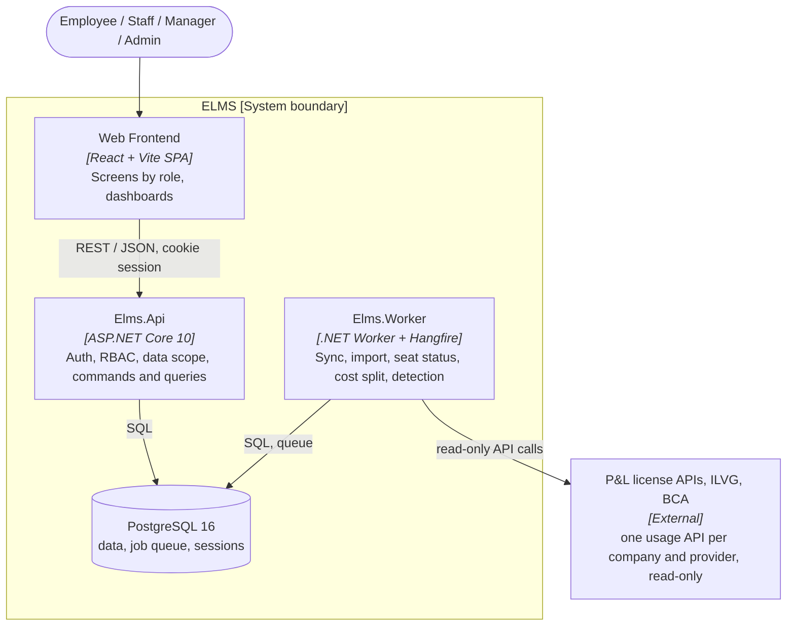

# 05 — Folder structure and solution architecture

Design status: **TARGET** for the backend, aligned with the 11 use cases (November 2026). The frontend (`src/frontend`) is already coded but still follows the previous model; its target screens are in [Information architecture](04-information-architecture-manager.md). Items marked *assumption* need team confirmation.


## 1. Repository layout

```text
VFast/
├─ README.md
├─ docs/
│  ├─ 01-research-top-down.md … 04-information-architecture-manager.md
│  ├─ 05-folder-structure.md        ← this file
│  ├─ 06-connector-standard.md, 07-c4-architecture.md, 08-feature-list.md, 09-data-fields-research.md
│  ├─ database/
│  │  ├─ elms.dbml                  Database design (source of truth), schema.sql, tables.md
│  │  └─ diagrams/                  ERDs (draw.io, png, svg)
│  ├─ diagrams/                     ve_usecase.py, ve_erd.py, ve_mindmap.py, srsdiagram.py
│  │  └─ out/                       Use case diagrams per actor (draw.io, png, svg)
│  └─ mindmap/vfast.xmind           Editable mind map
├─ UI/                              HTML demos of the screens (D1)
└─ src/
   ├─ frontend/                     React SPA
   └─ backend/                      .NET solution
```


## 2. Solution architecture

One monolith built with Clean Architecture, deployed as two processes (`Elms.Api` and `Elms.Worker`) that share one PostgreSQL database. The API serves users only; every slow operation (provider calls, large CSV imports, detection) is queued and run by the worker. The queue lives in PostgreSQL, so no Redis or message broker is needed.

| Layer | Choice |
|---|---|
| Frontend | React 19, Vite, TypeScript, MUI v6, Tailwind CSS v4, ApexCharts, React Router v7 |
| Backend | ASP.NET Core 10 (.NET 10 LTS), controllers, Command/Query handlers |
| Worker | .NET Worker Service running a Hangfire server |
| Data access | EF Core 10 + Npgsql for writes; Dapper over views for dashboards |
| Database | PostgreSQL 16 |
| Jobs | Hangfire + Hangfire.PostgreSql |
| Connectors | One generic ECS client for every P&L API, plus ILVG and BCA clients; `IHttpClientFactory` + Polly |
| Auth | ASP.NET Core Identity, server-side cookie session, antiforgery |
| API contract | OpenAPI + Scalar; TypeScript client generated with `openapi-typescript` |
| Libraries | FluentValidation, CsvHelper, Serilog / OpenTelemetry, HybridCache |
| Tests | xUnit, Testcontainers (PostgreSQL), NetArchTest |
| Delivery | Docker (Compose for dev), Nginx or Caddy, GitHub Actions |

### Assumptions (non-functional)

| Property | Target |
|---|---|
| Scale | ~30 P&Ls, ~5,000 accounts, 100–300 daily users, ~500 licenses, ~150,000 assignments *(assumption)* |
| Latency | Dashboards p95 < 1 s; lists p95 < 500 ms (server-side paging) |
| Freshness | License data as old as each connector's sync interval (6 hours by default); ILVG and BCA daily; analysis on complete months |
| Availability | 99.5 % in business hours; RPO ≤ 24 h, RTO ≤ 4 h |

### Key decisions

| Decision | Alternative | Revisit when |
|---|---|---|
| Monolith: 1 Api + 1 Worker | Microservices | Several teams edit one codebase, or ingestion needs its own scaling |
| PostgreSQL only (data, queue, session) | Add Redis / broker | The job queue becomes a bottleneck |
| Scheduled sync at each connector's interval | Realtime events | P&L APIs push changes and users need same-hour numbers |
| Clean Architecture, modules as folders | Module-first modular monolith | A module must become its own service |
| EF Core to write, Dapper + views to read | EF Core only | Too many views to keep in sync with the schema |
| Cookie session | JWT | A mobile app or third-party API is needed |
| One `AppDbContext`, one schema per module | One DbContext per module | A module is split out |


### Container view




## 3. Frontend

React 19 + Vite + TypeScript, MUI v6 and Tailwind CSS v4, routing with React Router v7. Mock data is used until the backend exists. The tree below is the code as it is today, built for the previous model (category budgets, no Usage or Connector screens); the target screens and routes are in [Information architecture](04-information-architecture-manager.md#2-screen-catalog).

```text
src/frontend/
├─ index.html, main.tsx, App.tsx      Entry point and provider tree (theme, router)
├─ index.css, portal.css              Tailwind v4 @theme tokens and portal styles
├─ vite.config.ts, tsconfig*.json     Build and TypeScript config
├─ routes/                            paths.ts (typed URL constants), router.tsx
├─ layouts/                           Header, Sidebar, MainLayout (app shell)
├─ components/
│  ├─ layout/                         Shell pieces shared with layouts/
│  ├─ cards/                          KpiCard
│  ├─ LicenseHealthCharts.tsx         ApexCharts widgets
│  └─ PortalIcon.tsx
├─ sections/                          Feature blocks that compose pages
│  ├─ licenses/                       LicenseListSection, LicenseDetailDrawer
│  └─ budget/                         BudgetKpiSection, BudgetRenewalsDrawerSection
├─ pages/                             One folder per screen
│  ├─ licenses/                       LicenseManagementPage, LicenseDetailPage
│  ├─ budget/                         BudgetAnalyticsPage
│  ├─ analytics/                      GeneralAnalyticsPage
│  └─ users/                          UserManagementPage
├─ types/                             license.ts, budget.ts, user.ts
├─ utils/                             formatCurrency, formatDate, calculations, licenseCsv
├─ data/                              licenses.tsx (mock data)
└─ theme/                             MUI theme and design tokens
```

Each folder has a barrel `index.ts`. Composition order: `pages` → `sections` → `components`. Routes (`routes/paths.ts`):

| Path today | Screen today | Target (docs/04) |
|---|---|---|
| `/manager/licenses` | License management | License List (SCR-LIC-LIST-01) |
| `/manager/licenses/:licenseId` | License detail | License details dialog (SCR-LIC-DETAIL-01) |
| `/manager/analytics` | General analytics | Usage (SCR-USAGE-01) and dashboards |
| `/manager/analytics/budget` | Budget analytics | Budget screens (SCR-BUDGET-*, SCR-COST-01 …) |
| `/admin/users` | User management | Users (SCR-USERS-01) |
| — | — | Connector Management, sync monitoring, catalog: to add |

Note: `src/frontend/README.md` still describes alias folders (`layout/`, `page/`, `componant/`, `section/`, `route/`) that are not in the repository; `layouts/` and `components/layout/` both exist today. Align the two when the frontend is next refactored.

## 4. Backend

### 4.1 Modules

The modules follow the mind-map branches, plus two technical modules (`ingestion`, `usage`) where data errors are most likely. A module owns its tables ([Database design](database/README.md)); other modules read them only through a service or a public view.

| Module | Use cases | Owns | Responsibility |
|---|---|---|---|
| `identity` | UC07, UC11 | user accounts, roles, permissions, sessions | Accounts provisioned from ILVG (BR-15), password links, login, lockout, RBAC, policies |
| `organization` | UC08, ILVG sync, holder identity | org units, employees, user scopes, overrides | Five-level tree from ILVG (BR-19), employee and project membership, Manager and Staff scope (BR-14), holder identity (BR-25) |
| `catalog` | UC01, UC02 | vendors, software, categories, licenses, terms | Software catalog and mapping (BR-35), licenses as the connectors report them, owner unit and shared licenses (BR-24), expiry (BR-30) |
| `ingestion` | UC09 | connectors, plan data sources, sync runs, coverage, raw records, files, imports | Create, test, edit, delete, pause connectors; run them at their interval (BR-29); validate the license data contract (BR-17); budget and expense imports (preview → confirm, idempotent, BR-33) |
| `usage` | UC03, UC10 | subjects, assignments, usage records, snapshots, employee app usage | Seat status with grace period (BR-03), days used (BR-32), daily snapshots, BCA usage (BR-21) |
| `finance` | UC04, UC06 | budget versions and lines, expenses, accounting periods, exchange rates, cost allocations | Budget versions (BR-08), accrual (BR-23), currency (BR-05), cost split into Used, Wasted, Not evaluated (BR-06, BR-22), variance (BR-34) |
| `optimization` | UC05 | detection runs and results | Unused and inactive seats (BR-11), waste flag above 20 % (BR-20), waste analysis |
| `analytics` | UC06 | read models only | Dashboards, analysis by license, metric definitions (BR-27) |
| `audit` (shared) | BR-13 | audit logs | Who, old value, new value, time, reason for every change |

#### Dependency rules (enforced by NetArchTest):

- `analytics` may read every module; no module depends on `analytics`.
- `optimization` reads `usage`, `finance`, `catalog` and never writes to them.
- `finance` reads seat counts from `usage` to split the cost; `usage` never reads money.
- `ingestion` writes raw data, then calls `usage` and `catalog` to normalize; no business module calls a provider directly.
- Only `identity` and `organization` decide access; other modules receive an `AccessScope`.

Request flow: Controller (`Mediator.Send`) → pipeline behaviours (logging, validation, authorization) → handler → `IAppDbContext` (filtered by `AccessScope`) → interceptor writes the audit log.

Every P&L provides an API for its own data in the license data contract (BR-17), so one generic client reads every usage connector: `fetchLicenses`, `fetchTerms`, `fetchHolders`, `fetchActivity`, `fetchUsage(period)`. A dataset a P&L does not deliver returns `NotSupported`, never an empty list, so "no source" stays distinct from "source reports zero". Every record passes the same validator before it is written ([Connector standard](06-connector-standard.md#4-proposal-elms-connector-standard-ecs-v1)). ILVG and BCA have their own clients behind the same interface style.

### 4.2 Folder structure

The solution is created in `src/backend/`. Four `SharedKernel.*` projects (reusable by other hosts) sit beside the `Elms.*` projects (Domain, Application, Infrastructure, Api, Worker). Modules are feature folders inside each layer, not separate projects; boundaries are kept by namespaces and architecture tests.

```text
ELMS/
├─ Elms.slnx, global.json, Directory.Build.props, Directory.Packages.props
├─ docker-compose.yml
├─ src/
│  ├─ SharedKernel.Domain/            BaseEntity, BaseAuditableEntity, Money
│  ├─ SharedKernel.Application/       Base Command/Query, Behaviours, Exceptions, AccessScope
│  ├─ SharedKernel.Infrastructure/    BaseDbContext, Audit + Scope interceptor
│  ├─ SharedKernel.Api/               BaseApiController, GlobalExceptionHandler
│  ├─ Elms.Domain/
│  │  ├─ Entities/<Module>/           Catalog, Usage, Finance, Optimization...
│  │  ├─ Enums/                       OrgLevel, Archetype, LicenseType, SeatStatus, ConnectorStatus
│  │  └─ Rules/                       SeatStatusRule, AccrualCalculator, CostAllocator, WasteFlagRule
│  ├─ Elms.Application/
│  │  ├─ Interfaces/                  IAppDbContext, ILicenseSource, IIlvgSource, IBcaSource
│  │  ├─ <Module>/<Feature>/          e.g. Catalog/Software, Finance/BudgetImports
│  │  │  └─ Commands/  Queries/  DTO/
│  │  ├─ Analytics/<Dashboard>/Queries/   Read views with Dapper
│  │  ├─ Ingestion/Pipeline/          Steps of a sync run: fetch, validate, normalize, coverage
│  │  └─ ConfigureServices.cs
│  ├─ Elms.Infrastructure/
│  │  ├─ Data/                        AppDbContext, Configurations/, Migrations/
│  │  ├─ Connectors/                  Ecs/ (P&L APIs), Ilvg/, Bca/, Simulated/ (mock data, BR-12)
│  │  └─ ConfigureServices.cs
│  ├─ Elms.Api/                       Controllers/<Module>/, Program.cs
│  └─ Elms.Worker/                    Program.cs, Jobs/ (see section 6)
└─ tests/                             Unit, Integration (Testcontainers), Architecture
```

Dependency direction: `Api / Worker → Infrastructure → Application → Domain → SharedKernel`. Application talks to the database only through `IAppDbContext`.

Conventions:

- One folder per use case: `Elms.Application/<Module>/<Feature>/{Commands,Queries,DTO}`; command/query and handler share one file.
- Pure business rules (BR-03, BR-06, BR-09, BR-20, BR-22, BR-23) live in `Elms.Domain/Rules` for easy unit tests.
- One EF configuration file per entity in `Data/Configurations/<Module>/`; an interceptor writes `audit_logs` before/after values.
- Class names PascalCase English; columns `snake_case` via `EFCore.NamingConventions`.
- No lazy loading; use `.Select(...)` or `Include`; read-only queries use `AsNoTracking()`.
- Business constraints live in the database: check constraints, unique indexes, `Restrict` foreign keys (master data is never deleted, BR-13).
- One global `IExceptionHandler` returns `ProblemDetails`; controllers do not catch.
- Check licenses before choosing MediatR / AutoMapper; free alternatives are Mediator (source generator) and Mapperly.

### 4.3 Dependency flow

```text
Api / Worker ──► Infrastructure ──► Application ──► Domain ──► SharedKernel
```

```text
HTTP request → Controller → Mediator.Send → behaviours (log, validate, authorize)
             → handler → IAppDbContext (AccessScope filter) → PostgreSQL
Worker       → Hangfire job → handler / pipeline step → ILicenseSource / IAppDbContext
```

Rules: Domain depends on nothing; Application depends on interfaces only (`IAppDbContext`, `ILicenseSource` …); only Infrastructure references EF Core, Npgsql, and the HTTP clients; `Controllers/` run only in the Api and `Jobs/` only in the Worker, both using the same handlers. NetArchTest fails the build on a violation.

## 5. API conventions

| Item | Rule |
|---|---|
| URL | `/api/v1/<module>/<resource>`, plural kebab-case nouns, e.g. `/api/v1/catalog/software` |
| Business actions | `POST` to a sub-resource, e.g. `POST /ingestion/connectors/{id}/pause`, `POST /finance/budget-imports/{previewKey}/confirm` |
| Lists | `page`, `pageSize` (max 100), `sort`, typed filters; returns `{ items, page, pageSize, total }` |
| Errors | `ProblemDetails` (RFC 9457): 400 validation, 401, 403, 404 (outside scope), 409 (duplicate, wrong state, write conflict) |
| Concurrency | Optimistic, PostgreSQL `xmin`; the second writer gets 409 |
| Idempotency | Confirming an import is keyed by its `previewKey`; a repeat returns the first result; the same budget file again is `unchanged` (BR-33) |
| Data types | ISO 8601 dates; money as `amount` + `currency`; missing data is `null` with a reason, never `0` (BR-04) |
| Dashboards | Every response carries `dataDate` and the data source (BR-12) |


## 6. Background jobs (Hangfire, in `Elms.Worker`)

| Job | Trigger | Work |
|---|---|---|
| `SyncSchedulerJob` | Every minute | Start the runs of connectors whose interval has elapsed; write a `paused` run for a paused connector (BR-29) |
| `ConnectorRunJob` | Scheduler, *Run now*, *Rerun period* | Fetch, validate, normalize one connector and data date; replace, never duplicate (BR-33) |
| `IlvgSyncJob`, `BcaSyncJob` | Daily | Employees, units, projects, transfers, and their accounts — create for a new employee with a password-link email, disable for a leaver (BR-15); application usage |
| `DailyPipelineJob` | Daily, after the syncs | Seat status and days used, snapshots, cost split of open months, detection, refresh views |
| `ImportConfirmJob` | A Manager or Staff confirms an import | Write the budget version or the expenses in one transaction |
| `MonthCloseJob` | Day 10 of each month | Close the previous month of every company not closed by Staff (UC04) |

All jobs are idempotent (upsert by source key + data date), retried (Polly for API calls, Hangfire up to 3 times), and never overlap. When retries run out the source is marked `failed` and its figures are `Unknown`, not `0`. Jobs run as `SystemUser`, so the audit actor is `system`.


## 7. Caching

`HybridCache` in the Application layer; L1 in-memory first, Redis as L2 only when the API scales to several instances.

| Data | Key | TTL | Invalidated when |
|---|---|---|---|
| Permission matrix | `perm:{role}` | 10 min | Admin edits permissions |
| User `AccessScope` | `scope:{userId}` | 10 min | Role, managed units, or org tree change |
| Reference data (catalog, rates, organization) | `ref:{type}` | 30 min | Staff / Admin write, ILVG sync |
| Dashboard results | `dash:{name}:{scopeHash}:{filter}:{dataVersion}` | 1 h | `dataVersion` increments |

Keys always include the user's scope (BR-14). `dataVersion` is a counter in the database, bumped whenever a job refreshes the views, so all dashboards show the same version of the numbers (G7). API responses use `Cache-Control: private, no-store`.


## 8. Authorization and security

Three independent checks per request (hiding a button is not protection, BR-14):

1. **Authentication** — session cookie, user must be `ACTIVE`; otherwise 401.
2. **RBAC** — `[Authorize(Policy = "budget.plan:write")]` per endpoint, matched against role permissions; otherwise 403.
3. **Data scope** — an `AccessScope` (role, units or companies with everything under them, employee id) is applied by a global query filter; out-of-scope records return 404.

Also: Employees get a dedicated DTO (`/api/v1/me/licenses`) with no price or cost; login uses ASP.NET Core Identity with lockout after 5 failures for 15 minutes (BR-16); cookies are `HttpOnly`, `Secure`, `SameSite=Lax` with a CSRF token; sessions are stored server-side so disabling a user revokes them immediately; connector credentials are write-only, read-only in scope, encrypted with Data Protection, and only the worker can decrypt them (BR-18). Postgres Row-Level Security is planned after the MVP.


## 9. Deployment

A reverse proxy (Nginx or Caddy) serves the SPA and forwards `/api/*` to `Elms.Api` on the same domain, so no CORS is needed. One Api and one Worker instance; Hangfire's distributed lock prevents duplicate jobs. Migrations run as a separate pipeline step (EF migration bundle) before the apps start, never at application startup. Environments: dev (Docker Compose: postgres, api, worker, web, a simulated P&L API), staging (a P&L test API), prod. Operations: `/health`, structured logs with `request_id`, Hangfire dashboard (Admin only), alert when a source fails two days in a row.


## 10. Database

40 tables, 7 table groups, PostgreSQL. See [Database design](database/README.md) for the ERDs and rules; [`database/elms.dbml`](database/elms.dbml) is the source of truth. Each module maps to one Postgres schema (`identity`, `org`, `catalog`, `ingestion`, `usage`, `finance`, `optimization`, `audit`).
