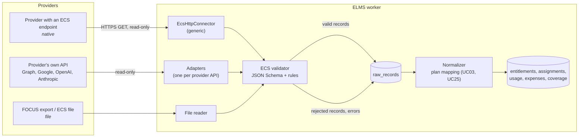

# Connector Management and the ELMS Connector Standard (ECS) — Research and Proposal

> Design status: PROPOSAL (to be reviewed by the team)
>
> Implementation status: NOT STARTED

System: **Enterprise License Management System (ELMS)**, built by team VFast.

This document answers one question: *can ELMS define one standard that every connector delivers license data in, and require providers to return data in that standard?* It reviews the standards that already exist, what the main providers actually expose, and proposes the **ELMS Connector Standard (ECS) v1**, how connectors fit in the product (set up when a license is added, UC03; mapped in UC25; watched in UC26), and a rollout plan.

## 1. Summary

| Question | Answer |
|---|---|
| Should ELMS have one standard for license data? | **Yes.** Every connector, whoever writes it, hands ELMS the same six datasets in the same shape. Validation, normalization, coverage, and the `Unknown`-not-zero rule (BR-04) are then written once. |
| Can every provider be required to return data in it? | **No, not every provider.** Microsoft, Google, Adobe, OpenAI, Anthropic, and AWS will not implement a customer's private format. ELMS can require it only where it has leverage: in-house applications, resellers and CSP partners, local vendors (through a contract clause), and license servers that run inside the company. |
| How do the big providers fit then? | ELMS writes an **adapter** that reads the provider's own API and outputs ECS. From the pipeline's point of view an adapter and a provider that speaks ECS are the same thing. |
| Should we invent the fields? | **No.** ECS is a *profile* of existing standards: FOCUS for cost and usage, SCIM 2.0 for people, ISO/IEC 19770-3 and -4 for entitlements and usage measurement. A provider already exporting FOCUS (AWS, Azure, Google Cloud) is half-way there. |
| What changes in the product? | Staff set up a connector when they add a license (UC03): choose or create the connection, test it, pick the provider plan. A sixth mind-map branch, **Connector Management**, has two use cases: Map Connector Data (UC25) and Monitor Data Synchronization (UC26). Two new business rules (BR-19, BR-20). |

## 2. Starting point

The design already has the pieces a standard plugs into:

- Connectors are plugins behind one interface, `IProviderConnector`: `fetchEntitlements`, `fetchAssignments`, `fetchActivity`, `fetchUsage(period)`, `fetchCost(period)`. An unsupported method returns `NotSupported`, never an empty list ([Folder structure](05-folder-structure.md)).
- The pipeline stores raw payloads before normalizing (A2), is idempotent (A3), and never turns missing data into zero (A4) ([Research](01-research-top-down.md#5-process-to-be)).
- The schema has `connectors`, `plan_data_sources` (one primary source per plan and kind of data, BR-14), `sync_runs`, `collection_coverage`, and `raw_records` ([Tables](database/tables.md#3-collection-pipeline)).

What is missing:

1. **No written contract for what a connector returns.** Each connector author decides the shape, so each one needs its own normalizer and its own tests.
2. **No way for a provider to plug in by itself.** Adding a provider always means ELMS developers write code.
3. **No screen to set up or watch connectors.** Connector rows are seeded, and seed data marks them `is_simulated` ([Database design](database/README.md)).

ECS is the written form of `IProviderConnector`: the five methods become six datasets with a published schema (`fetchAssignments` returns both `subjects` and `assignments`).

## 3. Research

### 3.1 Existing standards

| Standard | Owner, status | Covers | Use in ECS |
|---|---|---|---|
| **FOCUS** — FinOps Open Cost and Usage Specification | FinOps Foundation. 1.2 (May 2025) added SaaS and PaaS billing, virtual currencies (credits, tokens) and `InvoiceId`; 1.3 (Dec 2025) added the Contract Commitment dataset and Service vs Host Provider; **1.4 ratified 4 June 2026** added Invoice Detail and Billing Period datasets | Billed and effective cost, consumed quantity and unit, SKU, pricing currency, commitments, invoices | **Cost dataset = FOCUS column subset, names unchanged.** Contract commitment feeds UC04/UC13 later |
| **SCIM 2.0** — RFC 7643 (schema), RFC 7644 (protocol) | IETF, 2015 | Users and groups, `active` flag, emails, enterprise extension (employee number, department, manager) | **Subjects dataset = SCIM `User` subset** (`id`, `userName`, `emails`, `active`, `externalId`). SCIM has no standard attribute for licenses or activity, so assignments and activity are ECS datasets |
| **ISO/IEC 19770-3** — Entitlement schema (ENT) | ISO, 2016. XML schema | Usage rights, limits, metrics, contract, PO and invoice references | **Concepts for the Entitlements dataset**: metric, quantity, limits, validity, contract reference. ECS uses JSON, not the XML |
| **ISO/IEC 19770-4** — Resource Utilization Measurement (RUM) | ISO, 2017. XSD in Annex A | Measured use of a resource over a period, aligned with 19770-2 identification and 19770-3 entitlement | **Concepts for the Usage dataset**: metric, value, period, subject optional |
| ISO/IEC 19770-2 — Software identification (SWID) tags | ISO, 2015 | Identifying installed software | Not used in v1 (ELMS does not inventory installations) |
| OpenAPI 3.1 and JSON Schema 2020-12 | OpenAPI Initiative, JSON Schema org | Machine-readable API contract and payload schema | How ECS is published; the validator and provider SDK are generated from it |
| OAuth 2.0 client credentials (RFC 6749), RFC 9457 problem details, ISO 8601, ISO 4217 | IETF, ISO | Machine-to-machine auth, error format, dates, currencies | Transport rules for native ECS endpoints |

Two conclusions from the table:

- There is **no single open standard for "seat assignment plus last activity"**, the core of the Allocation archetype. FOCUS is about money, SCIM about identity, 19770 is XML-based and rarely exposed by SaaS vendors. This gap is where ECS adds its own two datasets (Assignments, Activity).
- For **cost**, a standard already exists and the cloud providers ship it. Reusing FOCUS column names means a FOCUS export can be loaded with almost no adapter code.

### 3.2 What the main providers expose today

| Provider | Entitlements | Holders | Activity / usage | Cost | Fit with ECS |
|---|---|---|---|---|---|
| Microsoft 365 (Graph v1.0) | `GET /subscribedSkus` | `GET /users` (`assignedLicenses`) | `reports/getOffice365ActiveUserDetail`, `signInActivity` (needs Entra ID P1/P2); reports may be anonymized by tenant setting | None | Adapter. Already planned as the first connector |
| Google Workspace | Enterprise License Manager API | License assignments per product and SKU | Admin SDK Reports API (user usage) | None | Adapter |
| Adobe | Admin Console products | User Management API (users and product profiles) | Not exposed per user | None | Adapter, Activity `NotSupported` |
| OpenAI | Organization projects | — | Usage API (`/v1/organization/usage/*`, tokens per model, project, key) | Costs API `GET /v1/organization/costs`, daily buckets, admin key | Adapter; Metered archetype |
| Anthropic | Organization, workspaces | — | Usage and Cost Analytics API `GET /v1/organizations/analytics/usage` (beta); legacy `usage_report/messages` | `GET /v1/organizations/analytics/cost` (beta), USD; legacy `cost_report`, daily | Adapter; per-user split available in the new API |
| AWS, Azure, Google Cloud | — | — | FOCUS export | FOCUS export (AWS Data Exports FOCUS 1.2; Azure Cost Management FOCUS dataset; Google Cloud BigQuery FOCUS export in preview) | Cost dataset almost as-is |
| Floating engineering software (FlexNet-style license servers) | License file | — | Server log or status command (sessions, denials) | None | Adapter or agent inside the company; Concurrent archetype |
| In-house applications, local vendors, resellers | Their own data | Their own data | Their own data | Invoices | **Native ECS** — this is where the standard can be required |

Points to check before each adapter is built (from [Research §4.4](01-research-top-down.md#44-data-collection-feasibility)): admin permissions needed, report delay, history limits, anonymized reports, rate limits, and beta status (the Anthropic analytics API is beta and the older endpoints are marked legacy).

### 3.3 How license-management products handle this

Commercial SaaS-management and SAM tools ship a catalogue of vendor-specific integrations and fill the gaps with SSO logs, finance data, and file upload. They do not depend on vendors adopting the tool's own format. The lesson for ELMS: the standard is valuable as **the internal contract every integration targets**, and as an **optional door** for the providers that can be asked to use it — not as a precondition for supporting a provider.

### 3.4 Conclusions

1. ECS is the single shape of data entering ELMS. Validation, normalization, coverage, and tests depend on ECS, never on a provider.
2. Three ways to deliver ECS, one pipeline:
   - **Native** — the provider exposes an ECS endpoint; ELMS uses one generic `EcsHttpConnector` and writes no code.
   - **Adapter** — ELMS writes a connector that calls the provider's own API and maps it to ECS (Microsoft Graph, Google, OpenAI, Anthropic, FOCUS exports, license server logs).
   - **File** — the provider or Staff delivers ECS files (JSON Lines or CSV with the same field names); for parties without an API.
3. Require ECS where ELMS has leverage: a clause in new contracts with resellers and local vendors, and a rule for in-house applications.
4. Reuse standard names (FOCUS, SCIM, 19770); add only what is missing (assignments, activity, completeness).

## 4. Proposal: ELMS Connector Standard (ECS) v1

### 4.1 Architecture



Every arrow toward a provider is a read (BR-01). Adapters output ECS documents and are validated by the same validator as native providers, so an adapter bug is caught the same way as a provider bug.

### 4.2 Datasets

| Dataset | `IProviderConnector` method | Based on | Key fields | Archetypes |
|---|---|---|---|---|
| `entitlements` | `fetchEntitlements` | ISO/IEC 19770-3 concepts | `plan_ref`, `plan_name`, `archetype` (`allocation`, `concurrent`, `metered`, `capacity`), `unit`, `quantity` or `unlimited`, `valid_from`, `valid_to`, `commercial_term`, `contract_ref` | All |
| `subjects` | (part of `fetchAssignments`) | SCIM 2.0 `User` | `subject_ref`, `user_name`, `email`, `active`, `external_id` | Allocation |
| `assignments` | `fetchAssignments` | ECS | `subject_ref`, `plan_ref`, `assigned_at`, `unassigned_at` | Allocation |
| `activity` | `fetchActivity` | ECS | `subject_ref`, `plan_ref`, `last_activity_at`, `activity_kind` (`sign_in`, `app_use`) | Allocation |
| `usage` | `fetchUsage(period)` | ISO/IEC 19770-4 concepts | `plan_ref`, `period_start`, `period_end`, `metric` (`active_subjects`, `peak_concurrent`, `consumption`, `deployed_units`), `value`, `unit`, `subject_ref` (optional) | Concurrent, Metered, Capacity; Allocation with aggregate data only |
| `costs` | `fetchCost(period)` | FOCUS 1.2+ columns, names unchanged | `BillingPeriodStart`, `BillingPeriodEnd`, `ChargePeriodStart`, `ChargePeriodEnd`, `ChargeCategory`, `BilledCost`, `EffectiveCost`, `BillingCurrency`, `PricingCurrency`, `ConsumedQuantity`, `ConsumedUnit`, `SkuId`, `InvoiceId` | All |

Conventions: dates and times in ISO 8601 UTC; money and quantities as decimal strings (no floating point); currencies in ISO 4217, or a declared virtual currency for credits and tokens (as in FOCUS `PricingCurrency`); `*_ref` fields are the provider's stable identifiers; Staff link a provider plan (`plan_ref`) to a license in UC03 or UC25.

Usage metrics are the values of the schema's `usage_metric`, so a record is stored without translation:

| `metric` | Archetype | Example |
|---|---|---|
| `active_subjects` | Allocation, aggregate only | 800 people used Microsoft 365 this month, names not given |
| `peak_concurrent` | Concurrent | Peak of 42 AutoCAD sessions on a license server in a day |
| `consumption` | Metered | 1,200,000 tokens, 30,000 requests, 500 credits; `unit` matches the unit of the license line |
| `deployed_units` | Capacity | 64 cores deployed at the end of the month |

When a provider prices two kinds of consumption differently (input and output tokens), the adapter sends them under two `plan_ref` values, so each is linked to its own license line. License-server denials are not collected in v1: storing them needs a new `usage_metric` value.

### 4.3 Envelope: completeness is part of the data

Every response or file carries an envelope, so ELMS can tell "the provider says zero" from "the provider did not say":

```json
{
  "ecs_version": "1.0",
  "dataset": "activity",
  "provider": { "name": "Contoso HR Suite", "tenant": "vinsmart" },
  "data_date": "2026-11-11",
  "generated_at": "2026-11-12T01:05:00Z",
  "completeness": "complete",
  "granularity": "per_subject",
  "total_count": 1,
  "records": [
    { "subject_ref": "u-1029", "plan_ref": "HR-PRO", "last_activity_at": "2026-11-10T08:12:44Z", "activity_kind": "app_use" }
  ],
  "next_cursor": null
}
```

- `completeness`: `complete` or `partial`; `partial` must list the missing `plan_ref` values. ELMS writes them to `collection_coverage` as not complete, so detection reports `Not evaluated` (BR-04).
- A dataset the provider cannot supply returns `501` with an RFC 9457 problem of type `ecs:not-supported`, never an empty list. This is the `NotSupported` rule of `IProviderConnector`.
- `granularity` (`per_subject` or `aggregate`) fills `plan_data_sources.granularity`; aggregate usage leaves seats `Not monitored` (BR-03).
- `total_count`: the number of records in the whole response, the same on every page. ELMS counts the records received over all pages and compares; a mismatch fails the run (§4.7). Example: 5,300 users arrive as six pages of up to 1,000; every page says `"total_count": 5300`, and a run that receives 5,000 fails instead of writing a short list.

### 4.4 Native transport

| Rule | Value |
|---|---|
| Protocol | HTTPS, `GET` only, JSON |
| Endpoints | `/ecs/v1/capabilities`, `/ecs/v1/entitlements`, `/ecs/v1/subjects`, `/ecs/v1/assignments`, `/ecs/v1/activity?date=`, `/ecs/v1/usage?from=&to=`, `/ecs/v1/costs?from=&to=` |
| Authentication | OAuth 2.0 client credentials with the read-only scope `ecs.read`; an API key header is allowed for small vendors |
| Paging | Cursor (`next_cursor`), page size up to 1,000 |
| Incremental | `updated_since` on `subjects`, `assignments`, `entitlements` |
| History | At least 90 days of `activity`, `usage`, and `costs`, for the first-connection backfill (A5) |
| Limits | `429` with `Retry-After`; ELMS retries with backoff |
| Errors | RFC 9457 problem details |

`/capabilities` declares the ECS version, datasets supported, granularity, history depth, and data delay. ELMS reads it when Staff test the connection while adding a license (UC03), then reads `entitlements` to list the provider plans to choose from.

### 4.5 File transport

One dataset per file, JSON Lines (one record per line) or CSV with the same field names, plus a `manifest.json` with `ecs_version`, `dataset`, `data_date`, `completeness`, `record_count`, and `sha256` of each file. A FOCUS CSV export is accepted as a `costs` file without renaming columns. In v1, files are uploaded in UC26; an SFTP drop folder is a later option.

### 4.6 Datasets per archetype

What ELMS needs from a provider depends on the archetype of the license, not on a ladder of levels:

| Archetype | Datasets needed | What ELMS can do with them |
|---|---|---|
| Allocation (seat, named user) | `entitlements`, `subjects`, `assignments`, `activity` | Purchased, assigned, and unassigned seats; seat status (BR-03); unused and inactive detection (UC10, UC11); cost allocation by holder (BR-06) |
| Concurrent | `entitlements`, `usage` (`peak_concurrent`) | Peak against purchased slots; overuse (UC12) |
| Metered | `entitlements`, `usage` (`consumption`) | Consumption against quota and budget |
| Capacity | `entitlements`, `usage` (`deployed_units`) | Deployed against purchased; overuse (UC12) |

`costs` is optional for every archetype. Most SaaS APIs (Microsoft Graph, Google, Adobe) do not return it, and Staff enter expenses from invoices (UC07); where a provider has it (FOCUS exports, OpenAI, Anthropic), it is collected. A dataset the provider lacks is `Not supported`; the license then has less data (for example seats stay `Not monitored` without `activity`), never wrong data.

### 4.7 Validation

The validator runs on every sync. Errors reject the record or the run; warnings are kept and shown in UC26.

| Check | Severity |
|---|---|
| Payload matches the JSON Schema of the dataset and version | Error, record rejected |
| Envelope present, `data_date` not in the future, records received over all pages equal `total_count` (for a file: `record_count` of the manifest) | Error, run failed (nothing written, day stays `Unknown`, A4) |
| Duplicate key in one run (same `subject_ref` and `plan_ref`, same period) | Error, record rejected |
| Assignment to an unknown `subject_ref` or `plan_ref` | Error, record rejected |
| Negative quantity, end before start, unknown currency | Error, record rejected |
| `plan_ref` not linked to an ELMS license plan | Warning, data kept in `raw_records` until Staff link it (UC25) |
| Assigned above purchased | **Not an error.** It is overuse (BR-07), a finding for the compliance dashboard |

Rejected records keep the reason in `raw_records.normalize_error`, as the schema already does.

### 4.8 Versioning and governance

- Semantic versioning. Minor versions only add optional fields or datasets; a breaking change is a new major version under a new path (`/ecs/v2`).
- ELMS supports the current and the previous major version for at least 12 months after a new one is published.
- The ECS package lives in this repository (`docs/connector-standard/` once approved): the specification, OpenAPI 3.1 document, JSON Schemas, sample files, and the validator CLI. Providers get it as an onboarding kit.
- The VFast team owns the standard; changes go through a pull request reviewed by the people who own ingestion.

### 4.9 Security and personal data

- Read-only access only (BR-01, A8): `ecs.read` scope, no write endpoint exists in the standard.
- Credentials are written once and never shown again; they are encrypted with Data Protection and only the worker can decrypt them ([Folder structure](05-folder-structure.md)).
- Data minimization: `subjects` carry only the identifiers needed to match employees (email, name, external id). No HR attributes beyond that.
- Per-user activity is personal data. Before onboarding, confirm with legal how Vietnam's personal data protection rules (Decree 13/2023/ND-CP and the Personal Data Protection Law in force from 1 January 2026) apply to collecting it from providers.

## 5. Connector Management in the product

### 5.1 Where connectors live

Setting up a connector is not a use case of its own: Staff do it while adding a license (UC03, main flow "connector"). They choose a connector already set up for the vendor or set up a new one (delivery, base URL, read-only credentials, schedule), test the connection, choose the provider plan, for example `ENTERPRISEPACK` for Microsoft 365 E3, and choose the primary source per kind of data. One connector serves every license of its provider account, so the second Microsoft license reuses it.

The mind map branch **Connector Management** has one group, Sync & Data Quality, with two leaves:

| Leaf | Use case | Actor |
|---|---|---|
| Data Source Mapping | UC25 Map Connector Data | Staff |
| Sync Monitoring | UC26 Monitor Data Synchronization | Staff; Admin sees status only |

The provider plan chosen when a license is added (UC03) shows in UC25 as linked; UC25 is where Staff link plans that appear later at the provider, fix a wrong link, and switch the primary source. UC25 and UC26 are numbered after UC24 so existing references (UC01–UC24, US01–US24, the database traceability) keep their numbers. Full specification: [Use cases](02-use-cases.md#connector-management).

### 5.2 Who does what

| Work | Actor | Why |
|---|---|---|
| Set up a connector, test it, choose the provider plan and the primary source | Staff, in UC03 | Done while adding the license; needs the catalog and entitlements, which Admin cannot see (BR-16) |
| Link provider plans that appear later, fix a wrong link, switch the primary source | Staff, in UC25 | Needs the catalog, like UC03 (BR-16) |
| Watch runs, rerun, pause, replace credentials, upload ECS files, review rejected records | Staff, in UC26 | Staff own data correctness |
| See connectors, run status, counts, and error codes | Admin, in UC26 | System health without license data (BR-16) |

### 5.3 New business rules

BR-19 (every connector delivers ECS; the validator checks every run) and BR-20 (a connector is saved only after a test connection with read-only credentials; credentials are write-only; Admin sees status only) are in [Use cases](02-use-cases.md#business-rules).

### 5.4 Impact on the database (proposed, not yet applied to `elms.dbml`)

| Change | Purpose |
|---|---|
| `connectors.delivery` (`native`, `adapter`, `file`), `connectors.ecs_version` | What the connector is and which ECS version it speaks |
| `connectors.capabilities` (JSON from `/capabilities`) | Datasets, granularity, history depth, delay, read at the connection test |
| `connectors.is_active` kept | Pause and resume (UC26); no status lifecycle without a conformance step |
| `sync_runs.trigger` gains `upload` | ECS file runs from UC26 |
| `plan_data_sources.external_ref` reused for the provider plan linked in UC03 and UC25 | No new table needed |
| `usage_metric` unchanged | ECS uses the schema's metric names (§4.2) |

No new table: the schema stays at 39 tables. These changes go into the database design as decision D24 once this proposal is approved.

### 5.5 Impact on the code structure

```text
Elms.Application/Ingestion/
├─ Ecs/            Dataset records, envelope, validator (JSON Schema + rules)
└─ Pipeline/       Unchanged: raw → normalize → coverage
Elms.Infrastructure/Connectors/
├─ Ecs/            EcsHttpConnector (native), EcsFileReader
├─ MicrosoftGraph/ Adapter → ECS
├─ OpenAI/, Anthropic/, Focus/ ...
```

`IProviderConnector` stays; its methods return ECS records. A new provider that speaks ECS needs configuration only.

## 6. Rollout plan

| Phase | Content | Exit criterion |
|---|---|---|
| P0 Specification | ECS v1.0-draft: datasets, envelope, OpenAPI 3.1, JSON Schemas, sample files; team review | Draft approved; decisions in §8 answered |
| P1 Core | Validator, `EcsHttpConnector`, file reader, simulated ECS provider for tests and demo; connector step in UC03, the UC25 and UC26 screens; schema change D24 | Simulated provider is connected through UC03, passes the validator every night, and feeds dashboards end to end |
| P2 Adapters | Microsoft Graph (Allocation datasets), FOCUS cost files (AWS, Azure), OpenAI and Anthropic (Metered datasets and costs) | Real tenant data validated daily for 2 weeks without false `Inactive` |
| P3 First native provider | One in-house application or reseller implements the ECS datasets of its archetype using the onboarding kit; contract clause drafted with procurement | Provider connected through UC03 and validated every night without ELMS code changes |
| P4 Freeze | ECS v1.0 published; change process in place | Version frozen; v1.1 backlog opened |

The connector step of US03, US25, and US26 in the [INVEST backlog](03-invest-requirements.md) cover P1. The adapters in P2 are delivery work on top of them.

## 7. Risks

| Risk | Mitigation |
|---|---|
| Providers refuse to implement ECS | The adapter and file paths need nothing from the provider; ECS is required only where ELMS has leverage |
| ECS grows into its own large standard | Reuse FOCUS, SCIM, 19770 names; add a field only with a use case that needs it |
| Provider APIs change or go beta (for example Anthropic's analytics API) | Adapters are isolated; the validator catches shape changes; the run fails visibly instead of writing zeros |
| A provider sends wrong but well-formed data | Staff correct with overrides (BR-14); coverage per plan and rejected records shown in UC26 |
| Staff handle provider credentials | Read-only scope only (BR-01); write-only after saving (BR-20); every change audited without the secret (BR-15) |
| Personal data collected without a legal basis | Data minimization; legal review before onboarding (§4.9) |
| Admin sees license data through connector screens | Admin sees status, counts, error codes only; record contents are Staff-only (BR-16) |

## 8. Decisions to confirm

| # | Question | Proposed answer |
|---|---|---|
| C1 | Who configures connectors? | Decided 12 Nov 2026: Staff, when adding a license (UC03); Staff map data (UC25) and operate syncs (UC26); Admin sees sync status only. No separate conformance step: the validator checks every run |
| C2 | Name of the standard | ELMS Connector Standard (ECS) |
| C3 | Push (provider sends to ELMS) in v1? | No. Pull and file only; push in a later version |
| C4 | What to require in new contracts | The datasets of the license's archetype (§4.6), for example "the Allocation datasets within 60 days of the contract start" |
| C5 | FOCUS version to target for costs | 1.2 columns as the floor (what AWS, Azure, Google Cloud export today); accept 1.3 and 1.4 fields when present |
| C6 | Where the standard is published | In this repository, `docs/connector-standard/`, after approval |

## 9. Sources

- FinOps Foundation — [What is FOCUS](https://focus.finops.org/what-is-focus/), [FOCUS 1.2 announcement](https://www.finops.org/insights/focus-1-2-available/), [FOCUS 1.2 specification (PDF)](https://focus.finops.org/wp-content/uploads/2025/05/FOCUS-spec-v1_2.pdf), [FOCUS changelog](https://github.com/FinOps-Open-Cost-and-Usage-Spec/FOCUS_Spec/blob/working_draft/CHANGELOG.md)
- AWS — [Migrating from FOCUS 1.0 to FOCUS 1.2 (Data Exports)](https://docs.aws.amazon.com/cur/latest/userguide/table-dictionary-focus-1-2-migrating.html)
- Microsoft — [Cost and usage details (FOCUS) schema](https://learn.microsoft.com/en-us/azure/cost-management-billing/dataset-schema/cost-usage-details-focus), [FOCUS 1.2 in Microsoft Cost Management](https://techcommunity.microsoft.com/blog/finopsblog/focus-1-2-in-microsoft-cost-management-unified-multi-cloud-multi-currency-report/4423852)
- ISO — [ISO/IEC 19770 overview](https://en.wikipedia.org/wiki/ISO/IEC_19770), [ISO/IEC 19770-4:2017 RUM](https://standards.iteh.ai/catalog/standards/iso/7725f72a-8bab-4e24-9dfd-285311fb0605/iso-iec-19770-4-2017)
- IETF — RFC 7643 and RFC 7644 (SCIM 2.0), RFC 6749 (OAuth 2.0), RFC 9457 (problem details)
- OpenAI — [Costs API](https://developers.openai.com/api/reference/resources/admin/subresources/organization/subresources/usage/methods/costs), [Usage and Cost API cookbook](https://developers.openai.com/cookbook/examples/completions_usage_api)
- Anthropic — [Usage and Cost API (legacy) and the Usage and Cost Analytics API](https://platform.claude.com/docs/en/manage-claude/usage-cost-api)

**Related:** [Research](01-research-top-down.md) · [Use cases](02-use-cases.md) · [INVEST requirements](03-invest-requirements.md) · [Folder structure](05-folder-structure.md) · [Database design](database/README.md)
