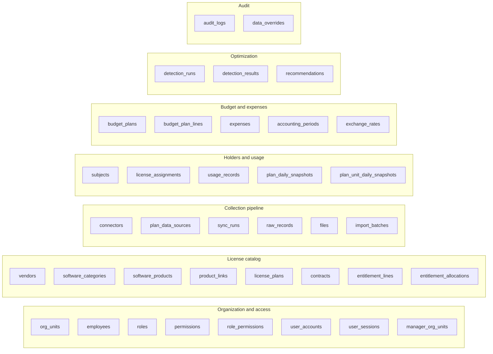

# Data model

> Design status: **TARGET**, nothing implemented yet. Source of truth: [`database/elms.dbml`](database/elms.dbml) (PostgreSQL). Column-level diagrams: [`database/er-diagram.md`](database/er-diagram.md).

37 tables in 7 groups and 19 enums. Decisions D1–D4 and conventions are at the top of the DBML file.

## 1. Table groups

## 2. Tables

### Organization and access

| Table | Purpose | References |
|---|---|---|
| `org_units` | P&Ls (subsidiaries) and their departments in one two-level tree (UC20). | `org_units` |
| `employees` | Directory of real employees (decision D2). An employee may have no account. | `org_units` |
| `roles` | The four fixed roles (BR-17). Seeded; UC21 changes the role of a user, not this list. | — |
| `permissions` | Catalogue of what can be granted: feature x (read / write) (UC22). Seeded. | — |
| `role_permissions` | Permission matrix; permissions belong to roles, never to single users (BR-17). | `permissions`, `roles`, `user_accounts` |
| `user_accounts` | Login accounts (UC19, UC21, UC24). Accounts are disabled, never deleted. | `employees`, `roles`, `user_accounts` |
| `user_sessions` | Server-side sessions, so disabling an account ends its open sessions at once (UC19, BR-18). | `user_accounts` |
| `manager_org_units` | Units a Manager is responsible for (UC20); the source of Manager data scope | `org_units`, `user_accounts` |

### License catalog

| Table | Purpose | References |
|---|---|---|
| `vendors` | Vendors / providers (UC02). App rule: a vendor with an active contract cannot be marked inactive. | `user_accounts` |
| `software_categories` | Category and subcategory in a two-level tree. Partial unique: category names are unique where parent_id is null. | `software_categories` |
| `software_products` | Software catalog (UC01), e.g. Microsoft 365. The "License" column of most | `software_categories`, `user_accounts`, `vendors` |
| `product_links` | Useful links of a product (UC01): policy, terms of service, admin portal. | `software_products` |
| `license_plans` | The unit everything else calls "a license" (decision D1): one tier of a | `software_products`, `user_accounts` |
| `contracts` | Contracts (UC04). A contract is active while ended_on is null; there is no | `files`, `user_accounts`, `vendors` |
| `entitlement_lines` | One purchase of a plan (UC03): quantity, validity, and price terms. | `contracts`, `import_batches`, `license_plans`, `sync_runs`, `user_accounts` |
| `entitlement_allocations` | Optional quota of a purchase per unit (decision D3); gives the "Purchased" | `entitlement_lines`, `org_units`, `user_accounts` |

### Collection pipeline

| Table | Purpose | References |
|---|---|---|
| `connectors` | One read-only connection to a provider. The Admin configuration screen is a | `vendors` |
| `plan_data_sources` | The one primary source of each kind of data for a plan (BR-14). | `connectors`, `license_plans` |
| `sync_runs` | One execution of a connector. A failed run writes no figures, so that day | `connectors` |
| `raw_records` | Raw provider data kept before normalization, so rules can change and be recomputed without calling the API again (A2). | `sync_runs` |
| `files` | Uploaded files: contract attachments, expense invoices (PDF or image, at most 10 MB, BR-10), and CSV import files. | `user_accounts` |
| `import_batches` | One CSV import by Staff: preview, then confirm (UC03, UC07). This is the | `files`, `license_plans`, `user_accounts` |

### Holders and usage

| Table | Purpose | References |
|---|---|---|
| `subjects` | Who or what uses a license on the provider side: a user account, a device, | `employees`, `org_units`, `vendors` |
| `license_assignments` | A holder of a plan: "Assigned" data read from the provider or entered by | `entitlement_lines`, `import_batches`, `license_plans`, `subjects`, `sync_runs`, `user_accounts` |
| `usage_records` | Usage per period for Concurrent, Metered, and Capacity plans, and aggregate | `import_batches`, `license_plans`, `subjects`, `sync_runs`, `user_accounts` |
| `plan_daily_snapshots` | Daily Purchased and cost per plan, kept by ELMS because providers give no | `license_plans` |
| `plan_unit_daily_snapshots` | Daily seat status per plan and department: every assigned seat has exactly | `license_plans`, `org_units` |

### Budget and expenses

| Table | Purpose | References |
|---|---|---|
| `budget_plans` | Yearly license budget of one unit (UC05, BR-08, decision D4): at most one | `org_units`, `user_accounts` |
| `budget_plan_lines` | Plan lines: the "Planned" level of the reconciliation chain Planned -> Purchased -> Assigned -> Used -> Actual cost (BR-09). | `budget_plans`, `license_plans` |
| `expenses` | Expenses and invoices (UC07): the "Actual cost" level of BR-09. The vendor | `expenses`, `files`, `import_batches`, `license_plans`, `org_units`, `sync_runs`, `user_accounts` |
| `accounting_periods` | Calendar months and whether they are closed. A closed month locks its | `user_accounts` |
| `exchange_rates` | Declared exchange rates (BR-05). Without a rate for a pair, amounts are shown per currency and never added (UC16). | `user_accounts` |

### Optimization

| Table | Purpose | References |
|---|---|---|
| `detection_runs` | One daily detection run (BR-12). | — |
| `detection_results` | Result of one check for one plan in one run: only the verdict is stored | `detection_runs`, `license_plans`, `org_units` |
| `recommendations` | Recommendations and their decision (UC14, BR-13): | `detection_results`, `license_plans`, `org_units`, `user_accounts` |

### Audit

| Table | Purpose | References |
|---|---|---|
| `audit_logs` | Append-only record of who changed what, with old value, new value, and time | `user_accounts` |
| `data_overrides` | Staff edit of a value that came from a connector (BR-14): the edit needs a | `user_accounts` |

## 3. Enums

| Enum | Values |
|---|---|
| `org_unit_type` | `pnl`, `department` |
| `employee_status` | `active`, `left` |
| `permission_action` | `read`, `write` |
| `data_source` | `api`, `log`, `import`, `manual` |
| `license_archetype` | `allocation`, `concurrent`, `metered`, `capacity` |
| `commercial_term` | `pay_as_you_go`, `monthly`, `yearly`, `multi_year`, `prepaid_credit`, `perpetual` |
| `data_kind` | `entitlement`, `assignment`, `usage`, `expense` |
| `usage_granularity` | `per_subject`, `aggregate` |
| `subject_type` | `user`, `device`, `project`, `api_key`, `other` |
| `usage_metric` | `active_subjects`, `peak_concurrent`, `denied_requests`, `consumption`, `deployed_units` |
| `sync_trigger` | `scheduled`, `manual`, `backfill` |
| `run_status` | `running`, `success`, `partial`, `failed` |
| `import_status` | `previewed`, `confirmed`, `rejected` |
| `budget_plan_status` | `draft`, `active` |
| `period_status` | `open`, `closed` |
| `detection_check` | `unused`, `inactive`, `overuse` |
| `detection_outcome` | `clear`, `flagged`, `not_evaluated` |
| `recommendation_type` | `reduce_seats`, `downgrade_plan`, `cancel`, `reassign` |
| `recommendation_status` | `proposed`, `accepted`, `rejected`, `done` |

## 4. Conventions the schema keeps

- PostgreSQL; surrogate keys are `bigint` identity columns.
- Money is `numeric(18,2)` with an ISO 4217 currency beside it. Amounts in different currencies are only added through `exchange_rates` (BR-05).
- Quantities are `numeric(20,4)` because one column serves seats, sessions, tokens, and cores.
- `NULL` means **Unknown** and is never read as 0 (BR-04). "Unlimited" is its own flag (`is_unlimited`).
- Master data is never deleted, only marked inactive or ended (BR-15), so no foreign key cascades on delete.
- Where a row has an end date, the date alone says whether it is active; there is no status column beside it.
- Each daily figure has one owner table: Purchased and cost in `plan_daily_snapshots`, seat counts in `plan_unit_daily_snapshots`, period usage in `usage_records`; `detection_results` stores only the verdict.
- Confidence (BR-14) is derived from the source, not stored: `api` or `log` per subject = high; `api` or `log` aggregate, or `import` = medium; `manual` = low.
- ELMS never writes to a provider (BR-01); nothing in this schema is written back.

## 5. Tables per backend module

Each backend module owns its tables (see [folder structure](05-folder-structure.md#4-backend)) and maps to one Postgres schema.

| Module | Schema | Tables |
|---|---|---|
| `identity` | `identity` | `roles`, `permissions`, `role_permissions`, `user_accounts`, `user_sessions` |
| `organization` | `org` | `org_units`, `employees`, `manager_org_units` |
| `catalog` | `catalog` | `vendors`, `software_categories`, `software_products`, `product_links`, `license_plans`, `contracts`, `entitlement_lines`, `entitlement_allocations` |
| `ingestion` | `ingestion` | `connectors`, `plan_data_sources`, `sync_runs`, `raw_records`, `files`, `import_batches` |
| `usage` | `usage` | `subjects`, `license_assignments`, `usage_records`, `plan_daily_snapshots`, `plan_unit_daily_snapshots` |
| `finance` | `finance` | `budget_plans`, `budget_plan_lines`, `expenses`, `accounting_periods`, `exchange_rates` |
| `optimization` | `optimization` | `detection_runs`, `detection_results`, `recommendations` |
| `audit` | `audit` | `audit_logs`, `data_overrides` |
| `analytics` | `—` | none; reads views over the tables above |
