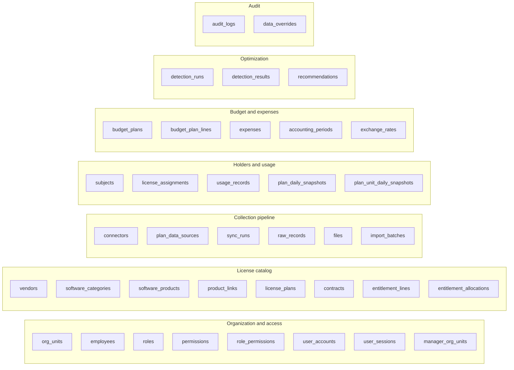

# Data model

> Design status: **TARGET**, nothing implemented yet. Source of truth: [`database/elms.dbml`](database/elms.dbml) (PostgreSQL).

37 tables in 7 groups and 19 enums. Decisions D1–D4 and conventions are at the top of the DBML file.

## 1. Table groups

## 2. Entity-relationship diagram

Every table, column, and relationship (label = foreign key column; `PK` primary key, `FK` foreign key, `UK` unique). Enum columns show the enum name as their type; values are in section 4.

```mermaid
erDiagram
    %% Organization and access
    org_units |o--o{ org_units : "parent_id"
    org_units |o--o{ employees : "org_unit_id"
    roles ||--o{ role_permissions : "role_id"
    permissions ||--o{ role_permissions : "permission_id"
    user_accounts |o--o{ role_permissions : "granted_by"
    employees ||--o| user_accounts : "employee_id"
    roles ||--o{ user_accounts : "role_id"
    user_accounts |o--o{ user_accounts : "created_by"
    user_accounts ||--o{ user_sessions : "user_account_id"
    user_accounts ||--o{ manager_org_units : "user_account_id"
    org_units ||--o{ manager_org_units : "org_unit_id"
    user_accounts |o--o{ manager_org_units : "assigned_by"
    %% License catalog
    user_accounts |o--o{ vendors : "created_by"
    software_categories |o--o{ software_categories : "parent_id"
    vendors ||--o{ software_products : "vendor_id"
    software_categories |o--o{ software_products : "category_id"
    user_accounts |o--o{ software_products : "created_by"
    software_products ||--o{ product_links : "product_id"
    software_products ||--o{ license_plans : "product_id"
    user_accounts |o--o{ license_plans : "created_by"
    vendors ||--o{ contracts : "vendor_id"
    files |o--o{ contracts : "attachment_file_id"
    user_accounts |o--o{ contracts : "created_by"
    license_plans ||--o{ entitlement_lines : "license_plan_id"
    contracts |o--o{ entitlement_lines : "contract_id"
    sync_runs |o--o{ entitlement_lines : "sync_run_id"
    import_batches |o--o{ entitlement_lines : "import_batch_id"
    user_accounts |o--o{ entitlement_lines : "created_by"
    entitlement_lines ||--o{ entitlement_allocations : "entitlement_line_id"
    org_units ||--o{ entitlement_allocations : "org_unit_id"
    user_accounts |o--o{ entitlement_allocations : "created_by"
    %% Collection pipeline
    vendors ||--o{ connectors : "vendor_id"
    license_plans ||--o{ plan_data_sources : "license_plan_id"
    connectors |o--o{ plan_data_sources : "connector_id"
    connectors ||--o{ sync_runs : "connector_id"
    sync_runs ||--o{ raw_records : "sync_run_id"
    user_accounts |o--o{ files : "uploaded_by"
    license_plans |o--o{ import_batches : "license_plan_id"
    files ||--o{ import_batches : "file_id"
    user_accounts ||--o{ import_batches : "imported_by"
    %% Holders and usage
    vendors ||--o{ subjects : "vendor_id"
    employees |o--o{ subjects : "employee_id"
    org_units |o--o{ subjects : "org_unit_id"
    license_plans ||--o{ license_assignments : "license_plan_id"
    subjects ||--o{ license_assignments : "subject_id"
    entitlement_lines |o--o{ license_assignments : "entitlement_line_id"
    sync_runs |o--o{ license_assignments : "sync_run_id"
    import_batches |o--o{ license_assignments : "import_batch_id"
    user_accounts |o--o{ license_assignments : "entered_by"
    license_plans ||--o{ usage_records : "license_plan_id"
    subjects |o--o{ usage_records : "subject_id"
    sync_runs |o--o{ usage_records : "sync_run_id"
    import_batches |o--o{ usage_records : "import_batch_id"
    user_accounts |o--o{ usage_records : "entered_by"
    license_plans ||--o{ plan_daily_snapshots : "license_plan_id"
    license_plans ||--o{ plan_unit_daily_snapshots : "license_plan_id"
    org_units |o--o{ plan_unit_daily_snapshots : "org_unit_id"
    %% Budget and expenses
    org_units ||--o{ budget_plans : "org_unit_id"
    user_accounts |o--o{ budget_plans : "activated_by"
    user_accounts ||--o{ budget_plans : "created_by"
    budget_plans ||--o{ budget_plan_lines : "budget_plan_id"
    license_plans ||--o{ budget_plan_lines : "license_plan_id"
    license_plans ||--o{ expenses : "license_plan_id"
    org_units |o--o{ expenses : "org_unit_id"
    files |o--o{ expenses : "invoice_file_id"
    expenses |o--o{ expenses : "corrects_expense_id"
    sync_runs |o--o{ expenses : "sync_run_id"
    import_batches |o--o{ expenses : "import_batch_id"
    user_accounts |o--o{ expenses : "created_by"
    user_accounts |o--o{ accounting_periods : "closed_by"
    user_accounts |o--o{ exchange_rates : "declared_by"
    %% Optimization
    detection_runs ||--o{ detection_results : "detection_run_id"
    license_plans ||--o{ detection_results : "license_plan_id"
    org_units |o--o{ detection_results : "org_unit_id"
    license_plans ||--o{ recommendations : "license_plan_id"
    license_plans |o--o{ recommendations : "target_plan_id"
    org_units |o--o{ recommendations : "org_unit_id"
    detection_results |o--o{ recommendations : "detection_result_id"
    user_accounts |o--o{ recommendations : "owner_id"
    user_accounts ||--o{ recommendations : "created_by"
    user_accounts |o--o{ recommendations : "decided_by"
    %% Audit
    user_accounts |o--o{ audit_logs : "actor_id"
    user_accounts ||--o{ data_overrides : "overridden_by"

    org_units {
        bigint id PK
        bigint parent_id FK
        org_unit_type unit_type
        varchar name
        data_source source
        varchar external_ref
        boolean is_active
        timestamptz created_at
        timestamptz updated_at
    }
    employees {
        bigint id PK
        varchar employee_code UK
        varchar full_name
        varchar email UK
        bigint org_unit_id FK
        employee_status status
        data_source source
        varchar external_ref
        timestamptz created_at
        timestamptz updated_at
    }
    roles {
        bigint id PK
        varchar code UK
        varchar name
        text description
    }
    permissions {
        bigint id PK
        varchar feature_code
        permission_action action
        text description
    }
    role_permissions {
        bigint role_id FK
        bigint permission_id FK
        bigint granted_by FK
        timestamptz granted_at
    }
    user_accounts {
        bigint id PK
        bigint employee_id FK,UK
        bigint role_id FK
        varchar password_hash
        int failed_login_count
        timestamptz locked_until
        timestamptz last_login_at
        timestamptz disabled_at
        bigint created_by FK
        timestamptz created_at
        timestamptz updated_at
    }
    user_sessions {
        bigint id PK
        bigint user_account_id FK
        char token_hash UK
        timestamptz created_at
        timestamptz last_seen_at
        timestamptz expires_at
        timestamptz revoked_at
        varchar ip_address
        text user_agent
    }
    manager_org_units {
        bigint user_account_id FK
        bigint org_unit_id FK
        bigint assigned_by FK
        timestamptz assigned_at
    }
    vendors {
        bigint id PK
        varchar name UK
        varchar website
        varchar support_contact
        data_source collection_method
        boolean is_active
        bigint created_by FK
        timestamptz created_at
        timestamptz updated_at
    }
    software_categories {
        bigint id PK
        bigint parent_id FK
        varchar name
    }
    software_products {
        bigint id PK
        bigint vendor_id FK
        bigint category_id FK
        varchar name
        text description
        boolean is_active
        bigint created_by FK
        timestamptz created_at
        timestamptz updated_at
    }
    product_links {
        bigint id PK
        bigint product_id FK
        varchar label
        varchar url
        int sort_order
    }
    license_plans {
        bigint id PK
        bigint product_id FK
        varchar name
        license_archetype archetype
        varchar unit
        text description
        boolean is_active
        bigint created_by FK
        timestamptz created_at
        timestamptz updated_at
    }
    contracts {
        bigint id PK
        bigint vendor_id FK
        varchar contract_no
        varchar title
        date start_date
        date renewal_date
        int notice_period_days
        boolean auto_renew
        numeric commitment_amount
        numeric total_value
        char currency
        date ended_on
        bigint attachment_file_id FK
        text notes
        bigint created_by FK
        timestamptz created_at
        timestamptz updated_at
    }
    entitlement_lines {
        bigint id PK
        bigint license_plan_id FK
        bigint contract_id FK
        numeric quantity
        boolean is_unlimited
        date valid_from
        date valid_to
        commercial_term commercial_term
        numeric unit_price
        char currency
        data_source source
        varchar external_ref
        bigint sync_run_id FK
        bigint import_batch_id FK
        bigint created_by FK
        timestamptz created_at
        timestamptz updated_at
    }
    entitlement_allocations {
        bigint id PK
        bigint entitlement_line_id FK
        bigint org_unit_id FK
        numeric quantity
        bigint created_by FK
        timestamptz created_at
        timestamptz updated_at
    }
    connectors {
        bigint id PK
        bigint vendor_id FK
        varchar name UK
        varchar connector_type
        varchar base_url
        text credentials_encrypted
        varchar schedule_cron
        boolean is_simulated
        boolean is_active
        timestamptz created_at
        timestamptz updated_at
    }
    plan_data_sources {
        bigint id PK
        bigint license_plan_id FK
        data_kind data_type
        data_source source_type
        bigint connector_id FK
        varchar external_ref
        usage_granularity granularity
        timestamptz created_at
        timestamptz updated_at
    }
    sync_runs {
        bigint id PK
        bigint connector_id FK
        sync_trigger trigger
        run_status status
        date data_date
        timestamptz window_start
        timestamptz window_end
        int records_read
        int records_written
        text error_message
        timestamptz started_at
        timestamptz finished_at
    }
    raw_records {
        bigint id PK
        bigint sync_run_id FK
        varchar record_type
        varchar external_id
        jsonb payload
        char payload_hash
        timestamptz fetched_at
        timestamptz normalized_at
    }
    files {
        bigint id PK
        varchar storage_key UK
        varchar original_name
        varchar content_type
        bigint size_bytes
        char checksum
        bigint uploaded_by FK
        timestamptz uploaded_at
    }
    import_batches {
        bigint id PK
        data_kind import_type
        bigint license_plan_id FK
        bigint file_id FK
        import_status status
        int rows_total
        int rows_added
        int rows_updated
        int rows_rejected
        jsonb error_report
        bigint imported_by FK
        timestamptz created_at
        timestamptz confirmed_at
    }
    subjects {
        bigint id PK
        bigint vendor_id FK
        subject_type subject_type
        varchar identifier
        varchar external_id
        varchar display_name
        bigint employee_id FK
        bigint org_unit_id FK
        boolean is_enabled
        data_source source
        timestamptz first_seen_at
        timestamptz last_seen_at
    }
    license_assignments {
        bigint id PK
        bigint license_plan_id FK
        bigint subject_id FK
        bigint entitlement_line_id FK
        date assigned_on
        date first_seen_on
        date ended_on
        timestamptz last_active_at
        data_source source
        bigint sync_run_id FK
        bigint import_batch_id FK
        bigint entered_by FK
        timestamptz created_at
        timestamptz updated_at
    }
    usage_records {
        bigint id PK
        bigint license_plan_id FK
        bigint subject_id FK
        usage_metric metric
        date period_start
        date period_end
        numeric quantity
        data_source source
        bigint sync_run_id FK
        bigint import_batch_id FK
        bigint entered_by FK
        timestamptz created_at
        timestamptz updated_at
    }
    plan_daily_snapshots {
        date snapshot_date
        bigint license_plan_id FK
        numeric purchased_qty
        boolean is_unlimited
        numeric effective_monthly_cost
        char currency
        timestamptz created_at
    }
    plan_unit_daily_snapshots {
        bigint id PK
        date snapshot_date
        bigint license_plan_id FK
        bigint org_unit_id FK
        int assigned_count
        int active_count
        int inactive_count
        int no_activity_count
        int not_monitored_count
        numeric used_qty
        timestamptz created_at
    }
    budget_plans {
        bigint id PK
        bigint org_unit_id FK
        int fiscal_year
        numeric budget_amount
        char currency
        text note
        budget_plan_status status
        timestamptz activated_at
        bigint activated_by FK
        bigint created_by FK
        timestamptz created_at
        timestamptz updated_at
    }
    budget_plan_lines {
        bigint id PK
        bigint budget_plan_id FK
        bigint license_plan_id FK
        numeric planned_quantity
        numeric planned_cost
        text note
        timestamptz created_at
        timestamptz updated_at
    }
    expenses {
        bigint id PK
        date expense_date
        numeric amount
        char currency
        bigint license_plan_id FK
        bigint org_unit_id FK
        text description
        bigint invoice_file_id FK
        bigint corrects_expense_id FK
        data_source source
        varchar external_ref
        bigint sync_run_id FK
        bigint import_batch_id FK
        bigint created_by FK
        timestamptz created_at
        timestamptz updated_at
    }
    accounting_periods {
        bigint id PK
        int fiscal_year
        int period_year
        int period_month
        period_status status
        timestamptz closed_at
        bigint closed_by FK
    }
    exchange_rates {
        bigint id PK
        char from_currency
        char to_currency
        numeric rate
        date effective_from
        bigint declared_by FK
        timestamptz created_at
    }
    detection_runs {
        bigint id PK
        date data_date
        int inactivity_threshold_days
        run_status status
        timestamptz started_at
        timestamptz finished_at
    }
    detection_results {
        bigint id PK
        bigint detection_run_id FK
        bigint license_plan_id FK
        bigint org_unit_id FK
        detection_check check_type
        detection_outcome outcome
        numeric flagged_qty
        numeric monthly_cost
        char currency
        date flagged_since
        timestamptz created_at
    }
    recommendations {
        bigint id PK
        bigint license_plan_id FK
        bigint target_plan_id FK
        bigint org_unit_id FK
        bigint detection_result_id FK
        recommendation_type type
        varchar title
        text description
        jsonb evidence
        numeric affected_qty
        numeric estimated_yearly_saving
        numeric actual_saving
        char currency
        recommendation_status status
        text rejection_reason
        date earliest_action_date
        date due_date
        bigint owner_id FK
        bigint created_by FK
        bigint decided_by FK
        timestamptz decided_at
        timestamptz done_at
        timestamptz created_at
        timestamptz updated_at
    }
    audit_logs {
        bigint id PK
        bigint actor_id FK
        varchar action
        varchar entity_type
        bigint entity_id
        jsonb old_values
        jsonb new_values
        text reason
        varchar ip_address
        timestamptz occurred_at
    }
    data_overrides {
        bigint id PK
        varchar entity_type
        bigint entity_id
        varchar field_name
        text original_value
        text override_value
        text reason
        bigint overridden_by FK
        timestamptz overridden_at
        timestamptz reverted_at
    }
```

## 3. Table specifications

### Organization and access

#### 1. Table `org_units`

P&Ls (subsidiaries) and their departments in one two-level tree (UC20).

- `id`: `BIGINT PRIMARY KEY GENERATED ALWAYS AS IDENTITY`
- `parent_id`: `BIGINT NULL REFERENCES org_units(id)` — NULL for a P&L; the owning P&L for a department
- `unit_type`: `ORG_UNIT_TYPE NOT NULL` (`pnl`, `department`)
- `name`: `VARCHAR(200) NOT NULL`
- `source`: `DATA_SOURCE NOT NULL DEFAULT 'manual'` (`api`, `log`, `import`, `manual`) — import = loaded from HR data; the name is then read-only (UC20)
- `external_ref`: `VARCHAR(200) NULL` — Key of the unit in the HR source, if imported
- `is_active`: `BOOLEAN NOT NULL DEFAULT true`
- `created_at`: `TIMESTAMPTZ NOT NULL DEFAULT now()`
- `updated_at`: `TIMESTAMPTZ NOT NULL DEFAULT now()`
- **Index:** `(parent_id, name) [unique, name: 'uq_org_units_parent_name']`
- **Index:** `unit_type`
- **Check:** `(unit_type = 'pnl' and parent_id is null) or (unit_type = 'department' and parent_id is not null) [name: 'chk_org_units_two_levels']`

#### 2. Table `employees`

Directory of real employees (decision D2). An employee may have no account.

- `id`: `BIGINT PRIMARY KEY GENERATED ALWAYS AS IDENTITY`
- `employee_code`: `VARCHAR(50) NULL UNIQUE` — HR code, if known
- `full_name`: `VARCHAR(200) NOT NULL`
- `email`: `VARCHAR(320) NOT NULL UNIQUE` — Company email, stored lowercase; the matching key for accounts and provider identities
- `org_unit_id`: `BIGINT NULL REFERENCES org_units(id)` — Department (or P&L when no department). NULL = Unknown department (BR-06)
- `status`: `EMPLOYEE_STATUS NOT NULL DEFAULT 'active'` (`active`, `left`)
- `source`: `DATA_SOURCE NOT NULL DEFAULT 'manual'` (`api`, `log`, `import`, `manual`)
- `external_ref`: `VARCHAR(200) NULL` — Key of the person in the HR or IdP source
- `created_at`: `TIMESTAMPTZ NOT NULL DEFAULT now()`
- `updated_at`: `TIMESTAMPTZ NOT NULL DEFAULT now()`
- **Index:** `org_unit_id`

#### 3. Table `roles`

The four fixed roles (BR-17). Seeded; UC21 changes the role of a user, not this list.

- `id`: `BIGINT PRIMARY KEY GENERATED ALWAYS AS IDENTITY`
- `code`: `VARCHAR(30) NOT NULL UNIQUE` — ADMIN, MANAGER, STAFF, EMPLOYEE
- `name`: `VARCHAR(100) NOT NULL`
- `description`: `TEXT NULL`

#### 4. Table `permissions`

Catalogue of what can be granted: feature x (read | write) (UC22). Seeded.

- `id`: `BIGINT PRIMARY KEY GENERATED ALWAYS AS IDENTITY`
- `feature_code`: `VARCHAR(60) NOT NULL` — One per row of the role x feature matrix, e.g. contracts, expenses, budget_plan, recommendations
- `action`: `PERMISSION_ACTION NOT NULL` (`read`, `write`)
- `description`: `TEXT NULL`
- **Index:** `(feature_code, action) [unique, name: 'uq_permissions_feature_action']`

#### 5. Table `role_permissions`

Permission matrix; permissions belong to roles, never to single users (BR-17).

- `role_id`: `BIGINT NOT NULL REFERENCES roles(id)`
- `permission_id`: `BIGINT NOT NULL REFERENCES permissions(id)`
- `granted_by`: `BIGINT NULL REFERENCES user_accounts(id)`
- `granted_at`: `TIMESTAMPTZ NOT NULL DEFAULT now()`
- **Index:** `(role_id, permission_id) [pk]`

#### 6. Table `user_accounts`

Login accounts (UC19, UC21, UC24). Accounts are disabled, never deleted.

- `id`: `BIGINT PRIMARY KEY GENERATED ALWAYS AS IDENTITY`
- `employee_id`: `BIGINT NOT NULL UNIQUE REFERENCES employees(id)` — Every account belongs to one employee; login email = employees.email
- `role_id`: `BIGINT NOT NULL REFERENCES roles(id)` — Exactly one role per account (BR-17)
- `password_hash`: `VARCHAR(255) NULL` — Hashed, never plain (BR-18). NULL until a first password is set; login is refused
- `failed_login_count`: `INT NOT NULL DEFAULT 0` — Consecutive failures; reset on success
- `locked_until`: `TIMESTAMPTZ NULL` — Set to now + 15 minutes after 5 failures in a row (BR-18)
- `last_login_at`: `TIMESTAMPTZ NULL`
- `disabled_at`: `TIMESTAMPTZ NULL` — NULL = active. Set = disabled: cannot log in and open sessions are revoked (UC19); cleared on re-enable
- `created_by`: `BIGINT NULL REFERENCES user_accounts(id)`
- `created_at`: `TIMESTAMPTZ NOT NULL DEFAULT now()`
- `updated_at`: `TIMESTAMPTZ NOT NULL DEFAULT now()`
- **Index:** `role_id`
- **Check:** `failed_login_count >= 0 [name: 'chk_user_accounts_failed_count']`

#### 7. Table `user_sessions`

Server-side sessions, so disabling an account ends its open sessions at once (UC19, BR-18).

- `id`: `BIGINT PRIMARY KEY GENERATED ALWAYS AS IDENTITY`
- `user_account_id`: `BIGINT NOT NULL REFERENCES user_accounts(id)`
- `token_hash`: `CHAR(64) NOT NULL UNIQUE` — SHA-256 of the session id kept in the HttpOnly, Secure cookie
- `created_at`: `TIMESTAMPTZ NOT NULL DEFAULT now()`
- `last_seen_at`: `TIMESTAMPTZ NULL`
- `expires_at`: `TIMESTAMPTZ NOT NULL`
- `revoked_at`: `TIMESTAMPTZ NULL` — Set on logout, on disable, and on role change
- `ip_address`: `VARCHAR(45) NULL`
- `user_agent`: `TEXT NULL`
- **Index:** `user_account_id`
- **Index:** `expires_at`

#### 8. Table `manager_org_units`

Units a Manager is responsible for (UC20); the source of Manager data scope

- `user_account_id`: `BIGINT NOT NULL REFERENCES user_accounts(id)`
- `org_unit_id`: `BIGINT NOT NULL REFERENCES org_units(id)`
- `assigned_by`: `BIGINT NULL REFERENCES user_accounts(id)`
- `assigned_at`: `TIMESTAMPTZ NOT NULL DEFAULT now()`
- **Index:** `(user_account_id, org_unit_id) [pk]`
- **Index:** `org_unit_id`

### License catalog

#### 9. Table `vendors`

Vendors / providers (UC02). App rule: a vendor with an active contract cannot be marked inactive.

- `id`: `BIGINT PRIMARY KEY GENERATED ALWAYS AS IDENTITY`
- `name`: `VARCHAR(200) NOT NULL UNIQUE`
- `website`: `VARCHAR(500) NULL`
- `support_contact`: `VARCHAR(500) NULL`
- `collection_method`: `DATA_SOURCE NOT NULL DEFAULT 'manual'` (`api`, `log`, `import`, `manual`) — How this vendor data is normally collected (UC02)
- `is_active`: `BOOLEAN NOT NULL DEFAULT true`
- `created_by`: `BIGINT NULL REFERENCES user_accounts(id)`
- `created_at`: `TIMESTAMPTZ NOT NULL DEFAULT now()`
- `updated_at`: `TIMESTAMPTZ NOT NULL DEFAULT now()`

#### 10. Table `software_categories`

Category and subcategory in a two-level tree. Partial unique: category names are unique where parent_id is null.

- `id`: `BIGINT PRIMARY KEY GENERATED ALWAYS AS IDENTITY`
- `parent_id`: `BIGINT NULL REFERENCES software_categories(id)` — NULL = category; set = subcategory of that category
- `name`: `VARCHAR(100) NOT NULL`
- **Index:** `(parent_id, name) [unique, name: 'uq_software_categories_parent_name']`

#### 11. Table `software_products`

Software catalog (UC01), e.g. Microsoft 365. The "License" column of most

- `id`: `BIGINT PRIMARY KEY GENERATED ALWAYS AS IDENTITY`
- `vendor_id`: `BIGINT NOT NULL REFERENCES vendors(id)`
- `category_id`: `BIGINT NULL REFERENCES software_categories(id)` — Most specific node (subcategory if any). NULL is shown as Uncategorized
- `name`: `VARCHAR(200) NOT NULL`
- `description`: `TEXT NULL`
- `is_active`: `BOOLEAN NOT NULL DEFAULT true`
- `created_by`: `BIGINT NULL REFERENCES user_accounts(id)`
- `created_at`: `TIMESTAMPTZ NOT NULL DEFAULT now()`
- `updated_at`: `TIMESTAMPTZ NOT NULL DEFAULT now()`
- **Index:** `(vendor_id, name) [unique, name: 'uq_software_products_vendor_name']`
- **Index:** `category_id`

#### 12. Table `product_links`

Useful links of a product (UC01): policy, terms of service, admin portal.

- `id`: `BIGINT PRIMARY KEY GENERATED ALWAYS AS IDENTITY`
- `product_id`: `BIGINT NOT NULL REFERENCES software_products(id)`
- `label`: `VARCHAR(100) NOT NULL`
- `url`: `VARCHAR(1000) NOT NULL`
- `sort_order`: `INT NOT NULL DEFAULT 0`
- **Index:** `product_id`

#### 13. Table `license_plans`

The unit everything else calls "a license" (decision D1): one tier of a

- `id`: `BIGINT PRIMARY KEY GENERATED ALWAYS AS IDENTITY`
- `product_id`: `BIGINT NOT NULL REFERENCES software_products(id)`
- `name`: `VARCHAR(200) NOT NULL` — Tier / SKU name, e.g. E3, E5, Business, API pay-as-you-go
- `archetype`: `LICENSE_ARCHETYPE NOT NULL` (`allocation`, `concurrent`, `metered`, `capacity`) — Measurement archetype (BR-02); every entitlement line of the plan inherits it
- `unit`: `VARCHAR(30) NOT NULL` — What is counted: seat, device, slot, token, credit, GB, core ...
- `description`: `TEXT NULL`
- `is_active`: `BOOLEAN NOT NULL DEFAULT true`
- `created_by`: `BIGINT NULL REFERENCES user_accounts(id)`
- `created_at`: `TIMESTAMPTZ NOT NULL DEFAULT now()`
- `updated_at`: `TIMESTAMPTZ NOT NULL DEFAULT now()`
- **Index:** `(product_id, name) [unique, name: 'uq_license_plans_product_name']`
- **Index:** `archetype`

#### 14. Table `contracts`

Contracts (UC04). A contract is active while ended_on is null; there is no

- `id`: `BIGINT PRIMARY KEY GENERATED ALWAYS AS IDENTITY`
- `vendor_id`: `BIGINT NOT NULL REFERENCES vendors(id)`
- `contract_no`: `VARCHAR(100) NULL` — Number on the vendor paper, if any
- `title`: `VARCHAR(200) NOT NULL`
- `start_date`: `DATE NOT NULL`
- `renewal_date`: `DATE NULL`
- `notice_period_days`: `INT NOT NULL DEFAULT 0`
- `auto_renew`: `BOOLEAN NOT NULL DEFAULT false`
- `commitment_amount`: `NUMERIC(18,2) NULL` — Minimum commitment of the agreement, if any
- `total_value`: `NUMERIC(18,2) NULL`
- `currency`: `CHAR(3) NULL`
- `ended_on`: `DATE NULL` — NULL = active. Set by "mark ended" (UC04)
- `attachment_file_id`: `BIGINT NULL REFERENCES files(id)`
- `notes`: `TEXT NULL`
- `created_by`: `BIGINT NULL REFERENCES user_accounts(id)`
- `created_at`: `TIMESTAMPTZ NOT NULL DEFAULT now()`
- `updated_at`: `TIMESTAMPTZ NOT NULL DEFAULT now()`
- **Index:** `(vendor_id, contract_no) [unique, name: 'uq_contracts_vendor_no']`
- **Index:** `renewal_date`
- **Index:** `ended_on`
- **Check:** `renewal_date is null or renewal_date >= start_date [name: 'chk_contracts_renewal_after_start']`
- **Check:** `ended_on is null or ended_on >= start_date [name: 'chk_contracts_ended_after_start']`
- **Check:** `notice_period_days >= 0 [name: 'chk_contracts_notice_period']`
- **Check:** `(total_value is null and commitment_amount is null) or currency is not null [name: 'chk_contracts_currency']`

#### 15. Table `entitlement_lines`

One purchase of a plan (UC03): quantity, validity, and price terms.

- `id`: `BIGINT PRIMARY KEY GENERATED ALWAYS AS IDENTITY`
- `license_plan_id`: `BIGINT NOT NULL REFERENCES license_plans(id)`
- `contract_id`: `BIGINT NULL REFERENCES contracts(id)` — Contract covering this line; one FK means a line is never under two contracts (UC04)
- `quantity`: `NUMERIC(20,4) NULL` — Purchased quantity or quota. NULL = Unknown, unless is_unlimited
- `is_unlimited`: `BOOLEAN NOT NULL DEFAULT false` — True for a line bought without a quota (e.g. metered pay-as-you-go): quantity is NULL and the line can never be over-used (BR-07)
- `valid_from`: `DATE NOT NULL`
- `valid_to`: `DATE NULL` — NULL = open-ended (perpetual). "End a line" (UC03) sets this date
- `commercial_term`: `COMMERCIAL_TERM NOT NULL` (`pay_as_you_go`, `monthly`, `yearly`, `multi_year`, `prepaid_credit`, `perpetual`) — The one field for how the line is paid (BR-02); it also fixes the period of unit_price
- `unit_price`: `NUMERIC(18,4) NULL` — Price of one unit for the period of the commercial term (see table note). NULL = Unknown
- `currency`: `CHAR(3) NOT NULL`
- `source`: `DATA_SOURCE NOT NULL DEFAULT 'manual'` (`api`, `log`, `import`, `manual`) — Source of quantity and validity (BR-14); prices always come from Staff
- `external_ref`: `VARCHAR(200) NULL` — Subscription id at the provider, if synced
- `sync_run_id`: `BIGINT NULL REFERENCES sync_runs(id)`
- `import_batch_id`: `BIGINT NULL REFERENCES import_batches(id)`
- `created_by`: `BIGINT NULL REFERENCES user_accounts(id)`
- `created_at`: `TIMESTAMPTZ NOT NULL DEFAULT now()`
- `updated_at`: `TIMESTAMPTZ NOT NULL DEFAULT now()`
- **Index:** `license_plan_id`
- **Index:** `contract_id`
- **Index:** `(valid_from, valid_to)`
- **Check:** `quantity is null or quantity >= 0 [name: 'chk_entitlement_lines_quantity']`
- **Check:** `not is_unlimited or quantity is null [name: 'chk_entitlement_lines_unlimited']`
- **Check:** `valid_to is null or valid_to >= valid_from [name: 'chk_entitlement_lines_validity']`
- **Check:** `unit_price is null or unit_price >= 0 [name: 'chk_entitlement_lines_unit_price']`

#### 16. Table `entitlement_allocations`

Optional quota of a purchase per unit (decision D3); gives the "Purchased"

- `id`: `BIGINT PRIMARY KEY GENERATED ALWAYS AS IDENTITY`
- `entitlement_line_id`: `BIGINT NOT NULL REFERENCES entitlement_lines(id)`
- `org_unit_id`: `BIGINT NOT NULL REFERENCES org_units(id)`
- `quantity`: `NUMERIC(20,4) NOT NULL`
- `created_by`: `BIGINT NULL REFERENCES user_accounts(id)`
- `created_at`: `TIMESTAMPTZ NOT NULL DEFAULT now()`
- `updated_at`: `TIMESTAMPTZ NOT NULL DEFAULT now()`
- **Index:** `(entitlement_line_id, org_unit_id) [unique, name: 'uq_entitlement_allocations_line_unit']`
- **Index:** `org_unit_id`
- **Check:** `quantity > 0 [name: 'chk_entitlement_allocations_quantity']`

### Collection pipeline

#### 17. Table `connectors`

One read-only connection to a provider. The Admin configuration screen is a

- `id`: `BIGINT PRIMARY KEY GENERATED ALWAYS AS IDENTITY`
- `vendor_id`: `BIGINT NOT NULL REFERENCES vendors(id)`
- `name`: `VARCHAR(200) NOT NULL UNIQUE`
- `connector_type`: `VARCHAR(60) NOT NULL` — Implementation key, e.g. ms_graph, license_server_log; it also says whether the connector reads an API or a log
- `base_url`: `VARCHAR(500) NULL`
- `credentials_encrypted`: `TEXT NULL` — Encrypted at rest; read-only scopes only (A8)
- `schedule_cron`: `VARCHAR(100) NOT NULL DEFAULT '0 2 * * *'` — Daily by default (A1)
- `is_simulated`: `BOOLEAN NOT NULL DEFAULT false` — True when the connector reads a fake provider, so figures are not presented as real (A9)
- `is_active`: `BOOLEAN NOT NULL DEFAULT true`
- `created_at`: `TIMESTAMPTZ NOT NULL DEFAULT now()`
- `updated_at`: `TIMESTAMPTZ NOT NULL DEFAULT now()`
- **Index:** `vendor_id`

#### 18. Table `plan_data_sources`

The one primary source of each kind of data for a plan (BR-14).

- `id`: `BIGINT PRIMARY KEY GENERATED ALWAYS AS IDENTITY`
- `license_plan_id`: `BIGINT NOT NULL REFERENCES license_plans(id)`
- `data_type`: `DATA_KIND NOT NULL` (`entitlement`, `assignment`, `usage`, `expense`)
- `source_type`: `DATA_SOURCE NOT NULL` (`api`, `log`, `import`, `manual`) — Stamped as source on every row collected for this plan and kind of data
- `connector_id`: `BIGINT NULL REFERENCES connectors(id)` — Required when source_type is api or log
- `external_ref`: `VARCHAR(200) NULL` — Key of the plan at the provider, e.g. Microsoft Graph skuId
- `granularity`: `USAGE_GRANULARITY NULL` (`per_subject`, `aggregate`) — For usage: per subject or aggregate only
- `created_at`: `TIMESTAMPTZ NOT NULL DEFAULT now()`
- `updated_at`: `TIMESTAMPTZ NOT NULL DEFAULT now()`
- **Index:** `(license_plan_id, data_type) [unique, name: 'uq_plan_data_sources_plan_type']`
- **Index:** `connector_id`
- **Check:** `(source_type in ('api', 'log')) = (connector_id is not null) [name: 'chk_plan_data_sources_connector']`

#### 19. Table `sync_runs`

One execution of a connector. A failed run writes no figures, so that day

- `id`: `BIGINT PRIMARY KEY GENERATED ALWAYS AS IDENTITY`
- `connector_id`: `BIGINT NOT NULL REFERENCES connectors(id)`
- `trigger`: `SYNC_TRIGGER NOT NULL DEFAULT 'scheduled'` (`scheduled`, `manual`, `backfill`)
- `status`: `RUN_STATUS NOT NULL DEFAULT 'running'` (`running`, `success`, `partial`, `failed`)
- `data_date`: `DATE NOT NULL` — The day the collected figures describe (reports lag 1-2 days)
- `window_start`: `TIMESTAMPTZ NULL` — Incremental window (A3)
- `window_end`: `TIMESTAMPTZ NULL`
- `records_read`: `INT NOT NULL DEFAULT 0`
- `records_written`: `INT NOT NULL DEFAULT 0`
- `error_message`: `TEXT NULL`
- `started_at`: `TIMESTAMPTZ NOT NULL DEFAULT now()`
- `finished_at`: `TIMESTAMPTZ NULL`
- **Index:** `(connector_id, data_date)`
- **Index:** `status`

#### 20. Table `raw_records`

Raw provider data kept before normalization, so rules can change and be recomputed without calling the API again (A2).

- `id`: `BIGINT PRIMARY KEY GENERATED ALWAYS AS IDENTITY`
- `sync_run_id`: `BIGINT NOT NULL REFERENCES sync_runs(id)`
- `record_type`: `VARCHAR(60) NOT NULL` — Provider object, e.g. subscribedSku, user, activeUserDetail
- `external_id`: `VARCHAR(200) NULL`
- `payload`: `JSONB NOT NULL`
- `payload_hash`: `CHAR(64) NOT NULL` — SHA-256 of the payload, to skip unchanged records
- `fetched_at`: `TIMESTAMPTZ NOT NULL DEFAULT now()`
- `normalized_at`: `TIMESTAMPTZ NULL` — NULL until normalized into the tables below
- **Index:** `(sync_run_id, record_type)`
- **Index:** `(record_type, external_id)`

#### 21. Table `files`

Uploaded files: contract attachments, expense invoices (PDF or image, at most 10 MB, BR-10), and CSV import files.

- `id`: `BIGINT PRIMARY KEY GENERATED ALWAYS AS IDENTITY`
- `storage_key`: `VARCHAR(500) NOT NULL UNIQUE` — Path or object key in file storage; the bytes are not in the database
- `original_name`: `VARCHAR(255) NOT NULL`
- `content_type`: `VARCHAR(100) NOT NULL`
- `size_bytes`: `BIGINT NOT NULL`
- `checksum`: `CHAR(64) NULL`
- `uploaded_by`: `BIGINT NULL REFERENCES user_accounts(id)`
- `uploaded_at`: `TIMESTAMPTZ NOT NULL DEFAULT now()`
- **Check:** `size_bytes > 0 [name: 'chk_files_size']`

#### 22. Table `import_batches`

One CSV import by Staff: preview, then confirm (UC03, UC07). This is the

- `id`: `BIGINT PRIMARY KEY GENERATED ALWAYS AS IDENTITY`
- `import_type`: `DATA_KIND NOT NULL` (`entitlement`, `assignment`, `usage`, `expense`)
- `license_plan_id`: `BIGINT NULL REFERENCES license_plans(id)` — Set for assignment and usage imports, which target one plan
- `file_id`: `BIGINT NOT NULL REFERENCES files(id)`
- `status`: `IMPORT_STATUS NOT NULL DEFAULT 'previewed'` (`previewed`, `confirmed`, `rejected`)
- `rows_total`: `INT NOT NULL DEFAULT 0`
- `rows_added`: `INT NOT NULL DEFAULT 0`
- `rows_updated`: `INT NOT NULL DEFAULT 0`
- `rows_rejected`: `INT NOT NULL DEFAULT 0`
- `error_report`: `JSONB NULL` — Rejected rows with their errors
- `imported_by`: `BIGINT NOT NULL REFERENCES user_accounts(id)`
- `created_at`: `TIMESTAMPTZ NOT NULL DEFAULT now()`
- `confirmed_at`: `TIMESTAMPTZ NULL`
- **Index:** `(import_type, created_at)`
- **Index:** `license_plan_id`

### Holders and usage

#### 23. Table `subjects`

Who or what uses a license on the provider side: a user account, a device,

- `id`: `BIGINT PRIMARY KEY GENERATED ALWAYS AS IDENTITY`
- `vendor_id`: `BIGINT NOT NULL REFERENCES vendors(id)`
- `subject_type`: `SUBJECT_TYPE NOT NULL DEFAULT 'user'` (`user`, `device`, `project`, `api_key`, `other`)
- `identifier`: `VARCHAR(320) NOT NULL` — Provider identity, lowercase: email / userPrincipalName, device name, project, key label
- `external_id`: `VARCHAR(200) NULL` — Immutable id at the provider, if any
- `display_name`: `VARCHAR(200) NULL`
- `employee_id`: `BIGINT NULL REFERENCES employees(id)` — Matched by company email. NULL = not matched: shown with the provider identity and Unknown department
- `org_unit_id`: `BIGINT NULL REFERENCES org_units(id)` — Only for non-person subjects (project, key, device pool) whose department is known (UC06)
- `is_enabled`: `BOOLEAN NULL` — Account enabled at the provider; NULL = Unknown
- `source`: `DATA_SOURCE NOT NULL` (`api`, `log`, `import`, `manual`)
- `first_seen_at`: `TIMESTAMPTZ NOT NULL DEFAULT now()`
- `last_seen_at`: `TIMESTAMPTZ NOT NULL DEFAULT now()`
- **Index:** `(vendor_id, subject_type, identifier) [unique, name: 'uq_subjects_vendor_type_identifier']`
- **Index:** `employee_id`
- **Index:** `org_unit_id`

#### 24. Table `license_assignments`

A holder of a plan: "Assigned" data read from the provider or entered by

- `id`: `BIGINT PRIMARY KEY GENERATED ALWAYS AS IDENTITY`
- `license_plan_id`: `BIGINT NOT NULL REFERENCES license_plans(id)`
- `subject_id`: `BIGINT NOT NULL REFERENCES subjects(id)`
- `entitlement_line_id`: `BIGINT NULL REFERENCES entitlement_lines(id)` — Purchase the seat belongs to. Set on Staff entry (holders are added on a line, UC03) and by a sync when the plan has one active line. NULL = not known: the provider pools the seats of several purchases
- `assigned_on`: `DATE NULL` — Assigned date reported by the provider or entered by Staff; NULL = Unknown
- `first_seen_on`: `DATE NOT NULL` — First day ELMS saw the assignment
- `ended_on`: `DATE NULL` — NULL = currently assigned
- `last_active_at`: `TIMESTAMPTZ NULL` — Last recorded activity; NULL = no activity recorded
- `source`: `DATA_SOURCE NOT NULL` (`api`, `log`, `import`, `manual`)
- `sync_run_id`: `BIGINT NULL REFERENCES sync_runs(id)`
- `import_batch_id`: `BIGINT NULL REFERENCES import_batches(id)`
- `entered_by`: `BIGINT NULL REFERENCES user_accounts(id)`
- `created_at`: `TIMESTAMPTZ NOT NULL DEFAULT now()`
- `updated_at`: `TIMESTAMPTZ NOT NULL DEFAULT now()`
- **Index:** `(license_plan_id, subject_id)`
- **Index:** `subject_id`
- **Index:** `(license_plan_id, ended_on)`
- **Index:** `entitlement_line_id`
- **Index:** `last_active_at`
- **Check:** `ended_on is null or ended_on >= first_seen_on [name: 'chk_license_assignments_dates']`

#### 25. Table `usage_records`

Usage per period for Concurrent, Metered, and Capacity plans, and aggregate

- `id`: `BIGINT PRIMARY KEY GENERATED ALWAYS AS IDENTITY`
- `license_plan_id`: `BIGINT NOT NULL REFERENCES license_plans(id)`
- `subject_id`: `BIGINT NULL REFERENCES subjects(id)` — NULL = aggregate figure for the whole plan
- `metric`: `USAGE_METRIC NOT NULL` (`active_subjects`, `peak_concurrent`, `denied_requests`, `consumption`, `deployed_units`)
- `period_start`: `DATE NOT NULL`
- `period_end`: `DATE NOT NULL`
- `quantity`: `NUMERIC(20,4) NOT NULL`
- `source`: `DATA_SOURCE NOT NULL` (`api`, `log`, `import`, `manual`)
- `sync_run_id`: `BIGINT NULL REFERENCES sync_runs(id)`
- `import_batch_id`: `BIGINT NULL REFERENCES import_batches(id)`
- `entered_by`: `BIGINT NULL REFERENCES user_accounts(id)`
- `created_at`: `TIMESTAMPTZ NOT NULL DEFAULT now()`
- `updated_at`: `TIMESTAMPTZ NOT NULL DEFAULT now()`
- **Index:** `(license_plan_id, subject_id, metric, period_start, period_end) [unique, name: 'uq_usage_records_period']`
- **Index:** `(license_plan_id, metric, period_start)`
- **Index:** `subject_id`
- **Check:** `period_end >= period_start [name: 'chk_usage_records_period']`
- **Check:** `quantity >= 0 [name: 'chk_usage_records_quantity']`

#### 26. Table `plan_daily_snapshots`

Daily Purchased and cost per plan, kept by ELMS because providers give no

- `snapshot_date`: `DATE NOT NULL`
- `license_plan_id`: `BIGINT NOT NULL REFERENCES license_plans(id)`
- `purchased_qty`: `NUMERIC(20,4) NULL` — Sum of the entitlement lines active that day; NULL = Unknown, unless is_unlimited
- `is_unlimited`: `BOOLEAN NOT NULL DEFAULT false` — True when an active line of the plan is unlimited; purchased_qty is then NULL
- `effective_monthly_cost`: `NUMERIC(18,2) NULL` — BR-05; NULL = Unknown
- `currency`: `CHAR(3) NULL`
- `created_at`: `TIMESTAMPTZ NOT NULL DEFAULT now()`
- **Index:** `(snapshot_date, license_plan_id) [pk]`
- **Index:** `license_plan_id`
- **Check:** `not is_unlimited or purchased_qty is null [name: 'chk_plan_daily_snapshots_unlimited']`

#### 27. Table `plan_unit_daily_snapshots`

Daily seat status per plan and department: every assigned seat has exactly

- `id`: `BIGINT PRIMARY KEY GENERATED ALWAYS AS IDENTITY`
- `snapshot_date`: `DATE NOT NULL`
- `license_plan_id`: `BIGINT NOT NULL REFERENCES license_plans(id)`
- `org_unit_id`: `BIGINT NULL REFERENCES org_units(id)` — Department of the holders; NULL = Unknown department
- `assigned_count`: `INT NOT NULL DEFAULT 0`
- `active_count`: `INT NOT NULL DEFAULT 0`
- `inactive_count`: `INT NOT NULL DEFAULT 0`
- `no_activity_count`: `INT NOT NULL DEFAULT 0`
- `not_monitored_count`: `INT NOT NULL DEFAULT 0`
- `used_qty`: `NUMERIC(20,4) NULL` — Non-seat plans: consumption or peak attributed to the unit; NULL = Unknown
- `created_at`: `TIMESTAMPTZ NOT NULL DEFAULT now()`
- **Index:** `(snapshot_date, license_plan_id, org_unit_id) [unique, name: 'uq_plan_unit_daily_snapshots']`
- **Index:** `(license_plan_id, snapshot_date)`
- **Index:** `(org_unit_id, snapshot_date)`
- **Check:** `assigned_count = active_count + inactive_count + no_activity_count + not_monitored_count [name: 'chk_plan_unit_daily_snapshots_sum']`

### Budget and expenses

#### 28. Table `budget_plans`

Yearly license budget of one unit (UC05, BR-08, decision D4): at most one

- `id`: `BIGINT PRIMARY KEY GENERATED ALWAYS AS IDENTITY`
- `org_unit_id`: `BIGINT NOT NULL REFERENCES org_units(id)`
- `fiscal_year`: `INT NOT NULL`
- `budget_amount`: `NUMERIC(18,2) NOT NULL`
- `currency`: `CHAR(3) NOT NULL`
- `note`: `TEXT NULL`
- `status`: `BUDGET_PLAN_STATUS NOT NULL DEFAULT 'draft'` (`draft`, `active`)
- `activated_at`: `TIMESTAMPTZ NULL`
- `activated_by`: `BIGINT NULL REFERENCES user_accounts(id)`
- `created_by`: `BIGINT NOT NULL REFERENCES user_accounts(id)`
- `created_at`: `TIMESTAMPTZ NOT NULL DEFAULT now()`
- `updated_at`: `TIMESTAMPTZ NOT NULL DEFAULT now()`
- **Index:** `(org_unit_id, fiscal_year) [unique, name: 'uq_budget_plans_unit_year']`
- **Index:** `(fiscal_year, status)`
- **Check:** `budget_amount > 0 [name: 'chk_budget_plans_amount']`

#### 29. Table `budget_plan_lines`

Plan lines: the "Planned" level of the reconciliation chain Planned -> Purchased -> Assigned -> Used -> Actual cost (BR-09).

- `id`: `BIGINT PRIMARY KEY GENERATED ALWAYS AS IDENTITY`
- `budget_plan_id`: `BIGINT NOT NULL REFERENCES budget_plans(id)`
- `license_plan_id`: `BIGINT NOT NULL REFERENCES license_plans(id)`
- `planned_quantity`: `NUMERIC(20,4) NOT NULL`
- `planned_cost`: `NUMERIC(18,2) NOT NULL` — In the currency of the budget plan; suggested = quantity x current yearly unit price
- `note`: `TEXT NULL`
- `created_at`: `TIMESTAMPTZ NOT NULL DEFAULT now()`
- `updated_at`: `TIMESTAMPTZ NOT NULL DEFAULT now()`
- **Index:** `(budget_plan_id, license_plan_id) [unique, name: 'uq_budget_plan_lines_plan_license']`
- **Index:** `license_plan_id`
- **Check:** `planned_quantity >= 0 [name: 'chk_budget_plan_lines_quantity']`
- **Check:** `planned_cost >= 0 [name: 'chk_budget_plan_lines_cost']`

#### 30. Table `expenses`

Expenses and invoices (UC07): the "Actual cost" level of BR-09. The vendor

- `id`: `BIGINT PRIMARY KEY GENERATED ALWAYS AS IDENTITY`
- `expense_date`: `DATE NOT NULL`
- `amount`: `NUMERIC(18,2) NOT NULL` — Positive; only a correcting entry may be negative
- `currency`: `CHAR(3) NOT NULL`
- `license_plan_id`: `BIGINT NOT NULL REFERENCES license_plans(id)`
- `org_unit_id`: `BIGINT NULL REFERENCES org_units(id)` — Unit that carries the expense. Required on manual entry and CSV (BR-10); NULL only for billing API rows without a unit, shown as Unallocated
- `description`: `TEXT NULL`
- `invoice_file_id`: `BIGINT NULL REFERENCES files(id)`
- `corrects_expense_id`: `BIGINT NULL REFERENCES expenses(id)` — Set on a correcting entry for an expense of a closed month (BR-10)
- `source`: `DATA_SOURCE NOT NULL DEFAULT 'manual'` (`api`, `log`, `import`, `manual`)
- `external_ref`: `VARCHAR(200) NULL` — Id of the billing record at the provider, for idempotent sync (A3)
- `sync_run_id`: `BIGINT NULL REFERENCES sync_runs(id)`
- `import_batch_id`: `BIGINT NULL REFERENCES import_batches(id)`
- `created_by`: `BIGINT NULL REFERENCES user_accounts(id)`
- `created_at`: `TIMESTAMPTZ NOT NULL DEFAULT now()`
- `updated_at`: `TIMESTAMPTZ NOT NULL DEFAULT now()`
- **Index:** `expense_date`
- **Index:** `(license_plan_id, expense_date)`
- **Index:** `(org_unit_id, expense_date)`
- **Index:** `(source, external_ref)`
- **Index:** `corrects_expense_id`
- **Check:** `amount <> 0 [name: 'chk_expenses_amount_not_zero']`
- **Check:** `amount > 0 or corrects_expense_id is not null [name: 'chk_expenses_negative_only_correction']`

#### 31. Table `accounting_periods`

Calendar months and whether they are closed. A closed month locks its

- `id`: `BIGINT PRIMARY KEY GENERATED ALWAYS AS IDENTITY`
- `fiscal_year`: `INT NOT NULL`
- `period_year`: `INT NOT NULL`
- `period_month`: `INT NOT NULL`
- `status`: `PERIOD_STATUS NOT NULL DEFAULT 'open'` (`open`, `closed`)
- `closed_at`: `TIMESTAMPTZ NULL`
- `closed_by`: `BIGINT NULL REFERENCES user_accounts(id)` — NULL when closed by the system
- **Index:** `(period_year, period_month) [unique, name: 'uq_accounting_periods_month']`
- **Index:** `(fiscal_year, status)`
- **Check:** `period_month between 1 and 12 [name: 'chk_accounting_periods_month']`

#### 32. Table `exchange_rates`

Declared exchange rates (BR-05). Without a rate for a pair, amounts are shown per currency and never added (UC16).

- `id`: `BIGINT PRIMARY KEY GENERATED ALWAYS AS IDENTITY`
- `from_currency`: `CHAR(3) NOT NULL`
- `to_currency`: `CHAR(3) NOT NULL`
- `rate`: `NUMERIC(18,8) NOT NULL` — 1 from_currency = rate to_currency
- `effective_from`: `DATE NOT NULL`
- `declared_by`: `BIGINT NULL REFERENCES user_accounts(id)`
- `created_at`: `TIMESTAMPTZ NOT NULL DEFAULT now()`
- **Index:** `(from_currency, to_currency, effective_from) [unique, name: 'uq_exchange_rates_pair_date']`
- **Check:** `rate > 0 [name: 'chk_exchange_rates_rate']`
- **Check:** `from_currency <> to_currency [name: 'chk_exchange_rates_pair']`

### Optimization

#### 33. Table `detection_runs`

One daily detection run (BR-12).

- `id`: `BIGINT PRIMARY KEY GENERATED ALWAYS AS IDENTITY`
- `data_date`: `DATE NOT NULL` — Date of the data the run evaluated
- `inactivity_threshold_days`: `INT NOT NULL DEFAULT 60` — Fixed at 60 in this phase; stored so old results stay explainable
- `status`: `RUN_STATUS NOT NULL DEFAULT 'running'` (`running`, `success`, `partial`, `failed`)
- `started_at`: `TIMESTAMPTZ NOT NULL DEFAULT now()`
- `finished_at`: `TIMESTAMPTZ NULL`
- **Index:** `data_date`

#### 34. Table `detection_results`

Result of one check for one plan in one run: only the verdict is stored

- `id`: `BIGINT PRIMARY KEY GENERATED ALWAYS AS IDENTITY`
- `detection_run_id`: `BIGINT NOT NULL REFERENCES detection_runs(id)`
- `license_plan_id`: `BIGINT NOT NULL REFERENCES license_plans(id)`
- `org_unit_id`: `BIGINT NULL REFERENCES org_units(id)` — Only for the inactive check: department of the flagged seats, NULL = Unknown department. Always NULL for unused and overuse, which are company-level results
- `check_type`: `DETECTION_CHECK NOT NULL` (`unused`, `inactive`, `overuse`)
- `outcome`: `DETECTION_OUTCOME NOT NULL` (`clear`, `flagged`, `not_evaluated`)
- `flagged_qty`: `NUMERIC(20,4) NULL` — Unassigned seats, inactive seats, or excess over the entitlement; NULL when not evaluated
- `monthly_cost`: `NUMERIC(18,2) NULL` — Monthly cost of the flagged quantity
- `currency`: `CHAR(3) NULL`
- `flagged_since`: `DATE NULL` — First day of the current unbroken flagged streak ("Since", UC12)
- `created_at`: `TIMESTAMPTZ NOT NULL DEFAULT now()`
- **Index:** `(detection_run_id, license_plan_id, check_type, org_unit_id) [unique, name: 'uq_detection_results_run_plan_check_unit']`
- **Index:** `(check_type, outcome)`
- **Index:** `license_plan_id`
- **Index:** `org_unit_id`
- **Check:** `check_type = 'inactive' or org_unit_id is null [name: 'chk_detection_results_unit_only_inactive']`

#### 35. Table `recommendations`

Recommendations and their decision (UC14, BR-13):

- `id`: `BIGINT PRIMARY KEY GENERATED ALWAYS AS IDENTITY`
- `license_plan_id`: `BIGINT NOT NULL REFERENCES license_plans(id)`
- `target_plan_id`: `BIGINT NULL REFERENCES license_plans(id)` — For downgrade_plan: the plan to move to
- `org_unit_id`: `BIGINT NULL REFERENCES org_units(id)` — Unit the recommendation concerns, for Manager data scope; NULL = company level
- `detection_result_id`: `BIGINT NULL REFERENCES detection_results(id)` — Result it was created from; NULL when created by hand
- `type`: `RECOMMENDATION_TYPE NOT NULL` (`reduce_seats`, `downgrade_plan`, `cancel`, `reassign`)
- `title`: `VARCHAR(300) NOT NULL`
- `description`: `TEXT NULL`
- `evidence`: `JSONB NOT NULL` — Snapshot of the evidence at creation time (BR-13)
- `affected_qty`: `NUMERIC(20,4) NULL`
- `estimated_yearly_saving`: `NUMERIC(18,2) NOT NULL`
- `actual_saving`: `NUMERIC(18,2) NULL` — Entered when marked done
- `currency`: `CHAR(3) NOT NULL`
- `status`: `RECOMMENDATION_STATUS NOT NULL DEFAULT 'proposed'` (`proposed`, `accepted`, `rejected`, `done`)
- `rejection_reason`: `TEXT NULL`
- `earliest_action_date`: `DATE NULL` — Monthly plan: now; yearly or enterprise: renewal date minus notice period (UC13)
- `due_date`: `DATE NULL`
- `owner_id`: `BIGINT NULL REFERENCES user_accounts(id)`
- `created_by`: `BIGINT NOT NULL REFERENCES user_accounts(id)`
- `decided_by`: `BIGINT NULL REFERENCES user_accounts(id)`
- `decided_at`: `TIMESTAMPTZ NULL`
- `done_at`: `TIMESTAMPTZ NULL`
- `created_at`: `TIMESTAMPTZ NOT NULL DEFAULT now()`
- `updated_at`: `TIMESTAMPTZ NOT NULL DEFAULT now()`
- **Index:** `(license_plan_id, type)`
- **Index:** `status`
- **Index:** `org_unit_id`
- **Index:** `owner_id`
- **Check:** `status <> 'rejected' or rejection_reason is not null [name: 'chk_recommendations_reject_reason']`
- **Check:** `status <> 'done' or done_at is not null [name: 'chk_recommendations_done_at']`
- **Check:** `estimated_yearly_saving >= 0 [name: 'chk_recommendations_saving']`

### Audit

#### 36. Table `audit_logs`

Append-only record of who changed what, with old value, new value, and time

- `id`: `BIGINT PRIMARY KEY GENERATED ALWAYS AS IDENTITY`
- `actor_id`: `BIGINT NULL REFERENCES user_accounts(id)` — NULL for system jobs
- `action`: `VARCHAR(50) NOT NULL` — create, update, deactivate, activate, status_change, role_change, permission_change, import ...
- `entity_type`: `VARCHAR(60) NOT NULL` — Table name of the changed row
- `entity_id`: `BIGINT NOT NULL`
- `old_values`: `JSONB NULL`
- `new_values`: `JSONB NULL`
- `reason`: `TEXT NULL` — Required where a rule asks for one: active budget plan (BR-08), permission change (UC22)
- `ip_address`: `VARCHAR(45) NULL`
- `occurred_at`: `TIMESTAMPTZ NOT NULL DEFAULT now()`
- **Index:** `(entity_type, entity_id, occurred_at)`
- **Index:** `(actor_id, occurred_at)`
- **Index:** `occurred_at`

#### 37. Table `data_overrides`

Staff edit of a value that came from a connector (BR-14): the edit needs a

- `id`: `BIGINT PRIMARY KEY GENERATED ALWAYS AS IDENTITY`
- `entity_type`: `VARCHAR(60) NOT NULL` — Table name: entitlement_lines or expenses
- `entity_id`: `BIGINT NOT NULL`
- `field_name`: `VARCHAR(60) NOT NULL`
- `original_value`: `TEXT NULL` — Value from the connector; refreshed by each sync
- `override_value`: `TEXT NOT NULL`
- `reason`: `TEXT NOT NULL`
- `overridden_by`: `BIGINT NOT NULL REFERENCES user_accounts(id)`
- `overridden_at`: `TIMESTAMPTZ NOT NULL DEFAULT now()`
- `reverted_at`: `TIMESTAMPTZ NULL` — NULL = the override is in force
- **Index:** `(entity_type, entity_id, field_name)`

## 4. Enums

| Enum | Values |
|---|---|
| `org_unit_type` | `pnl`, `department` |
| `employee_status` | `active`, `left` |
| `permission_action` | `read`, `write` |
| `data_source` | `api`, `log`, `import`, `manual` |
| `license_archetype` | `allocation`, `concurrent`, `metered`, `capacity` |
| `commercial_term` | `pay_as_you_go`, `monthly`, `yearly`, `multi_year`, `prepaid_credit`, `perpetual` |
| `data_kind` | `entitlement`, `assignment`, `usage`, `expense` |
| `usage_granularity` | `per_subject`, `aggregate` |
| `subject_type` | `user`, `device`, `project`, `api_key`, `other` |
| `usage_metric` | `active_subjects`, `peak_concurrent`, `denied_requests`, `consumption`, `deployed_units` |
| `sync_trigger` | `scheduled`, `manual`, `backfill` |
| `run_status` | `running`, `success`, `partial`, `failed` |
| `import_status` | `previewed`, `confirmed`, `rejected` |
| `budget_plan_status` | `draft`, `active` |
| `period_status` | `open`, `closed` |
| `detection_check` | `unused`, `inactive`, `overuse` |
| `detection_outcome` | `clear`, `flagged`, `not_evaluated` |
| `recommendation_type` | `reduce_seats`, `downgrade_plan`, `cancel`, `reassign` |
| `recommendation_status` | `proposed`, `accepted`, `rejected`, `done` |

## 5. Conventions the schema keeps

- PostgreSQL; surrogate keys are `bigint` identity columns.
- Money is `numeric(18,2)` with an ISO 4217 currency beside it. Amounts in different currencies are only added through `exchange_rates` (BR-05).
- Quantities are `numeric(20,4)` because one column serves seats, sessions, tokens, and cores.
- `NULL` means **Unknown** and is never read as 0 (BR-04). "Unlimited" is its own flag (`is_unlimited`).
- Master data is never deleted, only marked inactive or ended (BR-15), so no foreign key cascades on delete.
- Where a row has an end date, the date alone says whether it is active; there is no status column beside it.
- Each daily figure has one owner table: Purchased and cost in `plan_daily_snapshots`, seat counts in `plan_unit_daily_snapshots`, period usage in `usage_records`; `detection_results` stores only the verdict.
- Confidence (BR-14) is derived from the source, not stored: `api` or `log` per subject = high; `api` or `log` aggregate, or `import` = medium; `manual` = low.
- ELMS never writes to a provider (BR-01); nothing in this schema is written back.

## 6. Tables per backend module

Each backend module owns its tables (see [folder structure](05-folder-structure.md#4-backend)) and maps to one Postgres schema.

| Module | Schema | Tables |
|---|---|---|
| `identity` | `identity` | `roles`, `permissions`, `role_permissions`, `user_accounts`, `user_sessions` |
| `organization` | `org` | `org_units`, `employees`, `manager_org_units` |
| `catalog` | `catalog` | `vendors`, `software_categories`, `software_products`, `product_links`, `license_plans`, `contracts`, `entitlement_lines`, `entitlement_allocations` |
| `ingestion` | `ingestion` | `connectors`, `plan_data_sources`, `sync_runs`, `raw_records`, `files`, `import_batches` |
| `usage` | `usage` | `subjects`, `license_assignments`, `usage_records`, `plan_daily_snapshots`, `plan_unit_daily_snapshots` |
| `finance` | `finance` | `budget_plans`, `budget_plan_lines`, `expenses`, `accounting_periods`, `exchange_rates` |
| `optimization` | `optimization` | `detection_runs`, `detection_results`, `recommendations` |
| `audit` | `audit` | `audit_logs`, `data_overrides` |
| `analytics` | `—` | none; reads views over the tables above |
