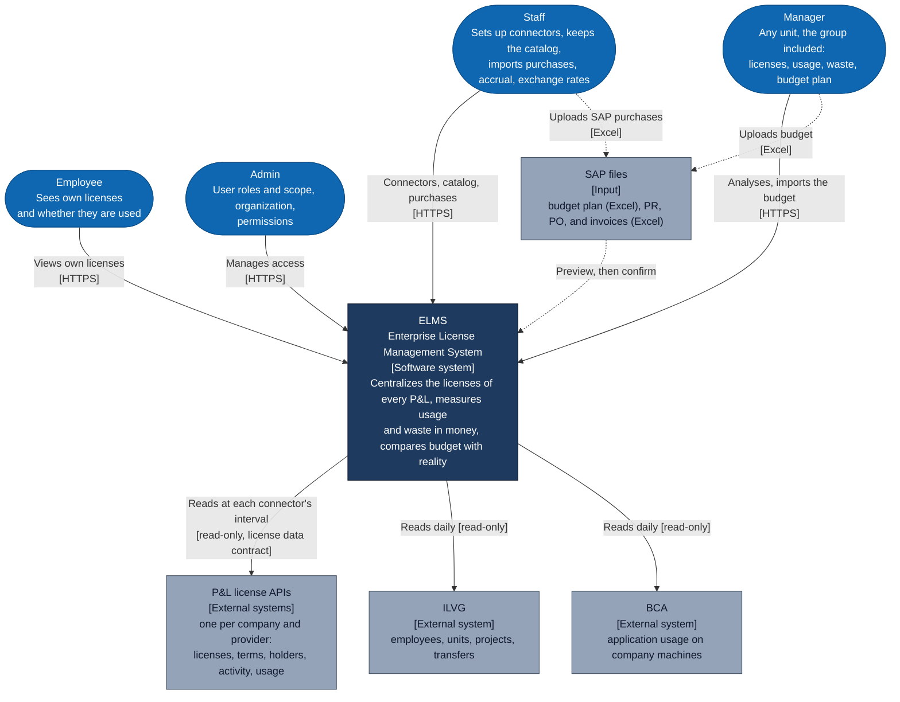
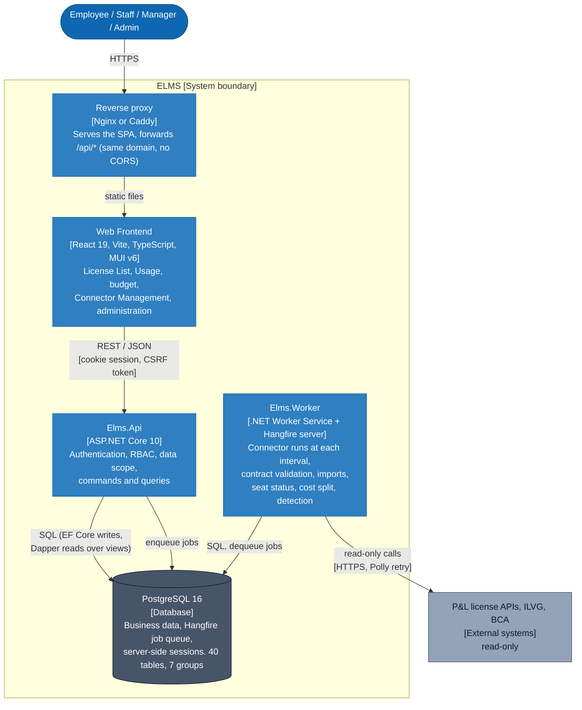
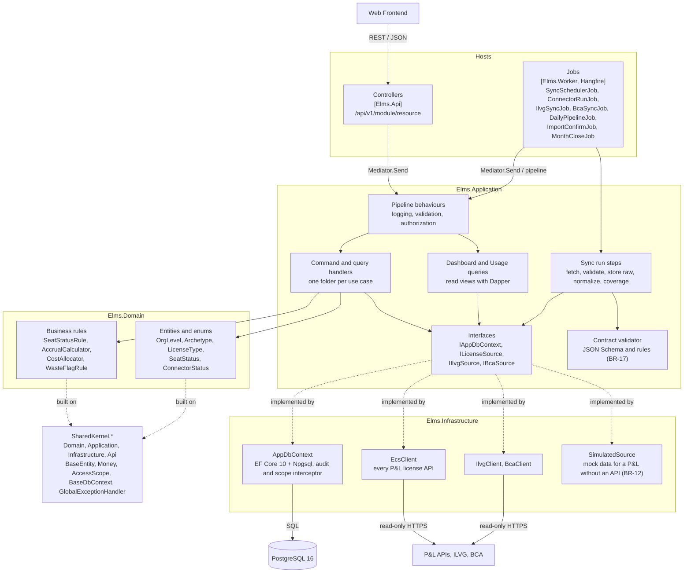
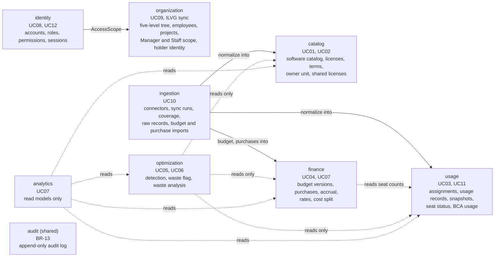
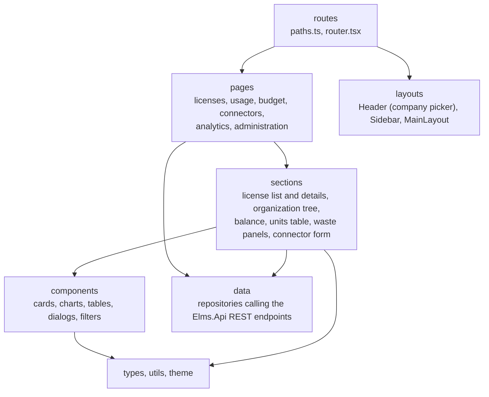
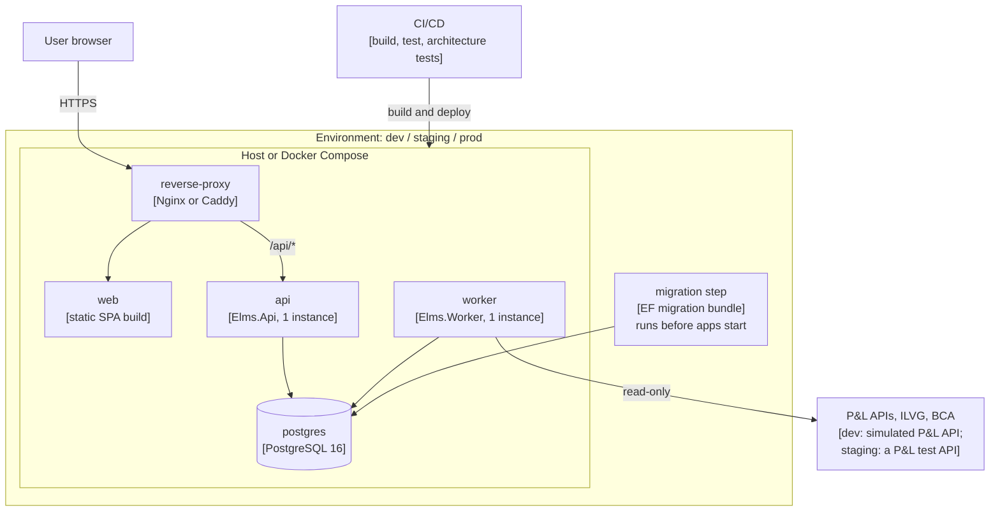

# 07 — C4 Architecture

> Aligned with the P&L API business model and the 12 use cases (November 2026).

The C4 model describes a system at four zoom levels. Each level answers one question for one audience:

| Level | Diagram | Question it answers | Audience |
|---|---|---|---|
| 1 | System Context | Who uses ELMS and which other systems does it touch? | Everyone, including non-technical readers |
| 2 | Container | What are the deployable parts and how do they talk? | Developers, operations |
| 3 | Component | How is one container built inside? | Developers |
| 4 | Code | How is a component implemented? | Developers (see the repository, not this file) |

Two supplementary views follow the four levels: a **dynamic view** (the sync and daily pipeline) and a **deployment view**.

Diagrams use Mermaid flowcharts so they render in GitHub and GitLab Markdown. Notation: a person is a rounded shape, an external system is grey, the system boundary is a dashed frame, and every arrow is labelled with what flows and over which protocol.

## 1. Level 1 — System Context

ELMS is one system. It reads, for every P&L of the group, the licenses, holders, and usage that the P&L's own API returns; it takes employees and units from ILVG, application usage from BCA, the budget plan from an Excel export of SAP, and the purchases — PO lines for quantities and terms, invoices for cost — from another SAP export that Staff import, with a purchase made outside SAP entered by hand; and it shows each Manager, in money, what is planned, purchased, used, and wasted. It never changes anything at a source (BR-01).



### People

| Person | Role in ELMS | Data scope |
|---|---|---|
| Employee | `EMPLOYEE` — every employee | Own licenses only, across all their emails, without price or cost |
| Staff | `STAFF` — license management team | The companies assigned to them (the group for group-level Staff): connectors, sync, catalog, shared licenses, purchases, accrual, exchange rates; no usage or waste analysis |
| Manager | `MANAGER` — manager of a unit at any level, the group included | The units assigned to them and everything under them |
| Admin | `ADMIN` — system operator | User roles and data scope, organization, permissions; no license, usage, budget, or cost data (BR-14); accounts come from ILVG (BR-15) |

Each account has exactly one role (BR-15). The full capability matrix is in [Use cases](02-use-cases.md).

### External systems

| System | What ELMS takes | Delivery |
|---|---|---|
| P&L license API (one per company and provider) | Licenses, holders, last activity, active days, consumption | An API each P&L provides for its own data, in the license data contract (ECS, BR-17); read by one generic connector |
| ILVG | Employees, their unit in five levels, their projects, transfers | API, synced daily like a connector |
| BCA | Application usage per employee and day (fields assumed until its API is known) | API, synced daily like a connector |
| SAP | Budget plan per unit, license, and month | Excel export in the ELMS template, imported by Managers (UC04) |
| SAP purchases | PO lines: purchased quantity and term; invoices: the cost that becomes Purchased | Excel export in the ELMS template, imported by Staff each month; a purchase made outside SAP entered by hand (UC04) |

Behind its API, each P&L reads its providers (Microsoft 365, Atlassian, Adobe, GitHub, AI services …); ELMS never calls a provider directly. A P&L whose API is not ready yet has simulated data, labelled as mock on every screen (BR-12). Data fields of each source: [Data fields research](09-data-fields-research.md).

### Out of scope at this level

ELMS does not assign, revoke, buy, or cancel anything at a provider, does not let anyone enter licenses, holders, or usage by hand, and does not send e-mail or chat notifications ([research §7](01-research-top-down.md)).

## 2. Level 2 — Container

A container is something that runs or stores data. ELMS is one monolith deployed as **two processes** that share **one PostgreSQL database**. The API serves users; every slow operation (connector syncs, imports, seat status, cost split, detection) is queued in PostgreSQL and run by the worker, so no Redis or message broker is required.



### Containers

| Container | Technology | Responsibility |
|---|---|---|
| Web Frontend | React 19, Vite, TypeScript, MUI v6, Tailwind CSS v4, ApexCharts, React Router v7 | The screens of [Information architecture](04-information-architecture-manager.md): License List, Usage and waste analysis, budget, Connector Management and sync monitoring, administration |
| Elms.Api | ASP.NET Core 10 (.NET 10 LTS), controllers, command/query handlers | Serves users only: three checks per request (authentication, RBAC, data scope), validation, audit, idempotent import confirm |
| Elms.Worker | .NET Worker Service, Hangfire server | Runs every slow job; the only process that calls the P&L APIs, ILVG, and BCA, and decrypts connector credentials |
| PostgreSQL 16 | PostgreSQL, Hangfire.PostgreSql | One database for business data, the job queue, and sessions; one schema per module (see [`elms.dbml`](database/elms.dbml)) |
| Reverse proxy | Nginx or Caddy | Serves the SPA and forwards `/api/*` to `Elms.Api` on the same domain |

### Relationships

| From → To | Protocol | Carries |
|---|---|---|
| Browser → Reverse proxy | HTTPS | Page loads and API calls |
| Web Frontend → Elms.Api | REST / JSON, `HttpOnly` `Secure` `SameSite=Lax` cookie, CSRF token | Every business request; OpenAPI contract with a generated TypeScript client |
| Elms.Api → PostgreSQL | SQL over Npgsql | Writes through EF Core; dashboard reads through Dapper over views; enqueue of jobs |
| Elms.Worker → PostgreSQL | SQL over Npgsql | Reads and writes data; dequeues jobs |
| Elms.Worker → P&L APIs, ILVG, BCA | HTTPS (`IHttpClientFactory` + Polly) | Read-only calls; credentials are write-only after saving and encrypted with Data Protection (BR-18) |

The API never calls a source, and the worker never serves a user request.

### Decisions behind this level

| Decision | Alternative | Revisit when |
|---|---|---|
| One monolith, two processes | Microservices | Several teams edit one codebase, or ingestion needs its own scaling |
| PostgreSQL only (data, queue, session) | Add Redis or a message broker | The job queue becomes a bottleneck |
| Scheduled sync at each connector's interval (6 hours by default) | Realtime events | P&L APIs push changes and users need same-hour numbers |
| Cookie session | JWT | A mobile app or third-party API is needed |

Non-functional assumptions: about 30 P&Ls, 5,000 accounts, 100–300 daily users, 500 licenses, and 150,000 assignments; dashboards p95 under 1 s; license data as old as each connector's interval; 99.5 % availability in business hours. Source: [05 §2](05-folder-structure.md).

## 3. Level 3 — Component

### 3.1 Elms.Api and Elms.Worker

Both processes are built from the same Clean Architecture layers and run the same handlers. `Controllers/` exist only in the Api and `Jobs/` only in the Worker. Modules are feature folders inside each layer, not separate projects; boundaries are kept by namespaces and architecture tests (NetArchTest).



Dependency direction: `Api / Worker → Infrastructure → Application → Domain → SharedKernel`. Domain depends on nothing; Application depends on interfaces only; only Infrastructure references EF Core, Npgsql, and the HTTP clients.

Request flow: controller → `Mediator.Send` → behaviours (log, validate, authorize) → handler → `IAppDbContext` (filtered by `AccessScope`) → interceptor writes the audit log. Worker flow: Hangfire job → handler or pipeline step → `ILicenseSource` / `IAppDbContext`.

### 3.2 Business modules

Eight business modules follow the mind-map branches, plus a shared `audit` module. A module owns its tables (one Postgres schema each) and other modules read them only through a service or a public view.



Dependency rules, enforced by NetArchTest (from [05 §4.1](05-folder-structure.md)):

- `analytics` may read every module; no module depends on `analytics`.
- `optimization` reads `usage`, `finance`, and `catalog` and never writes to them.
- `finance` reads seat counts from `usage` to split the cost; `usage` never reads money.
- `ingestion` writes raw data, then calls `catalog`, `usage`, and `finance` to normalize; no business module calls a source directly.
- Only `identity` and `organization` decide access; other modules receive an `AccessScope`.
- Every module writes through the audit interceptor, which is why `audit` has no drawn arrows.

Every P&L answers in the license data contract (ECS), so one client reads every usage connector through `ILicenseSource`: `fetchLicenses`, `fetchTerms`, `fetchHolders`, `fetchActivity`, `fetchUsage(period)`. Each dataset arrives in an envelope that carries `completeness`, `granularity`, and `total_count`. A dataset a P&L cannot supply is `NotSupported` (HTTP 501, `ecs:not-supported`), never an empty list, so "no source" stays distinct from "source reports zero" (BR-04). Details: [Connector standard](06-connector-standard.md).

### 3.3 Web Frontend



Call flow: `routes → pages → sections → components → types / utils`. The target screens and their API calls are in [Information architecture](04-information-architecture-manager.md). The code in `src/frontend` today still follows the previous model (category budgets, no Usage or Connector screens).

### 3.4 PostgreSQL

Not drawn as components: the container is described by its seven table groups (organization and access, software catalog and licenses, collection pipeline, holders and usage, budget and expenses, optimization, audit). See [Database design](database/README.md) for the ERDs.

## 4. Level 4 — Code

C4 level 4 is left to the source, because a code-level diagram drawn by hand goes stale quickly.

| Component | Where to look |
|---|---|
| Frontend components | `src/frontend/` (one barrel `index.ts` per folder) |
| Backend solution layout | [05 §4.2](05-folder-structure.md); the solution lives in `src/backend/` |
| Entities and fields | [`database/tables.md`](database/tables.md), [`database/elms.dbml`](database/elms.dbml) |
| Reference DDL | [`database/schema.sql`](database/schema.sql) |
| Pure business rules | `Elms.Domain/Rules` (BR-03 seat status, BR-06 allocation, BR-09 and BR-22 Purchased / Used / Wasted, BR-20 waste flag, BR-23 accrual) |

## 5. Dynamic view — the daily pipeline

Data enters ELMS in two rhythms. `SyncSchedulerJob` checks every minute which connectors are due and starts a `ConnectorRunJob` for each, at that connector's interval; ILVG and BCA run daily. Once the day's syncs are done, `DailyPipelineJob` turns the data into the figures every screen reads, so dashboards show one consistent version of the numbers (G7).

```mermaid
sequenceDiagram
    autonumber
    participant S as SyncSchedulerJob (Worker)
    participant C as ConnectorRunJob
    participant V as Contract validator
    participant P as P&L API (read-only)
    participant D as PostgreSQL
    participant J as DailyPipelineJob
    participant A as Elms.Api
    participant M as Manager

    S->>D: Find connectors whose interval has elapsed
    alt connector paused
        S->>D: sync_runs = paused (nothing read, period stays Unknown)
    else connector due
        S->>C: start run (distributed lock per connector)
        C->>P: fetchLicenses / fetchTerms / fetchHolders / fetchActivity / fetchUsage
        alt success
            P-->>C: records
            C->>V: validate (schema, total_count, duplicates)
            V->>D: store raw_records, normalize (upsert by source key + data date)
            V->>D: collection_coverage = complete or partial
        else retries exhausted, or validation fails the run
            C->>D: sync_runs = failed, nothing written, figures stay Unknown (never 0)
        end
    end
    J->>D: seat status over 30 days with grace (BR-03), days used (BR-32)
    J->>D: daily snapshots; cost split of open months into Used, Wasted, Not evaluated (BR-06, BR-22)
    J->>D: detection (unused, inactive, overuse, leaver), waste flag above 20 % (BR-20)
    J->>D: REFRESH MATERIALIZED VIEW CONCURRENTLY, bump dataVersion
    M->>A: open License List or Usage
    A->>D: read views (Dapper), scoped to the Manager's units
    A-->>M: figures with dataDate and data source (BR-12)
```

Other jobs: `IlvgSyncJob` (daily; also creates the account of a new employee and disables a leaver's, BR-15) and `BcaSyncJob` (daily); `ImportConfirmJob` writes a confirmed budget version or purchase file in one transaction, once per preview key (BR-33); `MonthCloseJob` closes, on day 10, the previous month of every company Staff have not closed (UC04). Records that fail a check are rejected one by one, with the reason kept in `raw_records.normalize_error`; a record count that does not match `total_count` fails the whole run. All jobs are idempotent, never overlap, and run as `SystemUser`, so the audit actor is `system`.

## 6. Deployment view



| Topic | Decision |
|---|---|
| Instances | One Api and one Worker; Hangfire's distributed lock prevents duplicate jobs |
| Migrations | A separate pipeline step before the apps start, never at application startup |
| Environments | dev (Docker Compose: postgres, api, worker, web, a simulated P&L API), staging (a P&L test API), prod |
| Operations | `/health`, structured logs with `request_id` (Serilog / OpenTelemetry), Hangfire dashboard for Admin only, alert when a connector stays `Failed` or `Delayed` for a day |
| Backup targets | RPO ≤ 24 h, RTO ≤ 4 h (assumption, [05 §2](05-folder-structure.md)) |

## 7. Cross-cutting concerns

| Concern | Where it applies | Rule |
|---|---|---|
| Authentication | Api | Server-side cookie session via ASP.NET Core Identity; the account must be active; lockout after 5 failures for 15 minutes (BR-16); disabling a user or changing a role deletes their sessions at once |
| Authorization | Api | Three independent checks per request: authentication (401), RBAC policy (403), data scope via `AccessScope` global query filter (404 outside scope). Hiding a button is not protection (BR-14) |
| Data scope | Api, Worker | Managers see their units and everything under them, the group for a Manager of the group; Staff see their companies; Admin reads users, roles, permissions, and the hierarchy only; Employees get a dedicated DTO without price or cost (BR-14) |
| Idempotency | Api, Worker | Syncs upsert by source key and data date; a budget confirm is keyed by its preview key; the same budget file again is `unchanged` (BR-33) |
| Audit | Api, Worker | An interceptor writes who, old value, new value, time, and reason to an append-only log (BR-13) |
| Missing data | Everywhere | `null` / `Unknown`, never 0 (BR-04); every figure carries its source (BR-12); complete months only (BR-28) |
| Caching | Api | `HybridCache`, L1 in-memory; Redis only when the API scales to several instances. Keys include the user's scope; dashboard keys include `dataVersion` |
| Secrets | Worker | Connector credentials: read-only scope (BR-01), write-only after saving and never shown or exported (BR-18), encrypted with Data Protection, decrypted only by the worker |
| Errors | Api | One global `IExceptionHandler` returns `ProblemDetails` (RFC 9457) |

**Related:** [Connector standard](06-connector-standard.md) · [Folder structure and architecture](05-folder-structure.md) · [Database design](database/README.md) · [Use cases](02-use-cases.md)
