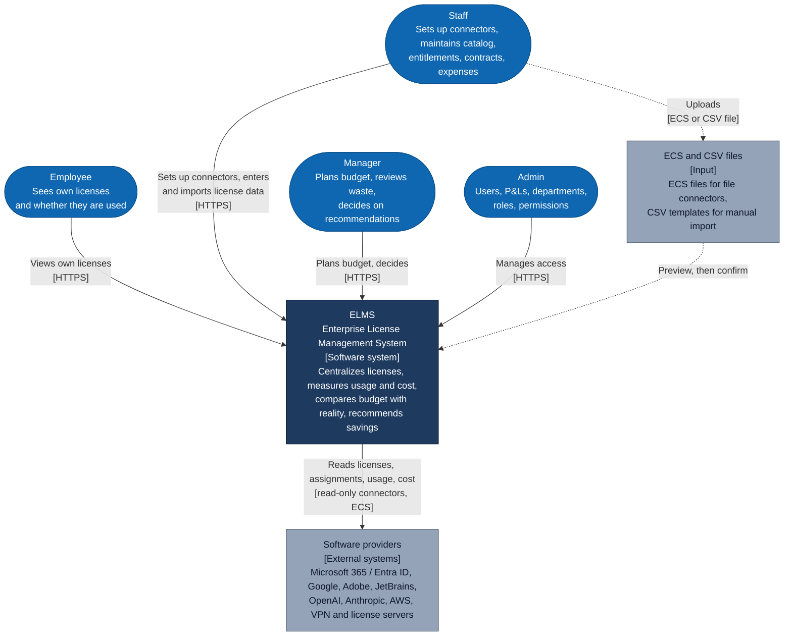
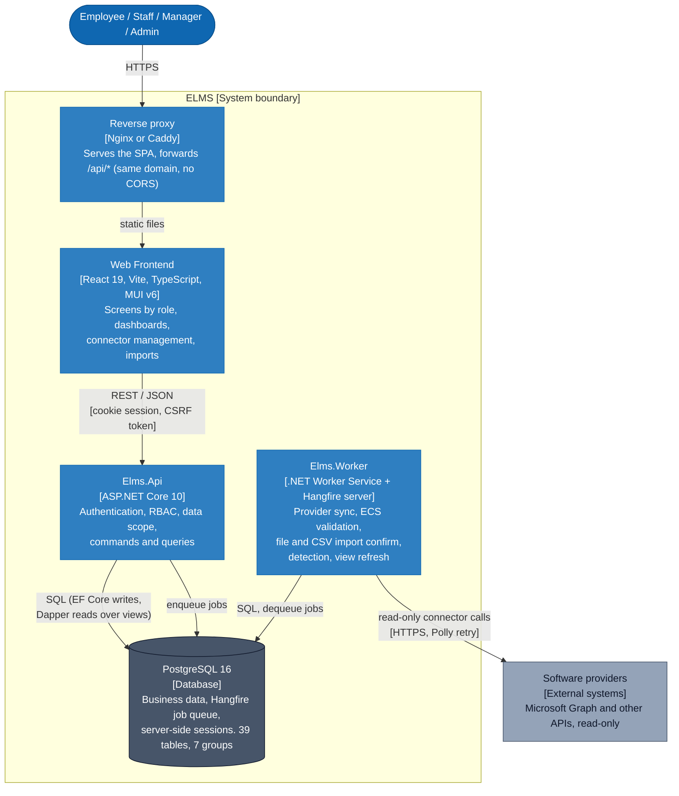
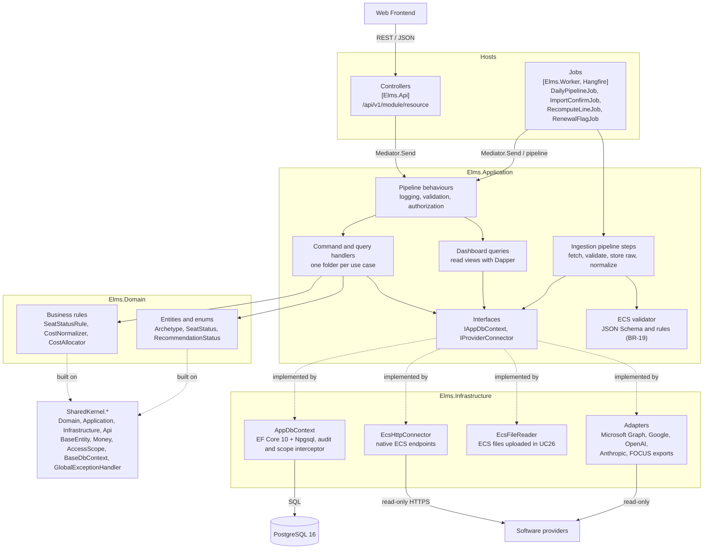
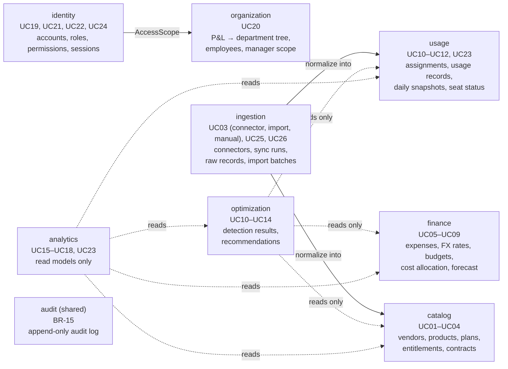
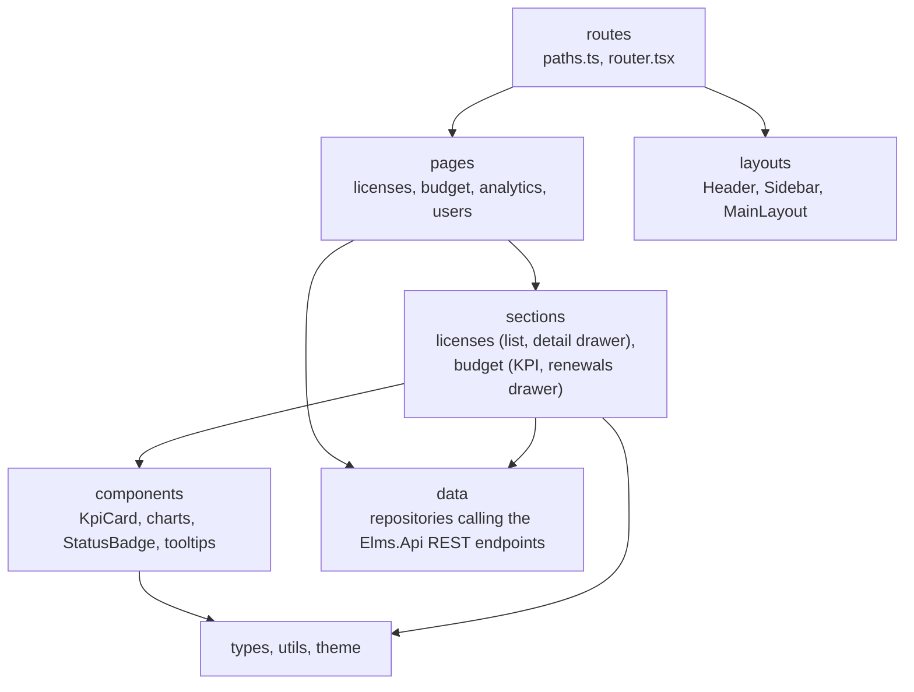
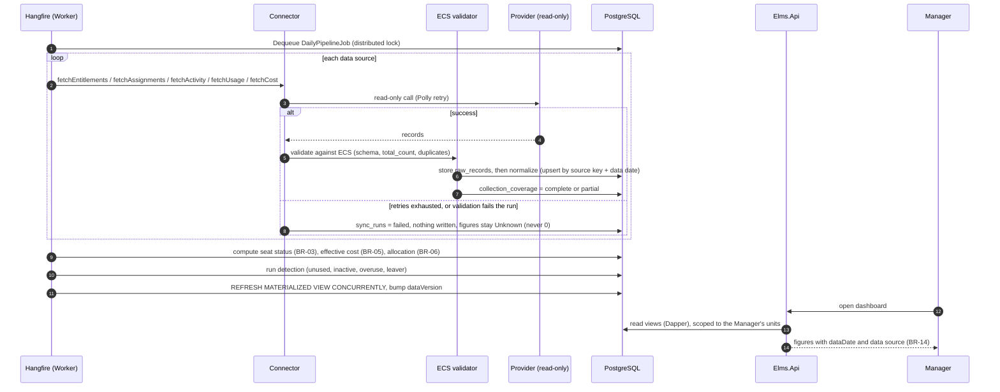
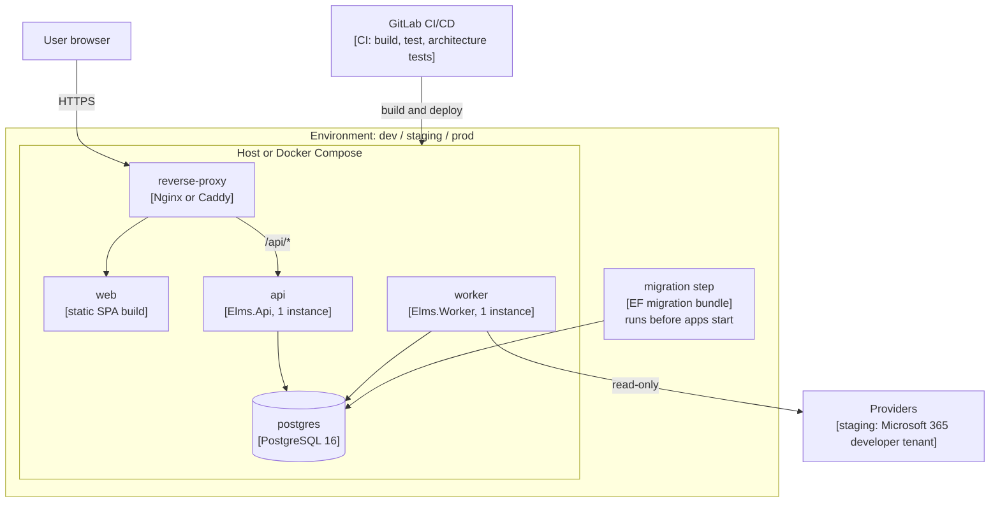

# 07 — C4 Architecture

The C4 model describes a system at four zoom levels. Each level answers one question for one audience:

| Level | Diagram | Question it answers | Audience |
|---|---|---|---|
| 1 | System Context | Who uses ELMS and which other systems does it touch? | Everyone, including non-technical readers |
| 2 | Container | What are the deployable parts and how do they talk? | Developers, operations |
| 3 | Component | How is one container built inside? | Developers |
| 4 | Code | How is a component implemented? | Developers (see the repository, not this file) |

Two supplementary views follow the four levels: a **dynamic view** (the daily pipeline) and a **deployment view**.

Diagrams use Mermaid flowcharts so they render in GitLab Markdown. Notation: a person is a rounded shape, an external system is grey, the system boundary is a dashed frame, and every arrow is labelled with what flows and over which protocol.

## 1. Level 1 — System Context

ELMS is one system. It reads license, assignment, usage, and cost data from software providers, combines it with data entered by the license team, and shows managers where money is wasted. It never changes anything on a provider (BR-01).

### People

| Person | Role in ELMS | Data scope |
|---|---|---|
| Employee | `EMPLOYEE` — every employee | Own licenses only, without price or cost |
| Staff | `STAFF` — license management team | Every license and expense; sets up and monitors connectors; no budget, no dashboards |
| Manager | `MANAGER` — manager of a P&L or department | Only the units assigned to them |
| Admin | `ADMIN` — system operator | Access settings only; sees connector status, counts, and error codes, but no license, budget, or cost data (BR-16) |

Each account has exactly one role (BR-17). The full capability matrix is in [Use cases](02-use-cases.md).

### External systems

| System | What ELMS takes | Delivery | Automation (from [research §4.4](01-research-top-down.md)) |
|---|---|---|---|
| Microsoft 365 / Entra ID | Plans and quantities, assigned licenses, activity, last sign-in | Adapter over Microsoft Graph, read-only | High (first connector) |
| Usage and cost APIs of OpenAI, Anthropic | Token / credit consumption, cost | Adapter over the provider API, read-only | High |
| AWS, Azure, Google Cloud | Cost (FOCUS export) | Adapter or file | High |
| License servers, VPN | Peak concurrent sessions (denials are not collected in v1) | Adapter reading logs, or an agent inside the company | Medium |
| MDM / endpoint agents | Devices | File or adapter | Low |
| Inventory scripts, contracts | Cores, deployed units, contract terms | ECS file, or manual entry | Very low |
| In-house applications, resellers, local vendors | Their own license data | Native ECS endpoint, where ELMS can require it | Depends on the provider |

Every connector hands ELMS data in the ELMS Connector Standard (ECS, see the [Connector standard proposal](06-connector-standard.md), BR-19), delivered one of three ways: **native** (the provider exposes an ECS endpoint), **adapter** (ELMS writes a connector that maps the provider's own API to ECS), or **file** (an ECS file uploaded in UC26). One validator checks all three. A license line without a connector is filled by Staff through manual entry or CSV import (UC03), so a provider is never left out.

### Out of scope at this level

ELMS does not assign or revoke licenses on a provider, does not buy or cancel contracts, and does not send e-mail or chat notifications ([research §7](01-research-top-down.md)).

## 2. Level 2 — Container

A container is something that runs or stores data. ELMS is one monolith deployed as **two processes** that share **one PostgreSQL database**. The API serves users; every slow operation (provider calls, large imports, detection) is queued in PostgreSQL and run by the worker, so no Redis or message broker is required.

### Containers

| Container | Technology | Responsibility |
|---|---|---|
| Web Frontend | React 19, Vite, TypeScript, MUI v6, Tailwind CSS v4, ApexCharts, React Router v7 | Role-based screens, dashboards, connector set-up and sync monitoring (UC03, UC25, UC26), CSV and ECS file upload with preview |
| Elms.Api | ASP.NET Core 10 (.NET 10 LTS), controllers, command/query handlers | Serves users only: three checks per request (authentication, RBAC, data scope), validation, audit |
| Elms.Worker | .NET Worker Service, Hangfire server | Runs every slow job and validates ECS payloads; the only process that calls providers and decrypts connector credentials |
| PostgreSQL 16 | PostgreSQL, Hangfire.PostgreSql | One database for business data, the job queue, and sessions; one schema per module (see [`elms.dbml`](database/elms.dbml)) |
| Reverse proxy | Nginx or Caddy | Serves the SPA and forwards `/api/*` to `Elms.Api` on the same domain |

### Relationships

| From → To | Protocol | Carries |
|---|---|---|
| Browser → Reverse proxy | HTTPS | Page loads and API calls |
| Web Frontend → Elms.Api | REST / JSON, `HttpOnly` `Secure` `SameSite=Lax` cookie, CSRF token | Every business request; OpenAPI contract with a generated TypeScript client |
| Elms.Api → PostgreSQL | SQL over Npgsql | Writes through EF Core; dashboard reads through Dapper over views; enqueue of jobs |
| Elms.Worker → PostgreSQL | SQL over Npgsql | Reads and writes data; dequeues jobs |
| Elms.Worker → Providers | HTTPS (native ECS endpoints, provider APIs and SDKs through adapters, `IHttpClientFactory` + Polly) | Read-only calls; credentials are read-only scope and encrypted with Data Protection |

The API never calls a provider, and the worker never serves a user request.

### Decisions behind this level

| Decision | Alternative | Revisit when |
|---|---|---|
| One monolith, two processes | Microservices | Several teams edit one codebase, or ingestion needs its own scaling |
| PostgreSQL only (data, queue, session) | Add Redis or a message broker | The job queue becomes a bottleneck |
| Daily scheduled sync | Realtime events | Providers offer usage webhooks and users need same-day numbers |
| Cookie session | JWT | A mobile app or third-party API is needed |

Non-functional assumptions: about 5,000 accounts, 100–300 daily users, about 200 license lines, about 150,000 assignments; dashboards p95 under 1 s; provider data up to 1 day old; 99.5 % availability in business hours. Source: [05 §2](05-folder-structure.md).

## 3. Level 3 — Component

### 3.1 Elms.Api and Elms.Worker

Both processes are built from the same Clean Architecture layers and run the same handlers. `Controllers/` exist only in the Api and `Jobs/` only in the Worker. Modules are feature folders inside each layer, not separate projects; boundaries are kept by namespaces and architecture tests (NetArchTest).

Dependency direction: `Api / Worker → Infrastructure → Application → Domain → SharedKernel`. Domain depends on nothing; Application depends on interfaces only; only Infrastructure references EF Core, Npgsql, and the Graph SDK.

Request flow: controller → `Mediator.Send` → behaviours (log, validate, authorize) → handler → `IAppDbContext` (filtered by `AccessScope`) → interceptor writes the audit log. Worker flow: Hangfire job → handler or pipeline step → `IProviderConnector` / `IAppDbContext`.

### 3.2 Business modules

Eight business modules follow the six mind-map branches, plus a shared `audit` module. A module owns its tables (one Postgres schema each) and other modules read them only through a service or a public view.

Dependency rules, enforced by NetArchTest (from [05 §4.1](05-folder-structure.md)):

- `analytics` may read every module; no module depends on `analytics`.
- `optimization` reads `usage`, `finance`, and `catalog` and never writes to them.
- `ingestion` writes raw data, then calls `usage` and `catalog` to normalize; no business module calls a provider directly.
- Only `identity` and `organization` decide access; other modules receive an `AccessScope`.
- Every module writes through the audit interceptor, which is why `audit` has no drawn arrows.

Connectors are plugins behind one interface, `IProviderConnector`: `fetchEntitlements`, `fetchAssignments`, `fetchActivity`, `fetchUsage(period)`, `fetchCost(period)`. What they return is the ELMS Connector Standard (ECS): six datasets (`entitlements`, `subjects`, `assignments`, `activity`, `usage`, `costs`) inside an envelope that carries `completeness`, `granularity`, and `total_count`. A dataset a provider cannot supply is `NotSupported` (HTTP 501, `ecs:not-supported`), never an empty list, so "no source" stays distinct from "source reports zero" (BR-04). Details: [Connector standard](06-connector-standard.md).

### 3.3 Web Frontend

Call flow: `routes → pages → sections → components → types / utils`. Screens: `/manager/licenses`, `/manager/licenses/:licenseId`, `/manager/analytics`, `/manager/analytics/budget`, `/admin/users`. Screen details are in [Information architecture](04-information-architecture-manager.md).

### 3.4 PostgreSQL

Not drawn as components: the container is described by its seven table groups (organization and access, license catalog, collection pipeline, holders and usage, budget and expenses, optimization, audit). See [Database design](database/README.md) for the ERDs.

## 4. Level 4 — Code

C4 level 4 is left to the source, because a code-level diagram drawn by hand goes stale quickly.

| Component | Where to look |
|---|---|
| Frontend components | `src/frontend/` (one barrel `index.ts` per folder) |
| Backend solution layout | [05 §4.2](05-folder-structure.md); the solution lives in `src/backend/` |
| Entities and fields | [`database/tables.md`](database/tables.md), [`database/elms.dbml`](database/elms.dbml) |
| Reference DDL | [`database/schema.sql`](database/schema.sql) |
| Pure business rules | `Elms.Domain/Rules` (BR-03 seat status, BR-05 cost normalization, BR-06 allocation, BR-09 reconciliation) |

## 5. Dynamic view — the daily pipeline

`DailyPipelineJob` runs at 02:00 every day in `Elms.Worker`. It is the main way provider data enters ELMS and the reason dashboards show one consistent version of the numbers (G7).

Other jobs: `ImportConfirmJob` writes a confirmed CSV or ECS file in one transaction; `RecomputeLineJob` recomputes one entitlement line after an edit; `RenewalFlagJob` flags "Renewal soon" and "Notice period passed" (UC04). Records that fail a check are rejected one by one, with the reason kept in `raw_records.normalize_error`; a record count that does not match `total_count` fails the whole run. All jobs are idempotent, never overlap, and run as `SystemUser`, so the audit actor is `system`.

## 6. Deployment view

| Topic | Decision |
|---|---|
| Instances | One Api and one Worker; Hangfire's distributed lock prevents duplicate jobs |
| Migrations | A separate pipeline step before the apps start, never at application startup |
| Environments | dev (Docker Compose: postgres, api, worker, web), staging (Microsoft 365 developer tenant), prod |
| Operations | `/health`, structured logs with `request_id` (Serilog / OpenTelemetry), Hangfire dashboard for Admin only, alert when a source fails two days in a row |
| Backup targets | RPO ≤ 24 h, RTO ≤ 4 h (assumption, [05 §2](05-folder-structure.md)) |

## 7. Cross-cutting concerns

| Concern | Where it applies | Rule |
|---|---|---|
| Authentication | Api | Server-side cookie session via ASP.NET Core Identity; the account must be `ACTIVE`; lockout after 5 failures for 15 minutes (BR-18); disabling a user or changing a role deletes their sessions at once |
| Authorization | Api | Three independent checks per request: authentication (401), RBAC policy (403), data scope via `AccessScope` global query filter (404 outside scope). Hiding a button is not protection (BR-16) |
| Data scope | Api, Worker | Managers see only their P&Ls or departments; Employees get a dedicated DTO without price or cost; Admin sees connector status only, not record contents or connector settings (BR-16) |
| Audit | Api, Worker | An interceptor writes who, old value, new value, time, and reason to an append-only log (BR-15) |
| Missing data | Everywhere | `null` / `Unknown`, never 0 (BR-04); every figure carries source and confidence (BR-14) |
| Caching | Api | `HybridCache`, L1 in-memory; Redis only when the API scales to several instances. Keys include the user's scope; dashboard keys include `dataVersion` |
| Secrets | Worker | Connector credentials: read-only scope (BR-01), write-only after saving and never shown or exported (BR-20), encrypted with Data Protection, decrypted only by the worker |
| Errors | Api | One global `IExceptionHandler` returns `ProblemDetails` (RFC 9457) |

**Related:** [Connector standard](06-connector-standard.md) · [Folder structure and architecture](05-folder-structure.md) · [Database design](database/README.md) · [Use cases](02-use-cases.md)
