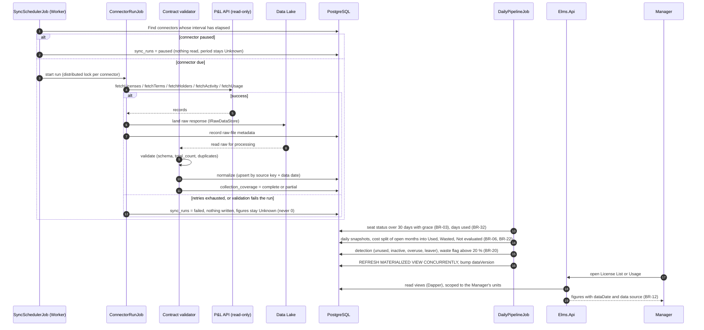

# 6. Runtime View

## 6.1 Daily pipeline

Data enters ELMS in two rhythms. `SyncSchedulerJob` checks every minute which connectors are due and starts a `ConnectorRunJob` for each, at that connector's interval; ILVG and VinSOC run daily. Once the day's syncs are done, `DailyPipelineJob` turns the data into the figures every screen reads, so dashboards show one consistent version of the numbers (G7).

Other jobs: `IlvgSyncJob` (daily; also disables a leaver's account, BR-15) and `VinSocSyncJob` (daily); `ImportConfirmJob` writes a confirmed budget version or purchase file in one transaction, once per preview key (BR-33); `MonthCloseJob` closes, on day 10, the previous month of every company Staff have not closed (UC05). Records that fail a check are rejected one by one, with the reason kept in `raw_records.normalize_error`; a record count that does not match `total_count` fails the whole run. All jobs are idempotent, never overlap, and run as `SystemUser`, so the audit actor is `system`.

## 6.2 User scenarios

Login and role routing, viewing Usage for a scope, importing the budget plan, and creating a connector are drawn as sequence diagrams in [UML — Sequence diagrams](../uml/02-sequence-diagrams.md).
