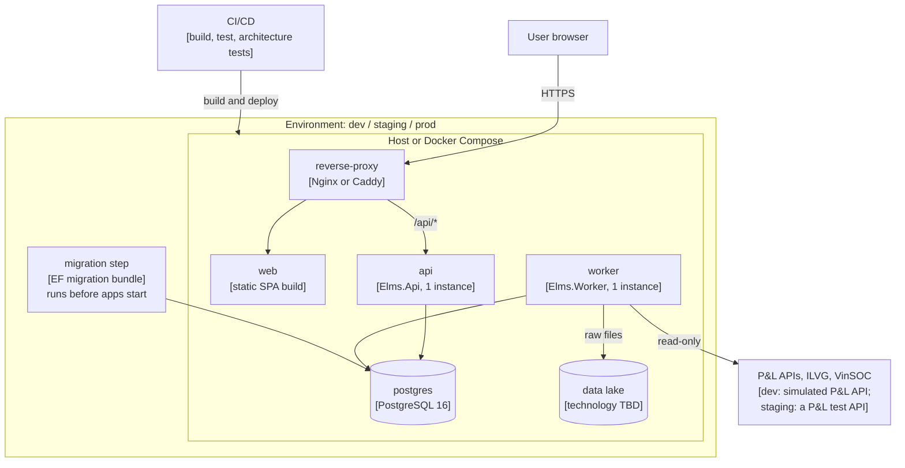

# 7. Deployment View

| Topic | Decision |
|---|---|
| Instances | One Api and one Worker; Hangfire's distributed lock prevents duplicate jobs |
| Migrations | A separate pipeline step before the apps start, never at application startup |
| Environments | dev (Docker Compose: postgres, a local data lake, api, worker, web, a simulated P&L API), staging (a P&L test API), prod |
| Operations | `/health`, structured logs with `request_id` (Serilog / OpenTelemetry), Hangfire dashboard for Admin only, alert when a connector stays `Failed` or `Delayed` for a day |
| Backup targets | RPO ≤ 24 h, RTO ≤ 4 h (assumption, [05 §2](../../05-code-structure.md)) for PostgreSQL; data lake retention to be set with its technology |
