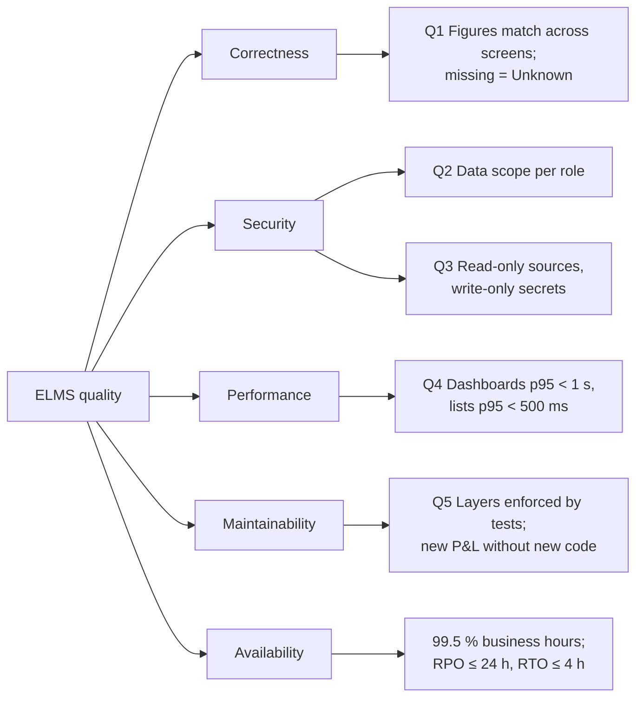

# 10. Quality Requirements

## 10.1 Quality tree

## 10.2 Scenarios

| # | Stimulus | Expected response |
|---|---|---|
| Q1 | A connector fails for a day | Its figures show `Unknown` and the connector `Failed` / `Delayed`; no screen shows 0 (BR-04, BR-29) |
| Q1 | A Manager opens License List and Usage for the same scope | Totals are equal; both carry the same `dataDate` |
| Q2 | A Manager calls an API for a unit outside their scope | `404`; nothing leaks in lists or exports |
| Q2 | An Admin calls a license or cost endpoint | `403`; no license, budget, or cost data returned (BR-14) |
| Q3 | Staff save a connector, then open it again | The secret is never returned; only "set" is shown (BR-18) |
| Q4 | 300 users open dashboards at 9:00 | p95 < 1 s from materialized views and cache |
| Q5 | A new P&L exposes the ECS contract | Staff add a connector; no deployment needed |

Load assumptions: ~30 P&Ls, ~5,000 accounts, 100–300 daily users, ~500 licenses, ~150,000 assignments ([Code structure §2](../../05-code-structure.md#2-solution-architecture)).
