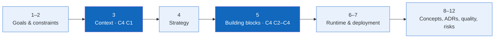

# ELMS — arc42 Architecture Documentation

> **Status:** TARGET (11 use cases, November 2026) · **Audience:** developers, reviewers, and maintainers

This documentation uses [arc42](https://arc42.org) to explain goals, constraints, decisions, and runtime scenarios. The [C4 diagrams](../c4/README.md) are the structural views; arc42 references them and does not define a second architecture.

## Contents

| Section | Content |
|---|---|
| 1 | [Introduction and Goals](01-introduction-and-goals.md) |
| 2 | [Architecture Constraints](02-architecture-constraints.md) |
| 3 | [Context and Scope](03-context-and-scope.md) |
| 4 | [Solution Strategy](04-solution-strategy.md) |
| 5 | [Building Block View](05-building-block-view.md) |
| 6 | [Runtime View](06-runtime-view.md) |
| 7 | [Deployment View](07-deployment-view.md) |
| 8 | [Cross-cutting Concepts](08-crosscutting-concepts.md) |
| 9 | [Architecture Decisions](09-architecture-decisions.md) |
| 10 | [Quality Requirements](10-quality-requirements.md) |
| 11 | [Risks and Technical Debt](11-risks-and-technical-debt.md) |
| 12 | [Glossary](12-glossary.md) |

## Baseline

- **Current:** UI demo [`UI/VFast_UI_v90.html`](../../../UI/VFast_UI_v90.html) and a React mock in `src/frontend/` built for the previous model.
- **Target:** React SPA → `Elms.Api` (ASP.NET Core 10) and `Elms.Worker` (Hangfire) → PostgreSQL 16.
- **Principle:** the backend is the trust boundary; sources are read-only; missing data is `Unknown`, never 0.

Related: [C4 C1 → C4](../c4/README.md) · [UML](../uml/README.md) · [Code structure](../../05-code-structure.md) · [Use cases](../../02-use-cases.md)
