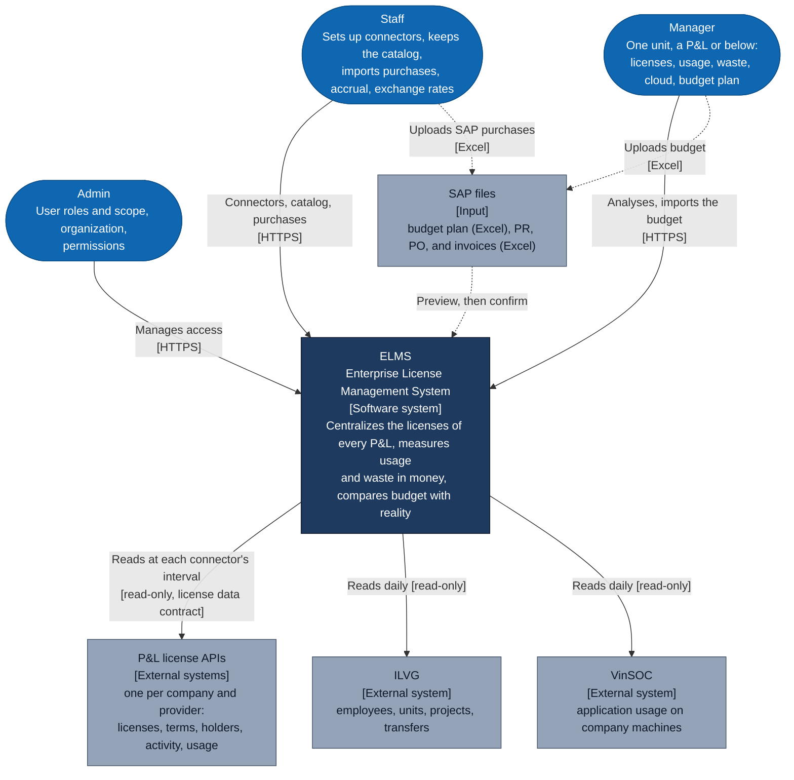

# C4 Level 1 — System Context

> **Status:** TARGET (11 use cases, November 2026) · **Audience:** everyone, including non-technical readers

ELMS is one system. It reads, for every P&L of the group, the licenses, holders, and usage that the P&L's own API returns; it takes employees and units from ILVG, application usage from VinSOC, the budget plan from an Excel export of SAP, and the purchases — PO lines for quantities and terms, invoices for cost — from another SAP export that Staff import, with a purchase made outside SAP entered by hand; and it shows each Manager, in money, what is planned, purchased, used, and wasted. It never changes anything at a source (BR-01).

## People

| Person | Role in ELMS | Data scope |
|---|---|---|
| Staff | `STAFF` — license management team, working for one Manager | The units of that Manager: connectors, sync, catalog, shared licenses, cloud account assignment, purchases, accrual, exchange rates; no usage or waste analysis |
| Manager | `MANAGER` — manager of one unit: a P&L, block, department, or project | Their unit and everything under it; can also do every task of Staff there |
| Admin | `ADMIN` — system operator | User roles and data scope, organization, permissions; no license, usage, budget, or cost data (BR-14); accounts for ILVG employees only (BR-15) |

Each account has exactly one role (BR-15). The full capability matrix is in [Use cases](../../02-use-cases.md).

## External systems

| System | What ELMS takes | Delivery |
|---|---|---|
| P&L license API (one per company and provider) | Licenses, holders, last activity, active days, consumption | An API each P&L provides for its own data, in the license data contract (ECS, BR-17); read by one generic connector |
| ILVG | Employees, their unit in four levels (P&L the highest), their projects, transfers | API, synced daily like a connector |
| VinSOC | Application usage per employee and day (fields assumed until its API is known) | API, synced daily like a connector |
| SAP | Budget plan per unit, license, and month | Excel export in the ELMS template, imported by Managers (UC05) |
| SAP purchases | PO lines: purchased quantity and term; invoices: the cost that becomes Purchased | Excel export in the ELMS template, imported by Staff each month; a purchase made outside SAP entered by hand (UC05) |

Behind its API, each P&L reads its providers (Microsoft 365, Atlassian, Adobe, GitHub, AI services …); ELMS never calls a provider directly. A P&L whose API is not ready yet has simulated data, labelled as mock on every screen (BR-12). Data fields of each source: [Data fields research](../../09-data-fields-research.md).

## Out of scope at this level

ELMS does not assign, revoke, buy, or cancel anything at a provider, does not let anyone enter licenses, holders, or usage by hand, and does not send e-mail or chat notifications ([research §7](../../01-research-top-down.md)).

---

[C4 index](README.md) · [C2 Container →](02-container.md)
