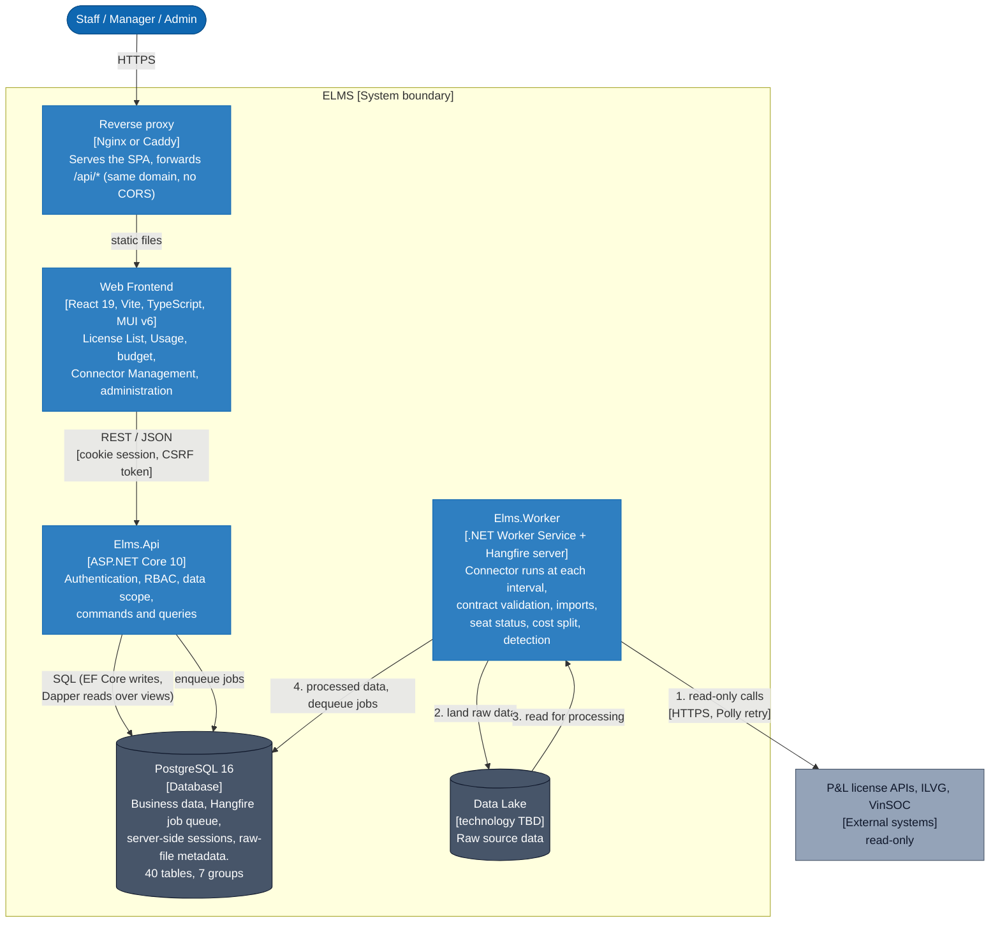

# C4 Level 2 — Container

> **Status:** TARGET · **Audience:** developers, operations

A container is something that runs or stores data. ELMS is one monolith deployed as **two processes** that share **one PostgreSQL database**, plus a **data lake** for raw source data. The API serves users; every slow operation (connector syncs, imports, seat status, cost split, detection) is queued in PostgreSQL and run by the worker, so no Redis or message broker is required.

## Containers

| Container | Technology | Responsibility |
|---|---|---|
| Web Frontend | React 19, Vite, TypeScript, MUI v6, Tailwind CSS v4, ApexCharts, React Router v7, axios | The screens of [Information architecture](../../04-information-architecture-manager.md): License List, Usage and waste analysis, budget, Connector Management and sync monitoring, administration |
| Elms.Api | ASP.NET Core 10 (.NET 10 LTS), controllers, command/query handlers | Serves users only: three checks per request (authentication, RBAC, data scope), validation, audit, idempotent import confirm |
| Elms.Worker | .NET Worker Service, Hangfire server | Runs every slow job; the only process that calls the P&L APIs, ILVG, and VinSOC, and decrypts connector credentials |
| PostgreSQL 16 | PostgreSQL, Hangfire.PostgreSql | One database for business data, the job queue, and sessions; one schema per module (see [`elms.dbml`](../../database/elms.dbml)) |
| Data Lake | Technology TBD | Raw data from every source, landed before processing; PostgreSQL keeps the metadata of each raw file and the result of each record. The schema does not model this yet: `raw_records.payload` still holds the raw payload (see [arc42 §11](../arc42/11-risks-and-technical-debt.md)) |
| Reverse proxy | Nginx or Caddy | Serves the SPA and forwards `/api/*` to `Elms.Api` on the same domain |

## Relationships

| From → To | Protocol | Carries |
|---|---|---|
| Browser → Reverse proxy | HTTPS | Page loads and API calls |
| Web Frontend → Elms.Api | REST / JSON, `HttpOnly` `Secure` `SameSite=Lax` cookie, CSRF token | Every business request; OpenAPI contract with a generated TypeScript client |
| Elms.Api → PostgreSQL | SQL over Npgsql | Writes through EF Core; dashboard reads through Dapper over views; enqueue of jobs |
| Elms.Worker → PostgreSQL | SQL over Npgsql | Reads and writes data; dequeues jobs |
| Elms.Worker → Data Lake | Store API (TBD) | Raw responses landed first, then read back to validate and normalize; nothing from a source goes straight into PostgreSQL |
| Elms.Worker → P&L APIs, ILVG, VinSOC | HTTPS (`IHttpClientFactory` + Polly) | Read-only calls; credentials are write-only after saving and encrypted with Data Protection (BR-18) |

The API never calls a source, and the worker never serves a user request.

## Decisions behind this level

| Decision | Alternative | Revisit when |
|---|---|---|
| One monolith, two processes | Microservices | Several teams edit one codebase, or ingestion needs its own scaling |
| PostgreSQL for data, queue, and session; no Redis or broker | Add Redis or a message broker | The job queue becomes a bottleneck |
| Raw source data in a data lake, processed data in PostgreSQL | Raw payloads in PostgreSQL | Lake technology chosen; volume or retention outgrows the database |
| Scheduled sync at each connector's interval (6 hours by default) | Realtime events | P&L APIs push changes and users need same-hour numbers |
| Cookie session | JWT | A mobile app or third-party API is needed |

Non-functional assumptions: about 30 P&Ls, 5,000 accounts, 100–300 daily users, 500 licenses, and 150,000 assignments; dashboards p95 under 1 s; license data as old as each connector's interval; 99.5 % availability in business hours. Source: [05 §2](../../05-code-structure.md).

---

[← C1 System Context](01-system-context.md) · [C4 index](README.md) · [C3 Component →](03-component.md)
