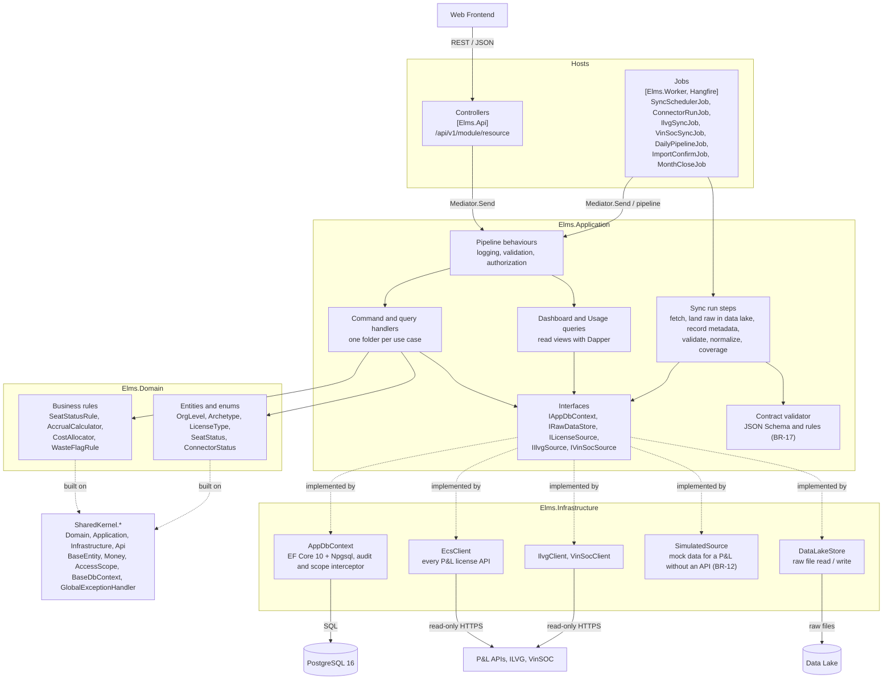
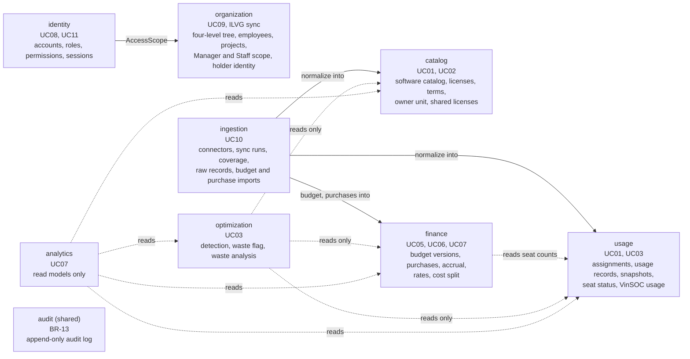
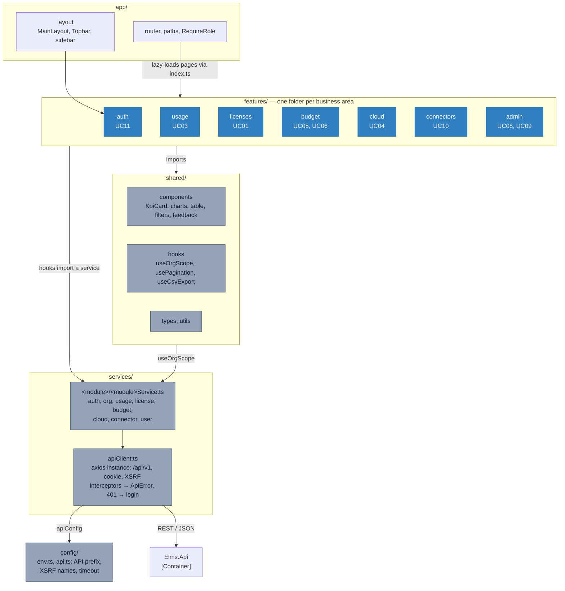

# C4 Level 3 — Component

> **Status:** TARGET · **Audience:** developers

## 1. Elms.Api and Elms.Worker

Both processes are built from the same Clean Architecture layers and run the same handlers. `Controllers/` exist only in the Api and `Jobs/` only in the Worker. Modules are feature folders inside each layer, not separate projects; boundaries are kept by namespaces and architecture tests (NetArchTest).

Dependency direction: `Api / Worker → Infrastructure → Application → Domain → SharedKernel`. Domain depends on nothing; Application depends on interfaces only; only Infrastructure references EF Core, Npgsql, the HTTP clients, and the data lake store.

Request flow: controller → `Mediator.Send` → behaviours (log, validate, authorize) → handler → `IAppDbContext` (filtered by `AccessScope`) → interceptor writes the audit log. Worker flow: Hangfire job → handler or pipeline step → `ILicenseSource` / `IAppDbContext`.

## 2. Business modules

Eight business modules follow the mind-map branches, plus a shared `audit` module. A module owns its tables (one Postgres schema each) and other modules read them only through a service or a public view.

Dependency rules, enforced by NetArchTest (from [Code structure §4.4](../../05-code-structure.md#44-modules)):

- `analytics` may read every module; no module depends on `analytics`.
- `optimization` reads `usage`, `finance`, and `catalog` and never writes to them.
- `finance` reads seat counts from `usage` to split the cost; `usage` never reads money.
- `ingestion` writes raw data, then calls `catalog`, `usage`, and `finance` to normalize; no business module calls a source directly.
- Only `identity` and `organization` decide access; other modules receive an `AccessScope`.
- Every module writes through the audit interceptor, which is why `audit` has no drawn arrows.

Every P&L answers in the license data contract (ECS), so one client reads every usage connector through `ILicenseSource`: `fetchLicenses`, `fetchTerms`, `fetchHolders`, `fetchActivity`, `fetchUsage(period)`. Each dataset arrives in an envelope that carries `completeness`, `granularity`, and `total_count`. A dataset a P&L cannot supply is `NotSupported` (HTTP 501, `ecs:not-supported`), never an empty list, so "no source" stays distinct from "source reports zero" (BR-04). Details: [Connector standard](../../06-connector-standard.md).

## 3. Web Frontend

Flow: `Page / Component → Feature Hook → Feature Service → apiClient → ASP.NET Core API`; inside a feature only `hooks/` import a service (`services/<module>/<module>Service.ts → apiClient.ts`). A feature imports `services/` and `shared/`, never another feature; `app/` is the only place that knows every feature. Target tree, routes, and role → feature rules: [Code structure §3](../../05-code-structure.md#3-frontend). Each feature zoomed in: [C4 Code](04-code.md#1-web-frontend). Screen catalog and API calls: [Information architecture](../../04-information-architecture-manager.md).

## 4. PostgreSQL

Not drawn as components: the container is described by its seven table groups (organization and access, software catalog and licenses, collection pipeline, holders and usage, budget and expenses, optimization, audit). See [Database design](../../database/README.md) for the ERDs.

---

[← C2 Container](02-container.md) · [C4 index](README.md) · [C4 Code →](04-code.md)
